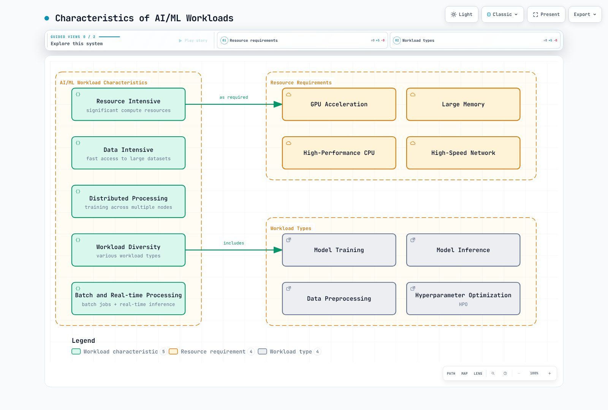
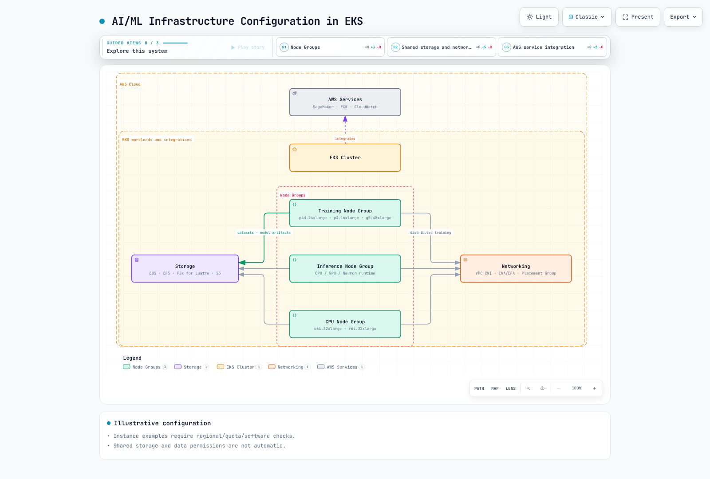
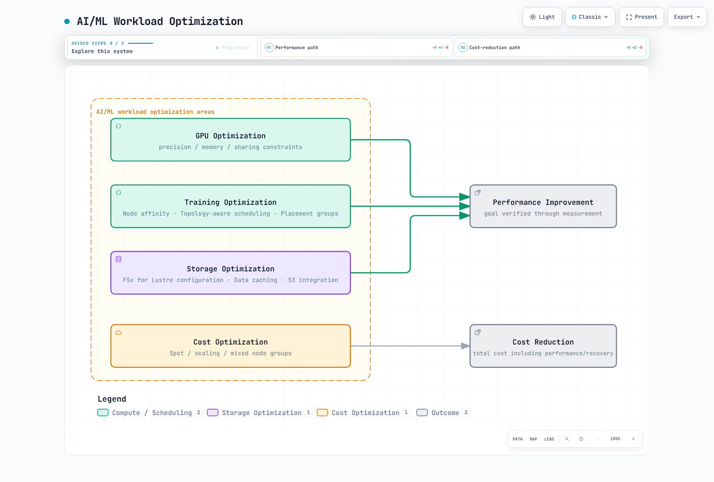

# AI/ML 工作负载

> **审查基线**：GPU Operator 26.7.2 / NVIDIA device plugin 0.20.1 / FSx CSI 1.11.0
> **最后更新**：October 16, 2026

Kubernetes 是运行 AI/ML 工作负载的强大平台。本章将介绍如何在 EKS 上运行 AI/ML 工作负载，并探讨最佳实践。

## AI/ML 工作负载的特点

与典型的应用程序工作负载相比，AI/ML 工作负载具有不同的特点：



[🔍 查看交互式图表](https://www.atomai.click/kubernetes-docs/archmaps/en-ai-ml-01-ai-ml-workloads-0.html)

1. **资源密集型**：需要大量计算资源，包括 GPU、高性能 CPU 和大容量内存。
2. **数据密集型**：需要快速访问大型数据集。
3. **分布式处理**：大规模模型训练需要跨多个节点进行分布式处理。
4. **工作负载多样性**：包括训练、推理和数据预处理等多种类型的工作负载。

## AI/ML 设计的差异

请根据所选框架、镜像、设备和 Kubernetes 版本验证支持情况：

### 1. 大语言模型（LLM）部署

大语言模型（LLM）是近年来 AI 领域最引人注目的技术之一。在 Kubernetes 上高效部署 LLM 时需要考虑以下关键因素：

- **模型分片**：将大型模型分布到多个 GPU 上
- **精度选择**：区分 FP16/BF16 计算与 INT8/INT4 量化，并验证准确性和设备支持情况
- **推理优化**：使用 vLLM、TensorRT、ONNX Runtime 等提升推理性能
- **扩展策略**：通过水平扩展提高吞吐量

### 2. AI 编排框架

用于管理 Kubernetes 上 AI/ML 工作负载的专用编排框架：

- **Kubeflow**：用于机器学习工作流的综合平台
- **Ray on Kubernetes**：分布式计算框架
- **KServe**：通过 Knative/Standard 等模式管理推理
- **Seldon Core**：模型服务和监控

### 3. GPU 共享与优化

用于高效利用 GPU 资源的技术：

- **MIG（Multi-Instance GPU）**：对 NVIDIA A100/H100 GPU 进行分区
- **共享方式**：MPS 和时间切片彼此不同，也不同于 MIG 的隔离和支持特性
- **动态分配**：根据需要动态分配 GPU 资源
- **GPU Operator**：在 Kubernetes 中自动化 GPU 管理

### 4. MLOps 与 GitOps 集成

将 DevOps 原则应用于 AI/ML 生命周期管理：

- **模型版本控制**：将模型版本管理与 Git 集成
- **CI/CD 流水线**：自动化模型训练和部署
- **A/B 测试和金丝雀发布**：实验性比较和逐步发布的目标/指标各不相同
- **监控和反馈循环**：监控模型性能并重新训练

### 5. 向量数据库集成

集成向量数据库以支持嵌入和语义搜索：

- **Pinecone**：托管式向量搜索
- **Milvus**：开源向量数据库
- **Faiss**：Facebook AI 的高效相似性搜索库
- **OpenSearch**：具备向量搜索功能的搜索引擎

批量推理和在线推理的延迟/吞吐量目标各不相同。

## EKS 中的 AI/ML 基础设施配置



[🔍 查看交互式图表](https://www.atomai.click/kubernetes-docs/archmaps/en-ai-ml-01-ai-ml-workloads-1.html)

### 节点类型选择

以下是容量示例，并非完整的当前实例目录或排名。请检查区域可用性、配额、CPU 架构、GPU 内存和软件兼容性：

1. **GPU 实例**：
   - p4d.24xlarge：8 个 NVIDIA A100 GPU，320GB GPU 内存
   - p3.16xlarge：8 个 NVIDIA V100 GPU，128GB GPU 内存
   - g5.xlarge~g5.48xlarge：NVIDIA A10G GPU，最多 8 个 GPU
   - g4dn.12xlarge：4 个 T4 GPU；g4dn.16xlarge：1 个 T4 GPU（实例大小和 GPU 数量并非单调递增）

2. **计算优化型实例**：
   - c6i.32xlarge：128 vCPU，256GB 内存
   - c7g.16xlarge：64 vCPU（AWS Graviton3），128GB 内存

3. **内存优化型实例**：
   - r6i.32xlarge：128 vCPU，1024GB 内存
   - x2gd.16xlarge：64 vCPU，1024GB 内存

4. **Inferentia 实例**：
   - inf1.24xlarge：16 个 AWS Inferentia 芯片，96 vCPU，192GB 内存

5. **Trainium 实例**：
   - trn1.32xlarge：16 个 AWS Trainium 芯片，128 vCPU，512GB 内存

### 存储配置

AI/ML 工作负载需要高性能存储：

1. **Amazon EBS**：
   - gp3：默认通用 SSD 存储
   - io2：高性能 SSD 存储
   - st1：吞吐量优化型 HDD 存储

2. **Amazon EFS**：
   - 多个节点需要访问共享数据时很有用
   - 性能模式：推荐使用 General Purpose；上一代 Max I/O 与 Elastic 吞吐量不兼容
   - 吞吐量模式：Elastic、Provisioned 和 Bursting；请结合工作负载需求、定价和限制进行比较

3. **Amazon FSx for Lustre**：
   - 高性能并行文件系统
   - 提供对大型数据集的快速访问
   - 通过 S3 集成简化数据导入和导出

4. **Amazon S3**：
   - 存储大型数据集
   - 存储训练数据和模型制品

### 网络配置

分布式训练的网络配置：

1. **集群置放群组**：
   - 尽量减少节点间的延迟
   - 将节点放置在同一个可用区内

2. **增强型联网**：
   - Elastic Network Adapter (ENA)
   - ENA Express
   - Elastic Fabric Adapter (EFA)

3. **VPC CNI 配置**：
   - 为大规模 Pod 部署管理 IP 地址
   - 配置辅助 IP 地址范围

## AI/ML 工作负载部署


[🔍 查看交互式图表](https://www.atomai.click/kubernetes-docs/archmaps/en-ai-ml-01-ai-ml-workloads-2.html)

### NVIDIA GPU Operator 和设备分配 {#nvidia-gpu-operator-and-device-allocation}

EKS AL2023 NVIDIA AMI 已包含驱动程序和 Container Toolkit，因此请在 GPU Operator 中禁用它们的安装。AMI 不包含 device plugin/DRA 驱动程序，这些需要进行配置。Bottlerocket NVIDIA AMI 包含 device plugin。避免安装重复的管理组件。

此命令会在本地**渲染**经过审查的 Operator chart。部署前请检查 ClusterPolicy/RBAC 和实际安装要求。

```bash
# AL2023 NVIDIA AMI profile: host driver/toolkit are already installed.
helm repo add nvidia https://helm.ngc.nvidia.com/nvidia
helm repo update nvidia
helm template gpu-operator nvidia/gpu-operator \
  --version v26.7.2 --namespace gpu-operator \
  --set driver.enabled=false --set toolkit.enabled=false \
  > gpu-operator.rendered.yaml
```

NVIDIA 扩展资源为 `nvidia.com/gpu`。整数形式的限制值意味着相同的请求值；如果同时指定，两者必须一致。`0.5` 不是有效的 GPU 分配值。此 CUDA 12.8 镜像仅用于示例；部署前请验证主机驱动程序/架构兼容性，并固定镜像摘要。本次审查未执行 GPU。

```yaml
apiVersion: v1
kind: Pod
metadata:
  name: gpu-allocation-check
spec:
  restartPolicy: Never
  containers:
    - name: check
      image: nvidia/cuda:12.8.1-base-ubuntu22.04
      command: ["nvidia-smi", "-L"]
      resources:
        requests:
          cpu: "100m"
          memory: 128Mi
        limits:
          memory: 256Mi
          nvidia.com/gpu: 1
```

### Kubeflow 和分布式训练 {#kubeflow-and-distributed-training}

依赖项、身份和存储配置请参阅固定版本的[26.03.1 安装指南](kubeflow/01-architecture-installation.md)，不要使用 master 分支上的单行安装命令。服务项目现名为 KServe；KFServing 是其历史名称。

分布式执行可以使用 [Trainer](kubeflow/05-training-operator.md)、旧版 TFJob/PyTorchJob 或独立的 MPI Operator。请根据已安装的 CRD/版本区分 MPI Operator API 和旧版 Training Operator。Job 控制器会创建 Pods；MPI launcher 或 torchrun 会启动进程。

单个 Pod 无法满足 torchrun --nnodes=2 的要求，凭空编造的 Pod DNS 名称也无法提供 rendezvous。请提供实际的训练代码/镜像、worker 数量、Service/DNS、rank/backend、数据分片以及检查点/超时/重试行为。Gang 调度需要单独的策略/调度器支持。


[🔍 交互式图表](https://www.atomai.click/kubernetes-docs/archmaps/en-ai-ml-01-ai-ml-workloads-3.html)

NCCL 通过 EFA 通信时，路径为 AWS OFI NCCL plugin → libfabric → EFA。MPI 可以启动进程，但它并非 NCCL 必需的传输层。请分别验证 ENA/EFA、GPUDirect、安全组、AMI 和库。仅使用 Multus/SR-IOV 或设备 hostPath 挂载并不能在 EKS 上配置 EFA/GPUDirect。

### 模型服务

请检查 [KServe](kubeflow/06-kserve.md) 的 Knative/Standard 模式、运行时/模型格式、URI 访问、协议和 GPU 设备配置。仅请求 GPU 并不能启用 GPU 推理。Triton 还需要模型仓库、backend 配置和就绪状态验证。

TorchServe 已宣布不再积极维护，也没有计划提供安全修复，因此它并非新部署的受维护默认选项。不要通过未经身份验证的 LoadBalancer 同时公开推理、管理和指标端口。请配置经过身份验证的入口和适当的内部管理访问。


[🔍 交互式图表](https://www.atomai.click/kubernetes-docs/archmaps/en-ai-ml-01-ai-ml-workloads-4.html)

## AI/ML 工作负载优化



[🔍 查看交互式图表](https://www.atomai.click/kubernetes-docs/archmaps/en-ai-ml-01-ai-ml-workloads-5.html)

### GPU 共享和内存

时间切片会公开共享 GPU 访问，但不提供内存/故障隔离或按比例的性能保证。MPS 使用单独的控制守护进程；经审查的 plugin 文档将其支持标记为实验性，并排除启用了 MIG 的设备。仅添加 RuntimeClass 和特权 MPS Pod 并不能配置节点级共享。

这是一个独立的 device-plugin 配置。如果 GPU Operator 管理 plugin，请改用该管理组件提供的配置方式。

```yaml
# device-plugin-sharing.yaml: NVIDIA device plugin configuration, not a Pod.
version: v1
sharing:
  timeSlicing:
    renameByDefault: true
    failRequestsGreaterThanOne: true
    resources:
      - name: nvidia.com/gpu
        replicas: 2
```

```bash
# Alternative to an operator-owned plugin; do not install a second owner.
helm repo add nvdp https://nvidia.github.io/k8s-device-plugin
helm repo update nvdp
helm template nvdp nvdp/nvidia-device-plugin \
  --version 0.20.1 --namespace nvidia-device-plugin \
  --set config.default=shared \
  --set-file config.map.shared=device-plugin-sharing.yaml \
  > device-plugin.rendered.yaml
```

这会公开 nvidia.com/gpu.shared；Pods 可请求该资源的整数值。replicas=2 并不能保证获得一半 GPU 内存。请在实际 GPU 硬件上验证所选节点、资源分配和争用情况。

### 放置和拓扑 {#placement-and-topology}

Zone/region 注解不会控制 Pod 放置。请使用 nodeSelector/affinity 匹配实际节点标签；反亲和性/分散选择器也必须匹配 Pod 标签。请将下方的 AZ 替换为实际值。同一 AZ 放置、跨节点分散和 gang 准入是不同的约束。

```yaml
apiVersion: v1
kind: Pod
metadata:
  name: placement-check
  labels:
    app: placement-check
spec:
  restartPolicy: Never
  nodeSelector:
    topology.kubernetes.io/zone: us-west-2a
  affinity:
    podAntiAffinity:
      preferredDuringSchedulingIgnoredDuringExecution:
        - weight: 100
          podAffinityTerm:
            labelSelector:
              matchLabels:
                app: placement-check
            topologyKey: kubernetes.io/hostname
  containers:
    - name: check
      image: python:3.12-slim
      command: ["python", "-c", "print('placement check')"]
      resources:
        requests:
          cpu: "100m"
          memory: 64Mi
        limits:
          cpu: "1"
          memory: 128Mi
```

### 存储和缓存 {#storage-and-caching}

静态 FSx CSI 预配会通过 PV/PVC 连接**现有文件系统**。请将文件系统 ID、DNS、挂载名称、容量和命名空间替换为实际值。Retain 可避免自动删除文件系统；费用会持续产生，直到另行清理。

```yaml
apiVersion: v1
kind: PersistentVolume
metadata:
  name: ml-fsx-existing
spec:
  capacity:
    storage: 1200Gi
  volumeMode: Filesystem
  accessModes: [ReadWriteMany]
  storageClassName: ""
  persistentVolumeReclaimPolicy: Retain
  mountOptions: [flock]
  csi:
    driver: fsx.csi.aws.com
    volumeHandle: fs-0123456789abcdef0
    volumeAttributes:
      dnsname: fs-0123456789abcdef0.fsx.us-west-2.amazonaws.com
      mountname: replace-with-actual-mount-name
---
apiVersion: v1
kind: PersistentVolumeClaim
metadata:
  name: ml-dataset
  namespace: ml-workloads
spec:
  accessModes: [ReadWriteMany]
  storageClassName: ""
  volumeName: ml-fsx-existing
  resources:
    requests:
      storage: 1200Gi
```

动态预配会根据 StorageClass/PVC 创建文件系统。不要在 StorageClass 中放入静态 volumeHandle/DNS 设置，也不要混用未定义的 fsx.aws.k8s.io/Lustre 资源。请使用[驱动程序的动态预配示例](https://github.com/kubernetes-sigs/aws-fsx-csi-driver/tree/v1.11.0/examples/kubernetes/dynamic_provisioning)，并检查特定部署类型的吞吐量/备份规则；SCRATCH_2 不能使用仅适用于持久存储的选项。

仅有 Alluxio worker DaemonSet 并不构成完整的缓存部署。请设计 master/worker 角色、路径、内存、网络、一致性和保留策略。在实际挂载的 PVC 上使用独立测试路径进行基准测试；对未挂载的 /data 运行 FIO 并不能测量 FSx 性能。

## 监控和日志记录


[🔍 查看交互式图表](https://www.atomai.click/kubernetes-docs/archmaps/en-ai-ml-01-ai-ml-workloads-6.html)

### Prometheus 和 Grafana {#prometheus-and-grafana}

DCGM Exporter 提供 GPU 指标，这与 device-plugin 的可分配容量不同。避免用另一个 DaemonSet 重复部署由 Operator 管理的 exporter。containerd 配置不需要挂载 Docker socket。

ServiceMonitor 选择的是 **Service 标签和命名端口**，而不是直接选择 Pod 标签。请将这些值与已安装的 exporter Service 相匹配，并确保 Prometheus 也会选择相应命名空间/标签中的 ServiceMonitor。

```yaml
apiVersion: monitoring.coreos.com/v1
kind: ServiceMonitor
metadata:
  name: gpu-metrics
  namespace: monitoring
spec:
  namespaceSelector:
    matchNames: [gpu-operator]
  selector:
    matchLabels:
      app: nvidia-dcgm-exporter
  endpoints:
    - port: gpu-metrics
      interval: 15s
```

同时观察 GPU 利用率/内存/错误，以及应用请求、错误和延迟直方图。准确性需要通过包含真实情况标签的评估流程来验证；增加副本不会提升模型质量。请将旧版 Grafana graph/flot JSON 替换为当前的时间序列/仪表格式和实际数据源 UID，然后验证导入结果。

### 日志收集

containerd CRI 日志分帧和应用程序 JSON 属于不同层。请配置 Fluent Bit CRI/多行解析、路径、位置数据库/轮换和 Kubernetes 元数据 RBAC。不要复制已移除的 Elasticsearch/OpenSearch 文档类型或未定义的解析器名称。CloudWatch/输出集成需要相应的镜像插件、工作负载 IAM 和网络访问。请管理敏感模型载荷和重试缓冲区增长。请参阅[可观测性指南](../observability/README.md)中选定的收集路径。

## 成本优化

### Spot 和节点预配 {#spot-and-node-provisioning}

Spot 中断/容量短缺需要外部检查点、重试/幂等机制和恢复时间验证。请使用 [Karpenter 指南](../autoscaling/02-karpenter.md)中的当前 NodePool/EC2NodeClass 配置，包括镜像/AMI 版本、污点/容忍度、限制和中断处理。混合使用 CPU/GPU 节点组与 EKS Hybrid Nodes 产品并不是一回事。

### HPA 和指标 {#hpa-and-metrics}

请对 metrics-server 提供的 CPU/内存使用 HPA Resource 指标。nvidia.com/gpu 分配并不是 GPU 利用率 Resource 指标。GPU/请求信号需要 exporter 和自定义/外部指标适配器。

此示例使用适配器按**命名空间/Pod**公开的 RPS。目标 Deployment 和适配器需要分别安装；100 RPS 是用于示例的目标值，应通过测量进行校准。请指定一个扩缩所有者，而不是让多个 HPA/KEDA 控制器同时控制同一副本数。

```yaml
apiVersion: autoscaling/v2
kind: HorizontalPodAutoscaler
metadata:
  name: inference-hpa
  namespace: ml-workloads
spec:
  scaleTargetRef:
    apiVersion: apps/v1
    kind: Deployment
    name: inference-service
  minReplicas: 1
  maxReplicas: 10
  metrics:
    - type: Pods
      pods:
        metric:
          name: inference_requests_per_second
        target:
          type: AverageValue
          averageValue: "100"
```

聚合/标签分组不正确可能导致适配器无法返回每个 Pod 的值。直方图百分位数或模型准确性不一定适合作为成比例的 HPA 信号。请同时测量负载/队列/延迟/利用率和实际吞吐量。Pod 数量减少后，EC2 费用可能仍会持续，直到节点终止；仅仅改变一天中的时间并不会降低 On-Demand 费率。

### 数据和模型访问 {#data-and-model-access}

Kubernetes RBAC 管理 API 访问；S3/KMS 权限使用工作负载 IAM。请使用对象存储、加密和基于文件的凭证，而不要将大型模型或解密密钥放入环境变量中的 Secret。Secret 的 base64 编码并不等于加密。在同一个 peer 中，NetworkPolicy 的 namespaceSelector 和 podSelector 条件之间是 AND 关系；不同条目之间是 OR 关系。还需允许实际的 DNS/存储/指标通信方向。

## 验证和参考资料

本章通过官方 GPU Operator/device-plugin Helm 渲染和清单/配置审查进行了修订。本次未实际执行 GPU、FSx 创建/挂载、分布式训练、服务部署或自动扩缩。请在目标环境中验证组件版本和节点要求。

- [EKS 加速型 AMI](https://docs.aws.amazon.com/eks/latest/userguide/ml-eks-optimized-ami.html)
- [Kubernetes GPU 调度](https://kubernetes.io/docs/tasks/manage-gpus/scheduling-gpus/)
- [NVIDIA device plugin 0.20.1](https://github.com/NVIDIA/k8s-device-plugin/tree/v0.20.1)
- [FSx CSI 1.11.0](https://github.com/kubernetes-sigs/aws-fsx-csi-driver/tree/v1.11.0)
- [EFS 性能模式](https://docs.aws.amazon.com/efs/latest/ug/performance.html)
- [Kubernetes HPA](https://kubernetes.io/docs/tasks/run-application/horizontal-pod-autoscale/)

## 测验

如需测试你在本章中的学习成果，请尝试[主题测验](../quizzes/ai-ml/03-ai-ml-workloads-quiz.md)。
