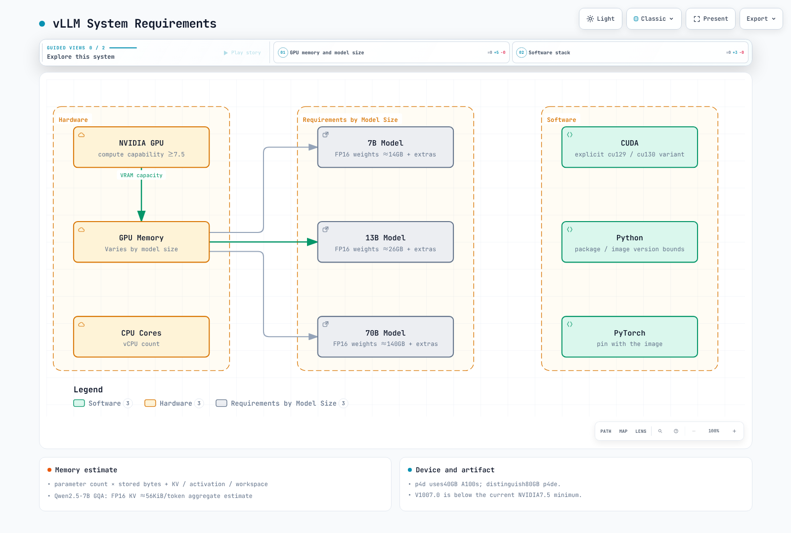
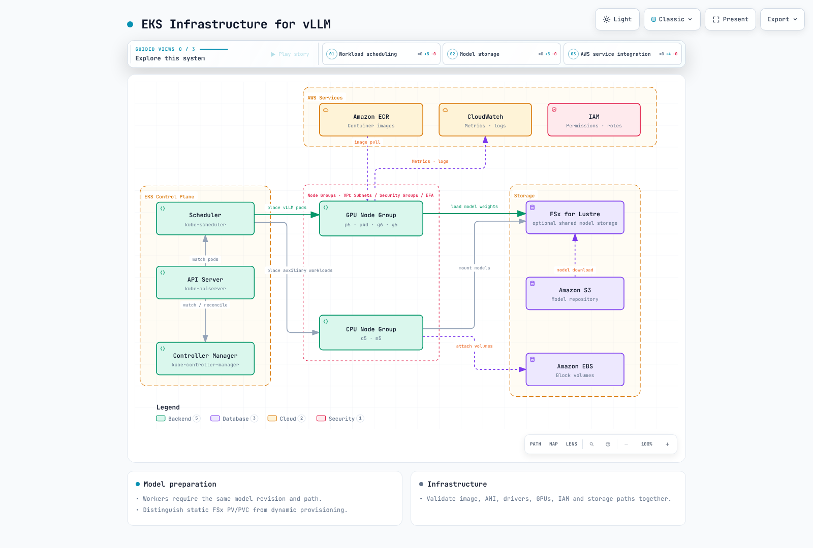
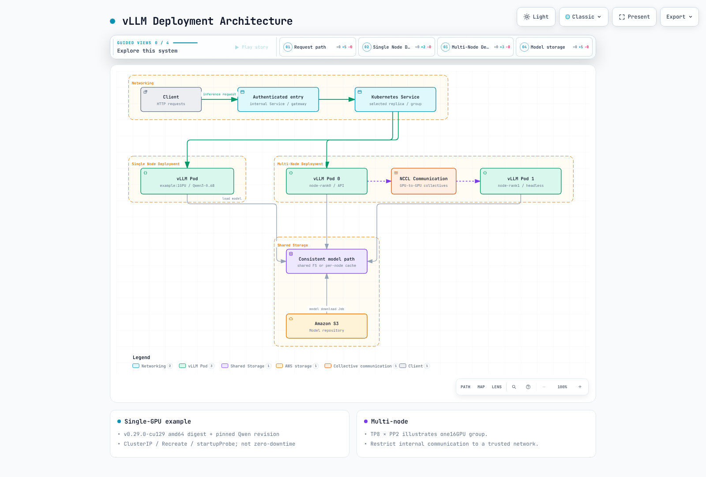
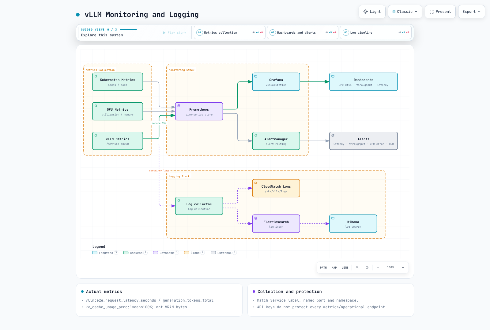

# vLLM 部署与优化

> **审查基线**：vLLM 0.29.0，CUDA 12.9 镜像变体；历史版本 0.6.4.post1 的基准测试另行列出
> **已检查的最新版本**：vLLM 0.31.0（2026 年 10 月 5 日），检查日期为 2026 年 10 月 12 日
> **最后更新**：2026 年 10 月 12 日

vLLM 是一款开源推理引擎，适用于生成式模型以及受支持的多模态/池化工作负载。它不应被扩展解释为“Vector Language Model”。本章审查特定版本以及 EKS 的运行边界，不提供普遍适用的加速或模型支持保证。

## 实验环境设置

本章中的清单和本地检查使用 [v0.29.0](https://github.com/vllm-project/vllm/releases/tag/v0.29.0)，该版本于 2026 年 9 月 9 日发布。之后发布了 v0.30.0（2026 年 9 月 22 日）和 [v0.31.0](https://github.com/vllm-project/vllm/releases/tag/v0.31.0)（2026 年 10 月 5 日）。

在 v0.31.0 中：

- 默认情况下会拒绝每个请求中的 `mm_processor_kwargs` 和 `media_io_kwargs`。只有显式使用 `--trust-request-mm-kwargs` 选项时才允许这些参数。
- `tokenizer_mode="slow"` 已被移除。

本章中的 0.29.0 示例尚未在 v0.30.0 或 v0.31.0 上重新运行。升级前请查看[版本变更](https://github.com/vllm-project/vllm/releases/tag/v0.31.0)和兼容性信息。

0.29.0 默认的 PyPI/Docker 路径使用 CUDA 13.0，另有单独的 v0.29.0-cu129 镜像。某些带标签的安装文本仍称 CUDA 12.9 为默认版本；请检查实际的镜像变体/摘要。

PyPI 要求 Python >=3.10、<3.15，而带标签的 GPU 指南列出的版本为 3.10–3.13。这并不保证每种 Python/PyTorch/CUDA 组合都受支持。NVIDIA 路径要求计算能力为 7.5 或更高，因此不包括 V100（7.0）。内核、数据类型和量化可能会对设备提出额外要求。

请遵循 [AI/ML 工作负载](01-ai-ml-workloads.md)中的 AMI/驱动/设备插件条件。CUDA 镜像不能直接用于 Trainium/Inferentia 部署；请单独验证 Neuron 或其他平台插件。应根据模型/缓存/并发需求配置 GPU、RAM 和磁盘，而不要将 g5.2xlarge 或 50GB 当作普遍适用的最低要求。

## vLLM 简介

vLLM 是一款具备以下特性的 LLM 推理引擎：


[🔍 查看交互式图表](https://www.atomai.click/kubernetes-docs/archmaps/en-ai-ml-02-vllm-deployment-0.html)

### 功能与支持边界

| 功能 | 含义与条件 |
| --- | --- |
| PagedAttention / KV 缓存 | 管理 token 块以减少浪费；内核/缓存布局取决于模型/后端 |
| 连续批处理 | 调度器会在每个步骤调整工作；不保证立即接纳、不会排队或获得固定加速 |
| TP / PP / DP / EP | 张量、流水线、数据和专家并行是不同的维度，需要模型/后端/网络支持 |
| 精度 / 量化 | 应区分 FP16/BF16 数据类型与 FP8/INT8/INT4/AWQ 格式，也应区分权重量化与 KV 缓存量化 |
| 前缀缓存 / 分块预填充 | 检查受支持模型的默认值和覆盖项；这并非完整响应缓存，也不会提高准确性 |
| 结构化输出 | response_format 或 structured_outputs 可限制输出格式；真实性和业务有效性仍需单独检查 |
| 工具调用 | 需要模型/聊天模板/解析器以及客户端执行循环；服务器不会自动执行工具 |
| LoRA | 需要模型支持并注册适配器；仅更改请求中的 model 并不会加载适配器 |

0.29.0 默认使用 Model Runner V2 作为运行器。这不是 OpenAI 兼容 API 版本，也不是单独的“vLLM Engine V2”。模型系列名称并不能保证所有尺寸、量化或视觉变体都受支持；请核实架构、制品/tokenizer、聊天模板和内核。

### 当前 CLI 功能配置

请使用 vllm serve，而不要使用已弃用的 python -m vllm.entrypoints.openai.api_server。当前 CLI 中，之前的 --speculative-model/--num-speculative-tokens 选项已由 --speculative-config 取代。

```bash
# Syntax when compatible target/draft models and sufficient memory are prepared.
vllm serve /models/target \
  --speculative-config '{"model":"/models/draft","method":"draft_model","num_speculative_tokens":5}'
```

此处仅展示语法；它不会提供这些模型文件，也不能证明会获得加速。草稿 token 的接受率、额外内存和通信成本可能会抵消收益。

使用 --enable-lora --lora-modules adapter=/models/adapter 注册启动时加载的 LoRA。运行时加载/卸载需要单独选择启用 VLLM_ALLOW_RUNTIME_LORA_UPDATING，并使用受限的运维路径。--enable-auto-tool-choice 需要搭配适当的 --tool-call-parser。多模态 URL 还需要 SSRF 防护、允许的域名以及下载/解码限制。

## 系统要求

在 EKS 上部署 vLLM 的系统要求：



[🔍 查看交互式图表](https://www.atomai.click/kubernetes-docs/archmaps/en-ai-ml-02-vllm-deployment-1.html)

可先用参数量 × 存储字节数估算权重内存。70B 模型仅 FP16/BF16 权重就约需 140GB，因此 80GB 并非适用于所有 70B 模型的要求。还需计入 KV 缓存、激活值、CUDA graphs/workspaces 和通信缓冲区，并考虑量化元数据和复制的张量。

下面是常用的稠密注意力 KV 估算公式。对于 GQA/MQA，应使用 KV 头数，而不是套用仅适用于 MHA 的公式并代入隐藏维度。

```text
KV bytes ≈ 2 × layers × KV_heads × head_dim × cached_tokens × bytes_per_element
```

cached_tokens 是所有并发请求中保留的 token 总数。TP 分片/复制、滑动窗口、MLA 和混合架构需要分别处理。当前 Qwen2.5-7B 配置有 28 层、4 个 KV 头和 128 的头维度：每个元素占两个字节时，每个 token 约为 56KiB，单个 4096-token 序列约为 224MiB。这是总量估算，不是实测的每 GPU 或整个模型内存占用。

p4d.24xlarge 使用 40GB A100；请与 80GB A100 的 p4de 实例区分。应根据区域容量、驱动程序和工作负载需求比较 p5/g6/g6e 及其他选项。每个 GPU 固定配置四个 CPU 核心或 RAM 为权重两倍之类的规则，不能替代实际测量。

## EKS 基础设施配置



[🔍 查看交互式图表](https://www.atomai.click/kubernetes-docs/archmaps/en-ai-ml-02-vllm-deployment-2.html)

## 存储与模型准备

FSx for Lustre 是一种可选方案，并非必需，也并非在所有情况下都是最佳选择。应根据加载时间、成本和并发情况，对比本地 NVMe/EBS、可复用缓存、对象存储和共享文件系统。emptyDir 可以在容器重启后保留，但在 Pod 删除/重新创建后不会保留。

请区分[静态 FSx PV/PVC 与动态配置](01-ai-ml-workloads.md#storage-and-caching)。Hugging Face snapshot_download 会从 Hugging Face 下载，而不是从 S3 下载。请记录仓库修订版本、完整性、许可证和访问权限。对于受限模型，请将 token 作为文件挂载，并使用读取该文件的下载阶段。默认情况下不要启用对可执行远程代码的信任。

下面的示例使用经过验证的公共 Qwen3-0.6B 修订版本，无需 token。其 emptyDir 缓存会在 Pod 重新创建后再次下载。多节点 worker 必须使用相同的模型修订版本/路径。

## vLLM 部署

### 部署架构

下图展示了在 EKS 上部署 vLLM 的两种主要架构：



[🔍 查看交互式图表](https://www.atomai.click/kubernetes-docs/archmaps/en-ai-ml-02-vllm-deployment-3.html)

### 单 GPU 配置示例

这是一个**在 GPU 上执行前需审查的模板**。请准备好命名空间和 GPU 驱动/插件。该摘要标识 v0.29.0-cu129 amd64 制品；模型修订版本标识经过检查的公共 Qwen3-0.6B 快照。本次审计未执行镜像拉取、非 root 运行、内核编译和推理；这些都需要在目标环境中验证。

Recreate 无需额外的 GPU 副本，但会导致更新期间停机。startupProbe 为启动预留约 15 分钟；readiness 不是 SLA。Service 为 ClusterIP，不会创建公共入口。

```yaml
apiVersion: apps/v1
kind: Deployment
metadata:
  name: vllm-demo
  namespace: ml-inference
spec:
  replicas: 1
  strategy:
    type: Recreate
  selector:
    matchLabels:
      app: vllm-demo
  template:
    metadata:
      labels:
        app: vllm-demo
    spec:
      automountServiceAccountToken: false
      nodeSelector:
        kubernetes.io/arch: amd64
      securityContext:
        runAsNonRoot: true
        runAsUser: 1000
        runAsGroup: 1000
        fsGroup: 1000
        seccompProfile:
          type: RuntimeDefault
      containers:
        - name: vllm
          image: vllm/vllm-openai@sha256:3e10e8189823e0f7ae4620c271bcdaaf64127ec7d0edc351591a508498b7684a
          command: ["vllm", "serve"]
          args:
            - Qwen/Qwen3-0.6B
            - --revision=c1899de289a04d12100db370d81485cdf75e47ca
            - --served-model-name=qwen3-demo
            - --dtype=float16
            - --max-model-len=2048
            - --max-num-seqs=8
            - --gpu-memory-utilization=0.80
            - --host=0.0.0.0
            - --port=8000
          env:
            - name: HF_HOME
              value: /cache/huggingface
            - name: XDG_CACHE_HOME
              value: /cache
            - name: XDG_CONFIG_HOME
              value: /cache/config
            - name: VLLM_NO_USAGE_STATS
              value: "1"
            - name: VLLM_CACHE_ROOT
              value: /cache/vllm
            - name: TORCHINDUCTOR_CACHE_DIR
              value: /cache/torchinductor
            - name: TRITON_CACHE_DIR
              value: /cache/triton
          ports:
            - name: http
              containerPort: 8000
          resources:
            requests:
              cpu: "2"
              memory: 4Gi
              ephemeral-storage: 4Gi
            limits:
              cpu: "4"
              memory: 12Gi
              ephemeral-storage: 12Gi
              nvidia.com/gpu: 1
          securityContext:
            allowPrivilegeEscalation: false
            readOnlyRootFilesystem: true
            capabilities:
              drop: [ALL]
          startupProbe:
            httpGet:
              path: /health
              port: http
            periodSeconds: 10
            failureThreshold: 90
          readinessProbe:
            httpGet:
              path: /health
              port: http
            periodSeconds: 10
          volumeMounts:
            - name: cache
              mountPath: /cache
            - name: tmp
              mountPath: /tmp
            - name: shm
              mountPath: /dev/shm
      volumes:
        - name: cache
          emptyDir:
            sizeLimit: 8Gi
        - name: tmp
          emptyDir:
            sizeLimit: 1Gi
        - name: shm
          emptyDir:
            medium: Memory
            sizeLimit: 2Gi
---
apiVersion: v1
kind: Service
metadata:
  name: vllm-demo
  namespace: ml-inference
  labels:
    app: vllm-demo
spec:
  type: ClusterIP
  selector:
    app: vllm-demo
  ports:
    - name: http
      port: 8000
      targetPort: http
```

### 多节点分片与独立副本

对单个模型副本进行分片需要 TP/PP，以及 Ray 或 multiprocessing 协调。独立的 API-server 副本各自加载模型并提供水平扩展；这是两种不同的设计。

0.29.0 支持 multiprocessing 参数 --nnodes、--node-rank、--master-addr 和 --master-port。旧示例中的 --rank、--tensor-parallel-rank 和 --distributed-init-method 并不是这些 CLI 选项。假设有两个准备好的节点，每个节点提供八个 GPU，命令形式如下：

```bash
# node0: substitute an actual trusted head IP and identical prepared model path.
vllm serve /models/model --distributed-executor-backend mp \
  --tensor-parallel-size 8 --pipeline-parallel-size 2 \
  --nnodes 2 --node-rank 0 --master-addr 10.0.0.10 --master-port 29500
# node1: the worker does not start a duplicate API server.
vllm serve /models/model --distributed-executor-backend mp \
  --tensor-parallel-size 8 --pipeline-parallel-size 2 \
  --nnodes 2 --node-rank 1 --master-addr 10.0.0.10 --master-port 29500 --headless
```

这些命令不会创建节点、模型文件或连接。Kubernetes 需要适当的并发 worker 创建机制、就绪前 DNS、每个 Pod 各自的 VLLM_HOST_IP、内部连通性和共享内存。Ray 需要可正常工作的集群，并且必须先具备兼容的 Ray 依赖，然后才能使用 --distributed-executor-backend ray 启动单个 API 入口；请参阅 [Ray](ray/README.md)。请将内部通信端口限制在私有网络内。

## 性能优化


[🔍 查看交互式图表](https://www.atomai.click/kubernetes-docs/archmaps/en-ai-ml-02-vllm-deployment-4.html)

### 内存、调度器和通信选项

0.29.0 中的 CacheConfig 默认将 gpu_memory_utilization 设为 0.92；这并不是对所有进程 VRAM 的硬性限制。示例明确选择了 0.80。--kv-cache-memory-bytes 会覆盖自动 KV 缓存大小设置，因此请检查选项优先级。

当前 CLI 中没有 --swap-space。权重 CPU 卸载和 KV 卸载是不同的功能/配置，并不保证主机 RAM 可以解决 GPU 限制。对于受支持的模型，前缀缓存可能默认开启；分块预填充也取决于模型。队列限制、token 预算、max-num-seqs 和 max-model-len 是不同的控制项。

EFA 需要受支持的 EC2 设备、AMI/插件/网络以及 AWS OFI NCCL/libfabric。不要将虚构的 NCCL_IB_ENABLE_RDMA 标志或任意 mlx5/GID 设置当作通用默认值照搬。请检查当前的 NVIDIA/PyTorch 变量和实际后端日志。单节点 NCCL 测试不能证明多节点 EFA 的性能。

## 历史测量：单个 L4 GPU 上的 Qwen2.5-7B

这些是[2026 年 9 月 4 日仓库提交](https://github.com/Atom-oh/kubernetes-docs/commit/8622d388cb684dc4f68083af7be6d91f80b79106)中报告的历史测量数据。本次审计未找到原始请求结果/服务器日志或完整客户端制品，也没有重新运行实验。保留报告中的数字，但不将其重新标记为当前 0.29.0 性能或独立复现的结果。


[🔍 查看交互式图表](https://www.atomai.click/kubernetes-docs/archmaps/en-ai-ml-02-vllm-deployment-6.html)

### 设置

- **集群**：专用 Karpenter NodePool（`bench-gpu`，按需 `g6.2xlarge`：1 个 NVIDIA L4、24GB GPU 内存、8 个 vCPU、32 GiB RAM），添加污点 `nvidia.com/gpu=true:NoSchedule`，并添加标签以加入现有的 `nvidia-device-plugin` daemonsets，运行后立即删除。
- **服务器**：`vllm/vllm-openai:v0.6.4.post1`（发布于 2024-11-15；此后 vLLM 项目已发布默认启用前缀缓存的 V1 引擎，因此应将其视为该版本系列的快照，而不是当前 vLLM），模型为 `Qwen/Qwen2.5-7B-Instruct`，参数为 `--dtype bfloat16 --max-model-len 4096 --gpu-memory-utilization 0.90`。只使用一种精度（bf16，即模型的原生数据类型），不使用量化、推测解码或前缀缓存：这是本页其他部分所述的普通默认配置。
- **客户端**：通过 `ThreadPoolExecutor` 运行的 Python 程序，以 Job 形式在**集群内**运行（位于单独的非 GPU 节点），通过 `vllm-server` ClusterIP Service 调用 `/v1/chat/completions`。采用非流式模式，`temperature=0`、`max_tokens=128`，并轮换使用 8 条简短提示（询问 Kubernetes 概念并要求用 1–2 句话回答）。实际上，每个响应都接近 128-token 上限（三个并发批次的平均值一致，约为 102 token），而不是在 1–2 句话后停止。这有助于在不同并发级别间公平比较吞吐量，但在将延迟数字理解为“回答一个简短问题所需的时间”之前，值得了解这一点。
- **冷启动**：从 vLLM 引擎启动日志到其 `/health` 端点返回 `200`，约 4.5 分钟，主要耗时在于从 Hugging Face 下载约 15 GB 的 Qwen2.5-7B-Instruct 权重到 Pod 的临时缓存中。不包括镜像拉取时间；该时间未单独测量。

### 复现

```yaml
# NodePool (Karpenter) - dedicated, deleted after the run; nodeClassRef points at the cluster's existing GPU EC2NodeClass (AMI/subnets/SG), not shown here
apiVersion: karpenter.sh/v1
kind: NodePool
metadata: { name: bench-gpu }
spec:
  limits: { cpu: "16", memory: 128Gi, nvidia.com/gpu: "1" }
  template:
    metadata:
      labels: { node-type: bench-gpu, nvidia.com/device-plugin.config: default }
    spec:
      expireAfter: 6h
      nodeClassRef: { group: karpenter.k8s.aws, kind: EC2NodeClass, name: gpu }
      requirements:
        - { key: node.kubernetes.io/instance-type, operator: In, values: [g6.2xlarge] }
      taints: [{ key: nvidia.com/gpu, value: "true", effect: NoSchedule }]
---
# vLLM server (namespace bench-gpu) + the ClusterIP Service the client calls
apiVersion: apps/v1
kind: Deployment
metadata: { name: vllm-server, namespace: bench-gpu }
spec:
  replicas: 1
  selector: { matchLabels: { app: vllm-server } }
  template:
    metadata: { labels: { app: vllm-server } }
    spec:
      nodeSelector: { node-type: bench-gpu }
      tolerations: [{ key: nvidia.com/gpu, value: "true", effect: NoSchedule }]
      containers:
        - name: vllm
          image: vllm/vllm-openai:v0.6.4.post1
          args: ["--model", "Qwen/Qwen2.5-7B-Instruct", "--max-model-len", "4096",
                 "--gpu-memory-utilization", "0.90", "--dtype", "bfloat16"]
          ports: [{ containerPort: 8000 }]
          resources:
            limits: { nvidia.com/gpu: "1" }
            requests: { nvidia.com/gpu: "1", cpu: "3", memory: 20Gi }
          readinessProbe: { httpGet: { path: /health, port: 8000 }, initialDelaySeconds: 30, periodSeconds: 10, failureThreshold: 60 }
---
apiVersion: v1
kind: Service
metadata: { name: vllm-server, namespace: bench-gpu }
spec:
  selector: { app: vllm-server }
  ports: [{ port: 8000, targetPort: 8000 }]
```

这些清单展示了报告环境的一部分。它们省略了命名空间创建、现有的 EC2NodeClass 和完整的客户端脚本，因此无法证明实验得到了完整复现。nvidia.com/device-plugin.config:default 是该共享 DaemonSet 配置中的一个条件，并非通用的调度标签要求。报告中提到的按需实例声明也需要实际的历史配置来佐证。

### 结果

| 并发数 | 请求数 | 总耗时 | 客户端延迟 p50 / p90 | 客户端聚合吞吐量 | 服务器报告的峰值生成吞吐量 | GPU KV 缓存使用率 |
|---|---|---|---|---|---|---|
| 1（串行） | 10 | ~53.2 s（请求延迟总和） | 5.65 s / 7.43 s | 每个请求约 17–18 tokens/s | 约 17 tokens/s | 0.1-0.2% |
| 4 | 16 | 27.78 s | 6.99 s / 7.88 s | 58.67 tokens/s | 65-66 tokens/s | 0.4-0.7% |
| 8 | 32 | 30.02 s | 7.18 s / 8.15 s | 109.04 tokens/s | 123-129 tokens/s | 0.8-1.4% |
| 16 | 64 | 31.35 s | 7.52 s / 8.74 s | 208.08 tokens/s | 最高 243 tokens/s | 1.5-2.6% |

客户端聚合吞吐量是完成的 token 数除以测得的总耗时。服务器 Avg generation throughput 是区间平均值；日志中最大的值并非瞬时“真实峰值”。由于时间窗口、token 计数和 HTTP 边界各不相同，这些指标不能直接互换。

### 解读

报告的 p50 从 5.65s 增至 7.52s，约增加 33.1%。并发数为 4→8→16 时，聚合吞吐量为 58.67→109.04→208.08tokens/s。应将这一批处理观察与对底层瓶颈的因果证明区分开来。

将约 300GB/s 的带宽除以 15.2GB 的权重，可得到接近 20 tokens/s 的理想化 Roofline 上限估算。本次审计没有直接测量带宽或 FLOP 执行情况的分析器证据，因此无法证明“肯定受内存限制”或“增加请求几乎没有额外成本”。KV 缓存占用率和 VRAM 总使用量是不同的指标。

### 注意事项

这是在单个模型、一种精度（bf16）、一种 GPU 类型和一个上下文长度上的单次运行（n=1）。应将其视为一个经过校准的数据点，而不是关于 vLLM/L4 性能的一般性结论。客户端运行在集群内（位于单独的非 GPU 节点），因此网络延迟反映的是集群内部跳数，而不是外部调用方。此处的延迟是端到端 HTTP 响应时间，而不是首 token 时间（TTFT）；未测试流式传输。前缀缓存、推测解码、FP8 和多 GPU 张量并行（本页前面均有介绍）均未参与测试。完整复现需要补齐缺失的执行制品和环境详情；不要将这些数字外推到其他模型尺寸、GPU 或提示长度。

## 监控与日志记录



[🔍 查看交互式图表](https://www.atomai.click/kubernetes-docs/archmaps/en-ai-ml-02-vllm-deployment-5.html)

### 指标与日志

默认的 /metrics 端点使用 API 的 8000 端口。不要虚构单独的 8001 端口或 --enable-metrics=true。配置 ServiceMonitor 时，应使 Service 标签、命名端口和命名空间选择相匹配。

```promql
# End-to-end p95 by model
histogram_quantile(0.95, sum by (le, model_name) (rate(vllm:e2e_request_latency_seconds_bucket[5m])))
# Generation-token throughput
sum by (model_name) (rate(vllm:generation_tokens_total[5m]))
# Queued requests
sum by (model_name) (vllm:num_requests_waiting)
```

vllm:kv_cache_usage_perc 是一个比例值，其中 1 表示 100%，并非 GPU 内存总字节数。请同时观察网关错误/取消情况和成功计数；不要将健康的空闲时段称为低吞吐量中断。请核实实际的端点名称/标签。应区分 CRI 帧格式与应用日志，并避免不加区分地记录提示/输出/token。

## 自动扩缩容


[🔍 查看交互式图表](https://www.atomai.click/kubernetes-docs/archmaps/en-ai-ml-02-vllm-deployment-10.html)

### 自动扩缩容与可用性

使用 HPA/KEDA 扩展独立副本，与扩展分片模型的 worker 组不同。增加 StatefulSet 副本不会自动重新配置 TP/PP。请验证适配器的请求/队列信号；如果没有 CPU requests，不要使用基于 CPU 利用率的 HPA。避免让 Karpenter 和 Cluster Autoscaler 同时负责同一容量。

PDB 只能限制某些自愿驱逐，不能防止所有故障。独立副本可以分布在多个 AZ；将通信密集型 TP/PP 组放置在多个 AZ 上，则会带来单独的延迟/成本影响。在声称更新不会造成中断之前，请验证模型加载、预热、排空、进行中的流式请求以及备用 GPU。

## 安全配置

--api-key 并不能保护所有端点。此版本的中间件会保护 /v1、/v2、/inference 和 /cohere 前缀；/invocations、/metrics 及部分运维端点需要额外保护。经过身份验证的网关应只允许所需的路径/方法；分布式通信应限制在可信网络内。CORS 不是身份验证。

运行时 LoRA、远程模型代码和多模态 URL 各自会引入信任/权限/SSRF 边界。使用正则表达式拦截“ignore instructions”并不能防止所有提示注入，也不能保证移除 PII。应独立于模型输出执行工具/数据权限控制。

请将 Secret 作为文件提供，并将 Pod/container 的 securityContext 字段放置在正确位置。NetworkPolicy 选择器、DNS、抓取方向和内部流量应与实际配置相匹配。Pod 注释无法启用 API-server 审计；不要记录 Secret 的 RequestResponse 正文。EKS 控制平面审计日志与应用访问日志是分开的。

## 客户端集成


[🔍 查看交互式图表](https://www.atomai.click/kubernetes-docs/archmaps/en-ai-ml-02-vllm-deployment-7.html)

### 客户端请求

完成部署/就绪状态验证后，获得授权的开发人员可以使用 kubectl port-forward -n ml-inference service/vllm-demo 8000:8000。请保持其默认的 localhost 绑定。此本地示例不能替代生产环境中的网关身份验证。

```python
import json
import urllib.request

payload = {
    "model": "qwen3-demo",
    "messages": [{"role": "user", "content": "Explain a Kubernetes Pod briefly."}],
    "max_tokens": 64,
    "temperature": 0,
    "chat_template_kwargs": {"enable_thinking": False},
}
request = urllib.request.Request(
    "http://127.0.0.1:8000/v1/chat/completions",
    data=json.dumps(payload).encode(),
    headers={"Content-Type": "application/json"},
    method="POST",
)
with urllib.request.urlopen(request, timeout=60) as response:
    result = json.load(response)
print(result["choices"][0]["message"]["content"])
```

请求中的 model 必须与 served-model-name 或 /v1/models 相匹配。生产客户端需要基于文件的网关凭据，以及超时/错误/流式处理逻辑。JSON 正文中的 model 字段不是 HTTP 模型标头，因此标头路由不会自动检查该字段。

## 验证范围

已检查固定版本的源代码，以核实 CLI 参数、指标、身份验证和制品元数据。Kubernetes schema/本地 HTTP fixture 无法验证实际的 vLLM 解析器/内核/GPU 执行情况。本次审计未下载模型权重，也未创建 GPU 服务器或云资源。

## 参考资料

- [vLLM 0.29.0 发布说明（审查基线）](https://github.com/vllm-project/vllm/releases/tag/v0.29.0)
- [vLLM 0.31.0 发布说明（已检查的最新版本）](https://github.com/vllm-project/vllm/releases/tag/v0.31.0)
- [并行与扩展](https://github.com/vllm-project/vllm/blob/v0.29.0/docs/serving/parallelism_scaling.md)
- [安全边界](https://github.com/vllm-project/vllm/blob/v0.29.0/docs/usage/security.md)
- [生产环境指标](https://github.com/vllm-project/vllm/blob/v0.29.0/docs/usage/metrics.md)
- [结构化输出](https://github.com/vllm-project/vllm/blob/v0.29.0/docs/features/structured_outputs.md)
- [LoRA 适配器](https://github.com/vllm-project/vllm/blob/v0.29.0/docs/features/lora.md)

## 测验

想要检验你在本章中的学习成果，请尝试[主题测验](../quizzes/ai-ml/04-vllm-deployment-quiz.md)。
