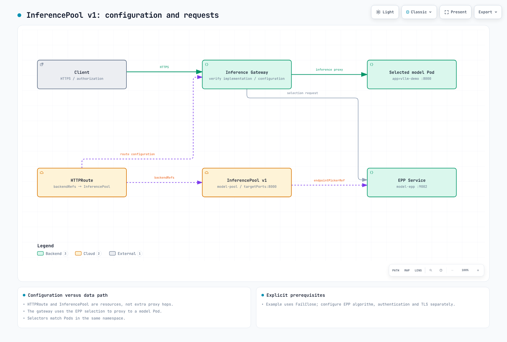

# 在 EKS 上构建智能体式 AI 平台

> **审查基线**：Kagent 0.10.1 / Gateway Inference Extension 1.6.1 / LangGraph 1.2.11 / Langfuse SDK 4.15.2
> **最后更新**：2026 年 10 月 16 日

智能体式 AI 不止于简单问答，还能自主制定计划、使用工具并通过迭代实现目标。本章介绍如何设计智能体式 AI 平台及其在 EKS 上的运行边界。

## 1. 智能体式 AI 平台概览

### 什么是智能体式 AI？

智能体式 AI 是具备以下特征的自主 AI 系统：


[🔍 查看交互式图表](https://www.atomai.click/kubernetes-docs/archmaps/en-ai-ml-03-agentic-ai-platform-0.html)

1. **自主规划**：将复杂任务拆分为子任务并确定执行顺序。
2. **基于工具的执行**：利用各种工具，包括外部 API、数据库和代码执行器。
3. **迭代改进**：评估执行结果，并根据需要修改计划。
4. **状态管理**：为长时间运行的任务维护状态和记忆。

### 何时选择 Kubernetes

Kubernetes 为智能体式 AI 平台提供以下核心能力：

| 需求 | Kubernetes 解决方案 |
|-------------|---------------------|
| GPU 编排 | Device Plugin、GPU Operator、MIG |
| 自动扩缩 | HPA、VPA、Karpenter |
| 多租户隔离 | RBAC、Namespace、强制执行的 NetworkPolicy、工作负载身份 |
| 高可用性 | 副本、探针、放置与恢复测试 |
| 服务网格 | 已配置的网关/网格实现 |
| 成本优化 | Spot 实例、节点整合 |

### 四项关键技术挑战

构建智能体式 AI 平台时需要解决的关键挑战：


[🔍 查看交互式图表](https://www.atomai.click/kubernetes-docs/archmaps/en-ai-ml-03-agentic-ai-platform-1.html)

---

## 2. GPU 与成本基线

使用外部模型 API 的 Agent 不一定需要 GPU。自托管推理需要根据权重/精度、KV cache、并发量、CPU 架构和驱动兼容性选择设备。请使用[已审查的 GPU 指南](01-ai-ml-workloads.md)，并避免在 AL2023 NVIDIA AMI 上重复安装驱动/工具包。

MIG 会对受支持的 GPU 进行分区。在单个 MIG 实例内进行时间片共享，不会为共享该实例的工作负载增加内存/故障隔离；它不是软件安全边界。同样，80 GB 通常无法容纳 70B FP16 权重。

GPU Operator 的 Helm values 与 ConfigMap/HelmRelease 资源并不相同。将 Flux HelmRelease 作为 helm --values 传入，并不会应用预期设置。MIG manager ConfigMap 引用、配置文件节点标签和插件策略必须相互匹配。device-plugin.config 标签选择的是配置键，而不是 ConfigMap 名称。重新配置 MIG 可能中断工作负载，本次审计未执行此操作。

价格需要结合区域/操作系统/购买方式/日期和配额背景来考量。以前缺少来源的小时费率表和固定节省百分比，并不能作为当前定价依据。应将自托管 GPU 的总闲置时间、存储/传输、运维和恢复成本，与实测的成功吞吐量进行比较。

## 3. 模型服务（vLLM）

### vLLM 架构

vLLM 通过以下核心技术提供高性能 LLM 推理：


[🔍 查看交互式图表](https://www.atomai.click/kubernetes-docs/archmaps/en-ai-ml-03-agentic-ai-platform-2.html)

### 已审查的服务路径

请使用[当前 vLLM 指南](02-vllm-deployment.md)，了解 0.29.0 镜像/模型版本、启动探针、私有 Service 和实际 CLI 选项。单 GPU NodePool 无法调度此前的四 GPU/200Gi Pod。请区分 TP/PP 组与独立副本，并计算所需内存。

前缀缓存会复用受支持的 KV 前缀，而不是完整响应。GPU 内存利用率并非仅由 KV cache 占用比例决定，当前 CLI 中也没有 swap-space。llm-d 解耦并不是使用两个臆造的 prefill/decode 镜像并传入角色参数；应验证其实际版本的模型服务器、KV 连接器、调度器、网关以及硬件/网络组合。

## 4. 推理网关

### 基于 Gateway API 的 AI 工作负载路由

扩展 Kubernetes Gateway API，以高效路由 AI 推理工作负载。

### Kgateway + InferencePool 架构



[🔍 查看交互式图表](https://www.atomai.click/kubernetes-docs/archmaps/en-ai-ml-03-agentic-ai-platform-3.html)

#### InferencePool v1

Gateway API 与 Gateway API Inference Extension 是两个独立的 API。Extension 1.6.1 使用 inference.networking.k8s.io/v1，以及 targetPorts 和 endpointPickerRef。此前臆造的 EndpointPicker CRD/endpointPickerConfig 并不属于此 schema。

此 schema 检查过的示例要求 EPP Service 位于 9002 端口、存在模型 Pod，并且使用支持该功能的网关控制器。仅有 InferencePool 并不会配置身份验证、速率限制或感知前缀的选择算法。

```yaml
apiVersion: inference.networking.k8s.io/v1
kind: InferencePool
metadata:
  name: model-pool
  namespace: ai-inference
spec:
  selector:
    matchLabels:
      app: vllm-demo
  targetPorts:
    - number: 8000
  endpointPickerRef:
    name: model-epp
    kind: Service
    group: ""
    port:
      number: 9002
    failureMode: FailClose
```

selector 只匹配同一 namespace 中的 Pod。EndpointPickerRef 默认引用 Service，且失败模式为 FailClose。应一并验证 HTTPRoute、EPP 配置/版本支持、TLS 和网关状态。API 定义或 Kgateway 安装并不会启用所有插件能力。

### LiteLLM 1.100.1 提供方网关

LiteLLM 提供方适配与 InferencePool 端点选择属于不同层。提供方 API 在路径、身份验证、负载、响应和流式传输方面各不相同；将 OpenAI JSON 原样转发到 Anthropic 端点并不是有效的适配方式。

当前 Router 回退配置形式如下。应将代理命令/参数连接到实际配置文件，并根据需要单独提供 Redis/数据库、凭据和回调。

```yaml
model_list:
  - model_name: local-primary
    litellm_params:
      model: openai/qwen3-demo
      api_base: http://vllm-demo.ml-inference:8000/v1
  - model_name: local-fallback
    litellm_params:
      model: openai/qwen3-demo
      api_base: http://vllm-secondary.ml-inference:8000/v1
router_settings:
  fallbacks:
    - local-primary: [local-fallback]
  num_retries: 0
```

此示例展示了配置形式，实际使用需要准备好端点和身份验证。应向应用客户端提供作用域受限的凭据，而不是 master key。外部回退路径会导致数据外传：应在路由前强制执行租户的提供方/数据策略。模型选出的名称或客户端标头不得绕过此策略。


## 5. RAG 数据与检索边界

最近检查的 Milvus 版本为 3.0.3（2026-10-14）；单独审查的 Operator 1.3.9 默认使用 Milvus 2.6.11。它们不是同一个版本，宽泛的兼容性表也不能证明已测试过 3.x 升级。Operator 仓库为 https://zilliztech.github.io/milvus-operator/，与普通 Milvus chart 仓库分开。

向量维度必须与实际 embedding 输出相匹配。记录摄取和查询所用的版本、维度选项、tokenizer、归一化方法和距离度量。索引参数各不相同；不能直接将 HNSW M/efConstruction 用于 GPU_IVF_FLAT。GPU 索引需要兼容的镜像、版本、设备和组件角色；在 indexNode 上请求 GPU 并不会自动带来加速。

仅有 tenant_id 字段并不能强制隔离。应从经过身份验证的身份派生作用域，在服务端应用检索过滤器，并验证返回的文档。同时还要管理文档删除/更改以及 embedding 版本生命周期。

### 分块与混合搜索

当前 splitter 导入路径使用 langchain_text_splitters。RecursiveCharacterTextSplitter 的 chunk_size 默认按字符计数，而不是按 token 计数。Token 分割必须匹配 embedding 模型的 tokenizer 和实际输入限制。语义分块会增加 embedding 调用/成本，也不能保证质量更好。

混合搜索需要 RRF 或校准分数等融合方式，而不能只是执行两次搜索，并且两者必须使用相同的授权过滤器。应评估召回率、精确率和延迟。限制重试次数，并在没有证据时拒绝作答，而不是在重试耗尽后仍始终生成回答。


## 6. AI Agent 部署（Kagent）

### Kagent 概览

Kagent 是 Kubernetes 原生的 AI Agent 生命周期管理工具。


[🔍 查看交互式图表](https://www.atomai.click/kubernetes-docs/archmaps/en-ai-ml-03-agentic-ai-platform-4.html)

### Kagent 0.10.1 Agent API

Kagent 并不局限于自动执行 kubectl。声明式 Agent 使用 Go/Python ADK 运行时；BYO 则托管用户提供的 A2A Agent。LangGraph 是单独集成的工作流框架，并非与 Kagent 相同的运行时。

此 Agent 引用了单独批准/配置且位于同一 namespace 的 ModelConfig 和 RemoteMCPServer 资源。请提供实际的 MCP 服务/search_documents 工具、身份验证、TLS 和数据权限。它既不会创建工具，也不会授予 Kubernetes 写入权限。

```yaml
apiVersion: kagent.dev/v1alpha2
kind: Agent
metadata:
  name: research-agent
  namespace: ai-agents
spec:
  type: Declarative
  description: Retrieves authorized documents and cites their sources
  declarative:
    runtime: go
    modelConfig: approved-internal-model
    systemMessage: 'Use approved document tools. Cite retrieved sources.

      If evidence is missing, say so. Do not execute arbitrary code.

      '
    tools:
    - type: McpServer
      mcpServer:
        apiGroup: kagent.dev
        kind: RemoteMCPServer
        name: document-tools
        toolNames:
        - search_documents
    deployment:
      replicas: 1
      resources:
        requests:
          cpu: 250m
          memory: 256Mi
        limits:
          cpu: '1'
          memory: 1Gi
```

ModelConfig.apiKeySecret 并不意味着会以文件形式提供密钥。检查过的 OpenAI translator 会创建一个 OPENAI_API_KEY SecretKeyRef 环境变量。在禁止使用 Secret 环境变量的策略下，应改用经过验证的文件凭据 BYO/运行时路径或身份验证网关路径。若没有设计 token 委派/受众，不应将启用 apiKeyPassthrough 视为替代方案。

eval() 计算器和臆造的权限字段都不是安全边界。应在实际工具服务器中实施最小权限、输入验证、资源限制、审批和幂等性。Agent 副本不会自动使共享记忆/会话存储实现高可用。

### 可执行的 LangGraph 控制流

此本地示例使用实际 SDK，并显式提供 retrieve/rewrite/generate 回调。演示不会调用 LLM 或向量数据库。它保留原始问题，将改写次数限制为两次，并在没有文档时拒绝作答。SQLite 上下文管理器使用正确，并且在重新打开后检查了持久化状态。

```python
from typing import Callable, TypedDict
from langgraph.graph import StateGraph, START, END
from langgraph.checkpoint.sqlite import SqliteSaver


class QAState(TypedDict):
    question: str
    search_query: str
    documents: list[str]
    answer: str
    retries: int


def build_graph(retrieve: Callable[[str], list[str]],
                rewrite: Callable[[str], str],
                generate: Callable[[str, list[str]], str]):
    def search(state: QAState):
        return {"documents": retrieve(state["search_query"])}

    def route(state: QAState):
        if state["documents"]:
            return "answer"
        return "rewrite" if state["retries"] < 2 else "abstain"

    def rewrite_query(state: QAState):
        return {"search_query": rewrite(state["search_query"]),
                "retries": state["retries"] + 1}

    def answer(state: QAState):
        return {"answer": generate(state["question"], state["documents"])}

    def abstain(state: QAState):
        return {"answer": "No supporting documents were found."}

    graph = StateGraph(QAState)
    graph.add_node("retrieve", search)
    graph.add_node("rewrite", rewrite_query)
    graph.add_node("answer", answer)
    graph.add_node("abstain", abstain)
    graph.add_edge(START, "retrieve")
    graph.add_conditional_edges("retrieve", route,
                               {"answer": "answer", "rewrite": "rewrite", "abstain": "abstain"})
    graph.add_edge("rewrite", "retrieve")
    graph.add_edge("answer", END)
    graph.add_edge("abstain", END)
    return graph


if __name__ == "__main__":
    # Deterministic local fixtures, not a vector database or LLM quality test.
    graph = build_graph(
        retrieve=lambda query: ["A Pod groups containers."] if query == "pod" else [],
        rewrite=lambda query: "pod",
        generate=lambda question, documents: documents[0],
    )
    initial = {"question": "What is a Pod?", "search_query": "unknown",
               "documents": [], "answer": "", "retries": 0}
    # Server-derived authorized tenant/session identity is required in a real app.
    config = {"configurable": {"thread_id": "tenant-a/session-1"}, "recursion_limit": 12}
    with SqliteSaver.from_conn_string("agent-state.sqlite") as saver:
        app = graph.compile(checkpointer=saver)
        print(app.invoke(initial, config)["answer"])
        print(app.get_state(config).values["retries"])
```

生产环境中的 thread_id 必须绑定到经过身份验证的租户/会话身份，并配有数据库授权、加密、并发和保留控制。:memory: 在进程退出后不会保留数据。SqliteSaver 不能使用 PostgreSQL DSN；应使用相应的 Postgres saver。仅读取 get_state_history() 并不能恢复执行；应使用检查点配置和实际的恢复/重放语义。

应根据允许的枚举值验证 supervisor 输出，并处理未知值/预算耗尽。使用子串 COMPLETE 不能将 INCOMPLETE 误判为成功。要求模型使用工具，本身并不会执行或验证该工具。

## 7. Langfuse 与运维可观测性

Langfuse SDK 4.15.2 使用 start_as_current_observation()、create_score() 和相关方法替代旧的 trace()/generation() API。本次审计通过内存导出器在一个 trace 中验证了三个检索/生成/父级 span，但没有验证真实服务器的摄取/存储/身份验证。

```python
from pathlib import Path
from langfuse import Langfuse

# Read existing Secret-volume files; do not put credentials in source.
client = Langfuse(
    public_key=Path("/run/secrets/langfuse/public-key").read_text().strip(),
    secret_key=Path("/run/secrets/langfuse/secret-key").read_text().strip(),
    base_url="https://langfuse.example.internal",
)
with client.start_as_current_observation(name="rag", as_type="span"):
    with client.start_as_current_observation(name="retrieve", as_type="span") as span:
        span.update(metadata={"document_count": 2})
    with client.start_as_current_observation(name="generate", as_type="generation",
                                           model="prepared-model-alias") as generation:
        # Supply actual provider usage; these values only illustrate the shape.
        generation.update(usage_details={"input": 10, "output": 5})
client.flush()
client.shutdown()
```

Langfuse chart 2.1.0 引用 app 4.24.0，与最近检查的服务器 4.60.0（2026-10-15）不同。需要 Web/worker、PostgreSQL、Redis/Valkey、对象存储和 ClickHouse。此 chart 会检查 ClickHouse Operator/cert-manager 前置条件。离线渲染使用的是模拟 API 能力信息，并非已部署的 Operator。默认 charts 包含 Secret 环境变量传递方式，不适用于仅通过文件提供凭据的部署。

DCGM FB_USED 是数量而非百分比；请验证单位和总内存。GPU 利用率 80% 或温度 85C 并非通用健康阈值。应一并观察延迟/队列/错误/限流情况和实际设备限制。

### 响应缓存与成本

缓存键必须包含租户/授权作用域、模型/提示词/检索数据版本、生成设置和相关工具状态。共享的模型+提示词键可能会复用其他用户的结果。对于私有状态或会变化的外部状态，应禁用缓存或明确设置过期/失效策略。

Token 价格估算并非账单。应计入缓存读写、批处理、重试、路由调用和自托管固定成本。若最低价模型回退违反预算、质量或提供方策略，则应拒绝使用。KEDA cron 触发器不会在夜间对其他触发器设置更低上限。应为 CronJob 定义时区、并发、截止时间/重试和持久化结果。


## 8. 评估与质量管理

Ragas 0.4.3 在解析到 langchain-community 0.4.2 时导入失败，因为它导入了已移除的 vertexai 模块。在另一个固定使用 langchain 0.3.27、core 0.3.79、community 0.3.31 和 openai integration 0.3.35 的环境中，导入以及 SingleTurnSample/EvaluationDataset 构造均通过。不要假设这与当前 LangGraph 共用同一依赖栈。

当前的集合 API（如 Faithfulness/AnswerRelevancy）要求显式提供 LLM/embedding 适配器；旧的 ragas.metrics 单例导入会发出弃用警告。评估需要处理模型调用成本/失败、数据集/评判器/提示词版本，以及缺失/NaN 值。此处只测试了指标导入/schema；未测得 0.92 之类的质量分数。

仅有 A/B ConfigMap 并不会路由流量。应实现实际的使用方/控制器、稳定分配、等效授权/数据上下文、充足样本和防护指标。任意模型质量/定价表并不能证明节省了 30–50%。

财务示例中的 compliance_check 函数并不能证明符合监管要求。应设计经过身份验证的账户作用域、单调敏感/审批条件（之后不得将 true 覆盖为 false）、副作用幂等性、审计和人工交接标准。


## 9. 审查基线与验证范围

| 组件 | 基线 | 已验证范围 |
| --- | --- | --- |
| Kagent |0.10.1 / v1alpha2 | 官方 Helm/CRD 以及 Agent/ModelConfig/RemoteMCPServer schemas |
| Inference Extension |1.6.1 / v1 | InferencePool schema；未运行实际 EPP/网关 |
| LiteLLM |1.100.1 | Router 回退配置；未调用提供方 |
| Milvus | server/SDK3.0.1；Operator 1.3.9 | Operator Helm/合成向量 schema；未连接数据库 |
| LangGraph |1.2.11 + sqlite saver 3.1.1 | 有界检索、拒绝作答和状态恢复 |
| Langfuse | SDK 4.15.2 / chart 2.1.0 | 本地 trace/span 和离线 chart 检查 |
| Ragas |0.4.3 | 兼容的隔离导入/schema；未调用评估器模型 |

Schema、Helm 和本地 SDK 检查并不能证明完整平台的部署、身份验证、高可用性或 GPU 性能。未使用云资源或付费模型调用。

## 10. 后续步骤

### 练习测验

请完成以下测验，检验你对智能体式 AI 平台的理解：
- [智能体式 AI 平台测验](../quizzes/ai-ml/08-agentic-ai-platform-quiz.md)

### 相关文档

- [vLLM 部署详细指南](./02-vllm-deployment.md) - vLLM 安装与优化详解
- [AI/ML 工作负载](./01-ai-ml-workloads.md) - Kubernetes 中的 AI/ML 工作负载管理

### 参考资料

- [Kagent 0.10.1](https://github.com/kagent-dev/kagent/tree/v0.10.1)
- [InferencePool v1 API](https://github.com/kubernetes-sigs/gateway-api-inference-extension/blob/v1.6.1/api/v1/inferencepool_types.go)
- [Milvus Operator 1.3.9](https://github.com/zilliztech/milvus-operator/tree/milvus-operator-1.3.9)
- [Langfuse SDK 4.15.2](https://github.com/langfuse/langfuse-python/tree/v4.15.2)
- [Langfuse Helm2.1.0](https://github.com/langfuse/langfuse-k8s/releases/tag/langfuse-2.1.0)
- [LangGraph 持久化](https://docs.langchain.com/oss/python/langgraph/persistence)
- [LiteLLM Router](https://docs.litellm.ai/docs/routing)
- [Ragas 0.4.3](https://pypi.org/project/ragas/0.4.3/)
