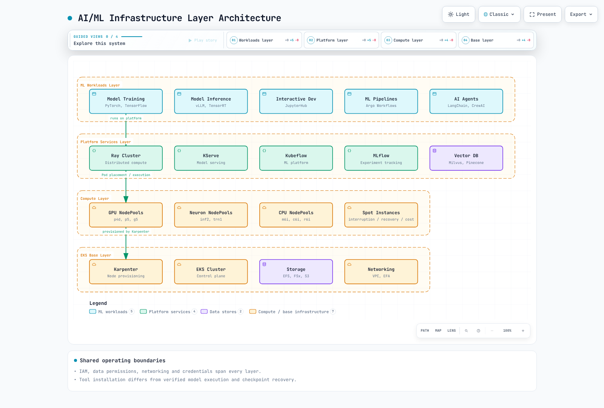

# EKS 上的 AI 基础设施

> **最近更新**：October 16, 2026
> **基线版本**：GPU Operator26.7.2 / NVIDIA DRA0.5.0 / Argo Workflows4.1.3 / JupyterHub chart4.4.2 / Mountpoint CSI2.8.0

AI 基础设施由 notebooks、pipelines、分布式运行时、设备/节点、存储/网络和授权组成。工具列表或成功的 Helm release 并不能证明平台具备安全性、可用性或模型执行能力。

## 分层与职责



[查看交互式图表](https://www.atomai.click/kubernetes-docs/archmaps/en-ai-ml-06-ai-infrastructure-0.html)

工作负载负责模型/数据/执行代码；平台负责 workflows、运行时和 registries；计算层负责真实设备、Pods 和节点容量。IAM、网络和存储身份贯穿这些层。启用了 Spot 的 NodePool 既不保证容量，也不保证恢复能力或节省成本。

## JARK Stack

JARK 结合了 JupyterHub、Argo Workflows、Ray 和 Karpenter。这是一种集成模式，并不是一个会自动互联的产品。请显式连接 notebook 授权、workflow 提交、Ray jobs、Kubernetes 调度和节点预置。


[查看交互式图表](https://www.atomai.click/kubernetes-docs/archmaps/en-ai-ml-06-ai-infrastructure-1.html)

### JupyterHub 身份验证与 Notebook Profiles

Chart4.4.2 声明的 appVersion5.5.2，与最近检查的 PyPI Hub6.1.0（2026-10-14）不同。本地 API 检查使用了 Hub6.0.0/OAuthenticator17.4.0/KubeSpawner7.1.0；请在实际运行的 chart 镜像中验证软件包组合。

Cognito 是一种 OIDC provider 选项。请匹配 callback URLs、token/userInfo endpoints、scopes 和稳定的 username claim，并配置明确的允许策略。MFA/企业联合身份验证必须在 provider 中配置；GenericOAuthenticator 不会自动启用这些功能。

此 Hub 配置假设已存在一个挂载到 /run/secrets/oidc 的 Secret volume。请勿将真实密钥放入 ConfigMaps、源代码或环境变量中。将此 Python 文件接入 Hub 的实际配置路径，并根据你的环境替换 URI/获批的 sub 值。

```python
from pathlib import Path

c.JupyterHub.authenticator_class = "oauthenticator.generic.GenericOAuthenticator"
c.GenericOAuthenticator.client_id = "prepared-client-id"
c.GenericOAuthenticator.client_secret = Path("/run/secrets/oidc/client-secret").read_text().strip()
c.GenericOAuthenticator.oauth_callback_url = "https://jupyter.example.com/hub/oauth_callback"
c.GenericOAuthenticator.authorize_url = "https://prepared-domain.auth.us-west-2.amazoncognito.com/oauth2/authorize"
c.GenericOAuthenticator.token_url = "https://prepared-domain.auth.us-west-2.amazoncognito.com/oauth2/token"
c.GenericOAuthenticator.userdata_url = "https://prepared-domain.auth.us-west-2.amazoncognito.com/oauth2/userInfo"
c.GenericOAuthenticator.scope = ["openid", "profile", "email"]
c.GenericOAuthenticator.username_claim = "sub"
c.GenericOAuthenticator.allow_all = False
c.GenericOAuthenticator.allow_existing_users = False
c.GenericOAuthenticator.allowed_users = {"replace-with-approved-cognito-sub"}
```

示例设置了 allow_all=False、显式的 allowed_users 和 allow_existing_users=False。本地检查允许了一个获批身份，并拒绝了未经批准的用户和之前的用户。未执行实际的 OAuth 登录/token 交换。

请区分 notebook 的 CPU/RAM 保证与限制，并确保与实际 GPU 镜像、labels、tolerations 和 drivers 相匹配。不要假设旧的 jupyter/*:gpu tags 提供 CUDA。PVC 必须与使用它的 Pod 位于同一 namespace；jupyterhub Pod 不能仅凭名称引用 ml-platform PVC。请检查每个用户的 access points、UID/GID、配额和共享模型写入权限。EFS storage_capacity 不是物理容量上限。

### Argo Workflows 数据流

先前的 workflow 引用了缺失的 templates、artifacts 和 scripts。此**小型数据流 fixture**包含六个阶段。它通过环境变量和 JSON 传递参数，而不是将值注入 Python 源代码。它会在两个系数之间进行选择；它不是实际的图像分类训练、Ray 集群或外部 registry pipeline。

已在本地验证 Argo4.1.3 离线 lint 和全部六个 Python script 主体。运行前，请为 prepared-workflow-runner 配置最小权限，并单独配置 image digests、配额和 artifact 存储。

```yaml
apiVersion: argoproj.io/v1alpha1
kind: Workflow
metadata:
  generateName: toy-dataflow-
  namespace: argo
spec:
  entrypoint: pipeline
  serviceAccountName: prepared-workflow-runner
  parallelism: 1
  activeDeadlineSeconds: 600
  arguments:
    parameters:
    - name: data
      value: '[[1,2],[2,4],[3,6],[4,8]]'
  templates:
  - name: pipeline
    dag:
      tasks:
      - name: validate
        template: validate
        arguments:
          parameters:
          - name: data
            value: '{{workflow.parameters.data}}'
      - name: prepare
        template: prepare
        arguments:
          parameters:
          - name: data
            value: '{{tasks.validate.outputs.result}}'
        dependencies:
        - validate
      - name: tune
        template: tune
        arguments:
          parameters:
          - name: data
            value: '{{tasks.prepare.outputs.result}}'
        dependencies:
        - prepare
      - name: train
        template: train
        arguments:
          parameters:
          - name: scale
            value: '{{tasks.tune.outputs.result}}'
        dependencies:
        - tune
      - name: evaluate
        template: evaluate
        arguments:
          parameters:
          - name: model
            value: '{{tasks.train.outputs.result}}'
          - name: data
            value: '{{tasks.prepare.outputs.result}}'
        dependencies:
        - train
      - name: register
        template: register
        arguments:
          parameters:
          - name: model
            value: '{{tasks.train.outputs.result}}'
        dependencies:
        - evaluate
        when: '{{tasks.evaluate.outputs.result}} == 0'
  - name: validate
    inputs:
      parameters:
      - name: data
    script:
      image: python:3.12.14-slim-trixie
      command:
      - python
      env:
      - name: DATA
        value: '{{inputs.parameters.data}}'
      resources:
        requests:
          cpu: 100m
          memory: 64Mi
        limits:
          cpu: 500m
          memory: 128Mi
      source: 'import json, os

        rows = json.loads(os.environ["DATA"])

        assert rows and all(len(row) == 2 for row in rows)

        assert all(isinstance(v, (int, float)) for row in rows for v in row)

        print(json.dumps(rows))

        '
  - name: prepare
    inputs:
      parameters:
      - name: data
    script:
      image: python:3.12.14-slim-trixie
      command:
      - python
      env:
      - name: DATA
        value: '{{inputs.parameters.data}}'
      resources:
        requests:
          cpu: 100m
          memory: 64Mi
        limits:
          cpu: 500m
          memory: 128Mi
      source: 'import json, os

        rows = json.loads(os.environ["DATA"])

        print(json.dumps({"train": rows[:2], "test": rows[2:]}))

        '
  - name: tune
    inputs:
      parameters:
      - name: data
    script:
      image: python:3.12.14-slim-trixie
      command:
      - python
      env:
      - name: DATA
        value: '{{inputs.parameters.data}}'
      resources:
        requests:
          cpu: 100m
          memory: 64Mi
        limits:
          cpu: 500m
          memory: 128Mi
      source: 'import json, os

        data = json.loads(os.environ["DATA"])

        candidates = [1.0, 2.0]

        loss = lambda scale: sum((scale*x-y)**2 for x,y in data["train"]) / len(data["train"])

        print(min(candidates, key=loss))

        '
  - name: train
    inputs:
      parameters:
      - name: scale
    script:
      image: python:3.12.14-slim-trixie
      command:
      - python
      env:
      - name: SCALE
        value: '{{inputs.parameters.scale}}'
      resources:
        requests:
          cpu: 100m
          memory: 64Mi
        limits:
          cpu: 500m
          memory: 128Mi
      source: 'import json, os

        print(json.dumps({"scale": float(os.environ["SCALE"]), "fixture": True}))

        '
  - name: evaluate
    inputs:
      parameters:
      - name: model
      - name: data
    script:
      image: python:3.12.14-slim-trixie
      command:
      - python
      env:
      - name: MODEL
        value: '{{inputs.parameters.model}}'
      - name: DATA
        value: '{{inputs.parameters.data}}'
      resources:
        requests:
          cpu: 100m
          memory: 64Mi
        limits:
          cpu: 500m
          memory: 128Mi
      source: 'import json, os

        model = json.loads(os.environ["MODEL"])

        held_out = json.loads(os.environ["DATA"])["test"]

        print(sum((model["scale"]*x-y)**2 for x,y in held_out) / len(held_out))

        '
  - name: register
    inputs:
      parameters:
      - name: model
    script:
      image: python:3.12.14-slim-trixie
      command:
      - python
      env:
      - name: MODEL
        value: '{{inputs.parameters.model}}'
      resources:
        requests:
          cpu: 100m
          memory: 64Mi
        limits:
          cpu: 500m
          memory: 128Mi
      source: 'import json, os

        model = json.loads(os.environ["MODEL"])

        print(json.dumps({"candidate": model, "note": "fixture output only; no registry write"}))

        '
```

Fixture 的 MSE 为 0，来自四个合成样本，并非真实的模型质量度量。生产 workflow 需要训练/测试集分离、数据/模型版本、失败/重试/幂等性规则以及实际的 artifact 交接。artifactRepositoryRef 不会安装 boto3，也不会授予应用下载权限。

### Ray 与 Karpenter

请使用 [Ray 指南](ray/README.md)中经过审查的 Ray2.58/KubeRay1.7 路径。GCS 指 Global Control Service；调度会与 raylets 交互。如果 head 声明了 CPU，也可能执行工作。避免在 CPU/GPU/Neuron workers 上使用未经验证的 Ray/Python 组合；Neuron 镜像还需要 Ray 和兼容的框架。

Ray autoscaling 表示对 worker-Pod 的需求，Kubernetes scheduler 放置 Pods，Karpenter 提供受支持的节点容量。Ray workers 不会直接调用 Karpenter APIs。请将内存/GPU 产品 labels 与实际节点匹配；不要用 80GB label 选择40GB p4d A100。

在 AL2023 NVIDIA AMIs 上不要重复安装 drivers，也不要覆盖整个 containerd 配置。Karpenter 限制不是绝对的准入/成本上限，consolidation 也不会直接使用 DCGM20% 利用率阈值。请检查 requests、调度可行性、价格和中断约束。

## DRA APIs 与支持边界

DRA 通过 DeviceClass、ResourceSlice 和 ResourceClaim/Template 表示设备属性、请求和分配。Drivers 发布 slices；scheduler/driver 组件分配并准备 claims。手写 ResourceSlices 并不会创建真实 GPU。Kubernetes API 的成熟度与 NVIDIA driver 功能的成熟度是两回事。


[查看交互式图表](https://www.atomai.click/kubernetes-docs/archmaps/en-ai-ml-06-ai-infrastructure-2.html)

### 当前 Claim 示例

检查过的 Kubernetes1.36.2 resource.k8s.io/v1 schema 使用 requests.exactly。NVIDIA driver0.5 的前提条件区分 GPU 分配（1.34.2+）和 ComputeDomains（1.32+）。请验证 EKS 实际提供的 APIs 和补丁/平台版本。“1.31+ 上所有 DRA 功能均可用”是不准确的。

此**schema 示例**定义了一个 GPU claim 和一个 inventory-command Pod。请分别准备 ml-workloads namespace、gpu.nvidia.com DeviceClass、driver/CDI、节点和权限。本次审计未执行 GPU。

```yaml
apiVersion: resource.k8s.io/v1
kind: ResourceClaimTemplate
metadata:
  namespace: ml-workloads
  name: single-gpu
spec:
  spec:
    devices:
      requests:
      - name: gpu
        exactly:
          deviceClassName: gpu.nvidia.com
          count: 1
---
apiVersion: v1
kind: Pod
metadata:
  name: gpu-inventory-demo
  namespace: ml-workloads
spec:
  restartPolicy: Never
  automountServiceAccountToken: false
  containers:
  - name: inspect
    image: ubuntu:24.04
    command:
    - nvidia-smi
    - -L
    resources:
      claims:
      - name: gpu
      requests:
        cpu: 100m
        memory: 64Mi
      limits:
        cpu: 500m
        memory: 128Mi
  resourceClaims:
  - name: gpu
    resourceClaimTemplateName: single-gpu
  tolerations:
  - key: nvidia.com/gpu
    operator: Exists
    effect: NoSchedule
```

CEL 必须使用实际发布的类型化属性/域结构。原先的 device.topology.node==device.topology.node 既不能表达同节点放置，也不符合 API。matchAttribute 需要实际的限定属性。普通的单 Pod GPU claim 不会自动在 NVL72 机架上分配72个 GPU。

### NVIDIA0.5 与 GPU Operator26.7

0.5 README 仍将 GPU allocation 描述为实验性/默认禁用，这与安装/chart 和 Operator26.7 文档相冲突。实际的独立 chart 默认设置 resources.gpus.enabled=true，但为了避免与 device-plugin 冲突，**在未显式选择启用时会拒绝渲染**。不要将默认安装描述为静默禁用 GPU 并成功完成。

Operator26.7 管理的路径使用名为 gpu-cluster 的 GPUCluster singleton，且不能与 ClusterPolicy 同时使用。其预装 driver 路径设置 clusterPolicy.deployCR=false、gpuCluster.deployCR=true 和 driver.enabled=false。GPUCluster 并不能取代所有 driver/toolkit 准备工作；请提供 driver/CDI 前置条件。不要安装重复的独立 DRA release。本地渲染模拟了已提供 DeviceClass API 的情况；它并未启用真实集群功能。

请区分 full-GPU/现有 MIG 和 ComputeDomain 支持与 alpha 版 DynamicMIG、MPS 和 TimeSlicingSettings。检查过的0.5 feature-gate 代码将这三项声明为 false/Alpha。一些文档中的 GA 标签也与源代码中的 Beta 标签不一致；请将具体 release 的支持矩阵、代码和配置一并记录。仅凭 GPU Operator25.3 并不能证明支持所有功能。

Device plugins 也支持现有 MIG、time-slicing 和实验性 MPS 路径；GPU sharing 并非 DRA 独有。3g.20gb 表示一种 instance profile，并非三个20GB实例。MIG/独占分配不会自动隔离 host、driver、权限或所有侧信道；MPS/time-slicing 不是安全边界。

### 多节点 NVLink 与 ComputeDomains

GB200 是 Grace Blackwell，而不是 Grace Hopper。ComputeDomains 会协调跨 Pods/节点的 MNNVL/IMEX 资源。请区分机架、EC2 instances、Kubernetes nodes 和 Pods，并验证实际的 clique/fabric/device/driver 支持情况。臆造的 nvswitchEnabled/graceHopperMode 字段或调度 gates 无法配置拓扑。如果没有 controller 移除调度 gate，Pod 就会一直等待。

## Agent 平台与 MCP

请在 [Agentic AI 指南](03-agentic-ai-platform.md)中使用当前的 Kagent/LangGraph/Langfuse/Milvus APIs。GitLab 是可选的源代码/CI 平台；特权 runners 和公共 ingress 并非基线要求。请分别处理 job identity、网络、密钥和镜像构建权限，并验证 provider 凭据的交付方式。

MCP 定义了工具列出/调用等协议操作；它不是标准的 Kubernetes 自动发现 controller，也不是一种 gateway 发行版。先前的 ghcr.io/anthropics/mcp-gateway:latest 镜像和 mcp.anthropic.com/tool label/config 都是未经验证的实现，已被移除。请选择实际的 server/gateway release，并验证 transport、身份验证、授权、超时和工具输入 schemas。URL 环境变量并不能实现这些操作。

为 Milvus 请求 GPU 资源并不会启用 GPU indexing。请匹配 embedding dimensions/model revisions、index parameters、删除/更新生命周期和 tenant filters。不要将 Langfuse2.x Deployment 当作当前4.x 平台安装；请检查后端依赖、文件凭据、instrumentation APIs 和敏感数据保留策略。

## 存储与网络

请验证 EFS access-point IAM/UID/GID、目录权限以及 PVC 在同一 namespace 中的使用情况。IAM mount 选项本身不会配置 controller/mount-identity 凭据。

请使用受支持的 FSx CSI 参数和容量单位。不要照搬为 PERSISTENT_2 臆造的 s3ImportPath/s3ExportPath 设置或无效的10Ti 容量。请在[存储指南](01-ai-ml-workloads.md)中区分现有/静态和新预置的文件系统、DRA 与备份兼容性。

Mountpoint CSI2.8.0 支持为现有 S3 buckets 使用**静态 PVs**。仅靠 StorageClass/PVC 动态创建 bucket 的示例已被移除。Mountpoint 并非完全符合 POSIX；请检查 rename、随机写入、锁定和 checkpoint 行为。2.8 支持表不再列出 AL2/Ubuntu22.04，并建议通过 EKS add-ons 或官方 charts 安装，而不是使用 repository branches。

不要将已聚合的实例带宽再乘以网络接口数量。先前的 p4d“4×400Gbps”和 trn1n“16×1600Gbps”数据有误。请参阅[训练网络指南](05-model-training.md)，了解同 AZ 放置、真实接口、driver/libfabric/NCCL、设备/Pod 分配和 security groups。RAID0 和 efa-enabled tags 并不能启用 EFA。

子网只是隔离的一部分。请通过实际的 SG/IAM resources 配置工作负载 ingress/egress 和 EFA 自引用要求。存放在 ConfigMap 中、看起来像 Terraform 的 YAML 并不会应用网络规则。避免默认允许访问整个 VPC CIDR。

## GPU 可观测性与告警

DCGM Exporter4.6.0-4.8.3 将 XID_ERRORS 定义为最近一次错误的**代码 gauge**。increase(XID_ERRORS) 并非错误计数，且可能将代码从31变为13误判为重置。请观察当前代码，或单独启用 XID_ERRORS_TOTAL counter。并非所有 XID 都表示硬件故障。

FB_USED/FB_FREE 是 MiB gauges；以下比率的范围为0–1。VRAM 预留量高并不一定意味着 OOM：请结合检查分配失败、工作负载行为、模型缓存和可用内存。固定的85C/20% 阈值并非通用的故障/回收标准。对 PCIe throughput 或 NVLink bandwidth gauges 应用 rate() 前，请检查实际的 metric 类型/单位。

这些规则假设每个 Prometheus 对应一个集群。对于合并的集群，请在聚合/连接中包含 cluster labels。请检查实际的 node/UUID/MIG labels 和 kube-state-metrics 资源 label 规范化情况。

```yaml
groups:
- name: gpu-observations
  rules:
  - record: gpu:framebuffer_used_ratio
    expr: DCGM_FI_DEV_FB_USED / (DCGM_FI_DEV_FB_USED + DCGM_FI_DEV_FB_FREE)
  - alert: GPUReportedXIDCode
    expr: DCGM_FI_DEV_XID_ERRORS > 0
    for: 1m
    labels:
      severity: warning
    annotations:
      summary: "Inspect the reported XID code and workload context"
  - record: namespace:pending_gpu_requesting_pods:count
    expr: |
      count by (namespace) (
        max by (namespace, pod) (kube_pod_status_phase{phase="Pending"} == 1)
        and on (namespace, pod)
        max by (namespace, pod) (kube_pod_container_resource_requests{resource="nvidia_com_gpu"} > 0)
      )
```

pending 规则统计的是请求 GPU 且仍在等待的 Pods；它不能证明等待是由 GPU 短缺导致的。每个 Pod 中多个请求 GPU 的 containers 只计为一个。请检查 events、PVCs、affinity、taints、配额、claims 和镜像拉取情况。不要假设每条告警中都存在 node label。

请为 DCGM、Ray 和 Karpenter 配置实际的 Prometheus 规则选择和正确的 Service/port 抓取方式。Grafana 文件预配与 HTTP dashboard wrapper 不同；单靠 label 并不能连接 datasources。Neuron monitor 输出和 exporter endpoints 需要单独准备。

## 验证范围

已审查所有原始指南/quiz 文本和58个唯一代码块。检查范围包括 DRA/Pod schemas、官方 Helm、OAuthenticator 允许策略、Argo 离线 lint/script 主体和 Prometheus fixtures。未实际执行 OAuth/集群/GPU/DRA 分配、模型、S3 mount 或 MCP server；未创建任何云资源或付费调用。

## 参考资料

- [GPU Operator26.7 DRA 安装](https://docs.nvidia.com/datacenter/cloud-native/gpu-operator/26.7/dra-intro-install.html)
- [NVIDIA DRA0.5 源码](https://github.com/kubernetes-sigs/dra-driver-nvidia-gpu/tree/v0.5.0)
- [DRA0.5 前置条件](https://github.com/kubernetes-sigs/dra-driver-nvidia-gpu/blob/v0.5.0/site/content/docs/prerequisites.md)
- [DRA0.5 feature gates](https://github.com/kubernetes-sigs/dra-driver-nvidia-gpu/blob/v0.5.0/pkg/featuregates/featuregates.go)
- [OAuthenticator17.4](https://github.com/jupyterhub/oauthenticator/tree/17.4.0)
- [JupyterHub chart4.4.2](https://github.com/jupyterhub/zero-to-jupyterhub-k8s/releases/tag/4.4.2)
- [Argo Workflows4.1.3](https://github.com/argoproj/argo-workflows/tree/v4.1.3)
- [Mountpoint CSI2.8.0](https://github.com/awslabs/mountpoint-s3-csi-driver/tree/v2.8.0)
- [DCGM Exporter counter 定义](https://github.com/NVIDIA/dcgm-exporter/blob/4.6.0-4.8.3/etc/default-counters.csv)
- [MCP tools 规范](https://modelcontextprotocol.io/specification/2025-11-25/server/tools)

## 测验

[AI 基础设施测验](../quizzes/ai-ml/06-ai-infrastructure-quiz.md)
