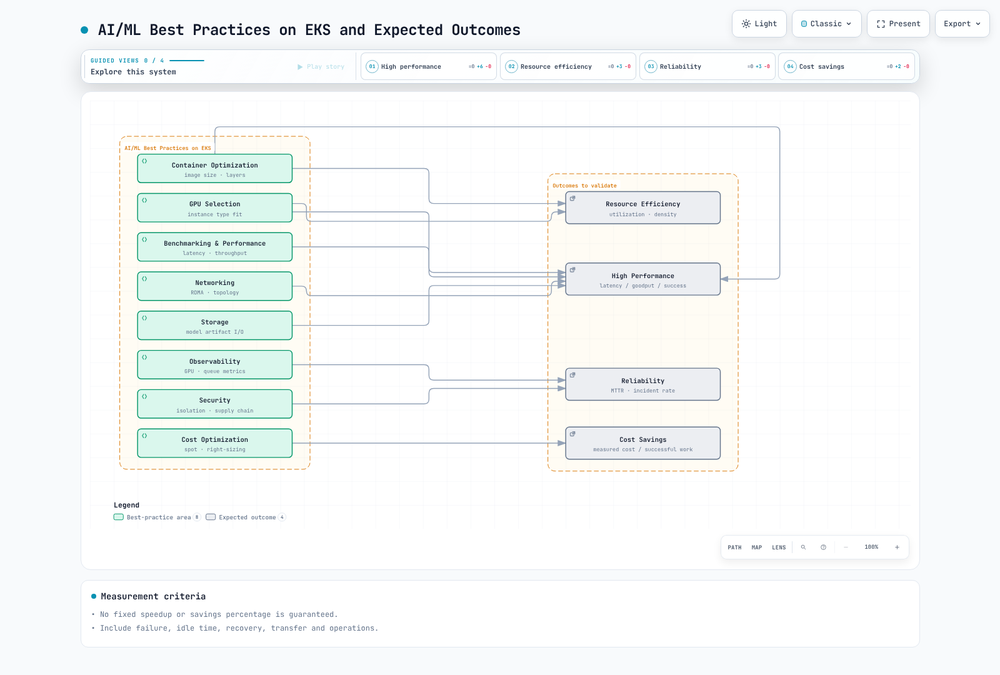
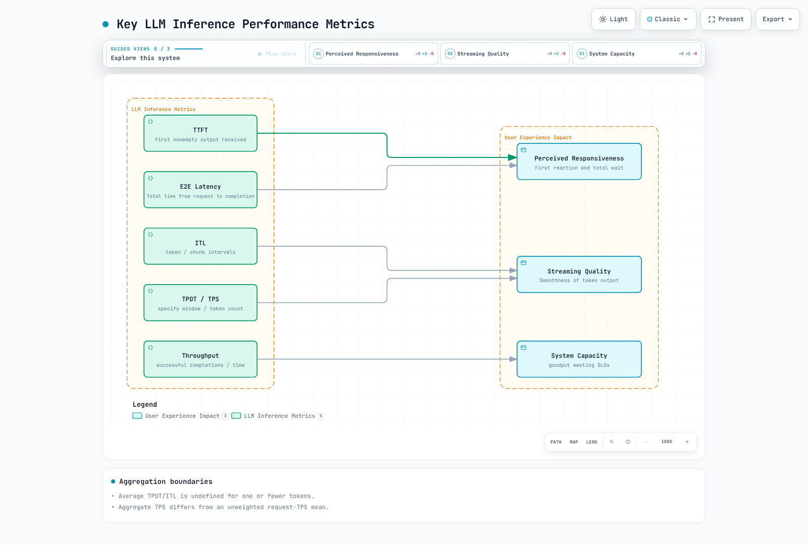

# EKS 上的 AI/ML 最佳实践

> **最后更新**: September 12, 2026
> **基线版本**: inference-perf0.6.1 / SOCI0.15.0 / Karpenter1.14.1 / External Secrets2.10.0

针对相同工作负载，使用延迟、成功率、吞吐量、成本和恢复能力评估改进效果。GPU、快照器或共享功能并不能保证固定的加速效果或节省比例。



[查看交互式图表](https://www.atomai.click/kubernetes-docs/archmaps/en-ai-ml-07-ai-ml-best-practices-0.html)

## LLM 推理基准测试



[查看交互式图表](https://www.atomai.click/kubernetes-docs/archmaps/en-ai-ml-07-ai-ml-best-practices-1.html)

| 指标 | 定义和注意事项 |
| --- | --- |
| TTFT | 从发送请求到收到第一个**非空输出**的时间；第一个 HTTP/SSE 帧不一定包含 token |
| ITL | token/数据块之间的间隔；一个网络数据块可能包含多个 token |
| TPOT | 工具定义的首个 token 之后的平均值；输出 token 不超过一个时未定义 |
| E2E | 从请求到完成的时间；记录队列、网络和后处理的边界 |
| 请求吞吐量 | 成功完成的请求数 / 指定测量时间窗口 |
| Token 吞吐量 | 时间窗口内输出 token 总数 / 时间，而非请求 TPS 的不加权平均值 |
| Goodput | 满足成功和延迟 SLO 标准的请求速率 |

有实际 token 时间戳时，平均 ITL 为(最后一个 token 时间-第一个 token 时间)/(token 数-1)。非流式响应无法测量实际 TTFT/ITL。指定 tokenizer、空输出/单 token 输出、失败和预热排除项。500ms/50ms 并非通用 SLO。

### inference-perf 和 GenAI-Perf

inference-perf 是 Kubernetes SIGs/wg-serving 基准测试工具。检查过的 PyPI 软件包版本为0.6.1，而其 Git 标签中的 pyproject 仍显示0.5.0；已记录这一元数据差异。实际 CLI 使用 --config_file 或 --server.type 等结构化选项，而不是以前的 benchmark --endpoint --prompt-length 接口。

此**内部模拟配置**不会调用模型服务器。实际的0.6.1 CLI 使用一个 worker 完成了三个请求。模拟 token 数为零，TTFT/TPOT 为 null，因此这些结果并非模型性能结果。

```yaml
api:
  type: chat
  streaming: false
data:
  type: mock
load:
  type: concurrent
  stages:
    - concurrency_level: 1
      num_requests: 3
  num_workers: 1
  worker_max_concurrency: 1
  base_seed: 17
server:
  type: mock
  base_url: http://127.0.0.1:8000
report:
  request_lifecycle:
    summary: true
    per_stage: true
    per_request: true
storage:
  local_storage:
    path: ./benchmark-fixture-results
```

```bash
inference-perf --config_file benchmark-fixture.yaml
```

切换到真实端点之前，请验证服务器/API 类型、模型别名、流式传输、tokenizer 和身份验证。配置可能包含机密标头，合并后的配置也会写入日志，因此请验证凭证传递和脱敏方式。保留输出文件、原始请求/响应和失败记录，同时遵守数据集隐私和使用权限。

恒定速率/Poisson 速率用于测量每秒到达的请求数；并发负载用于控制并发数。相同的数值设置并不等效。测试单请求基线、受限负载递增、突发负载和真实分布。仅凭饱和曲线无法证明存在 CPU/GPU/内存瓶颈；请检查性能分析、队列、网络和客户端容量。

使用 GenAI-Perf0.0.16 中经审查的[profile/endpoint/service/token 选项](04-inference-frameworks.md)，不要使用虚构的 --backend vllm 组合。GPU 指标需要单独采集；请检查负载生成器的 CPU/网络限制。基准测试 Job 需要经过验证的镜像、配置键、PVC、截止时间和重试语义，并且这些语义要考虑重复负载。

## 容器启动优化


[查看交互式图表](https://www.atomai.click/kubernetes-docs/archmaps/en-ai-ml-07-ai-ml-best-practices-2.html)

分别测量镜像传输、解包、模型下载/加载和就绪时间。已移除缺乏来源依据的“始终需要5–15分钟”和“节省80–95%”表格。45GB/1Gbps≈360秒只是理想化的传输计算，未考虑压缩大小、协议、磁盘和并发开销，并非实测的拉取时间。

外部模型制品可以减少镜像变更/拉取，但会增加下载和缓存管理成本。在某些环境中，预先准备好的镜像可能更合适。初始化必须传递失败状态，并验证版本、校验和及完成状态。以前的 S3 sync 后接成功 echo 的做法可能掩盖下载失败，因此已移除。

多阶段构建必须确保 Python 解释器/ABI 和 CUDA/运行时库一致，包括可执行文件/共享库。不要假定 Ubuntu22.04 的 python3.11 和 pip3 使用同一个解释器，也不要只复制 site-packages。使用受支持的发行版软件包/wheel，并在镜像内测试导入和入口点。优先使用只读根文件系统，并显式挂载可写的缓存/tmp/模型目录。

### SOCI0.15

SOCI 支持延迟加载镜像，但如果启动时立即读取所有权重/库，收益可能会减少。拥有索引并不意味着已配置 CRI 使用 SOCI snapshotter。请验证 containerd/CRI 集成、镜像/索引摘要和注册表兼容性。已移除未经验证、暴露主机 containerd 套接字的特权 DaemonSet。

版本0.15 的 create/push 使用位置参数形式的镜像引用，而不是 --ref。当前入门指南使用 convert 来创建启用了 SOCI 的镜像。独立模式可处理本地 OCI 布局，无需 containerd 或 sudo。

```bash
soci convert --standalone --format oci-dir input-oci-layout output-soci-layout
```

输入必须是 OCI 布局，而不是普通的 docker-save tar 包。如果每一层都小于 min-layer-size，转换可能会失败。本次审查使用显式设置的 min-layer-size=0 转换了一个合成层，并验证了八个 blob 摘要。未运行容器启动基准测试。发布时，请将转换后的镜像和索引一起保留。

### Bottlerocket Bootstrap

在1.64版本中，`bootstrap-containers.<name>.user-data` 是**base64 数据**，由 bootstrap 容器作为文件使用。设置中的普通 shell 文本不会自动执行。源镜像必须真实存在，并且正确使用主机镜像存储/命名空间。静态的 images-prefetched=true 标签并不能证明预取成功。

执行后，mode=once 会变为 off。essential=true 时，失败会停止启动；false 则允许失败，因此应根据就绪需求设置该选项。allowed-unsafe-sysctls 不是特权容器开关。测量时请计入预取对节点准备时间的影响。

## GPU、Neuron 和存储选择

参数×字节数只是权重占用的下限。还要考虑架构相关的 KV cache、激活值、工作区、通信缓冲区、内存碎片和分片约束。13B FP16 权重约为26GB，无法装入24GB；70B FP16 约为140GB，超过四块24GB GPU 的总容量。增加主机 CPU 并不会扩大未变的 GPU VRAM。

请区分 p4d.24xlarge（8×40GB）和 p4de（8×80GB A100）。G5g 使用 Arm/T4G；请验证镜像/内核架构。inf2.48xlarge 的主机 RAM 为192vCPUs/768GiB，包含12chips/24NeuronCores/384GiB HBM，详见[经审查的 Inf2 表格](04-inference-frameworks.md)。P5 这样的系列名称并不能确定所有规格的 GPU 数量。选择时请重新检查可用代际、区域、配额和价格。

LoRA 会减少可训练的适配器状态，但仍保留基础权重/激活值，且与 QLoRA 不同。不要使用假设大多数 LoRA 模型都能装入24GB 的函数。测量峰值内存、延迟、吞吐量和重启情况。

不要仅根据10TB 数据集阈值选择存储。请比较访问模式、并发、元数据、延迟、语义、持久性和成本。当前通用 gp3 文档列出的基准性能为3000IOPS/125MiB/s，最高为80000IOPS/2000MiB/s，但受容量/IOPS/实例限制；Outposts 的情况不同。历史上的16000IOPS/1GB/s 限制并非当前普遍适用。

有关 EFS Elastic 吞吐量、FSx/CSI/S3 关联和 Mountpoint POSIX 限制，请参阅[基础设施指南](06-ai-infrastructure.md)。S3 并非吞吐量无限或延迟固定；EFS 也并非总是比 FSx 慢。实例存储/tmpfs 是临时的。GPU KV cache 通常位于 GPU 内存中，不会自动放到 SSD/tmpfs。

### 模型缓存验证

存在 config.json 文件并不能证明权重已下载完成。在暴露不可变只读存储之前，请根据可信发布清单/版本验证**所有文件**。防止下载器并发竞争和写入不完整的文件。

此本地验证器不会下载/删除文件。测试涵盖完整文件、错误版本、部分/缺失权重、路径遍历和外部符号链接。清单可信度和验证后的不可变性仍是单独的要求。

```python
from pathlib import Path
import hashlib
import re


def verify_model_cache(root, manifest, expected_revision):
    """Verify files against a separately trusted release manifest; no downloads/deletion."""
    root = Path(root).resolve(strict=True)
    if manifest.get("revision") != expected_revision:
        raise ValueError("Model revision mismatch")
    files = manifest.get("files")
    if not isinstance(files, dict) or not files:
        raise ValueError("Empty or invalid release manifest")
    for relative, expected_hash in files.items():
        name = Path(relative)
        if name.is_absolute() or ".." in name.parts or not name.parts:
            raise ValueError("Unsafe manifest path")
        if not isinstance(expected_hash, str) or not re.fullmatch(r"[0-9a-f]{64}", expected_hash):
            raise ValueError("Invalid SHA256")
        target = (root / name).resolve(strict=True)
        if not target.is_relative_to(root) or not target.is_file():
            raise ValueError("File escapes the cache or is not a regular file")
        digest = hashlib.sha256()
        with target.open("rb") as source:
            for chunk in iter(lambda: source.read(1024 * 1024), b""):
                digest.update(chunk)
        if digest.hexdigest() != expected_hash:
            raise ValueError("Incomplete or corrupt model file: " + relative)
    return root
```

检查点需要包含优化器/RNG/数据游标和分片状态，参见[训练/恢复示例](05-model-training.md)。只有在传输、校验和及完成清单均成功后，才可删除先前有效的副本。旧的 ls/xargs rm -rf 循环混淆了目录内容与检查点路径，并试图通过只读挂载执行删除，因此已移除。将首次同步延迟30分钟或省略终止时的刷新操作，都会增加工作丢失的风险。

## 网络和调度

对于合适的工作负载，EFA 可以改善通信；但并非每次 DDP 执行都需要它。请验证接口、同一 AZ 调度、driver/libfabric/aws-ofi-nccl、Pod 资源、安全组和实际传输方式。RAID0/子网标签并不能启用 EFA。避免使用未经验证的 NCCL_TIMEOUT，以及盲目复制 Ring/Simple/IB_DISABLE 设置。torchrun --nnodes 统计的是节点数，而非总进程数 WORLD_SIZE。

使用 Karpenter1.14.1 实际支持的 placementGroupSelector。aws:ec2:placement-group 标签不是放置 API，aws: 也不是用户标签命名空间。此**架构示例**需要经过批准的 AMI/子网/安全组/角色标识符，以及一个已存在的 placement group。示例指定 amiFamily AL2023，因此替换项必须是经过验证的 EKS AL2023 AMI，而不是其他操作系统的 AMI。此示例并未完成 EFA networkInterfaces 配置。

```yaml
apiVersion: karpenter.k8s.aws/v1
kind: EC2NodeClass
metadata:
  name: prepared-gpu-class
spec:
  role: REPLACE_WITH_APPROVED_NODE_ROLE
  amiSelectorTerms:
  - id: ami-0123456789abcdef0
  subnetSelectorTerms:
  - id: subnet-0123456789abcdef0
  securityGroupSelectorTerms:
  - id: sg-0123456789abcdef0
  placementGroupSelector:
    name: prepared-training-placement-group
  amiFamily: AL2023
```

### 中断预算和 Spot

此预算适用于周一至周五 **09:00–17:00UTC**。旧配置0 9-17 * * 1-5 每小时都会启动一个持续八小时的窗口，直到17:00，导致保护延长至次日01:00。并发预算采用限制更严格的规则，且不会自动遵循本地时区。

```yaml
apiVersion: karpenter.sh/v1
kind: NodePool
metadata:
  name: reviewed-gpu-pool
spec:
  template:
    spec:
      nodeClassRef:
        group: karpenter.k8s.aws
        kind: EC2NodeClass
        name: prepared-gpu-class
      requirements:
      - key: karpenter.sh/capacity-type
        operator: In
        values:
        - on-demand
        - spot
  disruption:
    consolidationPolicy: WhenEmptyOrUnderutilized
    consolidateAfter: 5m
    budgets:
    - nodes: '0'
      schedule: 0 9 * * 1-5
      duration: 8h
    - nodes: 30%
```

budgets.nodes=0 限制的是主动中断，不包括 Spot 中断、节点故障或强制到期。Spot-only 要求是强制条件，并非优先使用 Spot、同时允许回退到 on-demand。ScheduleAnyway 拓扑分散是软性约束；请验证实际副本数、容量和 AZ 分布。

terminationGracePeriodSeconds=120 并不保证 EC2 会提供120秒。请通过真实终止流程测试网关就绪/排空、端点传播、SIGTERM、活动流、重试和重复请求。不要虚构 vLLM /drain API。推理缓存、会话和 TP 组都带有状态/重启成本。

## 可观测性和成本

使用[vLLM 当前指标](02-vllm-deployment.md)和[DCGM 规则](06-ai-infrastructure.md)。KV 占用指标是 vllm:kv_cache_usage_perc，而不是旧的 gpu_cache_usage_perc。请观察队列/抢占和后端行为，不要假设缓存一满就会立即拒绝请求。使用当前命中/查询计数器推导前缀命中率，并处理分母为零的情况。

DCGM FB_USED/FREE 是以 MiB 为单位的 gauge；XID_ERRORS 是最后一次错误代码。避免使用不存在的 FB_TOTAL，或对 gauge 使用 increase()。仅凭温度无法证明发生了热降频；请比较时钟、功耗、降频原因和工作负载。匹配 Prometheus 标签/直方图聚合方式，并对 avg_over_time 在表达式上的用法使用有效的子查询语法。

VPA Off 提供 CPU/内存建议，不会自动选择 GPU 实例。之前的规格调整脚本只检查了第一个序列，并将0–1的比率与50/90比较，因此已移除。移除工作负载后，请跨工作负载检查峰值、队列、SLO 和恢复情况。

使用实际区域/操作系统/购买条款、利用率、空闲/故障时间、存储、传输和运维成本记录节省情况。Spot/Savings Plans/RI 的折扣和容量保证各不相同。避免使用固定的60–90%表格，也不要将优化节省比例相加。应使用测得的基线和波动情况，单独做出承诺购买决策。

## 模型访问和机密管理

S3 ListBucket 和 GetObject 分别使用存储桶/对象 ARN 和受支持的条件键。通用存储桶可以使用 aws:ResourceTag/Environment 等存储桶标签条件，但前提是已显式启用 ABAC。ABAC 默认处于禁用状态：请验证存储桶状态、可信的标签管理权限、身份/存储桶策略以及操作/资源配对，不要仅复制标签条件。启用 ABAC 不会自动创建所需的 Allow，也不会覆盖其他 Deny 策略。请验证信任绑定的 ServiceAccount 命名空间/名称、SDK 凭证链和实际请求身份。vLLM 不会自动下载所有 S3 模型 URI。

检查过的 ESO2.10.0 CRD **提供 v1**，v1beta1 的 served=false。此示例引用已批准、且位于同一命名空间的 SecretStore。远程密钥、权限、轮换和目标资源生命周期应分别准备。

```yaml
apiVersion: external-secrets.io/v1
kind: ExternalSecret
metadata:
  name: model-download-token
  namespace: ai-ml
spec:
  refreshPolicy: Periodic
  refreshInterval: 1h
  secretStoreRef:
    name: approved-secrets-manager
    kind: SecretStore
  target:
    name: model-download-credential
    creationPolicy: Owner
  data:
  - secretKey: token
    remoteRef:
      key: approved/model-download
      property: token
```

将 Kubernetes Secrets 挂载为卷，并在需要时让应用重新读取文件。subPath 挂载不会自动接收更新；环境变量或仅在启动时读取的值也不会自动重新加载。ESO 刷新本身并不等同于上游凭证的签发/轮换。请分别验证提供方轮换、Secret 访问和应用重新加载。

CloudTrail Secrets Manager API 记录不会捕获应用对本地 Secret 文件的每一次读取。不要声称 kubectl describe 通常会打印 SecretKeyRef 的值，但通过环境变量传递仍会暴露进程/调试层面的风险，也不同于文件凭证策略。示例/日志中绝不能打印真实机密。

NetworkPolicy 需要 CNI 执行策略。请验证选择器的 AND/OR 语义、默认命名空间名称标签以及 TCP/UDP DNS。已移除开放10.0.0.0/8 健康检查以及“允许互联网443就等于仅允许 S3”的规则。模型已准备好的情况下，应将运行时出站流量限制为必要路径，并在网关处区分推理/管理 API。

审计日志应记录用户/工作负载身份、模型版本、操作、结果和请求 ID，并酌情对提示/机密进行脱敏。将 containerd CRI 日志按 Docker 日志解析，或仅保留包含 request 的行，都可能丢失审计事件。请验证实际的采集器、解析器、IAM、缓冲区、保留期限和投递失败情况，而不仅仅是检查 ConfigMap。

## 验证范围

已审查所有原始指南/测验文本和87个不重复的代码块。验证包括三个原生 inference-perf 模拟请求、SOCI 本地 OCI 转换、六种缓存情况、三个 Karpenter/ESO 架构，以及 cron 算术。未执行 GPU/真实模型基准测试、容器启动测量、主机 SOCI 安装、云资源操作或机密提供方调用。

## 参考资料

- [inference-perf0.6.1](https://github.com/kubernetes-sigs/inference-perf/tree/v0.6.1)
- [SOCI0.15 CLI](https://github.com/awslabs/soci-snapshotter/blob/v0.15.0/docs/cli-usage.md)
- [Bottlerocket1.64 bootstrap 设置](https://bottlerocket.dev/en/os/1.64.x/api/settings/bootstrap-containers/)
- [Karpenter1.14.1 CRD](https://github.com/aws/karpenter-provider-aws/tree/v1.14.1/pkg/apis/crds)
- [Karpenter 中断](https://karpenter.sh/docs/concepts/disruption/)
- [ESO2.10 ExternalSecret CRD](https://github.com/external-secrets/external-secrets/blob/helm-chart-2.10.0/config/crds/bases/external-secrets.io_externalsecrets.yaml)
- [Kubernetes Secret 更新](https://kubernetes.io/docs/concepts/configuration/secret/)
- [S3 通用存储桶 ABAC 启用](https://docs.aws.amazon.com/AmazonS3/latest/userguide/buckets-tagging-enable-abac.html)
- [EBS gp3 性能](https://docs.aws.amazon.com/ebs/latest/userguide/general-purpose.html)

## 测验

[AI/ML 最佳实践测验](../quizzes/ai-ml/07-ai-ml-best-practices-quiz.md)
