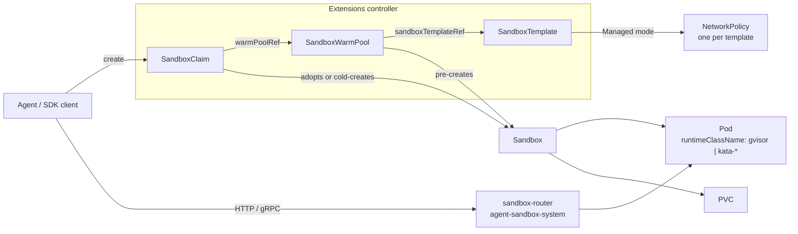

# EKS 上的 Agent Sandbox：面向 AI Agent 的隔离、有状态运行环境

> **支持的版本**：Agent Sandbox v1.0.6（API `v1beta1`）、Python SDK `k8s-agent-sandbox` 1.0.6、Karpenter v1.13.0+（支持 `cpuOptions.nestedVirtualization`）
> **最后更新**：2026 年 10 月 16 日

[Agent Sandbox](https://github.com/kubernetes-sigs/agent-sandbox)（`kubernetes-sigs/agent-sandbox`）是 Kubernetes SIG Apps 子项目，新增了 `Sandbox` 自定义资源及其控制器，用于**隔离的、有状态的单实例工作负载**。一个 Sandbox 对应一个 Pod，具有稳定身份、可选持久存储和生命周期控制（过期、暂停和恢复），这些概念无法直接用 Deployment 和 StatefulSet 建模。典型使用者包括执行 LLM 生成代码的 AI Agent、强化学习（RL）rollout、notebook 和每用户开发环境。

本章依据 tag `v1.0.6` 的 API 说明项目本身，并介绍在 Amazon EKS 上运行时的差异：运行时隔离选项、Amazon VPC CNI 下默认 NetworkPolicy 的行为、router 的私有暴露方式以及 IAM。

> 本章事实依据上游 tag `v1.0.6` 的源码（CRD 类型、控制器、发行说明、威胁模型）、AWS 文档和 Karpenter 源码。本章中的清单没有在 EKS 集群上运行；请将它们视为起点，并在自己的节点/网络配置上测试。

---

## 1. 为什么需要新的工作负载 API

| 需求 | Deployment | StatefulSet（replicas: 1）+ Service + PVC | Sandbox |
|------|------------|------------------------------------------|---------|
| 恰好一个具有稳定名称的 Pod | 否（带随机后缀） | 是（`name-0`） | 是（Pod 名称 = Sandbox 名称） |
| 每个实例的存储在 Pod 重启后保留 | 否 | 是 | 是（`volumeClaimTemplates`） |
| 停止计算资源但保留对象和卷 | 缩容到 0（所有副本） | 缩容到 0 | `operatingMode: Suspended` |
| 绝对过期时间 | 否 | 否 | `shutdownTime` + `shutdownPolicy` |
| 按需交付预热实例 | 否 | 否 | `SandboxWarmPool` + `SandboxClaim` |
| 针对不可信代码的安全默认设置 | 否 | 否 | `SandboxTemplate`（无 SA token、由其管理 NetworkPolicy） |

Agent 平台通常需要数千个短命或大多数时间闲置的环境，每个环境由一个会话或用户拥有。使用大小为 1 的 StatefulSet 加 Service 和 PVC 虽然可行，但过期时间、预热池、claim 延迟和隔离默认设置都需要自定义代码处理。

### 项目状态（2026 年 10 月 16 日）

| 项目 | 值 |
|------|-------|
| 仓库创建时间 | 2025 年 8 月 12 日 |
| v1.0.0 | 2026 年 8 月 28 日：移除 `v1alpha1` 和转换 webhook；所有 CRD 只提供 `v1beta1` |
| 最新发布 | v1.0.7（2026 年 10 月 15 日）；自 v1.0.0 起每周发布补丁版本。本章依据 v1.0.6 |
| API group | `agents.x-k8s.io/v1beta1`（核心）、`extensions.agents.x-k8s.io/v1beta1`（扩展） |
| 控制器命名空间 | `agent-sandbox-system` |
| SDK | Python（`k8s-agent-sandbox`，Python ≥ 3.11）、Go（`sigs.k8s.io/agent-sandbox/clients/go/sandbox`）、TypeScript |
| 隔离方式 | 通过 Pod 的 `RuntimeClass` 委派选择（例如 gVisor 或 Kata Containers） |

项目版本为 1.0，但 API 版本仍是 `v1beta1`。请固定 release 版本，并阅读每个发行版中的 “Breaking Changes / Action Required” 部分；多个补丁版本（v1.0.2、v1.0.5、v1.0.6、v1.0.7）都包含必须执行的操作。

---

## 2. 架构



| 类型 | Group | 简称 | 作用 |
|------|-------|-----------|------|
| `Sandbox` | `agents.x-k8s.io` | `sandbox` | 一个具有稳定身份的 Pod，可选 PVC 和 headless Service，并提供生命周期及暂停控制 |
| `SandboxTemplate` | `extensions.agents.x-k8s.io` | `sandboxtemplate` | 可复用蓝图及平台策略（NetworkPolicy、环境变量和卷注入规则） |
| `SandboxWarmPool` | `extensions.agents.x-k8s.io` | `swp` | 根据模板维持 N 个可供认领的 Sandbox；有供 HPA 使用的 scale 子资源 |
| `SandboxClaim` | `extensions.agents.x-k8s.io` | `sandboxclaim` | 从预热池请求 Sandbox；完成接管后拥有该 Sandbox |

支撑组件：

- **sandbox-router**（可选）：Go HTTP 反向代理（`registry.k8s.io/agent-sandbox/sandbox-router-go`），通过 `X-Sandbox-ID` 标头路由，也可通过 `--path-routing-prefix` 按 URL 路径路由。自 v1.0.2 起，相关清单位于 `agent-sandbox-system`；并支持 Ed25519 范围化 token（v2），绑定 Sandbox UID、端口、方法和路径。
- **sandboxd**：在 Sandbox 内运行的 runtime 守护进程（在 `:8080` 提供 REST 文件系统接口，在 `:9090` 提供 gRPC `ProcessService`），SDK 可用它执行命令、操作文件和启动交互进程。

---

## 3. 核心 `Sandbox` 资源

```yaml
apiVersion: agents.x-k8s.io/v1beta1
kind: Sandbox
metadata:
  name: py-session-42           # also the Pod name; ≤ 63 chars when spec.service is true
  namespace: agents
spec:
  podTemplate:
    metadata:
      labels:
        team.example.com/owner: data-science
    spec:
      runtimeClassName: gvisor   # isolation comes from the runtime, not from Agent Sandbox
      automountServiceAccountToken: false
      containers:
      - name: runtime
        image: <your-registry>/python-runtime:<tag>
        ports:
        - containerPort: 8888
        resources:
          requests: { cpu: 250m, memory: 512Mi }
          limits:   { cpu: "1",  memory: 1Gi }
  volumeClaimTemplates:          # immutable after creation
  - metadata:
      name: workspace
    spec:
      accessModes: [ReadWriteOnce]
      storageClassName: gp3
      resources:
        requests:
          storage: 5Gi
  service: true                  # create a headless Service named after the Sandbox
  operatingMode: Running         # or Suspended
  shutdownTime: "2026-10-14T00:00:00Z"
  shutdownPolicy: Delete         # default Retain
```

`v1beta1` 中的字段行为：

| 字段 | 行为 |
|-------|----------|
| `podTemplate` | 必需。标签和注解会传递到 Pod，但控制器会过滤掉位于 `agents.x-k8s.io/` 和 `extensions.agents.x-k8s.io/` 下的系统保留键。 |
| `volumeClaimTemplates` | 为每个 Sandbox 创建 PVC；不可变（CEL 规则）。 |
| `service` | 未设置：不创建新 Service（为保持向后兼容会保留现有 Service）。`true`：创建一个以 Sandbox 命名的 headless Service。`false`：移除 Service。 |
| `operatingMode` | `Running`（默认值）保留 Pod；`Suspended` 会删除 Pod，但保留 Sandbox 对象及其 PVC。 |
| `shutdownTime` | 绝对过期时间。到期后删除 Pod 和 Service。 |
| `shutdownPolicy` | `Retain`（默认值）会保留 Sandbox 对象，并设为 `Ready=False, reason=SandboxExpired`；`Delete` 会删除该对象。 |

状态条件遵循 Gateway API 约定：

| 条件 | 含义 |
|-----------|---------|
| `Ready` | 只有当 Pod 正在运行、处于 Ready 且具有 IP（若要求 Service，也必须已存在）时才为 True。False 原因包括 `DependenciesNotReady`、`SandboxSuspended`、`SandboxExpired`、`InvalidConfiguration`、`ReconcilerError`。 |
| `Suspended` | 暂停进度：先为 `PodTerminating`，再为 `PodTerminated`；恢复运行后为 `NotSuspended`。 |
| `PodScheduled` | 镜像 Pod 的 `PodScheduled` 条件（例如 `Unschedulable`），因此无需单独读取 Pod。 |
| `Finished` | Pod 进入 `Succeeded` 或 `Failed` 后设置。 |

`status` 还包含 `serviceFQDN`、`podIPs` 和 `nodeName`。

> **v1.0.6 必须处理的事项**：当 `spec.service` 为 `true` 时，CEL 规则会拒绝名称超过 63 个字符的 Sandbox（Service 名称必须是 DNS-1035 label）。现有对象也不例外，因此此类 Sandbox 的每次更新（包括状态更新）都会失败，直到将 `spec.service` 设为 unset，或使用更短名称重新创建。

---

## 4. 扩展：Template、预热池与 Claim

### SandboxTemplate：平台策略所在位置

```yaml
apiVersion: extensions.agents.x-k8s.io/v1beta1
kind: SandboxTemplate
metadata:
  name: python-gvisor
  namespace: agents
spec:
  podTemplate:
    metadata:
      annotations:
        karpenter.sh/do-not-disrupt: "true"   # optional: keep consolidation away from live sessions
    spec:
      runtimeClassName: gvisor
      containers:
      - name: python-runtime
        image: <your-registry>/python-runtime-sandbox:<tag>
        ports:
        - containerPort: 8888
        readinessProbe:
          httpGet: { path: "/", port: 8888 }
          periodSeconds: 1
        resources:
          requests: { cpu: 250m, memory: 512Mi, ephemeral-storage: 512Mi }
          limits:   { cpu: "1",  memory: 1Gi }
  networkPolicyManagement: Managed      # default
  # networkPolicy: omitted -> controller applies its secure default (section 6)
  envVarsInjectionPolicy: Disallowed    # default; Allowed | Overrides
  volumeClaimTemplatesPolicy: Disallowed  # default; Allowed | Overrides
```

通过模板创建的 Sandbox（通过预热池或 claim 创建）会应用以下安全默认设置：

- 如果 PodSpec 未设置 `automountServiceAccountToken`，控制器会将其设为 `false`。
- 使用 `networkPolicyManagement: Managed`（默认值）时，控制器会为每个模板创建**一个共享的 NetworkPolicy**。编辑其规则会影响该模板所有现有和未来 Sandbox 的强制策略。
- 除非模板允许，否则 claim 不能注入环境变量或 volume template。

直接创建的 `Sandbox` 不会获得这些默认设置。如果用户可能直接创建 `Sandbox` 对象，应使用准入控制（ValidatingAdmissionPolicy、Kyverno 或 Gatekeeper）；或者只授予其 `SandboxClaim` 的 RBAC 权限。

### SandboxWarmPool：预先创建的容量

```yaml
apiVersion: extensions.agents.x-k8s.io/v1beta1
kind: SandboxWarmPool
metadata:
  name: python-gvisor-pool
  namespace: agents
spec:
  replicas: 10                 # default 1; scale subresource, so an HPA can own it
  sandboxTemplateRef:
    name: python-gvisor
  updateStrategy:
    type: OnReplenish          # default; Recreate replaces stale unclaimed Sandboxes at once
```

模板蓝图更改后，尚未认领的 Sandbox 会变成过时状态。`OnReplenish` 只会在它们被认领或删除时替换；`Recreate` 会立即删除它们。已认领的 Sandbox 不会受到影响，因为所有权已转移给 claim。

### SandboxClaim：Agent 会话请求什么

```yaml
apiVersion: extensions.agents.x-k8s.io/v1beta1
kind: SandboxClaim
metadata:
  name: session-7f3a
  namespace: agents
spec:
  warmPoolRef:
    name: python-gvisor-pool
  lifecycle:
    shutdownTime: "2026-10-13T12:00:00Z"
    shutdownPolicy: Delete       # Delete | DeleteForeground | Retain (default)
    ttlSecondsAfterFinished: 600
```

- Claim 会从预热池接管一个 Ready Sandbox。如果在 `--sandbox-claim-warm-candidate-grace-period` 时间内（默认 `2s`，v1.0.6 新增）没有预热候选项报告 Pod IP，就会回退为冷启动创建一个实例。
- 设置 `spec.env` 或 `spec.volumeClaimTemplates` 总是会强制冷启动，因为这些值必须在创建 Pod 之前就确定。
- `additionalPodMetadata` 标签必须使用获准的域名（默认 `sandbox.users.io`，可通过 `agent-sandbox-config` ConfigMap 配置）。
- `status.sandbox` 会报告所绑定 Sandbox 的 `name`、`podIPs` 和 `serviceFQDN`。

---

## 5. 在 EKS 上隔离：选择 RuntimeClass

Agent Sandbox 是一个编排器。其威胁模型说明，应通过 `runtimeClassName` 选择更强的运行时来缓解容器逃逸风险；最好在 `SandboxTemplate` 中设置，避免用户将其移除。使用默认 `runc` 时，LLM 生成的代码会与节点上的所有其他 Pod 共享节点内核。

| EKS 上的选项 | 隔离边界 | 节点要求 | 说明 |
|---------------|-------------------|-----------------|-------|
| `runc`（默认值） | Linux namespace 和 cgroup | 任意节点 | 不适合在共享节点上运行不可信代码 |
| gVisor（`runsc`） | 用户空间应用内核 | 安装 `runsc` 和 `containerd-shim-runsc-v1`，并在 containerd 中注册 `runsc` handler | 可用于普通虚拟化实例；部分系统调用和工作负载行为不同，需先测试 |
| Kata Containers | 每个 Pod 一个轻量 VM | 硬件虚拟化：裸机（`*.metal`）实例，或支持嵌套虚拟化的实例 | 这些选项中隔离边界最强；每个 Pod 的额外开销也较高 |
| 每个租户独立节点 | EC2 实例 | Taint、toleration 和节点选择器 | 可与 gVisor 或 Kata 配合使用 |

EKS 特定事项：

- **EKS Auto Mode**：AWS 选择 AMI 并负责容器运行时，实例无法通过 SSH 访问，因此不能在此添加 `runsc` 或 Kata。可用托管节点组、自管理节点或使用自定义 AMI/user data 的 Karpenter 沙箱节点池。
- **gVisor**：在自定义 AMI 或启动时安装二进制文件，并注册 runtime handler。在 AL2023 上，nodeadm 的 `NodeConfig` 在 `spec.containerd.config` 中接受内联 TOML。containerd 1.x 使用 config version 2（`plugins."io.containerd.grpc.v1.cri"`），2.x 使用 version 3（`plugins."io.containerd.cri.v1.runtime"`）；编写 runtime 配置前请在 AMI 上运行 `containerd --version` 检查。
- **Kata 与嵌套虚拟化**：EC2 在 M7i、M7i-flex、M8i、M8id、M8i-flex、C7i、C7i-flex、C8i、C8id、C8i-flex、R7i、R7iz、R8i、R8id、R8i-flex、X8i、I7i 和 I7ie 上支持嵌套虚拟化（KVM 或 Hyper-V 作为 L1），需通过 CPU 选项 `NestedVirtualization=enabled` 启用。对性能敏感的工作负载，AWS 建议使用裸机实例。
  - Karpenter v1.13.0 及更高版本的 `EC2NodeClass` 提供 `spec.cpuOptions.nestedVirtualization: enabled`，并将实例类型限制为具有 `nested-virtualization` 能力的类型。
  - 针对托管节点组的 containers-roadmap 请求（[#2784](https://github.com/aws/containers-roadmap/issues/2784)）于 2026 年 10 月 12 日标记为完成，原因是用户反馈启动模板设置已生效。依赖前请在测试节点上运行 `grep -cE 'vmx|svm' /proc/cpuinfo` 确认。
- **Fargate** 会在每个 Pod 的独立 VM 中运行，但 VPC CNI 无法对 Fargate Pod 应用网络策略，因此无法强制执行模板管理的 NetworkPolicy。选择 Fargate 前请阅读其注意事项。

将 RuntimeClass 绑定到准备好的节点，确保沙箱 Pod 永远不会调度到缺少相应 handler 的节点上：

```yaml
apiVersion: node.k8s.io/v1
kind: RuntimeClass
metadata:
  name: gvisor
handler: runsc
scheduling:
  nodeSelector:
    sandbox.example.com/runtime: gvisor
  tolerations:
  - key: sandbox.example.com/untrusted
    operator: Exists
    effect: NoSchedule
---
# Karpenter: a NodeClass for Kata nodes on nested-virtualization instances
apiVersion: karpenter.k8s.aws/v1
kind: EC2NodeClass
metadata:
  name: kata-nested
spec:
  cpuOptions:
    nestedVirtualization: enabled   # Karpenter >= v1.13.0
  # amiSelectorTerms, role, subnetSelectorTerms, securityGroupSelectorTerms,
  # and user data that installs Kata are omitted here.
```

---

## 6. EKS 上的网络

### 默认管理策略的行为

模板未设置 `networkPolicy` 且保持 `Managed` 模式时，控制器会生成以下策略（来自 v1.0.6 中的 `buildDefaultNetworkPolicySpec`）：

| 方向 | 规则 |
|-----------|------|
| 入站 | 仅允许来自 `agent-sandbox-system` 命名空间中带有 `app: sandbox-router` 标签的 Pod |
| 出站（IPv4） | `0.0.0.0/0`，排除 `10.0.0.0/8`、`172.16.0.0/12`、`192.168.0.0/16`、`169.254.0.0/16` |
| 出站（IPv6） | `::/0`，排除 `fc00::/7`、`fe80::/10` |
| DNS | 不允许：CoreDNS 使用私有 IP，代码注释指出这是有意设置，用来阻止内部服务发现 |

对 EKS 的影响：

1. **强制执行需要网络策略引擎。** 启用 Amazon VPC CNI add-on 中的网络策略（版本 1.21.0 或更高版本，`enableNetworkPolicy: "true"`）。Auto Mode 上，在 `kube-system` 命名空间的 `amazon-vpc-cni` ConfigMap 中设置 `enable-network-policy-controller: "true"`；NodeClass 的 `networkPolicy` 设置为可选。没有强制执行时，NetworkPolicy 对象虽然存在，但不会阻止任何流量。
2. **默认无法解析公共主机名。** Agent 调用 `pip install` 或按名称访问公共 API 都会失败，直到你允许 DNS，或为 Pod 配置另一种解析器。
3. **私有地址范围列表并非你的 VPC 地址规划。** 检查默认策略仍允许访问什么：
   - RFC1918 之外的 VPC CIDR（例如 VPC CNI 自定义网络使用的 `100.64.0.0/10` 辅助 CIDR）**不会**被排除。
   - 在 IPv4 集群中，IMDS（`169.254.169.254`）和 Route 53 Resolver（`169.254.169.253`）会被阻止，这是预期行为。EKS Pod Identity Agent（`169.254.170.23`）也会被阻止，因此默认策略下不能使用 Pod Identity 凭据。
   - 在 **IPv6 集群**中，VPC CNI 会忽略 IPv4 规则，仅强制执行 IPv6 规则。IMDS、Resolver 和 Pod Identity Agent 的 IPv6 地址（`fd00:ec2::254`、`fd00:ec2::253`、`fd00:ec2::23`）都属于 `fc00::/7`，因此会被阻止。但 Pod 和节点地址是来自 VPC IPv6 CIDR 的全局单播地址，会被 `::/0` 规则允许。
   - 同样在 IPv6 集群中，VPC CNI 只对 Pod 主接口（`eth0`）应用策略。启用 IPv4 出站（`ENABLE_V4_EGRESS=true`）后，IPv4 流量会从额外接口离开，该接口不受任何策略过滤，包括访问 `169.254.169.254` 和 RFC1918 地址的流量。如果沙箱节点不需要 IPv4 出站，请禁用它，并将 IMDS hop limit 保持为 1。
   - VPC 接口端点使用私有 IP，因此会被阻止。如有 AWS API 调用，流量将通过 NAT 发往公共端点。
4. **集群内部的直接连接会被阻止。** 入站只允许 router，因此使用 SDK 集群内模式（Service DNS 或 Pod IP）的 Agent Pod 需要额外的入站规则以允许其命名空间。

针对 IPv4 集群，假设 VPC 使用 `10.0.0.0/16`，Pod CIDR 为 `100.64.0.0/16`，自定义策略可能如下。它仅允许访问 CoreDNS 的 DNS 查询、允许 Agent 命名空间直接连接，并将所有 VPC 范围排除在公共出站之外：

```yaml
spec:
  networkPolicyManagement: Managed
  networkPolicy:
    ingress:
    - from:
      - namespaceSelector:
          matchLabels: { kubernetes.io/metadata.name: agent-sandbox-system }
        podSelector:
          matchLabels: { app: sandbox-router }
      - namespaceSelector:
          matchLabels: { kubernetes.io/metadata.name: agent-orchestrator }
      ports:
      - { protocol: TCP, port: 8888 }
    egress:
    - to:
      - namespaceSelector:
          matchLabels: { kubernetes.io/metadata.name: kube-system }
        podSelector:
          matchLabels: { k8s-app: kube-dns }
      ports:
      - { protocol: UDP, port: 53 }
      - { protocol: TCP, port: 53 }
    - to:
      - ipBlock:
          cidr: 0.0.0.0/0
          except: [10.0.0.0/8, 172.16.0.0/12, 192.168.0.0/16, 169.254.0.0/16, 100.64.0.0/10]
```

允许 CoreDNS 后，Sandbox 才能解析内部 Service 名称。如果这点很重要，可继续阻止 DNS，并为 Pod 指定显式解析器（设置 `dnsPolicy: None`，并在 `dnsConfig.nameservers` 中指定一个受你控制且根据出站规则可达的解析器）。如果要按 FQDN 配置出站允许列表，请使用支持此功能的 CNI 或代理；Kubernetes NetworkPolicy 只能匹配 IP block 和 selector。VPC CNI 在所有策略中最多统计每个 CIDR 的 24 种端口/协议组合。

### 暴露 router

上游 SDK 示例包含一种 “Gateway mode”，会将流量通过公共云负载均衡器转发。在 EKS 上，应保持数据平面为私有：

| 调用方 | 路径 |
|--------|------|
| 同一集群中的 Agent | SDK 集群内模式，直接连接 Pod（添加上方的入站规则）；或通过端口 8080 访问 `sandbox-router-svc` ClusterIP Service |
| 开发人员笔记本或 CI | SDK 隧道模式（使用 `kubectl port-forward` 转发到 router Service） |
| 浏览器或外部客户端 | CloudFront → CloudFront VPC origin → **内部** ALB → router Service。内部 ALB 的安全组只允许 CloudFront VPC-origin 安全组或 CloudFront 托管前缀列表；路径中只有 CloudFront 面向互联网。 |

Router 默认 authorizer 为 `AllowAll`。其威胁模型指出，未配置 authorizer 时，拒绝 `X-Sandbox-Pod-IP` 中的本地/元数据 IP 字面量是唯一的 SSRF 防护。在将 router 暴露到集群之外之前，应启用 scoped-token v2 授权（Ed25519，绑定 Sandbox UID、端口、方法和路径；v2 会拒绝 Pod-IP 覆盖），并在 ALB 或 Envoy 层强制执行速率及连接限制；router 自身不会针对 WebSocket 实现这些限制。

---

## 7. IAM 与凭据

- 保持 `automountServiceAccountToken: false`（模板默认值）。能够携带 token 访问 Kubernetes API 的 Agent 可能会尝试提升权限。
- 默认不要向沙箱 Pod 提供 AWS 凭据。在 IPv4 集群中，管理策略已阻止访问 IMDS 和 Pod Identity Agent；但 IPv6 集群的 IPv4 出站不适用此限制（见第 6 节）。沙箱节点仍应要求 IMDSv2 并将 hop limit 设为 1，作为第二道防线。
- 如果 Sandbox 必须调用 AWS，请使用专用 ServiceAccount，授予尽可能狭窄的 IAM role，将其范围限定在一个命名空间，并谨慎更改 NetworkPolicy（Pod Identity 需要访问 `169.254.170.23/32` 的端口 80；在 IPv6 集群中则是 `fd00:ec2::23/128`；IRSA 需要访问区域 STS 端点）。将此记录为策略例外。
- 终端用户在其命名空间中只应拥有 `SandboxClaim` 的 RBAC 权限。平台团队负责 `SandboxTemplate` 和 `SandboxWarmPool`。

---

## 8. 安装与升级

```bash
export VERSION=v1.0.6
# Core + extensions (recommended; works with Argo CD / Flux as plain manifests)
kubectl apply -f "https://github.com/kubernetes-sigs/agent-sandbox/releases/download/${VERSION}/sandbox-with-extensions.yaml"

kubectl get crd sandboxes.agents.x-k8s.io \
  sandboxclaims.extensions.agents.x-k8s.io \
  sandboxtemplates.extensions.agents.x-k8s.io \
  sandboxwarmpools.extensions.agents.x-k8s.io
kubectl -n agent-sandbox-system get deploy agent-sandbox-controller

# Optional router: apply the manifests from sandbox-router/deploy/ at the same tag,
# and pin the image to registry.k8s.io/agent-sandbox/sandbox-router-go:${VERSION}
```

- 每个 tag 的发行资产包括：`sandbox.yaml`（核心）、`extensions.yaml`、`sandbox-with-extensions.yaml`。Controller 和 router 镜像使用相应的 `v1.0.x` tag，发布在 `registry.k8s.io/agent-sandbox/` 下。
- 仓库中包含 Helm chart（`helm/`；v1.0.6 对应 chart 版本 0.1.2），需从 checkout 目录安装（`helm install agent-sandbox ./helm/`）。没有发布 chart 仓库。
- **从早于 v0.5.0 的版本升级**：不支持直接升级到 v1.x。应先升级至 v0.5.2 或更高版本，将存储对象迁移到 `v1beta1`，确认每个 CRD 的 `status.storedVersions` 只列出 `v1beta1`，再继续升级。Helm 用户应在 `helm upgrade` 前应用 `helm/crds/`。
- 自 v1.0.0 以来的其他必须处理事项：
  - v1.0.0 停止写入 `agents.x-k8s.io/pod-name` 注解；请使用 `.metadata.name`。
  - v1.0.2 将 router 清单从 `default` 移到 `agent-sandbox-system`，并更改 Go `Authorizer` 接口。
  - v1.0.6 添加了 63 字符名称规则，并更改 scoped-token v2 和 `proxy.Lookup` 合约。
- 卸载：删除 CRD 会级联删除集群中的所有 Sandbox、claim、template 和 pool。应先列出它们。

---

## 9. 使用 Python SDK

```bash
pip install k8s-agent-sandbox==1.0.6
```

```python
from k8s_agent_sandbox import SandboxClient
from k8s_agent_sandbox.models import SandboxLocalTunnelConnectionConfig

# Tunnel mode: port-forward to sandbox-router-svc in agent-sandbox-system
client = SandboxClient(connection_config=SandboxLocalTunnelConnectionConfig())

sandbox = client.create_sandbox(warmpool="python-gvisor-pool", namespace="agents")
try:
    result = sandbox.commands.run("python -c 'print(2 + 2)'")
    print(result.stdout)
finally:
    sandbox.terminate()
```

- `create_sandbox` 会针对指定的预热池创建 `SandboxClaim`。传入 `env=` 会强制冷启动。
- 要使工作流可安全重试，请传入稳定的 `claim_name` 并设置 `adopt_existing=True`；收到 `409 Conflict` 时会接管现有 claim。`shutdown_after_seconds` 用于设置过期时间，避免客户端崩溃后遗留沙箱。
- 其他连接配置包括：`SandboxInClusterConnectionConfig`（旧 runtime；先用 Pod IP，再用集群 DNS）、`SandboxdInClusterConnectionConfig`（自 v1.0.6 起支持 `in-cluster-service` 和 `in-cluster-pod-ip` 模式）、`SandboxDirectConnectionConfig`（显式 URL，可选 mTLS），以及用于 asyncio 的 `AsyncSandboxClient`。
- 仓库中的集成包括 LangChain、OpenAI Agents、Deep Agents、NVIDIA NeMo Gym、Gymnasium 和 Ray RLlib 示例，以及 MCP server。

---

## 10. 大规模运行

| 关注点 | 建议 |
|---------|-----------|
| Claim 延迟 | 根据需求确定预热池大小；按 `launch_type`（warm/cold）监控 `agent_sandbox_claim_controller_startup_latency_ms`。在 IPAM 较慢的集群中，如果冷启动回退增加，可调高 `--sandbox-claim-warm-candidate-grace-period`。 |
| 池大小 | 使用 `agent_sandbox_warmpool_size`（按 pool 和就绪状态分类）及 `agent_sandboxes` gauge。Pool 的 scale 子资源可供 HPA 或 KEDA 调整 `replicas`。 |
| API server 负载 | 批量补充容量会与 claim 竞争。项目提供 APF `FlowSchema`/`PriorityLevelConfiguration` 清单，以及 Helm chart `controller.*` 下暴露的控制器标志（`--api-connections`、`--sandbox-warm-pool-replenish-delay`、write-behind 时间窗口）。 |
| 节点整合 | Karpenter 可能会整合承载空闲预热 Pod 或活动会话的节点。对会话 Pod，在模板 Pod metadata 中添加 `karpenter.sh/do-not-disrupt: "true"`；并为沙箱节点使用独立 NodePool。 |
| 暂停与恢复 | `Suspended` 会删除 Pod 并保留 PVC。EBS 卷按可用区分区，因此恢复的 Pod 必须调度到卷所在 AZ；应在该处保留容量，或使用符合恢复模式的 StorageClass。 |
| 清理 | 始终设置 `shutdownTime`（或 SDK 中的 `shutdown_after_seconds`）以及 claim 上的 `ttlSecondsAfterFinished`；`Retain` 会留下对象供检查。 |
| 资源滥用 | 在模板中设置 requests 和 limits，并在每个租户命名空间设置 `LimitRange` 和 `ResourceQuota`。 |

---

## 11. 何时使用

| 情况 | 建议 |
|-----------|----------------|
| 在 EKS 上自托管 Agent 平台，并为每个会话运行不可信代码 | 使用 Agent Sandbox、模板、gVisor 或 Kata 节点以及私有 router |
| RL 或评估 rollout 需要数千个短时隔离环境 | 使用 Agent Sandbox 预热池；遵循项目性能调优和 APF 指南 |
| 少量长期运行且名称稳定的单 Pod 服务 | StatefulSet 可能更简单；需要过期或暂停后，Agent Sandbox 更有帮助 |
| 不希望自己运维代码执行用 runtime 和节点 | 可考虑托管代码执行服务（例如 Amazon Bedrock AgentCore Code Interpreter），并根据需求比较其隔离、网络和数据驻留模型 |

### 生产前检查清单

- [ ] 固定 release 版本（`v1.0.6`），升级前检查每个 release 的必须处理事项
- [ ] 每个模板都设置 `runtimeClassName`；RuntimeClass 包含指向已准备节点的 `scheduling`
- [ ] 用户仅对 `SandboxClaim` 具有 RBAC 权限；通过准入策略限制或验证直接创建 `Sandbox`
- [ ] 启用并通过探测 Pod 测试 VPC CNI 网络策略强制执行（DNS、IMDS、VPC CIDR、其他沙箱）；IPv6 集群还需检查 IPv4 出站路径
- [ ] 出站例外覆盖所有 VPC CIDR，包括非 RFC1918 地址范围和 IPv6 范围
- [ ] Router 仅在私有网络中可达；启用 scoped-token v2 授权
- [ ] 每个 claim 都有 `shutdownTime` 或 SDK 过期设置；每个命名空间都有限额
- [ ] 抓取控制器和预热池指标并设置告警

---

## 参考资料

- [kubernetes-sigs/agent-sandbox](https://github.com/kubernetes-sigs/agent-sandbox) 和[文档站点](https://agent-sandbox.sigs.k8s.io/docs/)
- [v1.0.6 Release](https://github.com/kubernetes-sigs/agent-sandbox/releases/tag/v1.0.6) · [v1.0.0 Release](https://github.com/kubernetes-sigs/agent-sandbox/releases/tag/v1.0.0) · [路线图](https://github.com/kubernetes-sigs/agent-sandbox/blob/main/roadmap.md)
- [威胁模型（v1.0.6）](https://github.com/kubernetes-sigs/agent-sandbox/blob/v1.0.6/docs/security/threat_model.md)
- [CRD 类型：Sandbox](https://github.com/kubernetes-sigs/agent-sandbox/blob/v1.0.6/api/v1beta1/sandbox_types.go) · [扩展](https://github.com/kubernetes-sigs/agent-sandbox/tree/v1.0.6/extensions/api/v1beta1) · [默认 NetworkPolicy](https://github.com/kubernetes-sigs/agent-sandbox/blob/v1.0.6/extensions/controllers/sandboxtemplate_controller.go)
- [Python SDK README（v1.0.6）](https://github.com/kubernetes-sigs/agent-sandbox/blob/v1.0.6/clients/python/agentic-sandbox-client/README.md) · [指标](https://github.com/kubernetes-sigs/agent-sandbox/blob/v1.0.6/docs/metrics.md)
- [Amazon EC2 嵌套虚拟化](https://docs.aws.amazon.com/AWSEC2/latest/UserGuide/amazon-ec2-nested-virtualization.html)
- [使用 Kubernetes 网络策略限制 Pod 流量（Amazon EKS）](https://docs.aws.amazon.com/eks/latest/userguide/cni-network-policy.html)
- [gVisor 安装](https://gvisor.dev/docs/user_guide/install/) · [Kata Containers](https://katacontainers.io/)
- 相关章节：[EKS 上的 Agentic AI 平台](03-agentic-ai-platform.md) · [LLM Gateway](08-llm-gateway.md) · [Pod 安全标准](../security/03-pod-security-standards.md)
