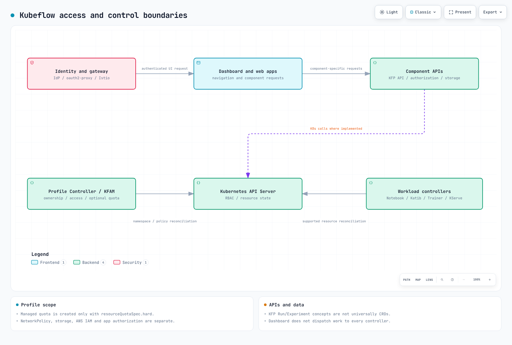

# 第 1 部分：Kubeflow 架构与在 EKS 上安装

> **审查基线**：Community Distribution 26.03.1；Dashboard 2.0.0；KFP 2.16.1
> **最后审阅**：September 12, 2026
> **验证**：使用 kubectl 1.36.2 / Kustomize 5.8.1 在本地渲染了 Profile overlay。未执行 EKS 安装或 AWS 身份流程。

## 准备环境

选择命令之前，先选择发行版版本。记录 EKS/Kubernetes 版本、节点架构、CNI、存储类、身份提供方和所需组件。`Kubernetes 1.34+` 并不意味着支持范围没有上限。

26.03.1 发行版报告了 Kubernetes 1.36 CI 覆盖情况以及 Kind 0.32+ 的使用情况。这并不能认证所有 EKS 附加组件组合。其 README 警告，某些镜像可能不支持 ARM64。渲染需要使用带有 Kustomize 的 kubectl，或发行版指定的独立 Kustomize；应用资源还需要目标集群、相应权限以及已就绪的依赖项。

## 什么是 Kubeflow？

Kubeflow 由独立发布的 ML 组件组成。Community Distribution 汇集了这些组件的修订版本和共享服务。有些工作负载使用 CRD；其他操作则使用应用 API、数据库和对象存储。Dashboard 是 UI 入口，并非调度器或通用分发器。

### CNCF 于 2026 年 8 月 17 日毕业

[CNCF 公告](https://www.cncf.io/announcements/2026/08/17/cncf-announces-kubeflows-graduation-solidifying-the-standard-for-cloud-native-ai-operations/)记录了毕业、独立安全审计和正式治理。这些内容有助于评估项目成熟度，但不能替代威胁建模、租户隔离测试或针对具体部署的合规性评估。

## 发布模式与当前基线

该发行版采用 `YY.MM.patch` 版本格式，计划每年发布大约两个基础版本，并说明社区支持以尽力而为的方式提供约六个月。这并非供应商支持 SLA。

[26.03.1 发行版](https://github.com/kubeflow/community-distribution/releases/tag/26.03.1)于 2026 年 6 月 15 日发布，其[标记版本清单](https://github.com/kubeflow/community-distribution/blob/26.03.1/README.md)提供了以下基线：

| 组件 | 捆绑版本 |
| --- | --- |
| Dashboard / Profile Controller / 访问管理 | 2.0.0 |
| Pipelines | 2.16.1 |
| Notebooks v1 | 1.11.0 |
| Trainer v2 / 旧版 Training Operator | 2.2.0 / 1.9.2 |
| Katib | 0.19.0 |
| KServe / Models Web Application | 0.18.0 / 0.18.0 |
| Hub / Spark Operator | 0.3.9 / 2.5.0 |
| Istio / Knative | 1.30.1 / 1.22.0 |
| cert-manager / Dex / oauth2-proxy | 1.20.2 / 2.45.1 / 7.15.2 |

该发行版将 Workspaces (Notebooks v2) 标为 beta；这并不取代稳定版 Notebooks v1 这一行。旧版 Training Operator 与 Trainer v2 并存，但使用不同的 API。编写训练作业之前，请检查已安装的 CRD 和运行时定义。

## 组件架构



[🔍 查看交互式图表](https://www.atomai.click/kubernetes-docs/archmaps/en-ai-ml-kubeflow-01-architecture-installation-0.html)

| 边界 | 提供的功能 | 仍需配置 |
| --- | --- | --- |
| 身份提供方、oauth2-proxy、网关 | 浏览器身份验证和受信任身份转发 | OIDC 客户端、TLS、受信任的请求头、机器对机器身份验证 |
| Dashboard 和组件 Web 应用 | 导航和应用界面 | 每个 API 的授权和服务身份 |
| Profile Controller 和访问管理 (KFAM) | 命名空间所有权、所有者/贡献者访问、生成的 RBAC 和 Istio 策略 | 配额、网络隔离、工作负载权限、存储和 AWS 权限 |
| 组件控制器 | 协调受支持的 Kubernetes 资源 | 准入、调度、依赖项和状态 |
| KFP API 和持久化存储 | Pipeline/Run/Experiment 操作、元数据和制品 | 数据库/对象存储可用性、授权和备份 |

集群范围的 `Profile` 具有所有者并管理一个命名空间；贡献者通过访问管理进行管理。只有当 `spec.resourceQuotaSpec.hard` 非空时，Dashboard 2.0.0 才会创建 `ResourceQuota`。省略配额不会产生默认资源上限；清空此字段会移除由该控制器管理的配额。

Profile 生成的 RBAC 和 Istio `AuthorizationPolicy` 并不能提供完整的租户隔离。NetworkPolicy 强制执行、Pod 权限、存储访问、AWS IAM 和应用授权仍需分别处理。Profile overlay 中捆绑的 NetworkPolicy 保护的是该控制器/访问管理服务，而非每个用户命名空间。

KFP 的 Pipeline、Run 和 Experiment 概念并非一律对应 CRD。可选的 Kubernetes Native API 模式会添加 `Pipeline` 和 `PipelineVersion` CRD。KFP Experiment 与 Katib Experiment 是不同的资源。

### Profile 示例

此示例声明了一个所有者和明确的配额。它不是安装命令，也不是完整的隔离策略。

```yaml
apiVersion: kubeflow.org/v1
kind: Profile
metadata:
  name: team-a
spec:
  owner:
    kind: User
    name: owner@example.com
  resourceQuotaSpec:
    hard:
      requests.cpu: "8"
      requests.memory: 32Gi
      requests.nvidia.com/gpu: "2"
      persistentvolumeclaims: "10"
```

如果现有命名空间的所有权不匹配，控制器会拒绝接管。命名空间的 owner reference 也意味着删除操作影响重大：删除 Profile 可能会删除其拥有的命名空间及其中的资源。在迁移到 Dashboard v2 期间，请遵循针对具体发行版的旧控制器资源移除步骤；保留 Profile CRD、Profile 对象和用户命名空间。

## 在 EKS 上的安装途径

| 途径 | 依据与限制 |
| --- | --- |
| Community Distribution 26.03.1 | 已审查的社区捆绑版本；需针对该发行版配置 EKS 网络、存储、入口和身份 |
| `awslabs/kubeflow-manifests` | 已检查的最新发布版本：`v1.7.0-aws-b1.0.3`（2023 年 9 月 1 日）。其发布页面指出，由于旧 OIDC 镜像已被移除，新安装会失败 |
| 供应商支持的发行版 | 评估其自身的版本矩阵、支持、集成和迁移路径 |

[AWS 发布警告](https://github.com/awslabs/kubeflow-manifests/releases/tag/v1.7.0-aws-b1.0.3)意味着，旧版 manifest/Terraform 操作指南并不是经过验证的 26.03.1 安装方案。仅凭仓库的活动情况并不会改变该发行版的兼容性。

历史 AWS overlay 描述了 Cognito、RDS 和 S3 集成。它们可以减少对自托管身份、数据库和对象存储服务的运维，但并非可以互换的默认选项：颁发者/声明映射、数据库兼容性、网络、IAM、成本和迁移仍然需要考虑。将旧 overlay 与新发行版结合之前，请先验证它们。

### 应用前先渲染

以下命令会获取已审查的发行版，并且只渲染其 Profile controller overlay。它们会在本地创建文件，不会连接到 Kubernetes：

```bash
git clone --depth 1 --branch 26.03.1 \
  https://github.com/kubeflow/community-distribution.git kubeflow-26.03.1
cd kubeflow-26.03.1
kubectl kustomize \
  applications/dashboard/upstream/profile-controller/overlays/kubeflow \
  > profile-controller.rendered.yaml
```

经审查的 overlay 生成了 14 个资源，包括 Profile CRD、RBAC、Service，以及 `kubeflow` 中的 `profiles-deployment`。其容器使用 Dashboard 2.0.0 Profile Controller 和访问管理镜像。此 overlay 不会创建 `kubeflow` 命名空间，并且需要其 Istio/网络策略依赖项。

安装时，请遵循固定版本发行版中各个组件的安装顺序。检查渲染后的资源，建立所需的 CRD，等待控制器/webhook 就绪，然后再应用自定义资源。遇到准入或字段所有权错误时，应进行诊断，而不是反复强制解决冲突。渲染成功既不能证明 API 准入成功，也不能证明 EKS 部署能够正常运行。

## IAM 访问模式：IRSA、KFPv2 和 Pod Identity

[当前 KFP 对象存储指南](https://www.kubeflow.org/docs/components/pipelines/operator-guides/configure-object-store/)介绍了使用 IRSA 的 S3 配置，以及 launcher 的 `credentials.fromEnv: true`。旧版 AWS 发行版中“IRSA 仅适用于 KFPv1”的说明，并不代表当前 KFPv2 的普遍限制。

在 KFP 2.16.1 中，`fromEnv` 会调用 Go Cloud 的存储桶打开器。其固定版本 `gocloud.dev` 0.40.0 默认使用 AWS SDK v2 凭证链，除非指定 SDK 覆盖项。这比读取静态访问密钥环境变量适用范围更广。

配置 Pipeline 执行 ServiceAccount，以及每个需要访问制品的组件；如果对象存储配置要求 API server 访问，也要配置 API server。检查实际容器的 SDK/提供方支持、存储桶前缀和 KMS 权限。IRSA 需要匹配的角色信任关系和投射的凭证，而不仅仅是一个注解。Pod Identity 还需要受支持的 EKS 环境、agent、关联关系和 SDK 支持；本次审查未运行此集成。

Dashboard 的 `AwsIamForServiceAccount` Profile 插件并非 Pod Identity 开关：它会为 `default-editor` 添加注解，并能更新 IAM 角色的信任策略。请考虑控制器权限和信任关系变更。上述示例未启用此插件。请使用具有范围限制的工作负载身份，而不要将历史上的 IAM 用户/静态密钥变通方案照搬到新部署中。

## 为什么要在 EKS 上运行，而不是使用托管替代方案？

对于具备 Kubernetes 运维能力、需要共享工具、自定义训练运行时，或特定调度和服务行为的团队，EKS 是合适的选择。团队负责控制器、CRD、租户边界、恢复、容量和升级。

SageMaker AI 可以减少基础设施运维工作，但不会免除应用、数据、IAM 或模型质量方面的责任。请比较实际需要的服务和部署模式。

## 来源与验证

本次审查检查了带标签的发行版 manifest、Dashboard 2.0.0 Profile 代码以及 KFP 2.16.1 对象存储代码。在本地渲染了 Profile overlay，并根据其 CRD schema 检查了示例。这并不能证明端到端身份验证、隔离或制品访问正常。

- [Dashboard Profile 控制器](https://github.com/kubeflow/dashboard/blob/v2.0.0/components/profile-controller/controllers/profile_controller.go)
- [Dashboard AWS Profile 插件](https://github.com/kubeflow/dashboard/blob/v2.0.0/components/profile-controller/controllers/plugin_iam.go)
- [KFP 对象存储实现](https://github.com/kubeflow/pipelines/blob/2.16.1/backend/src/v2/objectstore/object_store.go)

## 后续步骤

继续阅读[第 2 部分：Pipelines](02-pipelines.md)。

[返回主页](README.md)

## 测验

尝试[主题测验](../../quizzes/ai-ml/kubeflow/01-architecture-installation-quiz.md)。
