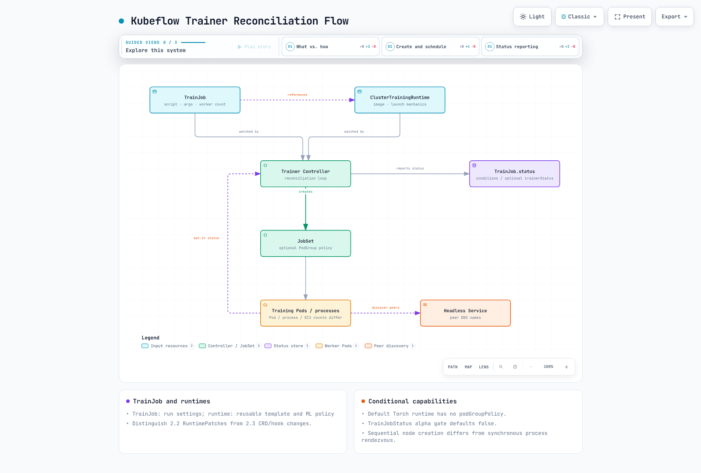

# 第 5 部分：Kubeflow Trainer 与分布式训练

> **审查基线**：Trainer 2.2.0 / Community Distribution 26.03.1；另行比较 2.3.0 升级
> **最后更新**：2026 年 9 月 12 日

## 实验环境设置

使用兼容的 Kubernetes、Trainer controller/CRD、运行时及其依赖项（例如 JobSet）。是否需要 GPU 取决于工作负载；也可以进行 CPU 训练。GPU 工作负载还需要驱动程序、设备插件、节点容量和网络。本节的验证内容是 Helm 渲染和 Schema 检查，不包括训练执行。

## 从框架专用 Operator 到统一 API

在 Kubeflow 项目中，Kubernetes 上的分布式训练经历了真正的架构转变。在开始编写任何 YAML 之前，最重要的就是理解这一点。

### 最初的 Training Operator（v1）

Kubeflow 在 2021 年整合的 Training Operator 采用了**框架专用 CRD**方案。每个受支持的 ML 框架都有自己的 Custom Resource Definition，且各自的 controller 实现该框架特定的分布式训练语义：

* **`PyTorchJob`**：controller 理解 PyTorch 的分布式启动约定，会将 `MASTER_ADDR`、`RANK` 和 `WORLD_SIZE` 等环境变量注入每个 worker Pod，使 `torch.distributed` 能够建立进程组。
* **`TFJob`**：controller 则会构造 `TF_CONFIG` 环境变量（一个描述集群任务角色的 JSON 数据块：chief、worker、parameter server），以满足 TensorFlow 分布策略的要求。
* **`MPIJob`**：controller 负责跨 Pod 启动 MPI 作业，并协调面向一组 worker Pod 的 `mpirun` 风格启动器。

除这三种之外，v1 Training Operator 还提供了其他一些框架的 CRD。每个 CRD 都把各自框架对于“worker 如何相互发现并确定彼此角色”的设想直接编码到单独的 controller 中，因此添加框架需要进行集成，不过仍可复用通用的 Job controller 基础设施。

### 转向 Kubeflow Trainer v2

Kubeflow Trainer v2 以单一统一 API 取代了这种做法，它围绕两个概念构建，而不是为每个框架各定义一个 CRD：

* **`TrainJob`**：描述要运行的**内容**：训练脚本/入口点、参数、资源数量（例如 worker 数量），以及用于执行作业的运行时引用。ML 从业者会为单次训练创建此对象。
* **`TrainingRuntime` / `ClusterTrainingRuntime`**：描述如何运行作业：可复用的框架专用执行模板，涵盖容器映像、分布式启动机制（worker 如何发现彼此、使用哪些环境变量或启动器进程）以及默认资源规格。平台团队只需定义一小组运行时（例如 PyTorch DDP 运行时、MPI 运行时），许多不同的 `TrainJob` 就可以在多次训练中引用同一个运行时。

这与 Kubernetes 中其他地方的一种模式相似：将可复用的“模板”资源与使用该模板的“实例”分离，其理念类似于可供多个 `PersistentVolumeClaim` 引用的可复用模板 `StorageClass`。实际优势在于，平台团队可以在一个地方（运行时）管理并进行版本控制那些复杂的分布式启动机制，而提交作业的 ML 从业者只需提供脚本并按名称请求运行时。运行时可以减少重复配置，但训练代码仍必须处理兼容的分布式初始化、数据分片、检查点和恢复。

### 2.2.0 与 2.3.0 之间的差异

[Trainer 2.2.0](https://github.com/kubeflow/trainer/releases/tag/v2.2.0) 于 2026 年 3 月 20 日发布，并包含在 26.03.1 中。该版本新增了 JAX/XGBoost 运行时以及 Flux 策略/集成；包含某项功能并不能证明它与所有映像、网络或加速器配置都兼容。

2.2.0 还用 `RuntimePatches` 取代了 `PodTemplateOverrides`，并从 Torch 策略中移除了 `numProcPerNode`，同时移除了 `ElasticPolicy`。不要将运行时 Torch 策略与每次运行的 `trainer.numProcPerNode` 混淆。较早的 2.x 清单也可能需要迁移。

`status.trainerStatus` 中的运行时进度/指标需要启用 **alpha TrainJobStatus 功能门**，该功能默认禁用。训练代码必须通过状态服务器报告信息，并且需要可用的 TLS/投射式 ServiceAccount token 访问权限。注入的 token/CA 环境变量值是文件路径，而不是机密内容。仅打印日志不会自动填充状态指标。

[2.3.0](https://github.com/kubeflow/trainer/releases/tag/v2.3.0) 于 2026 年 8 月 7 日发布，调整了运行时 finalizer/snapshot 和 Helm CRD 的放置方式。其发行说明要求 2.0/2.1/2.2 安装必须先升级到 2.3，之后才能升级到更高版本。升级前请检查 CRD 的 Helm 所有权及特定发行版的迁移要求；删除现有 CRD 不是常规的升级修复方法。

已发布的 OCI chart 也有所不同：2.2 会直接渲染八个默认运行时，而 2.3 则将它们打包在一个 runtimes.yaml ConfigMap 中，由 post-install/post-upgrade 安装程序 Job 应用。2.3 的 hook 会在运行时安装 kubectl、通过服务器端强制应用资源，并按其管理标签清理资源；此外还存在 pre-delete hook。请检查 GitOps 对 hook 的处理、网络访问和运行时所有权。本次审查渲染了这些 hook，但没有执行它们。

### 迁移旧版 API

26.03.1 包含 Trainer 2.2.0 和旧版 Training Operator 1.9.2。两者并存并不能反映任何团队的迁移进度。PyTorchJob/TFJob/MPIJob 与 TrainJob 是不同的 API，不会自动转换。

[官方迁移文档（固定版本）](https://github.com/kubeflow/trainer/blob/v2.3.0/docs/operator-guides/migration.md)提供了一个将 PyTorchJob 迁移到默认 Torch 运行时的示例，并介绍了 SDK 的方向，但并未详尽列出每个框架/字段的映射关系。请针对每个工作负载，比较副本角色、启动命令、环境、重试、存储、调度/网络以及检查点恢复。

## TrainJob 和 Runtime 的职责

`TrainingRuntime` 是命名空间级资源；`ClusterTrainingRuntime` 是集群级资源。两者都包含执行模板和 ML 策略。`TrainJob.runtimeRef` 用于选择 kind/name，而 trainer 字段可用于配置命令/参数、训练 Pod 数量以及每个 Pod 的资源。权限和允许的覆盖项需要单独管理。

默认的 `torch-distributed` 运行时包含 `mlPolicy.numNodes: 1`、`torch: {}` 和一个 JobSet 模板。在 2.2.0 中，它引用 `pytorch/pytorch:2.10.0-cuda12.8-cudnn9-runtime`。请记录映像/运行时版本，并验证架构、驱动程序和通信库；本次审查没有执行该映像，也没有训练模型。

这里的 numNodes 表示训练 Pod 数量，并不表示 EC2 实例数量与其一一对应。请分别计算进程数、每个 Pod 的 GPU 数量，以及多个 Pod 的放置方式。

## Kubernetes 上的分布式训练机制

JobSet 和运行时组合使用 Jobs/Pods，并通过 Service/DNS 以及 rank/rendezvous 配置来发现进程。仅有无头 Service 并不能维持进程状态或 IP；稳定的 Pod 命名、hostname/subdomain 和网络条件仍然很重要。

**安装 Trainer 并不会自动启用 gang scheduling。** 2.2.0 默认的 Torch 运行时没有 podGroupPolicy。对于这些 PodGroup 路径，必须安装/配置 Coscheduling/Volcano 策略、CRD 和 scheduler 集成。Kueue 准入与实际的 Pod 调度也不是一回事。

固定规模的同步训练要求所有必需进程都已就绪并能进行通信，但节点不必在同一时刻创建。只要在 rendezvous 超时范围内，按顺序配置资源也可以成功；受支持的弹性工作负载则遵循不同规则。Gang 准入可以减少部分资源分配的情况，但无法解决所有 EC2 容量不足或应用死锁问题。请协调 [Karpenter](../../autoscaling/02-karpenter.md) 容量与 JobSet、scheduler 和框架超时/重试设置。

[🔍 查看交互式图表](https://www.atomai.click/kubernetes-docs/archmaps/en-ai-ml-kubeflow-05-training-operator-0.html)

## 交叉参考：Katib 和 TrainJob

Katib 0.19.0 可以在经过配置的 Trial 模板中使用 TrainJob。请匹配 trialResources 注册、运行时、成功/失败条件、主要 Pods/容器以及指标收集。Katib 指标报告与 Trainer 选择启用的状态服务器是分开的。TrainJob 成功并不会自动将模型部署到 KServe。

## 验证和来源

已拉取并使用默认运行时启用的配置渲染了官方 OCI Trainer Helm chart 2.2.0 和 2.3.0；并检查了 CRD/运行时 Schema。未执行 API 准入/CEL、实际升级、JobSet 创建、分布式/GPU 训练或状态服务器报告。

- [2.2.0 TrainJob API](https://github.com/kubeflow/trainer/blob/v2.2.0/pkg/apis/trainer/v1alpha1/trainjob_types.go)
- [TrainJobStatus 默认功能门](https://github.com/kubeflow/trainer/blob/v2.2.0/pkg/features/features.go)
- [有条件创建 Coscheduling PodGroup](https://github.com/kubeflow/trainer/blob/v2.2.0/pkg/runtime/framework/plugins/coscheduling/coscheduling.go)
- [默认 Torch 运行时](https://github.com/kubeflow/trainer/blob/v2.2.0/manifests/base/runtimes/torch_distributed.yaml)

## 后续步骤

从框架专用 CRD 转向统一的 `TrainJob`/runtime 模型之后，[第 6 部分：KServe（Kubernetes 上的模型服务）](./06-kserve.md)将介绍使用 `TrainJob` 完成训练后模型的处理方式：为推理提供服务。

[返回主页](./README.md)

## 测验

要检验你在本章学到的内容，请尝试[主题测验](../../quizzes/ai-ml/kubeflow/05-training-operator-quiz.md)。
