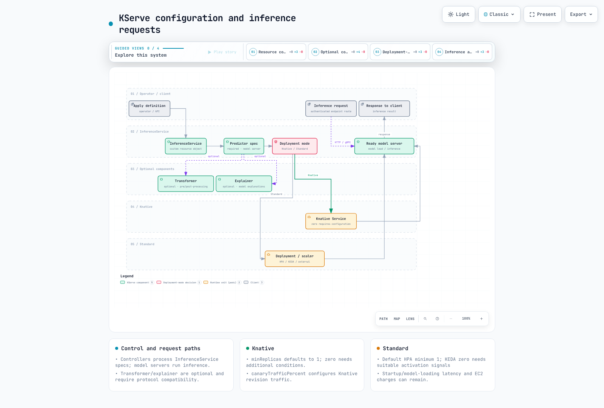

# 第 6 部分：KServe（Kubernetes 上的模型服务）

> **审核基线**：KServe 0.18.0 / Models Web Application 0.18.0 / Community Distribution 26.03.1
> **最后更新**：2026 年 10 月 12 日

## 实验环境设置

使用兼容的 Kubernetes、KServe 控制器/CRD、ServingRuntime、存储访问权限和经过身份验证的网络路径。不需要完整的 Kubeflow；Web 应用为可选项。Knative 模式需要 Knative Serving/网络组件；Standard 的 KEDA 路径需要 KEDA 和指标提供程序。是否需要 GPU 取决于工作负载。

## KServe 和 Kubeflow

KServe 从 KFServing 演进为独立的服务项目。本章介绍 **KServe 和 Models Web Application 0.18.0**，它们包含在 Community Distribution 26.03.1 中。

截至 2026 年 10 月 12 日核查的最新公开 KServe 版本是 **0.21.0（2026 年 9 月 25 日）**。更早发布的版本是 0.20.0（2026 年 8 月 6 日）。这两个版本都不是该发行版的 0.18.0 基线。

控制器、CRD 和 Web 应用是需要进行兼容性检查的独立制品。它们的版本号不一定总是相同，也不一定总是不同。记录实际使用的镜像、CRD 字段模式和 Web 应用修订版本。

`InferenceService` 是本文介绍的服务 API，并非整个 KServe 架构。ServingRuntime/ClusterServingRuntime、ModelMesh 以及独立的 LLMInferenceService API 各自具有不同的依赖项和运行模式。

## InferenceService：Predictor、Transformer、Explainer

InferenceService 必须包含 Predictor，并可选包含 Transformer/Explainer。Predictor 用于配置模型服务器，Transformer 提供预处理/后处理，Explainer 则处理解释请求。解释不会自动附加到每次预测上；运行时/协议支持会影响此功能。

请确保 modelFormat、ServingRuntime、文件布局/库版本、URI/凭据、端口/探针和请求协议相匹配。仅有 URI 并不能让所有模型都可提供服务。自定义容器也必须满足客户端约定以及 KServe 的路由/健康检查要求。

官方 runtime-config Helm Chart 默认不会生成任何资源。设置 `kserve.servingruntime.enabled=true` 进行渲染会生成 12 个 ClusterServingRuntimes。目录中包含某个运行时，并不代表其镜像是最新的、仍受安全支持，或与模型兼容。

TorchServe 的[项目公告](https://github.com/pytorch/serve)指出，该项目不再计划添加新功能、修复缺陷或提供安全补丁。它出现在较早的运行时目录中，并不意味着它仍是新生产环境的受维护默认选项。请根据模型格式和 GPU 要求，验证一个仍受维护的运行时。

## 部署模式：Knative 和 Standard

0.18.0 中的模式名称为 **Knative** 和 **Standard**。Serverless 和 RawDeployment 注解值是已弃用的别名，会被规范化为这两个名称。请检查 serving.kserve.io/deploymentMode 和已安装的 inferenceservice-config。代码的默认回退模式是 Standard，而下载的 OCI 资源 Helm Chart 默认模式为 Knative。不要仅凭术语推断安装默认值。

| 项目 | Knative | Standard |
| --- | --- | --- |
| 工作负载资源 | Knative Service/Revision 路径 | Deployment/Service 和所选的自动扩缩组件 |
| 缩容 | 在支持 KPA/策略且 minReplicas=0 时，可以缩至零 | 默认 HPA 路径至少保留一个副本；配置合适的外部激活信号后，KEDA 可以支持缩至零 |
| 默认 minReplicas | KServe 默认为一个副本；仅选择 Knative 并不会启用缩至零 | HPA 会将请求的零副本数限制为至少一个 |
| 依赖项 | Knative Serving/网络组件和所选的自动扩缩组件 | 所选的入口/网关、HPA 指标或 KEDA 等 |
| 启动延迟 | 从零启动时的调度/镜像/模型加载 | 即使有预热副本，重启、滚动更新和扩容仍会产生启动延迟 |

任何一种模式都无法保证副本可用或满足延迟 SLA。请验证模型加载、就绪状态、容量、超时和恢复能力。KEDA 从零扩缩需要一个无需有 Pod 运行即可观测到的信号，以及一条重新激活路径；仅有 CPU/内存指标并不意味着能够根据请求激活。

[🔍 查看交互式图表](https://www.atomai.click/kubernetes-docs/archmaps/en-ai-ml-kubeflow-06-kserve-0.html)

## 自动扩缩和指标

Knative KPA 支持并发数/RPS，Knative 的 HPA 类则是另一条路径。Standard 通过 serving.kserve.io/autoscalerClass 选择 hpa、keda 或 external/none。并非每个 Standard 部署都会创建 HPA。

CPU、外部指标或受支持的 Pod 指标需要实际配置 metrics-server、指标适配器/提供程序等依赖项。GPU 请求不会自动生成 GPU 指标。响应速度取决于观测间隔、稳定窗口和模型行为；并发指标并不总是更快。

## 渐进式更新和金丝雀流量

经验证，此版本的 canaryTrafficPercent 用于 **Knative Revision 流量拆分路径**。KServe 会将先前已上线的修订版本和新修订版本设为 Knative Service 的流量目标；Knative 网络组件会分发请求。KServe 控制器并不是每次推理调用的代理。

不要将 Standard Deployment 滚动更新等同于按修订版本百分比进行路由。Standard 中的加权路由需要单独设计服务/网关/服务网格或发布工具，并明确责任归属。使用 [Istio 流量管理](../../service-mesh/istio/traffic-management/04-traffic-splitting.md)或 [Argo Rollouts](../../service-mesh/istio/advanced/08-argo-rollouts.md) 时，请避免多个组件同时管理 KServe 管理的对象。

仅设置百分比无法验证质量，也不会自动推进发布或回滚。请检查对比指标、错误/延迟、保留的修订版本/模型制品以及路由就绪状态。

## EKS 上的 GPU 推理

Pod 的 nvidia.com/gpu 请求可启用调度/设备分配。要实际进行 GPU 推理，还需要兼容的 CUDA/驱动程序、服务器镜像、模型后端和设备配置。请检查 Triton 模型配置或框架设备选择；GPU 请求不会自动将 CPU 模型转移到 GPU 上运行。

Karpenter 根据 NodePool、配额和可用容量，为符合条件的 Pending Pod 创建节点。KServe/Knative/HPA/KEDA 的 Pod 扩缩与 EC2 资源的创建/回收是相互独立的循环。即使模型 Pod 数量为零，其他工作负载或中断策略也可能使节点继续运行并产生费用。

## 验证和来源

已拉取并在本地渲染官方 0.18.0 OCI CRD、resource 和 runtime-config Helm Chart，以检查字段模式和配置。已检查模式别名处理、HPA 最小副本数、KEDA ScaledObject 和 Knative 流量相关代码。未执行模型下载/服务、GPU、集群自动扩缩或实时金丝雀请求。

- [0.18.0 模式名称和默认值](https://github.com/kserve/kserve/blob/v0.18.0/pkg/constants/constants.go)
- [HPA 最小副本数处理](https://github.com/kserve/kserve/blob/v0.18.0/pkg/controller/v1beta1/inferenceservice/reconcilers/hpa/hpa_reconciler.go)
- [KEDA ScaledObject 处理](https://github.com/kserve/kserve/blob/v0.18.0/pkg/controller/v1beta1/inferenceservice/reconcilers/keda/keda_reconciler.go)
- [Knative 流量处理](https://github.com/kserve/kserve/blob/v0.18.0/pkg/controller/v1beta1/inferenceservice/reconcilers/knative/ksvc_reconciler.go)
- [0.20.0 版本发布](https://github.com/kserve/kserve/releases/tag/v0.20.0)
- [0.21.0 版本发布（核查时的最新版本）](https://github.com/kserve/kserve/releases/tag/v0.21.0)

## 后续步骤

将此服务路径与[Kubeflow 系列](README.md)中的架构、Pipelines、Notebooks、Katib 和 Trainer 章节衔接，同时将模型制品部署和验证视为独立步骤。

---

[返回主页](./README.md)

## 测验

要测试你在本章中学到的内容，请尝试[主题测验](../../quizzes/ai-ml/kubeflow/06-kserve-quiz.md)。
