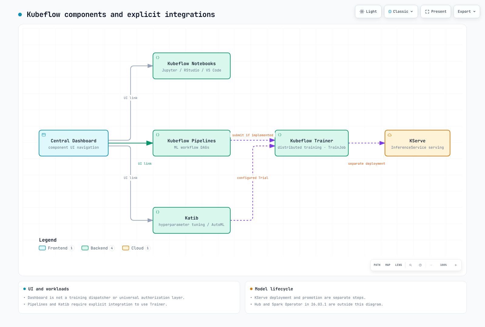

# Kubeflow on EKS 深入解析

> **审查基线**：Kubeflow Community Distribution 26.03.1
> **已检查的最新发行版**：Community Distribution 26.03.1；组件版本单独跟踪
> **最后审查**：October 12, 2026

## 概述

Kubeflow 提供基于 Kubernetes 的工具，用于 ML 管道、notebook、调优、训练和服务。Community Distribution 汇集了组件修订版本、共享服务和仪表板；各个项目也拥有自己的发行版和安装要求。

本系列使用该发行版的 KFP 2.16.1 和 KServe 0.18.0 作为复现基线。

KFP 2.17.2 和 KServe 0.21.0 是较新且彼此独立的发行版。它们未捆绑在 Community Distribution 26.03.1 中，本指南也未确认它们彼此兼容。请同时核对该发行版的固定版本清单和当前组件版本。

CNCF [于 2026 年 8 月 17 日宣布 Kubeflow 毕业](https://www.cncf.io/announcements/2026/08/17/cncf-announces-kubeflows-graduation-solidifying-the-standard-for-cloud-native-ai-operations/)。这认可了项目的成熟度和治理水平，包括一次独立的安全审计。这并不证明某个特定 EKS 部署的安全性或监管合规性。

## 组件映射

| 组件 | 用途 | API 或概念 | 指南 |
| --- | --- | --- | --- |
| Dashboard、Profiles、访问管理 | UI 导航、namespace 所有权和成员资格 | Cluster-scoped `Profile`；可选配额 | [第 1 部分](01-architecture-installation.md) |
| Pipelines | 编译并执行工作流；跟踪运行和制品 | Pipeline/Run/Experiment APIs；可选的 Kubernetes Native API 模式新增 `Pipeline`/`PipelineVersion` CRDs | [第 2 部分](02-pipelines.md) |
| Notebooks | 用户 notebook 工作负载 | `Notebook`；镜像和 PVC 配置 | [第 3 部分](03-notebooks.md) |
| Katib | 超参数搜索和试验 | `Experiment`、`Trial`、`Suggestion` CRDs | [第 4 部分](04-katib.md) |
| Trainer | 使用已配置运行时进行分布式训练 | `TrainJob`、`TrainingRuntime`、`ClusterTrainingRuntime` | [第 5 部分](05-training-operator.md) |
| KServe | 模型推理服务 | `InferenceService`；特定模式的依赖项 | [第 6 部分](06-kserve.md) |

此映射涵盖的是本指南的范围，而非整个发行版。26.03.1 版还包括 Hub/模型注册表和 Spark Operator。KFP Experiment 并不是 Katib Experiment CRD。

[🔍 查看交互式图表](https://www.atomai.click/kubernetes-docs/archmaps/en-ai-ml-kubeflow-readme-0.html)

仪表板链接各组件 UI。仅当 Pipelines 和 Katib 的实现明确提交受支持的训练资源时，它们才会使用 Trainer。将训练后的制品连接到 KServe 需要单独的部署步骤；该图并不表示自动提升模型。

## 为什么要在 EKS 上运行

现有的 EKS 平台可与 ML 工作负载共享容量管理、存储集成、工作负载身份和监控。兼容性仍取决于 Kubernetes 版本、CPU 架构、镜像、网络、存储驱动程序和身份验证。仅 Kubernetes 一致性不足以保证兼容；发行版文档指出 ARM64 镜像覆盖并不完整。

团队仍需负责组件/CRD 升级、租户授权、持久化数据、凭证和恢复。[Amazon SageMaker AI](../sagemaker-ai/README.md) 可减少部分基础设施责任，但数据访问、应用程序正确性、模型质量和成本控制仍需要负责人。请根据所需接口、运维能力和工作负载约束进行选择。

## 当前涵盖内容

1. [第 1 部分：EKS 上的架构和安装](01-architecture-installation.md) — 当前社区发行版、旧版 AWS 发行版限制、Profiles、身份和清单渲染。
2. [第 2 部分：Pipelines](02-pipelines.md) — SDK v2、编译、执行和制品存储。
3. [第 3 部分：Notebooks](03-notebooks.md) — 工作负载、Profiles、存储和 GPU 放置。
4. [第 4 部分：Katib](04-katib.md) — 实验、试验、搜索和提前停止。
5. [第 5 部分：Trainer](05-training-operator.md) — 旧版 Training Operator 和 Trainer v2 APIs。
6. [第 6 部分：KServe](06-kserve.md) — 推理资源、部署模式和发布。

请使用各章节的组件基线。在选择安装方案前，请检查 [26.03.1 发行版](https://github.com/kubeflow/community-distribution/releases/tag/26.03.1)、[固定版本清单](https://github.com/kubeflow/community-distribution/blob/26.03.1/README.md)、[KFP 2.17.2](https://github.com/kubeflow/pipelines/releases/tag/2.17.2) 和 [KServe 0.21.0](https://github.com/kserve/kserve/releases/tag/v0.21.0)。
