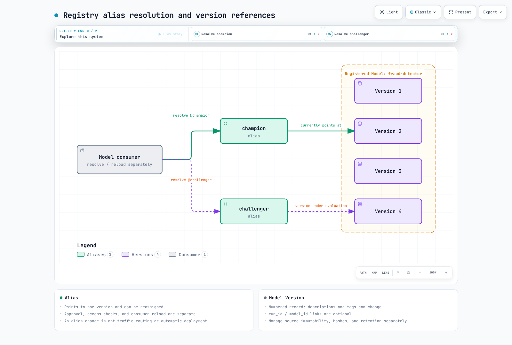

# 第 2 部分：MLflow 模型注册表

> **审查基线**：MLflow 3.16.0；已检查最新版本 3.17.1 · 2026-10-16

## 实验环境设置

使用 Python 3.10 或更高版本以及 `mlflow==3.16.0`。注册表 API 也可与本地 SQLite 配合使用；不强制要求单独的 HTTP 服务器。3.16.1 补丁版本以及后续的 3.17.x 系列（最新版本为 3.17.1）均已发布，但本章示例使用 3.16.0，且未在任何后续版本上重新运行。

团队部署请参阅[第 3 部分](03-eks-deployment.md)，Tracking 设置请参阅[第 1 部分](01-tracking.md)。本章介绍的是 OSS MLflow。Databricks Unity Catalog 等托管注册表的权限、复制和保留行为可能有所不同。

## 模型注册表是什么

注册表管理逻辑模型名称、编号版本、别名和元数据。记录候选模型、审批模型版本提升以及部署端点是彼此独立的操作。拥有注册表并不会自动实现审批或推理服务行为。

## 核心概念

| 实体 | 含义与可变范围 |
|---|---|
| Registered Model | 逻辑名称下的一组版本，例如 `fraud-detector` |
| Model Version | 带有源信息的编号记录；描述、标签、阶段/别名关系可以更改 |
| Alias | 指向某个版本的可变名称；多个别名可以指向同一个版本 |
| LoggedModel | 独立的 Tracking 模型实体；与 Registered Model 和 Model Version 不同 |

### 模型版本

新的模型结果通常应成为新版本。不过，**并非每个版本字段和工件字节都不可变**。`update_model_version` 可以更改描述；版本标签也可以更改。拥有写入权限的人可以更改外部 `source` URI 上的文件。注册表版本号不会强制实现对象不可变性，也不会强制使用内容哈希。

`create_model_version` 中的 `run_id` 和 `model_id` 是可选项。直接从源 URI 注册时，可能没有训练运行关联。注册操作是创建指针、复制工件，还是使用其他存储位置，取决于注册表后端和所执行的操作；请核实实际行为。

### 别名

`models:/fraud-detector@champion` 会在**解析/加载时**查找该别名对应的版本。`models:/fraud-detector/7` 是明确指定版本的引用。移动别名不会自动替换已加载到内存中的模型或缓存中的模型。应单独实现推理服务控制器的部署、重新加载和缓存策略，并记录实际处理请求的版本。

`champion` 和 `challenger` 是团队自定义的名称。它们不会配置实时/影子流量百分比，也不会自行运行评估。更新别名并不能证明模型已通过质量或安全审批。

### 旧版阶段模型

旧版阶段包括 `None`、`Staging`、`Production` 和 `Archived`。`transition_model_version_stage` 自 **2.9.0 起已弃用**，但仍存在于 3.16.0 API 中。不要将其描述为已从所有当前版本中移除。新的工作流可以将别名和标签与特定环境的 Registered Model 及明确权限结合使用。阶段名称或标签不属于访问控制。

## 注册模型

记录实际的 flavor 模型后，调用 `mlflow.register_model(model_uri, name)`，或在 flavor 的 `log_model` 调用中传入 `registered_model_name`。较低层的 `MlflowClient.create_model_version` API 可以直接指定源。注册和重新分配别名是两个独立操作。

此**注册表元数据练习**不会创建可用于推理的模型。已使用 Python 3.12、MLflow 3.16.0 和 SQLite 进行检查。

```python
from pathlib import Path
import mlflow
from mlflow import MlflowClient

root = Path(".registry-demo").resolve()
root.mkdir(exist_ok=True)
mlflow.set_tracking_uri(f"sqlite:///{root / 'registry.db'}")
client = MlflowClient()
name = "registry-contract-demo"
# Run once in a fresh demo DB. Inspect the existing name before repeating.
client.create_registered_model(name)
versions = []
for number in (1, 2):
    source = root / f"candidate-{number}"
    source.mkdir(exist_ok=True)
    (source / "metadata.json").write_text('{"fixture": true}')
    versions.append(client.create_model_version(name, source=source.as_uri()))

first, second = versions
assert first.run_id is None
client.update_model_version(name, first.version, description="metadata fixture")
client.set_model_version_tag(name, first.version, "review_state", "demo-only")
client.set_registered_model_alias(name, "champion", first.version)
snapshot = client.get_model_version_by_alias(name, "champion")
client.set_registered_model_alias(name, "champion", second.version)
assert snapshot.version == first.version
assert client.get_model_version_by_alias(name, "champion").version == second.version
```

`READY` 是一种注册状态。如上所示，没有模型 flavor 或权重的元数据样例也可以注册；推理兼容性和评估标准需另行测试。该练习会在 `.registry-demo` 中留下本地数据库和样例文件。

## 治理与交接工作流

1. 记录实际源工件、模型/代码/数据哈希、依赖项以及运行/模型引用。
2. 评估质量、安全性和业务标准；保留审批证据。
3. 获得授权的操作方（人员或自动化服务）调用 `set_registered_model_alias`。训练完成并不意味着自动获批。
4. 推理服务系统解析新的引用并执行重新加载或部署。为确保可复现和回滚，在需要时固定版本号和工件哈希。

要将候选模型创建与模型版本提升分开，必须具备身份验证、授权和运行中的流水线。仅有 `review_state=approved` 这样的标签并不能限制写入权限，也不能使审批证据免遭篡改。请协调多个部署作业同时更新别名的情况。



[交互式图表](https://www.atomai.click/kubernetes-docs/archmaps/en-ai-ml-mlflow-02-model-registry-0.html)

## 血缘与可复现性

血缘信息的完整程度取决于记录和保留的信息。注册表无法事后重建缺失的 `run_id`、`model_id`、代码修订版本或数据集哈希。源文件变更、Runs/Model Versions 删除以及工件清理也可能导致关联不完整。

审计需要记录实际提供推理服务的版本/模型 ID、工件哈希和位置、源代码提交、数据集快照、依赖项以及评估/审批记录。应统筹管理元数据数据库和工件存储的备份与保留流程。别名并非记录所有变更的永久审计日志。

## 后续步骤

[第 3 部分：EKS 部署](03-eks-deployment.md)介绍服务器、数据库和工件的权限边界。

## 主要来源

- [模型注册表](https://mlflow.org/docs/3.16.0/ml/model-registry/)
- [3.16.0 注册表客户端 API](https://github.com/mlflow/mlflow/blob/v3.16.0/mlflow/tracking/client.py)
- [ModelVersion 字段](https://github.com/mlflow/mlflow/blob/v3.16.0/mlflow/entities/model_registry/model_version.py)
- [OSS SQL 注册表实现](https://github.com/mlflow/mlflow/blob/v3.16.0/mlflow/store/model_registry/sqlalchemy_store.py)

[主页](README.md) · [测验](../../quizzes/ai-ml/mlflow/02-model-registry-quiz.md)
