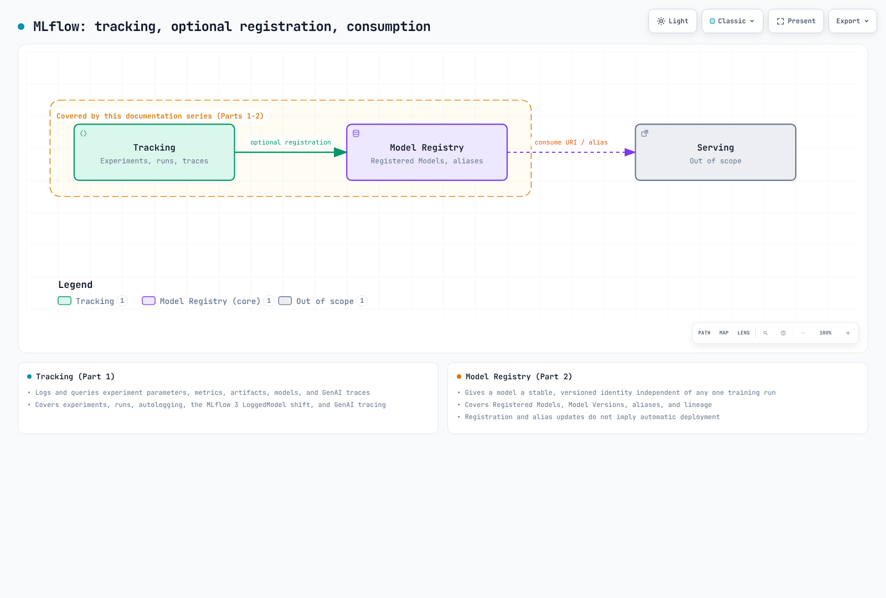

# EKS 上的 MLflow 深入解析

> **审核基准版本**：MLflow 3.16.0
> **已检查的最新版本**：MLflow 3.17.1（2026 年 10 月 13 日）；最新的 3.16 补丁版本为 3.16.1（2026 年 9 月 17 日）
> **文档审核日期**：2026 年 10 月 16 日

## 概述

MLflow 提供实验跟踪、模型记录与注册、版本管理、GenAI 评估和追踪功能。追踪功能于 2.14.0 中推出；3.x 扩展了 LoggedModel、评估和 UI 集成。3.16.0 版本于 2026-09-04 发布。

补丁版本 3.16.1 随后于 2026-09-17 发布，并移除了随附的默认 basic-auth 管理员密码。以下示例使用 3.16.0 进行检查，未在 3.16.1 上重新运行。MLflow 3.17.0（2026-10-07）是后续的小版本更新，对于使用 SQL 的服务器，需要协调升级 SQL 架构；3.17.1（2026-10-13）是其补丁版本。本系列不涵盖 3.17.x。

你可以在本地通过 SDK 和 SQLite 使用它，也可以运行一个 HTTP 跟踪服务，并分别使用 SQL 元数据存储和制品存储。一个逻辑服务不一定对应一个 Pod 或一个存储系统。本系列涵盖 Tracking、Registry 和 EKS 部署；不验证 MLflow 的所有功能，也不验证 GPU 训练是否成功。

## 组件图

| 概念 | 解决的问题 | 深入解析 |
|---------|--------------------|-----------|
| **Tracking** | 记录并查询实验参数、指标、制品、模型和 GenAI 追踪数据 | [第 1 部分](01-tracking.md) |
| **Model Registry** | 为模型提供稳定且有版本控制的身份标识，使其独立于任何单次训练运行 | [第 2 部分](02-model-registry.md) |
| **EKS 部署** | 在 EKS 上运行跟踪服务器、后端存储和制品存储 | [第 3 部分](03-eks-deployment.md) |

[🔍 查看交互式示意图](https://www.atomai.click/kubernetes-docs/archmaps/en-ai-ml-mlflow-readme-0.html)

## 为什么在 EKS 上运行

权衡取舍与本文档站点的数据/ML 部分其他内容所述相同：已经运行 EKS 的团队可以让 MLflow 跟踪服务器复用与集群中其他服务相同的部署、IAM（IRSA/Pod Identity）和可观测性模式；代价是需要直接运维跟踪服务器、其后端数据库和制品存储，而不是使用托管替代方案。

[SageMaker AI 指南](../sagemaker-ai/README.md)介绍了一种 Qwen 对比设计。该示例采用了单独的历史版本固定配置，目前由于其 DLC 已达到补丁版本生命周期末期，GPU 执行会被阻止。本系列针对 MLflow 3.16.0 的本地检查，并不构成对该示例的端到端验证。

Model Registry 注册是可选的生命周期步骤。Serving 系统通过单独的配置使用模型 URI 或别名；注册模型或更改别名不会自动部署模型。

## 当前涵盖内容

1. [第 1 部分：MLflow Tracking](01-tracking.md)：实验、运行、自动记录、MLflow 3 中 LoggedModel 的变化，以及 GenAI 追踪
2. [第 2 部分：MLflow Model Registry](02-model-registry.md)：已注册模型、模型版本、别名和溯源关系
3. [第 3 部分：在 EKS 上部署 MLflow](03-eks-deployment.md)：跟踪服务器、PostgreSQL 后端存储、S3 制品存储和 IAM 访问

## 主要来源

- [MLflow 3.17.1 发布说明](https://github.com/mlflow/mlflow/releases/tag/v3.17.1)
- [MLflow 3.17.0 发布说明（数据库升级说明）](https://github.com/mlflow/mlflow/releases/tag/v3.17.0)
- [MLflow 3.16.1 发布说明](https://github.com/mlflow/mlflow/releases/tag/v3.16.1)
- [MLflow 3.16.0 审核基准版本](https://github.com/mlflow/mlflow/releases/tag/v3.16.0)
- [MLflow 2.14.0 中引入的追踪功能](https://github.com/mlflow/mlflow/releases/tag/v2.14.0)
- [后端存储](https://mlflow.org/docs/3.16.0/self-hosting/architecture/backend-store/)
