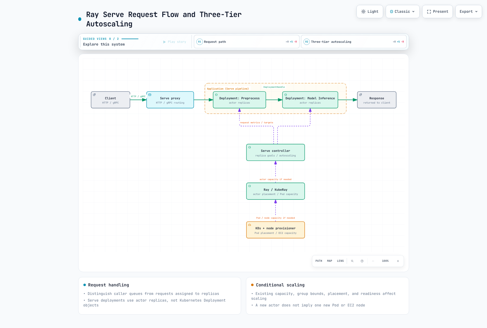

# 第 4 部分：Ray Serve

> **审查基准**：Ray 2.58.0 · KubeRay 1.7.1 · 2026-10-16

## 环境与验证范围

我们使用 Python 3.12 和 `ray[serve]==2.58.0` 检查了一个小型 CPU 响应示例。在此环境中，HAProxy 模块导入了 Jinja2，但额外安装项并未提供它；显式添加 `Jinja2==3.1.6` 后，导入问题得到解决。其他环境可能已通过其他依赖安装了它。

`ray[llm]` 额外项会添加 vLLM 等大型推理依赖。本次未安装此额外项，也未运行模型权重、GPU 或 EKS 工作负载。以下验证涵盖 Serve 配置、HTTP 响应和 DeploymentHandle 调用。

## Deployments、Applications 与请求路径

Serve **Deployment** 管理 actor 副本；它与 Kubernetes Deployment 不同。一个 Ray Pod 中可以容纳多个副本 actor，因此副本数和 Pod 数不能互换使用。

一个 **Application** 包含一个或多个 deployment，以及一个入口 deployment。DeploymentHandles 可以连接预处理和推理，而无需让每个内部调用都经过 HTTP，也无需为每个 deployment 创建一个 Kubernetes Service。

Controller 管理 Serve 控制状态和 actor 生命周期。Proxy 接收 HTTP/gRPC 流量并将其转发到 deployments。2.58.0 中的默认 proxy 位置是**承载副本的节点上的 `EveryNode`**。可以显式选择 `HeadOnly` 和 `Disabled`。较早的架构页面所述的仅 Head 节点默认值不应覆盖当前 API 契约。

请区分 proxy/handle 处的调用方队列与分配给副本的正在处理请求。请在应用中检查同步/异步处理程序、阻塞工作、超时和取消行为。

## 简单的本地 HTTP/Handle 示例

此示例验证响应 API，而非模型推理。实际检查使用了一个可用的私有回环端口，并确认 HTTP 200 和 `double(4) == 8`。

```python
import requests
import ray
from ray import serve

try:
    ray.init(address="local", num_cpus=2, include_dashboard=False,
             object_store_memory=80 * 1024 * 1024)
    serve.start(proxy_location="HeadOnly",
                http_options={"host": "127.0.0.1", "port": 18080})

    @serve.deployment(num_replicas=1,
                      ray_actor_options={"num_cpus": 1},
                      max_ongoing_requests=2, max_queued_requests=4)
    class Echo:
        async def __call__(self, request):
            return {"echo": request.query_params.get("value", "")}
        def double(self, value):
            return value * 2

    handle = serve.run(Echo.bind(), name="echo", route_prefix="/echo")
    response = requests.get("http://127.0.0.1:18080/echo",
                            params={"value": "fixture"}, timeout=15)
    assert response.status_code == 200
    assert response.json() == {"echo": "fixture"}
    assert handle.double.remote(4).result(timeout_s=15) == 8
finally:
    serve.shutdown()
    ray.shutdown()
```

请在单独的练习进程中运行，并确保端口 18080 可用。Ray 逻辑资源和对象存储大小并非整个进程的 OS 内存/CPU 限制。`serve.shutdown()` 会停止已连接的 Serve 实例；请勿将此示例中的清理操作用于共享的生产集群。

## 副本、自动扩缩容与背压

请区分以下已验证的 2.58.0 默认值：

| 配置 | 值或含义 |
|---|---|
| 默认 deployment | 一个副本，未配置自动扩缩容 |
| `num_replicas="auto"` | 应用最小值 1、最大值 100、正在处理请求目标值 2 |
| 直接使用 `AutoscalingConfig()` | 最小值 1，**最大值 1**；省略最大值会限制扩容 |
| `max_ongoing_requests` | 已发送给副本但尚未收到响应的请求；默认值为 5 |
| `max_queued_requests` | **每个调用方**（proxy/handle）的队列上限；默认值为 -1，即不限制 |
| 扩缩容延迟 | 默认向上扩容 30 秒/向下扩容 600 秒；不代表实际就绪延迟 |

自动扩缩容目标会观察请求负载；它不同于正在处理请求的最大值和全局队列上限。超过队列限制时，handle 可能引发 BackPressureError，HTTP 默认返回 503。背压配置可以自定义 HTTP 响应。

应一并调整最小值/最大值、测量窗口/延迟、冷启动、模型加载、批处理和实际处理时间。将 `min_replicas=0` 设为零扩容并不能消除重启延迟。期望的副本数不保证所有副本都已就绪。

## EKS 上的控制层

1. Serve 根据请求负载和策略调整 deployment 副本目标。
2. Ray 放置 actor/bundle；启用 Ray 自动扩缩容后，KubeRay 可以调整 worker Pod 容量。
3. Kubernetes 放置 Pod，并在需要时由 Karpenter 等供应器提供节点容量。

**一个待处理的 actor 不会自动变成一个 Pending Pod 或一个 EC2 节点。**现有 Ray Pod 可能有可用容量，也可能因组限制、放置策略和配额而无法继续推进。请检查每一层的需求和就绪状态。



[交互式图表](https://www.atomai.click/kubernetes-docs/archmaps/en-ai-ml-ray-04-ray-serve-0.html)

## GPU 推理与 Ray Serve LLM

普通 GPU 副本使用 Ray 资源设置，例如 `ray_actor_options`。请协调设备、驱动程序、Pod 限制，以及 Ray 结构化资源/rayStartParams 的优先级。如[第 2 部分](02-kuberay-operator.md)所述，Pod 限制并不总是唯一的配置值。

`LLMConfig` 和 `build_openai_app` 等 API 提供了独立的 LLM 配置层。2.58.0 文档和软件包显示支持 **vLLM 和 SGLang 后端**。已验证的 `ray[llm]` 依赖包括 `vllm[audio]==0.26.0` 和 NIXL 软件包；这并不意味着所有 SGLang 依赖也都已安装。

请区分 `model_loading_config`、`deployment_config`、`engine_kwargs` 和 `server_cls`。请检查引擎专属字段和支持的组合，不要假定每个 `vllm serve` CLI 选项都能原样传递。不同后端的 tensor-parallel 选项名称和 worker 放置方式可能不同。一些 API 处于 beta 阶段，较旧的 LLMServer/LLMRouter 路径则带有弃用通知。

请分别验证模型访问权限、版本、权重下载、引擎/CUDA/驱动程序兼容性、KV cache，以及 tensor/pipeline 并行所需资源。与 OpenAI 兼容的请求格式并不能证明身份验证、安全性或功能覆盖完全相同。CPU Echo 检查不能证明 LLM 的性能或兼容性。

## RayService 与运维更新

RayService 是一种在 EKS 上以声明式方式管理 Serve 应用和 RayClusters 生命周期的选择，并非每个生产部署都必须使用。请区分应用配置变更与集群变更，以及 `NewCluster` 和基于 Gateway 的增量升级策略。

KubeRay 1.7 启用的增量功能门控仍需要 Gateway API/实现、备用容量、就绪条件和排空条件。请针对关闭限制测试流式和长时间运行的请求。不要描述成每次升级都能保证请求零丢失。

HTTP 选项等集群级启动设置在动态更新方面存在限制。Deployment 变更可能只需轻量级重新配置，也可能需要替换 actor。重启/替换的副本需要承担模型初始化和状态恢复成本。

## 访问控制与限制

请分别限制 API/dashboard/client 入口、模型工件访问和应用用户访问。Ray 集群令牌和 ClusterIP 不会自动为每个 Serve 端点实现身份验证/授权。请检查敏感输入、响应、提示词和日志，并配置队列、超时和资源限制。

此处的检查涵盖原生配置/装饰器，以及一个小型单节点 HTTP/Handle 应用。未进行自动扩缩容负载测试、GPU/LLM 执行、多节点故障转移或 RayService 滚动更新。

## 主要来源

- [Serve 2.58.0](https://docs.ray.io/en/releases-2.58.0/serve/index.html)
- [自动扩缩容](https://docs.ray.io/en/releases-2.58.0/serve/autoscaling-guide.html)
- [Serve LLM](https://docs.ray.io/en/releases-2.58.0/serve/llm/index.html)
- [Serve API 和 proxy 默认值](https://github.com/ray-project/ray/blob/ray-2.58.0/python/ray/serve/api.py)
- [Serve 配置](https://github.com/ray-project/ray/blob/ray-2.58.0/python/ray/serve/config.py)
- [副本/队列配置](https://github.com/ray-project/ray/blob/ray-2.58.0/python/ray/serve/_private/config.py)
- [KubeRay 1.7](https://github.com/ray-project/kuberay/releases/tag/v1.7.1)

[主页](README.md) · [测验](../../quizzes/ai-ml/ray/04-ray-serve-quiz.md)
