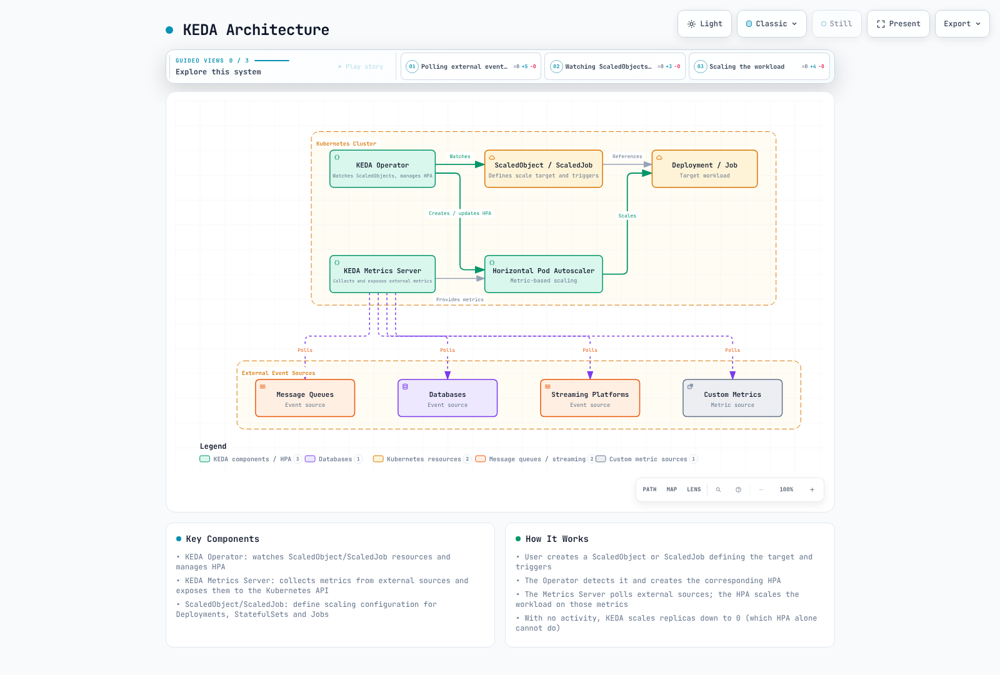

# KEDA（Kubernetes 事件驱动自动伸缩）

> **示例版本**：KEDA/Helm chart 2.21.0；请参阅下方经过测试的 Kubernetes 版本矩阵。
> **最后更新**：October 16, 2026

## 目录
- [简介](#introduction)
- [架构](#architecture)
- [安装和配置](#installation-and-configuration)
- [Scaler](#scalers)
- [自定义指标伸缩](#custom-metric-scaling)
- [Twitter 指标伸缩](#twitter-metric-scaling)
- [Google Calendar 伸缩](#google-calendar-scaling)
- [Istio 指标伸缩](#istio-metric-scaling)
- [基于 Cron 的伸缩](#cron-based-scaling)
- [与 Amazon EKS 集成](#integration-with-amazon-eks)
- [最佳实践](#best-practices)
- [故障排查](#troubleshooting)
- [结论](#conclusion)

## 简介

KEDA（Kubernetes 事件驱动自动伸缩）是一个开源项目，可为 Kubernetes 应用启用事件驱动自动伸缩。KEDA 扩展了 Kubernetes 原生的 Horizontal Pod Autoscaler（HPA），使工作负载能够根据 CPU 和内存使用量以外的各种事件源和指标进行伸缩。

### KEDA 的主要优势

1. **事件驱动伸缩**：根据各种事件源（消息队列、数据库、流等）进行伸缩
2. **缩容至零**：支持的事件触发器可以激活空闲工作负载；为该工作负载配置最小值、激活阈值和冷却时间。
3. **丰富的 Scaler 支持**：支持 50 多种内置 Scaler，也支持自定义 Scaler
4. **原生 Kubernetes 集成**：与现有 Kubernetes HPA 集成
5. **云中立**：可在具备所需 API、网络访问和身份配置的兼容 Kubernetes 发行版上运行。
6. **部署模型**：标准安装包含一个 operator、一个指标 API server 和 admission webhook。

### 与现有伸缩方法的比较

| 功能 | KEDA | Kubernetes HPA | 云提供商自动伸缩器 |
|---------|------|----------------|---------------------------|
| 指标来源 | 内置事件 Scaler 和外部 Scaler | 通过适当的适配器提供资源、自定义和外部指标 | 取决于产品 |
| 缩容至零 | 支持的触发器和配置 | 取决于版本/功能；在 Kubernetes 1.37 beta 中，对象/外部指标支持缩容至零 | 取决于产品 |
| 事件驱动 | 事件源集成和激活 | 可通过自定义/外部指标适配器实现 | 取决于产品 |
| 云中立 | ✅ | ✅ | ❌ |
| 部署复杂度 | Operator、指标 server、webhook 和凭据 | 内置控制器；可能需要适配器 | 取决于产品 |
| 自定义指标 | Scaler 集成或 HTTP/gRPC 生产器 | 需要适当的指标适配器 | 取决于产品 |

## 架构

KEDA 基于 Kubernetes operator 模式，可监控外部指标来源并自动管理 Kubernetes HPA。



[🔍 查看交互式图表](https://www.atomai.click/kubernetes-docs/archmaps/en-autoscaling-01-keda-0.html)


### 主要组件

1. **KEDA Operator**：协调 ScaledObject 及其 HPA，处理零副本激活/停用，并为 ScaledJob 创建 Job。
2. **KEDA Metrics Server**：通过聚合 Kubernetes API 提供外部指标，并通过 operator 的指标服务获取 Scaler 结果。
3. **ScaledObject**：定义 Deployment、StatefulSet 等的伸缩配置。
4. **ScaledJob**：定义 Kubernetes Job 的伸缩配置
5. **触发器/Scaler**：获取事件源指标并评估是否激活；admission webhook 验证受支持的资源配置。

### 工作原理

1. ScaledObject 引用其命名空间中兼容的伸缩目标。KEDA 为其管理一个 HPA；每个目标只使用一个伸缩管理者。
2. Operator 根据 `pollingInterval` 轮询触发器以判断是否激活，包括工作负载处于零副本时。
3. 对于非零副本，HPA 通过指标 API server 和 operator 请求外部指标。HPA 同步和指标缓存设置会影响查询频率。
4. HPA 调整非零副本数；KEDA 处理激活和已配置的缩容至零冷却时间。`cooldownPeriod` 不会取代 HPA 将副本数从 N 缩减到 1 时的稳定窗口。
5. ScaledJob 采用单独的处理路径：KEDA 根据事件及其伸缩策略创建批处理 Job；它不会为这些 Job 创建 HPA。

## 安装和配置

这些示例是可选方案，并非一组可一次性应用的 manifest。请准备好引用的工作负载、Service、Secret 和镜像；替换账户、队列、URL 和镜像占位符。不要让多个 ScaledObject/HPA 作用于同一个目标。自动伸缩接管副本数后，请协调 GitOps/应用对 `spec.replicas` 的管理权。这些配置示例尚未在生产环境中部署或测量。

Kubernetes 1.37 引入了对象/外部指标的 beta 版 HPA 缩容至零功能，通过 `HPAScaleToZero` 默认启用；仅使用 CPU/内存的指标无法从零副本激活工作负载。这并未改变 KEDA 2.21 中 operator 与 HPA 的分工，也不能据此确认其与 Kubernetes 1.37 兼容。

### 先决条件

- 选择由你的提供商和所选 KEDA 版本支持的 Kubernetes 版本。KEDA 2.21 部署文档公布的**已测试版本矩阵为 1.34–1.36**。该矩阵不代表与 1.37 兼容；请单独验证这一组合。
- 如果你要从 KEDA 2.20 升级，请先阅读[2.21 迁移指南](https://keda.sh/docs/2.21/migration/#upgrading-from-keda-220-to-221)。作为 CVE-2026-77524 的修复措施，2.21 默认强制执行服务账户令牌受众验证（`operator.serviceAccountTokens.mode: enforce-audience`），适用于 Vault Kubernetes 身份验证和 `boundServiceAccountToken`。它还移除了 Temporal Scaler 已弃用的设置，并更改了 Azure Pipelines 的 `scaleOnInFlight` 默认值。本章示例不使用这些身份验证方法或 Scaler。
- 已配置 kubectl
- Helm（可选）

### 安装方法

#### 1. 使用 Helm 安装

```bash
helm repo add kedacore https://kedacore.github.io/charts
helm repo update
helm install keda kedacore/keda --version 2.21.0 --namespace keda --create-namespace
```

#### 2. 使用 YAML Manifest 安装

```bash
kubectl apply --server-side -f https://github.com/kedacore/keda/releases/download/v2.21.0/keda-2.21.0.yaml
```

#### 3. 验证安装

```bash
kubectl get deployments,pods -n keda
kubectl wait --for=condition=Available deployment --all -n keda --timeout=180s
kubectl get apiservice v1beta1.external.metrics.k8s.io
```

示例输出（名称/数量取决于 chart 设置；此处并非实际执行结果）：
```
NAME                                      READY   STATUS    RESTARTS   AGE
keda-operator-<hash>-<id>                  1/1     Running   0          1m
keda-operator-metrics-apiserver-<hash>-<id> 1/1     Running   0          1m
keda-admission-webhooks-<hash>-<id>        1/1     Running   0          1m
```

### 基本配置

稍后展示的 IRSA 值必须合并到同一份固定版本的 Helm values 文件中，然后再应用升级。更改身份配置时，请验证最终生成的 ServiceAccount 注解，并通过常规滚动更新流程重启 operator Pod。

以下 values 与 Helm chart 2.21.0 相匹配。两个 operator 副本提供的是 leader-election 备用实例，而非两个活跃的协调器。Metrics Server 的冗余也取决于 API aggregation 路由，并不意味着端到端完全高可用。资源值只是起始配置，并非经过测量的容量规格。

#### 使用 Helm Values 文件自定义配置

```yaml
operator:
  replicaCount: 2
metricsServer:
  replicaCount: 1
resources:
  operator:
    limits:
      cpu: '1'
      memory: 1000Mi
    requests:
      cpu: 100m
      memory: 100Mi
  metricServer:
    limits:
      cpu: '1'
      memory: 1000Mi
    requests:
      cpu: 100m
      memory: 100Mi
  webhooks:
    limits:
      cpu: '1'
      memory: 1000Mi
    requests:
      cpu: 100m
      memory: 100Mi
logging:
  operator:
    level: info
  metricServer:
    level: 0
```

```bash
helm upgrade --install keda kedacore/keda --version 2.21.0 --namespace keda --create-namespace -f values.yaml
```

## Scaler

KEDA 为各种事件源提供 Scaler。每个 Scaler 都会从特定事件源收集指标，并根据这些指标对工作负载进行伸缩。

### 主要 Scaler

KEDA 支持 50 多种 Scaler，其中主要包括：

1. **消息队列**：
   - Apache Kafka
   - RabbitMQ
   - AWS SQS
   - Azure Service Bus
   - Google Cloud Pub/Sub

2. **数据库**：
   - MySQL
   - PostgreSQL
   - MongoDB
   - Redis

3. **流处理平台**：
   - Apache Kafka
   - AWS Kinesis
   - Azure Event Hubs

4. **云服务**：
   - AWS CloudWatch
   - Azure Monitor
   - Google Cloud Monitoring

5. **其他**：
   - Prometheus
   - InfluxDB
   - Cron
   - CPU/内存

### 基本 ScaledObject 示例

在目标命名空间中创建 `rabbitmq-credentials`，并设置 `host` 键，其中包含完整且经过授权的 AMQP/AMQPS 连接 URI。引用的 `rabbitmq-consumer` Deployment 必须已配置为从该队列消费消息。在非隔离网络中，建议使用经过验证的信任链的 TLS；此示例不会部署 broker，也不会生成凭据。

```yaml
apiVersion: keda.sh/v1alpha1
kind: TriggerAuthentication
metadata:
  name: rabbitmq-auth
  namespace: default
spec:
  secretTargetRef:
  - parameter: host
    name: rabbitmq-credentials
    key: host
---
apiVersion: keda.sh/v1alpha1
kind: ScaledObject
metadata:
  name: rabbitmq-scaledobject
  namespace: default
spec:
  scaleTargetRef:
    apiVersion: apps/v1
    kind: Deployment
    name: rabbitmq-consumer
  pollingInterval: 15
  cooldownPeriod: 30
  minReplicaCount: 0
  maxReplicaCount: 30
  triggers:
  - type: rabbitmq
    metadata:
      protocol: amqp
      queueName: hello
      mode: QueueLength
      value: '5'
    authenticationRef:
      name: rabbitmq-auth
```

### 基本 ScaledJob 示例

重复使用上文的 `rabbitmq-auth` 和 `rabbitmq-credentials`。请提供一个真实的 worker 镜像，其进程能够处理有限数量的工作、确认消息并退出；否则 Job 将永远无法完成。重试可能导致重复处理，因此请使用应用级幂等机制以及适当的确认/可见性超时。`jobTargetRef` 是一个 JobSpec，而不是另一个嵌套的 Job 或 PodTemplate。

```yaml
apiVersion: keda.sh/v1alpha1
kind: ScaledJob
metadata:
  name: rabbitmq-scaledjob
  namespace: default
spec:
  jobTargetRef:
    template:
      spec:
        containers:
        - name: rabbitmq-worker
          image: rabbitmq-worker:latest
          imagePullPolicy: Always
          env:
          - name: RABBITMQ_HOST
            valueFrom:
              secretKeyRef:
                name: rabbitmq-credentials
                key: host
        restartPolicy: Never
    backoffLimit: 4
  pollingInterval: 15
  maxReplicaCount: 30
  successfulJobsHistoryLimit: 5
  failedJobsHistoryLimit: 5
  triggers:
  - type: rabbitmq
    metadata:
      protocol: amqp
      queueName: hello
      mode: QueueLength
      value: '5'
    authenticationRef:
      name: rabbitmq-auth
```
## 自定义指标伸缩

除各种内置 Scaler 外，KEDA 还支持根据自定义指标灵活地进行伸缩。这样你就可以实现适合自身业务需求的独特伸缩逻辑。

### 使用外部指标 API

计数器示例使用 `rate(...[2m])`，因此其目标单位是每个副本每秒的事件数，而非累计总数。Prometheus 查询必须返回单个数值结果。`ignoreNullValues: false` 会将缺失序列作为错误处理；请审慎判断空结果究竟代表零，还是遥测故障。

你可以使用 Prometheus 等外部指标来源实现基于自定义指标的伸缩：

```yaml
apiVersion: keda.sh/v1alpha1
kind: ScaledObject
metadata:
  name: custom-metrics-scaler
  namespace: default
spec:
  scaleTargetRef:
    apiVersion: apps/v1
    kind: Deployment
    name: my-app
  minReplicaCount: 1
  maxReplicaCount: 10
  triggers:
  - type: prometheus
    metadata:
      serverAddress: http://prometheus-server.monitoring.svc.cluster.local
      threshold: '100'
      query: sum(rate(custom_metric_total{namespace="default",pod=~"my-app-.*"}[2m]))
      ignoreNullValues: 'false'
```

### 使用 HTTP Scaler

这是用于数值端点数据的 `metrics-api` Scaler，并非单独的 KEDA HTTP add-on；后者会拦截并缓冲请求以激活工作负载。该端点必须能够独立于被伸缩的工作负载持续运行，尤其是在工作负载为零副本时。

你可以从 HTTP 端点获取指标以进行伸缩：

```yaml
apiVersion: keda.sh/v1alpha1
kind: ScaledObject
metadata:
  name: http-scaler
  namespace: default
spec:
  scaleTargetRef:
    apiVersion: apps/v1
    kind: Deployment
    name: my-app
  minReplicaCount: 1
  maxReplicaCount: 10
  triggers:
  - type: metrics-api
    metadata:
      targetValue: '100'
      url: https://metrics.example.com/metrics
      valueLocation: value
```

### 开发自定义 Scaler

下面的 Go 示例是一个**供内置 `metrics-api` Scaler 使用的 HTTP JSON 指标生产器**，不是 Kubernetes external.metrics.k8s.io 的实现，也不是 KEDA 的 external-scaler 协议实现。KEDA `external`/`external-push` 服务则需实现文档规定的 gRPC 方法 `IsActive`、`GetMetricSpec`、`GetMetrics`，并在使用 push 激活时实现 `StreamIsActive`。

1. Metrics Server 实现：

完整的 Go server 会读取 `METRICS_FILE`，这是一个通过原子替换更新的 JSON 快照，包含数值型 `value` 和 RFC3339 格式的 `observed_at`。需要由单独的业务指标生产器写入此文件。缺失/无效/负值或超过两分钟的数据会返回 HTTP503。使用以下 ScaledObject 前，请先构建并部署该服务及匹配的 Service；它不是聚合 Kubernetes API server。

```go
package main

import (
    "encoding/json"
    "errors"
    "io"
    "log"
    "net/http"
    "os"
    "time"
)

type snapshot struct {
    Value *float64 `json:"value"`
    ObservedAt time.Time `json:"observed_at"`
}

func metricsHandler(path string) http.HandlerFunc {
    return func(w http.ResponseWriter, r *http.Request) {
        if r.Method != http.MethodGet {
            w.Header().Set("Allow", "GET")
            http.Error(w, "method not allowed", http.StatusMethodNotAllowed)
            return
        }
        f, err := os.Open(path)
        if err != nil {
            http.Error(w, "metric unavailable", http.StatusServiceUnavailable)
            return
        }
        defer f.Close()
        var v snapshot
        decoder := json.NewDecoder(io.LimitReader(f, 1<<20))
        if err = decoder.Decode(&v); err == nil {
            var extra any
            if err = decoder.Decode(&extra); !errors.Is(err, io.EOF) {
                http.Error(w, "invalid snapshot", http.StatusServiceUnavailable)
                return
            }
        } else {
            http.Error(w, "invalid snapshot", http.StatusServiceUnavailable)
            return
        }
        age := time.Since(v.ObservedAt)
        if v.Value == nil || *v.Value < 0 || v.ObservedAt.IsZero() || age < -5*time.Second || age > 2*time.Minute {
            http.Error(w, "stale or invalid metric", http.StatusServiceUnavailable)
            return
        }
        w.Header().Set("Content-Type", "application/json")
        w.Header().Set("Cache-Control", "no-store")
        _ = json.NewEncoder(w).Encode(v)
    }
}

func main() {
    path := os.Getenv("METRICS_FILE")
    if path == "" { log.Fatal("METRICS_FILE is required") }
    mux := http.NewServeMux()
    mux.HandleFunc("/metrics", metricsHandler(path))
    server := &http.Server{
        Addr: ":8080", Handler: mux,
        ReadHeaderTimeout: 5 * time.Second,
        WriteTimeout: 10 * time.Second,
        IdleTimeout: 60 * time.Second,
    }
    log.Fatal(server.ListenAndServe())
}
```

2. 与 KEDA 集成：

```yaml
apiVersion: keda.sh/v1alpha1
kind: ScaledObject
metadata:
  name: custom-scaler
  namespace: default
spec:
  scaleTargetRef:
    apiVersion: apps/v1
    kind: Deployment
    name: my-app
  minReplicaCount: 1
  maxReplicaCount: 10
  triggers:
  - type: metrics-api
    metadata:
      targetValue: '100'
      url: http://custom-metrics-server:8080/metrics
      valueLocation: value
```

## Twitter 指标伸缩

此示例使用 X API（前身为 Twitter）v2 recent-counts 端点。它统计以数据采集时间前 30 秒为结束时间的五分钟窗口内的匹配项；这既不是累计计数，也不是即时发帖速率。必须针对预期用途验证账户访问权限、查询语义、计费和速率限制。

### 先决条件

- 一个有权访问近期 Post 计数的 X 开发者应用及其应用 bearer token；此示例不代表已获得 API 访问权限或相关费用已包含在内。
- 一个用于采集和公开指标的服务

### 实施步骤

1. 实现 Twitter 指标采集服务：

将此独立示例保存为采集器镜像中的 `app.py`，并在镜像中安装 Flask、requests 和 Gunicorn 依赖。该部署使用一个 Gunicorn worker 和 `app:create_app()`，以确保后台采集器能够在 WSGI 下实际启动。多个 worker/副本会增加 API 轮询量。计数不完整、遇到速率限制或身份验证错误时，服务会在失败后返回 HTTP503；代码不会默默将截断的搜索页面当作速率使用。请根据你的 API 权限调整轮询频率。

```python
import datetime as dt
import os
import threading
import time

import requests
from flask import Flask, jsonify

TOKEN = os.environ["X_BEARER_TOKEN"]
QUERY = os.environ.get("X_QUERY", "#kubernetes")
POLL_SECONDS = 60
MAX_AGE_SECONDS = 120
METRIC_NAME = "tweet_count"


def fetch_value():
    # Five-minute window ending 30 seconds ago; not a lifetime count or live rate.
    end = dt.datetime.now(dt.timezone.utc) - dt.timedelta(seconds=30)
    start = end - dt.timedelta(minutes=5)
    response = requests.get(
        "https://api.x.com/2/tweets/counts/recent",
        headers={"Authorization": f"Bearer {TOKEN}"},
        params={"query": QUERY, "granularity": "minute",
                "start_time": start.isoformat(), "end_time": end.isoformat()},
        timeout=(3, 10),
    )
    response.raise_for_status()
    body = response.json()
    meta = body["meta"]
    # Never silently scale from a partial result or an API error payload.
    if body.get("errors") or meta.get("next_token"):
        raise ValueError("incomplete counts response")
    value = meta["total_tweet_count"]
    if type(value) is not int or value < 0:
        raise ValueError("invalid count")
    return value


def create_app():
    app = Flask(__name__)
    lock = threading.Lock()
    state = {"value": None, "updated": 0.0, "healthy": False}

    def collect():
        while True:
            try:
                value = fetch_value()
                if type(value) is not int or value < 0:
                    raise ValueError("invalid metric")
                with lock:
                    state.update(value=value, updated=time.monotonic(), healthy=True)
            except Exception as exc:
                with lock:
                    state["healthy"] = False
                app.logger.warning("Metric refresh failed: %s", type(exc).__name__)
            time.sleep(POLL_SECONDS)

    @app.get("/metrics")
    def get_metrics():
        with lock:
            current = state.copy()
        if not current["healthy"] or time.monotonic() - current["updated"] > MAX_AGE_SECONDS:
            return jsonify(error="metric unavailable or stale"), 503
        response = jsonify({METRIC_NAME: current["value"]})
        response.headers["Cache-Control"] = "no-store"
        return response

    threading.Thread(target=collect, daemon=True).start()
    return app


if __name__ == "__main__":
    # Local development only; use a WSGI server for the deployment example.
    create_app().run(host="127.0.0.1", port=8080)
```

2. 部署指标采集服务：

部署前构建并固定采集器镜像版本。将现有令牌文件作为 Secret 输入创建，避免在 shell 参数中放入其内容：

```bash
kubectl create secret generic twitter-api-secrets --namespace default --from-file=bearer-token=./x-bearer-token
```

运行此命令时会创建 Kubernetes Secret；本次审计期间并未执行该命令。请勿将源文件纳入版本控制。

```yaml
apiVersion: apps/v1
kind: Deployment
metadata:
  name: twitter-metrics-collector
  namespace: default
spec:
  replicas: 1
  selector:
    matchLabels:
      app: twitter-metrics-collector
  template:
    metadata:
      labels:
        app: twitter-metrics-collector
    spec:
      containers:
      - name: collector
        image: twitter-metrics-collector:latest
        ports:
        - containerPort: 8080
        env:
        - name: X_BEARER_TOKEN
          valueFrom:
            secretKeyRef:
              name: twitter-api-secrets
              key: bearer-token
        command:
        - gunicorn
        args:
        - --bind
        - 0.0.0.0:8080
        - --workers
        - '1'
        - --threads
        - '4'
        - app:create_app()
        resources:
          requests:
            cpu: 100m
            memory: 128Mi
          limits:
            memory: 256Mi
        readinessProbe:
          httpGet:
            path: /metrics
            port: 8080
          periodSeconds: 10
          failureThreshold: 3
      automountServiceAccountToken: false
---
apiVersion: v1
kind: Service
metadata:
  name: twitter-metrics-collector
  namespace: default
spec:
  selector:
    app: twitter-metrics-collector
  ports:
  - port: 80
    targetPort: 8080
```

3. 配置 KEDA ScaledObject：

```yaml
apiVersion: keda.sh/v1alpha1
kind: ScaledObject
metadata:
  name: twitter-scaler
  namespace: default
spec:
  scaleTargetRef:
    apiVersion: apps/v1
    kind: Deployment
    name: twitter-processor
  minReplicaCount: 1
  maxReplicaCount: 20
  pollingInterval: 15
  cooldownPeriod: 30
  triggers:
  - type: metrics-api
    metadata:
      targetValue: "10"
      url: "http://twitter-metrics-collector/metrics"
      valueLocation: "tweet_count"
```

使用默认的 AverageValue 时，计数/目标值比率会在配置的上下限内建议副本数；它并不直接表示处理吞吐量。采集器独立保持一个副本，在不可用时返回 503，并且没有会仅因上游故障而重启它的 liveness probe。生产环境使用仍需经过验证的凭据、限制、生命周期处理和可观测性。

## Google Calendar 伸缩

此示例统计**未来一小时内与时间窗口重叠的 Google Calendar 事件实例**，包括已经开始且仍在进行的事件。`timeMin` 会筛选事件结束时间，`timeMax` 会筛选开始时间。所有分页都会计入；采集不完整、失败或数据过期时，服务会返回指标不可用，而不是错误地返回零。

### 先决条件

- 启用 Calendar API，并使用有权读取特定共享日历的服务账户。设置实际日历 ID；`primary` 不能代替将用户日历共享给该服务账户。
- 一个用于采集和公开指标的服务

### 实施步骤

1. 实现 Google Calendar 指标采集服务：

将此独立示例保存为单独镜像中的 `app.py`，并安装 Flask、requests、google-auth 和 Gunicorn。单个采集线程会遍历所有分页；遇到重复令牌或达到分页安全上限时，会报告失败。该标量统计的是重叠的事件实例，而非参会者数量或所需副本数。必须向服务账户授予日历访问权限；仅有 OAuth scope 并不能授予该访问权限。

```python
import datetime as dt
import os
import threading
import time
from urllib.parse import quote

from flask import Flask, jsonify
from google.auth.transport.requests import AuthorizedSession
from google.oauth2 import service_account

CALENDAR_ID = os.environ["CALENDAR_ID"]
SERVICE_ACCOUNT_FILE = "/etc/secrets/service-account.json"
POLL_SECONDS = 300
MAX_AGE_SECONDS = 360
METRIC_NAME = "upcoming_events"


def fetch_value():
    credentials = service_account.Credentials.from_service_account_file(
        SERVICE_ACCOUNT_FILE,
        scopes=["https://www.googleapis.com/auth/calendar.readonly"],
    )
    now = dt.datetime.now(dt.timezone.utc)
    params = {"timeMin": now.isoformat(),
              "timeMax": (now + dt.timedelta(hours=1)).isoformat(),
              "singleEvents": "true", "showDeleted": "false",
              "orderBy": "startTime", "maxResults": 2500}
    url = f"https://www.googleapis.com/calendar/v3/calendars/{quote(CALENDAR_ID, safe='')}/events"
    total = 0
    seen_tokens = set()
    with AuthorizedSession(credentials) as session:
        for _ in range(100):
            response = session.get(url, params=params, timeout=(3, 10))
            response.raise_for_status()
            body = response.json()
            if body.get("error") or body.get("kind") != "calendar#events" or not isinstance(body.get("items", []), list):
                raise ValueError("invalid events response")
            total += len(body.get("items", []))
            token = body.get("nextPageToken")
            if not token:
                return total
            if token in seen_tokens:
                raise ValueError("repeated page token")
            seen_tokens.add(token)
            params["pageToken"] = token
    raise ValueError("pagination limit exceeded; result is incomplete")


def create_app():
    app = Flask(__name__)
    lock = threading.Lock()
    state = {"value": None, "updated": 0.0, "healthy": False}

    def collect():
        while True:
            try:
                value = fetch_value()
                if type(value) is not int or value < 0:
                    raise ValueError("invalid metric")
                with lock:
                    state.update(value=value, updated=time.monotonic(), healthy=True)
            except Exception as exc:
                with lock:
                    state["healthy"] = False
                app.logger.warning("Metric refresh failed: %s", type(exc).__name__)
            time.sleep(POLL_SECONDS)

    @app.get("/metrics")
    def get_metrics():
        with lock:
            current = state.copy()
        if not current["healthy"] or time.monotonic() - current["updated"] > MAX_AGE_SECONDS:
            return jsonify(error="metric unavailable or stale"), 503
        response = jsonify({METRIC_NAME: current["value"]})
        response.headers["Cache-Control"] = "no-store"
        return response

    threading.Thread(target=collect, daemon=True).start()
    return app


if __name__ == "__main__":
    # Local development only; use a WSGI server for the deployment example.
    create_app().run(host="127.0.0.1", port=8080)
```

2. 部署指标采集服务：

使用真实的共享日历 ID 和现有服务账户 JSON 文件。运行以下命令时会创建 Secret；本次审查期间并未执行该命令。

```bash
kubectl create secret generic google-calendar-secrets --namespace default --from-file=service-account.json=./service-account.json
```

```yaml
apiVersion: apps/v1
kind: Deployment
metadata:
  name: calendar-metrics-collector
  namespace: default
spec:
  replicas: 1
  selector:
    matchLabels:
      app: calendar-metrics-collector
  template:
    metadata:
      labels:
        app: calendar-metrics-collector
    spec:
      containers:
      - name: collector
        image: calendar-metrics-collector:latest
        ports:
        - containerPort: 8080
        env:
        - name: CALENDAR_ID
          value: REPLACE_WITH_SHARED_CALENDAR_ID
        volumeMounts:
        - name: google-calendar-credentials
          mountPath: /etc/secrets
          readOnly: true
        command:
        - gunicorn
        args:
        - --bind
        - 0.0.0.0:8080
        - --workers
        - '1'
        - --threads
        - '4'
        - app:create_app()
        resources:
          requests:
            cpu: 100m
            memory: 128Mi
          limits:
            memory: 256Mi
        readinessProbe:
          httpGet:
            path: /metrics
            port: 8080
          periodSeconds: 10
          failureThreshold: 3
      volumes:
      - name: google-calendar-credentials
        secret:
          secretName: google-calendar-secrets
      automountServiceAccountToken: false
---
apiVersion: v1
kind: Service
metadata:
  name: calendar-metrics-collector
  namespace: default
spec:
  selector:
    app: calendar-metrics-collector
  ports:
  - port: 80
    targetPort: 8080
```

3. 配置 KEDA ScaledObject：

```yaml
apiVersion: keda.sh/v1alpha1
kind: ScaledObject
metadata:
  name: calendar-scaler
  namespace: default
spec:
  scaleTargetRef:
    apiVersion: apps/v1
    kind: Deployment
    name: calendar-processor
  minReplicaCount: 1
  maxReplicaCount: 10
  pollingInterval: 15
  cooldownPeriod: 30
  triggers:
  - type: metrics-api
    metadata:
      targetValue: "1"
      url: "http://calendar-metrics-collector/metrics"
      valueLocation: "upcoming_events"
```

使用默认的 AverageValue 时，计数/目标值比率会在配置的上下限内建议副本数；它并不直接表示处理吞吐量。采集器独立保持一个副本，在不可用时返回 503，并且没有会仅因上游故障而重启它的 liveness probe。生产环境使用仍需经过验证的凭据、限制、生命周期处理和可观测性。
## Istio 指标伸缩

此示例展示如何根据从 Istio 服务网格收集的指标对应用进行伸缩。我们将介绍如何根据每秒请求数（RPS）进行伸缩。

### 先决条件

- 已安装 Istio 服务网格
- 已安装 Prometheus 并与 Istio 集成

### 实施步骤

1. 验证现有 Istio sidecar 安装和注入策略。此示例使用网格内路由，不需要虚构的 ingress Gateway 资源：

```bash
istioctl proxy-status
kubectl get namespace default --show-labels
kubectl get pods -n default
```

2. 部署示例应用：

```yaml
apiVersion: apps/v1
kind: Deployment
metadata:
  name: sample-app
  namespace: default
spec:
  replicas: 1
  selector:
    matchLabels:
      app: sample-app
  template:
    metadata:
      labels:
        app: sample-app
    spec:
      containers:
      - name: sample-app
        image: nginx:1.30.6
        ports:
        - containerPort: 80
---
apiVersion: v1
kind: Service
metadata:
  name: sample-app
  namespace: default
spec:
  selector:
    app: sample-app
  ports:
  - port: 80
    targetPort: 80
---
apiVersion: networking.istio.io/v1
kind: VirtualService
metadata:
  name: sample-app
  namespace: default
spec:
  hosts:
  - sample-app.default.svc.cluster.local
  gateways:
  - mesh
  http:
  - route:
    - destination:
        host: sample-app
        port:
          number: 80
```

3. 配置 KEDA ScaledObject：

```yaml
apiVersion: keda.sh/v1alpha1
kind: ScaledObject
metadata:
  name: istio-scaler
  namespace: default
spec:
  scaleTargetRef:
    apiVersion: apps/v1
    kind: Deployment
    name: sample-app
  minReplicaCount: 1
  maxReplicaCount: 10
  pollingInterval: 15
  cooldownPeriod: 30
  triggers:
  - type: prometheus
    metadata:
      serverAddress: http://prometheus.istio-system:9090
      threshold: '10'
      query: sum(rate(istio_requests_total{reporter="destination",destination_service="sample-app.default.svc.cluster.local"}[2m]))
      ignoreNullValues: 'false'
```

使用默认的 `AverageValue` 指标类型时，每秒 100 个请求的总速率和每个副本每秒 10 个请求的目标值，大约会建议配置 10 个副本，之后还需考虑 HPA 容差、稳定策略和限制。查询选择 destination 报告，避免对同一请求同时统计源代理和目标代理的数据。Prometheus 必须确实采集这些流量。

### 高级配置

下一个示例要求使用**自定义且取值范围受限的 `request_path` 遥测标签**；这不是 Istio 指标的默认维度。请先配置并验证该标签（避免 URL 取值导致任意高基数），或者使用前一个不含该标签的查询。这是作用于同一目标的替代 ScaledObject，而非额外的伸缩管理者。

```yaml
apiVersion: keda.sh/v1alpha1
kind: ScaledObject
metadata:
  name: istio-path-scaler
  namespace: default
spec:
  scaleTargetRef:
    apiVersion: apps/v1
    kind: Deployment
    name: sample-app
  minReplicaCount: 1
  maxReplicaCount: 10
  pollingInterval: 15
  cooldownPeriod: 30
  triggers:
  - type: prometheus
    metadata:
      serverAddress: http://prometheus.istio-system:9090
      threshold: '5'
      query: sum(rate(istio_requests_total{reporter="destination",destination_service="sample-app.default.svc.cluster.local",request_path="/api/v1/products"}[2m]))
      ignoreNullValues: 'false'
```

错误率和延迟通常是比伸缩输入更好的告警信号。以下可选示例使用 `metricType: Value` 计算服务级比率，避免分母为零，并限制扩容速度。它假设增加副本确实能缓解已诊断出的过载；否则，下游错误或低样本噪声可能导致有害的伸缩行为。尚未测量其在生产环境中的效果。

```yaml
apiVersion: keda.sh/v1alpha1
kind: ScaledObject
metadata:
  name: istio-error-scaler
  namespace: default
spec:
  scaleTargetRef:
    apiVersion: apps/v1
    kind: Deployment
    name: sample-app
  minReplicaCount: 1
  maxReplicaCount: 10
  pollingInterval: 15
  cooldownPeriod: 30
  triggers:
  - type: prometheus
    metadata:
      serverAddress: http://prometheus.istio-system:9090
      threshold: '0.05'
      query: (sum(rate(istio_requests_total{reporter="destination",destination_service="sample-app.default.svc.cluster.local",response_code=~"5.*"}[2m]))
        or vector(0)) / clamp_min(sum(rate(istio_requests_total{reporter="destination",destination_service="sample-app.default.svc.cluster.local"}[2m])),
        0.001)
      ignoreNullValues: 'false'
    metricType: Value
  advanced:
    horizontalPodAutoscalerConfig:
      behavior:
        scaleUp:
          policies:
          - type: Pods
            value: 1
            periodSeconds: 60
        scaleDown:
          stabilizationWindowSeconds: 300
```

## 基于 Cron 的伸缩

KEDA 支持使用 Cron 表达式进行基于时间的伸缩。这样，你可以根据可预测的流量模式或时间安排预先调整应用副本数。

### 基本 Cron Scaler

```yaml
apiVersion: keda.sh/v1alpha1
kind: ScaledObject
metadata:
  name: cron-scaler
  namespace: default
spec:
  scaleTargetRef:
    apiVersion: apps/v1
    kind: Deployment
    name: sample-app
  minReplicaCount: 0
  maxReplicaCount: 10
  pollingInterval: 15
  cooldownPeriod: 30
  triggers:
  - type: cron
    metadata:
      timezone: Asia/Seoul
      start: 30 * * * *
      end: 45 * * * *
      desiredReplicas: "5"
```

每小时的第 30 至 45 分钟期间，Cron 触发器会请求至少 5 个副本。在此时间段之外，触发器会变为非活动状态；缩容至零需要等待轮询和配置的冷却时间（此处为 30 秒），还要加上控制器调度时间。副本数不保证会在第 45 分钟准时变更。

### 工作时段和非工作时段

使用 `minReplicaCount: 2` 作为非工作时段的基准副本数，并使用一个工作日 Cron 时间窗口将副本数设为 5。这样可避免夜间/周末时间窗口重叠。工作时段结束后，HPA 稳定机制可能会延迟缩容。

```yaml
apiVersion: keda.sh/v1alpha1
kind: ScaledObject
metadata:
  name: multi-cron-scaler
  namespace: default
spec:
  scaleTargetRef:
    apiVersion: apps/v1
    kind: Deployment
    name: sample-app
  minReplicaCount: 2
  maxReplicaCount: 10
  pollingInterval: 15
  cooldownPeriod: 30
  triggers:
  - type: cron
    metadata:
      timezone: Asia/Seoul
      start: 0 9 * * 1-5
      end: 0 18 * * 1-5
      desiredReplicas: '5'
```

### 将 Cron 与其他 Scaler 结合使用

你可以将 Cron Scaler 与其他 Scaler 结合使用，以设置基准伸缩行为，并根据实际负载进一步伸缩：

```yaml
apiVersion: keda.sh/v1alpha1
kind: ScaledObject
metadata:
  name: combined-scaler
  namespace: default
spec:
  scaleTargetRef:
    apiVersion: apps/v1
    kind: Deployment
    name: sample-app
  minReplicaCount: 1
  maxReplicaCount: 20
  pollingInterval: 15
  cooldownPeriod: 30
  triggers:
  - type: cron
    metadata:
      timezone: Asia/Seoul
      start: 0 9 * * 1-5
      end: 0 18 * * 1-5
      desiredReplicas: '5'
  - type: prometheus
    metadata:
      serverAddress: http://prometheus.monitoring.svc.cluster.local:9090
      threshold: '10'
      query: sum(rate(http_requests_total{app="sample-app"}[1m]))
      ignoreNullValues: 'false'
```

## 与 Amazon EKS 集成

配置好 Kubernetes 兼容性、operator 身份、权限和连接后，KEDA 可以使用 AWS 指标对 EKS 工作负载进行伸缩。KEDA 本身不会增加计算容量；请将工作负载伸缩与适当的节点/Fargate 容量设计结合使用。

### 在 EKS 上安装 KEDA

```bash
helm status keda -n keda
kubectl get deployment -n keda
```

### 基于 AWS 服务的伸缩

#### 基于 SQS 队列的伸缩

```yaml
apiVersion: keda.sh/v1alpha1
kind: TriggerAuthentication
metadata:
  name: aws-credentials
  namespace: default
spec:
  podIdentity:
    provider: aws
    identityOwner: keda
---
apiVersion: keda.sh/v1alpha1
kind: ScaledObject
metadata:
  name: aws-sqs-scaler
  namespace: default
spec:
  scaleTargetRef:
    apiVersion: apps/v1
    kind: Deployment
    name: sqs-consumer
  minReplicaCount: 0
  maxReplicaCount: 10
  pollingInterval: 15
  cooldownPeriod: 30
  triggers:
  - type: aws-sqs-queue
    metadata:
      queueURL: https://sqs.us-west-2.amazonaws.com/123456789012/my-queue
      queueLength: '5'
      awsRegion: us-west-2
    authenticationRef:
      name: aws-credentials
```

#### 基于 CloudWatch 指标的伸缩

```yaml
apiVersion: keda.sh/v1alpha1
kind: TriggerAuthentication
metadata:
  name: aws-credentials
  namespace: default
spec:
  podIdentity:
    provider: aws
    identityOwner: keda
---
apiVersion: keda.sh/v1alpha1
kind: ScaledObject
metadata:
  name: aws-cloudwatch-scaler
  namespace: default
spec:
  scaleTargetRef:
    apiVersion: apps/v1
    kind: Deployment
    name: cloudwatch-app
  minReplicaCount: 1
  maxReplicaCount: 10
  pollingInterval: 15
  cooldownPeriod: 30
  triggers:
  - type: aws-cloudwatch
    metadata:
      namespace: AWS/SQS
      dimensionName: QueueName
      dimensionValue: my-queue
      metricName: ApproximateNumberOfMessagesVisible
      targetMetricValue: '5'
      minMetricValue: '0'
      awsRegion: us-west-2
      metricStat: Average
      metricStatPeriod: '60'
      metricCollectionTime: '300'
    authenticationRef:
      name: aws-credentials
```

### IRSA（服务账户 IAM 角色）集成

此示例假设已存在适用于 `system:serviceaccount:keda:keda-operator` 的 IRSA 角色，并且该角色限定于此集群的 OIDC 提供商，且具有 `aud: sts.amazonaws.com`。请授予所选队列的 `sqs:GetQueueAttributes` 权限，以及所需的 CloudWatch 指标读取操作权限（例如 `cloudwatch:GetMetricData`）；不支持资源级权限的 CloudWatch 操作需要使用通配符资源，并可按请求的 Region 进行限制。Consumer 权限需单独配置。以下命令用于检查设置；角色配置应纳入经过审查的基础设施配置中。

```bash
: "${KEDA_IAM_ROLE_NAME:?Set the existing IRSA role name}"
aws iam get-role --role-name "$KEDA_IAM_ROLE_NAME" --query Role.AssumeRolePolicyDocument
kubectl get serviceaccount keda-operator -n keda -o yaml
```

```yaml
serviceAccount:
  operator:
    create: true
    name: keda-operator
    annotations:
      eks.amazonaws.com/role-arn: arn:aws:iam::123456789012:role/keda-operator-role
      eks.amazonaws.com/sts-regional-endpoints: 'true'
```

## 最佳实践

### 性能优化

1. **设置合适的轮询间隔**：根据工作负载特征设置合适的轮询间隔
2. **分别配置 cooldown 和 HPA 行为**：Cooldown 控制缩容至零；HPA 稳定策略/策略规则控制非零副本数之间的变更。
3. **设置资源请求和限制**：为 KEDA 组件分配适当的资源
4. **编写高效查询**：优化指标查询

```yaml
apiVersion: keda.sh/v1alpha1
kind: ScaledObject
metadata:
  name: optimized-scaler
  namespace: default
spec:
  pollingInterval: 30
  cooldownPeriod: 300
  scaleTargetRef:
    name: my-app
  triggers:
  - type: prometheus
    metadata:
      serverAddress: http://prometheus.monitoring.svc.cluster.local:9090
      threshold: '100'
      query: sum(rate(http_requests_total{namespace="default",app="my-app"}[2m]))
      ignoreNullValues: 'false'
```

### 提高可靠性

1. **了解多个触发器的行为**：HPA 通常采用最大的副本数建议；触发器不会将容量相加，发生错误时还可能阻止缩容。
2. **设置合适的最小和最大副本数**：设置符合工作负载需求的范围
3. **故障处理策略**：在 KEDA 2.21 中，fallback 支持 Value 和 AverageValue 触发器（CPU/内存除外），且适用于 ScaledObject，不适用于 ScaledJob。请测试故障期间的行为和身份验证失败情况。
4. **设置监控和告警**：监控 KEDA 的运行状态

```yaml
apiVersion: keda.sh/v1alpha1
kind: ScaledObject
metadata:
  name: reliable-scaler
  namespace: default
spec:
  minReplicaCount: 2
  maxReplicaCount: 20
  fallback:
    failureThreshold: 3
    replicas: 5
  scaleTargetRef:
    name: my-app
  triggers:
  - type: prometheus
    metadata:
      serverAddress: http://prometheus.monitoring.svc.cluster.local:9090
      threshold: '100'
      query: sum(rate(http_requests_total{namespace="default",app="my-app"}[2m]))
      ignoreNullValues: 'false'
```

### 强化安全性

以下 NetworkPolicy 将对 Twitter 采集器的入站访问限制为来自 KEDA operator 的 TCP8080 流量；它并非完整的 KEDA 控制平面策略。策略生效需要 NetworkPolicy 支持。在限制 KEDA 本身之前，请考虑 API server 对 metrics API/admission webhook 的访问、operator 与 metrics server 之间的流量、DNS、Kubernetes API 以及每个 Scaler 端点。EKS 控制平面并不是一个简单位于 `kube-system` 中的 Pod。

1. **遵循最小权限原则**：仅授予必要权限
2. **Secret 管理**：安全地管理敏感信息
3. **应用网络策略**：限制对 KEDA 组件的访问
4. **配置 RBAC**：设置适当的基于角色的访问控制

```yaml
apiVersion: keda.sh/v1alpha1
kind: TriggerAuthentication
metadata:
  name: secure-auth
  namespace: default
spec:
  secretTargetRef:
  - parameter: host
    name: rabbitmq-credentials
    key: host
---
apiVersion: networking.k8s.io/v1
kind: NetworkPolicy
metadata:
  name: twitter-metrics-from-keda
  namespace: default
spec:
  podSelector:
    matchLabels:
      app: twitter-metrics-collector
  policyTypes:
  - Ingress
  ingress:
  - from:
    - namespaceSelector:
        matchLabels:
          kubernetes.io/metadata.name: keda
      podSelector:
        matchLabels:
          app: keda-operator
    ports:
    - protocol: TCP
      port: 8080
```

## 故障排查

### 常见问题

#### 1. 伸缩不起作用

**症状**：即使指标超过阈值，Pod 也不会伸缩

**解决方案**：
- 检查 KEDA 日志
- 验证指标来源的连接
- 验证身份验证配置

```bash
# Check KEDA operator logs
kubectl logs -n keda -l app=keda-operator

# Check KEDA metrics server logs
kubectl logs -n keda -l app=keda-operator-metrics-apiserver

# Check ScaledObject status
kubectl get scaledobject -n <namespace> <name> -o yaml
```

#### 2. 缩容至零问题

**症状**：没有活动时无法缩容至 0

**解决方案**：
- 检查 minReplicaCount 设置
- 验证指标值
- 检查 HPA 状态

```bash
# Check HPA status
kubectl get hpa -n <namespace>

# Check metric values directly
kubectl get --raw "/apis/external.metrics.k8s.io/v1beta1/namespaces/<namespace>/<metric-name>?labelSelector=scaledobject.keda.sh%2Fname%3D<scaledobject-name>" | jq
```

#### 3. 身份验证问题

**症状**：无法连接到指标来源

**解决方案**：
- 验证 TriggerAuthentication 配置
- 检查 Secret 或环境变量
- 验证权限

```bash
# Check TriggerAuthentication
kubectl get triggerauthentication -n <namespace> <name> -o yaml

# Check secrets
kubectl get secret -n <namespace> <name> -o json | jq '{name: .metadata.name, type: .type, keys: ((.data // {}) | keys)}'
```

### 调试工具

```bash
# Check KEDA version
kubectl get deployment -n keda keda-operator -o jsonpath="{.spec.template.spec.containers[0].image}"

# Check ScaledObject status
kubectl describe scaledobject -n <namespace> <name>

# Check HPA status
kubectl describe hpa -n <namespace> <name>

# Check metric values
kubectl get --raw "/apis/external.metrics.k8s.io/v1beta1/namespaces/<namespace>/<metric-name>?labelSelector=scaledobject.keda.sh%2Fname%3D<scaledobject-name>"

# Check KEDA logs
kubectl logs -n keda -l app=keda-operator --tail=100
```

## 结论

KEDA（Kubernetes 事件驱动自动伸缩）是一款功能强大的工具，可在 Kubernetes 环境中提供事件驱动自动伸缩。它扩展了基础 Kubernetes HPA，使工作负载能够根据各种事件源和指标进行伸缩。

本文介绍了 KEDA 的基本概念、安装方法、各种 Scaler 的用法、自定义指标伸缩、与 Twitter 和 Google Calendar 等外部服务的集成、基于 Istio 指标的伸缩、基于 Cron 的伸缩、与 Amazon EKS 的集成、最佳实践和故障排查。

借助 KEDA，你可以更高效地伸缩应用、优化资源使用并降低成本。它尤其适用于实现事件驱动架构和无服务器模式。

### 后续步骤

- 使用 KEDA 实现无服务器架构
- 探索与各种事件源的集成
- 开发自定义 Scaler
- 在多集群环境中利用 KEDA
- 将 KEDA 与其他云原生工具集成

## 参考资料

- [KEDA 官方文档](https://keda.sh/docs/)
- [KEDA GitHub 仓库](https://github.com/kedacore/keda)
- [KEDA Scaler 列表](https://keda.sh/docs/latest/scalers/)
- [KEDA Operator Hub](https://operatorhub.io/operator/keda)
- [AWS IRSA 设置](https://docs.aws.amazon.com/eks/latest/userguide/associate-service-account-role.html)

## 测验

要检验你对本章内容的掌握情况，请尝试[主题测验](../quizzes/autoscaling/05-keda-quiz.md)。

本次修订核实过的参考资料：[KEDA 兼容性](https://keda.sh/docs/2.21/operate/cluster/)、[ScaledObject](https://keda.sh/docs/2.21/reference/scaledobject-spec/)、[ScaledJob](https://keda.sh/docs/2.21/reference/scaledjob-spec/)、[AWS 身份验证](https://keda.sh/docs/2.21/authentication-providers/aws/)、[External scaler gRPC](https://keda.sh/docs/2.21/concepts/external-scalers/)、[X 计数](https://docs.x.com/x-api/posts/counts/quickstart)、[Calendar 事件](https://developers.google.com/workspace/calendar/api/v3/reference/events/list)、[HPA](https://kubernetes.io/docs/tasks/run-application/horizontal-pod-autoscale/)。
