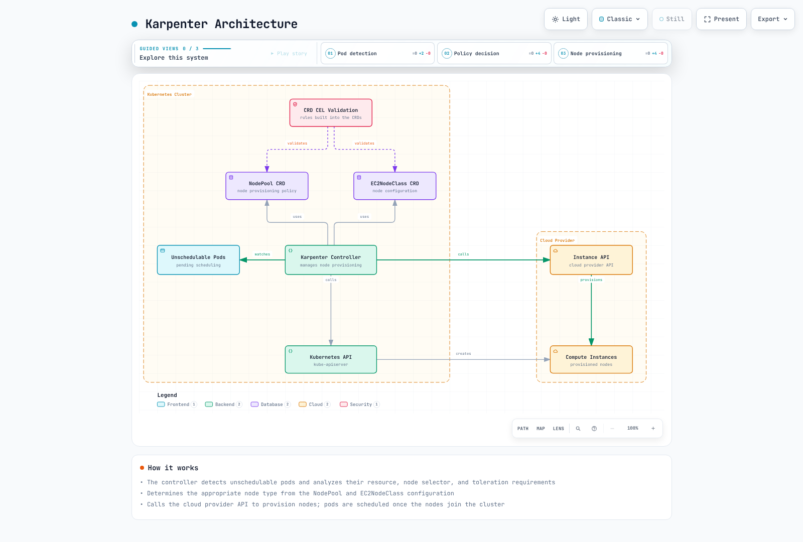
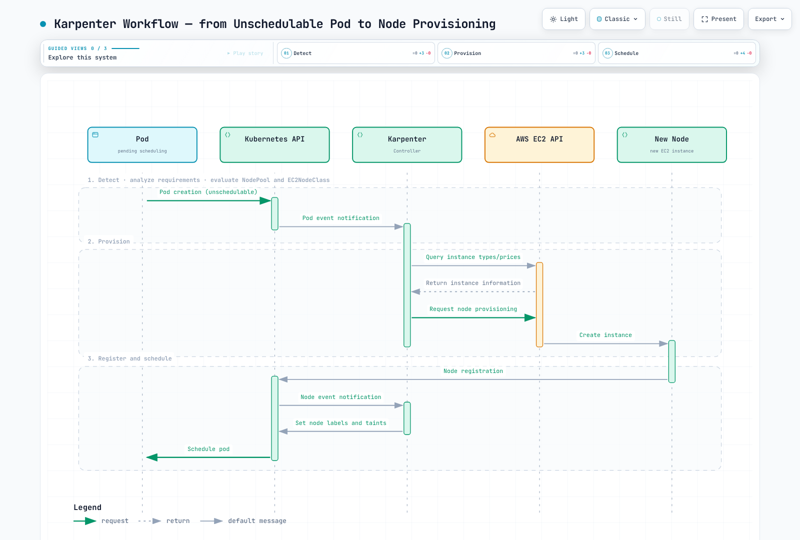
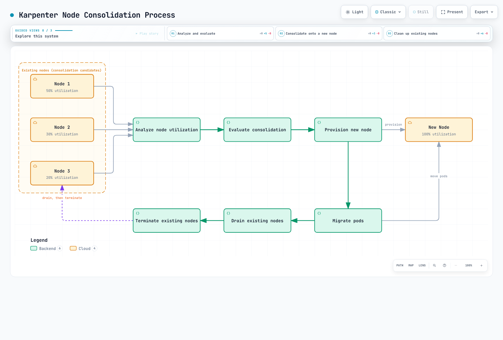
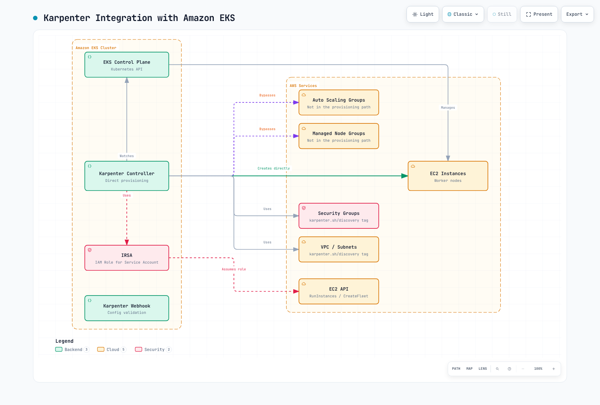
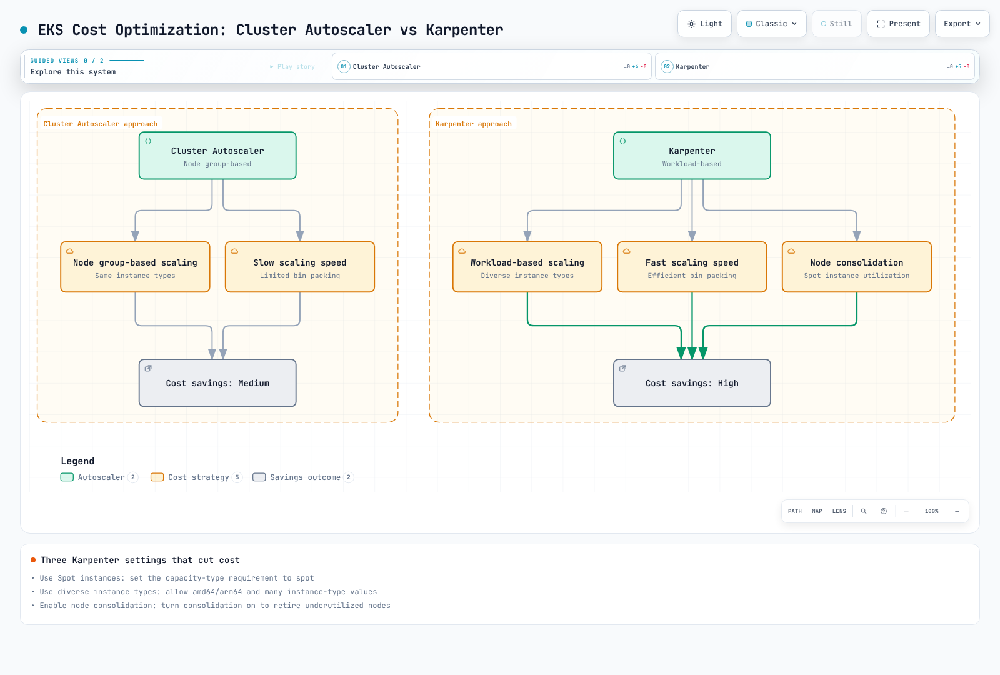
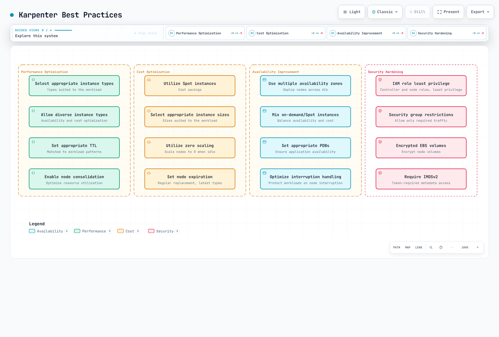

# Karpenter

> **支持的版本**：Karpenter 1.14 LTS（示例：1.14.1）；请根据兼容性和提供商支持表选择 Kubernetes/EKS 版本。
> **最后更新**：2026年11月16日

## 目录
- [简介](#introduction)
- [架构](#architecture)
- [安装和配置](#installation-and-configuration)
- [NodePool](#nodepool)
- [节点类](#node-classes)
- [中断处理](#interruption-handling)
- [集成](#integration)
- [与 Amazon EKS 集成](#integration-with-amazon-eks)
- [最佳实践](#best-practices)
- [故障排除](#troubleshooting)
- [结论](#conclusion)

## 简介 {#introduction}

Karpenter 是一个开源节点自动伸缩器。本章使用其 AWS 提供商，为兼容的 Kubernetes 工作负载预置 EC2 容量。可用性和效率取决于约束、云容量、节点初始化和应用程序设计。

### Karpenter 的主要优势

1. **快速响应伸缩**：在工作负载因无法调度而产生需求时开始预置；节点和应用程序就绪时间没有固定的延迟保证。
2. **成本优化**：为工作负载选择最合适的实例类型
3. **配置简单**：通过声明式 API 轻松配置
4. **以工作负载为中心的设计**：根据 Pod 需求预置节点
5. **云集成**：利用云提供商的功能
6. **高效装箱**：优化资源利用率
7. **灵活的节点管理**：管理节点生命周期并集成中断处理

### 与现有自动伸缩器的比较

| 功能 | Karpenter | Cluster Autoscaler | 云提供商托管节点组 |
|---------|-----------|-------------------|---------------------------|
| 伸缩速度 | 取决于调度、EC2 容量和初始化 | 取决于节点组伸缩和初始化 | 取决于伸缩策略、容量和初始化 |
| 实例类型选择 | 动态 | 基于节点组 | 基于节点组 |
| 装箱效率 | 取决于工作负载/约束 | 取决于工作负载/节点组 | 取决于调度器和伸缩控制器 |
| 配置复杂度 | 低 | 中 | 低 |
| 云集成 | 特定于提供商的实现 | 集成多个云提供商 | 原生于提供商 |
| 节点组管理 | 不需要 | 需要 | 需要 |
| 中断处理 | 配置事件处理和节点生命周期 | 取决于平台/集成 | 特定于平台的处理 |

> **注意**：EKS 于2026年4月8日为托管节点组增加了暖池支持。预初始化实例可以减少重复的初始化工作；Stopped 和 Running 模式的转换时间和成本不同，缩容时是否复用实例为可选项。根据 AWS 的说明，Cluster Autoscaler 集成无需额外配置。恢复实例、节点就绪和应用程序启动仍需时间。这是 EKS 托管节点组/Auto Scaling 功能，不是由 Karpenter 管理的池。

## 架构 {#architecture}

Karpenter 作为 Kubernetes 控制器运行，检测无法调度的 Pod 并预置合适的节点。



[🔍 查看交互式图表](https://www.atomai.click/kubernetes-docs/archmaps/en-autoscaling-02-karpenter-0.html)

### Karpenter 工作流程

下图展示了 Karpenter 在 EKS 集群中的工作方式：



[🔍 查看交互式图表](https://www.atomai.click/kubernetes-docs/archmaps/en-autoscaling-02-karpenter-1.html)

### 主要组件

1. **Karpenter 控制器**：模拟调度需求、创建 NodeClaims 并管理节点生命周期；实际的 Pod 绑定由 Kubernetes 调度器执行。
2. **CRD CEL 验证**：NodePool 和 EC2NodeClass 由 CRD 中的 CEL 规则验证（Karpenter 1.1 移除了准入/转换 Webhook）
3. **NodePool 和 NodeClaim CRD**：NodePool 定义策略；NodeClaim 记录单个预置节点的需求和生命周期。
4. **EC2NodeClass CRD**：定义待预置节点的配置
5. **云提供商集成**：与云提供商 API 集成，以管理计算资源

### 工作原理

1. Karpenter 控制器检测无法调度的 Pod
2. 分析 Pod 的需求（资源、节点选择器、容忍度等）
3. 根据 NodePool 和 EC2NodeClass 配置确定合适的节点类型
4. 调用云提供商 API 预置节点
5. 节点注册并变为就绪状态；随后 Kubernetes 调度器可以绑定符合条件的 Pod。Karpenter 不会取代 kube-scheduler。
6. 整合、漂移、到期、手动删除和云中断各有不同的触发条件和防护措施；它们并非都是 SQS 中断事件。

## 安装和配置 {#installation-and-configuration}

没有 apiVersion/kind 的 YAML 代码块是针对所讨论的 NodePool 或 EC2NodeClass spec 的配置片段；它们不是可独立通过 kubectl apply 应用的文档。

这些是针对现有集群的独立学习示例，不是可用于生产的完整部署包。重复的对象名称表示不同的备选方案。安装前，请准备并验证 IAM/OIDC、节点访问权限、获准使用的子网/安全组、引导容量和中断队列。所有 YAML 都使用 `my-cluster` 等字面示例名称；kubectl 不会在已保存的 YAML 文件中展开 `${CLUSTER_NAME}`。本次审查没有预置 AWS 资源、安装 Karpenter 或测量伸缩情况。如果该版本已经存在，全新安装命令将会失败；现有安装必须遵循对应版本的升级/CRD 迁移指南。

### 先决条件

- 使用平台和 Karpenter 兼容性矩阵支持的 Kubernetes 版本。已发布的矩阵列出了 Kubernetes 1.34 对应的 Karpenter 最低版本为 1.6、1.35 对应 1.9、1.36 对应 1.13；这些最低版本并不意味着所有较旧的 Karpenter 次版本都仍受维护。v1.14 矩阵不包含 1.37，而 v1.15 矩阵要求 Kubernetes 1.37 使用 Karpenter 1.15.x。EKS 版本的可用性/支持情况必须另行核实。
- 已配置 kubectl
- 云提供商凭据和权限
- Helm（可选）

### 在 AWS EKS 上安装

#### 1. IAM 角色和策略设置

这些命令假设已有控制器角色、节点角色，并使用基于 API 的 EKS 身份验证（API 或 API_AND_CONFIG_MAP）。仅使用 CONFIG_MAP 的集群需要检查现有的 aws-auth 节点映射，而不是运行 list-access-entries；不要把更改身份验证模式当作顺带的设置步骤。节点角色信任 EC2，并且需要工作节点/ECR 拉取权限（例如 AmazonEKSWorkerNodePolicy 和 AmazonEC2ContainerRegistryPullOnly）。在支持的情况下，应为 VPC CNI 使用独立的身份；SSM 权限是可选项，且需要已配置的代理。AmazonEKSClusterPolicy 不能替代 Karpenter 控制器策略。

```bash
# Set the existing cluster and Region; these commands only inspect AWS/Kubernetes.
export CLUSTER_NAME="my-cluster"
export AWS_REGION="us-west-2"
export KARPENTER_VERSION="1.14.1"
ACCOUNT_ID=$(aws sts get-caller-identity --query Account --output text)
CLUSTER_ENDPOINT=$(aws eks describe-cluster --region "$AWS_REGION" --name "$CLUSTER_NAME" --query cluster.endpoint --output text)
export ACCOUNT_ID CLUSTER_ENDPOINT
kubectl config current-context
aws iam get-role --role-name "KarpenterControllerRole-${CLUSTER_NAME}" --query Role.AssumeRolePolicyDocument
aws iam get-role --role-name "KarpenterNodeRole-${CLUSTER_NAME}" --query Role.AssumeRolePolicyDocument
aws eks list-access-entries --region "$AWS_REGION" --cluster-name "$CLUSTER_NAME"
```

#### 2. 使用 Helm 安装

准备好引用的队列和引导容量后，只执行一次全新安装示例。升级时，请查看对应版本的迁移指南并更新匹配的 CRD（例如通过单独管理的 karpenter-crd Chart）；单独升级控制器 Chart 通常不会升级 CRD。迁移现有 CRD 安装前，请先核实其所有权。

```bash
# Run only after the prerequisites and the current kubectl context are verified.
: "${CLUSTER_NAME:?Set the existing cluster name}"
: "${ACCOUNT_ID:?Set the AWS account ID}"
: "${CLUSTER_ENDPOINT:?Set the matching EKS endpoint}"
KARPENTER_VERSION="1.14.1"
helm install karpenter oci://public.ecr.aws/karpenter/karpenter \
  --version "$KARPENTER_VERSION" \
  --namespace karpenter --create-namespace \
  --set-string 'serviceAccount.annotations.eks\.amazonaws\.com/role-arn'="arn:aws:iam::${ACCOUNT_ID}:role/KarpenterControllerRole-${CLUSTER_NAME}" \
  --set-string settings.clusterName="$CLUSTER_NAME" \
  --set-string settings.clusterEndpoint="$CLUSTER_ENDPOINT" \
  --set-string settings.interruptionQueue="$CLUSTER_NAME" \
  --wait --timeout 5m
```

#### 3. 验证安装

```bash
kubectl get deployments,pods -n karpenter
kubectl rollout status deployment/karpenter -n karpenter --timeout=180s
kubectl get nodepools,ec2nodeclasses,nodeclaims
```

以下是默认两个控制器副本的示例输出（本次审查未捕获实际执行结果）：
```
NAME                         READY   STATUS    RESTARTS   AGE
karpenter-<hash>-<id-1>      1/1     Running   0          1m
karpenter-<hash>-<id-2>      1/1     Running   0          1m
```

### 基本 NodePool 和 EC2NodeClass 配置

```yaml
apiVersion: karpenter.sh/v1
kind: NodePool
metadata:
  name: default
spec:
  disruption:
    consolidationPolicy: WhenEmpty
    consolidateAfter: 30s
  limits:
    cpu: '1000'
    memory: 1000Gi
  template:
    spec:
      requirements:
      - key: karpenter.sh/capacity-type
        operator: In
        values:
        - on-demand
      - key: kubernetes.io/arch
        operator: In
        values:
        - amd64
      - key: node.kubernetes.io/instance-type
        operator: In
        values:
        - m5.large
        - m5.xlarge
        - m5.2xlarge
      nodeClassRef:
        group: karpenter.k8s.aws
        kind: EC2NodeClass
        name: default
---
apiVersion: karpenter.k8s.aws/v1
kind: EC2NodeClass
metadata:
  name: default
spec:
  role: KarpenterNodeRole-my-cluster
  amiSelectorTerms:
  - alias: al2023@latest
  subnetSelectorTerms:
  - tags:
      karpenter.sh/discovery: my-cluster
  securityGroupSelectorTerms:
  - tags:
      karpenter.sh/discovery: my-cluster
  tags:
    karpenter.sh/discovery: my-cluster
  blockDeviceMappings:
  - deviceName: /dev/xvda
    ebs:
      volumeSize: 100Gi
      volumeType: gp3
      deleteOnTermination: true
      encrypted: true
```

## NodePool

NodePool 是一个 Kubernetes 自定义资源，用于定义 Karpenter 如何预置节点。它取代了此前的 Provisioner。

### 基本 NodePool 配置

下面的特殊污点有意要求工作负载具有匹配的容忍度。在配置好经过验证、能够移除所配置污点的初始化器之前，startupTaints 保持为空；如果随意设置启动污点，却没有负责移除它的组件，节点可能无法使用。资源限制、初始化和中断示例都是备选方案，不应叠加应用到正在运行的生产 NodePool 上。

```yaml
apiVersion: karpenter.sh/v1
kind: NodePool
metadata:
  name: default
spec:
  template:
    metadata:
      labels:
        environment: training
        app: web
    spec:
      requirements:
      - key: karpenter.sh/capacity-type
        operator: In
        values:
        - on-demand
      - key: kubernetes.io/arch
        operator: In
        values:
        - amd64
      - key: node.kubernetes.io/instance-type
        operator: In
        values:
        - m5.large
        - m5.xlarge
        - m5.2xlarge
      nodeClassRef:
        group: karpenter.k8s.aws
        kind: EC2NodeClass
        name: default
      expireAfter: 720h
      taints:
      - key: example.com/special-taint
        value: 'true'
        effect: NoSchedule
      startupTaints: []
  limits:
    cpu: '1000'
    memory: 1000Gi
  disruption:
    consolidationPolicy: WhenEmpty
    consolidateAfter: 30s
```

### 需求配置

需求会彼此取交集，并与 EC2NodeClass 和 Pod 约束取交集。允许 amd64 和 arm64 只有在符合条件的实例类型、AMI 和容器镜像都支持这两种架构时才有帮助。列出符合条件的可用区/容量类型并不能保证平均分配；如需实现这一点，请使用工作负载拓扑约束。

需求定义了 Karpenter 将预置的节点特征：

```yaml
template:
  spec:
    requirements:
    - key: karpenter.sh/capacity-type
      operator: In
      values:
      - on-demand
      - spot
    - key: kubernetes.io/arch
      operator: In
      values:
      - amd64
      - arm64
    - key: node.kubernetes.io/instance-type
      operator: In
      values:
      - m5.large
      - m5.xlarge
      - c5.large
      - m6g.large
      - c6g.large
    - key: topology.kubernetes.io/zone
      operator: In
      values:
      - us-west-2a
      - us-west-2b
      - us-west-2c
    - key: kubernetes.io/os
      operator: In
      values:
      - linux
```

### 资源限制配置

`spec.limits` 限制预置资源的总量，但并行预置使用最终一致性检查，因此可能暂时超出限制。它不是严格的账单上限。使用字符串数量值可以避免 API/GitOps 类型差异。

```yaml
limits:
  cpu: '1000'
  memory: 1000Gi
  nvidia.com/gpu: '10'
```

### 实验性 DRA 分配跟踪（v1.13）

Karpenter 核心 v1.13 增加了 DRA 设备分配跟踪。这并不意味着生产环境中的 DRA 预置得到全面保证：AWS 1.14.1 Chart 默认设置 `settings.ignoreDRARequests: true`，上游也将正式 DRA 支持标记为尚未达到 GA。Kubernetes 最低版本为 1.29 并不足以证明兼容性。请验证确切的 Kubernetes 资源 API、DRA 驱动程序、ResourceClaims/ResourceSlices 和 Karpenter 配置；不要将 DRA 声明视为与下方设备插件扩展资源示例可互换。

### 节点到期配置

`expireAfter` 定义到期触发排空的时间，并不保证替换节点何时完成。下面的可选 `terminationGracePeriod` 会限制排空时长，但可能强制删除剩余 Pod，包括被 PDB 阻止驱逐的 Pod。只有在验证应用程序关闭和恢复要求后，才应设置此截止时间。

```yaml
spec:
  template:
    spec:
      expireAfter: 720h
      terminationGracePeriod: 30m
  disruption:
    consolidationPolicy: WhenEmpty
    consolidateAfter: 30s
```

### 识别 NodeReadinessController 污点（v1.13）

在对尚未初始化的托管节点进行调度模拟时，Karpenter 核心 v1.13 会将独立的 NodeReadinessController 的 `readiness.k8s.io/` 污点识别为临时污点。Karpenter 仍会等待这些污点消失后才将初始化标记为完成；它不会删除这些污点，也不会让 Kubernetes 调度器绕过它们。其他初始化器污点仍需要准确配置 `startupTaints`，并由控制器将其移除。

### 2026年7月更新：v1.14 发布

Karpenter v1.14 于2026年7月11日发布，带来以下功能：

- **支持 CapacityBuffers API**：集成 alpha 版容量缓冲区；默认禁用 `CapacityBuffer`，需要匹配的 CRD/控制器配置。预留余量不是免费容量，也不保证延迟。
- **支持预览版实例类型**：识别符合条件的预览版产品；实际预置仍需要账户/区域访问权限和可用容量。
- **支持 Nitro Enclaves**：当 NodeClaim 资源请求包含 `eks.amazonaws.com/nip-slots` 时，提供商会将生成的启动模板 `EnclaveOptions.Enabled` 设置为启用。兼容的实例、AMI 和设备插件设置仍是先决条件；1.14.1 中没有 `EC2NodeClass.spec.enclaveOptions` 字段。
- 错误修复：计入辅助 ENI 上的主 IP、确保 Zonal Shift 缓存完成填充、将 AWS SDK 客户端超时连接到 Operator 配置等

详情请参阅 [v1.14.0 发布说明](https://github.com/aws/karpenter-provider-aws/releases/tag/v1.14.0)。

2026年7月17日，旧分支收到了补丁，包括 1.3.8 和 1.11.3。这次历史性回补并不代表所有中间次版本仍持续受支持。当前支持策略列出的 LTS 版本为 1.9（支持至2027年2月）和 1.14（支持至2027年7月）；常规次版本仅支持到下一个次版本发布为止。请选择受支持的版本线并遵循其迁移指南，不要假设旧版本线仍在维护。

AWS 于2026年7月22日宣布，为 Karpenter/EKS Auto Mode 增加 EFA 网络接口和置放群组配置。在 AWS Karpenter 1.14.1 中，具体字段为 `EC2NodeClass.spec.networkInterfaces` 和 `spec.placementGroupSelector`（不是 NodePool 字段）。仅使用 EFA 的接口不消耗 VPC IP 地址，但仍要求在设备/卡索引 0 处配置主 `interface`。请按名称或 ID 选择现有置放群组；其集群/分布/分区策略和支持的实例会限制置放选择。本示例不会配置或验证 HPC 工作负载。

### 2026年8月更新：v1.14.1 补丁版本发布

[v1.14.1](https://github.com/aws/karpenter-provider-aws/releases/tag/v1.14.1) 是 v1.14 版本线上的第一个补丁版本，于2026年8月21日发布。这是一个维护版本，升级了上游 `sigs.k8s.io/karpenter` 版本，并挑选回移了自 v1.14.0 以来的修复。

### 2026年10月更新：v1.15.0 常规版本发布

[v1.15.0](https://github.com/aws/karpenter-provider-aws/releases/tag/v1.15.0) 是常规（非 LTS）次版本，于2026年10月10日发布。主要变化：

- **节点修复变为自愿中断**：节点修复被纳入中断处理机制；当容量受限的 NodePool 无法先暂存替换节点时，会先终止节点再进行修复。新增通过 `ec2:RebootInstances` 重启的修复操作（由 AWS 功能门控 `RebootForRepair` 控制），此前的修复控制器仍可通过 `--legacy-node-repair` 标志使用。
- **在 KubeletConfiguration 中支持 CEL**：`maxPodsExpression`、`kubeReserved` 和 `systemReserved` 接受 CEL 表达式，并扩展了 EC2NodeClass 的 KubeletConfiguration 字段。
- **扩大 DRA 支持范围**：支持优先级备选项，以及 NVIDIA 和 EFA 驱动程序的 DRA 支持。
- 其他变化：增加 `--aws-feature-gates` 标志、默认感知 Pod 拓扑分布、预置时计入实例类型的卷限制、新的中断指标（如 `karpenter_pods_disrupted_total`），以及由功能门控控制的 Pod 删除成本管理控制器。

根据支持策略，常规次版本仅支持到下一个次版本发布为止，因此 v1.15.0 发布后，v1.14 将仅作为 LTS 版本线继续受支持（至2027年7月）；因此本章示例继续使用 1.14 LTS（1.14.1）。Kubernetes 1.37 要求 Karpenter 1.15.x，因此如果需要 Kubernetes 1.37 或打算升级到 1.15，请先查看 [v1.15 兼容性矩阵](https://karpenter.sh/v1.15/upgrading/compatibility/) 和升级指南。详情请参阅 [v1.15.0 发布说明](https://github.com/aws/karpenter-provider-aws/releases/tag/v1.15.0)。

### 2026年10月更新：v1.15.1 和 LTS 补丁版本发布

2026年10月20日至23日期间，受支持的版本线都发布了补丁版本：[v1.15.1](https://github.com/aws/karpenter-provider-aws/releases/tag/v1.15.1)（1.15 版本线上的首个补丁版本——修复包括：当所有兼容的容量预留都已满时，放宽偏好而非推迟处理；以及创建后标签同步时将节点修复加入队列）、1.14 LTS 版本线上的 [v1.14.2](https://github.com/aws/karpenter-provider-aws/releases/tag/v1.14.2) 和 [v1.14.3](https://github.com/aws/karpenter-provider-aws/releases/tag/v1.14.3)（包括将 `SpotMaxPriceTooLow` 分类为 ICE 错误，以及将正在回收的可中断容量预留视为不可用容量等），以及 1.9 LTS 版本线上的 [v1.9.3](https://github.com/aws/karpenter-provider-aws/releases/tag/v1.9.3)。三个版本线都将 Go 工具链升级到了 1.26.10，这是一个停止信任已遭入侵的 eMudhra 中间 CA 证书的 Go 补丁版本（CVE-2026-111943）。

### 2026年11月更新：宣布 EKS Auto Mode 和 Karpenter 支持 DRA

2026年11月9日，AWS 宣布 EKS Auto Mode 和 Karpenter 支持 Kubernetes 动态资源分配（DRA），适用于 NVIDIA GPU 和 Elastic Fabric Adapter（EFA）网络设备。工作负载通过 DRA 声明所需的设备属性，并可在多个 Pod 之间共享 GPU 设备。Karpenter 支持所有 Kubernetes 版本上的 DRA；EKS Auto Mode 支持 Kubernetes 1.36 及更高版本，但不包括 AWS GovCloud（美国）和中国区域。详情请参阅[公告](https://aws.amazon.com/about-aws/whats-new/2026/11/amazon-eks-auto-mode-karpenter-dra/)。

### 2026年11月更新：v1.15.2 补丁版本发布

[v1.15.2](https://github.com/aws/karpenter-provider-aws/releases/tag/v1.15.2) 于2026年11月12日发布，仅更新 DRA 实例类型元数据；除非启用了 alpha 功能门控 `settings.awsFeatureGates.draNVIDIAGPU` 或 `settings.awsFeatureGates.draEFA`（或启用了 `settings.enableDRA`），否则不会产生任何变化。该版本为 `g7` 和 `g7e` 添加了 NVIDIA GPU DRA 元数据，并更新了现有 GPU 实例类型的 GPU 内存属性；而分数 GPU 类型 `g6f` 和 `gr6f` 不再携带 NVIDIA DRA 元数据，因此 Karpenter 不会为 `gpu.nvidia.com` 声明选择这些实例类型。EFA DRA 元数据现覆盖 302 种实例类型，高于之前的 29 种；新添加的条目仅设置 `dra.net/pciDevice`、`dra.net/pciVendor` 和 `dra.net/rdma`。从源代码构建现在需要 Go 1.26.11 或更高版本。

## 节点类 {#node-classes}

节点类定义 Karpenter 预置节点的配置。在 AWS 上，它使用 EC2NodeClass CRD。

### AWS EC2NodeClass 配置

```yaml
apiVersion: karpenter.k8s.aws/v1
kind: EC2NodeClass
metadata:
  name: default
spec:
  subnetSelectorTerms:
  - tags:
      karpenter.sh/discovery: my-cluster
  securityGroupSelectorTerms:
  - tags:
      karpenter.sh/discovery: my-cluster
  tags:
    karpenter.sh/discovery: my-cluster
    environment: training
  blockDeviceMappings:
  - deviceName: /dev/xvda
    ebs:
      volumeSize: 100Gi
      volumeType: gp3
      deleteOnTermination: true
      encrypted: true
  role: KarpenterNodeRole-my-cluster
  amiSelectorTerms:
  - alias: al2023@latest
  userData: '#!/bin/bash

    echo "Hello from Karpenter node!"

    '
  metadataOptions:
    httpEndpoint: enabled
    httpProtocolIPv6: disabled
    httpPutResponseHopLimit: 1
    httpTokens: required
```

### 子网和安全组选择

子网和安全组通过选择器条款进行选择（多个条款之间是 OR 关系；一个条款内的标签之间是 AND 关系）：

```yaml
subnetSelectorTerms:
- tags:
    karpenter.sh/discovery: my-cluster
    Name: private-*
securityGroupSelectorTerms:
- tags:
    karpenter.sh/discovery: my-cluster
```

### AMI 配置

Karpenter 通过 `amiSelectorTerms` 选择 AMI。别名会选择一个系列/版本；**`@latest` 不是固定版本**，解析出的 AMI 可能会变化并触发漂移。包含 `@latest` 的示例仅供学习。生产环境中，请在推出前解析并测试一个明确受支持的 AMI 版本（使用带真实发布日期的 `al2023@vYYYYMMDD`）或经批准的 AMI ID。Kubernetes 1.33 及更高版本不再发布 AL2 EKS AMI。以下选项互为备选；自定义 AMI 必须具有可正常工作的引导、注册污点、kubelet、CNI/运行时和身份设置。

```yaml
# Amazon Linux 2023
amiSelectorTerms:
  - alias: al2023@latest
---
# Bottlerocket
amiSelectorTerms:
  - alias: bottlerocket@latest
---
# Custom AMI (by ID): amiFamily is required when no alias term is used
amiFamily: Custom
amiSelectorTerms:
  - id: "ami-0123456789abcdef0"
# Ubuntu: no v1 alias; use amiFamily: Custom with an id/tags/name term
```

### 块设备配置

设备映射因 AMI 系列而异。以下 AL2023 示例使用 /dev/xvda 作为根设备；使用其他 AMI 时，请检查实际布局。额外卷需要明确的文件系统/挂载或应用程序存储方案。客户管理的 KMS 密钥还需要相应的密钥/IAM 权限。

你可以定义节点的存储配置：

```yaml
blockDeviceMappings:
- deviceName: /dev/xvda
  ebs:
    volumeSize: 100Gi
    volumeType: gp3
    iops: 3000
    throughput: 125
    deleteOnTermination: true
    encrypted: true
    kmsKeyID: arn:aws:kms:us-west-2:111122223333:key/1234abcd-12ab-34cd-56ef-1234567890ab
- deviceName: /dev/xvdb
  ebs:
    volumeSize: 500Gi
    volumeType: gp3
    deleteOnTermination: true
    encrypted: true
```

### 用户数据配置

以下 shell 用户数据片段假设使用 AL2023，Karpenter 会将其生成的 bootstrap/nodeadm 配置与自定义数据合并。这些片段不适用于通用的 Bottlerocket/Windows 引导。应将软件包烘焙到 AMI 中并经过测试，而不是在每次启动时执行不受限制的软件包更新。仅安装/启动 CloudWatch Agent，而没有配置、IAM 权限和网络路径，并不能证明遥测数据已被收集。

```yaml
userData: |
  #!/bin/bash
  set -euo pipefail
  # Only for a workload that requires this setting; keep node packages in a tested AMI.
  cat > /etc/sysctl.d/99-workload-map-count.conf <<'EOF'
  vm.max_map_count=262144
  EOF
  sysctl -p /etc/sysctl.d/99-workload-map-count.conf
```

### 节点整合流程

下图展示 Karpenter 的节点整合流程。该功能对于提升集群效率和降低成本非常重要：



[🔍 查看交互式图表](https://www.atomai.click/kubernetes-docs/archmaps/en-autoscaling-02-karpenter-2.html)

## 中断处理 {#interruption-handling}

已配置的中断处理会尝试在容量丢失前作出响应。处理结果取决于通知、替换容量、关闭时限和应用程序恢复情况；不保证服务不中断。

### 集成的中断处理

云中断处理与整合/到期处理相互独立。它涵盖以下信号：

1. **Spot 中断警告**：开始排空，并在可能的情况下请求替换容量；通知时限不保证达到恢复 SLA。
2. **计划的运行状况/维护事件**：对受影响的实例作出响应。
3. **实例停止/终止事件**：协调即将退出服务的容量。
4. **EC2 实例状态故障**：使用所需的 EC2 API 权限检查运行状况。仅发布重新平衡建议事件，不会自动执行加污点/排空/终止操作。

### 中断处理配置

```yaml
apiVersion: karpenter.sh/v1
kind: NodePool
metadata:
  name: default
spec:
  template:
    spec:
      requirements:
        - key: karpenter.sh/capacity-type
          operator: In
          values: ["on-demand"]
      nodeClassRef:
        group: karpenter.k8s.aws
        kind: EC2NodeClass
        name: default

      # Node expiration settings
      expireAfter: 720h  # 30 days
  disruption:
    consolidationPolicy: WhenEmpty
    consolidateAfter: 30s
```

### 排空配置

Karpenter 在正常的优雅排空过程中通常使用驱逐操作。Helm 设置用于配置控制器；NodePool 中断预算限制自愿整合/漂移的启动，不限制所有同时发生的节点丢失。30% 的预算向上取整，然后减去正在删除/未就绪的节点；它并非严格的 30% 上限。到期、中断和修复可能采用不同的强制处理方式。启用 `interruptionQueue` 之前，请先配置指定的 SQS 队列、EventBridge 规则/目标、队列策略和控制器权限；仅设置 Helm 字段不会创建这些资源。

```yaml
settings:
  clusterName: my-cluster
  interruptionQueue: my-cluster
  batchMaxDuration: 10s
  batchIdleDuration: 1s
  featureGates:
    spotToSpotConsolidation: false
controller:
  resources:
    requests:
      cpu: 1
      memory: 1Gi
    limits:
      cpu: '1'
      memory: 1Gi
logLevel: info
```

```yaml
apiVersion: karpenter.sh/v1
kind: NodePool
metadata:
  name: default
spec:
  template:
    spec:
      requirements:
        - key: karpenter.sh/capacity-type
          operator: In
          values: ["on-demand"]
      nodeClassRef:
        group: karpenter.k8s.aws
        kind: EC2NodeClass
        name: default
      expireAfter: 720h
  disruption:
    consolidationPolicy: WhenEmpty
    consolidateAfter: 30s
    budgets:
      - nodes: "30%"   # Voluntary budget: round up, then subtract deleting/not-ready nodes
```

### PDB（PodDisruptionBudget）集成

PDB 根据健康副本数量限制自愿驱逐；它不会创建副本，也不保证应用程序可用。下面的 `minAvailable: 2` 要求在允许驱逐前有足够数量的匹配健康 Pod。实例丢失和强制终止时限仍可能中断这些 Pod。

```yaml
apiVersion: policy/v1
kind: PodDisruptionBudget
metadata:
  name: app-pdb
  namespace: default
spec:
  minAvailable: 2
  selector:
    matchLabels:
      app: my-app
```

## 集成 {#integration}

Karpenter 可与各种 Kubernetes 和云服务集成。

### Kubernetes 集成

#### 1. Pod 拓扑分布约束

Karpenter 在预置节点时会考虑 Pod 拓扑分布约束：

```yaml
apiVersion: apps/v1
kind: Deployment
metadata:
  name: web-server
  namespace: default
spec:
  replicas: 10
  template:
    spec:
      topologySpreadConstraints:
      - maxSkew: 1
        topologyKey: topology.kubernetes.io/zone
        whenUnsatisfiable: DoNotSchedule
        labelSelector:
          matchLabels:
            app: web-server
      containers:
      - name: web-server
        image: nginx:1.30.6
        ports:
        - containerPort: 80
        resources:
          requests:
            cpu: 100m
            memory: 128Mi
          limits:
            memory: 256Mi
    metadata:
      labels:
        app: web-server
  selector:
    matchLabels:
      app: web-server
```

#### 2. Pod 亲和性/反亲和性

Karpenter 会考虑 Pod 亲和性和反亲和性规则：

```yaml
apiVersion: apps/v1
kind: Deployment
metadata:
  name: web-server
  namespace: default
spec:
  replicas: 10
  template:
    spec:
      affinity:
        podAntiAffinity:
          requiredDuringSchedulingIgnoredDuringExecution:
          - labelSelector:
              matchExpressions:
              - key: app
                operator: In
                values:
                - web-server
            topologyKey: kubernetes.io/hostname
      containers:
      - name: web-server
        image: nginx:1.30.6
        ports:
        - containerPort: 80
        resources:
          requests:
            cpu: 100m
            memory: 128Mi
          limits:
            memory: 256Mi
    metadata:
      labels:
        app: web-server
  selector:
    matchLabels:
      app: web-server
```

#### 3. 污点和容忍度

GPU 示例需要兼容的加速型 AMI、NVIDIA 驱动程序，以及能够容忍 GPU 污点并通告 nvidia.com/gpu 的设备插件 DaemonSet。BusyBox Pod 仅用于演示预留 GPU；它不会运行或测试 CUDA。请使用实际的 GPU 应用程序镜像另行验证。

Karpenter 在预置节点时会考虑污点和容忍度：

```yaml
apiVersion: karpenter.sh/v1
kind: NodePool
metadata:
  name: gpu
spec:
  template:
    spec:
      requirements:
      - key: node.kubernetes.io/instance-type
        operator: In
        values:
        - g4dn.xlarge
        - g4dn.2xlarge
      taints:
      - key: nvidia.com/gpu
        value: 'true'
        effect: NoSchedule
      nodeClassRef:
        group: karpenter.k8s.aws
        kind: EC2NodeClass
        name: default
---
apiVersion: apps/v1
kind: Deployment
metadata:
  name: gpu-app
  namespace: default
spec:
  replicas: 3
  template:
    spec:
      tolerations:
      - key: nvidia.com/gpu
        operator: Exists
        effect: NoSchedule
      nodeSelector:
        karpenter.sh/nodepool: gpu
      containers:
      - name: gpu-allocation-demo
        image: busybox:1.38.0
        command:
        - sh
        - -c
        - sleep 3600
        resources:
          requests:
            cpu: 100m
            memory: 64Mi
          limits:
            memory: 128Mi
            nvidia.com/gpu: 1
    metadata:
      labels:
        app: gpu-app
  selector:
    matchLabels:
      app: gpu-app
```

### AWS 集成

#### 1. EC2 Spot 实例

Karpenter 支持使用 EC2 Spot 实例来优化成本：

```yaml
apiVersion: karpenter.sh/v1
kind: NodePool
metadata:
  name: spot
spec:
  template:
    spec:
      requirements:
      - key: karpenter.sh/capacity-type
        operator: In
        values:
        - spot
      nodeClassRef:
        group: karpenter.k8s.aws
        kind: EC2NodeClass
        name: spot
---
apiVersion: karpenter.k8s.aws/v1
kind: EC2NodeClass
metadata:
  name: spot
spec:
  role: KarpenterNodeRole-my-cluster
  amiSelectorTerms:
  - alias: al2023@latest
  subnetSelectorTerms:
  - tags:
      karpenter.sh/discovery: my-cluster
  securityGroupSelectorTerms:
  - tags:
      karpenter.sh/discovery: my-cluster
```

#### 2. EC2 实例配置文件

role 和 instanceProfile 不能同时使用。使用 role 时，Karpenter 会管理实例配置文件，因此需要相应的 IAM API 权限/网络连接。如果集群无法访问 IAM 终端节点，请使用预先配置的 instanceProfile；IAM 没有 PrivateLink 终端节点。控制器仍需要对其节点角色具有 PassRole 权限，而且 EKS 节点访问权限与拥有 EC2 凭据是两回事。

Karpenter 使用 EC2 实例配置文件向节点授予 IAM 权限：

```yaml
apiVersion: karpenter.k8s.aws/v1
kind: EC2NodeClass
metadata:
  name: default
spec:
  instanceProfile: KarpenterNodeInstanceProfile-my-cluster
  amiSelectorTerms:
  - alias: al2023@latest
  subnetSelectorTerms:
  - tags:
      karpenter.sh/discovery: my-cluster
  securityGroupSelectorTerms:
  - tags:
      karpenter.sh/discovery: my-cluster
```

#### 3. 替代启动模板（EC2NodeClass）

Karpenter v1 不接受用户提供的 EC2 启动模板（旧版 `launchTemplate` 字段已移除）。Karpenter 会根据 EC2NodeClass 自行生成并管理启动模板，因此原本需要放在启动模板中的设置应直接写入 EC2NodeClass：

```yaml
apiVersion: karpenter.k8s.aws/v1
kind: EC2NodeClass
metadata:
  name: node-config
spec:
  role: KarpenterNodeRole-my-cluster
  subnetSelectorTerms:
  - tags:
      karpenter.sh/discovery: my-cluster
  securityGroupSelectorTerms:
  - tags:
      karpenter.sh/discovery: my-cluster
  amiSelectorTerms:
  - alias: al2023@latest
  userData: '#!/bin/bash

    echo "Hello from Karpenter node!"

    '
  blockDeviceMappings:
  - deviceName: /dev/xvda
    ebs:
      volumeSize: 100Gi
      volumeType: gp3
      deleteOnTermination: true
      encrypted: true
  metadataOptions:
    httpEndpoint: enabled
    httpProtocolIPv6: disabled
    httpPutResponseHopLimit: 1
    httpTokens: required
```
## 与 Amazon EKS 集成 {#integration-with-amazon-eks}

配置好身份、网络、节点访问权限和引导后，Karpenter 的 AWS 提供商可以与 EKS 管理的计算资源并行预置 EC2 容量。



[🔍 查看交互式图表](https://www.atomai.click/kubernetes-docs/archmaps/en-autoscaling-02-karpenter-3.html)

### 准备 EKS 集群

请一致地替换所有示例名称。仅选择适合作为工作节点的子网/安全组；给所有控制平面子网添加标签并不是安全的资源发现策略。允许节点启动之前，请验证子网路由、安全规则、CNI IP 容量以及任何所需的私有终端节点。

#### 1. 集群标签设置

请通过基础设施配置，只为获准使用的工作节点子网和安全组添加标签。选择这些资源的依据不是 VPC 标签。发现标签的值必须与示例相符（此处为 `my-cluster`）；仅有标签并不能证明私有路由、安全规则适用或可用地址充足。应用 NodePool 前，请检查实际资源和路由。

```bash
# Inspect resources that your infrastructure configuration has tagged for this cluster.
: "${CLUSTER_NAME:?Set the existing cluster name}"
: "${AWS_REGION:?Set the cluster Region}"
aws ec2 describe-subnets --region "$AWS_REGION" \
  --filters "Name=tag:karpenter.sh/discovery,Values=${CLUSTER_NAME}" \
  --query 'Subnets[].{ID:SubnetId,AZ:AvailabilityZone,FreeIPs:AvailableIpAddressCount,PublicIPOnLaunch:MapPublicIpOnLaunch,VPC:VpcId}'
aws ec2 describe-security-groups --region "$AWS_REGION" \
  --filters "Name=tag:karpenter.sh/discovery,Values=${CLUSTER_NAME}" \
  --query 'SecurityGroups[].{ID:GroupId,VPC:VpcId,Name:GroupName}'
# Inspect explicit and main route-table associations for the intended subnets.
aws ec2 describe-route-tables --region "$AWS_REGION" \
  --filters "Name=vpc-id,Values=$(aws eks describe-cluster --region "$AWS_REGION" --name "$CLUSTER_NAME" --query cluster.resourcesVpcConfig.vpcId --output text)"
```

#### 2. IAM 角色设置

请使用下方特定版本的控制器策略和基础设施参考，而不要采用前面不完整的手写全允许策略。控制器凭据（此处为 IRSA）与节点凭据以及 VPC CNI/工作负载身份相互独立。控制器信任策略必须匹配集群 OIDC 提供商、`system:serviceaccount:karpenter:karpenter` 和 `aud: sts.amazonaws.com`；只授予此版本和所选功能所需的操作/资源/条件。必须允许节点角色加入 EKS；启用基于 API 的身份验证时，通常需要 `EC2_LINUX` 访问条目。这些检查命令不会创建任何 IAM 角色或访问条目。

```bash
# Download a versioned reference for review; this does not create a CloudFormation stack.
KARPENTER_VERSION="1.14.1"
curl --fail --show-error --location \
  "https://raw.githubusercontent.com/aws/karpenter-provider-aws/v${KARPENTER_VERSION}/website/content/en/preview/getting-started/getting-started-with-karpenter/cloudformation.yaml" \
  --output karpenter-cloudformation-reference.yaml
# Inspect the existing role's attached and inline policies.
: "${CLUSTER_NAME:?Set the existing cluster name}"
aws iam list-attached-role-policies --role-name "KarpenterControllerRole-${CLUSTER_NAME}"
aws iam list-role-policies --role-name "KarpenterControllerRole-${CLUSTER_NAME}"
```

### 在 EKS 集群上安装 Karpenter

```bash
# Run only after the prerequisites and the current kubectl context are verified.
: "${CLUSTER_NAME:?Set the existing cluster name}"
: "${ACCOUNT_ID:?Set the AWS account ID}"
: "${CLUSTER_ENDPOINT:?Set the matching EKS endpoint}"
KARPENTER_VERSION="1.14.1"
helm install karpenter oci://public.ecr.aws/karpenter/karpenter \
  --version "$KARPENTER_VERSION" \
  --namespace karpenter --create-namespace \
  --set-string 'serviceAccount.annotations.eks\.amazonaws\.com/role-arn'="arn:aws:iam::${ACCOUNT_ID}:role/KarpenterControllerRole-${CLUSTER_NAME}" \
  --set-string settings.clusterName="$CLUSTER_NAME" \
  --set-string settings.clusterEndpoint="$CLUSTER_ENDPOINT" \
  --set-string settings.interruptionQueue="$CLUSTER_NAME" \
  --wait --timeout 5m
```

### 与 EKS 托管节点组配合使用

Karpenter 可以与 EKS 托管节点组并存。以下 NodePool 会预置独立 EC2 节点，不会管理托管节点组。请让控制器运行在可靠的引导容量上（默认 Chart 会将 Karpenter 节点排除，并在不同主机上请求两个副本）。

```yaml
apiVersion: karpenter.sh/v1
kind: NodePool
metadata:
  name: managed-ng
spec:
  template:
    metadata:
      labels:
        managed-by: karpenter
    spec:
      requirements:
      - key: karpenter.sh/capacity-type
        operator: In
        values:
        - on-demand
      - key: node.kubernetes.io/instance-type
        operator: In
        values:
        - m5.large
        - m5.xlarge
      taints:
      - key: managed-by
        value: karpenter
        effect: NoSchedule
      nodeClassRef:
        group: karpenter.k8s.aws
        kind: EC2NodeClass
        name: managed-ng
  disruption:
    consolidationPolicy: WhenEmpty
    consolidateAfter: 30s
---
apiVersion: karpenter.k8s.aws/v1
kind: EC2NodeClass
metadata:
  name: managed-ng
spec:
  role: KarpenterNodeRole-my-cluster
  amiSelectorTerms:
  - alias: al2023@latest
  subnetSelectorTerms:
  - tags:
      karpenter.sh/discovery: my-cluster
  securityGroupSelectorTerms:
  - tags:
      karpenter.sh/discovery: my-cluster
  tags:
    karpenter.sh/discovery: my-cluster
```

### 与 EKS Fargate 配合使用

Fargate 不实现 Kubernetes 的 topologySpreadConstraints，Kubernetes 亲和性/反亲和性规则也不适用于其中。不要假设默认 Chart 的 EC2 放置约束可以保证 Fargate 在不同 AZ 之间分布；应单独设计并验证配置文件/子网放置。

可以使用选择范围严格限定的 Fargate 配置文件来运行控制器 Pod，同时由 Karpenter 预置 EC2 工作节点。Karpenter 不会创建 Fargate 容量或管理其配置文件。请创建一个选择 `karpenter` 命名空间和控制器标签的配置文件，不要选择整个 `default`/`kube-system`；JSON 选择器结构为 `[{"namespace":"karpenter","labels":{"app.kubernetes.io/name":"karpenter"}}]`。该配置文件需要独立的 Pod 执行角色/私有子网，控制器 AWS 权限仍需要 IRSA（EKS Pod Identity 不支持在 Fargate 上使用）。以下命令仅检查现有配置文件。

```bash
# Inspect an existing, narrowly selected controller Fargate profile.
: "${CLUSTER_NAME:?Set the existing cluster name}"
: "${AWS_REGION:?Set the cluster Region}"
aws eks describe-fargate-profile --region "$AWS_REGION" \
  --cluster-name "$CLUSTER_NAME" --fargate-profile-name karpenter-controller
```

```yaml
apiVersion: karpenter.sh/v1
kind: NodePool
metadata:
  name: ec2
spec:
  template:
    spec:
      requirements:
      - key: karpenter.sh/capacity-type
        operator: In
        values:
        - on-demand
      nodeClassRef:
        group: karpenter.k8s.aws
        kind: EC2NodeClass
        name: ec2
  disruption:
    consolidationPolicy: WhenEmpty
    consolidateAfter: 30s
---
apiVersion: karpenter.k8s.aws/v1
kind: EC2NodeClass
metadata:
  name: ec2
spec:
  role: KarpenterNodeRole-my-cluster
  amiSelectorTerms:
  - alias: al2023@latest
  subnetSelectorTerms:
  - tags:
      karpenter.sh/discovery: my-cluster
  securityGroupSelectorTerms:
  - tags:
      karpenter.sh/discovery: my-cluster
```

### AZ 故障响应：集成 Amazon ARC Zonal Shift（2026年5月）

Karpenter 可与已启用的 EKS ARC 可用区转移资源集成。手动可用区转移或已配置的自动转移生效后，Karpenter 会避免在转移中的 AZ 创建新容量。这并不表示 Karpenter 可以独立检测所有 AZ 故障，也不会覆盖将工作负载固定在该 AZ 的 Pod/PV 要求。

转移期间，会暂停转移中 AZ 内的自愿中断；如果健康 AZ 内的中断需要将 Pod 移入该 AZ，也会阻止此类中断。这并不表示所有健康 AZ 中的每项自愿中断都会无条件暂停。请配置 EKS/ARC 先决条件、`eks:DescribeCluster`/ARC 权限以及 `settings.enableZonalShift: true`（环境选项 `ENABLE_ZONAL_SHIFT`）；自动转移还需要单独启用并配置演练。无需自定义 ARC CRD，转移结束后操作会恢复。

### 优化 EKS 成本

你可以使用 Karpenter 优化 EKS 集群的成本：



[🔍 查看交互式图表](https://www.atomai.click/kubernetes-docs/archmaps/en-autoscaling-02-karpenter-4.html)

#### 1. 使用 Spot 实例

```yaml
apiVersion: karpenter.sh/v1
kind: NodePool
metadata:
  name: spot
spec:
  template:
    spec:
      requirements:
      - key: karpenter.sh/capacity-type
        operator: In
        values:
        - spot
      - key: kubernetes.io/arch
        operator: In
        values:
        - amd64
        - arm64
      nodeClassRef:
        group: karpenter.k8s.aws
        kind: EC2NodeClass
        name: spot
  disruption:
    consolidationPolicy: WhenEmpty
    consolidateAfter: 30s
---
apiVersion: karpenter.k8s.aws/v1
kind: EC2NodeClass
metadata:
  name: spot
spec:
  role: KarpenterNodeRole-my-cluster
  amiSelectorTerms:
  - alias: al2023@latest
  subnetSelectorTerms:
  - tags:
      karpenter.sh/discovery: my-cluster
  securityGroupSelectorTerms:
  - tags:
      karpenter.sh/discovery: my-cluster
```

#### 2. 使用多种实例类型

```yaml
apiVersion: karpenter.sh/v1
kind: NodePool
metadata:
  name: flexible
spec:
  template:
    spec:
      requirements:
      - key: karpenter.sh/capacity-type
        operator: In
        values:
        - on-demand
        - spot
      - key: kubernetes.io/arch
        operator: In
        values:
        - amd64
        - arm64
      - key: node.kubernetes.io/instance-type
        operator: In
        values:
        - m5.large
        - m5.xlarge
        - m5.2xlarge
        - m6g.large
        - m6g.xlarge
        - m6g.2xlarge
        - c5.large
        - c5.xlarge
        - c5.2xlarge
        - c6g.large
        - c6g.xlarge
        - c6g.2xlarge
        - r5.large
        - r5.xlarge
        - r5.2xlarge
        - r6g.large
        - r6g.xlarge
        - r6g.2xlarge
      nodeClassRef:
        group: karpenter.k8s.aws
        kind: EC2NodeClass
        name: default
  disruption:
    consolidationPolicy: WhenEmpty
    consolidateAfter: 30s
```

#### 3. 启用节点整合

```yaml
apiVersion: karpenter.sh/v1
kind: NodePool
metadata:
  name: default
spec:
  template:
    spec:
      requirements:
        - key: karpenter.sh/capacity-type
          operator: In
          values: ["on-demand"]
      nodeClassRef:
        group: karpenter.k8s.aws
        kind: EC2NodeClass
        name: default
  disruption:
    consolidationPolicy: WhenEmptyOrUnderutilized
    consolidateAfter: 1m
```

## 最佳实践 {#best-practices}



[🔍 查看交互式图表](https://www.atomai.click/kubernetes-docs/archmaps/en-autoscaling-02-karpenter-5.html)

### 性能优化

1. **选择合适的实例类型**：选择适合工作负载的实例类型
2. **允许使用多种实例类型**：允许使用多种实例类型，以优化可用性和成本
3. **设置合适的 TTL**：设置与工作负载模式匹配的 TTL
4. **启用节点整合**：启用节点整合以优化资源利用率

```yaml
apiVersion: karpenter.sh/v1
kind: NodePool
metadata:
  name: optimized
spec:
  template:
    spec:
      requirements:
      - key: node.kubernetes.io/instance-type
        operator: In
        values:
        - m5.large
        - m5.xlarge
        - m5.2xlarge
        - c5.large
        - c5.xlarge
        - c5.2xlarge
        - r5.large
        - r5.xlarge
        - r5.2xlarge
      nodeClassRef:
        group: karpenter.k8s.aws
        kind: EC2NodeClass
        name: default
      expireAfter: 720h
  disruption:
    consolidationPolicy: WhenEmpty
    consolidateAfter: 30s
```

### 成本优化

1. **利用 Spot 实例**：使用 Spot 实例节省成本
2. **选择合适的实例规格**：选择适合工作负载的实例规格
3. **评估空节点移除**：符合条件的工作节点 NodePool 可以缩容至零；控制器/引导计算资源和集群中无关的其他成本仍会保留。
4. **规划节点刷新**：到期会根据当前约束轮换符合条件的容量；它不会自动选择更新的实例类型或修补固定版本的 AMI。

```yaml
apiVersion: karpenter.sh/v1
kind: NodePool
metadata:
  name: cost-optimized
spec:
  template:
    spec:
      requirements:
      - key: karpenter.sh/capacity-type
        operator: In
        values:
        - spot
      nodeClassRef:
        group: karpenter.k8s.aws
        kind: EC2NodeClass
        name: default
      expireAfter: 168h
  disruption:
    consolidationPolicy: WhenEmpty
    consolidateAfter: 30s
```

### 提升可用性

1. **使用多个可用区**：在多个可用区部署节点
2. **混用按需型和 Spot 实例**：平衡可用性与成本
3. **设置合适的 PDB**：在实际健康副本数量限制内保护 Pod，避免被自愿驱逐，同时做好冗余和恢复设计。
4. **配置并测试中断处理**：验证通知路径、关闭时限和替换容量，不要假设服务不会中断。

```yaml
apiVersion: karpenter.sh/v1
kind: NodePool
metadata:
  name: high-availability
spec:
  template:
    spec:
      requirements:
      - key: topology.kubernetes.io/zone
        operator: In
        values:
        - us-west-2a
        - us-west-2b
        - us-west-2c
      - key: karpenter.sh/capacity-type
        operator: In
        values:
        - on-demand
        - spot
      nodeClassRef:
        group: karpenter.k8s.aws
        kind: EC2NodeClass
        name: default
      expireAfter: 720h
  disruption:
    consolidationPolicy: WhenEmptyOrUnderutilized
    consolidateAfter: 60s
```

## 故障排除 {#troubleshooting}

### 常见问题

#### 1. 节点预置失败

**症状**：Pod 一直处于 Pending 状态，且未预置节点

**解决方法**：
- 检查 Karpenter 日志
- 验证 IAM 权限
- 检查 NodePool 配置

```bash
# Check Karpenter logs
kubectl logs -n karpenter -l app.kubernetes.io/name=karpenter -c controller

# Check NodePool status
kubectl describe nodepool <name>

# Check pod events
kubectl describe pod <name>
```

#### 2. 节点移除问题

**症状**：节点未按预期移除

**解决方法**：
- 检查 TTL 设置
- 验证节点整合设置
- 检查 Pod 排空状态

```bash
# Check node status
kubectl describe node <name>

# Check node labels
kubectl get node <name> --show-labels

# Check Karpenter logs
kubectl logs -n karpenter -l app.kubernetes.io/name=karpenter -c controller --since=30m
```

#### 3. 实例类型选择问题

**症状**：预置了意料之外的实例类型

**解决方法**：
- 检查 NodePool 需求
- 验证 Pod 资源请求
- 检查可用区约束

```bash
# Check NodePool requirements
kubectl get nodepool <name> -o yaml

# Check pod resource requests
kubectl describe pod <name>

# Check node information
kubectl describe node <name>
```

### 调试工具

```bash
# Check Karpenter version
kubectl get deployment -n karpenter karpenter -o jsonpath="{.spec.template.spec.containers[0].image}"

# Check Karpenter logs
kubectl logs -n karpenter -l app.kubernetes.io/name=karpenter -c controller

# Check NodePool list
kubectl get nodepools

# Check EC2NodeClass list
kubectl get ec2nodeclasses

# Check events
kubectl get events --sort-by='.lastTimestamp'

# Inspect the installed chart version and values before any optional log-level change.
helm list --namespace karpenter --filter '^karpenter$'
helm get values karpenter --namespace karpenter
kubectl get nodeclaims -o wide
```

## 结论 {#conclusion}

Karpenter 会根据工作负载和基础设施约束自动预置节点并管理其生命周期。它可以改进容量管理，但可用性、性能和成本方面的结果仍需根据具体工作负载进行验证。

本文介绍了 Karpenter 的基本概念、安装方法、NodePool 和 EC2NodeClass 配置、中断处理、各类集成、与 Amazon EKS 的集成、最佳实践和故障排除。

使用 Karpenter 可以简化集群管理、优化资源利用率并降低成本。尤其是在 Amazon EKS 等云托管 Kubernetes 环境中，可以充分发挥 Karpenter 的优势。

### 后续步骤

- 使用 Karpenter 实施成本优化策略
- 为各种工作负载类型配置 NodePool
- 设计混合集群架构
- 将 Karpenter 与其他 Kubernetes 工具集成
- 制定高级节点生命周期管理策略

## 参考资料

- [Karpenter 官方文档](https://karpenter.sh/)
- [Karpenter AWS Provider 仓库](https://github.com/aws/karpenter-provider-aws)
- [Amazon EKS Workshop - Karpenter](https://www.eksworkshop.com/docs/autoscaling/compute/karpenter/)
- [AWS 博客 - Karpenter](https://aws.amazon.com/blogs/aws/introducing-karpenter-an-open-source-high-performance-kubernetes-cluster-autoscaler/)
- [Karpenter 最佳实践](https://aws.github.io/aws-eks-best-practices/karpenter/)
- [Karpenter GitHub 发布版本](https://github.com/aws/karpenter-provider-aws/releases)
- [AWS What's New - Karpenter ARC Zonal Shift 支持](https://aws.amazon.com/about-aws/whats-new/2026/05/karpenter-arc-zonal-shift/)
- [AWS What's New - Amazon EKS 托管节点组暖池支持](https://aws.amazon.com/about-aws/whats-new/2026/04/amazon-eks-managed-node-groups-ec2-warm-pools/)

## 测验

要检验你对本章内容的掌握情况，请尝试[主题测验](../quizzes/autoscaling/06-karpenter-quiz.md)。

本次修订已核实的主要参考资料：[兼容性](https://karpenter.sh/v1.14/upgrading/compatibility/)、[NodePool](https://karpenter.sh/v1.14/concepts/nodepools/)、[EC2NodeClass](https://karpenter.sh/v1.14/concepts/nodeclasses/)、[中断处理](https://karpenter.sh/v1.14/concepts/disruption/)、[支持策略](https://github.com/aws/karpenter-provider-aws/blob/main/SUPPORT.md)、[固定版本的 Helm 值](https://github.com/aws/karpenter-provider-aws/blob/v1.14.1/charts/karpenter/values.yaml)、[就绪污点](https://github.com/kubernetes-sigs/karpenter/commit/05431485c90c76a3a662b678a46c1a8da330038d)、[固定版本的 DRA 选项](https://github.com/kubernetes-sigs/karpenter/blob/6e7eab7a0f48/pkg/operator/options/options.go)、[EKS 节点 IAM](https://docs.aws.amazon.com/eks/latest/userguide/create-node-role.html)、[Fargate 配置文件](https://docs.aws.amazon.com/eks/latest/userguide/fargate-profile.html)。
