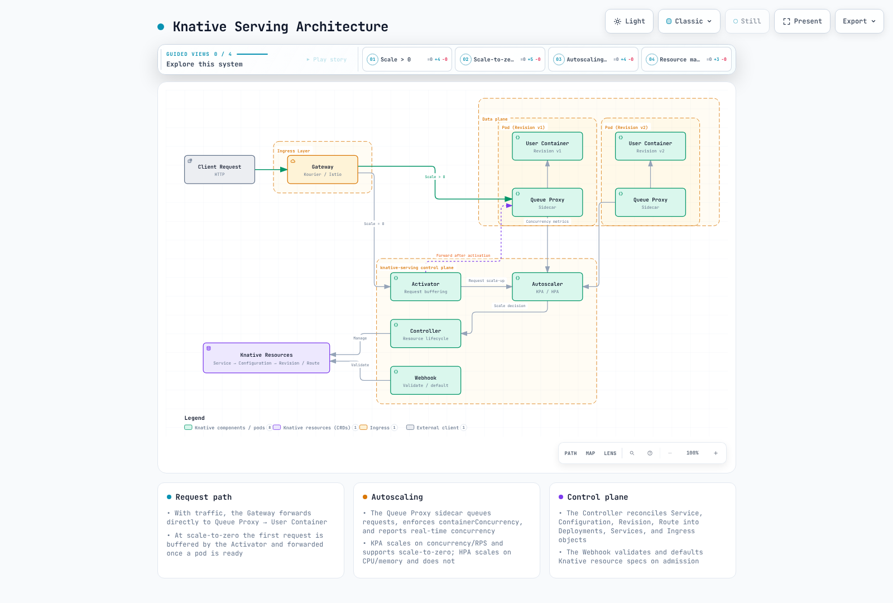
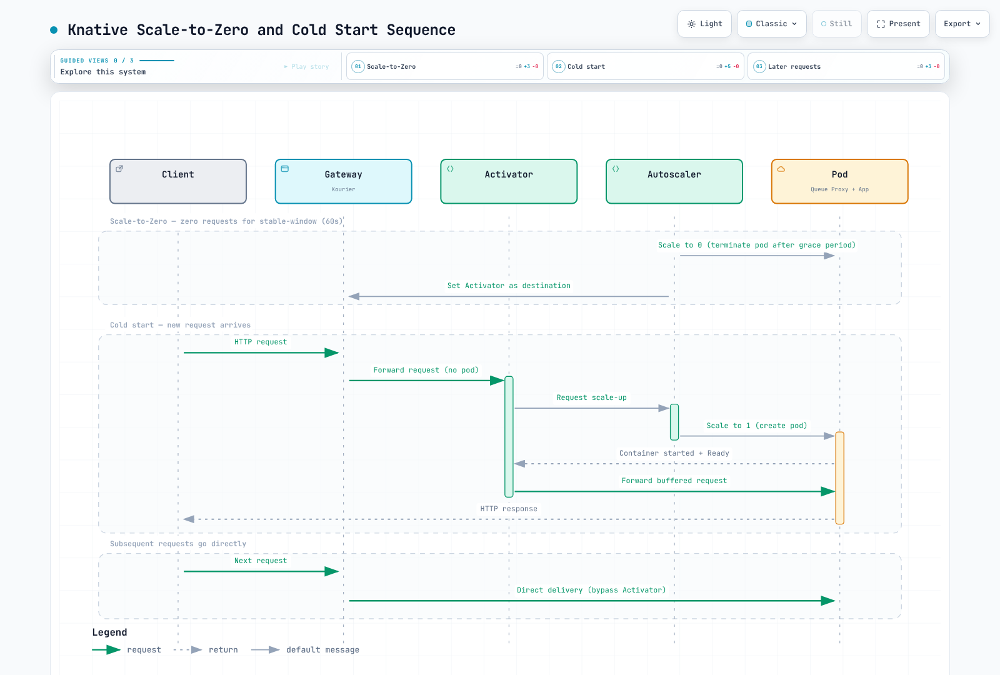

# Knative

> **示例版本**：Serving/Eventing/Kourier 1.23.0；Operator 1.23.1。安装前请确认与 Kubernetes/EKS 的兼容性。
> **最后更新**：October 16, 2026

## 目录

- [概述与学习目标](#overview-and-learning-objectives)
- [Knative 架构](#knative-architecture)
- [EKS 安装与配置](#eks-installation-and-configuration)
- [深入了解 Knative Serving](#knative-serving-deep-dive)
- [深入了解 Knative Eventing](#knative-eventing-deep-dive)
- [KEDA 与 Knative 对比](#keda-vs-knative-comparison)
- [生产环境运维](#production-operations)
- [最佳实践](#best-practices)
- [参考资料](#references)

---

## 概述与学习目标 {#overview-and-learning-objectives}

### 什么是 Knative？

Knative 是一个 **CNCF 毕业级**项目，它扩展了 Kubernetes，提供一组中间件组件，用于构建、部署和管理现代无服务器工作负载。Knative 并不取代 Kubernetes 原语，而是构建在这些原语之上，提供更高级别的抽象，简化常见模式，例如由请求驱动的自动扩缩容、事件传递和流量管理。

CNCF 于 2022 年 3 月 2 日接受 Knative 成为孵化级项目，并于 2025 年 9 月 11 日宣布其毕业。项目成熟度并不能证明某个具体部署已达到生产就绪状态。

Knative 由两个可独立安装的组件组成：

- **Knative Serving** -- 管理无服务器工作负载的生命周期。它自动化部署、扩缩容（包括缩容至零）、Revision 跟踪和流量路由。
- **Knative Eventing** -- 提供用于生成、路由和使用事件的基础设施，并遵循 CloudEvents 规范。它将事件生产者与消费者解耦，从而支持松耦合的事件驱动架构。

### Kubernetes 上的无服务器

传统 Kubernetes Deployment 要求运维人员预先配置副本数、HPA 阈值和资源预算。Knative 减轻了这项负担：

1. 工作负载根据传入请求的并发数或 RPS，自动从零扩展到多个副本。
2. Revision 规格会保存工作负载模板的快照；流量可以切换到仍保留且就绪的 Revision。被引用的 Secret/ConfigMap、注册表访问和外部状态不会被冻结，路由/回滚也需要协调时间。
3. Source/适配器和 Trigger 将事件接入与传递分离。某些适配器会轮询外部系统，而应用程序处理、身份验证和故障处理仍需自行实现。

最终形成的平台保留了 Kubernetes 的全部能力（调度、RBAC、网络、存储），同时提供了更接近全托管无服务器平台的开发者体验。

### Knative Serving 与 Eventing

| 方面 | Knative Serving | Knative Eventing |
|--------|----------------|-----------------|
| 主要用途 | 由请求驱动的工作负载生命周期管理 | 事件路由与传递 |
| 扩缩容触发条件 | HTTP 请求并发数 / RPS | 取决于消费者/适配器；Broker/Trigger 不会通用地扩缩每个订阅者 |
| 缩容至零 | 支持（内置） | 取决于消费者（由 Serving 支持的消费者可以） |
| 核心资源 | Service、Configuration、Revision、Route | Broker、Trigger、Channel、Subscription、Source |
| 典型用例 | API、Web 应用、微服务 | 异步流水线、webhook、CDC 流 |

### Knative、AWS Lambda 与 AWS Fargate 对比

| 功能 | EKS 上的 Knative Serving | AWS Lambda（标准计算） | AWS Fargate |
|---|---|---|---|
| 运行时 | 满足 Serving 运行时契约的容器 | 支持的 Lambda 运行时或实现其运行时 API 的镜像 | 支持的 ECS 任务/EKS Pod；适用平台限制 |
| 请求/执行时长 | 可配置请求超时；默认值为300s，除非重新配置，否则最大允许值为600s | 标准函数超时最长为900s | 由任务/Pod 生命周期决定，不受 Lambda 式调用时限约束 |
| 缩容至零 | KPA 支持空闲 Revision 缩容至零 | 按需执行 | ECS 期望任务数或 Kubernetes 副本数可设为0；激活需要合适的控制器/指标 |
| 冷启动 | 基线副本、镜像/启动/就绪性调优 | 特定运行时优化和预置并发 | 任务/Pod 启动以及镜像/网络设置；没有固定时长可供比较 |
| 内存 | 节点可分配容量、容器请求和 sidecar | 可配置为128–10,240MB | EKS Fargate 插槽最高支持120GB；适用平台开销和受支持的 CPU/内存组合限制 |
| GPU | 需要合适的节点、设备插件、资源请求和已启用的 PodSpec 功能 | 标准 Lambda 计算不支持 GPU | Fargate 不提供 GPU |
| 网络 | Kubernetes/CNI 和网关配置 | 可选客户 VPC 附加 | VPC 网络；EKS Fargate 有平台限制 |
| 可移植性 | Kubernetes/Knative API；云身份/存储集成仍然重要 | AWS 专属运行时/服务 API | ECS 或 EKS 集成及受支持的平台 API |
| 事件输入 | HTTP/CloudEvents 和已配置的适配器 | 受支持的 AWS 事件集成 | 应用程序/控制器集成；不是通用事件路由服务 |
| 本地测试 | 本地 Kubernetes 有帮助，但仍需验证云端行为 | 本地工具/模拟器为可选项，且保真度有限 | 可在本地测试容器逻辑；平台行为有所不同 |
| 可观测性 | 配置指标、日志和跟踪导出器 | CloudWatch 和受支持的跟踪集成 | 配置受支持的 AWS/OpenTelemetry 数据采集 |
| 成本依据 | 已分配的集群、存储、负载均衡器及支持资源 | 请求/时长及所选功能 | 已分配的任务/Pod CPU 和内存，以及相关资源 |

此表中的 Lambda 指标准计算。Lambda Managed Instances 上符合条件的异步/事件源调用最长可运行90分钟（特定服务可能有例外）；其运行约束有所不同。Pod 缩容至零本身不会消除 EC2 节点、持久化存储或负载均衡器的费用。

### 学习目标

读完本文后，你将能够：

1. 说明 Knative 的架构，以及 Serving 和 Eventing 如何相互补充。
2. 使用 Kourier、DNS 和 TLS 在 Amazon EKS 上安装并配置 Knative。
3. 部署基于并发数进行精细化自动扩缩容的无服务器工作负载。
4. 使用 Revision 和 Route 实现流量拆分策略（金丝雀、蓝绿部署）。
5. 使用 Broker、Trigger 和 CloudEvents 构建事件驱动流水线。
6. 对比 KEDA 和 Knative，并决定何时使用其中之一或两者。
7. 通过监控、高可用性和垃圾回收策略在生产环境中运维 Knative。

---

## Knative 架构 {#knative-architecture}

### Serving 架构

Serving 在 `knative-serving` 中包含控制平面组件，并在每个 Revision Pod 的工作负载命名空间中包含 Queue Proxy。它们负责协调、路由、准入和扩缩容；它们并非全部是位于同一命名空间中的五个 Deployment。



[🔍 查看交互式图表](https://www.atomai.click/kubernetes-docs/archmaps/en-autoscaling-03-knative-0.html)

**组件职责：**

| 组件 | 作用 |
|-----------|------|
| **Activator** | 当某个 Revision 缩容至零时接收请求。它会缓冲请求、触发扩容，并在 Pod 就绪后代理已缓冲的请求。在系统处于“突发容量”模式时，它还会充当负载均衡器。 |
| **Autoscaler** | 从 Queue Proxy sidecar 收集并发数和 RPS 指标。KPA 及其协调器负责推动目标副本数；可选的 HPA 集成负责管理 Kubernetes HPA 资源。Serving Controller 会协调工作负载资源，但它不是每项扩缩容决策都必须经过的通用中间层。 |
| **Queue Proxy** | 注入为每个 Knative Pod 中的 sidecar。它强制执行 `containerConcurrency` 限制，向 Autoscaler 报告实时并发数，执行运行状况检查，并在缩容时处理优雅关闭。 |
| **Controller** | 将 Knative CRD（Service、Configuration、Revision、Route）协调为底层 Kubernetes 资源（Deployment、Service、Ingress 对象）。它负责管理 Revision 的创建和垃圾回收。 |
| **Webhook** | 在准入阶段验证 Knative 资源规格并设置默认值。它确保无效配置在到达 Controller 之前被拒绝。 |

### Eventing 架构

Knative Eventing 提供一种声明式方式，将事件源绑定到消费者。它支持两种传递模式：**Broker/Trigger**（基于内容的路由）和 **Channel/Subscription**（直接发布/订阅）。


[🔍 查看交互式图表](https://www.atomai.click/kubernetes-docs/archmaps/en-autoscaling-03-knative-1.html)

**Eventing 核心概念：**

| 概念 | 描述 |
|---------|-------------|
| **Event Source** | 生成或导入事件的资源。Knative 提供内置 Source（ApiServerSource、PingSource），社区维护 Kafka、AWS SQS、GitHub 等 Source。 |
| **Broker** | 接收事件，并通过所选实现将事件传递给匹配的 Trigger。缓冲、持久化和故障行为取决于类别/底层传输。 |
| **Trigger** | 附加到 Broker 的过滤器。每个 Trigger 根据 CloudEvent 属性（type、source、扩展属性）选择事件，并将匹配的事件路由到订阅者。 |
| **Channel** | 持久化或内存中的事件传输通道。与 Broker 不同，Channel 不执行过滤——每个 Subscription 都会接收每个事件。 |
| **Subscription** | 将 Channel 连接到订阅者，并可选择配置回复目标。 |
| **Dead Letter Sink** | 在重试策略耗尽后仍无法传递事件时使用的备用目标。 |
| **CloudEvents** | 所有 Knative Eventing 组件使用的 CNCF 标准信封格式（v1.0）。它为 Source 和消费者提供互操作性。 |

---

## EKS 安装与配置 {#eks-installation-and-configuration}

安装片段针对隔离的测试环境，并包含占位符。应用带有 LoadBalancer 的 Serving 配置时，可能会通过已安装的控制器创建 AWS 资源；本次审计没有执行此类操作。由 Operator 管理的 ConfigMap、Service 和工作负载应通过 KnativeServing/KnativeEventing 资源配置。准备合并补丁时应保留现有配置，尤其是列表字段。在使用后续示例前，请创建其中引用的应用程序命名空间、ServiceAccount、Secret、镜像、Kafka/SQS 资源和 IAM 角色。通过架构检查并不意味着已达到生产就绪状态。

### 前置条件

- 使用现有且受提供商支持的 EKS 版本，并确认其与选定的 Knative 组件兼容。示例使用 Serving/Eventing/Kourier1.23.0 和 Operator1.23.1；这不代表 Knative 与所有 Kubernetes1.28+ 版本都兼容。
- 已配置集群管理员访问权限的 `kubectl`。
- （可选）用于基于 Helm 安装的 `helm` v3.12+。

### 步骤 1：安装 Knative Operator

Knative Operator 管理 Knative Serving 和 Eventing 组件的安装和生命周期。使用 Operator 可以简化版本升级和配置管理。

```bash
# Fresh installation on the intended test cluster; review versioned upgrade guidance for existing installs.
kubectl config current-context
kubectl apply --server-side -f https://github.com/knative/operator/releases/download/knative-v1.23.1/operator.yaml
kubectl wait --for=condition=Established crd/knativeservings.operator.knative.dev crd/knativeeventings.operator.knative.dev --timeout=120s
kubectl wait --for=condition=Available deployment/knative-operator deployment/operator-webhook -n knative-operator --timeout=300s
```

### 步骤 2：通过 Operator 安装 Knative Serving

创建 `KnativeServing` 自定义资源以部署 Serving 组件：

```yaml
apiVersion: operator.knative.dev/v1beta1
kind: KnativeServing
metadata:
  name: knative-serving
  namespace: knative-serving
spec:
  version: 1.23.0
  ingress:
    kourier:
      enabled: true
  config:
    network:
      ingress-class: kourier.ingress.networking.knative.dev
    autoscaler:
      pod-autoscaler-class: kpa.autoscaling.knative.dev
      container-concurrency-target-percentage: '70'
      enable-scale-to-zero: 'true'
    defaults:
      revision-timeout-seconds: '300'
      max-revision-timeout-seconds: '600'
    deployment:
      queue-sidecar-cpu-request: 25m
      queue-sidecar-memory-request: 400Mi
      queue-sidecar-memory-limit: 800Mi
  services:
  - name: kourier
    annotations:
      service.beta.kubernetes.io/aws-load-balancer-type: external
      service.beta.kubernetes.io/aws-load-balancer-nlb-target-type: ip
      service.beta.kubernetes.io/aws-load-balancer-scheme: internet-facing
```

```bash
kubectl create namespace knative-serving --dry-run=client -o yaml | kubectl apply -f -
kubectl create namespace knative-demo --dry-run=client -o yaml | kubectl apply -f -
kubectl apply -f knative-serving.yaml
kubectl wait --for=condition=Ready knativeserving/knative-serving -n knative-serving --timeout=600s
kubectl get deployments,pods,services -n knative-serving
```

### 步骤 3：安装 Kourier（轻量级 Ingress）

Kourier 是基于 Envoy 的 Knative 网络实现。如果其支持的功能满足工作负载需求，它就是一种合适的选择；资源或延迟优势需要通过测量确认。

Operator 会从选定的 Serving 软件包安装 Kourier。在此工作流中，网关 Service 位于 `knative-serving`。独立手动安装的 Kourier 清单通常使用 `kourier-system`；不要在 Operator 管理的安装上叠加应用此清单。检查受管理资源：

```bash
# Operator-managed Kourier uses the KnativeServing namespace.
kubectl get deployment net-kourier-controller 3scale-kourier-gateway -n knative-serving
kubectl get service kourier -n knative-serving -o yaml
```

上述基础 KnativeServing 资源为 Kourier Service 配置了由 **AWS Load Balancer Controller 管理的 NLB** 注解。必须预先准备好该控制器、IAM 和所选子网。Service 注解不会创建 ALB；ALB 需要合适的 L7 控制器/路由设计。EKS Auto Mode 使用不同的负载均衡器管理路径。请确认实际的 class/注解，不要假定每个 EKS LoadBalancer Service 默认都使用 NLB：

```bash
kubectl get service kourier -n knative-serving -o jsonpath='{.spec.loadBalancerClass}{"\n"}{.metadata.annotations}{"\n"}'
```

### 步骤 4：DNS 配置

Knative 会为每个 Service 生成形如 `<service>.<namespace>.<domain>` 的 URL。必须配置 DNS，让这些 URL 解析到 Ingress 网关。

#### 选项 A：Magic DNS（sslip.io）-- 仅限开发环境

sslip.io 可以解析受支持的 IP 编码名称，适用于合适的开发环境。AWS 负载均衡器主机名和不断变化的后端 IP 并不是持久可靠的生产 DNS 映射。此 Operator 工作流使用显式域名；独立的默认域名辅助程序不应与 Operator 管理的配置冲突。

```bash
# Inspect the address type; this Operator workflow uses an explicitly configured domain.
kubectl get service kourier -n knative-serving -o jsonpath='{.status.loadBalancer.ingress}'
kubectl get ksvc -n knative-demo
```

#### 选项 B：使用 Amazon Route 53 配置真实 DNS -- 生产环境

准备你所控制的域名/托管区，并在应用前检查生成的变更。运行后，以下命令会更新该托管区；本次审计未执行这些命令。每条记录只使用一个 DNS 管理方（手动/IaC 或 ExternalDNS）。ExternalDNS 需要配置 `knative-serving` Source、权限以及与实际 Route/DomainMapping 匹配的主机名；仅添加主机名注解不会创建新的 Knative Route。

```bash
# Review the intended zone/domain and wait for the NLB hostname before preparing a DNS change.
set -euo pipefail
export KOURIER_HOST
KOURIER_HOST=$(kubectl get service kourier -n knative-serving -o jsonpath='{.status.loadBalancer.ingress[0].hostname}')
: "${KOURIER_HOST:?Wait for the load-balancer hostname}"
export KNATIVE_DOMAIN="knative.example.com"
export HOSTED_ZONE_ID="REPLACE_WITH_HOSTED_ZONE_ID"
python3 - <<'PYDNS'
import json, os
from pathlib import Path
host = os.environ["KOURIER_HOST"].strip()
if not host or any(c.isspace() for c in host):
    raise SystemExit("Invalid load-balancer hostname")
change = {"Changes": [{"Action": "UPSERT", "ResourceRecordSet": {
    "Name": "*." + os.environ["KNATIVE_DOMAIN"], "Type": "CNAME", "TTL": 300,
    "ResourceRecords": [{"Value": host}]
}}]}
Path("knative-dns-change.json").write_text(json.dumps(change, indent=2))
patch = {"spec": {"config": {"domain": {os.environ["KNATIVE_DOMAIN"]: ""}}}}
Path("knative-domain.patch.json").write_text(json.dumps(patch))
PYDNS
# These commands change the selected DNS zone and Operator configuration when run.
aws route53 change-resource-record-sets --hosted-zone-id "$HOSTED_ZONE_ID" --change-batch file://knative-dns-change.json
kubectl patch knativeserving knative-serving -n knative-serving --type merge --patch-file knative-domain.patch.json
```

### 步骤 5：使用 cert-manager 配置 TLS

Serving1.23 在其 Controller 中包含 cert-manager 集成。旧的独立 net-certmanager 仓库已归档；不要从中安装不存在的1.16/1.23 版本。在启用集成之前，请单独安装并配置兼容的 cert-manager，包括其专用的 Route53 DNS01 身份和遵循最小权限原则的托管区访问权限。

```bash
kubectl get deployments -n cert-manager
kubectl get crd certificates.cert-manager.io clusterissuers.cert-manager.io
```

将此合并补丁保存为现有 KnativeServing 资源的 `serving-tls.patch.yaml`。它不是用于覆盖 Operator 管理状态的独立 ConfigMap：

```yaml
spec:
  config:
    network:
      certificate-class: cert-manager.certificate.networking.knative.dev
      external-domain-tls: Enabled
      http-protocol: Redirected
    certmanager:
      issuerRef: |
        group: cert-manager.io
        kind: ClusterIssuer
        name: letsencrypt-staging
```

首次验证 DNS/IAM 时，请使用 staging ClusterIssuer。将联系人、托管区和 Region 替换为经过检查的值。Staging 证书不受公开信任；只有在验证挑战流程和证书生命周期后，才切换到生产颁发者：

```yaml
apiVersion: cert-manager.io/v1
kind: ClusterIssuer
metadata:
  name: letsencrypt-staging
spec:
  acme:
    server: https://acme-staging-v02.api.letsencrypt.org/directory
    email: REPLACE_WITH_CERTIFICATE_CONTACT_EMAIL
    privateKeySecretRef:
      name: letsencrypt-staging-key
    solvers:
    - dns01:
        route53:
          region: us-west-2
          hostedZoneID: REPLACE_WITH_HOSTED_ZONE_ID
```

将颁发者保存为 `cluster-issuer.yaml`，将前述 Operator 补丁保存为 `serving-tls.patch.yaml`，然后按以下顺序应用：

```bash
# cert-manager and its Route 53 identity must already be configured.
kubectl apply -f cluster-issuer.yaml
kubectl wait --for=condition=Ready clusterissuer/letsencrypt-staging --timeout=180s
kubectl patch knativeserving knative-serving -n knative-serving --type merge --patch-file serving-tls.patch.yaml
# The integration starts in the Serving controller after the setting is effective.
kubectl get configmap config-network -n knative-serving -o yaml
kubectl rollout restart deployment/controller -n knative-serving
kubectl rollout status deployment/controller -n knative-serving --timeout=300s
```

### 步骤 6：选择 HPA 或 KPA Autoscaler

Knative 支持两种 Autoscaler 实现。选择不同实现会显著影响扩缩容行为。

| 功能 | KPA（Knative Pod Autoscaler） | HPA（Kubernetes HPA） |
|---------|------------------------------|----------------------|
| 缩容至零 | 支持 | 不支持 |
| 指标 | 并发数、RPS | CPU、内存、自定义指标 |
| 扩缩容速度 | 快（panic/stable 窗口） | 标准 HPA 间隔 |
| 配置 | Knative 注解 | 标准 HPA spec |
| 最适用场景 | HTTP 工作负载、对延迟敏感的工作负载 | CPU/内存受限的工作负载 |

通过 Operator 配置默认 Autoscaler 类别。HPA 类 Revision 需要可选的 HPA 扩展和可正常工作的 Kubernetes 资源指标 API；此补丁包含固定版本的 HPA 清单。如果你的发行版已提供该组件，请避免重复管理：

```yaml
spec:
  additionalManifests:
  - URL: https://github.com/knative/serving/releases/download/knative-v1.23.0/serving-hpa.yaml
  config:
    autoscaler:
      pod-autoscaler-class: kpa.autoscaling.knative.dev
      stable-window: 60s
      panic-window-percentage: '10'
      panic-threshold-percentage: '200'
      scale-to-zero-grace-period: 30s
      scale-to-zero-pod-retention-period: 0s
      target-burst-capacity: '211'
      requests-per-second-target-default: '200'
      container-concurrency-target-default: '100'
```

保存为 `serving-autoscaler.patch.yaml`，并将其合并到现有 Operator 资源中。准备补丁时，请保留其他 `additionalManifests` 条目：

```bash
kubectl patch knativeserving knative-serving -n knative-serving --type merge --patch-file serving-autoscaler.patch.yaml
kubectl get deployment autoscaler-hpa -n knative-serving
```

可在 Knative Service 的 `spec.template.metadata.annotations` 下覆盖每个 Revision 的设置（以下为模板片段）：

```yaml
metadata:
  annotations:
    autoscaling.knative.dev/class: "hpa.autoscaling.knative.dev"
    autoscaling.knative.dev/metric: "cpu"
    autoscaling.knative.dev/target: "70"
```

### 步骤 7：安装 Knative Eventing

```yaml
apiVersion: operator.knative.dev/v1beta1
kind: KnativeEventing
metadata:
  name: knative-eventing
  namespace: knative-eventing
spec:
  version: 1.23.0
  defaultBrokerClass: MTChannelBasedBroker
  config:
    default-ch-webhook:
      default-ch-config: "clusterDefault:\n  apiVersion: messaging.knative.dev/v1\n\
        \  kind: InMemoryChannel\n"
  sinkBindingSelectionMode: inclusion
```

```bash
kubectl create namespace knative-eventing --dry-run=client -o yaml | kubectl apply -f -
kubectl apply -f knative-eventing.yaml
kubectl wait --for=condition=Ready knativeeventing/knative-eventing -n knative-eventing --timeout=600s
kubectl get deployments,pods -n knative-eventing
kubectl get crd inmemorychannels.messaging.knative.dev integrationsources.sources.knative.dev
```

---

## 深入了解 Knative Serving {#knative-serving-deep-dive}

### 资源模型

Knative Serving 引入四种主要自定义资源，它们协同管理无服务器工作负载的完整生命周期。


[🔍 查看交互式图表](https://www.atomai.click/kubernetes-docs/archmaps/en-autoscaling-03-knative-2.html)

| 资源 | 描述 |
|----------|-------------|
| **Service**（`ksvc`） | 顶层资源。它拥有一个 Configuration 和一个 Route，以管理完整生命周期。大多数用户只与 Service 交互。 |
| **Configuration** | 描述工作负载模板；相关模板变更会创建 Revision。仅元数据或流量变更不一定会创建 Revision。 |
| **Revision** | 不可变的工作负载规格，但外部引用仍可能变化。保留/垃圾回收策略决定旧 Revision 是否继续可用。 |
| **Route** | 将网络流量映射到一个或多个 Revision。支持金丝雀部署、蓝绿发布和基于百分比的流量拆分。 |

### 完整的 Knative Service YAML

请先提供引用的镜像、ServiceAccount 和 Secret。Serving Controller 必须解析注册表标签/摘要，同时节点也必须能够单独拉取镜像；仅有 EKS 节点凭证并不能证明 Controller 可以访问注册表。就绪性/存活性路径必须与实际应用程序相符，并且不应因下游故障而引发重启风暴。

以下是配置示例，而不是经过测试的生产部署。它定义了一个 Knative Service，并明确设置自动扩缩容、资源限制、运行状况检查和扩缩容边界：

```yaml
apiVersion: serving.knative.dev/v1
kind: Service
metadata:
  name: order-api
  namespace: knative-demo
  labels:
    app.kubernetes.io/name: order-api
    app.kubernetes.io/part-of: ecommerce
    app.kubernetes.io/managed-by: knative
spec:
  template:
    metadata:
      annotations:
        autoscaling.knative.dev/class: kpa.autoscaling.knative.dev
        autoscaling.knative.dev/metric: concurrency
        autoscaling.knative.dev/target: '100'
        autoscaling.knative.dev/target-utilization-percentage: '70'
        autoscaling.knative.dev/min-scale: '2'
        autoscaling.knative.dev/max-scale: '50'
        autoscaling.knative.dev/initial-scale: '3'
        autoscaling.knative.dev/scale-down-delay: 15m
        autoscaling.knative.dev/window: 60s
      name: order-api-v1
    spec:
      containerConcurrency: 0
      timeoutSeconds: 300
      containers:
      - image: 123456789012.dkr.ecr.us-west-2.amazonaws.com/order-api:v1.2.3
        ports:
        - containerPort: 8080
          protocol: TCP
        env:
        - name: DB_HOST
          valueFrom:
            secretKeyRef:
              name: db-credentials
              key: host
        - name: LOG_LEVEL
          value: info
        resources:
          requests:
            cpu: 250m
            memory: 512Mi
          limits:
            cpu: 1000m
            memory: 1Gi
        readinessProbe:
          httpGet:
            path: /healthz
            port: 8080
          initialDelaySeconds: 5
          periodSeconds: 10
        livenessProbe:
          httpGet:
            path: /healthz
            port: 8080
          initialDelaySeconds: 15
          periodSeconds: 20
      serviceAccountName: order-api-sa
```

### 流量拆分：金丝雀部署

流量拆分可以逐步将流量从一个 Revision 切换到另一个 Revision。这是金丝雀和蓝绿部署策略的基础。

#### 金丝雀部署

以下是以完整的基础 Service 及其就绪的 `order-api-v1` Revision 为起点的替代练习。请将镜像和名称替换为已验证的制品；每次模板变更都需要一个未使用过的新 Revision 名称。JSON 补丁会保留环境变量、ServiceAccount、探针和资源设置，而不是替换整个 containers 列表。它假设基础示例中的 ingress 容器只有一个，且位于 index0。A0% 标签可提供一个可用于测试的路由，但不保证有充足的预热容量。

保存为 `canary-template.patch.json`：

```json
[
  {
    "op": "add",
    "path": "/spec/traffic",
    "value": [
      {
        "revisionName": "order-api-v1",
        "percent": 100
      },
      {
        "revisionName": "order-api-v2",
        "percent": 0,
        "tag": "canary"
      }
    ]
  },
  {
    "op": "add",
    "path": "/spec/template/metadata/name",
    "value": "order-api-v2"
  },
  {
    "op": "replace",
    "path": "/spec/template/spec/containers/0/image",
    "value": "123456789012.dkr.ecr.us-west-2.amazonaws.com/order-api:v1.3.0"
  }
]
```

```bash
kubectl wait --for=condition=Ready revision/order-api-v1 -n knative-demo --timeout=300s
kubectl patch ksvc order-api -n knative-demo --type json --patch-file canary-template.patch.json
kubectl wait --for=jsonpath='{.status.latestCreatedRevisionName}'=order-api-v2 ksvc/order-api -n knative-demo --timeout=180s
kubectl wait --for=condition=Ready revision/order-api-v2 -n knative-demo --timeout=300s
kubectl get ksvc order-api -n knative-demo -o jsonpath='{.status.traffic}'

# Route10%, then50%, then100% only after validating each stage.
kubectl patch ksvc order-api -n knative-demo --type merge --patch '{"spec":{"traffic":[{"revisionName":"order-api-v1","percent":90},{"revisionName":"order-api-v2","percent":10,"tag":"canary"}]}}'
kubectl patch ksvc order-api -n knative-demo --type merge --patch '{"spec":{"traffic":[{"revisionName":"order-api-v1","percent":50},{"revisionName":"order-api-v2","percent":50,"tag":"canary"}]}}'
kubectl patch ksvc order-api -n knative-demo --type merge --patch '{"spec":{"traffic":[{"revisionName":"order-api-v1","percent":0},{"revisionName":"order-api-v2","percent":100,"tag":"canary"}]}}'
```

从 `status.traffic` 中读取实际的标签 URL；它取决于域名/标签模板和 TLS 设置。请在每次变更之间检查 Route 就绪状态、已观测配置和应用信号。百分比是路由策略，不代表小样本请求中的精确数量。

#### 蓝绿部署

将此作为与基础 `order-api-v1` 分开的练习，或者将稳定名称更新为当前实际提供已验证基线服务的 Revision。将以下内容保存为 `green-template.patch.json`：

```json
[
  {
    "op": "add",
    "path": "/spec/traffic",
    "value": [
      {
        "revisionName": "order-api-v1",
        "percent": 100
      },
      {
        "revisionName": "order-api-green",
        "percent": 0,
        "tag": "green"
      }
    ]
  },
  {
    "op": "add",
    "path": "/spec/template/metadata/name",
    "value": "order-api-green"
  },
  {
    "op": "replace",
    "path": "/spec/template/spec/containers/0/image",
    "value": "123456789012.dkr.ecr.us-west-2.amazonaws.com/order-api:v2.0.0"
  }
]
```

```bash
kubectl patch ksvc order-api -n knative-demo --type json --patch-file green-template.patch.json
kubectl wait --for=jsonpath='{.status.latestCreatedRevisionName}'=order-api-green ksvc/order-api -n knative-demo --timeout=180s
kubectl wait --for=condition=Ready revision/order-api-green -n knative-demo --timeout=300s
kubectl get ksvc order-api -n knative-demo -o jsonpath='{.status.traffic}'
# Validate the green tag URL and capacity before requesting this switch.
kubectl patch ksvc order-api -n knative-demo --type merge --patch '{"spec":{"traffic":[{"revisionName":"order-api-v1","percent":0},{"revisionName":"order-api-green","percent":100,"tag":"green"}]}}'
```

流量变更会异步协调；连接和正在处理的请求仍可能使用之前的 Revision。为回滚保留旧 Revision 及其外部依赖，并测量实际的传播/就绪情况。这些命令没有在集群上执行。

### 缩容至零行为

缩容至零是 Knative Serving 的标志性功能。当某个 Revision 符合缩容至零条件时，其空闲窗口、缩容延迟、保留期和内部路由就绪情况会影响最后一个 Pod 的移除时间。收到新请求时，Activator 会缓冲请求、触发扩容，并在 Pod 就绪后代理请求。



[🔍 查看交互式图表](https://www.atomai.click/kubernetes-docs/archmaps/en-autoscaling-03-knative-3.html)

控制缩容至零的关键参数：

| 注解 / 配置 | 默认值 | 描述 |
|---------------------|---------|-------------|
| `scale-to-zero-grace-period`（全局） |30s| 在移除最后一个副本前，为从零扩容准备内部路由预留的最长时间；它不是保证的空闲保留计时器。 |
| `scale-to-zero-pod-retention-period`（全局） |0s| Autoscaler 决定缩容至零后，最后一个 Pod 的最短保留时间。 |
| `autoscaling.knative.dev/scale-to-zero-pod-retention-period`（每个 Revision） | 继承 | 每个 Revision 对全局保留时间的覆盖值。 |
| `enable-scale-to-zero`（全局） | true | 总开关。设置为 false 可在整个集群中禁用缩容至零。 |

### 基于并发数的扩缩容

Knative 的 KPA 根据观测到的并发数（正在处理的请求）或每秒请求数（RPS）进行扩缩容。该算法维护两个窗口：

- **Stable 窗口**（默认 60s）：此时间段内的平均并发数决定稳定状态下的副本数。
- **Panic 窗口**（默认 6s，即 stable 窗口的 10%）：如果此窗口内的平均并发数超过 panic 阈值（默认是目标值的 200%），系统就会积极扩容。

**关键注解：**

| 注解 | 示例 | 描述 |
|------------|---------|-------------|
| `autoscaling.knative.dev/metric` | `"concurrency"` 或 `"rps"` | 选择用于扩缩容的指标。 |
| `autoscaling.knative.dev/target` | `"100"` | 指标的目标值（例如，每个 Pod 有 100 个并发请求）。 |
| `autoscaling.knative.dev/target-utilization-percentage` | `"70"` | Autoscaler 会尝试将平均利用率维持在目标值的此百分比。有效目标值 = target * utilization / 100。 |
| `spec.template.spec.containerConcurrency` |`0`| 每个 Pod 可转发请求的并发数限制；`0` 表示禁用此硬性上限。仍会进行有界等待/拒绝和自动扩缩容。设为1 并不会让应用程序线程或所有副本全局串行运行。 |

**扩缩容公式：**

```
desiredReplicas = ceil( observedConcurrency / (target * targetUtilization / 100) )
```

例如，`target=100`、`targetUtilization=70%`，且观测到 350 个并发请求时：

```
desiredReplicas = ceil(350 / (100 * 0.70)) = ceil(350 / 70) = ceil(5.0) = 5
```

### 冷启动优化

冷启动——从零扩容时产生的延迟开销——是一个常见问题。Knative 提供了多种缓解机制：

| 策略 | 配置 | 权衡 |
|----------|---------------|-----------|
| **minScale** | `autoscaling.knative.dev/min-scale: "2"` | 在正常空闲期间保持基线容量；新 Revision、重启和扩容仍可能需要冷启动。 |
| **initialScale** | `autoscaling.knative.dev/initial-scale: "3"` | 首次部署新 Revision 时创建的 Pod 数量。之后仍可能缩容至零。 |
| **scale-down-delay** | `autoscaling.knative.dev/scale-down-delay: "15m"` | 延迟缩容决策。适用于突发型工作负载，可避免频繁冷启动。 |
| **容器镜像缓存** | 使用 EKS 节点级镜像缓存或预拉取 DaemonSet | 减少冷启动期间的容器拉取时间。 |
| **轻量级基础镜像** | 使用 distroless 或基于 Alpine 的镜像 | 减小镜像体积和拉取时间。 |
| **应用预热** | 针对实际就绪契约实现 readiness probe | 避免过早宣告就绪；仍需测量满载性能。 |

```yaml
apiVersion: serving.knative.dev/v1
kind: Service
metadata:
  name: latency-critical-api
  namespace: knative-demo
spec:
  template:
    metadata:
      annotations:
        autoscaling.knative.dev/min-scale: '3'
        autoscaling.knative.dev/initial-scale: '5'
        autoscaling.knative.dev/scale-down-delay: 10m
        autoscaling.knative.dev/target: '50'
        autoscaling.knative.dev/window: 30s
    spec:
      containerConcurrency: 100
      containers:
      - image: 123456789012.dkr.ecr.us-west-2.amazonaws.com/api:v1.0.0
        ports:
        - containerPort: 8080
        readinessProbe:
          httpGet:
            path: /ready
            port: 8080
          initialDelaySeconds: 3
          periodSeconds: 5
```

### 私有和公开 Service

默认情况下，Knative Service 会通过 Ingress 网关对外公开。你可以将 Service 设置为仅供集群内部访问：

```yaml
apiVersion: serving.knative.dev/v1
kind: Service
metadata:
  name: internal-processor
  namespace: knative-demo
  labels:
    networking.knative.dev/visibility: cluster-local
spec:
  template:
    spec:
      containers:
      - image: 123456789012.dkr.ecr.us-west-2.amazonaws.com/processor:v1.0.0
```

cluster-local 标签会改变 Knative 路由的可见性和生成的内部 URL。它不是身份验证策略，也不是完整的网络隔离边界；私有网络路径、NetworkPolicy 和应用程序授权仍然重要。

所选版本中没有 `config-network.visibility` 设置。请在每个 Service 上应用 visibility 标签，或使用适当的准入策略强制执行。`default-external-scheme` 只影响生成的外部 URL scheme；它不会单独将 Service 设为私有或配置 TLS。以下是 Service 元数据片段：

```yaml
metadata:
  labels:
    networking.knative.dev/visibility: cluster-local
```

---

## 深入了解 Knative Eventing {#knative-eventing-deep-dive}

### Event Source

Event Source 是连接外部系统和事件网格的 Knative 资源。每个 Source 都会向已配置的 sink（Broker、Channel 或 Knative Service）发送 CloudEvents。

#### ApiServerSource

监视 Kubernetes API Server 中的资源事件，并将其作为 CloudEvents 转发：

```yaml
apiVersion: v1
kind: ServiceAccount
metadata:
  name: k8s-events-sa
  namespace: knative-demo
---
apiVersion: rbac.authorization.k8s.io/v1
kind: Role
metadata:
  name: k8s-events-reader
  namespace: knative-demo
rules:
- apiGroups:
  - ''
  resources:
  - pods
  verbs:
  - get
  - list
  - watch
- apiGroups:
  - apps
  resources:
  - deployments
  verbs:
  - get
  - list
  - watch
---
apiVersion: rbac.authorization.k8s.io/v1
kind: RoleBinding
metadata:
  name: k8s-events-reader
  namespace: knative-demo
subjects:
- kind: ServiceAccount
  name: k8s-events-sa
  namespace: knative-demo
roleRef:
  apiGroup: rbac.authorization.k8s.io
  kind: Role
  name: k8s-events-reader
---
apiVersion: rbac.authorization.k8s.io/v1
kind: ClusterRole
metadata:
  name: knative-demo-namespace-discovery
rules:
- apiGroups:
  - ''
  resources:
  - namespaces
  verbs:
  - get
  - list
  - watch
---
apiVersion: rbac.authorization.k8s.io/v1
kind: ClusterRoleBinding
metadata:
  name: knative-demo-namespace-discovery
subjects:
- kind: ServiceAccount
  name: k8s-events-sa
  namespace: knative-demo
roleRef:
  apiGroup: rbac.authorization.k8s.io
  kind: ClusterRole
  name: knative-demo-namespace-discovery
---
apiVersion: sources.knative.dev/v1
kind: ApiServerSource
metadata:
  name: k8s-events
  namespace: knative-demo
spec:
  serviceAccountName: k8s-events-sa
  mode: Reference
  resources:
  - apiVersion: v1
    kind: Pod
  - apiVersion: apps/v1
    kind: Deployment
  sink:
    ref:
      apiVersion: eventing.knative.dev/v1
      kind: Broker
      name: default
  namespaceSelector:
    matchLabels:
      kubernetes.io/metadata.name: knative-demo
```

#### SinkBinding

所选 Eventing 配置使用 inclusion 模式。请仅将 demo 命名空间加入绑定注入范围，并确保 subject Deployment 已在该命名空间中创建，且元数据标签/名称匹配。对运行中工作负载的变更可能需要通过正常 rollout，才能使用新注入的环境变量：

```bash
kubectl label namespace knative-demo bindings.knative.dev/include=true --overwrite
```

它会向任意 Kubernetes 工作负载注入环境变量（具体为 `K_SINK`），让工作负载可以向 sink 发送事件，而无需将目标地址硬编码：

```yaml
apiVersion: sources.knative.dev/v1
kind: SinkBinding
metadata:
  name: order-producer-binding
  namespace: knative-demo
spec:
  subject:
    apiVersion: apps/v1
    kind: Deployment
    name: order-producer
  sink:
    ref:
      apiVersion: eventing.knative.dev/v1
      kind: Broker
      name: default
  ceOverrides:
    extensions:
      producer: order-system
```

应用程序必须读取 `K_SINK` 并应用 `K_CE_OVERRIDES`；SinkBinding 不会重写任意发出的 Python 请求。下面的生产者使用结构化 HTTP 编码（完整 CloudEvent 正文及匹配的内容类型）、有界超时和状态检查。同一逻辑事件在重试时应始终使用同一个 `event_id`：

```python
import json
import os
import re

import requests
from cloudevents.http import CloudEvent
from cloudevents.conversion import to_structured

CORE_ATTRIBUTES = {"specversion", "id", "source", "type", "time", "subject", "datacontenttype", "dataschema"}


def emit_order_event(order_id, event_type, data, event_id):
    """Use one stable event_id for retries of the same logical event."""
    attributes = {
        "specversion": "1.0", "id": event_id,
        "type": f"com.example.order.{event_type}",
        "source": "/orders/api", "subject": f"order/{order_id}",
        "datacontenttype": "application/json",
    }
    overrides = json.loads(os.environ.get("K_CE_OVERRIDES", "{}"))
    for key, value in overrides.get("extensions", {}).items():
        if key in CORE_ATTRIBUTES or not re.fullmatch(r"[a-z0-9]+", key):
            raise ValueError("Only valid extension attributes may be overridden")
        attributes[key] = value
    event = CloudEvent(attributes, data)
    headers, body = to_structured(event)
    response = requests.post(
        os.environ["K_SINK"], data=body, headers=headers, timeout=(3, 10)
    )
    response.raise_for_status()
    return response.status_code
```

#### KafkaSource

KafkaSource/KafkaChannel 需要匹配的 Kafka 扩展和现有已配置的 Kafka 集群（包括 bootstrap/TLS/SASL 配置，以及满足所需复制因子的足够数量的 broker）。将这些1.23.2 插件 URL 与 KnativeEventing 资源中现有的 additionalManifests 合并；不要同时启用另一种管理方式来管理同一插件。保存为 eventing-kafka.patch.yaml：

```yaml
spec:
  additionalManifests:
  - URL: https://github.com/knative-extensions/eventing-kafka-broker/releases/download/knative-v1.23.2/eventing-kafka-controller.yaml
  - URL: https://github.com/knative-extensions/eventing-kafka-broker/releases/download/knative-v1.23.2/eventing-kafka-source.yaml
  - URL: https://github.com/knative-extensions/eventing-kafka-broker/releases/download/knative-v1.23.2/eventing-kafka-channel.yaml
```

```bash
kubectl patch knativeeventing knative-eventing -n knative-eventing --type merge --patch-file eventing-kafka.patch.yaml
GENERATION=$(kubectl get knativeeventing knative-eventing -n knative-eventing -o jsonpath='{.metadata.generation}')
kubectl wait --for=jsonpath='{.status.observedGeneration}'="$GENERATION" knativeeventing/knative-eventing -n knative-eventing --timeout=600s
kubectl wait --for=condition=Ready knativeeventing/knative-eventing -n knative-eventing --timeout=600s
kubectl get crd kafkasources.sources.knative.dev kafkachannels.messaging.knative.dev
```

从 Apache Kafka 主题中消费消息，并将其作为 CloudEvents 传递：

```yaml
apiVersion: sources.knative.dev/v1
kind: KafkaSource
metadata:
  name: payment-events
  namespace: knative-demo
spec:
  consumerGroup: knative-payment-consumer
  bootstrapServers:
  - kafka-bootstrap.kafka.svc.cluster.local:9092
  topics:
  - payment-events
  sink:
    ref:
      apiVersion: eventing.knative.dev/v1
      kind: Broker
      name: default
  net:
    sasl:
      enable: true
      type:
        secretKeyRef:
          name: kafka-credentials
          key: sasl-type
      user:
        secretKeyRef:
          name: kafka-credentials
          key: username
      password:
        secretKeyRef:
          name: kafka-credentials
          key: password
    tls:
      enable: true
```

#### SQSSource（AWS）

1.23 核心 IntegrationSource 支持 SQS，并取代了此处已归档的 TriggerMesh 示例。这是一个 alpha API；请确认已安装的 CRD 和适配器镜像。专用队列及其 IAM 角色必须已存在。运行后，该 Source 会消费/删除消息；审计期间没有部署任何 Source：

```bash
# Verify the core IntegrationSource CRD
kubectl get crd integrationsources.sources.knative.dev
```

```yaml
apiVersion: v1
kind: ServiceAccount
metadata:
  name: sqs-event-source
  namespace: knative-demo
  annotations:
    eks.amazonaws.com/role-arn: arn:aws:iam::123456789012:role/KnativeSqsSourceRole
---
apiVersion: sources.knative.dev/v1alpha1
kind: IntegrationSource
metadata:
  name: sqs-order-events
  namespace: knative-demo
spec:
  aws:
    sqs:
      arn: arn:aws:sqs:us-west-2:123456789012:knative-demo-orders
      region: us-west-2
      autoCreateQueue: false
      deleteAfterRead: true
      visibilityTimeout: 120
    auth:
      serviceAccountName: sqs-event-source
  sink:
    ref:
      apiVersion: eventing.knative.dev/v1
      kind: Broker
      name: default
```

此示例使用带有现有 IRSA 角色的专用 ServiceAccount。请将 ReceiveMessage/DeleteMessage/GetQueueAttributes/GetQueueUrl 权限限制在测试队列范围内，并验证确认、可见性超时和故障行为。autoCreateQueue 为 false。生成的 CloudEvent type/source 由适配器提供；在复制手动订单事件 Trigger 过滤器前，请先检查这些值。如果所选 EKS 计算方式、agent 和 SDK 支持，EKS Pod Identity 也是一种凭证选项；Fargate 不支持 EKS Pod Identity。

### Broker/Trigger 模式

Broker/Trigger 模式提供基于内容的事件路由。Broker 充当事件中心；Trigger 根据 CloudEvent 属性过滤事件，并将事件路由给订阅者。

#### 完整的 Broker/Trigger 示例

```yaml
apiVersion: v1
kind: ConfigMap
metadata:
  name: demo-broker-channel
  namespace: knative-demo
data:
  channel-template-spec: |
    apiVersion: messaging.knative.dev/v1
    kind: InMemoryChannel
---
apiVersion: eventing.knative.dev/v1
kind: Broker
metadata:
  name: default
  namespace: knative-demo
  annotations:
    eventing.knative.dev/broker.class: MTChannelBasedBroker
spec:
  config:
    apiVersion: v1
    kind: ConfigMap
    name: demo-broker-channel
    namespace: knative-demo
  delivery:
    retry: 5
    backoffPolicy: exponential
    backoffDelay: PT2S
    deadLetterSink:
      ref:
        apiVersion: serving.knative.dev/v1
        kind: Service
        name: dead-letter-handler
---
apiVersion: eventing.knative.dev/v1
kind: Trigger
metadata:
  name: order-created-trigger
  namespace: knative-demo
spec:
  broker: default
  filter:
    attributes:
      type: com.example.order.created
      source: /orders/api
  subscriber:
    ref:
      apiVersion: serving.knative.dev/v1
      kind: Service
      name: order-processor
---
apiVersion: eventing.knative.dev/v1
kind: Trigger
metadata:
  name: payment-processed-trigger
  namespace: knative-demo
spec:
  broker: default
  filter:
    attributes:
      type: com.example.payment.processed
  subscriber:
    ref:
      apiVersion: serving.knative.dev/v1
      kind: Service
      name: payment-reconciler
  delivery:
    retry: 10
    backoffPolicy: exponential
    backoffDelay: PT5S
    deadLetterSink:
      ref:
        apiVersion: serving.knative.dev/v1
        kind: Service
        name: payment-dead-letter
---
apiVersion: eventing.knative.dev/v1
kind: Trigger
metadata:
  name: analytics-trigger
  namespace: knative-demo
spec:
  broker: default
  subscriber:
    ref:
      apiVersion: serving.knative.dev/v1
      kind: Service
      name: analytics-collector
```

### CloudEvents 标准

Knative Eventing 事件传递使用 [CloudEvents](https://cloudevents.io/) 规范（v1.0）；Kubernetes 控制平面操作仍使用其自身的 API。CloudEvents 定义了一个包含必需和可选属性的通用信封：

| 属性 | 必需 | 示例 | 描述 |
|-----------|----------|---------|-------------|
| `specversion` | 是 | `"1.0"` | CloudEvents 规范版本。 |
| `type` | 是 | `"com.example.order.created"` | 事件类型。Trigger 使用此属性进行路由。 |
| `source` | 是 | `"/orders/api"` | 事件来源。过滤时可与 type 组合使用。 |
| `id` | 是 | `"evt-abc123"` | 在其 source 内唯一的标识符；使用 `(source, id)` 去重。 |
| `time` | 否 | `"2025-06-15T10:30:00Z"` | 事件发生的时间戳。 |
| `datacontenttype` | 否 | `"application/json"` | `data` 属性的内容类型。 |
| `subject` | 否 | `"order-12345"` | 事件在其来源上下文中的主题。 |
| `data` | 否 | `{"orderId": "12345"}` | 事件负载。 |

#### 仅确认接收的消费者示例

将这个独立的 Flask 应用保存为 `app.py`，并使用 WSGI Server 运行。它会验证 CloudEvents 并确认收到事件；它不实现订单/付款交易或持久化处理。应用程序消费者必须先完成预期的事务/幂等性步骤，再确认接收。

```python
import json

from flask import Flask, request
from cloudevents.http import from_http


def create_app():
    app = Flask(__name__)
    app.config["MAX_CONTENT_LENGTH"] = 1024 * 1024

    @app.post("/")
    def receive_event():
        try:
            event = from_http(request.headers, request.get_data())
            metadata = {key: event[key] for key in ("source", "id", "type")}
        except Exception:
            # This boundary converts malformed input into a client error.
            return "invalid CloudEvent", 400
        app.logger.info("Received CloudEvent metadata: %s", json.dumps(metadata))
        # Receipt-only demo. Real consumers must commit processing before acknowledging.
        return "", 204

    return app
```

### Channel/Subscription 模式

请先创建所有被引用的订阅者/reply Channel。reply 目标会接收订阅者返回的有效 CloudEvent；空的204接收确认不会产生回复事件。Kafka 的持久性也取决于 broker 复制/保留/确认机制和故障处理，而不仅仅取决于 KafkaChannel 类型。

Channel/Subscription 模式提供不带基于内容过滤的直接发布/订阅。Channel 上的每个 Subscription 都会收到每个事件。

```yaml
apiVersion: messaging.knative.dev/v1
kind: KafkaChannel
metadata:
  name: audit-events
  namespace: knative-demo
spec:
  numPartitions: 6
  replicationFactor: 3
  retentionDuration: PT168H
---
apiVersion: messaging.knative.dev/v1
kind: Subscription
metadata:
  name: audit-log-subscription
  namespace: knative-demo
spec:
  channel:
    apiVersion: messaging.knative.dev/v1
    kind: KafkaChannel
    name: audit-events
  subscriber:
    ref:
      apiVersion: serving.knative.dev/v1
      kind: Service
      name: audit-logger
  reply:
    ref:
      apiVersion: serving.knative.dev/v1
      kind: Service
      name: audit-response-handler
---
apiVersion: messaging.knative.dev/v1
kind: Subscription
metadata:
  name: compliance-subscription
  namespace: knative-demo
spec:
  channel:
    apiVersion: messaging.knative.dev/v1
    kind: KafkaChannel
    name: audit-events
  subscriber:
    ref:
      apiVersion: serving.knative.dev/v1
      kind: Service
      name: compliance-checker
  delivery:
    deadLetterSink:
      ref:
        apiVersion: serving.knative.dev/v1
        kind: Service
        name: dead-letter-handler
    retry: 3
    backoffPolicy: linear
    backoffDelay: PT10S
```

### Dead Letter Sink

当配置的传递策略无法将事件发送给订阅者时，实现可以尝试将事件发送到已配置的 DLS。处理程序必须在确认之前持久化/处理事件；仅配置 DLS Service 名称或 S3_BUCKET 变量并不会创建存储行为、权限或不丢失保证。

```yaml
apiVersion: v1
kind: ServiceAccount
metadata:
  name: dead-letter-writer
  namespace: knative-demo
  annotations:
    eks.amazonaws.com/role-arn: arn:aws:iam::123456789012:role/KnativeDeadLetterWriterRole
---
apiVersion: serving.knative.dev/v1
kind: Service
metadata:
  name: dead-letter-handler
  namespace: knative-demo
  labels:
    networking.knative.dev/visibility: cluster-local
spec:
  template:
    metadata:
      annotations:
        autoscaling.knative.dev/min-scale: '1'
    spec:
      containers:
      - image: 123456789012.dkr.ecr.us-west-2.amazonaws.com/dead-letter:v1.0.0
        env:
        - name: S3_BUCKET
          value: REPLACE_WITH_EXISTING_BUCKET
        - name: AWS_REGION
          value: us-west-2
        ports:
        - containerPort: 8080
        command:
        - gunicorn
        args:
        - --bind
        - 0.0.0.0:8080
        - --workers
        - '1'
        - --threads
        - '4'
        - --timeout
        - '90'
        - --graceful-timeout
        - '60'
        - app:create_app()
      serviceAccountName: dead-letter-writer
      timeoutSeconds: 60
```

Broker、Trigger 和 Subscription 级别都可以配置传递设置，但具体支持和继承行为取决于实现。请确认所选类别和状态，包括解析后的 DLS。已配置的 DLS 也可能失败；它并不能保证不丢失消息。

#### S3 支持的 dead-letter 处理程序示例

使用 Flask、CloudEvents、boto3 和 Gunicorn 构建这个独立的 `app.py`。使用已有的受保护存储桶、具有受限 `s3:PutObject` 权限的专用工作负载 ServiceAccount、所需的 KMS 权限以及经过验证的网络路径。配置 `S3_BUCKET` 和 `AWS_REGION`；不要嵌入静态 AWS 凭证。容器必须运行 `gunicorn --bind 0.0.0.0:8080 --workers 1 --threads 4 --timeout 90 --graceful-timeout 60 app:create_app()`。请将这些示例超时与 Knative/proxy/Pod 终止设置保持一致。

```python
import base64
import hashlib
import json
import os

import boto3
from botocore.config import Config
from botocore.exceptions import BotoCoreError, ClientError
from cloudevents.http import from_http
from flask import Flask, request


def create_app(s3_client=None):
    app = Flask(__name__)
    app.config["MAX_CONTENT_LENGTH"] = 1024 * 1024
    bucket = os.environ["S3_BUCKET"]
    if s3_client is None:
        # Create once per application worker; IRSA/Pod Identity uses the credential chain.
        s3_client = boto3.client(
            "s3", region_name=os.environ["AWS_REGION"],
            config=Config(connect_timeout=3, read_timeout=10,
                          retries={"mode": "standard", "total_max_attempts": 2}),
        )

    @app.post("/")
    def store_dead_letter():
        raw_body = request.get_data()
        try:
            event = from_http(request.headers, raw_body)
            source, event_id = str(event["source"]), str(event["id"])
        except Exception:
            return "invalid CloudEvent", 400
        identity = json.dumps([source, event_id], ensure_ascii=False,
                              separators=(",", ":")).encode("utf-8")
        key = "dead-letters/" + hashlib.sha256(identity).hexdigest() + ".json"
        record = {
            "source": source, "id": event_id,
            "content_type": request.headers.get("Content-Type", "application/octet-stream"),
            # Preserve CloudEvents transport attributes, never Authorization/Cookie headers.
            "ce_headers": {k.lower(): v for k, v in request.headers.items()
                           if k.lower().startswith("ce-")},
            "body_base64": base64.b64encode(raw_body).decode("ascii"),
        }
        try:
            s3_client.put_object(
                Bucket=bucket, Key=key,
                Body=json.dumps(record, ensure_ascii=False).encode("utf-8"),
                ContentType="application/json", IfNoneMatch="*",
            )
        except ClientError as exc:
            # HTTP boundary: acknowledge a stored duplicate; retry other storage failures.
            status = exc.response.get("ResponseMetadata", {}).get("HTTPStatusCode")
            if status == 412:
                return "", 204
            app.logger.error("DLS storage failed: %s", exc.response.get("Error", {}).get("Code"))
            return "storage unavailable", 503
        except BotoCoreError as exc:
            app.logger.error("DLS storage unavailable: %s", type(exc).__name__)
            return "storage unavailable", 503
        return "", 204

    return app
```

该处理程序将原始正文保存为 Base64，并且只保存 CloudEvents 传输标头，因此可以保留二进制事件，同时排除 Authorization/Cookie 标头。确定性的 `(source, id)` 键和条件式写入可避免覆盖现有事件；412 会确认已有键，而409及其他存储故障会返回503，以便传递策略重试。保留/删除策略和生产者 ID 重用会影响去重；这并不保证业务处理恰好执行一次。超过1MiB 的请求会被拒绝。该代码使用本地 mock 进行了测试，没有在真实存储桶或 Eventing 部署中测试。

### 事件过滤

Trigger 支持根据 CloudEvent 属性和扩展属性进行过滤。

#### 属性过滤

```yaml
spec:
  filter:
    attributes:
      type: com.example.order.created
      source: /orders/api
```

仅当 `type` 和 `source` 都匹配时，此 Trigger 才会触发（逻辑 AND）。

#### 扩展属性过滤

你可以根据生产者设置的自定义 CloudEvent 扩展属性进行过滤：

```yaml
spec:
  filter:
    attributes:
      type: com.example.order.created
      myextension: priority-high
```

#### 使用多个 Trigger 实现 OR 逻辑

旧式 `spec.filter.attributes` 会用 AND 组合各属性。当前的 `spec.filters` 支持更丰富的表达式，例如 `any`、`all` 和 `not`。也可以使用多个 Trigger，但重叠匹配可能造成重复投递。一次只使用一种过滤器形式，并确认 Broker 支持该形式：

```yaml
apiVersion: eventing.knative.dev/v1
kind: Trigger
metadata:
  name: order-created
  namespace: knative-demo
spec:
  broker: default
  filter:
    attributes:
      type: com.example.order.created
  subscriber:
    ref:
      apiVersion: serving.knative.dev/v1
      kind: Service
      name: notification-service
---
apiVersion: eventing.knative.dev/v1
kind: Trigger
metadata:
  name: order-cancelled
  namespace: knative-demo
spec:
  broker: default
  filter:
    attributes:
      type: com.example.order.cancelled
  subscriber:
    ref:
      apiVersion: serving.knative.dev/v1
      kind: Service
      name: notification-service
```

---

## KEDA 与 Knative 对比 {#keda-vs-knative-comparison}

KEDA 和 Knative 都支持 Kubernetes 上的事件驱动扩缩容，但它们处于不同的抽象层，作用互为补充。

### 扩缩容模型差异

| 方面 | KEDA | Knative |
|--------|------|---------|
| **抽象级别** | 使用自定义指标源扩展 HPA | 完整的无服务器平台（部署、路由、扩缩容） |
| **扩缩容机制** | ScaledObject：Operator 激活并配合 HPA；ScaledJob：直接创建 Job | KPA 或可选的 HPA 扩展 |
| **主要指标** | 外部指标（队列深度、数据库行数、自定义指标） | HTTP 并发数 / RPS |
| **工作负载类型** | 任意 Deployment、StatefulSet、Job | Knative Service（管理自身的 Deployment） |
| **CRD** | ScaledObject、ScaledJob、TriggerAuthentication | Service、Configuration、Revision、Route |
| **内置路由** | 不支持 | 支持（流量拆分、Revision、金丝雀） |
| **内置事件处理** | 不支持（只专注于扩缩容） | 支持（Broker/Trigger、Channel/Subscription） |

### 缩容至零行为差异

| 行为 | KEDA | Knative（KPA） |
|----------|------|---------------|
| 缩容至零触发条件 | 配置的激活触发器变为非活动状态，并启用零副本；冷却时间/错误行为也会产生影响 | 空闲/缩容资格、保留期和路由就绪情况 |
| 激活机制 | Operator 根据触发器/最小值/空闲设置将副本数激活为非零 | Activator 在容量范围内缓冲请求并推动激活 |
| 请求缓冲 | KEDA 核心不缓冲 HTTP；另有独立的 HTTP 插件 | Activator 在容量和超时限制内缓冲请求 |
| 冷却时间 | ScaledObject 上的 `cooldownPeriod` | `scale-to-zero-grace-period` + `stable-window` |
| Job | ScaledJob 在非活动时停止创建新 Job；已运行的 Job 可能继续运行 | Serving 管理 HTTP 工作负载 Revision，而非批处理 Job 生命周期 |

### 在事件驱动架构中的作用


[🔍 查看交互式图表](https://www.atomai.click/kubernetes-docs/archmaps/en-autoscaling-03-knative-4.html)

### 何时使用 KEDA 或 Knative

| 用例 | 建议 | 原因 |
|----------|-------------|--------|
| 根据 SQS 队列深度扩缩 worker | **KEDA** | KEDA 提供原生 SQS scaler；不需要 HTTP 路由。 |
| 部署具备自动扩缩容和流量拆分功能的 HTTP API | **Knative** | Serving 提供 Revision 管理、流量拆分和感知 HTTP 的自动扩缩容。 |
| 根据 Prometheus 指标扩缩容 | **KEDA** | KEDA 的 Prometheus scaler 已成熟且经过充分测试。 |
| 使用 CloudEvents 的事件驱动微服务 | **Knative** | Eventing 提供 Broker/Trigger、死信处理和 CloudEvents 支持。 |
| 定时 Job / 事件驱动批处理 | **CronJob / KEDA** | 使用 Kubernetes CronJob 按计划运行 Job；ScaledJob 会根据事件需求创建 Job。KEDA Cron trigger 提供基于时间窗口的副本目标，而不是对 CronJob 进行扩缩容。 |
| CPU/内存指标加零副本激活 | **需要外部激活信号** | 仅有 CPU/内存指标无法测量不存在的 worker；应结合合适的事件触发器，而不要仅凭这些指标承诺零副本激活。 |
| 面向开发者的无服务器平台 | **Knative** | 更高层级的抽象；开发者可以通过 `kn service create` 进行部署。 |

### 同时使用 KEDA 和 Knative

KEDA 和 Knative 并非互斥。常见架构如下：

- 对面向 HTTP 的服务（API、Web 应用）使用 **Knative Serving**，通过并发数进行自动扩缩容。
- 对后台 worker（队列消费者、批处理器）使用 **KEDA**，通过外部指标进行自动扩缩容。
- 使用 **Knative Eventing** 进行事件路由。SinkBinding 会配置生产者的目标/覆盖值，但无法让任意零副本 HTTP worker 自动激活。应使用合适的队列/适配器路径，并为每个工作负载指定唯一的扩缩容管理方。

```yaml
apiVersion: keda.sh/v1alpha1
kind: TriggerAuthentication
metadata:
  name: keda-aws-credentials
  namespace: knative-demo
spec:
  podIdentity:
    provider: aws
    identityOwner: keda
---
apiVersion: serving.knative.dev/v1
kind: Service
metadata:
  name: event-enricher
  namespace: knative-demo
spec:
  template:
    spec:
      containers:
      - image: event-enricher:v1
---
apiVersion: keda.sh/v1alpha1
kind: ScaledObject
metadata:
  name: sqs-worker-scaler
  namespace: knative-demo
spec:
  scaleTargetRef:
    name: sqs-worker
  minReplicaCount: 0
  maxReplicaCount: 100
  triggers:
  - type: aws-sqs-queue
    metadata:
      queueURL: https://sqs.us-west-2.amazonaws.com/123456789012/enriched-events
      queueLength: '5'
      awsRegion: us-west-2
    authenticationRef:
      name: keda-aws-credentials
```

---

## 生产环境运维 {#production-operations}

### 资源限制和 QoS

根据测量得到的工作负载需求，为应用容器和 Queue Proxy 规划 requests 和 limits。QoS 取决于所有相关容器：Guaranteed 要求 CPU/内存 requests 和 limits 均匹配且非零；其他已指定预算的情况通常属于 Burstable。两种类别都无法避免 OOM、驱逐或资源争用；内存 limit 本身也可能触发 OOM kill。

```yaml
spec:
  config:
    deployment:
      queue-sidecar-cpu-request: 50m
      queue-sidecar-cpu-limit: 500m
      queue-sidecar-memory-request: 400Mi
      queue-sidecar-memory-limit: 800Mi
```

保存为 serving-deployment.patch.yaml 并合并到 Operator 资源中；它不是独立的 ConfigMap。

```bash
kubectl patch knativeserving knative-serving -n knative-serving --type merge --patch-file serving-deployment.patch.yaml
```

### Revision 垃圾回收

随着时间推移，旧 Revision 会不断累积。配置垃圾回收以限制保留的 Revision 数量：

```yaml
spec:
  config:
    gc:
      min-non-active-revisions: '2'
      max-non-active-revisions: '10'
      retain-since-create-time: 48h
      retain-since-last-active-time: 24h
```

保存为 serving-gc.patch.yaml 并合并到 Operator 资源中；它不是独立的 ConfigMap。

```bash
kubectl patch knativeserving knative-serving -n knative-serving --type merge --patch-file serving-gc.patch.yaml
```

### 高可用配置

对于生产工作负载，应将 Knative Serving 组件配置为高可用：

```yaml
spec:
  version: 1.23.0
  high-availability:
    replicas: 3
  ingress:
    kourier:
      enabled: true
  workloads:
  - name: activator
    replicas: 3
    resources:
    - container: activator
      requests:
        cpu: 300m
        memory: 256Mi
      limits:
        cpu: 1000m
        memory: 512Mi
  - name: controller
    replicas: 2
  - name: webhook
    replicas: 2
```

将此 Operator 合并补丁保存为 serving-ha.patch.yaml；保留现有 workloads/列表条目。不要假定仅设置副本数就能实现高可用，还应验证调度位置、资源和故障行为。

```bash
kubectl patch knativeserving knative-serving -n knative-serving --type merge --patch-file serving-ha.patch.yaml
```

此外，还应为 Knative 系统组件配置 Pod Disruption Budget：

```yaml
spec:
  podDisruptionBudgets:
  - name: activator-pdb
    minAvailable: 2
  - name: webhook-pdb
    minAvailable: 1
```

保存为 serving-pdb.patch.yaml 并补丁更新 KnativeServing 资源。这会覆盖现有的 Operator 管理 PDB；它们会限制自愿驱逐，但不能保证服务可用性。

```bash
kubectl patch knativeserving knative-serving -n knative-serving --type merge --patch-file serving-pdb.patch.yaml
```

使用拓扑约束将系统 Pod 分散到不同的 Availability Zone：

```yaml
spec:
  workloads:
  - name: activator
    topologySpreadConstraints:
    - maxSkew: 1
      topologyKey: topology.kubernetes.io/zone
      whenUnsatisfiable: DoNotSchedule
      labelSelector:
        matchLabels:
          app: activator
      minDomains: 3
```

此 Operator 片段要求至少有三个符合条件的可用区和足够的容量；DoNotSchedule 可能导致 Pod 保持 Pending 状态。应用前，请将其与现有 workloads 覆盖项合并。

### 使用 Prometheus 进行监控

Knative1.23 使用 OpenTelemetry，且默认关闭指标导出。此示例假定已有 Prometheus/Prometheus Operator 部署。启用其 OTLP 接收器（`--web.enable-otlp-receiver`，或受支持的 Operator 等效设置），适当限制访问，并配置资源属性提升。以下是**原生 Prometheus 配置片段**，不是 Helm values；请确认你安装的 Prometheus 版本支持这些设置：

```yaml
otlp:
  translation_strategy: UnderscoreEscapingWithSuffixes
  convert_histograms_to_nhcb: false
  promote_resource_attributes:
  - k8s.namespace.name
  - k8s.pod.name
  - kn.service.name
  - kn.configuration.name
  - kn.revision.name
```

使用此合并补丁配置由 Operator 管理的 Serving 资源，并将其保存为 `serving-metrics.patch.yaml`。将 endpoint 替换为实际的 OTLP 接收器；不能假定该 Service 名称一定存在。此设置会抓取控制平面指标并推送请求指标，因此不会抓取 Queue Proxy 的管理端口：

```yaml
spec:
  config:
    observability:
      metrics-protocol: prometheus
      request-metrics-protocol: http/protobuf
      request-metrics-endpoint: http://prometheus-operated.monitoring.svc.cluster.local:9090/api/v1/otlp/v1/metrics
      request-metrics-export-interval: 10s
```

```bash
kubectl patch knativeserving knative-serving -n knative-serving --type merge --patch-file serving-metrics.patch.yaml
kubectl patch knativeeventing knative-eventing -n knative-eventing --type merge --patch '{"spec":{"config":{"observability":{"metrics-protocol":"prometheus"}}}}'
kubectl get service prometheus-operated -n monitoring
```

下面的 ServiceMonitor 选择器会匹配已发布的控制平面 Service 及其 `http-metrics` Service 端口。其命名空间/标签也必须与 Prometheus 资源的 monitor 选择器匹配。配置完成或执行任何所需 rollout 后，请验证已安装的 endpoint：

```yaml
apiVersion: monitoring.coreos.com/v1
kind: ServiceMonitor
metadata:
  name: knative-serving-control-plane
  namespace: monitoring
  labels:
    release: prometheus
spec:
  namespaceSelector:
    matchNames:
    - knative-serving
  selector:
    matchExpressions:
    - key: app
      operator: In
      values:
      - controller
      - webhook
      - autoscaler
      - activator
  endpoints:
  - port: http-metrics
    path: /metrics
    interval: 30s
    honorLabels: true
```

**当前指标术语**（OTel instrument 名称；所选 Prometheus 转换策略会替换点号并添加实际单位后缀）：

| Instrument | 含义 |
|---|---|
| `kn.serving.invocation.duration` | 请求完成时长直方图，单位为秒；其 count 可用于推导已完成请求速率。 |
| `kn.serving.queue.depth` | Queue Proxy 队列/正在处理请求的采样值；不是始终精确且实时的全局并发数。 |
| `kn.revision.pods.desired` / `kn.revision.pods.requested` / `kn.revision.pods.count` | Autoscaler 期望、请求和当前已分配 Pod 数量的 gauge。 |
| `kn.revision.pods.not_ready.count` / `kn.revision.pods.pending.count` | 未就绪/Pending Pod 数量的 gauge。 |
| `kn.revision.concurrency.stable` / `kn.revision.concurrency.panic` | 根据两个窗口计算的每个已观测 Pod 的平均并发数；不要再除以 Pod 数量。 |
| `kn.revision.request.concurrency` | 通过 Activator 路由的请求；Activator 流量并不等同于冷启动计数。 |
| `kn.workqueue.depth` / `kn.workqueue.process.duration` | Controller 队列深度和处理时长。 |

Eventing Broker/Source/backend 指标因实现而异。其官方指标页面指出，旧版 OpenCensus 表格中的部分内容尚未完成迁移；不要假定 `broker_event_count` 或 `trigger_filter_event_count` 存在。请检查所选实现导出的指标和传递状态。本次审计未执行实际抓取或跟踪数据导出。

### Grafana 仪表板

这是仪表板 JSON 定义，而不是 HTTP API 的 `dashboard` 包装对象。导入前请替换 datasource UID。查询假定使用了上述转换策略、经典直方图 bucket 和资源属性提升；必须根据部署检查 endpoint/scrape 标签和聚合方式。panic-window 序列不是布尔型 panic 模式指示器；即使副本数非零，也可能存在 Activator 活动：

```json
{
  "id": null,
  "uid": "knative-demo-overview",
  "title": "Knative Demo Overview",
  "schemaVersion": 39,
  "version": 1,
  "refresh": "30s",
  "time": {
    "from": "now-1h",
    "to": "now"
  },
  "panels": [
    {
      "id": 1,
      "title": "Completed Request Rate",
      "type": "timeseries",
      "gridPos": {
        "x": 0,
        "y": 0,
        "w": 12,
        "h": 8
      },
      "datasource": {
        "type": "prometheus",
        "uid": "REPLACE_WITH_PROMETHEUS_DATASOURCE_UID"
      },
      "fieldConfig": {
        "defaults": {
          "unit": "reqps"
        },
        "overrides": []
      },
      "targets": [
        {
          "refId": "A",
          "expr": "sum by (k8s_namespace_name, kn_revision_name) (rate(kn_serving_invocation_duration_seconds_count{k8s_namespace_name=\"knative-demo\"}[5m]))",
          "legendFormat": "{{kn_revision_name}}"
        }
      ]
    },
    {
      "id": 2,
      "title": "Request Duration P99",
      "type": "timeseries",
      "gridPos": {
        "x": 12,
        "y": 0,
        "w": 12,
        "h": 8
      },
      "datasource": {
        "type": "prometheus",
        "uid": "REPLACE_WITH_PROMETHEUS_DATASOURCE_UID"
      },
      "fieldConfig": {
        "defaults": {
          "unit": "s"
        },
        "overrides": []
      },
      "targets": [
        {
          "refId": "A",
          "expr": "histogram_quantile(0.99, sum by (le, k8s_namespace_name, kn_revision_name) (rate(kn_serving_invocation_duration_seconds_bucket{k8s_namespace_name=\"knative-demo\"}[5m])))",
          "legendFormat": "{{kn_revision_name}}"
        }
      ]
    },
    {
      "id": 3,
      "title": "Queue Depth Sample",
      "type": "timeseries",
      "gridPos": {
        "x": 0,
        "y": 8,
        "w": 12,
        "h": 8
      },
      "datasource": {
        "type": "prometheus",
        "uid": "REPLACE_WITH_PROMETHEUS_DATASOURCE_UID"
      },
      "fieldConfig": {
        "defaults": {
          "unit": "short"
        },
        "overrides": []
      },
      "targets": [
        {
          "refId": "A",
          "expr": "max by (k8s_namespace_name, kn_revision_name) (kn_serving_queue_depth{k8s_namespace_name=\"knative-demo\"})",
          "legendFormat": "{{kn_revision_name}}"
        }
      ]
    },
    {
      "id": 4,
      "title": "Desired and Actual Pods",
      "type": "timeseries",
      "gridPos": {
        "x": 12,
        "y": 8,
        "w": 12,
        "h": 8
      },
      "datasource": {
        "type": "prometheus",
        "uid": "REPLACE_WITH_PROMETHEUS_DATASOURCE_UID"
      },
      "fieldConfig": {
        "defaults": {
          "unit": "short"
        },
        "overrides": []
      },
      "targets": [
        {
          "refId": "A",
          "expr": "max by (k8s_namespace_name, kn_revision_name) (kn_revision_pods_desired{k8s_namespace_name=\"knative-demo\"})",
          "legendFormat": "{{kn_revision_name}}"
        },
        {
          "refId": "B",
          "expr": "max by (k8s_namespace_name, kn_revision_name) (kn_revision_pods_count{k8s_namespace_name=\"knative-demo\"})",
          "legendFormat": "actual {{kn_revision_name}}"
        }
      ]
    },
    {
      "id": 5,
      "title": "Stable and Panic Window Concurrency",
      "type": "timeseries",
      "gridPos": {
        "x": 0,
        "y": 16,
        "w": 12,
        "h": 8
      },
      "datasource": {
        "type": "prometheus",
        "uid": "REPLACE_WITH_PROMETHEUS_DATASOURCE_UID"
      },
      "fieldConfig": {
        "defaults": {
          "unit": "short"
        },
        "overrides": []
      },
      "targets": [
        {
          "refId": "A",
          "expr": "max by (k8s_namespace_name, kn_revision_name) (kn_revision_concurrency_stable{k8s_namespace_name=\"knative-demo\"})",
          "legendFormat": "{{kn_revision_name}}"
        },
        {
          "refId": "B",
          "expr": "max by (k8s_namespace_name, kn_revision_name) (kn_revision_concurrency_panic{k8s_namespace_name=\"knative-demo\"})",
          "legendFormat": "panic window {{kn_revision_name}}"
        }
      ]
    },
    {
      "id": 6,
      "title": "Requests Through Activator",
      "type": "timeseries",
      "gridPos": {
        "x": 12,
        "y": 16,
        "w": 12,
        "h": 8
      },
      "datasource": {
        "type": "prometheus",
        "uid": "REPLACE_WITH_PROMETHEUS_DATASOURCE_UID"
      },
      "fieldConfig": {
        "defaults": {
          "unit": "short"
        },
        "overrides": []
      },
      "targets": [
        {
          "refId": "A",
          "expr": "max by (k8s_namespace_name, kn_revision_name) (kn_revision_request_concurrency{k8s_namespace_name=\"knative-demo\"})",
          "legendFormat": "{{kn_revision_name}}"
        }
      ]
    }
  ]
}
```

保存为 `knative-overview.json`。只有在 Grafana sidecar 已配置对应的标签/命名空间选择时，它才能从 ConfigMap 加载此文件；不要嵌入额外的 `dashboard` 包装对象。Grafana 渲染和实际指标采集仍未经验证。

```bash
kubectl create configmap knative-serving-dashboard -n monitoring --from-file=knative-serving.json=knative-overview.json --dry-run=client -o yaml | kubectl apply -f -
kubectl label configmap knative-serving-dashboard -n monitoring grafana_dashboard=1 --overwrite
```

### 故障排查

更改 Revision 级别的注解时，必须清除现有的 `spec.template.metadata.name`（在 JSON merge patch 中设为 `null`），或使用新的未使用过的 Revision 名称。要将新配置应用到整个 demo Service，请将 `spec.traffic` 设为 `[{"latestRevision": true, "percent": 100}]`。这会替换任何金丝雀流量拆分或固定 Revision 路由；如果必须保留这些路由，应先在单独的测试 Route 上验证新 Revision，再切换流量。

#### 冷启动延迟过高

**症状：** 空闲一段时间后的第一个请求需要数秒才能完成。

**诊断：**

```bash
# Check if the Revision is scaled to zero
kubectl get ksvc order-api -n knative-demo -o jsonpath='{.status.conditions}' | jq .

# Check Activator logs for buffering duration
kubectl logs -l app=activator -n knative-serving --tail=50

# Check pod startup time
kubectl get pods -l serving.knative.dev/service=order-api -n knative-demo \
  -o jsonpath='{range .items[*]}{.metadata.name}{"\t"}{.status.conditions}{"\n"}{end}'
```

**解决方案：**
1. 设置 `autoscaling.knative.dev/min-scale: "1"`，至少保留一个热 Pod。
2. 减小容器镜像体积。
3. 使用间隔较短的 readiness probe。
4. 使用 DaemonSet 预拉取镜像。

#### 扩缩容过慢或反复震荡

**症状：** Pod 数量跟不上负载，或反复扩容和缩容。

**诊断：**

```bash
# Check Autoscaler metrics
kubectl logs -l app=autoscaler -n knative-serving --tail=100

# View current scale decisions
kubectl get podautoscaler -n knative-demo
kubectl describe podautoscaler order-api-00001 -n knative-demo
```

**解决方案：**
1. 缩短 `stable-window`（例如 `30s`），以加快响应。
2. 如果需要更多备用容量，应降低目标利用率；提高目标利用率通常意味着在扩容前要求每个 Pod 处理更多负载。
3. 调整 `panic-window-percentage` 和 `panic-threshold-percentage`，以处理突发流量。
4. HPA 同步属于独立的控制平面设置；增大其周期会降低采样频率。不要假定 EKS 提供该标志。请检查受支持的 HPA 行为、指标可用性和工作负载限制。

#### 事件未能传递

**症状：** 事件已生成，但 Trigger 未触发。

**诊断：**

```bash
# Verify Broker is ready
kubectl get broker default -n knative-demo -o yaml

# Check Trigger status
kubectl get triggers -n knative-demo
kubectl describe trigger order-created-trigger -n knative-demo

# Inspect Eventing controller logs
kubectl logs -l app=eventing-controller -n knative-eventing --tail=100

# Check dead letter sink for failed events
kubectl logs -l serving.knative.dev/service=dead-letter-handler -n knative-demo --tail=50
```

**解决方案：**
1. 确认 Trigger 过滤属性与 CloudEvent 属性完全一致（区分大小写）。
2. 检查订阅者 Service 是否就绪且可访问。
3. 确认 Broker 的底层 Channel 运行正常。
4. 区分读取 Source 资源所需的 Kubernetes API 权限与 Broker 上的 HTTP/Eventing 身份验证和授权。检查实际 HTTP 错误及已配置的 EventPolicy/身份机制。

#### DNS 解析失败

**症状：** Knative Service URL 返回 `NXDOMAIN` 或连接超时。

**诊断：**

```bash
# Verify Kourier service has an external address
kubectl get svc kourier -n kourier-system

# Check config-domain
kubectl get cm config-domain -n knative-serving -o yaml

# Test DNS resolution
nslookup order-api.knative-demo.knative.example.com

# Check the Knative Service URL
kubectl get ksvc order-api -n knative-demo -o jsonpath='{.status.url}'
```

**解决方案：**
1. 对于 sslip.io：确认外部 IP 可访问，且安全组未阻止端口 80/443。
2. 对于 Route 53：确认通配符 CNAME 记录解析到 Kourier 负载均衡器。
3. 检查 `config-domain` 中的域名条目是否正确。

---

## 最佳实践 {#best-practices}

### Service 设计模式

1. **每个 Knative Service 使用一个容器。** Knative Service 的设计目标是一个应用容器加上 Queue Proxy sidecar。除非绝对必要，否则避免使用多容器 Pod（Knative 确实支持多容器，但其扩缩容模型假设只有一个主容器）。

2. **有意识地使用 `containerConcurrency`。** 对于线程安全且能处理大量并发请求的应用，将其设为 `0`（无限制）。对于单线程处理器（例如在单个 GPU 上进行 ML 推理），如果并发请求会降低性能，则设为 `1`。

3. **分离读写路径。** 将读密集型 API 和写密集型处理器部署为不同的 Knative Service，并为其设置不同的扩缩容配置。读取服务可以采用较高的 `target`（并发数 100+），而写入服务可能需要较低的 `target`（10-20），以免压垮数据库。

4. **保留经过测试的回滚目标。** 按需保留并引用已知良好的 Revision，并验证其依赖项。路由变更需要协调时间：

```bash
kn service update order-api --namespace knative-demo --tag order-api-v1=stable --tag @latest=canary
```

5. **控制内部路由可见性。** 在适当的位置应用 cluster-local 标签，然后单独强制实施网络/应用授权。Knative 网关/负载均衡器可能仍为共享资源，因此该标签不能保证减少单独负载均衡器的费用。

### 事件驱动微服务模式

对于 CQRS/事件溯源，命令路径必须在确认命令前提交权威事件或事务发件箱。Broker 是传递层，不是权威事件存储。仅有异步归档消费者并不能让命令处理具有事务性；请验证顺序、幂等性、重放和故障窗口。

1. **多消费者路由使用 Broker。** 当多个服务需要响应相同事件类型时，应使用带有多个 Trigger 的单个 Broker，而不是复制事件源。

2. **始终配置 Dead Letter Sink。** 绝不能静默丢弃无法传递的事件。将 DLS 配置在 Broker 层作为安全保障，并在关键路径的各个 Trigger 层分别配置。

3. **采用 CloudEvents 命名约定。** 事件类型使用反向 DNS 表示法：`com.<company>.<domain>.<action>`（例如 `com.example.order.created`）。这样可以防止命名冲突，并使 Trigger 过滤器更加清晰。

4. **消费者应具备幂等性。** 重试可能导致重复投递。使用 CloudEvent `(source, id)` 组合，并设计持久化的应用事务/去重机制；`id` 不一定全局唯一，Eventing 也不保证业务处理恰好执行一次。

5. **在接入事件前规划持久化传输。** InMemoryChannel 不具备持久性。正确配置的 Kafka 后端传输可以持久化事件，但更改运行中 Broker 的底层配置并不等同于数据迁移。请创建并验证单独的配置/Broker，并规划迁移期间的重放/排空。以下是该新配置的 channel-template 片段：

```yaml
# config-br-default-channel ConfigMap
data:
  channel-template-spec: |
    apiVersion: messaging.knative.dev/v1
    kind: KafkaChannel
    spec:
      numPartitions: 6
      replicationFactor: 3
```

### 通过缩容至零优化成本

1. **对非关键服务启用缩容至零。** 开发、预发布和低流量生产服务应在空闲时缩容至零。原先60–80% 的数字仅作为缺乏来源的历史估算保留，不代表测量结果或当前节省承诺。已分配的节点/存储/负载均衡器成本及承诺费用必须另行评估。

2. **对突发型工作负载使用 `scale-down-delay`。** 如果流量以短暂空闲期为间隔呈突发式出现，设置缩容延迟（例如 5-15 分钟）可以避免反复冷启动，同时无需无限期保持 Pod 运行。

3. **与 Karpenter 配合，提高节点级效率。** Knative 将 Pod 缩容至零后，释放的容量允许 Karpenter 合并或终止利用不足的节点：

| 层级 | 工具 | 操作 |
|-------|------|--------|
| 应用程序（Pod） | Knative Serving | 空闲时将 Pod 缩容至零 |
| 基础设施（节点） | Karpenter | 合并并终止空节点 |
| 成本可见性 | AWS Cost Explorer / Kubecost | 跟踪缩容至零带来的节省 |

4. **仅在需要时设置 `minScale`。** 只在对延迟敏感的路径上设置 `minScale > 0`。其他工作负载均可缩容至零。

### 原始成本示例（未经验证）

以下原始示例数字予以保留，但不应将其视为测量结果或当前价格。Pod 小时数不同于计费的节点小时数，且这些数字未计入控制平面、存储、负载均衡器和承诺费用。

| 环境 | 服务数 | 始终运行假设 | 缩容至零假设 | 原文所述节省比例 |
|---|---|---|---|---|
| 开发 |30|30 Pods ×24h|平均5 Pods ×8h|~83%|
| 预发布 |20|20 Pods ×24h|平均3 Pods ×12h|~92%|
| 夜间生产环境 |10|10 Pods ×24h|夜间2 Pods ×8h|~33%|

这些百分比并非都能通过表中给出的假设推算得出。如果其余时间为零个 Pod，则开发环境为720→40 Pod-hours（94.4%），预发布环境为480→36（92.5%）。如果生产环境指白天16小时运行10个 Pod、夜间8小时运行2个 Pod，则为240→176（26.7%）。这些只是有条件的算术核对，并非重新运行的基准测试结果。

原始 GPU 示例假设 p3.2xlarge 的费用为每小时$3.06：24小时=$73.44/天，4小时=$12.24/天，约节省83%。此处未验证该费率对应的 Region/日期，因此不应将其视为当前报价。Service 副本数为零并不保证 GPU 节点会立即终止；还应计入保留延迟、基线副本、模型存储和节点/承诺费用。

### Knative 与 GPU 工作负载

对于模型 PVC，应先填充数据，并使用与并发 Pod/节点/AZ 兼容的 CSI/访问模式（例如合适的 ReadOnlyMany/ReadWriteMany 存储），或者为每个 Pod 单独复制。RWO 并不意味着只能有一个 Pod，但可能会阻止跨节点挂载。此示例以只读方式挂载模型，因此未启用 persistent-volume-write。min-scale0 允许冷启动激活；只有在延迟/成本策略需要时才选择正数基线。平均窗口不是请求超时。

以下 PodSpec 扩展必须启用，才能使用节点选择器、容忍度和可选的只读 PVC 示例。保存为 serving-gpu-features.patch.yaml，并合并到现有 Operator 资源中。引用的 gpu NodePool 必须在扣除系统和 Queue Proxy 开销后，仍能提供足够的可分配 CPU/内存/GPU 容量，并配备所需驱动/设备插件。这些都是未经验证的模型服务示例，不是经测量得出的 GPU 规格建议。

```yaml
spec:
  config:
    features:
      kubernetes.podspec-nodeselector: enabled
      kubernetes.podspec-tolerations: enabled
      kubernetes.podspec-persistent-volume-claim: enabled
```

```bash
kubectl patch knativeserving knative-serving -n knative-serving --type merge --patch-file serving-gpu-features.patch.yaml
```

Knative 可以通过将 Pod 调度到 GPU 节点来提供 GPU 加速工作负载（例如 ML 推理）。关键注意事项如下：

```yaml
apiVersion: serving.knative.dev/v1
kind: Service
metadata:
  name: llm-inference
  namespace: knative-demo
spec:
  template:
    metadata:
      annotations:
        autoscaling.knative.dev/class: kpa.autoscaling.knative.dev
        autoscaling.knative.dev/metric: concurrency
        autoscaling.knative.dev/target: '1'
        autoscaling.knative.dev/min-scale: '1'
        autoscaling.knative.dev/max-scale: '4'
    spec:
      containerConcurrency: 1
      timeoutSeconds: 600
      containers:
      - image: 123456789012.dkr.ecr.us-west-2.amazonaws.com/llm-server:v1
        ports:
        - containerPort: 8080
        resources:
          requests:
            cpu: '4'
            memory: 16Gi
            nvidia.com/gpu: '1'
          limits:
            cpu: '6'
            memory: 24Gi
            nvidia.com/gpu: '1'
      nodeSelector:
        karpenter.sh/nodepool: gpu
      tolerations:
      - key: nvidia.com/gpu
        operator: Exists
        effect: NoSchedule
```

**GPU 专项提示：**
- 如果模型无法对并发请求进行批处理，请设置 `containerConcurrency: 1`。如果服务框架支持动态批处理（例如 vLLM、Triton Inference Server），则可提高此值。
- 可考虑设置正数 min-scale 作为热基线。新 Revision、重启和新增 GPU 副本仍可能需要冷加载；请测量镜像/模型启动时间。
- 使用 Karpenter 和 GPU NodePool，在 Knative 扩容时动态预置 GPU 节点。
- 使用 DCGM Exporter 和 NVIDIA GPU Operator 指标监控 GPU 利用率。

---

## 参考资料 {#references}

### 官方文档

- [Knative 官方文档](https://knative.dev/docs/)
- [Knative GitHub 组织](https://github.com/knative)
- [Knative Serving API 参考](https://knative.dev/docs/reference/api/serving-api/)
- [Knative Eventing API 参考](https://knative.dev/docs/reference/api/eventing-api/)
- [Kourier GitHub 仓库](https://github.com/knative-extensions/net-kourier)
- [CloudEvents 规范](https://cloudevents.io/)
- [CNCF Knative 项目页面](https://www.cncf.io/projects/knative/)

### AWS 和 EKS 资源

- [AWS 博客：使用 Knative 和 EKS 实现无服务器容器](https://aws.amazon.com/blogs/containers/)
- [EKS 最佳实践指南](https://aws.github.io/aws-eks-best-practices/)
- [Amazon Route 53 开发人员指南](https://docs.aws.amazon.com/Route53/latest/DeveloperGuide/)
- [EKS 上的 cert-manager](https://cert-manager.io/docs/installation/compatibility/)

### 相关内部文档

- [KEDA -- Kubernetes 事件驱动自动扩缩容](./01-keda.md)
- [Karpenter -- 集群自动扩缩容器](./02-karpenter.md)
- [EKS 成本优化](../eks/07-eks-cost-optimization.md)

---

**上一页：** [Karpenter](./02-karpenter.md) | **下一页：** 无

本修订版已核实的主要参考资料：[Serving1.23](https://github.com/knative/serving/releases/tag/knative-v1.23.0)、[Operator1.23.1](https://github.com/knative/operator/releases/tag/knative-v1.23.1)、[CNCF 里程碑](https://www.cncf.io/projects/knative/)、[Operator 配置](https://knative.dev/docs/install/operator/configuring-serving-cr/)、[缩容至零语义](https://knative.dev/docs/serving/autoscaling/scale-to-zero/)、[HPA 实现](https://github.com/knative/serving/blob/knative-v1.23.0/pkg/reconciler/autoscaling/hpa/resources/hpa.go)、[SQS IntegrationSource](https://knative.dev/docs/eventing/sources/integration-source/aws_sqs/)、[CloudEvents HTTP 绑定](https://github.com/cloudevents/spec/blob/v1.0.2/cloudevents/bindings/http-protocol-binding.md)、[S3 条件式写入](https://boto3.amazonaws.com/v1/documentation/api/latest/reference/services/s3/client/put_object.html)、[Serving 指标](https://knative.dev/docs/serving/observability/metrics/serving-metrics/)、[Prometheus OTLP 配置](https://github.com/prometheus/prometheus/blob/main/docs/configuration/configuration.md)。
