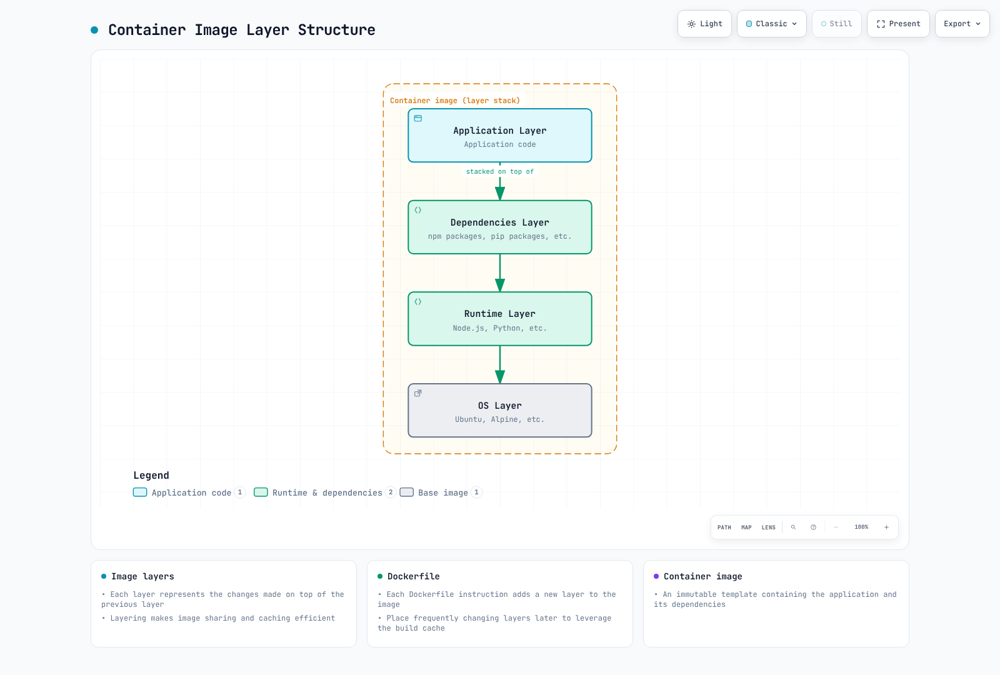

# 容器技术

> **支持的版本**：受维护的 Linux Docker/CRI 版本；Kubernetes CRI v1；Node.js 24 构建示例 **最后更新**：October 16, 2026

容器是一种将应用程序及其依赖项打包在一起的技术，可确保应用程序在各种环境中一致运行。本文档介绍容器的基本概念、工作原理以及容器与 Kubernetes 的关系。

## 目录

* [什么是容器？](03-container-technology.md#what-is-a-container)
* [容器与虚拟机](03-container-technology.md#container-vs-virtual-machine)
* [容器的技术基础](03-container-technology.md#technical-foundation-of-containers)
* [容器运行时](03-container-technology.md#container-runtime)
* [容器镜像](03-container-technology.md#container-images)
* [Dockerfile](03-container-technology.md#dockerfile)
* [容器网络](03-container-technology.md#container-networking)
* [容器存储](03-container-technology.md#container-storage)
* [容器安全](03-container-technology.md#container-security)
* [容器生命周期管理](03-container-technology.md#container-lifecycle-management)
* [容器编排](03-container-technology.md#container-orchestration)
* [AWS 上的容器](03-container-technology.md#containers-on-aws)

> 以下 Linux 命令假设运行在 Linux Docker 主机上。Docker Desktop 在 VM 中运行其守护进程，因此无法直接从桌面操作系统检查主机 PID/文件系统路径。镜像需要兼容的 CPU 架构、操作系统和内核功能。Kata/Fargate 等基于 VM 的环境与此处介绍的基本进程隔离模型有所不同。

## 什么是容器？

容器是一种标准化的软件单元，其中包含运行应用程序所需的一切（代码、运行时、系统工具、系统库、设置）。容器在隔离环境中运行，同时共享主机操作系统的内核。

### 容器的主要特性

1. **可移植性**：在开发、测试和生产环境中提供一致的运行环境
2. **轻量级**：比虚拟机占用更少的资源
3. **隔离性**：与其他容器和主机系统隔离的运行环境
4. **快速启动和停止**：通常启动较快；镜像拉取和应用程序初始化决定其是否就绪
5. **可扩展性**：易于复制以实现水平扩展
6. **版本控制**：通过镜像版本管理应用程序生命周期

### 容器技术的发展历史

* **2000 年代初期**：Linux VServer 和 OpenVZ 等早期容器技术出现
* **2008 年**：Linux 2.6.24 发布了初始版本的 cgroups 实现
* **2008 年**：LXC（Linux Containers）项目启动
* **2013 年**：Docker 发布，推动容器技术普及
* **2015 年**：Open Container Initiative (OCI) 成立，推动容器标准化
* **2017 年**：containerd 捐赠给 CNCF 项目

## 容器与虚拟机

### 虚拟机架构与容器架构

### 主要区别

这是架构对比，而非经过测量的性能/启动基准测试。镜像大小、初始化和 VM 恢复机制都会影响结果。

| 特性      | 容器                        | 虚拟机                                           |
| ------------------- | -------------------------------- | --------------------------------------------------------- |
| 大小                | 应用程序/用户空间层；大小不一             | 客户机操作系统加应用程序；大小不一                                      |
| 启动时间        | 镜像已在本地时通常较快                  | 取决于启动/恢复策略                                                   |
| 隔离级别     | 进程级隔离          | 硬件级隔离                                  |
| 操作系统                  | 共享主机操作系统内核            | 每个 VM 都需要完整的操作系统                                  |
| 性能         | 接近原生                    | 存在一定开销                                             |
| 安全性            | 共享内核；需要进行安全加固 | 以 Hypervisor 为边界；仍需进行安全加固                    |
| 资源效率 | 高                             | 中                                                    |
| 使用场景           | 微服务、CI/CD、开发/测试   | 旧版应用、多种操作系统需求、高安全性需求 |

## 容器的技术基础

容器通过 Linux 内核的多项功能实现。这些技术已在 01-linux-basics.md 中详细介绍；此处重点说明它们与容器的关系。

### 通过命名空间实现隔离

容器使用 Linux 命名空间隔离进程。命名空间可以配置为共享；例如，同一个 Kubernetes Pod 中的容器共享网络命名空间。

```bash
# Check container namespaces
docker inspect <container-id> | grep -A 10 "Pid"
ls -la /proc/<pid>/ns/

# Check processes inside container (isolated PID namespace)
docker exec <container-id> ps aux

# Check same process from host (actual PID)
ps aux | grep <process-name>
```

**容器使用的命名空间**：

* **PID**：容器拥有自己的进程树（从 PID 1 开始）
* **Network**：独立的网络栈（IP 地址、路由表、端口）
* **Mount**：独立的文件系统视图
* **UTS**：独立的主机名
* **IPC**：独立的进程间通信空间
* **User**：独立的用户 ID 映射（可选）

### 通过 cgroups 限制资源

容器使用 cgroups 限制并监控资源使用情况。

```bash
# Run container with CPU limit
docker run --cpus=0.5 --memory=512m nginx

# Check container resource usage
docker stats <container-id>

# Check container cgroup settings
docker inspect <container-id> | grep -A 20 "Cgroup"

# On a Linux cgroup v2 host, inspect a running container's actual path.
CONTAINER_PID=$(docker inspect -f '{{.State.Pid}}' <container-id>)
if [ "$CONTAINER_PID" -gt 0 ]; then
  CGROUP_PATH=$(awk -F: '$1 == "0" {print $3}' "/proc/$CONTAINER_PID/cgroup")
  cat "/sys/fs/cgroup$CGROUP_PATH/cpu.max"
  cat "/sys/fs/cgroup$CGROUP_PATH/memory.max"
fi
```

**容器使用的 cgroup 资源控制**：

* **CPU**：限制 CPU 时间并分配 CPU 核心
* **Memory**：限制内存使用并控制 OOM 行为
* **Block I/O**：限制磁盘 I/O 带宽
* **Network**：通过 tc/eBPF 实现流量分类
* **PIDs**：限制容器内的进程数量

### 通过 OverlayFS 管理层

全新安装的 Docker Engine 29.0+ 默认使用 containerd 镜像存储和 snapshotters。升级可能会保留传统的 overlay2；请检查 docker info。并非所有安装都提供 GraphDriver.Data 路径。

OCI 镜像独立描述文件系统层，不依赖具体的存储实现。OverlayFS 是常见的 Linux 后端；运行时也可能使用其他存储驱动或 snapshotters。

```bash
# Check image layers
docker history <image-name>

# Check container file system layers
docker info --format '{{.Driver}} {{json .DriverStatus}}'
docker image inspect <image-name> --format '{{json .RootFS.Layers}}'

# Check OverlayFS mount information
mount | grep overlay
```

**OverlayFS 结构**：

* **LowerDir**：只读镜像层（下层 → 上层）
* **UpperDir**：容器的读写层
* **WorkDir**：OverlayFS 工作目录
* **MergedDir**：统一视图（容器看到的文件系统）

### 实验：了解容器的技术基础

```bash
# 1. Run a simple container
docker run -d --name test-container nginx

# 2. Get container PID
CONTAINER_PID=$(docker inspect -f '{{.State.Pid}}' test-container)
echo "Container PID: $CONTAINER_PID"

# 3. Check container namespaces
ls -la /proc/$CONTAINER_PID/ns/

# 4. Check container cgroup
cat /proc/$CONTAINER_PID/cgroup

# 5. Check container file system layers
docker inspect test-container | jq '.[0].GraphDriver'

# 6. Cleanup
docker stop test-container
docker rm test-container
```

## 容器运行时

容器运行时是用于管理容器生命周期的软件。它运行容器镜像、限制容器资源使用，并配置网络和存储。

### 容器运行时层级

1. **低级运行时（兼容 OCI）**
   * **runc**：Docker 的默认运行时，OCI 标准实现
   * **crun**：使用 C 编写的轻量级 OCI 运行时
   * **kata-containers**：使用硬件虚拟化来增强安全性的运行时
   * **gVisor**：在用户空间模拟内核功能的安全运行时
2. **高级运行时**
   * **containerd**：从 Docker 中分离出来的行业标准容器运行时
   * **CRI-O**：专为 Kubernetes 设计的轻量级运行时
   * **Docker Engine**：使用最广泛的容器平台

### Kubernetes 容器运行时接口（CRI）

Kubernetes 通过 CRI（容器运行时接口）与各种容器运行时集成。CRI 为 Kubernetes 与容器运行时之间提供标准化接口。

Kubernetes 1.26+ 要求使用 CRI v1。请使用受支持的 containerd/CRI-O 版本，并使其 cgroup 驱动程序与 kubelet 保持一致。Docker Engine 本身并未实现 CRI；内置的 dockershim 已在 1.24 中移除。Docker Engine 需要单独的 CRI 适配器，例如 cri-dockerd。使用 Docker 构建的 OCI 镜像仍可使用。CRI 是 kubelet/运行时 API 契约，并不一定是单独部署的中间服务。

## 容器镜像

容器镜像是不可变模板，其中包含应用程序及其依赖项。镜像由多个层组成，每一层表示文件系统的更改。

### 镜像层

容器镜像由多个层堆叠而成。每一层都表示相对于上一层的更改。这种分层方式使镜像共享和缓存更加高效。



[🔍 查看交互式图表](https://www.atomai.click/kubernetes-docs/archmaps/en-basics-03-container-technology-0.html)

### 镜像仓库

容器镜像存储并共享在镜像仓库中。主要的镜像仓库包括：

* **Docker Hub**：最大的公共镜像仓库
* **Amazon ECR**：AWS 容器镜像仓库服务
* **Google Artifact Registry**：当前的 Google Cloud 镜像仓库；Container Registry 已于 2025 年关闭，但由 Artifact Registry 提供支持的 gcr.io 仓库仍受支持。
* **Azure Container Registry**：Microsoft Azure 镜像仓库
* **GitHub Container Registry**：GitHub 容器镜像仓库
* **Harbor**：开源企业级镜像仓库

### 镜像标签和摘要

* **Tag**：人类可读的可变引用；除非镜像仓库启用了不可变性，否则可以重新分配（例如，`nginx:1.30.6`）
* **Digest**：镜像清单或多平台索引的内容摘要（通常为 SHA256）；它引用配置/层摘要（例如，`nginx@sha256:2834dc507516af02784808c5f48b7cbe38b8ed5d0f4837f16e78d00deb7e7767`）

## Dockerfile

Dockerfile 是一个包含构建容器镜像指令的文本文件。会更改文件系统的指令可以创建层；ENV、CMD 和其他仅包含元数据的指令不会增加文件系统差异。

### Dockerfile 的主要指令

```dockerfile
FROM node:24-alpine
WORKDIR /app
ENV NODE_ENV=production
# Requires a committed package-lock.json matching package.json.
COPY package.json package-lock.json ./
RUN npm ci --omit=dev
COPY --chown=node:node . .
RUN mkdir -p /app/data && chown node:node /app/data
USER node
EXPOSE 3000
VOLUME /app/data
CMD ["node", "server.js"]
```

Node.js 14 已停止维护；这些示例使用受支持的 Node.js 24 版本系列。请检查 Alpine 对原生模块的 musl 兼容性。准备 .dockerignore，以免将主机上的 node_modules 或凭证复制到镜像中。EXPOSE 是元数据，不会发布端口；发布端口需要使用 docker run -p 或编排工具配置。

```text
# .dockerignore
node_modules
.git
.env
.env.*
npm-debug.log
```

### 多阶段构建

多阶段构建使用多个构建阶段来减小最终镜像的大小。

```dockerfile
FROM node:24 AS build
WORKDIR /app
COPY package.json package-lock.json ./
RUN npm ci
COPY . .
RUN npm run build

FROM nginx:1.30.6-alpine
# This example assumes a static build written to dist/.
COPY --from=build /app/dist /usr/share/nginx/html
EXPOSE 80
CMD ["nginx", "-g", "daemon off;"]
```

### 镜像优化技术

1. **选择合适的基础镜像**：使用 Alpine 等轻量级镜像
2. **使用多阶段构建**：排除构建工具和中间文件
3. **优化层内容和缓存**：在同一条 RUN 指令中组合软件包安装/清理操作；单纯减少层数并不能保证镜像更小。
4. **排除不必要的文件**：使用 .dockerignore 文件
5. **利用缓存**：将经常变化的层放在后面

## 容器网络

容器网络支持容器之间以及容器与外部世界之间的通信。

### 网络驱动程序

Docker 提供多种网络驱动程序：

1. **bridge**：默认网络驱动程序，支持同一主机上的容器彼此通信
2. **host**：共享主机网络命名空间；其他容器隔离仍然适用
3. **overlay**：支持跨多台主机的容器通信
4. **macvlan**：为容器分配 MAC 地址，使其表现为物理网络设备
5. **none**：仅保留环回网络

### 端口映射

将容器内部端口映射到主机端口，以便从外部访问。

```bash
# Map host port 8080 to container port 80
docker run -p 8080:80 nginx
```

默认情况下，端口发布会绑定到所有主机地址。用于本地实验时，请使用 `-p 127.0.0.1:8080:80`。

### 容器间通信

1. **同一网络**：同一用户定义 bridge 上的容器可以通过名称相互解析；默认 bridge 不提供自动名称 DNS
2. **Links**：旧式方法，用于在容器之间直接建立链接
3. **外部网络**：通过主机端口进行通信

## 容器存储

Docker 容器的可写层在停止/启动后仍会保留，但删除容器时也会被删除。请将持久数据存储在 volumes 或其他外部存储中。

### 存储类型

1. **临时存储**：容器内部文件系统，删除容器时数据会丢失
2. **Volumes**：由 Docker 管理的主机文件系统区域
3. **Bind mounts**：将特定主机路径挂载到容器中
4. **tmpfs mounts**：基于内存的临时存储；页面可能会被换出到磁盘

### Volume 使用示例

```bash
# Create volume
docker volume create my-vol

# Run container using volume
docker run -v my-vol:/app/data nginx

# Use bind mount
docker run -v /host/path:/container/path nginx

# Read-only mount
docker run -v /host/path:/container/path:ro nginx
```

### 数据共享模式

1. **Volume 共享**：多个容器使用同一个 volume
2. **数据 volume 容器**：创建仅包含数据的容器，然后共享数据
3. **外部存储集成**：使用 AWS EBS、NFS 等外部存储系统

## 容器安全

容器安全必须从多个层面考虑，包括镜像、容器运行时和主机系统。

### 镜像安全

1. **漏洞扫描**：使用 Trivy、Clair 等工具扫描镜像中的漏洞
2. **可信基础镜像**：使用官方或经验证的镜像
3. **最小权限原则**：仅包含必要的软件包和权限
4. **镜像签名**：使用受维护的镜像签名工作流，例如 Cosign。Docker Content Trust 正在逐步停用；Docker 的 Notary v1 服务计划于 2026 年 12 月 8 日关闭。

### 运行时安全

1. **限制权限**：以非 root 用户身份运行容器
2. **限制 capabilities**：仅授予必要的 Linux capabilities
3. **seccomp 配置文件**：限制系统调用
4. **AppArmor/SELinux**：应用强制访问控制
5. **只读文件系统**：尽可能以只读方式挂载文件系统

### 安全最佳实践

1. **定期更新**：定期更新容器镜像和主机系统
2. **网络隔离**：通过适当的网络策略限制容器通信
3. **机密信息管理**：使用平台的机密信息机制或外部机密信息管理器。Docker Swarm secrets 适用于 services，而非独立的 docker run 容器；Compose 文件 secrets 的保障机制有所不同。
4. **资源限制**：限制 CPU、内存和其他资源的使用
5. **监控和日志记录**：监控容器活动并集中管理日志

## 容器生命周期管理

了解完整的容器生命周期对于有效运行容器至关重要。

### 容器状态

容器可能处于以下几种状态：

* **Created**：容器已创建，但尚未启动
* **Running**：容器正在运行
* **Paused**：Linux 进程通过 freezer cgroup 冻结
* **Restarting**：容器正在重启
* **Exited**：容器已终止
* **Removing**：正在移除容器
* **Dead**：容器已被部分移除/处于失效状态；无法重启，需要清理

```bash
# Check container status
docker ps -a

# Detailed status of specific container
docker inspect <container-id> | jq '.[0].State'

# Container state transitions
docker create nginx  # Created state
docker start <container-id>  # Transition to Running state
docker pause <container-id>  # Transition to Paused state
docker unpause <container-id>  # Return to Running state
docker stop <container-id>  # Transition to Exited state
docker rm <container-id>  # Remove container
```

### 创建和运行容器

```bash
# Create container only (don't start)
docker create --name my-nginx nginx

# Start container
docker start my-nginx

# Create and start container (all at once)
docker run --name my-nginx2 -d nginx

# Run in interactive mode
docker run -it ubuntu bash

# Run in background
docker run -d nginx

# Auto-remove when container exits
docker run --rm nginx

# Run with environment variables
docker run -e "DB_HOST=localhost" -e "DB_PORT=5432" myapp

# Run with port mapping
docker run -p 8080:80 nginx

# Run with volume mount
docker run -v /host/path:/container/path nginx
```

### 控制容器

```bash
# List running containers
docker ps

# List all containers (including stopped)
docker ps -a

# Stop with configured signal (default SIGTERM), then SIGKILL after timeout
docker stop <container-id>

# Force kill container (SIGKILL)
docker kill <container-id>

# Restart container
docker restart <container-id>

# Pause container
docker pause <container-id>

# Resume container
docker unpause <container-id>

# Execute command in running container
docker exec -it <container-id> bash
docker exec <container-id> ls -la /app

# Copy files from/to container
docker cp <container-id>:/path/to/file /local/path
docker cp /local/path <container-id>:/path/to/file
```

### 容器日志和监控

```bash
# View container logs
docker logs <container-id>

# Stream real-time logs
docker logs -f <container-id>

# Last N log lines
docker logs --tail 100 <container-id>

# Output logs with timestamps
docker logs -t <container-id>

# Logs since specific time
docker logs --since "2025-11-24T10:00:00" <container-id>

# Check container resource usage
docker stats <container-id>

# All container resource usage
docker stats

# Check container processes
docker top <container-id>

# Container detailed information
docker inspect <container-id>
```

### 清理容器

```bash
# Remove all stopped containers
docker container prune

# Remove stopped containers, unused networks, dangling images and build cache; no volumes
docker system prune

# Additionally prune unused anonymous volumes; running resources are not removed
docker system prune --volumes

# Check disk usage
docker system df

# Remove image
docker rmi <image-id>

# Remove dangling images; -a includes all unused images
docker image prune

# Remove volume
docker volume rm <volume-name>

# Remove unused anonymous volumes; --all includes unused named volumes
docker volume prune

# Remove network
docker network rm <network-name>

# Remove unused networks
docker network prune
```

### 健康检查

HEALTHCHECK 会记录 Docker 健康状态。独立 Docker 的重启策略会根据进程退出做出响应，而不会仅依据健康状态做出响应。Kubernetes 会忽略 Dockerfile 中的 HEALTHCHECK，并使用存活/就绪/启动探针。

```dockerfile
FROM nginx:1.30.6-alpine

# Define health check in Dockerfile
HEALTHCHECK --interval=30s --timeout=3s --start-period=5s --retries=3 \
  CMD wget -q -O /dev/null http://127.0.0.1/ || exit 1
```

```bash
# Define health check at runtime
docker run -d \
  --health-cmd="wget -q -O /dev/null http://127.0.0.1/ || exit 1" \
  --health-interval=30s \
  --health-timeout=3s \
  --health-retries=3 \
  nginx:1.30.6-alpine

# Check health check status
docker inspect <container-id> | jq '.[0].State.Health'
```

### 重启策略

配置容器在退出时自动重启。

```bash
# Restart policy options
# - no: Don't restart (default)
# - on-failure: Restart only on failure
# - always: Restart after exit; manual stop suppresses it until daemon restart or explicit start
# - unless-stopped: Always restart unless explicitly stopped

# Restart on failure (max 3 times)
docker run -d --restart=on-failure:3 nginx

# Always restart
docker run -d --restart=always nginx

# Restart unless explicitly stopped
docker run -d --restart=unless-stopped nginx

# Change restart policy of existing container
docker update --restart=always <container-id>
```

### 调试容器

镜像中必须安装 bash/ip/netstat/ps。对于精简镜像，请使用主机上的 docker inspect/top 或经批准的调试镜像。env/inspect 的输出可能包含机密信息；请勿将其粘贴到共享日志中。

```bash
# Explore container internal file system
docker exec -it <container-id> bash

# Check container environment variables
docker exec <container-id> env

# Check container network information
docker exec <container-id> ip addr
docker exec <container-id> netstat -tuln

# Check container processes
docker exec <container-id> ps aux

# Monitor container events
docker events

# Filter specific container events
docker events --filter container=<container-id>

# Check container changes (compared to image)
docker diff <container-id>
```

## 容器编排

容器编排是管理和协调多个容器的过程。其主要功能包括部署管理、扩展、网络和服务发现。

### 主要编排工具

1. **Kubernetes**：使用最广泛的容器编排平台
2. **Docker Swarm**：Docker 内置的编排工具，配置简单
3. **Amazon ECS**：AWS 容器编排服务
4. **HashiCorp Nomad**：同时支持容器和非容器工作负载

### 编排的主要功能

1. **自动部署和回滚**：通过声明式配置管理应用程序部署
2. **服务发现和负载均衡**：实现容器通信和负载分配
3. **自动扩缩容**：根据负载调整容器数量
4. **自我修复**：自动重启故障容器
5. **配置管理**：管理应用程序配置和机密信息
6. **存储编排**：管理持久存储
7. **批处理执行**：执行一次性任务和 cron 作业

## AWS 上的容器

AWS 提供多种容器工作负载服务。

### Amazon ECS（Elastic Container Service）

AWS 自有的容器编排服务，可在 EC2 实例或 AWS Fargate 上运行容器。

**主要功能**：

* 与 AWS 服务紧密集成
* 无服务器容器执行（Fargate）
* 配置和管理简单
* 自动扩缩容和负载均衡

### Amazon EKS（Elastic Kubernetes Service）

AWS 托管的 Kubernetes 服务，允许使用标准 Kubernetes API 在 AWS 基础设施上运行 Kubernetes。

**主要功能**：

* 托管 Kubernetes 控制平面
* 跨多个可用区实现高可用性
* 与 AWS 服务集成
* 支持 EC2 和 Fargate

### AWS Fargate

无服务器容器执行环境，可在无需管理服务器的情况下运行容器。

**主要功能**：

* 无需管理服务器
* 计费基于请求的任务资源（ECS）或 Pod 资源（EKS），而不是按每个应用程序容器单独收费
* 与 ECS 和 EKS 集成
* 安全隔离

### Amazon ECR（Elastic Container Registry）

AWS 托管的容器镜像仓库服务。

**主要功能**：

* 镜像漏洞扫描
* 与 IAM 集成
* 镜像生命周期管理
* 高可用性和可扩展性

## 术语表

| 术语                  | 描述                                                                                                                   |
| --------------------- | ----------------------------------------------------------------------------------------------------------------------------- |
| **Container**         | 一种标准化软件单元，将应用程序及其依赖项打包在一起，从而确保其能够在任何地方一致运行。      |
| **Image**             | 用于创建容器的只读模板，包含应用程序代码、库、依赖项、工具和其他文件。 |
| **Dockerfile**        | 一个包含构建容器镜像指令的文本文件。                                                           |
| **Registry**          | 用于存储和分发容器镜像的仓库。（例如 Docker Hub、Amazon ECR）                                     |
| **Container Runtime** | 用于运行容器的软件。（例如 Docker、containerd、CRI-O）                                                              |
| **Namespace**         | Linux 内核功能，用于隔离进程，使其无法看到系统的其他部分。                                  |
| **cgroups**           | Linux 内核功能，用于限制和监控进程组的资源使用情况（CPU、内存等）。                         |
| **Layer**             | 容器镜像由多个层组成，用于表示文件系统差异；仅包含元数据的指令不需要文件系统层。                                  |
| **Volume**            | 用于持久存储容器数据的机制。                                                                          |
| **Orchestration**     | 自动化部署、管理、扩展和网络配置多个容器的过程。                         |
| **ECS**               | Amazon Elastic Container Service，AWS 的容器编排服务。                                                      |
| **ECR**               | Amazon Elastic Container Registry，AWS 的容器镜像仓库服务。                                                    |
| **Fargate**           | AWS 的无服务器容器执行环境，无需管理基础设施即可运行容器。                      |

## 总结

容器技术彻底改变了应用程序的开发和部署方式。它提供了可移植性、一致性和效率，有助于提高开发人员的生产力并降低运维复杂性。结合 Kubernetes 等编排工具，可以有效管理大规模分布式应用程序。

了解容器的基本概念和运行方式，对于开发和运营现代云原生应用程序至关重要。这些知识是有效使用 Kubernetes 的基础。

## 测验

通过完成[容器技术测验](../quizzes/basics/03-container-technology-quiz.md)，检验你对本章内容的掌握情况。

## 参考资料

* [Docker 官方文档](https://docs.docker.com/)
* [OCI（Open Container Initiative）](https://opencontainers.org/)
* [containerd 项目](https://containerd.io/)
* [Kubernetes 容器运行时概述](https://kubernetes.io/docs/setup/production-environment/container-runtimes/)
* [AWS 容器服务](https://aws.amazon.com/containers/)

## 验证参考资料

- https://kubernetes.io/docs/setup/production-environment/container-runtimes/
- https://docs.docker.com/reference/cli/docker/container/pause/
- https://docs.docker.com/reference/cli/docker/container/ls/
- https://docs.docker.com/engine/containers/start-containers-automatically/
- https://docs.docker.com/reference/cli/docker/system/prune/
- https://docs.docker.com/reference/cli/docker/volume/prune/
- https://docs.docker.com/reference/dockerfile/
- https://docs.docker.com/engine/network/drivers/bridge/
- https://docs.docker.com/engine/storage/containerd/
- https://docs.docker.com/engine/storage/tmpfs/
- https://docs.docker.com/engine/security/trust/
- https://docs.docker.com/engine/swarm/secrets/
- https://github.com/opencontainers/image-spec/blob/main/config.md
- https://github.com/opencontainers/image-spec/blob/main/manifest.md
- https://github.com/nodejs/Release/blob/main/schedule.json
- https://github.com/docker-library/official-images/blob/master/library/node
- https://github.com/nodejs/docker-node/blob/main/docs/BestPractices.md
- https://github.com/npm/cli/blob/latest/docs/lib/content/commands/npm-ci.md
- https://cloud.google.com/artifact-registry/docs/transition/transition-from-gcr
- https://man7.org/linux/man-pages/man7/cgroups.7.html
- https://github.com/torvalds/linux/releases/tag/v2.6.24
- https://docs.aws.amazon.com/eks/latest/userguide/fargate.html
- https://docs.aws.amazon.com/AmazonECS/latest/developerguide/AWS_Fargate.html
- https://aws.amazon.com/fargate/pricing/
