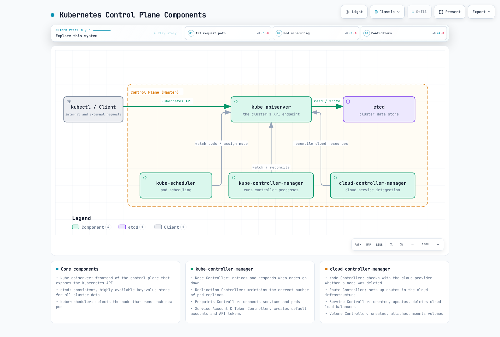
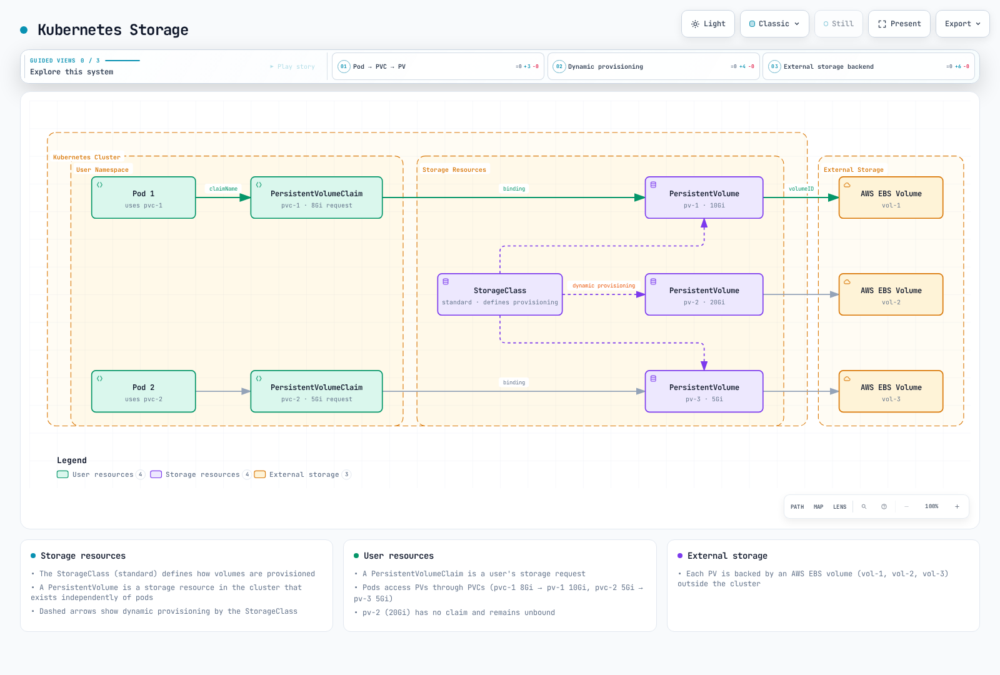

# Kubernetes 入门

> **支持的版本**：上游 Kubernetes 1.35–1.37；EKS 标准支持 1.34–1.37（截至 2026 年 10 月 12 日）
> **最后更新**：2026 年 10 月 16 日

Kubernetes 项目为最近的三个次要版本（1.35–1.37）维护发布分支。上游 1.34 处于维护模式，在生命周期结束前仍会收到补丁版本，结束日期为 **2026 年 10 月 27 日**；该日期与 AWS 的 EKS 支持结束日期不同。请查看 [AWS EKS 生命周期](https://docs.aws.amazon.com/eks/latest/userguide/kubernetes-versions.html)，了解 EKS 覆盖的版本和日期。

Kubernetes（K8s）是一个开源容器编排平台，可自动执行容器化应用的部署、扩展和管理。本文档介绍 Kubernetes 的基本概念、架构、主要组件和功能。

这些独立的学习示例已根据架构和官方文档进行静态审查，但并非经过部署验证的生产配置。请在目标环境中验证自定义镜像、名称/标签、TLS、IAM/RBAC、CNI 和存储前提条件，并替换占位符。

## 实验环境设置

若要跟着本文档中的示例操作，需要准备以下工具和环境：

### 必需工具

* **kubectl**：用于与 Kubernetes 集群交互的命令行工具
* **本地集群驱动程序**：minikube/kind 支持的容器引擎或 VM 驱动程序；Kubernetes 节点使用 CRI v1 运行时。
* **minikube** 或 **kind**：本地 Kubernetes 集群（用于开发和学习）

### 安装方法

**安装 kubectl**：

```bash
# macOS: use a kubectl version within one minor of the API server.
brew install kubectl
```

```bash
# Linux: select an explicit compatible version and architecture.
set -euo pipefail
: "${KUBECTL_VERSION:?Set a cluster-compatible version, e.g. v1.37.1}"
case "$(uname -m)" in
  x86_64) KUBECTL_ARCH=amd64 ;;
  aarch64|arm64) KUBECTL_ARCH=arm64 ;;
  *) echo "Choose a supported kubectl architecture" >&2; exit 1 ;;
esac
curl --fail --location --output kubectl "https://dl.k8s.io/release/$KUBECTL_VERSION/bin/linux/$KUBECTL_ARCH/kubectl"
curl --fail --location --output kubectl.sha256 "https://dl.k8s.io/release/$KUBECTL_VERSION/bin/linux/$KUBECTL_ARCH/kubectl.sha256"
echo "$(cat kubectl.sha256)  kubectl" | sha256sum --check
sudo install -m 0755 kubectl /usr/local/bin/kubectl
```

```powershell
$ErrorActionPreference = "Stop"
$KubectlVersion = Read-Host "Cluster-compatible kubectl version (vX.Y.Z)"
$KubectlArch = Read-Host "Architecture (amd64 or arm64)"
if ($KubectlVersion -notmatch '^v\d+\.\d+\.\d+$' -or $KubectlArch -notin @('amd64','arm64')) { throw "Invalid version/architecture" }
$BaseUrl = "https://dl.k8s.io/release/$KubectlVersion/bin/windows/$KubectlArch"
Invoke-WebRequest "$BaseUrl/kubectl.exe" -OutFile kubectl.exe
Invoke-WebRequest "$BaseUrl/kubectl.exe.sha256" -OutFile kubectl.exe.sha256
if ((Get-FileHash kubectl.exe -Algorithm SHA256).Hash -ne (Get-Content kubectl.exe.sha256).Trim()) { throw "Checksum mismatch" }
# Move the verified binary to a directory included in PATH.
```

**安装 minikube**：

请使用 minikube 官方启动指南，根据操作系统/体系结构选择二进制文件、校验和及驱动程序。在相应的 shell 中运行 Linux 和 Windows 说明，并将已验证的二进制文件添加到 PATH。macOS 的安装方法如下：

```bash
brew install minikube
minikube version
```

### 启动本地集群

```bash
minikube start
```

## 目录

* [什么是 Kubernetes？](04-kubernetes-introduction.md#what-is-kubernetes)
* [Kubernetes 的历史](04-kubernetes-introduction.md#history-of-kubernetes)
* [Kubernetes 架构](04-kubernetes-introduction.md#kubernetes-architecture)
* [Kubernetes 主要组件](04-kubernetes-introduction.md#kubernetes-main-components)
* [Kubernetes 基本对象](04-kubernetes-introduction.md#kubernetes-basic-objects)
* [Kubernetes 工作负载资源](04-kubernetes-introduction.md#kubernetes-workload-resources)
* [Kubernetes Services 和网络](04-kubernetes-introduction.md#kubernetes-services-and-networking)
* [Kubernetes 存储](04-kubernetes-introduction.md#kubernetes-storage)
* [Kubernetes 配置和安全](04-kubernetes-introduction.md#kubernetes-configuration-and-security)
* [Kubernetes 与 Amazon EKS 的比较](04-kubernetes-introduction.md#kubernetes-vs-amazon-eks)
* [Kubernetes 入门](04-kubernetes-introduction.md#getting-started-with-kubernetes)

## 什么是 Kubernetes？

Kubernetes 在希腊语中意为“舵手”或“领航员”，是一个开源系统，可自动执行容器化应用的部署、扩展和运行。它受到 Google 内部 Borg 系统的启发，并于 2014 年以开源形式发布。

### Kubernetes 的主要功能

1. **服务发现和负载均衡**：向外部公开容器并分配流量
2. **存储编排**：自动挂载本地或云存储系统
3. **滚动更新和回滚**：逐步更新应用，并支持由操作人员/工具触发的回滚；Deployment 失败时不会自动回滚。
4. **自动装箱**：根据资源需求将容器放置到节点上
5. **自我修复**：重启失败的容器并替换无响应的容器
6. **Secret 和配置管理**：存储敏感信息并更新配置
7. **水平扩展**：通过简单命令或 UI 扩展应用
8. **批处理执行**：管理批处理和 CI 工作负载

### Kubernetes 解决的问题

* **容器编排**：高效管理数百或数千个容器
* **高可用性**：通过副本、放置策略、探针和容量支持弹性应用设计
* **可扩展性**：根据流量增长自动扩展
* **恢复**：协调并恢复失败的工作负载；灾难恢复还需要经过测试的备份和恢复计划
* **资源效率**：高效利用硬件资源
* **声明式配置**：将基础设施作为代码进行管理
* **多云和混合云**：在各种环境中保持一致的部署和管理

## Kubernetes 的历史

### 背景

* **2003–2013 年**：Google 在内部使用名为 Borg 的容器编排系统
* **2014 年 6 月**：Google 将 Kubernetes 作为开源项目发布
* **2015 年 7 月**：Kubernetes 1.0 发布，并捐赠给云原生计算基金会（CNCF）
* **2016–2017 年**：主要云服务提供商推出托管 Kubernetes 服务
* **2018 年及以后**：成为容器编排领域事实上的标准

### 名称的由来

Kubernetes（κυβερνήτης）在希腊语中意为“舵手”或“领航员”。这象征着它在引导容器化应用方面发挥的作用。缩写 K8s 的由来是字母“K”和“s”之间有 8 个字符。

### Logo 的含义

Kubernetes Logo 描绘了一个带有 7 根辐条的舵轮，象征着 Kubernetes 在引导容器化应用前进方向方面的作用。

## Kubernetes 架构

Kubernetes 采用主节点架构。主节点（控制平面）管理集群，工作节点运行实际的应用工作负载。

### 控制平面（Master）组件



[🔍 查看交互式图表](https://www.atomai.click/kubernetes-docs/archmaps/en-basics-04-kubernetes-introduction-0.html)

1. **kube-apiserver**：控制平面的前端，用于公开 Kubernetes API
2. **etcd**：用于存储 Kubernetes API 对象和集群状态（不包括应用卷内容）的一致且高度可用的键值存储
3. **kube-scheduler**：将 Pod 分配给节点的组件
4. **kube-controller-manager**：运行控制器进程的组件
   * Node Controller：在节点宕机时发出通知并作出响应
   * Replication Controller：维持正确的 Pod 副本数量
   * EndpointSlice Controller：维护 Service 端点记录（旧版 Endpoints 已弃用）
   * ServiceAccount 控制器会创建默认账户；投射的 Pod 令牌使用 TokenRequest，并由 kubelet 轮换
5. **cloud-controller-manager**：包含云服务专属控制逻辑的组件
   * Node Controller：向云服务提供商确认节点是否已被删除
   * Route Controller：在云基础设施中设置路由
   * Service Controller：创建、更新和删除云服务提供商的负载均衡器

### 节点组件


[🔍 查看交互式图表](https://www.atomai.click/kubernetes-docs/archmaps/en-basics-04-kubernetes-introduction-1.html)

1. **kubelet**：在每个节点上运行的代理，确保 Pod 中的容器正常运行
2. **kube-proxy**：在每个节点上运行的网络代理，用于实现 Kubernetes Service 概念
3. **容器运行时**：实现 CRI v1 的软件，例如 containerd 或 CRI-O；Docker Engine 需要单独的 CRI 适配器

### 完整架构


[🔍 查看交互式图表](https://www.atomai.click/kubernetes-docs/archmaps/en-basics-04-kubernetes-introduction-2.html)

## Kubernetes 主要组件

### API 服务器（kube-apiserver）

API 服务器是控制平面的前端，用于公开 Kubernetes API。Kubernetes API 请求会经过该服务器；应用流量和存储 I/O 不会经过 API 服务器。

**主要功能**：

* 提供 REST API
* 身份验证和授权
* 请求验证
* 与 etcd 通信
* 支持水平扩展

### etcd

etcd 是一个一致且高度可用的键值存储，用于保存 Kubernetes API 对象和集群状态（不包括应用卷内容）。

**主要特性**：

* 分布式系统
* 强一致性
* 高可用性
* 安全的数据存储
* 用于监控变更的 Watch 功能

### Scheduler（kube-scheduler）

Scheduler 是一个控制平面组件，用于选择运行新创建 Pod 的节点。

**调度流程**：

1. **筛选**：找出能够运行 Pod 的节点
2. **评分**：为符合条件的节点评分
3. **绑定**：将 Pod 分配给最佳节点

**考虑因素**：

* 资源需求（CPU、内存）
* 硬件/软件/策略限制
* 亲和性/反亲和性规范
* 数据局部性
* 工作负载干扰

### Controller Manager（kube-controller-manager）

Controller Manager 是一个控制平面组件，用于运行多个控制器进程。

**主要控制器**：

* **Node Controller**：监控节点状态并作出响应
* **Replication Controller**：维持 Pod 副本数量
* **EndpointSlice Controller**：维护 Service 端点记录（旧版 Endpoints 已弃用）
* **ServiceAccount 控制器**：创建默认账户；现代 Pod 令牌通过 TokenRequest 请求，并由 kubelet 轮换
* **Job Controller**：管理一次性任务
* **CronJob Controller**：管理定时任务
* **DaemonSet Controller**：在每个符合条件的节点上协调一个 Pod
* **StatefulSet Controller**：管理有状态应用
* **PV Controller**：管理持久卷

### Cloud Controller Manager（cloud-controller-manager）

Cloud Controller Manager 包含云服务专属控制逻辑。CSI 控制器 sidecar/驱动程序和 kubelet/节点插件负责存储配置、挂载和装载；这不是 CCM 卷控制器。

**主要控制器**：

* **Node Controller**：通过云服务提供商 API 检查节点状态
* **Route Controller**：在云环境中设置路由
* **Service Controller**：创建、更新和删除云负载均衡器

### kubelet

kubelet 是在每个节点上运行的代理，确保 Pod 中的容器正常运行。

**主要功能**：

* 根据 PodSpec 运行容器
* 报告容器状态
* 执行容器运行状况检查
* 管理容器生命周期
* 报告节点状态

### kube-proxy

kube-proxy 是在每个节点上运行的网络代理，用于实现 Kubernetes Service 概念。

**主要功能**：

* 维护 Service IP 和端口的网络规则
* 转发连接
* 实现负载均衡

**运行模式**：

* **nftables 模式**：自 1.33 起稳定；请验证内核和网络插件的兼容性
* **iptables 模式**：使用 Linux iptables 的 NAT 实现（默认）
* **IPVS 模式**：自 1.35 起弃用；请规划迁移。历史上的 userspace 模式已移除。

## Kubernetes 基本对象

Kubernetes 对象是表示集群状态的持久化实体。这些对象描述集群中运行的应用、可用资源、策略等。

### Pod

Pod 是 Kubernetes 中最小的可部署单元，表示一个或多个容器组成的组。Pod 中的容器共享网络，并且可以共享显式挂载的卷；它们运行在同一节点上。它们不会自动共享根文件系统。

**主要特性**：

* 具有唯一 IP 地址
* 共享网络命名空间（相同的 IP 和端口空间）
* 共享 IPC 命名空间
* 共享主机名
* 容器之间可以通过 localhost 通信

**Pod 示例**：

```yaml
apiVersion: v1
kind: Pod
metadata:
  name: nginx-pod
  labels:
    app: nginx
spec:
  containers:
  - name: nginx
    image: nginx:1.30.6
    ports:
    - containerPort: 80
    volumeMounts:
    - name: logs
      mountPath: /var/log/nginx
  - name: log-sidecar
    image: busybox:1.38.0
    command:
    - /bin/sh
    - -c
    - until [ -f /var/log/nginx/access.log ]; do sleep 1; done; tail -F /var/log/nginx/access.log
    volumeMounts:
    - name: logs
      mountPath: /var/log/nginx
      readOnly: true
  volumes:
  - name: logs
    emptyDir: {}
```

### Namespace

Namespace 提供了一种在单个集群中隔离资源组的方法。这有助于组织团队/项目；仅靠 Namespace 并不能强制实施网络或授权隔离。

**默认 Namespace**：

* **default**：默认 Namespace
* **kube-system**：用于存放 Kubernetes 系统创建的对象
* **kube-public**：通常用于存放公开信息的 Namespace；实际对象访问权限仍取决于 RBAC
* **kube-node-lease**：用于存放节点心跳信息的 Namespace

**Namespace 示例**：

```yaml
apiVersion: v1
kind: Namespace
metadata:
  name: development
```

### 标签和选择器

标签是附加到对象上的键值对，用于识别和选择对象。选择器可根据标签筛选对象。

**标签示例**：

```yaml
metadata:
  labels:
    app: nginx
    environment: production
    tier: frontend
```

**选择器类型**：

* **基于相等性**：`=`、`!=`
* **基于集合**：`in`、`notin`、`exists`

**选择器示例**：

```yaml
selector:
  matchLabels:
    app: nginx
  matchExpressions:
    - {key: tier, operator: In, values: [frontend, middleware]}
    - {key: environment, operator: NotIn, values: [dev]}
```

### 注解

注解是键值对，用于存储对象的非标识性元数据。注解适合存储工具或库使用的信息。

**注解示例**：

```yaml
metadata:
  annotations:
    example.com/created-by: "admin"
    example.com/last-modified: "2023-07-01T12:00:00Z"
    prometheus.io/scrape: "true"
    prometheus.io/port: "9090"
```

### Node

Node 是 Kubernetes 集群中的工作机器，用于运行 Pod。Node 可以是物理机，也可以是虚拟机。

**Node 状态**：

* **地址**：主机名、内部 IP、外部 IP
* **条件**：Ready、DiskPressure、MemoryPressure、PIDPressure、NetworkUnavailable
* **容量**：CPU、内存、最大 Pod 数
* **信息**：内核版本、容器运行时版本、kubelet 版本

**Node 状态示例（由节点/控制器报告，而非节点配置清单）**：

```yaml
apiVersion: v1
kind: Node
metadata:
  name: worker-1
  labels:
    kubernetes.io/hostname: worker-1
    node-role.kubernetes.io/worker: ""
    topology.kubernetes.io/zone: us-east-1a
status:
  capacity:
    cpu: "4"
    memory: 8Gi
    pods: "110"
  conditions:
    - type: Ready
      status: "True"
  # ...
```

## Kubernetes 工作负载资源

工作负载资源是用于管理和运行 Pod 的对象。这些资源负责管理 Pod 的创建、扩展、更新和终止。

### ReplicaSet

ReplicaSet 会协调 Pod 对象达到所需数量；就绪状态还取决于容量、有效配置和应用本身。如果 Pod 失败或被删除，ReplicaSet 会自动创建替代 Pod。

**主要功能**：

* 维持指定数量的 Pod 副本
* 定义 Pod 模板
* 通过选择器识别 Pod

**ReplicaSet 示例**：

```yaml
apiVersion: apps/v1
kind: ReplicaSet
metadata:
  name: nginx-replicaset
  labels:
    app: nginx
spec:
  replicas: 3
  selector:
    matchLabels:
      app: nginx
  template:
    metadata:
      labels:
        app: nginx
    spec:
      containers:
      - name: nginx
        image: nginx:1.30.6
        ports:
        - containerPort: 80
```

### Deployment

Deployment 在 ReplicaSet 的基础上进一步抽象，为应用提供声明式更新。Deployment 提供滚动更新、回滚和扩展等功能。

**主要功能**：

* 声明式应用更新
* 滚动更新和回滚
* Deployment 历史记录管理
* 扩展

**Deployment 示例**：

```yaml
apiVersion: apps/v1
kind: Deployment
metadata:
  name: nginx-deployment
  labels:
    app: nginx
spec:
  replicas: 3
  selector:
    matchLabels:
      app: nginx
  strategy:
    type: RollingUpdate
    rollingUpdate:
      maxSurge: 1
      maxUnavailable: 0
  template:
    metadata:
      labels:
        app: nginx
    spec:
      containers:
      - name: nginx
        image: nginx:1.30.6
        ports:
        - containerPort: 80
        resources:
          requests:
            cpu: 100m
            memory: 128Mi
          limits:
            cpu: 200m
            memory: 256Mi
        livenessProbe:
          httpGet:
            path: /
            port: 80
          initialDelaySeconds: 30
          periodSeconds: 10
        readinessProbe:
          httpGet:
            path: /
            port: 80
          initialDelaySeconds: 5
          periodSeconds: 5
```

MySQL 示例是单个持久实例。StatefulSet 不会配置数据库复制、故障转移或备份。首先提供 mysql-secret/password 并替换 StorageClass 占位符。仅增加副本数会创建彼此独立的数据库；实现高可用需要经过测试的数据库 operator/复制配置。

### StatefulSet

StatefulSet 是用于需要保持状态的应用的工作负载资源。它为每个 Pod 分配唯一标识符，并提供稳定的网络标识和持久存储。

**主要功能**：

* 稳定且唯一的网络标识符
* 稳定且持久的存储
* 按顺序部署和扩展
* 按顺序更新

**StatefulSet 示例**：

```yaml
apiVersion: v1
kind: Service
metadata:
  name: mysql
spec:
  clusterIP: None
  selector:
    app: mysql
  ports:
  - name: mysql
    port: 3306
    targetPort: 3306
---
apiVersion: apps/v1
kind: StatefulSet
metadata:
  name: mysql
spec:
  selector:
    matchLabels:
      app: mysql
  serviceName: mysql
  replicas: 1
  template:
    metadata:
      labels:
        app: mysql
        role: db
    spec:
      containers:
      - name: mysql
        image: mysql:8.4
        env:
        - name: MYSQL_ROOT_PASSWORD
          valueFrom:
            secretKeyRef:
              name: mysql-secret
              key: password
        ports:
        - containerPort: 3306
          name: mysql
        volumeMounts:
        - name: data
          mountPath: /var/lib/mysql
        readinessProbe:
          tcpSocket:
            port: 3306
          initialDelaySeconds: 10
          periodSeconds: 5
  volumeClaimTemplates:
  - metadata:
      name: data
    spec:
      accessModes:
      - ReadWriteOnce
      storageClassName: replace-with-storage-class
      resources:
        requests:
          storage: 10Gi
```

Linux Fluent Bit 示例将 CRI 日志发送到 stdout 以供演示。它会排除自身日志以避免反馈循环，并将其位置 DB 单独持久化。不要与另一个会将相同日志重新发布到 stdout 的采集器同时部署。生产环境需要外部目标，并且必须审查主机路径、权限和 PSS 例外。

### DaemonSet

DaemonSet 会在每个符合条件的节点上创建一个 Pod；节点选择器、污点、容量和准入策略仍然适用。向集群添加节点时会自动添加 Pod；移除节点时，也会移除相应 Pod。

**主要使用场景**：

* 日志采集器（Fluentd、Logstash）
* 监控代理（Prometheus Node Exporter）
* 网络插件（Calico、Cilium）
* 存储守护进程（Ceph）

**DaemonSet 示例**：

```yaml
apiVersion: v1
kind: ConfigMap
metadata:
  name: intro-log-agent-config
  namespace: kube-system
data:
  fluent-bit.conf: |
    [SERVICE]
        Flush 5
        Parsers_File /fluent-bit/etc/parsers.conf
    [INPUT]
        Name tail
        Path /var/log/containers/*.log
        Exclude_Path /var/log/containers/intro-log-agent-*_kube-system_fluent-bit-*.log
        Parser cri
        Tag kube.*
        DB /var/lib/fluent-bit/tail.db
        Mem_Buf_Limit 5MB
        Skip_Long_Lines On
    [OUTPUT]
        Name stdout
        Match *
---
apiVersion: apps/v1
kind: DaemonSet
metadata:
  name: intro-log-agent
  namespace: kube-system
spec:
  selector:
    matchLabels:
      app: intro-log-agent
  template:
    metadata:
      labels:
        app: intro-log-agent
    spec:
      automountServiceAccountToken: false
      tolerations:
      - key: node-role.kubernetes.io/control-plane
        operator: Exists
        effect: NoSchedule
      containers:
      - name: fluent-bit
        image: cr.fluentbit.io/fluent/fluent-bit:5.1.3
        securityContext:
          runAsUser: 0
          allowPrivilegeEscalation: false
          readOnlyRootFilesystem: true
          capabilities:
            drop: [ALL]
        args:
        - -c
        - /fluent-bit/custom/fluent-bit.conf
        resources:
          requests:
            cpu: 100m
            memory: 100Mi
          limits:
            memory: 200Mi
        volumeMounts:
        - name: varlog
          mountPath: /var/log
          readOnly: true
        - name: config
          mountPath: /fluent-bit/custom
          readOnly: true
        - name: state
          mountPath: /var/lib/fluent-bit
      volumes:
      - name: varlog
        hostPath:
          path: /var/log
          type: Directory
      - name: config
        configMap:
          name: intro-log-agent-config
      - name: state
        hostPath:
          path: /var/lib/intro-log-agent
          type: DirectoryOrCreate
      nodeSelector:
        kubernetes.io/os: linux
```

### Job

Job 会创建一个或多个 Pod，并持续运行，直到指定数量的 Pod 成功终止。适用于批处理任务。

**主要功能**：

* 执行一次性任务
* 并行执行任务
* 跟踪成功完成的任务；失败/期限限制仍可能导致 Job 失败
* 失败时重试

**Job 示例**：

```yaml
apiVersion: batch/v1
kind: Job
metadata:
  name: pi-calculator
spec:
  completions: 5
  parallelism: 2
  backoffLimit: 3
  template:
    spec:
      containers:
      - name: pi
        image: perl
        command: ["perl", "-Mbignum=bpi", "-wle", "print bpi(2000)"]
      restartPolicy: Never
```

Job 可能因重试/期限限制而失败，也可能再次执行相同工作，因此任务应具备幂等性。CronJob 调度并非严格的恰好一次；Forbid 只会控制该 CronJob 所创建的 Job 是否重叠运行。

### CronJob

CronJob 按指定计划定期运行 Job。其工作方式类似 Linux cron 作业。

**主要功能**：

* 按计划执行任务
* 支持 Cron 表达式
* 并发策略设置
* 历史记录限制

**CronJob 示例**：

```yaml
apiVersion: batch/v1
kind: CronJob
metadata:
  name: database-backup
spec:
  timeZone: Etc/UTC
  schedule: "0 2 * * *"  # Run at 02:00 daily
  concurrencyPolicy: Forbid
  successfulJobsHistoryLimit: 3
  failedJobsHistoryLimit: 1
  jobTemplate:
    spec:
      template:
        spec:
          containers:
          - name: backup
            image: database-backup:v1
            env:
            - name: DB_HOST
              value: "db.example.com"
          restartPolicy: OnFailure
```

## Kubernetes Services 和网络

Kubernetes 网络模型基于以下前提：Pod 网络由兼容的 CNI 提供；可路由性取决于 NetworkPolicy、防火墙和网络拓扑。Service 为一组 Pod 提供稳定端点。

### Service

Service 为一组 Pod 提供单一端点和负载均衡。由于 Pod 会动态创建和删除，Service 可在这些变化期间提供稳定的网络地址。

**Service 类型**：

* **ClusterIP**：只能在集群内部访问的 Service（默认）
* **NodePort**：可通过每个节点的 IP 和指定端口从外部访问
* **LoadBalancer**：通过云服务提供商的负载均衡器从外部访问
* **ExternalName**：为外部 Service 创建 CNAME 记录


[🔍 查看交互式图表](https://www.atomai.click/kubernetes-docs/archmaps/en-basics-04-kubernetes-introduction-3.html)

**Service 示例**：

```yaml
apiVersion: v1
kind: Service
metadata:
  name: nginx-service
spec:
  selector:
    app: nginx
  ports:
  - port: 80
    targetPort: 80
  type: ClusterIP
```

**NodePort Service 示例**：

```yaml
apiVersion: v1
kind: Service
metadata:
  name: nginx-nodeport
spec:
  selector:
    app: nginx
  ports:
  - port: 80
    targetPort: 80
    nodePort: 30080
  type: NodePort
```

此 AWS 示例需要 AWS Load Balancer Controller 及其 IAM/网络前提条件。EKS Auto Mode 使用不同的 loadBalancerClass；本地集群需要自己的 LoadBalancer 实现。

**LoadBalancer Service 示例**：

```yaml
apiVersion: v1
kind: Service
metadata:
  name: nginx-lb
  annotations:
    service.beta.kubernetes.io/aws-load-balancer-scheme: internet-facing
    service.beta.kubernetes.io/aws-load-balancer-nlb-target-type: ip
spec:
  selector:
    app: nginx
  ports:
  - port: 80
    targetPort: 80
  type: LoadBalancer
  loadBalancerClass: service.k8s.aws/nlb
```

此示例需要已安装的 Traefik、其 traefik IngressClass、app1/app2 Services 以及 TLS Secret。路径 /app1 和 /app2 会保留，并且必须由后端提供服务。Ingress 资源本身不会安装控制器。

### Ingress

Ingress 是一种 API 对象，用于管理从集群外部到内部服务的 HTTP 和 HTTPS 路由。Ingress 提供负载均衡、SSL 终止、基于名称的虚拟主机等功能。

**Ingress 控制器**：

* **ingress-nginx（2026 年 3 月退役）**：历史上的社区控制器；新安装请选择仍在维护的控制器。F5 NGINX Ingress Controller 是另一个独立项目。
* **AWS Load Balancer Controller**：基于 AWS Application Load Balancer 的 Ingress 控制器
* **Traefik**：云原生边缘路由器
* **Istio Ingress**：基于服务网格的 Ingress

**Ingress 示例**：

```yaml
apiVersion: networking.k8s.io/v1
kind: Ingress
metadata:
  name: example-ingress
spec:
  ingressClassName: traefik
  rules:
  - host: example.com
    http:
      paths:
      - path: /app1
        pathType: Prefix
        backend:
          service:
            name: app1-service
            port:
              number: 80
      - path: /app2
        pathType: Prefix
        backend:
          service:
            name: app2-service
            port:
              number: 80
  tls:
  - hosts:
    - example.com
    secretName: example-tls
```

### NetworkPolicy

NetworkPolicy 提供了一种控制 Pod 之间通信的方式。默认情况下，所有 Pod 都可以互相通信，但可以使用网络策略限制通信。&#x20;


[🔍 查看交互式图表](https://www.atomai.click/kubernetes-docs/archmaps/en-basics-04-kubernetes-introduction-4.html)

**主要功能**：

* 控制 Pod 之间的通信
* 控制 Namespace 之间的通信
* 控制 Ingress（入站）和 Egress（出站）流量
* 基于端口和协议进行筛选

**NetworkPolicy 示例**：

```yaml
apiVersion: networking.k8s.io/v1
kind: NetworkPolicy
metadata:
  name: db-network-policy
  namespace: default
spec:
  podSelector:
    matchLabels:
      role: db
  policyTypes:
  - Ingress
  - Egress
  ingress:
  - from:
    - podSelector:
        matchLabels:
          role: api
    ports:
    - protocol: TCP
      port: 3306
  - from:
    - namespaceSelector:
        matchLabels:
          kubernetes.io/metadata.name: monitoring
      podSelector:
        matchLabels:
          app: prometheus
    ports:
    - protocol: TCP
      port: 9104
  egress:
  - to:
    - namespaceSelector:
        matchLabels:
          kubernetes.io/metadata.name: kube-system
      podSelector:
        matchLabels:
          k8s-app: kube-dns
    ports:
    - protocol: UDP
      port: 53
    - protocol: TCP
      port: 53
```

NetworkPolicy 的允许规则具有累加性。该策略允许 role=api 访问 DB 的 3306 端口，并允许 monitoring 中的 app=prometheus 访问单独安装的 DB exporter 的 9104 端口。它不会让 DB 连接到 Prometheus 的 9090 端口。请根据实际集群 DNS/NodeLocal DNS 配置调整 DNS 出站选择器。

### DNS

Kubernetes 发行版通常会部署 CoreDNS 以实现服务发现。编辑其 ConfigMap 时，请保留发行版管理的设置。下面的 pods insecure 模式会提供传统的基于 IP 的记录，但不会验证 Pod 是否存在；如果不需要这些记录，请使用 disabled；也可以使用 verified，但会产生额外的 watch 和内存开销。

**DNS 名称格式**：

* **Service**：`<service-name>.<namespace>.svc.cluster.local`
* **Pod**：`<pod-ip-with-dashes>.<namespace>.pod.cluster.local`（IPv4 记录；取决于 CoreDNS 的 pods 模式）

**DNS 配置示例**：

```yaml
apiVersion: v1
kind: ConfigMap
metadata:
  name: coredns
  namespace: kube-system
data:
  Corefile: |
    .:53 {
        errors
        health
        ready
        kubernetes cluster.local in-addr.arpa ip6.arpa {
          pods insecure
          fallthrough in-addr.arpa ip6.arpa
        }
        prometheus :9153
        forward . /etc/resolv.conf
        cache 30
        loop
        reload
        loadbalance
    }
```

### 服务网格

服务网格是一种管理微服务之间通信的基础设施层。服务网格提供流量管理、安全性和可观测性。

**主要服务网格**：

* **Istio**：使用最广泛的服务网格
* **Linkerd**：轻量级服务网格
* **AWS App Mesh**：支持已于 2026-09-30 结束；AWS 表示其控制台和资源已无法访问。

**Istio VirtualService 示例**：

```yaml
apiVersion: networking.istio.io/v1
kind: VirtualService
metadata:
  name: reviews-route
spec:
  hosts:
  - reviews
  http:
  - match:
    - headers:
        end-user:
          exact: jason
    route:
    - destination:
        host: reviews
        subset: v2
  - route:
    - destination:
        host: reviews
        subset: v1
---
apiVersion: networking.istio.io/v1
kind: DestinationRule
metadata:
  name: reviews-subsets
spec:
  host: reviews
  subsets:
  - name: v1
    labels:
      version: v1
  - name: v2
    labels:
      version: v2
```

## Kubernetes 存储

Kubernetes 为容器化应用提供各种存储选项。即使 Pod 重启或重新调度，也可以通过这些选项持久化数据。



[🔍 查看交互式图表](https://www.atomai.click/kubernetes-docs/archmaps/en-basics-04-kubernetes-introduction-5.html)

### Volume

Volume 是可挂载到 Pod 中容器的目录，可在 Pod 生命周期内持久保存数据。Volume 还用于在 Pod 中的容器之间共享数据。

**主要 Volume 类型**：

* **emptyDir**：初始为空目录，Pod 删除时也会删除
* **hostPath**：将主机节点的文件系统挂载到 Pod
* **configMap**：将 ConfigMap 挂载为 Volume
* **secret**：将 Secret 挂载为 Volume
* **persistentVolumeClaim**：将持久卷挂载到 Pod

**emptyDir Volume 示例**：

```yaml
apiVersion: v1
kind: Pod
metadata:
  name: test-pd
spec:
  containers:
  - name: test-container
    image: nginx:1.30.6
    volumeMounts:
    - mountPath: /cache
      name: cache-volume
  volumes:
  - name: cache-volume
    emptyDir: {}
```

### PersistentVolume（PV）

PersistentVolume 是一种 API 对象，表示集群中的存储资源。它独立于 Pod 存在，由管理员静态配置，或由存储配置程序动态配置。

**访问模式**：

* **ReadWriteOnce（RWO）**：可由单个节点以读写方式挂载
* **ReadOnlyMany（ROX）**：可由多个节点以只读方式挂载
* **ReadWriteMany（RWX）**：可由多个节点以读写方式挂载
* **ReadWriteOncePod（RWOP）**：支持此模式的 CSI 卷可供单个 Pod 访问；仅使用 RWO 时，同一节点上的多个 Pod 仍可访问卷

必须已安装 EBS CSI 驱动程序并配置 IAM 权限。请使用现有卷 ID 及其实际可用区；切勿重新使用仍在其他位置使用的卷。这些存储示例特定于 AWS；本地集群需要自己的配置程序。

**PersistentVolume 示例**：

```yaml
apiVersion: v1
kind: PersistentVolume
metadata:
  name: pv-example
spec:
  capacity:
    storage: 10Gi
  accessModes:
  - ReadWriteOnce
  persistentVolumeReclaimPolicy: Retain
  storageClassName: ebs-gp3
  csi:
    driver: ebs.csi.aws.com
    volumeHandle: vol-0123456789abcdef0
    fsType: ext4
  nodeAffinity:
    required:
      nodeSelectorTerms:
      - matchExpressions:
        - key: topology.kubernetes.io/zone
          operator: In
          values:
          - replace-with-volume-az
```

### PersistentVolumeClaim（PVC）

PersistentVolumeClaim 是一种 API 对象，表示用户的存储请求。Pod 通过 PVC 访问 PV。

**PersistentVolumeClaim 示例**：

```yaml
apiVersion: v1
kind: PersistentVolumeClaim
metadata:
  name: pvc-example
spec:
  accessModes:
  - ReadWriteOnce
  resources:
    requests:
      storage: 5Gi
  storageClassName: ebs-gp3
```

**使用 PVC 的 Pod 示例**：

```yaml
apiVersion: v1
kind: Pod
metadata:
  name: mypod
spec:
  containers:
    - name: myfrontend
      image: nginx:1.30.6
      volumeMounts:
      - mountPath: "/var/www/html"
        name: mypd
  volumes:
    - name: mypd
      persistentVolumeClaim:
        claimName: pvc-example
```

### StorageClass

StorageClass 描述管理员提供的存储“类别”。管理员可以提供不同服务质量级别、备份策略或任意策略。

**StorageClass 示例**：

```yaml
apiVersion: storage.k8s.io/v1
kind: StorageClass
metadata:
  name: ebs-gp3
provisioner: ebs.csi.aws.com
parameters:
  type: gp3
  csi.storage.k8s.io/fstype: ext4
  encrypted: 'true'
reclaimPolicy: Delete
allowVolumeExpansion: true
volumeBindingMode: WaitForFirstConsumer
```

### 动态配置

动态配置是一项功能，可在通过 StorageClass 请求 PVC 时自动创建 PV。

**动态配置示例**：

```yaml
apiVersion: v1
kind: PersistentVolumeClaim
metadata:
  name: dynamic-pvc
spec:
  accessModes:
  - ReadWriteOnce
  resources:
    requests:
      storage: 10Gi
  storageClassName: ebs-gp3
```

### CSI（Container Storage Interface）

CSI 在 Kubernetes 和存储系统之间提供标准接口。存储提供商可以借此开发自己的存储驱动程序，而无需修改 Kubernetes 代码。

**主要 CSI 驱动程序**：

* **AWS EBS CSI Driver**：Amazon EBS 卷管理
* **AWS EFS CSI Driver**：Amazon EFS 文件系统管理
* **AWS FSx for Lustre CSI Driver**：FSx for Lustre 文件系统管理
* **GCE PD CSI Driver**：Google Compute Engine 持久磁盘管理
* **Azure Disk CSI Driver**：Azure 磁盘管理

**使用已安装 CSI 驱动程序的 StorageClass**：

```yaml
apiVersion: storage.k8s.io/v1
kind: StorageClass
metadata:
  name: ebs-sc
provisioner: ebs.csi.aws.com
parameters:
  type: gp3
  encrypted: 'true'
  csi.storage.k8s.io/fstype: ext4
volumeBindingMode: WaitForFirstConsumer
```

## Kubernetes 配置和安全

Kubernetes 提供各种对象和机制，用于管理应用配置和安全。

### ConfigMap

ConfigMap 是一种 API 对象，以键值对的形式存储配置数据。Pod 可以将 ConfigMap 数据用作环境变量、命令行参数或配置文件。

**ConfigMap 示例**：

```yaml
apiVersion: v1
kind: ConfigMap
metadata:
  name: app-config
data:
  app.properties: |
    app.name=MyApp
    app.version=1.0.0
    app.environment=production
  log-level: INFO
  max-connections: "100"
```

环境变量不会自动刷新；更改后请重新创建 Pod。Volume 更新需要等待一段时间才会生效，并且需要应用重新加载；subPath 挂载不会接收更新。

**使用 ConfigMap 的 Pod 示例**：

```yaml
apiVersion: v1
kind: Pod
metadata:
  name: config-pod
spec:
  containers:
  - name: app
    image: myapp:1.0
    env:
    - name: LOG_LEVEL
      valueFrom:
        configMapKeyRef:
          name: app-config
          key: log-level
    volumeMounts:
    - name: config-volume
      mountPath: /etc/config
  volumes:
  - name: config-volume
    configMap:
      name: app-config
```

### Secret

Secret 是一种 API 对象，用于存储密码、令牌和密钥等敏感信息。它与 ConfigMap 类似，但专为敏感数据设计。

**Secret 类型**：

* **Opaque**：任意用户定义的数据（默认）
* **kubernetes.io/service-account-token**：手动请求的长期有效旧版令牌 Secret；建议使用 TokenRequest/投射令牌
* **kubernetes.io/dockercfg**：序列化的 \~/.dockercfg 文件
* **kubernetes.io/dockerconfigjson**：序列化的 \~/.docker/config.json 文件
* **kubernetes.io/basic-auth**：基本身份验证凭据
* **kubernetes.io/ssh-auth**：SSH 身份验证凭据
* **kubernetes.io/tls**：TLS 客户端或服务器数据

data 字段使用 Base64 编码，而不是加密。请使用 RBAC 保护 Secret，并根据集群情况配置静态加密；对于 1.28 及更高版本，EKS 默认会加密所有 Kubernetes API 数据。以下值仅用于演示，必须替换。

**Secret 示例**：

```yaml
apiVersion: v1
kind: Secret
metadata:
  name: db-credentials
type: Opaque
data:
  username: YWRtaW4=  # base64 encoded "admin"
  password: cGFzc3dvcmQxMjM=  # base64 encoded "password123"
```

**使用 Secret 的 Pod 示例**：

```yaml
apiVersion: v1
kind: Pod
metadata:
  name: secret-pod
spec:
  containers:
  - name: db-client
    image: db-client:1.0
    env:
    - name: DB_USERNAME
      valueFrom:
        secretKeyRef:
          name: db-credentials
          key: username
    - name: DB_PASSWORD
      valueFrom:
        secretKeyRef:
          name: db-credentials
          key: password
```

### RBAC（基于角色的访问控制）

RBAC 是一种控制 Kubernetes API 访问权限的机制。它使用 Role 和 RoleBinding 为用户或 ServiceAccount 授予特定权限。

**主要 RBAC 对象**：

* **Role**：定义 Namespace 范围内的一组权限
* **ClusterRole**：适用于集群级/Namespace 级资源的可重用规则；绑定决定其实际作用范围
* **RoleBinding**：将角色绑定到用户、组或 ServiceAccount
* **ClusterRoleBinding**：将集群角色绑定到用户、组或 ServiceAccount

**Role 示例**：

```yaml
apiVersion: rbac.authorization.k8s.io/v1
kind: Role
metadata:
  namespace: default
  name: pod-reader
rules:
- apiGroups: [""]
  resources: ["pods"]
  verbs: ["get", "watch", "list"]
```

**RoleBinding 示例**：

```yaml
apiVersion: rbac.authorization.k8s.io/v1
kind: RoleBinding
metadata:
  name: read-pods
  namespace: default
subjects:
- kind: User
  name: jane
  apiGroup: rbac.authorization.k8s.io
roleRef:
  kind: Role
  name: pod-reader
  apiGroup: rbac.authorization.k8s.io
```

### ServiceAccount

ServiceAccount 为 Pod 内运行的进程提供身份。Pod 使用 ServiceAccount 与 Kubernetes API 通信。

**ServiceAccount 示例**：

```yaml
apiVersion: v1
kind: ServiceAccount
metadata:
  name: app-sa
  namespace: default
```

**使用 ServiceAccount 的 Pod 示例**：

```yaml
apiVersion: v1
kind: Pod
metadata:
  name: sa-pod
spec:
  serviceAccountName: app-sa
  containers:
  - name: app
    image: myapp:1.0
```

### NetworkPolicy

NetworkPolicy 提供了一种控制 Pod 之间通信的方式。默认情况下，所有 Pod 都可以互相通信，但可以使用网络策略限制通信。

**NetworkPolicy 示例**：

```yaml
apiVersion: networking.k8s.io/v1
kind: NetworkPolicy
metadata:
  name: db-network-policy
  namespace: default
spec:
  podSelector:
    matchLabels:
      role: db
  policyTypes:
  - Ingress
  - Egress
  ingress:
  - from:
    - podSelector:
        matchLabels:
          role: api
    ports:
    - protocol: TCP
      port: 3306
  - from:
    - namespaceSelector:
        matchLabels:
          kubernetes.io/metadata.name: monitoring
      podSelector:
        matchLabels:
          app: prometheus
    ports:
    - protocol: TCP
      port: 9104
  egress:
  - to:
    - namespaceSelector:
        matchLabels:
          kubernetes.io/metadata.name: kube-system
      podSelector:
        matchLabels:
          k8s-app: kube-dns
    ports:
    - protocol: UDP
      port: 53
    - protocol: TCP
      port: 53
```

### Pod Security Admission 和 SecurityContext

PodSecurityPolicy 已于 1.25 移除。Pod Security Admission 使用 Namespace 标签实施 Pod Security Standards。SecurityContext 配置工作负载本身，不能替代准入控制。

**Pod SecurityContext 示例**：

```yaml
apiVersion: v1
kind: Pod
metadata:
  name: security-context-pod
spec:
  securityContext:
    runAsUser: 1000
    runAsGroup: 3000
    fsGroup: 2000
    runAsNonRoot: true
    seccompProfile:
      type: RuntimeDefault
  containers:
  - name: app
    image: myapp:1.0
    securityContext:
      allowPrivilegeEscalation: false
      capabilities:
        drop:
        - ALL
```

### Pod Security Standards

Pod Security Standards 提供三个策略级别，用于定义 Pod 的安全要求：

1. **Privileged**：不受限制，允许使用所有功能
2. **Baseline**：防止已知的权限提升
3. **Restricted**：实施严格限制并采用最佳实践

**应用 Pod Security Standards 示例**：

```yaml
apiVersion: v1
kind: Namespace
metadata:
  name: my-namespace
  labels:
    pod-security.kubernetes.io/enforce: restricted
    pod-security.kubernetes.io/audit: restricted
    pod-security.kubernetes.io/warn: restricted
```

## Kubernetes 与 Amazon EKS 的比较

Amazon EKS（Elastic Kubernetes Service）是 AWS 提供的托管 Kubernetes 服务。EKS 提供标准 Kubernetes API，并集成 AWS 服务。以下比较假设使用传统 EC2 节点组；Auto Mode、Fargate 和 Hybrid Nodes 的职责及支持功能各不相同。

### 主要差异

| 特征                     | 自行管理的 Kubernetes                         | Amazon EKS                                                        |
| ------------------------ | ----------------------------------------------- | ----------------------------------------------------------------- |
| 控制平面管理             | 用户直接管理                                    | 由 AWS 管理                                                       |
| 高可用性                 | 用户必须自行配置                                | 默认提供（部署在多个可用区中）                                    |
| 升级                     | 用户直接执行                                    | 控制平面升级由 AWS 管理；需协调节点/附加组件升级                                |
| 安全补丁                 | 用户直接应用                                    | AWS 为控制平面打补丁；托管节点 AMI 的滚动更新仍由用户负责（Auto Mode 情况不同）                                      |
| 身份验证                 | 需要配置各种选项                                | 与 AWS IAM 集成                                                   |
| 网络                     | 需要选择和配置 CNI 插件                         | 默认提供 Amazon VPC CNI                                          |
| 负载均衡                 | 需要手动配置                                    | 与 AWS Load Balancer Controller 集成                              |
| 存储                     | 需要配置存储驱动程序                            | 与 EBS、EFS、FSx CSI 驱动程序集成                                 |
| 监控                     | 需要手动设置                                    | 与 CloudWatch Container Insights 集成                             |
| 成本                     | 基础设施成本加运维投入                          | 控制平面成本 + 基础设施成本                                        |

### EKS 的其他功能

1. **AWS IAM 集成**：整合 Kubernetes RBAC 和 AWS IAM
2. **AWS Load Balancer Controller**：将 ALB 和 NLB 与 Kubernetes Service 和 Ingress 集成
3. **EKS 托管节点组**：自动管理节点生命周期
4. **Fargate Profile**：无服务器 Kubernetes Pod 执行
5. **VPC CNI 插件**：与 AWS VPC 网络集成
6. **CloudWatch Container Insights**：容器监控和日志记录
7. **AWS App Mesh**：支持已于 2026-09-30 结束；AWS 表示其控制台和资源已无法访问
8. **AWS Distro for OpenTelemetry**：分布式跟踪和监控
9. **EKS 控制台和 CLI**：管理界面
10. **EKS Blueprints**：基于最佳实践的集群配置

### EKS 专属组件

1. **EKS 控制平面**：跨多个可用区实现高可用性
2. **EKS Node AMI**：AWS 提供 AL2023/Bottlerocket/Windows 选项，并支持单独提供的兼容 AMI（例如 Ubuntu）
3. **EKS 托管节点组**：节点组更新工作流；根据工作负载进行节点扩展需要使用 autoscaler
4. **EKS Fargate**：无服务器容器执行环境
5. **EKS Connector**：将外部 Kubernetes 集群连接到 AWS 控制台
6. **EKS Anywhere**：在本地环境中运行兼容 EKS 的集群
7. **EKS Distro**：由 AWS 管理的 Kubernetes 发行版

### AWS 服务集成

EKS 与以下 AWS 服务集成：

1. **Amazon VPC**：网络基础设施
2. **AWS IAM**：身份验证和授权
3. **Amazon ECR**：容器镜像存储库
4. **AWS Load Balancer**：应用流量分配
5. **Amazon EBS/EFS/FSx**：持久存储
6. **AWS CloudWatch**：监控和日志记录
7. **AWS CloudTrail**：AWS API 审计；Kubernetes API 审计需要启用 EKS 审计日志记录
8. **AWS KMS**：加密密钥管理
9. **AWS WAF**：可附加到 ALB 等受支持的应用入口；不能直接附加到 EKS API 端点
10. **AWS Shield**：DDoS 防护
11. **AWS X-Ray**：分布式跟踪
12. **AWS App Mesh**：支持已于 2026-09-30 结束；现有工作负载需要迁移
13. **AWS SageMaker**：机器学习工作负载
14. **AWS Bedrock**：生成式 AI 工作负载

## Kubernetes 入门

有多种方法可以开始使用 Kubernetes。这里简要介绍如何在本地开发环境和 AWS EKS 上启动 Kubernetes。

### 本地开发环境

#### Minikube

Minikube 可运行本地 Kubernetes 集群，并支持单节点和多节点配置。

**安装和启动**：

```bash
# Install
brew install minikube

# Start
minikube start

# Check status
minikube status

# Inspect workloads; see the maintained Headlamp UI section below.
kubectl get pods -A
```

#### Kind（Kubernetes in Docker）

Kind 使用容器作为节点运行本地集群，支持 Docker/Podman/nerdctl 提供程序。

**安装和启动**：

```bash
# Install
brew install kind

# Create cluster
kind create cluster --name my-cluster

# Check cluster
kind get clusters
kubectl cluster-info --context kind-my-cluster
```

#### Docker Desktop

Docker Desktop 提供了在 Mac 和 Windows 上轻松运行 Kubernetes 的功能。

**设置**：

1. 安装 Docker Desktop
2. 设置 > Kubernetes > 勾选“Enable Kubernetes”
3. 点击“Apply & Restart”

### AWS EKS

#### 使用 eksctl 创建 EKS 集群

eksctl 是一款用于创建和管理 EKS 集群的简易 CLI 工具。

**安装和创建集群**：

```bash
# Install a reviewed eksctl release from the official eksctl-io GitHub releases,
# verify eksctl_checksums.txt, and place the binary in PATH.
eksctl version
# Use an existing short-lived AWS login/SSO profile with required permissions.
aws sts get-caller-identity
# This example provisions real AWS resources. Choose the intended account/Region,
# supported EKS version, networking and IAM configuration before running it.
: "${EKS_VERSION:?Set a version supported by EKS, not upstream latest}"
eksctl create cluster \
  --name my-cluster \
  --region ap-northeast-2 \
  --version "$EKS_VERSION" \
  --nodegroup-name standard-workers \
  --node-type t3.medium \
  --node-ami-family AmazonLinux2023 \
  --node-private-networking \
  --nodes 3 --nodes-min 1 --nodes-max 4 --managed
kubectl get nodes
```

#### 使用 AWS Management Console 创建 EKS 集群

也可以通过 AWS Management Console 创建 EKS 集群。

**步骤**：

1. 登录 AWS Management Console
2. 导航到 EKS 服务
3. 点击“Create cluster”
4. 配置集群名称、IAM 角色、VPC 和子网
5. 配置安全组
6. 配置日志记录选项
7. 创建集群
8. 添加节点组

### 安装和配置 kubectl

kubectl 是用于与 Kubernetes 集群交互的命令行工具。

**安装**：

```bash
# macOS: use a kubectl version within one minor of the API server.
brew install kubectl
```

```bash
# Linux: select an explicit compatible version and architecture.
set -euo pipefail
: "${KUBECTL_VERSION:?Set a cluster-compatible version, e.g. v1.37.1}"
case "$(uname -m)" in
  x86_64) KUBECTL_ARCH=amd64 ;;
  aarch64|arm64) KUBECTL_ARCH=arm64 ;;
  *) echo "Choose a supported kubectl architecture" >&2; exit 1 ;;
esac
curl --fail --location --output kubectl "https://dl.k8s.io/release/$KUBECTL_VERSION/bin/linux/$KUBECTL_ARCH/kubectl"
curl --fail --location --output kubectl.sha256 "https://dl.k8s.io/release/$KUBECTL_VERSION/bin/linux/$KUBECTL_ARCH/kubectl.sha256"
echo "$(cat kubectl.sha256)  kubectl" | sha256sum --check
sudo install -m 0755 kubectl /usr/local/bin/kubectl
```

```powershell
$ErrorActionPreference = "Stop"
$KubectlVersion = Read-Host "Cluster-compatible kubectl version (vX.Y.Z)"
$KubectlArch = Read-Host "Architecture (amd64 or arm64)"
if ($KubectlVersion -notmatch '^v\d+\.\d+\.\d+$' -or $KubectlArch -notin @('amd64','arm64')) { throw "Invalid version/architecture" }
$BaseUrl = "https://dl.k8s.io/release/$KubectlVersion/bin/windows/$KubectlArch"
Invoke-WebRequest "$BaseUrl/kubectl.exe" -OutFile kubectl.exe
Invoke-WebRequest "$BaseUrl/kubectl.exe.sha256" -OutFile kubectl.exe.sha256
if ((Get-FileHash kubectl.exe -Algorithm SHA256).Hash -ne (Get-Content kubectl.exe.sha256).Trim()) { throw "Checksum mismatch" }
# Move the verified binary to a directory included in PATH.
```

**基本命令**：

```bash
# Check cluster info
kubectl cluster-info

# List nodes
kubectl get nodes

# Check pods in all namespaces
kubectl get pods --all-namespaces

# Create deployment
kubectl create deployment nginx --image=nginx:1.30.6

# Expose service
kubectl expose deployment nginx --port=80 --type=ClusterIP
# Run port-forward in a separate terminal; stop it when finished.
kubectl port-forward service/nginx 8080:80

# Check logs
kubectl logs <pod-name>

# Execute command in pod container
kubectl exec -it <pod-name> -- /bin/bash
```

### 使用 Headlamp UI

Kubernetes Dashboard 已归档且不再维护。请使用权限受现有 RBAC 限制的身份访问 Headlamp。Helm 示例会禁用自动的 cluster-admin 绑定，也不会启用不安全的共享 service-account-token 模式。管理员可以另行授予范围严格受限的权限。

```bash
helm repo add headlamp https://kubernetes-sigs.github.io/headlamp/
helm repo update headlamp
: "${HEADLAMP_CHART_VERSION:?Set a reviewed chart version}"
helm upgrade --install headlamp headlamp/headlamp \
  --namespace kube-system --version "$HEADLAMP_CHART_VERSION" \
  --set clusterRoleBinding.create=false \
  --set config.unsafeUseServiceAccountToken=false
kubectl -n kube-system port-forward service/headlamp 8080:80
```

在本地打开 `http://localhost:8080`，并按照已安装 Headlamp 版本的登录流程操作。若要通过公开 Ingress 访问，需要单独配置 TLS 和身份验证。

## 结论

Kubernetes 是一个功能强大的平台，可自动执行容器化应用的部署、扩展和管理。本文档涵盖的主要内容总结如下：

### 核心架构

* **控制平面**：集群的大脑（API Server、etcd、Scheduler、Controller Manager）
* **工作节点**：运行实际应用的节点（kubelet、kube-proxy、Container Runtime）
* **声明式配置**：定义期望状态，由 Kubernetes 使当前状态与期望状态保持一致

### 主要对象和资源

* **基本对象**：Pod、Service、Volume、Namespace
* **工作负载资源**：Deployment、StatefulSet、DaemonSet、Job、CronJob
* **配置和安全**：ConfigMap、Secret、RBAC、ServiceAccount
* **网络**：Service、Ingress、NetworkPolicy
* **存储**：PersistentVolume、PersistentVolumeClaim、StorageClass

### 推荐学习路径

**步骤 1：搭建本地环境**

* 使用 minikube 或 kind 创建本地集群
* 学习 kubectl 命令
* 使用基本对象（Pod、Deployment、Service）进行练习

**步骤 2：掌握核心概念**

* 理解并练习工作负载资源
* 使用 ConfigMap 和 Secret 管理配置
* 使用 Service 和 Ingress 配置网络
* 使用 PV 和 PVC 管理存储

**步骤 3：学习高级功能**

* RBAC 和安全策略
* 自动扩展（HPA、VPA、Cluster Autoscaler）
* 监控和日志记录（Prometheus、Grafana）
* 服务网格（Istio、Linkerd）

**步骤 4：生产运维**

* 使用 Amazon EKS 或其他托管 Kubernetes 服务
* 集成 CI/CD 流水线
* 制定灾难恢复和备份策略
* 优化成本并管理资源

### 后续步骤

* **深入了解 EKS**：EKS 专属功能（Fargate、VPC CNI、ALB Controller）
* **高级网络**：CNI 插件（Calico、Cilium）
* **可观测性**：指标、日志、跟踪
* **GitOps**：ArgoCD、Flux
* **安全加固**：Pod Security Standards、Network Policies、OPA/Gatekeeper

Kubernetes 不断发展，已成为云原生应用开发和运维的核心组成部分。希望本文档能帮助你开启 Kubernetes 学习之旅。

### 其他学习资源

* **官方文档**：[Kubernetes 官方文档](https://kubernetes.io/docs/)提供最准确、最新的信息
* **交互式教程**：可在 [Kubernetes 教程](https://kubernetes.io/docs/tutorials/)中进行动手练习
* **社区**：[Kubernetes Slack](https://slack.k8s.io/)、[Reddit r/kubernetes](https://reddit.com/r/kubernetes)
* **认证**：CKA（Certified Kubernetes Administrator）、CKAD（Certified Kubernetes Application Developer）
* **韩国社区**：Kubernetes Korea User Group、AWS Korea User Group

## 测验

要检验你在本章学到的内容，请完成 [Kubernetes 入门测验](../quizzes/basics/04-kubernetes-introduction-quiz.md)。

## 参考资料

* [Kubernetes 官方文档](https://kubernetes.io/docs/)
* [Amazon EKS 文档](https://docs.aws.amazon.com/eks/)
* [Kubernetes GitHub 存储库](https://github.com/kubernetes/kubernetes)
* [CNCF（云原生计算基金会）](https://www.cncf.io/)
* [Kubernetes The Hard Way](https://github.com/kelseyhightower/kubernetes-the-hard-way)
* [Kubernetes Patterns](https://www.oreilly.com/library/view/kubernetes-patterns/9781492050278/)

## 验证参考资料

- https://kubernetes.io/releases/version-skew-policy/
- https://kubernetes.io/docs/tasks/tools/install-kubectl-windows/
- https://kubernetes.io/docs/setup/production-environment/container-runtimes/
- https://kubernetes.io/docs/concepts/workloads/controllers/deployment/
- https://kubernetes.io/docs/concepts/workloads/controllers/statefulset/
- https://kubernetes.io/docs/concepts/storage/persistent-volumes/
- https://kubernetes.io/docs/reference/networking/virtual-ips/
- https://kubernetes.io/docs/concepts/services-networking/network-policies/
- https://kubernetes.io/blog/2025/11/11/ingress-nginx-retirement/
- https://coredns.io/plugins/kubernetes/
- https://github.com/fluent/fluent-bit/releases/tag/v5.1.3
- https://github.com/fluent/fluent-bit/blob/v5.1.3/conf/parsers.conf
- https://docs.aws.amazon.com/app-mesh/latest/userguide/what-is-app-mesh.html
- https://docs.aws.amazon.com/eks/latest/userguide/managed-node-groups.html
- https://docs.aws.amazon.com/eks/latest/userguide/kubernetes-versions-standard.html
- https://docs.aws.amazon.com/eks/latest/userguide/envelope-encryption.html
- https://docs.aws.amazon.com/eks/latest/userguide/lbc-helm.html
- https://eksctl.io/installation/
- https://minikube.sigs.k8s.io/docs/tutorials/multi_node/
- https://kind.sigs.k8s.io/docs/user/quick-start/
- https://github.com/kubernetes/dashboard/blob/master/README.md
- https://headlamp.dev/docs/latest/installation/in-cluster/
- https://github.com/kubernetes-sigs/headlamp/blob/main/charts/headlamp/values.yaml
