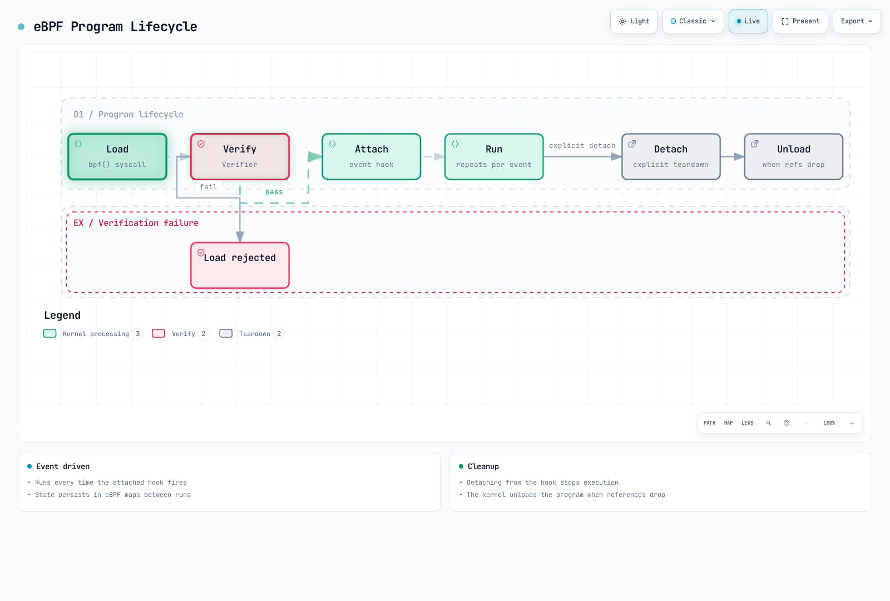
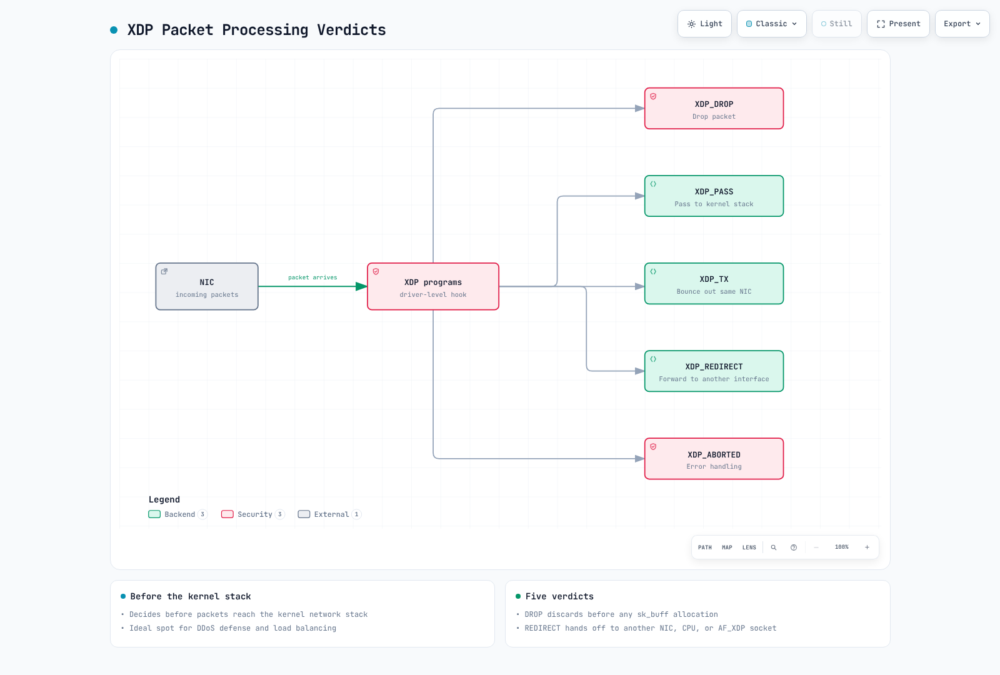
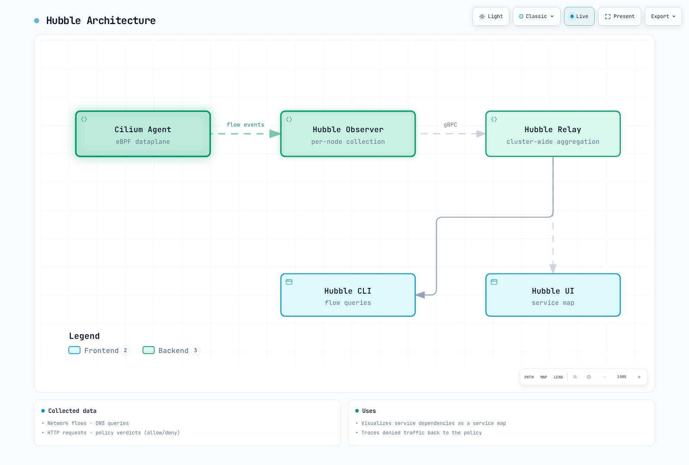

# eBPF 基础知识与 Kubernetes 应用

> **支持的版本**：根据功能具体要求的内核/BTF/helper；请匹配工具和 Kubernetes 兼容性矩阵
> **最后更新**：2026 年 10 月 16 日

eBPF 是一项革命性技术，允许沙箱化程序在 Linux 内核中运行。本文档涵盖从 eBPF 基本概念到 Kubernetes 环境中的实际应用。

## 目录

* [1. eBPF 简介](#1-introduction-to-ebpf)
* [2. eBPF 架构](#2-ebpf-architecture)
* [3. eBPF 程序类型](#3-ebpf-program-types)
* [4. eBPF 开发工具](#4-ebpf-development-tools)
* [5. eBPF 与 Kubernetes 网络](#5-ebpf-and-kubernetes-networking)
* [6. 基于 eBPF 的可观测性](#6-ebpf-based-observability)
* [7. 基于 eBPF 的安全](#7-ebpf-based-security)
* [8. eBPF 实例](#8-practical-ebpf-examples)
* [9. eBPF 的局限性和注意事项](#9-ebpf-limitations-and-considerations)
* [10. 后续步骤](#10-next-steps)

## 实验环境设置

如要跟着本文档中的示例进行操作，需要准备以下环境。

### 先决条件
- 维护中的发行版内核，具备各示例所需的 BTF、helpers 和挂载类型
- bpftool、bcc-tools
- Kubernetes 集群（可选）

bpftrace 示例已根据官方0.27语言语法（args.field）检查。发行版软件包可能较旧；请使用与其匹配的语法/功能。使用 bpftrace -lv 或 tracefs 格式文件验证 tracepoint 字段。函数探针取决于内核/库版本和架构。本次审计期间未执行任何跟踪/挂载操作。

### 环境设置

```bash
# Install required packages on Ubuntu/Debian
sudo apt-get update
sudo apt-get install -y bpfcc-tools python3-bpfcc bpftrace
# Install bpftool for this distribution/kernel separately:
# Debian provides the bpftool package; Ubuntu uses matching linux-tools packages.

# Check kernel version
uname -r

# Verify eBPF feature support
sudo bpftool feature probe kernel
```

---

<span id="1-introduction-to-ebpf"></span>

## 1. eBPF 简介

### 1.1 什么是 eBPF？

**eBPF**（扩展伯克利数据包过滤器）是一项允许用户定义的程序在 Linux 内核中安全运行的技术。它最初作为 BPF 被设计用于网络数据包过滤，后来经过扩展，如今已用于网络、安全、跟踪和性能分析等多个领域。

> **核心概念**：eBPF 允许你扩展和观察内核行为，而无需修改内核源代码或加载内核模块。


[🔍 查看交互式图表](https://www.atomai.click/kubernetes-docs/archmaps/en-basics-05-ebpf-fundamentals-0.html)

### 1.2 从传统 BPF 到 eBPF 的演进

**原始 BPF（1992）**：
- 由加州大学伯克利分校开发
- 专用于网络数据包捕获和过滤
- 2 个 32 位寄存器
- Linux 经典 BPF 通常将程序限制为4096条指令；这不是适用于所有情况的历史 BPF 规范

**eBPF（约从2014年起）**：
- 支持 64 位架构
- 11 个寄存器
- 通过 Maps 存储状态
- 支持各种挂载点
- 通过 JIT 编译实现原生性能

| 特性 | 传统 BPF | eBPF |
|---------|-----------------|------|
| 寄存器 | 2 个（32 位） | 11 个（64 位） |
| 指令限制 | Linux 常见限制为4096条 | 取决于内核/权限；程序大小与验证器复杂度是不同概念 |
| Map 支持 | 无 | 多种 Map 类型 |
| 用例 | 数据包过滤 | 通用内核编程 |
| 调用能力 | 无 | Helper 函数、BPF-to-BPF 调用 |
| 持久状态 | 没有持久 Map（一次运行期间可使用临时存储） | 可通过 Map 实现 |

### 1.3 eBPF 为何具有革命性

eBPF 具有革命性，原因如下：

1. **无需修改内核即可扩展功能**：无需更改内核源代码即可扩展内核功能
2. **安全执行**：验证器会检查已定义的内存/控制流安全属性
3. **高性能**：通过 JIT 编译实现原生代码级别的性能
4. **动态加载**：无需重启即可加载/卸载程序
5. **生产环境稳定性**：有界执行检查可降低风险；仍需验证正确性、内核/JIT 缺陷和运行影响


[🔍 查看交互式图表](https://www.atomai.click/kubernetes-docs/archmaps/en-basics-05-ebpf-fundamentals-1.html)

### 1.4 eBPF 与内核模块对比

| 方面 | eBPF | 内核模块 |
|--------|------|---------------|
| **安全性** | 在其模型范围内执行验证器安全检查 | 可能导致内核崩溃 |
| **可移植性** | CO-RE 可重定位兼容的内核类型；helpers、挂载点、语义和 BTF 仍会限制可移植性 | 每个内核版本都需要重新编译 |
| **加载** | 动态加载/卸载 | 需要 insmod/rmmod |
| **权限** | CAP_BPF/CAP_SYS_ADMIN 以及特定挂载点所需的权限 | 需要 root 权限 |
| **调试** | 有限 | 可以进行完整的内核调试 |
| **性能** | 通过 JIT 编译优化 | 原生性能 |
| **功能范围** | 仅限指定的挂载点 | 不受限制 |
| **开发难度** | 相对容易 | 需要较高专业水平 |

---

<span id="2-ebpf-architecture"></span>

## 2. eBPF 架构

### 2.1 eBPF 执行流程


[🔍 查看交互式图表](https://www.atomai.click/kubernetes-docs/archmaps/en-basics-05-ebpf-fundamentals-2.html)

### 2.2 验证器

验证器是 eBPF 的核心安全机制。它会在程序于内核中运行之前执行以下验证：

**验证项目**：
- 终止/有界控制流；在适用的内核上支持有界循环
- 不发生越界内存访问
- 不使用未初始化变量
- Helper 函数调用正确
- 保证程序终止

```c
// XDP fragments; compile as separate programs with linux/bpf.h and bpf_helpers.h.
SEC("xdp")
int bad_example(struct xdp_md *ctx) {
    unsigned char *data = (void *)(long)ctx->data;
    // No data_end check: the verifier cannot prove this packet byte exists.
    return data[0] == 0 ? XDP_DROP : XDP_PASS;
}

SEC("xdp")
int good_example(struct xdp_md *ctx) {
    unsigned char *data = (void *)(long)ctx->data;
    void *data_end = (void *)(long)ctx->data_end;
    if ((void *)(data + 1) > data_end)
        return XDP_PASS;
    return data[0] == 0 ? XDP_DROP : XDP_PASS;
}
```

### 2.3 JIT 编译器

JIT（即时编译）编译器会将 eBPF 字节码转换为原生机器码：

```bash
# Check JIT compiler status
cat /proc/sys/net/core/bpf_jit_enable

# Enable JIT compiler (0: disabled, 1: enabled, 2: debug mode)
echo 1 | sudo tee /proc/sys/net/core/bpf_jit_enable
```

某些内核会强制启用 CONFIG_BPF_JIT_ALWAYS_ON；此 sysctl 是否可用/可写取决于内核配置。调试模式2会写入内核日志跟踪，不是生产环境的默认设置。

**JIT 编译的优势**：
- 此处所述原始4–5倍加速声明没有来源；实际加速效果取决于程序、架构和内核
- 直接作为 CPU 原生指令执行
- 应用针对特定架构的优化

### 2.4 eBPF Maps

eBPF Maps 是用于在内核与用户空间之间共享数据以及存储状态的数据结构。

**主要 Map 类型**：

| Map 类型 | 描述 | 用例 |
|----------|-------------|----------|
| `BPF_MAP_TYPE_HASH` | 哈希表 | 键值存储、连接跟踪 |
| `BPF_MAP_TYPE_ARRAY` | 固定大小数组 | 按索引访问、配置值 |
| `BPF_MAP_TYPE_PERF_EVENT_ARRAY` | 事件数组 | 向用户空间发送事件 |
| `BPF_MAP_TYPE_RINGBUF` | 环形缓冲区 | 高性能事件流 |
| `BPF_MAP_TYPE_LRU_HASH` | LRU 哈希表 | 缓存、自动淘汰条目 |
| `BPF_MAP_TYPE_PERCPU_ARRAY` | 每 CPU 数组 | 减少统计数据的跨 CPU 争用 |
| `BPF_MAP_TYPE_LPM_TRIE` | LPM 前缀树 | IP 地址匹配、路由 |

```c
// Hash map definition example
struct {
    __uint(type, BPF_MAP_TYPE_HASH);
    __uint(max_entries, 1024);
    __type(key, __u32);      // Key: Process ID
    __type(value, __u64);    // Value: Counter
} packet_count SEC(".maps");
```

### 2.5 Helper 函数

eBPF 程序通过内核提供的 Helper 函数访问内核函数。

**主要 Helper 函数**：

以下是简化的 API 参考签名。在实际程序中，请包含 libbpf bpf_helpers.h，而不要重新声明这些函数。Helper 是否可用取决于程序类型/内核。

```text
// Map manipulation
void *bpf_map_lookup_elem(void *map, const void *key);
long bpf_map_update_elem(void *map, const void *key, const void *value, u64 flags);
long bpf_map_delete_elem(void *map, const void *key);

// Time-related
u64 bpf_ktime_get_ns(void);  // Monotonic nanoseconds since boot, excluding suspend; not wall-clock time

// Packet manipulation
long bpf_skb_load_bytes(const void *skb, u32 offset, void *to, u32 len);
long bpf_xdp_adjust_head(struct xdp_md *xdp_md, int delta);

// Tracing
long bpf_probe_read_kernel(void *dst, u32 size, const void *src);
long bpf_probe_read_user(void *dst, u32 size, const void *src);
long bpf_trace_printk(const char *fmt, u32 fmt_size, ...);

// Process information
u64 bpf_get_current_pid_tgid(void);    // Get PID/TGID
u64 bpf_get_current_uid_gid(void);     // Get UID/GID
long bpf_get_current_comm(void *buf, u32 size);  // Process name
```

### 2.6 程序生命周期



[🔍 查看交互式图表](https://www.atomai.click/kubernetes-docs/archmaps/en-basics-05-ebpf-fundamentals-3.html)

---

C 示例是相互独立的程序/片段。根据需要提供 vmlinux.h 或相关 UAPI 类型，以及 libbpf bpf_helpers.h、bpf_endian.h、bpf_tracing.h 和 bpf_core_read.h。BPF_KPROBE/BPF_UPROBE 需要使用正确的目标架构和实际挂载 ABI。请在隔离环境中验证加载/挂载；本次审计期间未执行这两项操作。基于路径的 LSM 示例在读取错误时会选择放行，且不覆盖别名/硬链接/其他协议；这些示例仅供学习，并非完整的访问控制。

<span id="3-ebpf-program-types"></span>

## 3. eBPF 程序类型

### 3.1 XDP（快速数据路径）

XDP 是在网络驱动程序层处理数据包的最快方式。



[🔍 查看交互式图表](https://www.atomai.click/kubernetes-docs/archmaps/en-basics-05-ebpf-fundamentals-4.html)

**XDP 操作模式**：
| 模式 | 描述 | 性能 |
|------|-------------|-------------|
| Native XDP | 在受支持驱动程序的接收路径中运行 | 开销低；取决于驱动程序/工作负载 |
| Offloaded XDP | 在受支持的 NIC 硬件上运行 | 受硬件/指令限制；请针对工作负载进行基准测试 |
| Generic XDP | 在协议栈中基于 skb 的回退模式 | 在常见情况下，开销高于 native 模式 |

```c
#include <linux/bpf.h>
#include <linux/if_ether.h>
#include <linux/ip.h>
#include <linux/tcp.h>
#include <linux/in.h>
#include <bpf/bpf_helpers.h>
#include <bpf/bpf_endian.h>

// Demonstration only: untagged, non-fragmented IPv4 TCP.
// VLAN, IPv6 and fragments pass through; this is not a complete firewall.
static __always_inline int packet_action(void *data, void *data_end) {
    struct ethhdr *eth = data;
    if ((void *)(eth + 1) > data_end || eth->h_proto != bpf_htons(ETH_P_IP))
        return XDP_PASS;
    struct iphdr *ip = (void *)(eth + 1);
    if ((void *)(ip + 1) > data_end || ip->version != 4 || ip->ihl < 5)
        return XDP_PASS;
    __u32 ihl = (__u32)ip->ihl * 4;
    __u32 ip_len = bpf_ntohs(ip->tot_len);
    if ((void *)ip + ihl > data_end || ip_len < ihl || (void *)ip + ip_len > data_end)
        return XDP_PASS;
    if (ip->protocol != IPPROTO_TCP || (bpf_ntohs(ip->frag_off) & 0x3fffU))
        return XDP_PASS;
    if (ip_len < ihl + sizeof(struct tcphdr))
        return XDP_PASS;
    struct tcphdr *tcp = (void *)ip + ihl;
    if ((void *)(tcp + 1) > data_end || tcp->doff < 5)
        return XDP_PASS;
    __u32 tcp_len = (__u32)tcp->doff * 4;
    if (ihl + tcp_len > ip_len || (void *)tcp + tcp_len > data_end)
        return XDP_PASS;
    return tcp->dest == bpf_htons(8080) ? XDP_DROP : XDP_PASS;
}

SEC("xdp")
int xdp_drop_port(struct xdp_md *ctx) {
    return packet_action((void *)(long)ctx->data, (void *)(long)ctx->data_end);
}
char LICENSE[] SEC("license") = "GPL";
```

### 3.2 TC（流量控制）

TC 程序在网络协议栈的流量控制层运行。

```bash
# TC program attachment example
set -e
: "${LAB_IFACE:?Select an isolated test veth interface, never a production interface}"
tc qdisc show dev "$LAB_IFACE"
# This assumes a fresh lab interface with no clsact qdisc.
sudo tc qdisc add dev "$LAB_IFACE" clsact
sudo tc filter add dev "$LAB_IFACE" ingress pref 49152 bpf da obj tc_prog.o sec classifier
sudo tc filter add dev "$LAB_IFACE" egress pref 49152 bpf da obj tc_prog.o sec classifier
# Cleanup only the filters created by this example, after the exercise:
# sudo tc filter del dev "$LAB_IFACE" ingress pref 49152
# sudo tc filter del dev "$LAB_IFACE" egress pref 49152
```

**TC 与 XDP 对比**：
| 特性 | XDP | TC |
|---------|-----|-----|
| 执行位置 | 驱动程序层 | 网络协议栈 |
| 性能 | 最高 | 高 |
| SKB 访问 | 不支持 | 支持 |
| 方向 | 仅入口 | 入口和出口 |
| 数据包修改 | 有限 | 灵活 |

### 3.3 Kprobes/Uprobes

Kprobes 和 Uprobes 可动态跟踪函数调用。

```c
// Kprobe example: Trace tcp_connect function
SEC("kprobe/tcp_connect")
int BPF_KPROBE(trace_tcp_connect, struct sock *sk) {
    u32 pid = bpf_get_current_pid_tgid() >> 32;

    // Get destination IP address
    u32 daddr = BPF_CORE_READ(sk, __sk_common.skc_daddr);
    u16 dport = BPF_CORE_READ(sk, __sk_common.skc_dport);

    bpf_printk("PID %d connecting to %pI4:%d\n", pid, &daddr, bpf_ntohs(dport));
    return 0;
}

// Uprobe example: Trace malloc function
// The userspace loader must select the real libc path, PID and malloc symbol.
SEC("uprobe")
int BPF_UPROBE(trace_malloc, size_t size) {
    u32 pid = bpf_get_current_pid_tgid() >> 32;
    bpf_printk("PID %d malloc(%zu)\n", pid, size);
    return 0;
}
```

### 3.4 Tracepoints

Tracepoints 是内核中预先定义的静态跟踪点。

```bash
# Check available tracepoints
sudo ls /sys/kernel/tracing/events/

# Tracepoints in specific categories
sudo ls /sys/kernel/tracing/events/sched/
sudo ls /sys/kernel/tracing/events/syscalls/
```

```c
// Tracepoint example: Trace process execution
SEC("tracepoint/sched/sched_process_exec")
int handle_exec(struct trace_event_raw_sched_process_exec *ctx) {
    char comm[16];
    bpf_get_current_comm(&comm, sizeof(comm));

    u32 pid = bpf_get_current_pid_tgid() >> 32;
    bpf_printk("Process started: %s (PID: %d)\n", comm, pid);

    return 0;
}
```

### 3.5 LSM（Linux 安全模块）BPF

LSM BPF 可动态应用安全策略。

```c
// LSM BPF example: Restrict file opening
SEC("lsm/file_open")
int BPF_PROG(restrict_file_open, struct file *file, int ret) {
    if (ret != 0)
        return ret;

    char path[256];
    if (bpf_d_path(&file->f_path, path, sizeof(path)) < 0)
        return 0;  // Demo fails open on unresolved paths; not a complete access policy.

    // Block access to /etc/shadow
    if (bpf_strncmp(path, 11, "/etc/shadow") == 0)
        return -EACCES;

    return 0;
}
```

### 3.6 Socket Filter

在 socket 层过滤数据包。

```c
// Socket Filter example
SEC("socket")
int socket_filter(struct __sk_buff *skb) {
    // Allow only IPv4 packets
    if (skb->protocol != bpf_htons(ETH_P_IP))
        return 0;  // Drop

    return skb->len;  // Return packet length (allow)
}
```

### 3.7 Cgroup 程序

控制容器资源和网络。

```c
// Cgroup socket program example: Block external connections
SEC("cgroup/connect4")
int restrict_connect(struct bpf_sock_addr *ctx) {
    // Block connections that are not to local network
    __u32 dst = bpf_ntohl(ctx->user_ip4);

    // Allow only 10.0.0.0/8 range
    if ((dst & 0xff000000U) != 0x0a000000U)
        return 0;  // Deny connection

    return 1;  // Allow connection
}
```

---

<span id="4-ebpf-development-tools"></span>

## 4. eBPF 开发工具

### 4.1 bpftool

bpftool 用于管理 BPF 程序/Map。只更新为本实验创建的 Map；运行中的 CNI/安全 Map 会影响工作负载。下面的十六进制更新假设键为小端序 u32、值为小端序 u64，与前面的 Map 示例一致。

```bash
# List loaded eBPF programs
sudo bpftool prog list

# Program details
sudo bpftool prog show id <ID>

# Program dump (bytecode)
sudo bpftool prog dump xlated id <ID>

# JIT compiled code dump
sudo bpftool prog dump jited id <ID>

# Map list
sudo bpftool map list

# Query map contents
sudo bpftool map dump id <MAP_ID>

# Add value to map
sudo bpftool map update id <MAP_ID> key hex 01 00 00 00 value hex ff 00 00 00 00 00 00 00

# Check kernel eBPF features
sudo bpftool feature probe kernel

# BTF (BPF Type Format) information
sudo bpftool btf list
```

### 4.2 bpftrace

bpftrace 是一种采用 DTrace 风格的高级跟踪语言。

```bash
# Installation
sudo apt-get install -y bpftrace

# System call count
sudo bpftrace -e 'tracepoint:raw_syscalls:sys_enter { @[comm] = count(); }'

# Read bytes per process
sudo bpftrace -e 'tracepoint:syscalls:sys_exit_read /args.ret > 0/ { @bytes[comm] = sum(args.ret); }'

# File open tracing
sudo bpftrace -e 'tracepoint:syscalls:sys_enter_openat { printf("%s opened %s\n", comm, str(args.filename)); }'

# TCP connection tracing
sudo bpftrace -e 'kprobe:tcp_connect { printf("%s -> %s\n", ntop(((struct sock *)arg0)->__sk_common.skc_rcv_saddr), ntop(((struct sock *)arg0)->__sk_common.skc_daddr)); }'

# Latency histogram
sudo bpftrace -e 'kprobe:vfs_read { @start[tid] = nsecs; } kretprobe:vfs_read /@start[tid]/ { @ns = hist(nsecs - @start[tid]); delete(@start[tid]); }'
```

**实用的 bpftrace 单行命令**：

```bash
# Top CPU-consuming processes
sudo bpftrace -e 'profile:hz:99 { @[comm] = count(); }'

# Block I/O latency
sudo biolatency-bpfcc 1 10  # Maintained request correlation; avoids dev/sector collisions

# New process tracing
sudo bpftrace -e 'tracepoint:sched:sched_process_exec { printf("%-10d %-16s\n", pid, comm); }'

# Memory allocation tracing
sudo bpftrace -e 'tracepoint:kmem:kmalloc { @bytes = hist(args.bytes_alloc); }'
```

### 4.3 BCC（BPF 编译器集合）

BCC 提供 BPF C 编译/加载功能，并通常在 Python 跟踪工具中嵌入 BPF C。

```bash
# Installation
sudo apt-get install -y bpfcc-tools python3-bpfcc

# Included tools
dpkg -L bpfcc-tools | head -40
```

**主要 BCC 工具**：

| 工具 | 描述 |
|------|-------------|
| `execsnoop` | 跟踪新进程的执行 |
| `opensnoop` | 跟踪文件打开操作 |
| `biolatency` | 块 I/O 延迟 |
| `tcpconnect` | 跟踪 TCP 连接 |
| `tcpaccept` | 跟踪 TCP 入站连接 |
| `tcpretrans` | 跟踪 TCP 重传 |
| `runqlat` | CPU 运行队列延迟 |
| `profile` | CPU 性能分析 |
| `funccount` | 函数调用次数 |
| `trace` | 通用函数跟踪 |

```bash
# Usage examples
sudo execsnoop-bpfcc    # Trace process execution
sudo tcpconnect-bpfcc   # Trace TCP connections
sudo biolatency-bpfcc   # Disk I/O latency
sudo profile-bpfcc -F 99 10  # CPU profiling for 10 seconds
```

### 4.4 libbpf 和 CO-RE

libbpf 是用于加载 eBPF 程序的 C 库，并支持 CO-RE（编译一次，随处运行）。

**CO-RE 优势**：
- 在各种内核版本上运行已编译的 eBPF 程序
- 使用 BTF（BPF 类型格式）进行结构体重定位
- 减少对内核头文件的依赖

```c
// Independent tracing program. Generate vmlinux.h from the target kernel's BTF.
#include "vmlinux.h"
#include <bpf/bpf_helpers.h>
#include <bpf/bpf_core_read.h>

SEC("tracepoint/syscalls/sys_enter_openat")
int trace_openat(struct trace_event_raw_sys_enter *ctx) {
    const char *filename = (const char *)BPF_CORE_READ(ctx, args[1]);
    char fname[256];
    if (bpf_probe_read_user_str(fname, sizeof(fname), filename) < 0)
        return 0;
    __u32 tgid = bpf_get_current_pid_tgid() >> 32;
    bpf_printk("TGID %u opened: %s", tgid, fname);
    return 0;
}
char LICENSE[] SEC("license") = "GPL";
```

**BTF 生成与验证**：

```bash
# Check BTF support
ls /sys/kernel/btf/vmlinux

# Generate vmlinux.h (for CO-RE development)
bpftool btf dump file /sys/kernel/btf/vmlinux format c > vmlinux.h

# Check program BTF information
bpftool prog show id <ID> --pretty
```

---

<span id="5-ebpf-and-kubernetes-networking"></span>

## 5. eBPF 与 Kubernetes 网络

### 5.1 Cilium：基于 eBPF 的 CNI

Cilium 是最具代表性的利用 eBPF 的 Kubernetes CNI（容器网络接口）。


[🔍 查看交互式图表](https://www.atomai.click/kubernetes-docs/archmaps/en-basics-05-ebpf-fundamentals-5.html)

#### 替换 kube-proxy

在受支持的配置中，Cilium 可以替代 kube-proxy。以下示意图说明新流量的后端选择；已建立的流量可以使用连接跟踪。路由/隧道/NAT 仍取决于所选数据平面。

**传统 kube-proxy（iptables 模式）**：
```
Packet → Netfilter → iptables rule evaluation → DNAT → Routing
```

**Cilium eBPF 模式**：
```
New flow → eBPF backend lookup → Configured routing/tunneling/NAT
```

```bash
# New, isolated self-managed lab only: configure the cluster for the selected
# CNI/proxy mode before bootstrap. Do not delete kube-proxy on a live cluster.
helm repo add cilium https://helm.cilium.io
helm repo update cilium
: "${CILIUM_CHART_VERSION:?Select a chart compatible with this Kubernetes/kernel}"
: "${CILIUM_VALUES_FILE:?Provide reviewed IPAM/routing/platform values}"
: "${API_SERVER_IP:?Set a directly reachable API endpoint, not the Service IP}"
: "${API_SERVER_PORT:?Set the API endpoint port}"
helm install cilium cilium/cilium --version "$CILIUM_CHART_VERSION" \
  --namespace kube-system -f "$CILIUM_VALUES_FILE" \
  --set kubeProxyReplacement=true \
  --set k8sServiceHost="$API_SERVER_IP" --set k8sServicePort="$API_SERVER_PORT"
cilium status --wait
# Existing clusters require the Cilium migration procedure and a tested rollback plan.

```

#### 网络策略

Cilium 使用 eBPF 实施 L3/L4 策略；HTTP/L7 策略需要受支持的代理处理（例如 Envoy）。DNS 可观测性使用 DNS 代理。Hubble HTTP/DNS 记录需要启用相应的可观测性设置。

```yaml
# Cilium network policy example
apiVersion: cilium.io/v2
kind: CiliumNetworkPolicy
metadata:
  name: allow-http-only
spec:
  endpointSelector:
    matchLabels:
      app: web
  ingress:
    - fromEndpoints:
        - matchLabels:
            app: frontend
      toPorts:
        - ports:
            - port: "80"
              protocol: TCP
          rules:
            http:
              - method: GET
                path: "/api/.*"
```

#### 负载均衡

```yaml
# Cilium LoadBalancer service example
apiVersion: v1
kind: Service
metadata:
  name: my-service
  annotations:
    lbipam.cilium.io/ips: "192.168.1.100"
spec:
  type: LoadBalancer
  selector:
    app: my-app
  ports:
    - port: 80
      targetPort: 8080
```

请求的 IP 必须属于管理员管理的 CiliumLoadBalancerIPPool。LB IPAM 只负责分配地址；要实现外部可达性，还需要配置 BGP/L2 通告或其他负载均衡方案。

### 5.2 Calico eBPF 模式

Calico 支持 eBPF 数据平面。下面的补丁假设已安装兼容的 Calico Operator，且仅是其迁移流程中的一个步骤。在更改任何 Service 代理之前，请配置直接 API 访问，并验证路由/回滚方案。

```bash
# Enable Calico eBPF mode
kubectl patch installation.operator.tigera.io default --type merge -p '{"spec":{"calicoNetwork":{"linuxDataplane":"BPF"}}}'
```

**Calico eBPF 模式功能**：
- 保留源 IP
- 支持直接服务器返回（DSR）
- 主机端点策略
- 单独配置且受支持时可选用 WireGuard 加密；仅选择 eBPF 并不会自动启用

### 5.3 性能对比：iptables 与 eBPF

| 方面 | iptables | eBPF |
|--------|----------|------|
| **可扩展性** | O(n) - 与 Service 数量成正比 | 哈希查找平均为 O(1)；具体取决于 Map 类型 |
| **延迟** | 取决于规则结构和工作负载 | 取决于 Map 类型、工作负载和数据平面 |
| **CPU 使用率** | 取决于工作负载/配置 | 取决于工作负载/配置 |
| **更新** | 现代 kube-proxy 可以更新发生变化的 Service/endpoint 规则 | Map 更新；成本取决于实现 |
| **可观测性** | 有限 | Hubble 集成 |
| **内存** | 规则、endpoint 和 conntrack 状态 | Maps、endpoint 和 conntrack 状态 |

**基准测试结果**（基于1000个 Service）：

以下原始数据没有注明来源、硬件、内核/CNI 版本或方法。这些数据尚未重新测试，不能证明当前性能或普遍的加速效果。要复现，需要使用原始方法和环境。

```
| Metric                  | iptables    | eBPF      | Improvement |
|------------------------|-------------|-----------|-------------|
| Connection setup time  | 2.5ms       | 0.3ms     | 8.3x        |
| CPU usage              | 15%         | 3%        | 5x          |
| Memory usage           | 256MB       | 32MB      | 8x          |
| Connections per second | 50,000      | 250,000   | 5x          |
```

```bash
# Check Cilium status
cilium status

# Check eBPF maps
kubectl -n kube-system exec ds/cilium -c cilium-agent -- cilium-dbg bpf lb list
kubectl -n kube-system exec ds/cilium -c cilium-agent -- cilium-dbg bpf ct list global

# Network policy status
kubectl get ciliumnetworkpolicies,ciliumclusterwidenetworkpolicies -A
```

---

<span id="6-ebpf-based-observability"></span>

## 6. 基于 eBPF 的可观测性

eBPF 可以深入观察系统和应用程序行为。与传统的基于代理的监控不同，eBPF 在内核层收集数据，以较低开销提供更丰富的信息。

### 6.1 Hubble：Cilium 网络可观测性

Hubble 提供 Cilium 网络可观测性。安装兼容的 Hubble CLI，启用 Relay，并在运行 CLI 示例之前建立端口转发。L7 可观测性需要相关的代理配置。



[🔍 查看交互式图表](https://www.atomai.click/kubernetes-docs/archmaps/en-basics-05-ebpf-fundamentals-6.html)

```bash
# Use the installed, reviewed chart version; this is not a chart-version upgrade.
: "${CILIUM_CHART_VERSION:?Set the installed compatible chart version}"
# Install Hubble
helm upgrade cilium cilium/cilium --version "$CILIUM_CHART_VERSION" \
  --namespace kube-system \
  --reuse-values \
  --set hubble.enabled=true \
  --set hubble.relay.enabled=true \
  --set hubble.ui.enabled=true

# First run cilium hubble port-forward in a separate terminal.
# Use Hubble CLI
hubble observe --pod my-pod
hubble observe --namespace default
hubble observe --protocol http
hubble observe --verdict DROPPED

# Observe traffic between specific services
hubble observe --from-pod default/frontend --to-pod default/backend

# Real-time network flow monitoring
hubble observe -f --type trace

# Generate service map
# Service maps are provided by Hubble UI; use the UI port-forward below.
```

**访问 Hubble UI**：

```bash
# Port forwarding
kubectl port-forward -n kube-system svc/hubble-ui 12000:80

# Access http://localhost:12000 in browser
```

### 6.2 Pixie：自动插桩可观测性

Pixie 使用 eBPF 自动收集遥测数据，无需修改应用程序代码。

**Pixie 功能**：
- 自动解析协议（HTTP、gRPC、MySQL、PostgreSQL、Kafka 等）
- 自动生成服务图
- 分布式跟踪
- CPU 性能分析
- 动态日志记录

```bash
# Install Pixie
px deploy

# Pixie CLI query examples
# HTTP request latency
px run px/http_data

# Traffic between services
px run px/service_stats

# Slow request analysis
px run px/slow_http_requests --help
# Use the parameters advertised by the installed script bundle.

# Pod resource usage
px run px/pods
```

**PxL（Pixie 查询语言）示例**：

```python
# Find slow HTTP requests
import px

df = px.DataFrame(table='http_events', start_time='-5m')
df.namespace = df.ctx['namespace']
df.pod = df.ctx['pod']
df = df[df.latency > 100000000]  # Over 100ms
df = df.groupby(['namespace', 'pod', 'req_path']).agg(
    count=('latency', px.count),
    avg_latency=('latency', px.mean),
    latency_quantiles=('latency', px.quantiles)
)
df.p99_latency_ns = px.pluck_float64(df.latency_quantiles, 'p99')
px.display(df)
```

### 6.3 Coroot：“无代码”监控

为受支持的应用配置代理、存储、权限和数据源后，Coroot 使用 eBPF 自动监控系统。

```bash
# Install Coroot with Helm
helm repo add coroot https://coroot.github.io/helm-charts
# The old coroot/coroot chart is deprecated; use the operator and CE resource chart.
: "${COROOT_OPERATOR_VERSION:?Select a reviewed operator chart version}"
: "${COROOT_CE_VERSION:?Select a compatible CE chart version}"
helm install coroot-operator coroot/coroot-operator -n coroot --create-namespace \
  --version "$COROOT_OPERATOR_VERSION"
helm install coroot coroot/coroot-ce -n coroot --version "$COROOT_CE_VERSION"
```

**Coroot 功能**：
- 自动发现服务
- 自动生成依赖关系图
- SLO 监控
- 异常检测
- 根因分析

### 6.4 Kepler：能耗监控

早期的 Kepler 使用 eBPF，但它从0.10.0开始**重写**，改为只读访问主机的 /proc 和 /sys，并使用 RAPL/powercap 和基于 CPU 使用率的功耗归因。它不再需要 CAP_BPF，因此当前版本的 Kepler 不是依赖 eBPF 插桩的示例。0.9及更早版本是冻结的旧版代码，其指标/部署方法有所不同。

请确认硬件/VM 提供了功耗传感器。容器/Pod 数值是对测得的节点能耗进行归因，而不是用功率计直接测量每个容器。对嵌套 RAPL 区域的能耗求和会造成重复计数。请核实特定版本的实验性 GPU/HWMon/平台支持情况。

```bash
: "${KEPLER_CHART_VERSION:?Select a reviewed current Kepler chart}"
helm install kepler oci://quay.io/sustainable_computing_io/charts/kepler \
  --version "$KEPLER_CHART_VERSION" --namespace kepler --create-namespace
kubectl get pods -n kepler
# Run port-forward in a separate terminal; then query metrics from this machine.
kubectl port-forward -n kepler service/kepler 28282:28282
# curl --fail http://localhost:28282/metrics | grep kepler_node_cpu_watts
```

当前 CPU 指标示例：`kepler_node_cpu_joules_total`、`kepler_container_cpu_joules_total`、`kepler_pod_cpu_watts`。请核实实际传感器覆盖范围和区域标签。

### 6.5 传统代理与 eBPF 插桩对比

5–15% 和 <1% 的数值是原文中未注明来源的数据；它们并非经过验证的开销范围。eBPF 仍需要用户空间代理、缓冲区和协议解析器。传统代理并非都需要修改代码，eBPF 工具也不会自动覆盖所有应用程序/协议。

| 方面 | 传统代理 | eBPF 插桩 |
|--------|-------------------|---------------------|
| **开销** | 高（5-15%） | 低（<1%） |
| **代码修改** | 取决于 SDK/代理模式 | 对受支持的数据源通常不需要 |
| **覆盖范围** | 取决于插桩和代理 | 受支持的挂载点/协议/可观测性；不会自动实现完整覆盖 |
| **部署** | 取决于应用、节点或收集器 | 通常使用节点代理；仍需考虑应用兼容性 |
| **权限** | 取决于代理 | 取决于程序/挂载点所需的 capabilities 和主机访问权限 |
| **数据深度** | 取决于应用/主机 | 内核和受支持的用户空间探针 |
| **协议支持** | 取决于工具 | 仅对受支持的解析器/库/可观测性自动生效 |


[🔍 查看交互式图表](https://www.atomai.click/kubernetes-docs/archmaps/en-basics-05-ebpf-fundamentals-7.html)

---

<span id="7-ebpf-based-security"></span>

## 7. 基于 eBPF 的安全

### 7.1 Tetragon：运行时安全

Tetragon 是 Cilium 项目提供的基于 eBPF 的运行时安全解决方案。


[🔍 查看交互式图表](https://www.atomai.click/kubernetes-docs/archmaps/en-basics-05-ebpf-fundamentals-8.html)

```bash
# Install Tetragon
helm repo add cilium https://helm.cilium.io
: "${TETRAGON_CHART_VERSION:?Select a compatible reviewed chart version}"
helm install tetragon cilium/tetragon -n kube-system --version "$TETRAGON_CHART_VERSION"

# Observe events
kubectl logs -n kube-system -l app.kubernetes.io/name=tetragon -c export-stdout -f | tetra getevents -o compact
```

创建 ebpf-lab 和 app=ebpf-demo 测试 Pod。这些示例只使用 Post 进行观察，不会向主机发送 SIGKILL。若要进行预防性拒绝，必须单独测试受支持的 LSM/Override 行为。

**TracingPolicy 示例**：

```yaml
apiVersion: cilium.io/v1alpha1
kind: TracingPolicyNamespaced
metadata:
  name: sensitive-file-access
  namespace: ebpf-lab
spec:
  kprobes:
  - call: security_file_open
    syscall: false
    args:
    - index: 0
      type: file
    selectors:
    - matchArgs:
      - index: 0
        operator: Prefix
        values:
        - /etc/shadow
        - /etc/passwd
        - /etc/sudoers
      matchActions:
      - action: Post
  podSelector:
    matchLabels:
      app: ebpf-demo
```

```yaml
apiVersion: cilium.io/v1alpha1
kind: TracingPolicyNamespaced
metadata:
  name: observe-outbound
  namespace: ebpf-lab
spec:
  kprobes:
  - call: tcp_connect
    syscall: false
    args:
    - index: 0
      type: sock
    selectors:
    - matchArgs:
      - index: 0
        operator: NotDAddr
        values:
        - 10.0.0.0/8
      matchActions:
      - action: Post
  podSelector:
    matchLabels:
      app: ebpf-demo
```

### 7.2 Falco：基于 eBPF 的异常检测

Falco 是一个 CNCF 项目，它使用 eBPF 检测运行时异常行为。

```bash
# Install Falco (eBPF driver)
helm repo add falcosecurity https://falcosecurity.github.io/charts
# Save the following Falco rule examples as ./ebpf-lab-rules.yaml before installation.
: "${FALCO_CHART_VERSION:?Select a compatible reviewed chart version}"
helm install falco falcosecurity/falco --version "$FALCO_CHART_VERSION" \
  --namespace falco --create-namespace \
  --set driver.kind=modern_ebpf \
  --set-file 'customRules.ebpf-lab-rules\.yaml=./ebpf-lab-rules.yaml'
```

**Falco 规则示例**：

```yaml
# Detect reading of /etc/shadow
- rule: eBPF lab read sensitive file
  desc: Detect reading of sensitive files
  condition: >
    open_read and
    fd.name in (/etc/shadow, /etc/sudoers) and
    not proc.name in (systemd, sudo, login)
  output: >
    Sensitive file opened (file=%fd.name user=%user.name
    process=%proc.name container=%container.name)
  priority: WARNING

# Detect shell execution in container
- rule: eBPF lab shell in container
  desc: Detect shell execution in container
  condition: >
    spawned_process and
    container and
    proc.name in (bash, sh, zsh, dash) and
    proc.pname != containerd-shim
  output: >
    Shell spawned in container (container=%container.name
    shell=%proc.name parent=%proc.pname)
  priority: NOTICE

# Detect privilege escalation
- rule: eBPF lab privilege escalation
  desc: Detect privilege escalation attempts
  condition: >
    spawned_process and
    proc.name in (sudo, su, doas) and
    container
  output: >
    Privilege escalation attempt (user=%user.name
    command=%proc.cmdline container=%container.name)
  priority: WARNING
```

### 7.3 seccomp-bpf：系统调用过滤

seccomp 过滤器使用经典 BPF 用户空间 ABI，而不是常规 eBPF 程序的 helpers/Maps。OCI JSON 配置文件由容器运行时解析，以构建系统调用过滤器。

```yaml
# Apply seccomp profile in Kubernetes Pod
apiVersion: v1
kind: Pod
metadata:
  name: secure-pod
spec:
  securityContext:
    seccompProfile:
      type: RuntimeDefault  # or Localhost
  containers:
    - name: app
      image: nginx:1.30.6
```

**自定义 seccomp 配置文件**：

以下是适用于精简 x86-64 示例的**格式示意**，并非可以运行 NGINX 或通用应用程序的配置文件。建议使用 RuntimeDefault；针对实际架构/运行时/工作负载生成自定义允许列表，并执行回归测试。将 mount/reboot/module/BPF 调用纳入宽泛允许列表并不是安全的默认做法。

```json
{
  "defaultAction": "SCMP_ACT_ERRNO",
  "architectures": [
    "SCMP_ARCH_X86_64"
  ],
  "syscalls": [
    {
      "names": [
        "read",
        "write",
        "exit",
        "exit_group",
        "rt_sigreturn"
      ],
      "action": "SCMP_ACT_ALLOW"
    }
  ]
}
```

### 7.4 LSM BPF：动态安全策略

LSM BPF 将 Linux 安全模块与 eBPF 结合起来，以动态应用安全策略。

```c
// LSM BPF example: Restrict executable files
SEC("lsm/bprm_check_security")
int BPF_PROG(restrict_exec, struct linux_binprm *bprm, int ret) {
    if (ret != 0)
        return ret;
    char filename[256];
    if (bpf_probe_read_kernel_str(filename, sizeof(filename), bprm->filename) < 0)
        return 0;  // Demo fails open on read error; define a real policy explicitly.

    // Block execution from /tmp
    if (bpf_strncmp(filename, 5, "/tmp/") == 0)
        return -EPERM;

    return 0;
}

// LSM BPF example: Restrict network sockets
SEC("lsm/socket_connect")
int BPF_PROG(restrict_connect, struct socket *sock, struct sockaddr *address, int addrlen, int ret) {
    if (ret != 0)
        return ret;

    if (addrlen < sizeof(struct sockaddr_in) || address->sa_family != AF_INET)
        return 0;  // This example handles IPv4 only.
    struct sockaddr_in *addr = (struct sockaddr_in *)address;

    // Block connection to specific port
    if (bpf_ntohs(addr->sin_port) == 6666)
        return -EACCES;

    return 0;
}
```

---

<span id="8-practical-ebpf-examples"></span>

## 8. eBPF 实例

### 8.1 使用 bpftrace 分析系统性能

**TCP 连接跟踪**：

```bash
# TCP connection tracing
sudo bpftrace -e '
tracepoint:sock:inet_sock_set_state /args.protocol == 6 && args.newstate == 1/ {
    if (args.family == 2) {
        printf("IPv4 %s:%d -> %s:%d established\n", ntop(args.saddr), args.sport, ntop(args.daddr), args.dport);
    } else if (args.family == 10) {
        printf("IPv6 %s:%d -> %s:%d established\n", ntop(args.saddr_v6), args.sport, ntop(args.daddr_v6), args.dport);
    }
}'
```

**系统调用延迟分析**：

```bash
# Read system call latency histogram
sudo bpftrace -e '
tracepoint:syscalls:sys_enter_read { @start[tid] = nsecs; }
tracepoint:syscalls:sys_exit_read /@start[tid]/ {
    @latency = hist((nsecs - @start[tid]) / 1000);
    delete(@start[tid]);
}'
```

**磁盘 I/O 分析**：

```bash
# Block I/O request tracing
sudo bpftrace -e '
tracepoint:block:block_rq_issue {
    printf("%s %s %d\n",
        comm,
        str(args.rwbs),
        args.nr_sector / 2);
}'

# I/O latency histogram
sudo biolatency-bpfcc 1 10
```

### 8.2 使用 Cilium Hubble 观察网络流量

```bash
# Real-time network flow observation
hubble observe -f

# Specific namespace traffic
hubble observe --namespace production

# Filter HTTP traffic only
hubble observe --protocol http

# Analyze dropped packets
hubble observe --verdict DROPPED

# DNS query tracing
hubble observe --protocol dns

# Traffic between specific Pods
hubble observe --from-pod default/frontend --to-pod default/backend

# Detailed analysis with JSON output
hubble observe --namespace default -o json | jq '.flow.destination.pod_name'

# Count retained flow observations, not unique connections or all traffic.
# Relay returns up to the requested count per Hubble instance.
hubble observe --namespace default --last 1000 -o jsonpb | \
  jq -r '.flow | "\(.source.pod_name // .source.identity) -> \(.destination.pod_name // .destination.identity)"' | \
  sort | uniq -c | sort -rn | head -20
```

### 8.3 使用 Tetragon 监控进程安全

```bash
# Real-time Tetragon event monitoring
kubectl logs -n kube-system -l app.kubernetes.io/name=tetragon -c export-stdout -f | \
  tetra getevents -o compact

# Filter process execution events only
kubectl logs -n kube-system -l app.kubernetes.io/name=tetragon -c export-stdout -f | \
  tetra getevents -o compact --event-types PROCESS_EXEC

# Events from specific namespace
kubectl logs -n kube-system -l app.kubernetes.io/name=tetragon -c export-stdout -f | \
  tetra getevents -o json | jq 'select(.process_exec.process.pod.namespace == "default")'
```

**文件访问监控策略**：

```yaml
apiVersion: cilium.io/v1alpha1
kind: TracingPolicyNamespaced
metadata:
  name: file-access-monitor
  namespace: ebpf-lab
spec:
  kprobes:
  - call: security_file_open
    syscall: false
    return: false
    args:
    - index: 0
      type: file
    selectors:
    - matchArgs:
      - index: 0
        operator: Prefix
        values:
        - /etc/
        - /var/run/secrets/
      matchActions:
      - action: Post
  podSelector:
    matchLabels:
      app: ebpf-demo
```

### 8.4 使用 eBPF 进行延迟分析

**函数、连接和名称解析延迟**：

```bash
# libc read() function duration; this is not an HTTP-request latency metric
sudo funclatency-bpfcc 'c:read' -i 1

# TCP handshake latency
sudo tcpconnlat-bpfcc  # Active TCP connection establishment latency

# DNS lookup latency
sudo gethostlatency-bpfcc  # libc name-resolution latency; includes cache/NSS work
```

以下示例展示 x86-64 glibc 路径。请先解析目标进程/库路径（容器挂载命名空间可能有所不同）。malloc/tcp_sendmsg 的持续时间是函数延迟，不是端到端请求延迟。

**应用程序性能分析脚本**：

```bash
#!/bin/bash
# app-latency-analysis.bt

sudo bpftrace -e '
BEGIN {
    printf("Tracing application latency... Hit Ctrl-C to end.\n");
}

uprobe:/usr/lib/x86_64-linux-gnu/libc.so.6:malloc {
    @malloc_start[tid] = nsecs;
}

uretprobe:/usr/lib/x86_64-linux-gnu/libc.so.6:malloc /@malloc_start[tid]/ {
    @malloc_ns = hist(nsecs - @malloc_start[tid]);
    delete(@malloc_start[tid]);
}

kprobe:tcp_sendmsg {
    @send_start[tid] = nsecs;
}

kretprobe:tcp_sendmsg /@send_start[tid]/ {
    @tcp_send_ns = hist(nsecs - @send_start[tid]);
    delete(@send_start[tid]);
}

END {
    printf("\n=== Malloc Latency ===\n");
    print(@malloc_ns);
    printf("\n=== TCP Send Latency ===\n");
    print(@tcp_send_ns);
}
'
```

---

<span id="9-ebpf-limitations-and-considerations"></span>

## 9. eBPF 的局限性和注意事项

### 9.1 技术局限性

| 局限性 | 数值 | 描述 |
|------------|-------|-------------|
| **栈大小** | 512 字节 | 局部变量存储空间限制 |
| **指令限制** | 取决于权限/内核 | 程序长度限制与验证器处理的指令限制相互独立；上游复杂度预算为1million |
| **最大嵌套调用数** | 8 层 | BPF-to-BPF 函数调用深度 |
| **Map 条目数** | 因 Map 类型而异 | 取决于内存限制 |
| **程序大小** | 受内核/验证器/JIT 限制 | 不由 Map 类型决定 |

**栈大小限制的解决方法**：

```c
// Bad example: Exceeds stack size
int bad_function(void *ctx) {
    volatile char buffer[1024] = {};  // Exceeds stack size!
    buffer[0] = 1;
    return buffer[1023];
}

// Good example: Use map
struct {
    __uint(type, BPF_MAP_TYPE_PERCPU_ARRAY);
    __uint(max_entries, 1);
    __type(key, __u32);
    __type(value, char[1024]);
} buffer_map SEC(".maps");

int good_function(void *ctx) {
    __u32 key = 0;
    char *buffer = bpf_map_lookup_elem(&buffer_map, &key);
    if (!buffer)
        return 0;
    // Use buffer
    return 0;
}
```

### 9.2 循环限制

eBPF 验证器会限制循环，以保证程序终止。

```c
// Potential verifier-complexity problem if n has no small proven bound.
for (int i = 0; i < n; i++) {  // Runtime values can still have provable bounds
    // ...
}

// Allowed by verifier: Bounded loop (kernel 5.3+)
#pragma clang loop unroll(disable)
for (int i = 0; i < 100 && i < n; i++) {  // Upper bound specified
    // ...
}

// Allowed by verifier: Compile-time unrolling
#pragma unroll
for (int i = 0; i < 10; i++) {
    // ...
}

// Using bpf_loop helper (kernel 5.17+)
static int callback(u32 index, void *ctx) {
    // Iteration work
    return 0;
}

int main_prog(void *ctx) {
    bpf_loop(1000, callback, NULL, 0);
    return 0;
}
```

### 9.3 内核版本兼容性

| 功能 | 最低内核版本 |
|---------|----------------------|
| 基本 eBPF | 3.18 |
| XDP | 4.8 |
| BTF | 4.18 |
| CO-RE | 兼容的 BTF/libbpf/helpers；没有普遍适用的仅由内核版本决定的最低版本 |
| BPF ring buffer | 5.8 |
| BPF 循环 | 5.3 |
| LSM BPF | 5.7 |
| bpf_loop helper | 5.17 |

```bash
# Check kernel version
uname -r

# Check eBPF feature support
sudo bpftool feature probe kernel

# Check BTF support
ls /sys/kernel/btf/vmlinux
```

### 9.4 调试难点

eBPF 程序的调试方式不同于传统方法：

**调试方法**：

```c
// bpf_printk (for debugging, impacts performance)
bpf_printk("value = %d\n", value);

```

```bash
# Read tracefs (mount/location is distribution-specific).
sudo cat /sys/kernel/tracing/trace_pipe
```

```bash
# Check verifier log (on load failure)
sudo bpftool prog load my_prog.o /sys/fs/bpf/my_prog -d

# Check program statistics
sudo bpftool -j prog show id <ID> | jq '.run_time_ns, .run_cnt'
# Runtime statistics require kernel.bpf_stats_enabled or a BPF stats FD; disabled by default and adds overhead.

# Dump map contents
sudo bpftool map dump id <MAP_ID>
```

### 9.5 权限要求

| 权限 | 用途 |
|-----------|---------|
| `CAP_BPF` | 加载 eBPF 程序（内核 5.8+） |
| `CAP_SYS_ADMIN` | 传统 eBPF 权限 |
| `CAP_PERFMON` | 挂载到性能监控事件 |
| `CAP_NET_ADMIN` | 挂载 XDP/TC 程序 |

```bash
# Check privileges
capsh --print

# Run program with specific privileges
sudo setcap cap_bpf,cap_perfmon+ep ./my_bpf_loader
```

下面的 Pod 用于展示 capability 字段，并非经过验证的完整代理。请分别检查内核/BTF/程序类型、seccomp 对 bpf/perf_event_open 的许可、LSM/lockdown、hostPath 挂载/所有权、PSS 以及任何所需的 RBAC。仅添加 capabilities 并不能保证所有程序都可以加载。

**Kubernetes 中的权限配置**：

```yaml
apiVersion: v1
kind: Pod
metadata:
  name: ebpf-pod
spec:
  containers:
    - name: ebpf-container
      image: my-ebpf-app
      securityContext:
        capabilities:
          add:
            - BPF
            - PERFMON
            - NET_ADMIN
        privileged: false
      volumeMounts:
        - name: bpf-maps
          mountPath: /sys/fs/bpf
        - name: debug
          mountPath: /sys/kernel/debug
  volumes:
    - name: bpf-maps
      hostPath:
        path: /sys/fs/bpf
    - name: debug
      hostPath:
        path: /sys/kernel/debug
```

### 9.6 安全注意事项

eBPF 是功能强大的工具，但也存在安全风险：

- **信息泄露**：可能访问敏感数据
- **DoS 攻击**：可能导致性能下降
- **权限提升**：配置错误可能引发漏洞

**安全最佳实践**：

```bash
# Inspect first. 0 enables unprivileged bpf(); 1 disables until reboot; 2 disables reversibly.
sysctl kernel.unprivileged_bpf_disabled
# On a kernel supporting value 2, disable only if currently enabled.
if [ "$(sysctl -n kernel.unprivileged_bpf_disabled)" = 0 ]; then
  sudo sysctl -w kernel.unprivileged_bpf_disabled=2
fi
# Inspect the real JIT-hardening setting; choose changes through host configuration management.
sysctl net.core.bpf_jit_harden
```

---

<span id="10-next-steps"></span>

## 10. 后续步骤

### 10.1 相关测验

请尝试以下测验，以检验你对本文档的理解：

- [eBPF 基础知识测验](../quizzes/basics/05-ebpf-fundamentals-quiz.md)

### 10.2 进阶学习资源

**官方文档和资源**：
- [eBPF.io](https://ebpf.io) - eBPF 官方文档
- [Cilium 文档](https://docs.cilium.io) - Cilium 官方文档
- [BPF 性能工具](https://www.brendangregg.com/bpf-performance-tools-book.html) - Brendan Gregg 的 BPF 性能工具书籍

**实践环境**：
- [eBPF 教程](https://github.com/lizrice/learning-ebpf) - Liz Rice 的 eBPF 教程
- [BCC 教程](https://github.com/iovisor/bcc/blob/master/docs/tutorial.md) - BCC 官方教程
- [bpftrace 教程](https://github.com/iovisor/bpftrace/blob/master/docs/tutorial_one_liners.md) - bpftrace 单行命令教程

**社区**：
- [eBPF 峰会](https://ebpf.io/events/?conference=eBPF%20Summit) - 年度 eBPF 大会
- [Cilium Slack](https://slack.cilium.io/) - Cilium 社区

### 10.3 相关文档

有关本文档相关的进阶内容，请参阅以下文档：

| 主题 | 文档链接 | 描述 |
|-------|---------------|-------------|
| Cilium 简介 | [Cilium 概述](../networking/cilium/01-introduction.md) | 基于 eBPF 的 CNI 简介 |
| 深入了解 eBPF | [深入了解 eBPF 技术](../networking/cilium/02-ebpf.md) | 进阶 eBPF 技术 |
| 网络 | [Cilium 网络](../networking/cilium/03-networking.md) | eBPF 网络实现 |
| 安全 | [Cilium 安全](../networking/cilium/06-security-visibility.md) | 基于 eBPF 的安全 |
| Kubernetes 网络 | [Service 与网络](../core/03-services-networking.md) | 基本网络概念 |

### 10.4 实践检查清单

eBPF 学习实践检查清单：

```
[ ] Use bpftool to check loaded eBPF programs
[ ] Run system call tracing with bpftrace
[ ] Analyze network traffic with BCC tools
[ ] Install Cilium and observe network with Hubble
[ ] Monitor security events with Tetragon
[ ] Write and load a simple XDP program
```

---

## 总结

eBPF 是一项革命性技术，可以安全地扩展和观察 Linux 内核行为。以下是本文档涵盖的主要内容摘要：

1. **eBPF 基本概念**：在内核中安全运行的沙箱化程序
2. **架构**：由验证器、JIT 编译器、Maps 和 Helper 函数组成
3. **程序类型**：XDP、TC、Kprobes、Tracepoints、LSM BPF 等
4. **开发工具**：bpftool、bpftrace、BCC、libbpf
5. **Kubernetes 应用**：使用 Cilium 实现高性能网络，以及 Calico eBPF 模式
6. **可观测性**：通过 Hubble、Pixie、Coroot 深入观察系统
7. **安全**：通过 Tetragon、Falco、seccomp-bpf 实现运行时安全
8. **局限性**：需考虑栈大小、循环、内核版本兼容性

eBPF 是推动云原生环境中网络、安全和可观测性未来发展的核心技术。

> Falco 示例依赖默认规则集中的 open_read/open_write/spawned_process/container 宏。请通过已安装 Chart 的 customRules/falco.rules_files 配置加载额外的文件。Falco 负责检测和告警；这些规则不会拒绝访问。容器/Kubernetes 元数据可能会延迟，且合法的 ServiceAccount token 读取也会匹配，因此请测试并设置适当的例外规则。

## 验证参考资料

- https://www.kernel.org/doc/html/latest/admin-guide/sysctl/kernel.html
- https://www.kernel.org/doc/html/latest/admin-guide/sysctl/net.html
- https://github.com/torvalds/linux/blob/master/include/linux/bpf.h
- https://github.com/torvalds/linux/blob/master/include/linux/filter.h
- https://github.com/torvalds/linux/blob/master/include/uapi/linux/bpf.h
- https://github.com/torvalds/linux/blob/master/kernel/bpf/syscall.c
- https://docs.kernel.org/bpf/prog_lsm.html
- https://docs.kernel.org/userspace-api/seccomp_filter.html
- https://github.com/torvalds/linux/blob/master/include/trace/events/sock.h
- https://github.com/bpftrace/bpftrace/blob/v0.27.0/docs/language.md
- https://github.com/bpftrace/bpftrace/blob/v0.27.0/docs/stdlib.md
- https://packages.debian.org/trixie/arm64/bpfcc-tools/filelist
- https://github.com/iovisor/bcc/blob/master/tools/tcpconnlat.py
- https://github.com/iovisor/bcc/blob/master/tools/gethostlatency.py
- https://github.com/libbpf/bpftool/blob/main/docs/bpftool-map.rst
- https://github.com/cilium/cilium/blob/v1.20.1/Documentation/network/kubernetes/kubeproxy-free.rst
- https://github.com/cilium/cilium/blob/v1.20.1/Documentation/network/lb-ipam.rst
- https://github.com/cilium/cilium/blob/v1.20.1/install/kubernetes/cilium/values.yaml
- https://github.com/cilium/cilium/blob/v1.20.1/hubble/cmd/observe/observe.go
- https://github.com/cilium/cilium/blob/v1.20.1/hubble/pkg/printer/printer_test.go
- https://github.com/cilium/tetragon/blob/main/docs/content/en/docs/concepts/enforcement/_index.md
- https://github.com/cilium/tetragon/blob/main/docs/content/en/docs/concepts/tracing-policy/selectors.md
- https://github.com/cilium/tetragon/blob/main/pkg/k8s/apis/cilium.io/v1alpha1/tracing_policy_types.go
- https://github.com/cilium/tetragon/blob/main/cmd/tetra/getevents/getevents.go
- https://github.com/cilium/tetragon/blob/main/examples/tracingpolicy/lsm_file_open.yaml
- https://github.com/cilium/tetragon/blob/main/install/kubernetes/tetragon/crds-yaml/cilium.io_tracingpoliciesnamespaced.yaml
- https://github.com/sustainable-computing-io/kepler/blob/main/README.md
- https://github.com/sustainable-computing-io/kepler/blob/main/docs/user/metrics.md
- https://github.com/coroot/helm-charts/blob/main/charts/coroot/Chart.yaml
- https://github.com/coroot/helm-charts/blob/main/charts/operator/Chart.yaml
- https://github.com/coroot/helm-charts/blob/main/charts/coroot-ce/Chart.yaml
- https://docs.px.dev/reference/pxl/udf/quantiles/
- https://github.com/pixie-io/pixie/blob/main/src/pixie_cli/pkg/cmd/run.go
- https://github.com/pixie-io/pixie/blob/main/src/pxl_scripts/px/http_data/data.pxl
- https://falco.org/docs/reference/rules/supported-fields/
- https://github.com/falcosecurity/charts/blob/master/charts/falco/values.yaml
- https://github.com/falcosecurity/rules/blob/main/rules/falco_rules.yaml
