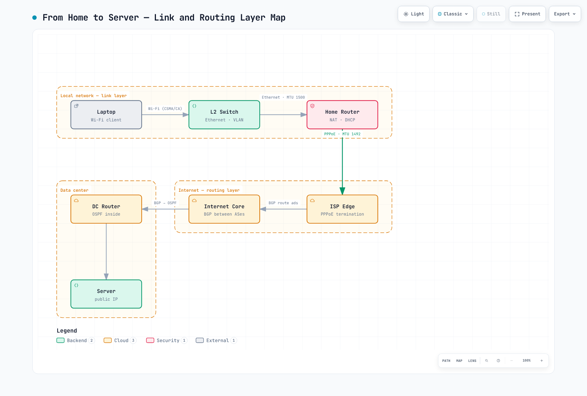

# 网络基础知识第 1 部分：分层模型、链路层与路由层

> **最后更新**：September 14, 2026

::: tip 这是一个由四部分组成的系列
**第 1 部分：分层模型、链路层与路由层** *(本文档)* ·
[第 2 部分：传输层与 TLS](./06-network-fundamentals-part2.md) ·
[第 3 部分：应用协议](./06-network-fundamentals-part3.md) ·
[第 4 部分：一次请求的旅程与云](./06-network-fundamentals-part4.md)
:::

浏览器请求依赖多个相互协作的协议。具体顺序取决于缓存、连接复用、IP 版本和 HTTP 版本，因此排查问题时需要检查的不只是 HTTP。

本系列将自下而上、**逐层**讲解 25 种网络协议和机制。之所以从底层开始很简单：每个上层都假定其下方各层已经正常工作。从上往下读，你会不断遇到“但那部分是怎么工作的？”这样的问题。

每个条目都遵循相同的结构：**一句话定义 → 工作原理 → 实际应用中的问题**。

---

## 0. 一页了解分层结构

| 层 | 职责 | 本文涵盖的协议 |
|---|---|---|
| 应用层 | 实际的服务语义 | HTTP/3、WebSocket、WebRTC、gRPC、DNS、DoH、DHCP、MQTT、SSH、SMTP |
| 安全层 | 加密与身份验证（依托于传输层） | TLS |
| 传输层 | 端到端数据传递 | TCP、UDP、QUIC |
| 互联网层 / 路由层 | 选择网络之间的路径 | IPv4、IPv6、ICMP、BGP、OSPF、NAT |
| 链路层 | 在一个物理网段内传递数据 | Ethernet、Wi-Fi、VLAN、PPP、ARP |

有些条目并不遵守严格的分层边界。TLS 夹在传输层与应用层之间，QUIC 虽然运行在 UDP 之上，却承担着传输层的职责，而 ARP 则连接了 IP 与链路层。NAT 与其说是一种协议，不如说是一种功能。这些“例外”是现实中大多数网络问题排查的关键。

---

[🔍 查看交互式图示](https://www.atomai.click/kubernetes-docs/archmaps/en-basics-06-network-fundamentals-part1-0.html)

---

## 1. 链路层：在一个网段内传递比特

链路层只关心一件事：**如何把比特交给紧邻你的设备。** 无论最终目的地是下一个机架，还是地球另一端，这一层都只负责下一跳。

### Ethernet

**定义：** 在有线局域网上传递帧的链路层标准。

**工作原理：** 数据被封装成帧，前面带有目的 MAC 地址和源 MAC 地址。对于已知的单播帧，交换机使用 MAC 表选择目的端口。广播帧和未知单播帧通常会在 VLAN 内泛洪；组播行为则取决于配置。早期 Ethernet 依赖冲突检测（CSMA/CD），但在现代交换式全双工网络中，冲突实际上已经消失。

**实际应用：** 对于 Ethernet 上的 IP 流量，MTU 为 1500 意味着帧内包含一个 1500 字节的 IP 数据包，不包括 Ethernet 头部/FCS。巨型 MTU 取决于设备和路径；9001 是 EC2 支持的值，并非通用的 Ethernet 大小。在云环境中，叠加 VPN 或覆盖网络会增加封装头部，从而缩小有效 MTU；如果 MTU 发现失败，就可能形成黑洞，表现为“ping 正常，但较大的响应会卡住”。这是最难排查的故障模式之一。

**MTU 与 MSS：** MSS 限制的是 TCP 数据字节数，而不是整个帧的大小。MTU 为 1500 时，基于基础头部计算，IPv4 的 MSS 为 1460（1500−20−20），IPv6 的 MSS 为 1440（1500−40−20）。发送方还会根据包含的任何 IP/TCP 选项进一步减少实际数据量。TCP 会在握手期间交换 MSS，因此当隧道反复出现 MTU 问题时，在路由器上进行 MSS 调整（强制使用较低的 TCP MSS）是广泛采用的变通办法。

### Wi-Fi

**定义：** 在无线网段上传递 LAN 帧的链路层标准（IEEE 802.11）。

**工作原理：** 由于无线信道是共享介质，Wi-Fi 与 Ethernet 有本质区别。Wi-Fi 在传输时不依赖冲突检测，而是使用 CSMA/CA：发送前检查信道是否空闲，然后对普通单播流量使用 ACK/重试；广播/组播的行为则有所不同。换句话说，链路层本身已经内置了重传机制。

**实际应用：** 链路层重传叠加 TCP 重传会加大延迟的波动（抖动）。实时体验问题常被归咎于“服务器故障”，但真正的罪魁祸首可能是客户端的无线网段。仅凭服务器 RTT 无法定位原因；应将其与应用处理时间以及客户端/AP 的重试、信号和队列指标关联起来分析。

### VLAN

**定义：** 将共享交换机基础设施划分为逻辑 L2 网络的技术（IEEE 802.1Q）。

**工作原理：** 带有 802.1Q 标签的帧包含一个 4 字节的 VLAN 标签。Access 端口可以传递未标记帧，由交换机将这些帧分配到某个 VLAN。广播只会到达同一 VLAN 中的主机，因此无需改动布线即可划分网络。VLAN 之间的流量必须经过 L3 设备（路由器或 L3 交换机）。

**实际应用：** VLAN 提供的是逻辑 L2 分段，而非物理隔离或加密隔离。允许哪些跨网段流量取决于路由和防火墙控制。VPC、子网和安全组在云网络中承担不同的职责；它们并不能与 VLAN 一一对应、相互替代。

> 📎 有关 EKS 如何构建其 VPC，请参阅 [EKS 网络基础知识](../eks/03-eks-networking-part1.md)。

### PPP

**定义：** 在恰好连接两个节点的点对点链路上传递数据包的协议。

**工作原理：** 与 Ethernet 不同，PPP 不需要寻址，因为链路两端各只有一个节点。相反，PPP 提供链路建立、可选身份验证以及上层协议协商（LCP/NCP）。

**实际应用：** PPP 看起来像拨号上网时代的遗物，但它仍以 PPPoE 的形式存在于大量家庭互联网线路中。使用标准的 1500 字节 Ethernet 负载时，通常的 6 字节 PPPoE 头部加上 2 字节 PPP 协议字段，会将 IP 可用空间限制为 1492 字节；如果协商使用更大的底层网络，则可以保留 1500 字节。若未考虑到降至 1492 字节，就可能导致前文所述的 MTU 问题。

### ARP

**定义：** 将链路内 IPv4 下一跳地址解析为 MAC 地址的协议。

**工作原理：** IP 层会说“把这个发到 10.0.1.5”，但 Ethernet 只识别 MAC 地址。因此，主机会广播“谁有 10.0.1.5？”，拥有该地址的主机则会回复。解析结果会被缓存，缓存状态/超时因操作系统而异。对于链路外的目的地，主机解析的是网关的 MAC 地址，而不是远程主机的 MAC 地址。

**实际应用：** ARP 没有身份验证。任何人都可以回应“那个 IP 是我的”，这正是 ARP 欺骗得以实现的原因。同一特性也有正当用途：发生故障转移时，新的活动节点会广播 Gratuitous ARP，向邻居通告 VIP 到 MAC 的映射；交换机也会根据帧学习源 MAC 地址的位置。当基于 VIP 的 HA 配置故障转移缓慢时，缓存刷新延迟是首要怀疑对象。

> 📎 有关 Cilium 如何使用 eBPF 集成 L2/路由行为，请参阅 [Cilium 网络](../networking/cilium/03-networking.md)。

---

## 2. 互联网层与路由层：跨越网络

如果链路层让你“到达隔壁”，这一层就会让你“到达地球另一端”。核心问题是：**这个数据包下一步应该发往哪里？**

### IPv4

**定义：** 基于 32 位地址的互联网层协议。

**工作原理：** 每个数据包都带有源 IP 和目的 IP；每台路由器都会在路由表中查找最具体的路由（最长前缀匹配），然后将数据包转发给下一跳。交付采用尽力而为方式：不作保证，也不保证顺序。这些保证由上一层（TCP）负责。

**实际应用：** IPv4 大约有 43 亿个可用地址，地址稀缺使 NAT 得到广泛应用，也让私有地址段（10.0.0.0/8、172.16.0.0/12、192.168.0.0/16）成为内部网络的标准。大型组织进行云迁移时遇到的第一个障碍，往往是这些私有地址段发生重叠：本地网络/VPC CIDR 重叠时，如果没有经过设计的重新编号、地址转换或代理方案，就无法通过 VPN 或 Direct Connect 直接路由。IP 地址规划应在项目启动时就确定下来。

#### IPv4、CIDR 与子网计算示例 {#ipv4-cidr-subnet}

IPv4 包含四个 8 位八位组。在 CIDR 表示法中，`/26` 将前 26 位固定为网络前缀，并留下 `32 − 26 = 6` 个主机位。以下地址是来自 [RFC 5737](https://www.rfc-editor.org/rfc/rfc5737.html) 的文档示例，并非公共测试端点。

对于接口地址 **`192.0.2.130/26`**：

| 步骤 | 计算或结果 |
|---|---|
| 子网掩码 | `255.255.255.192`；末尾八位组的二进制表示为 `11000000` |
| 每个地址块中的地址数 | `2^6 = 64`；末尾八位组的地址块从 `0`、`64`、`128`、`192` 开始 |
| 网络地址 | `130 AND 192 = 128`（`10000010 AND 11000000 = 10000000`），因此是 `192.0.2.128/26` |
| 广播地址 | 将六个主机位置为 1：`192.0.2.191` |
| 普通主机范围 | `192.0.2.129`–`192.0.2.190`：62 个地址 |

接口使用 `.130`；`.128/26` 表示其所属子网。在普通广播子网中，全零和全一的主机位分别表示网络地址和广播地址。如果配置了网关，它会占用主机范围中的一个地址；CIDR 并不要求网关必须使用第一个主机地址。

不要对每个前缀都套用“减二”的规则。[RFC 3021](https://www.rfc-editor.org/rfc/rfc3021.html) 允许在受支持的点对点链路上使用 `/31` 的两个地址。`/32` 表示单个地址，常用作主机路由；它并不意味着存在一个直接连接的 Ethernet 对等节点。云平台的地址分配规则则是另一回事：标准 AWS VPC IPv4 子网会保留前四个地址和最后一个地址，因此 `/26` 中有 **59 个可分配地址**，但 BYOIP 等情况除外。请根据分配模式查看 [VPC 子网规则](https://docs.aws.amazon.com/vpc/latest/userguide/subnet-sizing.html)。

#### 最长前缀、下一跳与 ARP {#longest-prefix-next-hop}

路由查找发生在**邻居解析之前**。以下是 Linux 主机上的示例路由表，该主机在 `eth0` 上配置了 `192.0.2.130/26`：

| 目的前缀 | 下一跳 / 接口 |
|---|---|
| `192.0.2.128/26` | 直接连接到 `eth0`（链路内） |
| `198.51.100.0/24` | 经由 `eth0` 上的 `192.0.2.129` |
| `198.51.100.128/25` | 经由 `eth0` 上的 `192.0.2.190` |
| `0.0.0.0/0` | 默认经由 `eth0` 上的 `192.0.2.129` |

在选定的路由表中，选择匹配的**最长前缀**路由（[RFC 1812 §5.2.4.3](https://www.rfc-editor.org/rfc/rfc1812.html#section-5.2.4.3)）：

- 对于 `192.0.2.150`，`/26` 路由是链路内路由：如果缺少该邻居条目，就使用 ARP **解析`.150` 本身**。
- 对于 `198.51.100.140`，`/24`、`/25` 和 `/0` 都匹配；`/25` 胜出。使用 ARP 解析网关 **`192.0.2.190`**，而不是远程目的地址。
- 对于 `203.0.113.10`，只有 `/0` 匹配：使用网关 **`192.0.2.129`**。

对于经路由转发的数据包，Ethernet 目的地址是网关的 MAC 地址，而 IP 目的地址仍然是远程主机（未使用 NAT 时）。默认路由的度量值较低，并不能胜过匹配的 `/25`。Linux 策略规则可以选择不同的路由表；请在相关网络命名空间中使用 `ip route get` 检查实际的路由查找，具体说明见 [ip-route(8) 手册](https://man7.org/linux/man-pages/man8/ip-route.8.html)。主机和容器可以拥有不同的路由表和邻居表。

### IPv6

**定义：** 使用 128 位地址的下一代互联网层协议。

**工作原理：** 使用 128 位地址后，地址耗尽不再是问题。基本头部长度固定为 40 字节，且没有头部校验和；路由器不会对 IPv6 数据包进行分片。SLAAC 允许主机在没有 DHCP 的情况下自行配置地址，ARP 则由 NDP（邻居发现协议）取代。

**实际应用：** IPv6 与 IPv4 不向后兼容，因此实际部署会采用双栈，这意味着要维护两套防火墙规则和安全策略。IPv6 路径上缺少规则是常见的安全漏洞。全球 IPv6 地址本身并不会自动让工作负载能够从互联网访问。AWS 仍要求配置路由并允许安全组/NACL 流量；仅出站互联网网关可以允许 IPv6 出站，而不接受未经请求的入站连接。

**过渡机制：** 与 IPv4 共存有三种实用方式：**双栈**（并行运行两种协议，最常见，但策略需要重复配置）、**隧道**（将 IPv6 数据包封装在 IPv4 中，以穿越仅支持 v4 的网段）和 **NAT64/DNS64**（通过转换让仅使用 IPv6 的客户端访问 IPv4 服务器；移动运营商通过 464XLAT 大规模使用这种方式）。Kubernetes 也支持双栈 Service，因此可以从一开始就在集群 CIDR 规划中纳入 IPv6 地址范围。

### ICMP

**定义：** 用于报告网络错误和状态的控制协议。

**工作原理：** ICMP 携带控制信息，可以包含 Echo 负载或引用原始数据包的数据，例如目的地不可达、TTL 超时、需要分片等。`ping` 使用 Echo Request/Reply；`traceroute` 每次递增一跳的 TTL（或 IPv6 Hop Limit），并读取返回的 Time Exceeded 消息。

**实际应用：** 出于“安全”考虑而一概阻止 ICMP 的做法很常见，而这正是前文提到的 MTU 黑洞的直接原因。传统的 IPv4 PMTUD 使用 ICMP Type 3 Code 4，IPv6 则使用 ICMPv6 Packet Too Big Type 2。阻止必要的消息会导致黑洞；PLPMTUD 则可以通过探测数据包大小来避免依赖 ICMP。应根据 IP 版本和策略保留必要的错误/发现流量。

> 📎 有关此故障在 EKS 中的表现，请参阅 [EKS 网络深入解析](../eks/03-eks-networking-part3.md)。

#### 解读 ICMP 与 traceroute 证据 {#icmp-traceroute-interpretation}

在 IPv4 转发过程中，路由器会减少数据包的 TTL；如果 TTL 到期，路由器会丢弃该探测包，通常会返回 **ICMP Time Exceeded（Type 11, Code 0）**。对于 TTL 被刻意设得很低的探测，这是预期行为，并不能证明普通应用数据包无法通过。该错误会引用部分原始数据包内容，便于发送方将响应与探测包对应起来（[RFC 792](https://www.rfc-editor.org/rfc/rfc792.html)）。

应将**发出的探测包**与**返回的响应**区分开来。以下常见 traceroute 方法都可能收到中间路由器返回的 ICMP Time Exceeded：

| 发出的探测包 | 到达目的地时的典型响应 |
|---|---|
| 发往未使用目的端口的 UDP | ICMP Destination Unreachable, Port Unreachable（IPv4 Type 3, Code 3） |
| ICMP Echo Request | ICMP Echo Reply |
| 发往指定端口的 TCP SYN | 对监听端口返回 TCP SYN/ACK，或对已关闭端口返回 RST |

不同实现的默认值和选项各不相同；[Linux traceroute(8) 手册](https://man7.org/linux/man-pages/man8/traceroute.8.html)介绍了 UDP、ICMP 和 TCP 方法。TCP 探测可以测试指定端口的处理情况，但即使收到 SYN/ACK，也不能证明 TLS 或 HTTP 正常工作。

`*` 表示**在等待超时之前没有收到匹配的响应**。探测包可能被过滤，路由器可能会抑制或限制响应速率，也可能是响应在返回路径上丢失。某一跳没有响应，但后续跳有响应，并不能证明端到端存在丢包。每个显示的 RTT 都包含一条返回路径，而它可能与正向路径不同；负载均衡也可能导致不同探测包经过不同路由器。在定位故障前，应结合目的地和应用层结果，对比多次观测结果。

Traceroute 主要用于探索跳数；小型探测包成功，并不能验证路径 MTU。设置 DF 的较大 IPv4 数据包仍可能需要 **Fragmentation Needed（Type 3, Code 4）** 消息，才能发现较小的 MTU。应将该消息与 Time Exceeded 和 Port Unreachable 区分开来；同时注意前文所述的 IPv6 和 PLPMTUD 差异。

> 📎 在 [Linux 路由与 ICMP 实验](../networking/07-linux-network-diagnostics.md#routing-icmp-lab)中应用路由和探测分析方法，然后将其用于容器与 Kubernetes 故障排查。

### OSPF

**定义：** 在单个自治系统内部计算最优路径的链路状态路由协议。

**工作原理：** 每台路由器都会在区域内泛洪其链路状态，因此同一区域中的路由器会收敛到一致的链路状态信息，然后各自运行 Dijkstra 算法计算最短路径。接口开销由配置决定（通常根据带宽得出），网络则划分为多个区域以支持扩展。

**实际应用：** OSPF 是 IGP（用于内部网络）。它收敛迅速，且能自动发现路径，但每台路由器都要维护其所连接区域的链路状态信息，因此在大规模部署中，区域设计会决定性能。

### BGP

**定义：** 在自治系统（AS）之间交换可达信息的路径向量路由协议。

**工作原理：** BGP 的目标与 OSPF 不同：它选择的不是“最快路径”，而是“策略偏好的路径”。每个 AS 都会通告其可达的前缀以及 AS 路径；接收方会根据 AS_PATH 长度、Local Preference 和 MED 等属性对路由进行排序。整个互联网的路由都依赖于此。

**实际应用：** BGP 默认信任路由通告，因此错误的前缀通告可能导致大范围中断。RPKI 源验证会检查前缀起源是否获得授权；它不会验证整个 AS 路径，也无法阻止所有路由泄漏。从云的角度看，Direct Connect 使用 BGP；Site-to-Site VPN 可以使用 BGP 或受支持的静态路由，因此 AS 编号、通告前缀设计以及用于冗余的路径偏好（AS_PATH 前置等）都会成为实际的设计事项。

> 📎 有关 Calico 如何在集群内部使用 BGP，请参阅 [Calico BGP 深入解析](../networking/calico/04-bgp-deep-dive.md)。

### NAT

**定义：** 转换 IP 地址的功能；对于 NAPT/PAT，还会转换传输层端口。

**工作原理：** 常见情形是多个私有主机通过 PAT/NAPT 共享一个公共地址。转换也可以发生在私有地址之间，并不总是为了共享公共互联网地址。转换表会保存每个会话的映射，让返回数据包能够找到正确的内部主机。

**实际应用：** NAT 是违反分层设计的典型例子：它是会改写 L4 端口的 L3 设备，而且会破坏端到端连接这一互联网最初的设计理念。因此，P2P 会变得困难，并需要 STUN/TURN 等变通方案（见下文 WebRTC）。在云环境中，实际需要关注的是 NAT Gateway 端口耗尽和数据处理费用。对于出站流量较大的工作负载，VPC endpoint 可以减少对受支持 AWS 服务的 NAT 处理量；在假定能够节省费用之前，应先比较其按小时和按数据量收取的费用以及流量路径。

---

**下一篇：** [第 2 部分：传输层与 TLS](./06-network-fundamentals-part2.md)

## 验证参考资料

- https://docs.aws.amazon.com/AWSEC2/latest/UserGuide/network_mtu.html
- https://www.rfc-editor.org/rfc/rfc894
- https://www.rfc-editor.org/rfc/rfc6691
- https://www.rfc-editor.org/rfc/rfc4638
- https://www.rfc-editor.org/rfc/rfc5227
- https://www.rfc-editor.org/rfc/rfc792
- https://www.rfc-editor.org/rfc/rfc8899
- https://www.rfc-editor.org/rfc/rfc2328
- https://www.rfc-editor.org/rfc/rfc6811
- https://docs.kernel.org/networking/bridge.html
- https://docs.aws.amazon.com/vpc/latest/userguide/VPC_Internet_Gateway.html
- https://docs.aws.amazon.com/vpc/latest/userguide/egress-only-internet-gateway.html
- https://docs.aws.amazon.com/vpn/latest/s2svpn/VPNRoutingTypes.html
- https://docs.aws.amazon.com/vpc/latest/userguide/nat-gateway-scenarios.html
- https://docs.aws.amazon.com/vpc/latest/userguide/nat-gateway-pricing.html
