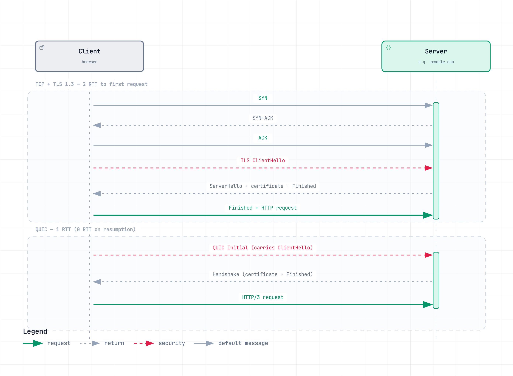

# 网络基础知识第 2 部分：传输层与 TLS

> **最后更新**：2026 年 9 月 11 日

::: tip 本系列共分五部分
[第 1 部分：分层模型、链路层与路由层](./06-network-fundamentals-part1.md) ·
**第 2 部分：传输层与 TLS** *（本文）* ·
[第 3 部分：应用层协议](./06-network-fundamentals-part3.md) ·
[第 4 部分：一次请求的旅程与云](./06-network-fundamentals-part4.md) ·
[第 5 部分：网络设备、LAN 与 WAN](./06-network-fundamentals-part5.md)
:::

第 1 部分介绍了如何将数据包送达目标主机。本部分将比较可靠的字节流（TCP 和 QUIC）与 UDP 数据报，然后说明 TLS 如何保护通信。UDP 本身不提供可靠性或 TLS；应用可以选择合适的安全协议（例如 DTLS），也可以使用集成了 TLS 1.3 的传输协议（例如 QUIC）。

这张图概括了本部分的核心内容：

[🔍 查看交互式图表](https://www.atomai.click/kubernetes-docs/archmaps/en-basics-06-network-fundamentals-part2-0.html)

---

## 3. 传输层：端到端传输

从这里开始，你的通信对象不再是“网络”，而是“进程”。这就是端口号出现的原因。

### TCP

**定义**：一种面向连接的传输协议，提供可靠、有序的字节流。

**工作方式**：通过三次握手（SYN → SYN+ACK → ACK）建立连接。序列号维持顺序，ACK 和重传用于恢复丢失的数据，滑动窗口用于流量控制，而拥塞控制则根据网络负载进行调整。对于应用来说，TCP 提供了一种简洁的抽象：一条连续不断的字节流。

**实际应用**：有序传输会导致**队头阻塞（HOL）**：一个 TCP 段丢失，就会阻止缺口之后的字节被交付。使用 HTTP/2 时，这可能会延迟共享该连接的多个流；已经交付的数据以及彼此独立的应用工作仍可继续处理。QUIC 消除了这种特定的、跨流的传输层顺序依赖。

对于没有进行优化的典型新连接，TCP 建立连接大约需要 1 个 RTT，之后完整的 TLS 1.3 握手需要 1 个 RTT（TLS 1.2 通常需要 2 个 RTT）。连接复用、会话恢复、早期数据和 TCP Fast Open 都会改变时序；重试则可能增加延迟。应根据实际工作负载评估连接池。

**拥塞控制简史**：除带宽、延迟、缓冲区和应用行为之外，拥塞控制也会影响吞吐量。经典的 **Reno** 会在发生丢包时缩小拥塞窗口。常见的 Linux 默认算法 **CUBIC** 使用三次窗口增长函数，以提升高带宽路径上的可扩展性。**BBR** 会对瓶颈带宽和传播 RTT 建模，以指导数据发送；其对丢包和 ECN 的处理也取决于具体实现和版本。没有任何算法能保证在所有长距离或移动网络路径上都提高吞吐量。`sysctl net.ipv4.tcp_congestion_control` 只会**读取**已配置的默认值；更改默认值只会影响新连接，并且需要单独配置和测量。

**TIME_WAIT 与端口耗尽**：在正常的优雅关闭中，主动关闭连接的一方通常会进入 TIME_WAIT；如果双方同时关闭，则两端都可能进入该状态。频繁创建和关闭连接，可能导致可用连接元组、临时端口或 NAT 映射耗尽，具体取决于实现和目标端模式。TIME_WAIT 条目并不总是会针对所有远端端点保留该端口。更改内核设置之前，应先诊断实际限制并考虑复用连接；TIME_WAIT 也能防止旧连接的延迟数据包造成问题。

### UDP

**定义**：一种精简的传输协议，无需建立连接即可发送数据报。

**工作方式**：8 字节的首部仅包含源端口、目标端口、长度和校验和。没有握手、重传、顺序保证或拥塞控制。它本质上就是“带端口号的 IP”。

**实际应用**：实时应用可能更重视及时交付，而不是重传过时的数据；DNS 通常也使用 UDP 进行小型数据交换。应用必须自行实现所需的可靠性和适当的拥塞控制，或者使用 QUIC 这类提供这些功能的协议。

需要注意的是，无状态特性使 UDP 容易被用于欺骗和放大攻击。向外部开放 UDP 服务时，应规划响应大小限制和请求速率控制。

### QUIC

**定义**：一种基于 UDP 实现的安全多路复用传输协议。

**工作方式**：QUIC 在 UDP 之上从头重新设计了 TCP+TLS 过去实现的所有功能。它有四个关键特性：

1. **独立的流交付**：每个流都有自己的字节顺序，因此一个流上的丢包不一定会阻止另一个流的可用数据交付。数据包恢复和拥塞控制仍会在整个连接或路径范围内运行；某个流可能会因自身缺失的字节而阻塞，应用层或 HTTP/3 QPACK 依赖也可能导致阻塞。
2. **内置加密**：QUIC 集成了 TLS 1.3 握手，并使用自己的数据包保护机制，而不是 TLS 记录。一次正常的完整握手大约需要 1 个 RTT。符合条件且被接受的会话恢复可以携带 **0-RTT 早期数据**，但握手仍会在之后完成；Retry 或额外的握手交互可能会增加延迟。
3. **连接 ID**：在地址发生变化时，连接 ID 有助于保持连接连续性，但需要进行路径验证并得到端点支持。迁移限制或不可用的路径仍可能中断从 Wi-Fi 切换到蜂窝网络的过程，因此无法保证连接连续性。
4. **实现灵活性**：QUIC 通常在用户空间实现，因此传输层改动可以随应用或库一起发布。在用户空间实现并非协议要求。

**实际应用**：HTTP/3 通常使用 UDP 443。如果该路径被阻断，并且服务器支持 HTTP/2 或 HTTP/1.1，HTTP 客户端可以尝试通过 TCP 使用这些协议；QUIC 本身不会转为 TCP。在将性能结果归因于 QUIC 之前，应先检查网络可达性、协商出的协议以及实现或卸载行为。CPU 开销取决于实现和工作负载。

一个安全注意事项：**0-RTT 数据可能会被重放**。重放早期数据交换可能导致应用多次处理同一个请求；仅靠传输层数据包去重，并不能提供应用层重放保护。只允许应用明确评估为可安全重放的操作。仅凭 GET 方法名称或幂等性声明并不足以证明安全。服务器可以拒绝早期数据；HTTP 服务器可以使用 `425 Too Early`，让客户端在握手后重试。应在客户端、CDN 和源站之间统一配置此策略。

---

## 4. 安全性：TLS

### TLS

**定义**：一种为传输中的数据提供机密性、完整性和身份验证的协议。

**工作方式**：TLS 在握手期间协商加密参数并建立密钥。基于证书的握手使用证书和密钥持有证明来验证服务器；基于 PSK 的握手则可以使用先前建立的密钥或通过其他方式预先配置的密钥进行身份验证。TLS 记录用于保护应用数据。TLS 1.3 使用经过身份验证的加密（AEAD）来保证机密性和完整性。

一次正常的完整 TLS 1.3 握手大约需要 1 个 RTT；会话恢复可在满足其他条件时选择发送早期数据。TLS 1.3 移除了静态 RSA 密钥交换和旧式密码套件，但仍支持 RSA 证书签名。临时 (EC)DHE 密钥交换可以提供前向保密，包括与 PSK 结合使用时。**仅使用 PSK 的密钥交换和 0-RTT 数据无法提供同等的前向保密保证。**

**实际应用**：有三类问题反复出现。

- **证书过期**：自动续期，并分别监控证书是否过期以及证书是否成功部署。
- **SNI 暴露**：仅使用 TLS 1.3 仍会让 ClientHello 中的 SNI 可见。如果双方端点都支持并配置了 ECH（Encrypted Client Hello，RFC 9849），它可以保护内部 ClientHello。QUIC Initial 数据包的密钥可从公开信息推导，因此仅靠 Initial 加密无法隐藏 SNI。ECH 也无法隐藏目标 IP 或所有流量元数据。
- **终止点设计**：记录每一段链路：客户端到负载均衡器、负载均衡器到应用，以及任何服务到服务的连接。TLS 终止并不会自动加密下一跳；如有需要，应在下一跳使用 TLS；如果通信双方都必须通过证书进行身份验证，则使用 mTLS。服务网格可以自动化这些配置，但并非所有设计都必须使用服务网格。

**证书链与 OCSP 装订**：典型的 X.509 验证会从叶证书出发，经过所需的中间证书，直到已配置的信任锚。服务器应发送所需的中间证书；根证书通常已由客户端信任。缺少中间证书可能导致因客户端而异的故障，不过并非所有有效证书链都包含中间证书。吊销处理方式取决于颁发者和客户端。在支持 OCSP 的情况下，OCSP 装订允许服务器附加签名状态响应，并可减少客户端直接查询。但这并非普遍适用：Let’s Encrypt 已于 2025 年 8 月停止 OCSP 服务，并改用 CRL。证书和吊销配置应与实际使用的 CA 及客户端相匹配。

> 📎 关于 Istio 如何自动化此过程，请参阅 [Istio mTLS](../service-mesh/istio/security/01-mtls.md)。

**主要参考资料**：[TLS 1.3](https://www.rfc-editor.org/rfc/rfc8446.html)、[QUIC 传输](https://www.rfc-editor.org/rfc/rfc9000.html)、[QUIC/TLS](https://www.rfc-editor.org/rfc/rfc9001.html)、[HTTP 早期数据](https://www.rfc-editor.org/rfc/rfc8470.html)、[ECH](https://www.rfc-editor.org/rfc/rfc9849.html)、[Linux TCP 设置](https://docs.kernel.org/networking/ip-sysctl.html)、[Let’s Encrypt 停止提供 OCSP 服务](https://letsencrypt.org/2025/08/06/ocsp-service-has-reached-end-of-life/)。
---

**下一部分：**[第 3 部分：应用层协议](./06-network-fundamentals-part3.md)
