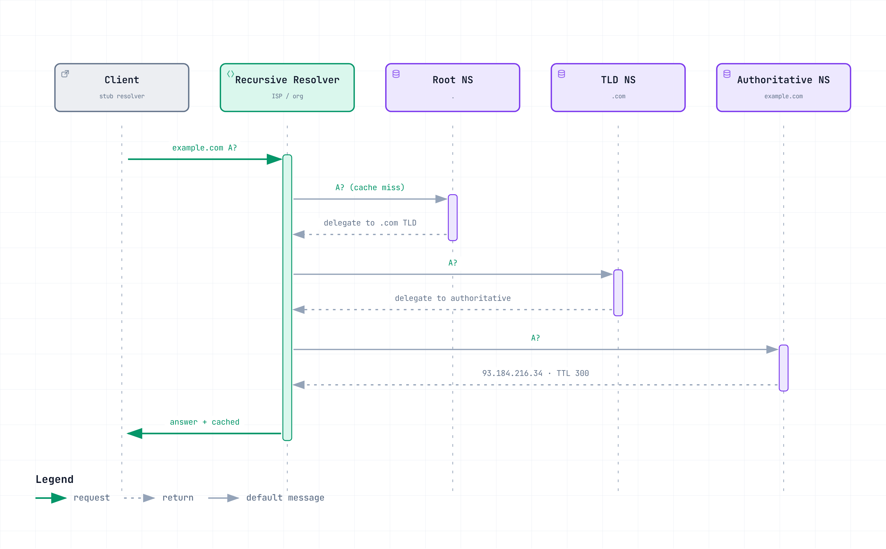

# 网络基础知识第 3 部分：十种应用层协议

> **最后更新**：2026年9月14日

::: tip 这是一个由五部分组成的系列
[第 1 部分：分层模型、链路层和路由层](./06-network-fundamentals-part1.md) ·
[第 2 部分：传输层和 TLS](./06-network-fundamentals-part2.md) ·
**第 3 部分：应用层协议** *(本文档)* ·
[第 4 部分：请求的旅程与云](./06-network-fundamentals-part4.md) ·
[第 5 部分：网络设备、LAN 和 WAN](./06-network-fundamentals-part5.md)
:::

传输层协议提供字节流或数据报；应用层协议则将它们转化为服务。本部分介绍名称解析（DNS 和 DoH）、启动配置（DHCP）、运维访问（SSH）、邮件（SMTP），以及 HTTP/3、WebSocket、WebRTC、gRPC 和 MQTT。

---

## 5. 应用层：实际服务

### DNS

**定义**：一种分布式目录系统，用于将域名解析为 IP 地址及其他记录。

**工作原理**：DNS 使用分层委派。缓存未命中时，递归解析器会沿着根域、TLD 到权威名称服务器逐级跟进转介，或将查询转发给另一个解析器。缓存的答案可以免去其中部分或全部查询步骤。A/AAAA 记录包含地址，CNAME 记录包含别名，MX 记录包含邮件服务器，TXT 记录则包含多个协议会使用的文本。

**实际应用**：DNS 是分布式的，但解析器、服务提供商或配置都可能成为共享依赖项。规划 DNS 故障转移时，应考虑故障检测、记录更新、已缓存答案的 TTL、应用程序缓存以及现有连接。现在缩短 TTL，并不会缩短旧缓存答案的 TTL。在定义的故障条件下，有些解析器还会提供过期答案（RFC 8767）。应测量每个阶段；TTL 短并不能单独保证故障转移时间。负载均衡器和 anycast 可以作为 DNS 的补充，但它们也有各自的健康检查和收敛限制。

**常见记录类型一览：**

| 类型 | 用途 | 说明 |
|---|---|---|
| A / AAAA | 域名 → IPv4 / IPv6 | 基础记录 |
| CNAME | 别名 → 规范名称 | 不能与顶点处的 SOA/NS 共存；特定提供商的 ALIAS/ANAME 或 Route 53 Alias 可将顶点映射到受支持的目标 |
| MX | 接收邮件的服务器 | 优先级数字越小越优先 |
| TXT | 任意字符串 | SPF/DKIM/DMARC、域名所有权验证 |
| NS | 委派的名称服务器 | 子区域委派 |
| SRV | 服务位置（主机+端口） | 某些协议的服务发现 |
| CAA | 限制获准签发证书的机构 | 需要 CA 强制执行；它本身无法阻止所有错误签发 |

**DNSSEC 和 DoH 解决的是不同问题**。DNSSEC 通过经过验证的信任链对签名的 DNS 数据及其完整性进行身份验证；它不会加密查询。DoH 使用 HTTPS 对所选解析器进行身份验证，并保护客户端与解析器之间这一段通信的机密性和完整性。它无法证明恶意或出错的解析器返回了权威数据。两者可以配合使用。



[🔍 查看交互式图表](https://www.atomai.click/kubernetes-docs/archmaps/en-basics-06-network-fundamentals-part3-0.html)

### DoH

**定义**：封装在 HTTPS 中并通过 HTTPS 传输的 DNS 查询。

**工作原理**：传统 DNS 通常使用明文 UDP **和 TCP** 53 端口。DoH 通过 HTTPS 传输 DNS 消息，避免消息在这段通信中遭到被动检查和篡改。解析器端点和流量元数据仍可能暴露 DoH 的使用情况；所选解析器也能看到查询内容。

**实际应用**：单独选择的公共 DoH 解析器可能绕过组织解析器的过滤或日志记录，也可能无法解析私有名称。DoH 本身并不会禁用策略：受管理的 DoH 解析器可以应用日志记录或过滤策略，浏览器和操作系统策略也可以选择获准的解析器。应测试分离 DNS 和端点策略，而不是假定总是必须禁用加密。

### DHCP

**定义**：自动为主机分配 IP 地址和网络配置的协议。

**工作原理**：常见的初始 **DHCPv4** 交互过程是 DORA：Discover → Offer → Request → Acknowledge。服务器可通过本地广播或 DHCP 中继来定位。租约可以包含 IPv4 地址、子网掩码、网关和 DNS 配置。续租时可以使用更短的交互过程。DHCPv6 使用不同的消息；IPv6 默认路由器信息通常来自路由器通告，SLAAC 则是另一种地址配置机制。

**实际应用**：在云环境中，这部分通常已被抽象化，但你会在 VPC DHCP 选项集中再次遇到它；DNS 服务器和域名就在这里配置。在使用本地 DNS 的混合环境中，如果名称解析发生故障，应检查此设置。

### SSH

**定义**：提供加密远程 shell 访问和隧道功能的协议。

**工作原理**：服务器使用主机密钥证明自身身份，密钥交换会派生会话密钥，随后用户进行身份验证（使用公钥或密码）。此后所有流量都会加密。除了远程 shell，SSH 还支持端口转发、SFTP 和代理转发。

**实际应用**：应根据访问策略限制转发，并验证服务器主机密钥。能够访问已转发代理套接字的已失陷主机可以向代理请求签名或身份验证；通常，转发并不会把私钥材料复制到该主机。在不需要代理转发时，优先使用跳板主机（`ProxyJump`）。原始密钥本身没有过期时间，但 OpenSSH 支持证书有效期和 `authorized_keys` 过期限制。应移除离职用户的访问权限，并轮换或撤销凭证。

如果已正确配置受管节点、IAM 权限和服务连接，AWS Systems Manager Session Manager 可以在无需开放入站 SSH 端口或分发 SSH 密钥的情况下提供 shell 访问。CloudTrail 会记录 API 活动；要将 shell 内容记录到 CloudWatch Logs/S3，则需要进行配置。**Session Manager SSH 和端口转发会话不支持会话内容日志记录**。仅使用基于 IAM 的访问，并不意味着每条命令都会被记录。

### SMTP

**定义**：在邮件服务器之间中继消息的协议。

**工作原理**：客户端将邮件提交给提交服务器，SMTP 服务器负责中继和接收邮件，路由时通常会查询 MX 记录。IMAP 和 POP3 让用户能够检索或访问已存储在邮箱中的邮件；它们并不能取代 SMTP 的服务器端接收功能。

**实际应用**：SMTP 身份验证和 TLS 可以保护邮件提交或传输，但它们本身并不能证明可见的发件人域名。以下三种互补的域名机制十分重要：

- **SPF**：授权信封 MAIL FROM 或 HELO 身份所对应的发送主机；这不会自动关联到可见的 From 标头。
- **DKIM**：使用签名域名的 DNS 密钥，验证邮件中受签名保护的内容；签名域名可以与可见的 From 域名不同。
- **DMARC**：要求可见的 From 域名与通过验证的 SPF **或** DKIM 身份保持对齐，并发布所请求的处理和报告策略。

在适当情况下，应一并配置 SPF、DKIM 和 DMARC，监控报告，并考虑转发和邮件列表的行为。只要其中一种机制对齐，DMARC 就可以通过。这些控制措施既不能保证邮件送达，也不能杜绝显示名称或相似域名冒充；接收方也会应用本地策略。

### HTTP/3

**定义**：运行于 QUIC 之上的第三个主要 HTTP 版本。

**工作原理**：不同版本共享 HTTP 语义，但 HTTP/3 使用 QUIC 流以及自身的帧格式和映射方式。它消除了 TCP 对不同流之间的顺序依赖；但流内丢包、QPACK 依赖关系和共享拥塞控制仍可能延误处理。典型的完整握手大约需要 1 RTT；在受支持的情况下，迁移可以让连接在地址变更后继续保持。QPACK 取代了 HPACK，以适应流的独立交付。

**实际应用**：客户端可以通过 `Alt-Svc`、先验知识或用于公布受支持协议的 HTTPS DNS 记录发现 HTTP/3。客户端可能通过较早建立的 TCP 连接获知 `Alt-Svc`；支持 HTTPS 记录的客户端则可以在此类交换之前发现 HTTP/3。这两种方式都不能保证网络可达，也不能保证一定降低延迟。

独立交付和集成式握手在有丢包或高延迟的路径上可能有帮助。实际延迟、吞吐量和 CPU 开销取决于实现、卸载功能、工作负载和网络状况。应测量有代表性的移动网络和数据中心流量，而不是假定它一定更好或更差。

**三代 HTTP 并列对比：**

| | HTTP/1.1 | HTTP/2 | HTTP/3 |
|---|---|---|---|
| 传输层 | TCP | TCP | QUIC (UDP) |
| 每个连接的请求数 | 顺序处理，或流水线处理但响应仍有序 | 多路复用 | 多路复用 |
| 队头阻塞 | 响应顺序和 TCP 交付 | TCP 在不同流之间的顺序 | 没有 TCP 跨流顺序依赖；仍存在其他阻塞 |
| 标头压缩 | 无 | HPACK | QPACK |
| 加密 | 可选（HTTPS） | HTTPS 使用 TLS；也存在明文 HTTP/2 | TLS 1.3 集成在 QUIC 中 |

多路复用改变了顺序依赖出现的位置；HTTP/3 减少了一种阻塞来源，但并未消除所有调度、流量控制或应用程序依赖。

#### 阅读 HTTP/1.1 请求和响应 {#http11-message-structure}

不同 HTTP 版本共享方法、状态码和字段语义。HTTP/1.1 会将这些概念直观地表示为**起始行 → 标头字段行 → 空行 → 可选消息体**。消息体可以包含文本或二进制数据；“文本形式的 HTTP/1.1”描述的是起始行和标头，而不是每一种有效载荷。

以下是**用于说明的 HTTP/1.1 消息，并非捕获的输出或命令操作示例**。为便于阅读，展示时使用 LF 换行。在网络传输中，起始行和每一行标头都以 **CRLF (`\r\n`)** 结尾，额外的 CRLF 则用于结束标头部分。以下每个消息体都恰好包含 **5 个 ASCII 字节** `hello`，**末尾没有换行符**；代码围栏关闭前的展示换行不属于消息体。

客户端 → 服务器：

```http
POST /echo HTTP/1.1
Host: example.test
Content-Type: text/plain; charset=utf-8
Content-Length: 5

hello
```

服务器 → 客户端：

```http
HTTP/1.1 200 OK
Date: Mon, 14 Sep 2026 00:00:00 GMT
Content-Type: text/plain; charset=utf-8
Content-Length: 5

hello
```

| 元素 | 读法 |
|---|---|
| 请求行 | `POST` 是方法，`/echo` 是请求目标（此处为路径），`HTTP/1.1` 是版本。必需的 `Host` 字段提供目标主机名和可选端口（authority）。 |
| 状态行 | `HTTP/1.1` 是版本，`200` 是状态码，`OK` 是可选的原因短语。应依据状态码解读结果。 |
| 标头字段 | `Name: value` 行承载元数据；字段名称不区分大小写。`Content-Type` 描述表示形式的媒体类型，此处还包含其字符集。 |
| 空行 | 结束标头部分。它并未指定后续消息体在哪里结束。 |
| 消息体 | 内容字节。此处，`Content-Length: 5` 表示消息体由五个字节组成，不包括起始行、标头和分隔符。应计算字节数，而非 Unicode 字符数。 |

**语义和消息分帧回答的是不同问题**。方法表示所请求的操作：GET 获取表示形式，HEAD 请求相应的响应元数据但不获取响应内容，POST 则要求目标处理所提供的内容。状态码类别概括结果：1xx 表示信息，2xx 表示成功，3xx 表示重定向，4xx 表示客户端错误，5xx 表示服务器错误。`Content-Type` 说明如何解读内容，但不负责界定内容的长度。有关这些共享语义，请参阅 [RFC 9110](https://www.rfc-editor.org/rfc/rfc9110.html)。

HTTP/1.1 消息分帧决定了在可复用 TCP 流上，属于当前消息的字节有多少。对于普通的带消息体消息，如果存在有效的 `Content-Length` 且没有 `Transfer-Encoding`，则由该字段给出消息体长度。如果使用 `Transfer-Encoding: chunked`，则消息体由块大小和终止用的零大小块界定，之后还可能跟有尾部字段，最后以空行结束。发送方不得同时发送这两个字段。有些响应以关闭连接作为分隔方式；TCP 分组边界绝不会用来分隔 HTTP 消息。

应首先考虑方法和状态码规则：对 HEAD 的响应，以及状态码为 1xx、204 或 304 的响应，都没有消息体，即使允许的元数据描述了某种表示形式也是如此。成功的 CONNECT 响应会启动隧道。既没有长度字段也没有传输编码的请求不包含消息体。这些区别可以防止把下一条消息误读为当前消息的内容（[RFC 9112 §§2–6](https://www.rfc-editor.org/rfc/rfc9112.html)）。

**HTTP/2 和 HTTP/3 保留了这些含义，但使用二进制分帧**，包括 HEADERS 和 DATA 帧，而不是此处的文本起始行和 CRLF 边界。HTTP/2 使用 TCP；HTTP/3 则将消息映射到 QUIC 流上。两者都不使用 HTTP/1.1 的分块传输编码。工具可以将解码后的字段以可读文本呈现，而不展示它们在网络上的实际编码形式（[RFC 9113](https://www.rfc-editor.org/rfc/rfc9113.html)，[RFC 9114](https://www.rfc-editor.org/rfc/rfc9114.html)）。

使用 HTTPS 时，TLS 会保护传输中的 HTTP 标头和消息体；没有会话密钥的被动抓包不会暴露这些明文内容（[RFC 8446 §5](https://www.rfc-editor.org/rfc/rfc8446.html#section-5)）。QUIC 同样会保护 HTTP/3 应用数据。应在获授权的端点或 TLS 终止点检查已解码的消息，并确认所观察的是哪一段连接。

> 📎 在将这些区别应用到容器服务、Kubernetes Ingress 或 AWS 负载均衡器之前，请先完成 [Linux HTTP 消息实验](../networking/07-linux-network-diagnostics.md#http-message-lab)。

### WebSocket

**定义**：通过单个连接进行双向消息传递的应用层协议。

**工作原理**：HTTP/1.1 握手使用 `Upgrade` 和成功的 `101` 响应。HTTP/2 和 HTTP/3 则在受支持时使用 Extended CONNECT（RFC 8441 和 9220）。连接建立后，任一端都可以发送 WebSocket 消息，无需反复通过 HTTP 轮询。

**实际应用**：应为长连接做好规划：在相关空闲超时时间内发送心跳流量，在发布期间平稳排空连接，并使用带抖动的退避策略重连。每个套接字始终属于其所在实例。共享应用状态或消息系统（例如 Redis Pub/Sub）可以跨实例传递事件，但不能迁移活动套接字，也不会自动提供持久化交付。应确认实际使用的握手方式与协商后的 HTTP 版本相符，并确认代理支持该方式。

### WebRTC

**定义**：兼容端点（包括浏览器和媒体服务器）之间实时传输媒体和数据的 API 与协议。

**工作原理**：NAT 可能阻碍直接连接，但两个位于 NAT 后的对等端仍有可能建立连接。ICE 会交换并测试主机候选地址、服务器反射候选地址（通过 STUN 学得）和中继候选地址（TURN）。应用层信令负责传递会话描述和候选地址。最终选用的路径取决于连通性检查和策略。媒体使用 SRTP，通常通过 DTLS-SRTP 建立密钥；数据通道则使用基于 DTLS 的 SCTP。

**实际应用**：使用 TURN 中继会增加带宽和基础设施成本；即使媒体采用直连路径，信令、STUN 和其他服务仍会产生费用。NAT 映射与过滤方式以及防火墙行为都会影响连通性，因此仅凭“对称 NAT”这一标签，不能一概断定必须使用中继。应为 TURN 回退预留预算，并在实际网络中进行测试。SFU 是一种常见的多方通信架构；与完全对等网状结构相比，它以服务器带宽和计算开销换取较低的客户端上传负担。

### gRPC

**定义**：一种 RPC 框架，其标准原生传输使用 HTTP/2，通常采用 Protocol Buffers 服务和消息 Schema。

**工作原理**：Protocol Buffers 定义可以生成客户端和服务器代码，并支持一元、服务器流式、客户端流式和双向流式 RPC。二进制编码可能更紧凑，但与 JSON 相比的大小和速度取决于数据、实现和压缩方式，并非协议保证。

**实际应用**：原生 gRPC 适用于许多服务 API。浏览器 API 并未开放原生 gRPC 所需的全部功能，因此浏览器客户端通常会使用 gRPC-Web，并配合兼容的服务器或转换代理；可用的流式模式取决于具体实现。检查和调试时，应使用能够识别 Schema 的工具。

一个 gRPC 通道可以使用**零个或多个 HTTP/2 连接**，许多 RPC 可以共享一个长连接。L4 负载均衡会按连接选择后端，因此连接池较小时，RPC 流量可能集中在少数后端；它无法保证按 RPC 进行分配。可以考虑适用的客户端策略或能够识别 gRPC 的 L7 代理（它可能是服务网格的一部分）。已建立的流仍会保留在所选后端。演进 Schema 时，应保留已删除的 Protocol Buffers 字段编号和名称，绝不能重复使用其编号。

> 📎 有关 Istio 对 gRPC 的处理，请参阅 [Istio gRPC 进阶](../service-mesh/istio/advanced/05-grpc.md)。

### MQTT

**定义**：一种轻量级发布-订阅消息协议。

**工作原理**：客户端连接到代理，并向主题发布消息或订阅主题。固定标头最短可为 2 字节，但实际数据包也可能需要可变标头、属性和有效载荷。QoS 0/1/2 分别在**相关发送方与接收方这一段协议交付链路上**提供最多一次、至少一次和恰好一次交付。发布者到代理的交付与代理到订阅者的交付是两个独立环节。满足指定断开连接条件时，可以发布已配置的遗嘱；MQTT 5 的遗嘱延迟和重连行为会影响其出现时间。

**实际应用**：应根据对丢失和重复的容忍度以及成本选择 QoS。成功的 QoS 2 交付通常会交换 PUBLISH、PUBREC、PUBREL 和 PUBCOMP；这并不能保证应用程序的数据库副作用或整个业务工作流恰好执行一次。QoS 1 加应用层去重是一种可选权衡。应针对所选产品规划代理可用性、持久化会话和消息状态，以及故障恢复。应使用 TLS 和适当的设备身份验证与授权方案；客户端证书是一种选择，但需要考虑配置和轮换要求。


**主要参考资料**：[DoH](https://www.rfc-editor.org/rfc/rfc8484.html)、[DNS 提供过期答案](https://www.rfc-editor.org/rfc/rfc8767.html)、[OpenSSH](https://man.openbsd.org/ssh)、[Session Manager](https://docs.aws.amazon.com/systems-manager/latest/userguide/session-manager.html)、[DMARC](https://www.rfc-editor.org/rfc/rfc7489.html)、[HTTP/3](https://www.rfc-editor.org/rfc/rfc9114.html)、[ICE](https://www.rfc-editor.org/rfc/rfc8445.html)、[gRPC 性能](https://grpc.io/docs/guides/performance/)、[MQTT 5.0](https://docs.oasis-open.org/mqtt/mqtt/v5.0/os/mqtt-v5.0-os.html)。
---

**下一篇：**[第 4 部分：请求的旅程与云](./06-network-fundamentals-part4.md)
