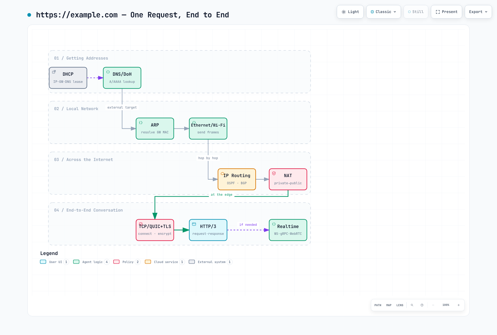

# 网络基础知识第 4 部分：一个请求的旅程与云端映射

> **最后更新**：2026年10月12日

::: tip 这是一个由五部分组成的系列
[第 1 部分：分层模型、链路层与路由层](./06-network-fundamentals-part1.md) ·
[第 2 部分：传输层与 TLS](./06-network-fundamentals-part2.md) ·
[第 3 部分：应用协议](./06-network-fundamentals-part3.md) ·
**第 4 部分：一个请求的旅程与云端**（本文档） ·
[第 5 部分：网络设备、LAN 与 WAN](./06-network-fundamentals-part5.md)
:::

本部分通过一个示例请求串联本系列中的 25 种协议和机制，然后映射它们在 AWS 和 Kubernetes 中的相关职责。这些是功能上的比较，并非一一对应的替代关系。

[🔍 查看交互式图表](https://www.atomai.click/kubernetes-docs/archmaps/en-basics-06-network-fundamentals-part4-0.html)

---

## 6. 跟踪一个请求的完整旅程

对于到 `https://example.com` 的新连接，以下内容是一份概念性的依赖关系指南，并非数据包跟踪：DNS 查询和握手数据包本身也会使用链路层和路由层，而缓存状态或现有连接可以省去一些步骤。

1. **地址配置**：主机已经配置好地址、路由和解析器设置，这些配置可能来自 DHCP、静态配置、IPv6 SLAAC/路由器通告或其他受管理机制。
2. **DNS（或 DoH）**：在需要时解析目标地址。递归解析器可以使用缓存、跟随委派或转发查询；应用程序不必直接联系根服务器。HTTPS 记录还可能通告连接参数。
3. **邻居解析**：对于通过以太网传输的 IPv4，如果所选下一跳的 MAC 地址不在缓存中，则使用 ARP 解析；IPv6 使用邻居发现。下一跳可以是本地目标，也可以是路由器。
4. **以太网 / Wi-Fi**：向该下一跳发送帧。只有在所选路由要求使用默认网关时，才会使用默认网关。
5. **IP 路由**：路由器根据其转发表转发数据。路由可以是静态路由、直连路由，也可以通过 BGP、OSPF 或其他控制平面学习；路由协议不会针对每个请求都重新协商。
6. **可选的 NAT**：IPv4 流量的互联网出口路径可能会将私有地址转换为公有地址。许多内部路径和 IPv6 路径不会使用 NAT；私有地址之间也可以进行 NAT。
7. **TCP 或 QUIC**：建立或复用传输连接。HTTP/1.1 和 HTTP/2 通常使用 TCP；HTTP/3 使用基于 UDP 的 QUIC。
8. **TLS**：根据握手模式对对端进行身份验证并建立流量密钥。对于 QUIC，TLS 1.3 与第 7 步集成；会话恢复不同于基于证书的新握手。
9. **HTTP**：使用协商好的版本交换请求和响应。HTTP/3 必须使用 QUIC 分支，不会通过 TCP 分支运行。
10. **可选的应用功能**：WebSocket、浏览器兼容的 gRPC 或 WebRTC 可能会创建额外连接，也可能复用/多路复用现有传输，具体取决于实现。

**ICMP** 可以报告某些 IP 层错误，例如目标不可达或数据包对于某条路径来说过大。但它不会报告所有故障：数据包或 ICMP 错误可能会被过滤，而 TLS/应用故障也有各自的处理机制。应将获准且相关的 ICMP 信息与传输层/应用日志和测量结果结合起来；没有 ICMP 错误并不能证明请求成功。

---

## 7. 这些概念在云端如何体现

云网络仍然承担寻址、路由、过滤和传输等职责，但与传统网络设备相比，其边界有所不同。在 AWS 中：

| 传统概念 | AWS 对应项 |
|---|---|
| 分段与过滤 | VPC/子网用于划分逻辑网络边界；安全组和 NACL 用于过滤，并非 VLAN 的对应物 |
| 路由表 | VPC 路由表、Transit Gateway |
| BGP 对等连接 | Direct Connect 虚拟接口；动态路由的 Site-to-Site VPN（也可以使用静态 VPN 路由） |
| NAT / 私有服务访问 | NAT Gateway 转换地址；VPC 端点为受支持的服务提供私有路径 |
| DNS 服务器 | Route 53、Resolver 端点 |
| DHCP | VPC DHCP 选项集 |
| TLS 终止 / 证书 | ALB HTTPS 监听器、NLB TLS 监听器或 CloudFront；ACM 管理受支持的证书，但不转发流量 |
| L7 负载均衡 | ALB；Istio/Envoy 等应用代理可作为单独管理的服务网格 |
| SSH 访问 | Systems Manager Session Manager |
| 内部网段加密 | 应用程序或代理中的 TLS/mTLS；网络层加密是单独的设计选项 |

AWS App Mesh 支持**已于2026年9月30日结束**。AWS 表示，在该日期之后将无法再访问 App Mesh 控制台和资源。现有部署已失去其控制和管理路径；请参阅官方停止支持通知和迁移指南。

设计时应**优先考虑以下三个决策**：

1. **IP 地址规划**：为需要互连的网络规划 CIDR，包括本地部署网络、Pod 和 Service 地址范围。地址重叠可能需要进行转换或重新设计；重新编号会带来运维成本，但不存在普遍适用的成本排序。
2. **出站路径**：根据每个目标选择互联网或私有服务路径。比较 NAT 的每小时/数据费用、接口端点的每小时/数据费用、跨 AZ 传输费用以及可用性要求。S3/DynamoDB 网关端点不收取额外端点费用，但端点无法取代所有互联网目标。
3. **加密终止点**：记录每一跳上的加密和身份验证情况，包括负载均衡器之后的后端连接。检查工作负载的要求和适用策略；仅进行 TLS 终止并不能保护下一跳。

---

## 8. 在 Kubernetes 中由谁来完成这些工作

在集群内，同样的概念会以新的组件名称重复出现。下表衔接了本系列与后续的深入介绍文档。

| 传统概念 | Kubernetes 对应项 |
|---|---|
| Pod IP 分配 | CNI/IPAM 集成（VPC CNI、Cilium、……）；不一定会为每个 Pod 使用 DHCP |
| 本地交付 / 转发 | 主机接口、邻居处理和 CNI 数据路径；实现可能使用 veth、路由、隧道或 eBPF |
| DNS | 集群 DNS，通常为 CoreDNS；`service.namespace.svc.<cluster-domain>`（`cluster.local` 是常见的已配置域名） |
| Service 虚拟 IP / L4 负载均衡 | Linux 上的 kube-proxy：iptables 或 nftables；自 1.35 起，IPVS 已弃用。eBPF 实现可以取代 kube-proxy，但它不是 kube-proxy 的一种模式 |
| Pod 流量策略 | NetworkPolicy；只有支持该功能的网络控制器/插件才会强制执行 |
| L7 路由 / TLS 终止 | Ingress/Gateway API 资源，以及负责实现它们的控制器和数据平面 |
| Service 间 mTLS | 应用 TLS 或已配置的网格，例如 Istio/Linkerd；仅安装任意 CNI 并不会启用 mTLS |
| BGP 路由 / 通告 | 例如，Calico BGP 路由，或 MetalLB 通过 BGP 通告 Service 地址；两者的职责不同 |

对于由 Pod 提供后端的普通 ClusterIP Service，集群 DNS 通常会解析出 Service IP，然后 kube-proxy 或其替代实现会根据 Service/EndpointSlice 状态选择符合条件的端点。数据路径会将流量转发到同一节点或其他节点上的该端点。Headless Service 则通过 DNS 暴露端点地址，而 ExternalName Service 会返回 CNAME。只有在相关对等方和策略均已配置时，mTLS 才会生效。这些变化说明了为什么“每一层总是都会运行”不是有效的数据包流假设。

---

## 总结

了解这 25 种协议和机制之后，请仔细审视各自的权衡和保证范围。

TCP 提供有序、可靠的交付，但需要承担恢复和排序开销。UDP 将这些功能留给更高层。QUIC 基于 UDP 提供可靠的数据流和集成安全机制。NAT 节省公有 IPv4 地址，但会使外部主动发起连接变得复杂；ICE/STUN/TURN 有助于解决这一问题。DoH 保护解析器这一跳；组织的可见性取决于解析器和端点策略。

调查故障时，应依据各层实际提供的保证和可观测证据来缩小故障范围。在日志、跟踪或测量结果将某种可能性与其他解释区分开来之前，协议层面的合理解释仍然只是一个假设。

---

## 后续文档

先将这些协议基础与 Linux 上的观测联系起来，然后沿着[网络学习路径](../networking/README.md#learning-path)，从容器和 Services 深入了解 CNI 实现：

- [第 5 部分：网络设备、LAN 与 WAN 基础](./06-network-fundamentals-part5.md)：逐设备的转发决策、VLAN/STP/FHRP、NAT 与 CGNAT、WAN 类型 | [测验](../quizzes/basics/06-network-fundamentals-part5-quiz.md)
- [内核网络栈](../kernel/02-network-stack.md)：套接字/VFS 入口路径、缓冲区和数据包处理
- [Linux 网络诊断实践](../networking/07-linux-network-diagnostics.md)：解读观测结果并检验假设 | [测验](../quizzes/networking/07-linux-network-diagnostics-quiz.md)
- [eBPF 基础知识](./05-ebpf-fundamentals.md)：数据包如何在内核中处理
- [Cilium 网络](../networking/cilium/03-networking.md)：基于 eBPF 的 CNI
- [Calico BGP 深入解析](../networking/calico/04-bgp-deep-dive.md)：集群内部的 BGP 路由
- [Amazon VPC CNI](../networking/01-vpc-cni.md)：VPC CNI 与 IP 分配

## 参考资料

协议列表以 ByteByteGo 的信息图《What Keeps the Internet Running?》为基础；解释和实践评论均为独立撰写。

主要参考资料：[Kubernetes Service 代理模式](https://kubernetes.io/docs/reference/networking/virtual-ips/)、[Service DNS](https://kubernetes.io/docs/concepts/services-networking/dns-pod-service/)、[NetworkPolicy](https://kubernetes.io/docs/concepts/services-networking/network-policies/)、[NAT Gateway 费用指南](https://docs.aws.amazon.com/vpc/latest/userguide/nat-gateway-pricing.html)、[ECR VPC 端点](https://docs.aws.amazon.com/AmazonECR/latest/userguide/vpc-endpoints.html)、[App Mesh 生命周期](https://docs.aws.amazon.com/app-mesh/latest/userguide/what-is-app-mesh.html)。
