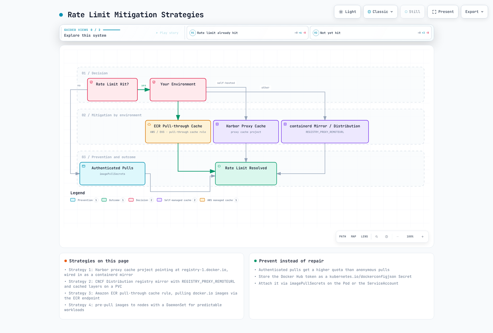

# Docker Hub

> **最后更新**：2026 年 9 月 11 日

## 概述

未指定镜像仓库时，Docker Hub 是 Docker CLI 默认使用的镜像仓库。它托管公有和私有容器镜像，包括 Docker Official Images、已验证发布者的镜像以及社区贡献的内容。

### 计划和功能

| 功能 | Personal | Pro | Team | Business |
|---------|------|-----|------|----------|
| **价格** | 基础免费额度 | 每月 11 美元 / 按年计费时每月 9 美元 | 每月 16 美元 / 按年计费时每用户每月 15 美元 | 请查看当前价格和合同 |
| **私有仓库** | 1 个 | 不限 | 不限 | 不限 |
| **团队功能** | 个人使用 | 个人使用 | 组织协作 | 组织治理 |
| **旧版 Automated Builds 并发数** | 不提供 | 5 | 15 | 15 |
| **安全和管理** | 查看套餐范围 | 查看套餐范围 | 查看组织功能 | 查看 SSO、审计和合同范围 |

价格为 2026 年 9 月 11 日在[官方定价页面](https://www.docker.com/pricing/)查看的美元标价；请核实账单条款和税费。Automated Builds 已弃用，计划于 2027 年 4 月 1 日停止服务。

### 拉取速率限制

[使用文档](https://docs.docker.com/docker-hub/usage/)说明了以下六小时限制。请核实实际账户条款和响应标头；公平使用和滥用限制另行适用：

| 用户类型 | 速率限制 | 重置周期 |
|-----------|------------|--------------|
| 匿名用户 | 100 次拉取 | 6 小时 |
| 已认证（Free） | 200 次拉取 | 6 小时 |
| 已认证（Pro） | 公平使用范围内不限 | - |
| 已认证（Team） | 公平使用范围内不限 | - |
| 已认证（Business） | 不限 | - |

匿名限制按 IPv4 地址或 IPv6 `/64` 子网计算。已认证的拉取量根据账户/组织规则归属。共用 NAT 地址的节点会共用**匿名**配额，但不一定共用已认证账户的配额。

## 在 Kubernetes 中使用 Docker Hub

### 创建镜像拉取 Secret

从 Docker Hub 拉取私有镜像时，应创建 Kubernetes Secret：

Secret、Pod 和 ServiceAccount 必须位于同一命名空间。拉取镜像时应使用只读 PAT，并避免将真实凭证直接写入 shell 历史或 CI 日志。

```bash
# Create docker-registry secret
kubectl create secret docker-registry dockerhub-secret \
  --docker-server=https://index.docker.io/v1/ \
  --docker-username=<your-username> \
  --docker-password=<your-password-or-token> \
  --docker-email=<your-email> \
  -n <namespace>
```

使用 Personal Access Token（推荐使用 PAT 而不是密码）：

```bash
# Generate a Personal Access Token at https://hub.docker.com/settings/security
kubectl create secret docker-registry dockerhub-secret \
  --docker-server=https://index.docker.io/v1/ \
  --docker-username=myuser \
  --docker-password=dckr_pat_xxxxxxxxxxxx \
  -n default
```

### 在 Pod 中使用 Secret

在 Pod spec 中引用该 secret：

```yaml
apiVersion: v1
kind: Pod
metadata:
  name: private-app
  namespace: default
spec:
  containers:
  - name: app
    image: myusername/private-app:v1.0.0
  imagePullSecrets:
  - name: dockerhub-secret
```

### 与 ServiceAccount 集成

将镜像拉取 Secret 关联到 ServiceAccount，即可自动注入：

```yaml
apiVersion: v1
kind: ServiceAccount
metadata:
  name: app-service-account
  namespace: default
imagePullSecrets:
- name: dockerhub-secret
```

现在，使用此 ServiceAccount 的 Pod 会自动使用 Docker Hub 凭证：

此设置适用于新准入且未指定自身 `imagePullSecrets` 的 Pod；不会追溯修改现有 Pod 或其他 ServiceAccount。

```yaml
apiVersion: apps/v1
kind: Deployment
metadata:
  name: my-app
  namespace: default
spec:
  replicas: 3
  selector:
    matchLabels:
      app: my-app
  template:
    metadata:
      labels:
        app: my-app
    spec:
      serviceAccountName: app-service-account
      containers:
      - name: app
        image: myusername/private-app:v1.0.0
```

### 在整个命名空间中分发 Secret

对于多命名空间集群，可自动化分发 Secret：

```yaml
# Using Kubernetes Replicator or similar controller
apiVersion: v1
kind: Secret
metadata:
  name: dockerhub-secret
  namespace: default
  annotations:
    replicator.v1.mittwald.de/replicate-to: "staging,production,dev-*"
type: kubernetes.io/dockerconfigjson
data:
  .dockerconfigjson: <base64-encoded-config>
```

## 缓解速率限制的策略



[🔍 查看交互式图表](https://www.atomai.click/kubernetes-docs/archmaps/en-container-registry-01-docker-hub-0.html)

### 策略 1：使用 Harbor 拉取缓存

将 Harbor 部署为代理缓存，以减少对 Docker Hub 的拉取次数：

```yaml
# Harbor values.yaml excerpt
proxy:
  httpProxy: ""
  httpsProxy: ""
  noProxy: 127.0.0.1,localhost,.local,.internal

# After Harbor deployment, configure a Docker Hub registry endpoint
# and select that endpoint when creating a proxy cache project.
```

应使用明确的代理项目镜像名称，例如 `harbor.internal.example.com/dockerhub-cache/library/nginx:TAG`。不要将上面的 Harbor 出站 HTTP 代理设置视为 registry-cache 配置。containerd 镜像还需要兼容的 registry URL 布局和受信任的 TLS 配置。

```toml
# containerd 2.x: /etc/containerd/config.toml
[plugins."io.containerd.cri.v1.images".registry]
  config_path = "/etc/containerd/certs.d"
```

```toml
# containerd 1.x uses this plugin name instead
[plugins."io.containerd.grpc.v1.cri".registry]
  config_path = "/etc/containerd/certs.d"
```

```toml
# /etc/containerd/certs.d/docker.io/hosts.toml
server = "https://registry-1.docker.io"
[host."https://mirror.gcr.io"]
  capabilities = ["pull"]
```

旧版 `registry.mirrors` 配置已弃用。请遵循 [containerd hosts 文档](https://github.com/containerd/containerd/blob/main/docs/hosts.md)，且只向受信任的镜像授权 `resolve`。公有镜像服务不能保证每个公有或私有镜像都可用。

### 策略 2：使用 Distribution 镜像

将 CNCF Distribution registry 部署为拉取缓存：

先创建所引用的 PVC 和 `dockerhub-creds` Secret。以下片段在受控实验环境中暴露 HTTP registry；生产环境必须使用 TLS、身份验证和访问控制。使用高权限上游凭证的代理不得向未授权用户暴露缓存的私有镜像。

```yaml
apiVersion: apps/v1
kind: Deployment
metadata:
  name: registry-mirror
spec:
  replicas: 1
  selector:
    matchLabels:
      app: registry-mirror
  template:
    metadata:
      labels:
        app: registry-mirror
    spec:
      containers:
      - name: registry
        image: registry:2
        ports:
        - containerPort: 5000
        env:
        - name: REGISTRY_PROXY_REMOTEURL
          value: "https://registry-1.docker.io"
        - name: REGISTRY_PROXY_USERNAME
          valueFrom:
            secretKeyRef:
              name: dockerhub-creds
              key: username
        - name: REGISTRY_PROXY_PASSWORD
          valueFrom:
            secretKeyRef:
              name: dockerhub-creds
              key: password
        volumeMounts:
        - name: cache-storage
          mountPath: /var/lib/registry
      volumes:
      - name: cache-storage
        persistentVolumeClaim:
          claimName: registry-cache-pvc
---
apiVersion: v1
kind: Service
metadata:
  name: registry-mirror
spec:
  selector:
    app: registry-mirror
  ports:
  - port: 5000
    targetPort: 5000
```

### 策略 3：使用 Amazon ECR Pull-through Cache

如果运行在 AWS 上，可使用 ECR 拉取缓存功能。首先在同一账户和区域中创建上游凭证 Secret，名称必须以 `ecr-pullthroughcache/` 为前缀；使用该 Secret 的实际完整 ARN：

```bash
# Example after creating a secret named ecr-pullthroughcache/dockerhub
PTC_SECRET_ARN=$(aws secretsmanager describe-secret \
  --secret-id ecr-pullthroughcache/dockerhub --region us-east-1 \
  --query ARN --output text)
# Create pull-through cache rule for Docker Hub
aws ecr create-pull-through-cache-rule \
  --ecr-repository-prefix docker-hub \
  --upstream-registry-url registry-1.docker.io \
  --credential-arn "$PTC_SECRET_ARN" \
  --region us-east-1

# Pull images through ECR
# Original: docker.io/library/nginx:latest
# Via ECR: 123456789012.dkr.ecr.us-east-1.amazonaws.com/docker-hub/library/nginx:latest
```

### 策略 4：预先将镜像拉取到节点

对于可预测的工作负载，可使用 DaemonSet 预先拉取镜像：

预拉取只是将下载时间提前；它不会消除上游拉取，也不能保证 kubelet 镜像垃圾回收保留缓存。应将凭证保存在 DaemonSet 所在的命名空间，并使用持续维护的标签或已核验的摘要。

```yaml
apiVersion: apps/v1
kind: DaemonSet
metadata:
  name: image-prepuller
spec:
  selector:
    matchLabels:
      app: image-prepuller
  template:
    metadata:
      labels:
        app: image-prepuller
    spec:
      initContainers:
      - name: prepull-nginx
        image: nginx:1.30.6
        command: ['sh', '-c', 'echo Image pulled']
      - name: prepull-redis
        image: redis:7
        command: ['sh', '-c', 'echo Image pulled']
      containers:
      - name: pause
        image: registry.k8s.io/pause:3.10
      imagePullSecrets:
      - name: dockerhub-secret
```

## Automated Builds

Docker Hub Automated Builds 已**弃用**，计划于 2027 年 4 月 1 日停止服务。以下内容介绍旧版 GitHub/Bitbucket 集成。GitLab 构建应在 GitLab CI 中执行并推送构建结果；新流水线应遵循[迁移指南](https://docs.docker.com/docker-hub/repos/manage/builds/)。

### 设置 Automated Builds

1. 对已有的自动构建设置，检查关联的 GitHub/Bitbucket 账户。
2. 创建仓库，并将其连接到源代码仓库。
3. 配置构建规则：

```yaml
# Example build rules configuration
Source Type: Branch
Source: main
Docker Tag: latest
Dockerfile location: /Dockerfile
Build Context: /

Source Type: Tag
Source: /^v[0-9.]+$/
Docker Tag: {sourceref}
Dockerfile location: /Dockerfile
Build Context: /
```

### 构建钩子

在仓库中使用钩子脚本自定义构建：

```bash
# hooks/build - Custom build script
#!/bin/bash
docker build \
  --build-arg BUILD_DATE=$(date -u +'%Y-%m-%dT%H:%M:%SZ') \
  --build-arg VCS_REF=$(git rev-parse --short HEAD) \
  -t $IMAGE_NAME .
```

```bash
# hooks/post_push - Run after successful push
#!/bin/bash
# Tag with additional tags
docker tag $IMAGE_NAME $DOCKER_REPO:$SOURCE_COMMIT
docker push $DOCKER_REPO:$SOURCE_COMMIT
```

### Docker Hub Automated Builds 的限制

- 此服务已弃用；应在 2027 年 4 月 1 日之前规划迁移。
- 文档所述的并发构建额度为 Pro 5 个，Team/Business 15 个。
- 不要假设多平台、缓存、凭证和保留行为与外部 CI runner 相同；应检查实际旧版配置。

**建议**：使用 GitHub Actions 和 `docker/build-push-action`，或使用 Docker/BuildKit 命令配置 GitLab CI。GitHub Actions 的 action 不能直接作为 GitLab CI 作业执行。

## 公有镜像的安全注意事项

### 供应链攻击向量

Docker Hub 上的公有镜像可能带来安全风险：

1. **拼写仿冒**：名称与热门镜像相似的恶意镜像。
2. **维护者账户被入侵**：合法镜像被攻击者接管。
3. **内嵌恶意软件**：加密货币挖矿程序、后门或数据窃取代码。
4. **易受攻击的基础镜像**：包含已知 CVE 的过时镜像。
5. **镜像臃肿**：不必要的软件包扩大攻击面。

### 识别受信任的镜像

| 镜像类型 | 标识 | 信任级别 |
|------------|-----------|-------------|
| Docker Official Images | 经精选的上游镜像项目 | 核实具体标签、摘要和漏洞 |
| Verified Publisher | 发布者身份已验证 | 核实具体制品和维护策略 |
| Sponsored OSS | 受赞助的项目计划 | 赞助并不保证没有漏洞 |
| 社区镜像 | 无徽标 | 手动核实 |

### Docker Official Images

Official Images 由 Docker 和上游/社区维护者共同精选维护；并非每个镜像都由 Docker Inc. 直接维护：

```bash
# Official images use the library/ namespace (often omitted)
docker pull nginx          # Same as docker.io/library/nginx
docker pull postgres:15    # Same as docker.io/library/postgres:15
```

Official Images 的特点：
- 文档清晰，Dockerfile 透明
- 定期提供安全更新
- Dockerfile 遵循最佳实践
- 架构支持因镜像/标签而异
- 基础镜像大小和所含软件包因变体而异

### Verified Publisher

Verified Publisher 是经 Docker 验证的组织：

```bash
# Select an actual maintained tag/digest from the publisher's current catalog
docker buildx imagetools inspect "$VERIFIED_VENDOR_IMAGE"
docker pull "$VERIFIED_VENDOR_IMAGE"
```

不要根据发布者徽标推断当前标签是否可用或是否存在漏洞。厂商目录和访问策略会变化；旧版 Bitnami 或 Grafana 标签示例并非当前建议。

### 安全扫描最佳实践

部署前应始终扫描公有镜像：

```bash
# Using Trivy (recommended)
trivy image nginx:latest

# Using Docker Scout (Docker Desktop)
docker scout cves nginx:latest

# Using Grype
grype nginx:latest
```

来源允许列表很有用，但**不能强制实施签名验证或漏洞扫描**。以下示例在专用的 `registry-demo` 命名空间使用 Kyverno Audit 模式；选择强制执行策略前，应先检查结果。

```yaml
# Source allowlist only; Kyverno must already be installed
apiVersion: kyverno.io/v1
kind: ClusterPolicy
metadata:
  name: allowed-image-sources
spec:
  validationFailureAction: Audit
  rules:
  - name: check-image-source
    match:
      any:
      - resources:
          kinds:
          - Pod
          namespaces:
          - registry-demo
    validate:
      message: "Use an approved, fully qualified image reference."
      pattern:
        spec:
          =(initContainers):
          - image: "docker.io/library/* | docker.io/my-approved-org/*"
          =(ephemeralContainers):
          - image: "docker.io/library/* | docker.io/my-approved-org/*"
          containers:
          - image: "docker.io/library/* | docker.io/my-approved-org/*"
```

签名策略需要受信任的密钥/身份以及摘要验证。漏洞证明策略还需要受信任的签名者和明确的接受标准；只检查未签名的 `scanner` 字符串并不足够。参阅[镜像安全](../security/07-image-security.md)和[上游来源允许列表示例](https://github.com/kyverno/policies/tree/main/best-practices/restrict-image-registries)。Docker CLI 的 Content Trust 设置不会自动在 Kubernetes/containerd 准入时强制执行。

### 公有镜像的建议

1. **固定到特定摘要**（而不仅是标签）：
   ```yaml
   # Avoid
   image: nginx:latest

   # Better
   image: nginx:1.30.6

   ```

   拉取镜像后，使用 `docker image inspect nginx:1.30.6 --format='{{index .RepoDigests 0}}'` 获取完整值，然后在工作负载中使用输出的 `repository@sha256:...`。缩短后的示例哈希不能作为有效镜像引用。

2. **镜像到私有仓库**：
   ```bash
   # Pull, scan, and push to your private registry
   docker pull nginx:1.30.6
   trivy image nginx:1.30.6 --exit-code 1
   docker tag nginx:1.30.6 myregistry.com/library/nginx:1.30.6
   docker push myregistry.com/library/nginx:1.30.6
   ```

3. **使用 Distroless 或最小化基础镜像**：
   ```dockerfile
   # Instead of full OS base images
   FROM gcr.io/distroless/static-debian12
   # or
   FROM cgr.dev/chainguard/static:latest
   ```

## Docker Hub API 用法

### 身份验证

旧版 `/v2/users/login` 路由已弃用。[官方 Hub API](https://docs.docker.com/reference/api/hub/latest/) 在 `/v2/auth/token` 接受 `identifier` 和 `secret`，并返回 `access_token`。此令牌 10 分钟后过期，并且不同于 Registry 拉取所使用的 `auth.docker.io` 令牌。应优先使用具有所需 scope 的 PAT，而不是密码。

```bash
set -euo pipefail
# Load these from secure shell input or CI secrets; do not commit their values.
: "${DOCKER_USER:?Set Docker Hub username}"
: "${DOCKER_PAT:?Load a Docker Hub personal access token}"
export DOCKER_USER DOCKER_PAT
HUB_TOKEN=$(jq -n '{identifier: env.DOCKER_USER, secret: env.DOCKER_PAT}' | \
  curl -fsS -X POST https://hub.docker.com/v2/auth/token \
    -H 'Content-Type: application/json' --data-binary @- | jq -er '.access_token')
HUB_NAMESPACE=${HUB_NAMESPACE:-$DOCKER_USER}
export HUB_TOKEN HUB_NAMESPACE
```

### 列出仓库和标签

`HUB_NAMESPACE` 默认使用登录用户；必要时应设置为已授权的组织命名空间。这些示例只请求第一个可见页面。`page_size` 最大值为 100；要获取完整清单，应继续跟随响应中的 `next` URL。

```bash
: "${DOCKER_REPO:?Set repository name}"
curl -fsS -H "Authorization: Bearer $HUB_TOKEN" \
  "https://hub.docker.com/v2/namespaces/$HUB_NAMESPACE/repositories?page_size=100" | \
  jq '.results[] | {name, is_private}'

curl -fsS -H "Authorization: Bearer $HUB_TOKEN" \
  "https://hub.docker.com/v2/namespaces/$HUB_NAMESPACE/repositories/$DOCKER_REPO/tags?page_size=100" | \
  jq '.results[] | {name, last_updated}'
```

### 清理前审查标签

不要只根据前 100 条记录删除标签，也不要假设服务器端顺序未公开说明。以下独立 Bash 脚本会收集所有分页并在本地排序清单；它不会执行删除。删除任何内容前，应检查正在运行的工作负载摘要、回滚保留情况和受保护标签，然后使用 Hub 管理界面或当前有文档记录的 API 功能。

```bash
#!/usr/bin/env bash
set -euo pipefail
: "${HUB_TOKEN:?Create a current Hub API access token}"
: "${HUB_NAMESPACE:?Set namespace}"
: "${DOCKER_REPO:?Set repository}"
registry_tag_index=$(mktemp)
trap 'rm -f "$registry_tag_index"' EXIT
registry_next="https://hub.docker.com/v2/namespaces/$HUB_NAMESPACE/repositories/$DOCKER_REPO/tags?page_size=100"
while [ -n "$registry_next" ]; do
  case "$registry_next" in
    https://hub.docker.com/*) ;;
    *) printf '%s\n' 'Unexpected pagination host' >&2; exit 1 ;;
  esac
  registry_page=$(curl -fsS -H "Authorization: Bearer $HUB_TOKEN" "$registry_next")
  printf '%s' "$registry_page" | jq -c '.results[]' >> "$registry_tag_index"
  registry_next=$(printf '%s' "$registry_page" | jq -r '.next // empty')
done
# Read-only inventory. No DELETE request is made.
jq -s 'sort_by(.last_updated // "") | reverse | .[] | {name, last_updated}' "$registry_tag_index"
```

### 漏洞分析

```bash
# Check Scout access against the account, plan and repository configuration.
# Use the documented CLI instead of assuming a /tags/TAG/vulnerabilities endpoint.
docker scout cves nginx:1.30.6
```

### 创建私有仓库

先确认命名空间权限和套餐额度。

```bash
jq -n --arg ns "$HUB_NAMESPACE" \
  '{namespace:$ns, name:"myapp", description:"My application", is_private:true}' | \
  curl -fsS -X POST "https://hub.docker.com/v2/namespaces/$HUB_NAMESPACE/repositories" \
    -H "Authorization: Bearer $HUB_TOKEN" \
    -H 'Content-Type: application/json' --data-binary @-
```

## 最佳实践

### 1. 身份验证与访问

- 使用 Personal Access Token，而不是密码。
- 定期轮换令牌（建议每 90 天一次）。
- CI/CD 拉取操作使用只读令牌。
- 为 Docker Hub 账户启用 2FA。
- 团队使用时，采用组织级访问管理。

### 2. 镜像管理

- 使用明确的标签；生产环境不要使用 `latest`。
- 实施一致的标签策略（推荐 SemVer）。
- 定期清理旧标签/未使用标签。
- 记录镜像依赖和更新流程。

### 3. 安全

- 部署前扫描所有镜像。
- 优先选择 Official Images 和 Verified Publisher。
- 将关键镜像同步到私有仓库。
- 使用准入控制器强制实施策略。
- 检查 Dockerfile 中的安全问题。

### 4. 性能和可靠性

- 在生产集群中设置仓库镜像/缓存。
- 监控速率限制使用量。
- 即使拉取公有镜像也应进行身份验证（可获得更高限额）。
- 对可预测的部署预先拉取镜像。

### 5. CI/CD 集成

- 使用 GitHub Actions 或 GitLab CI 执行构建（功能比 Docker Hub Automated Builds 更多）。
- 使用多阶段构建减小镜像。
- 有效缓存层以加快构建。
- 对镜像签名以保护供应链。

## 总结

Docker Hub 为 Docker CLI 提供默认的公有镜像生态系统和私有仓库。在 Kubernetes 基础设施中可靠地使用它，需要身份验证、缓存、制品验证和明确的维护策略。

生产工作负载如果需要更高可靠性或更严格的安全控制，可以考虑：
- **Amazon ECR**，适用于 AWS 原生环境。
- **Harbor**，适用于自行托管、隔离网络或多云场景。
- **Docker Hub Business**，适用于需要企业功能并希望使用 SaaS 的场景。

主要要点：
- 采用适当的身份验证，并核实账户实际适用的速率/公平使用限制。
- 在生产集群中部署拉取缓存。
- 信任但仍需验证：扫描所有公有镜像。
- 尽可能使用 Official Images 和 Verified Publisher。
- 考虑混合方案：使用 Docker Hub 获取基础镜像，使用私有仓库存放自己的应用。

## 参考资料

- [Docker Hub 使用和拉取限制](https://docs.docker.com/docker-hub/usage/pulls/)
- [Docker Hub API](https://docs.docker.com/reference/api/hub/latest/)
- [Automated Builds 弃用说明](https://docs.docker.com/docker-hub/repos/manage/builds/)
- [containerd registry host 配置](https://github.com/containerd/containerd/blob/main/docs/hosts.md)
- [ECR 拉取缓存规则](https://docs.aws.amazon.com/AmazonECR/latest/userguide/pull-through-cache-creating-rule.html)
