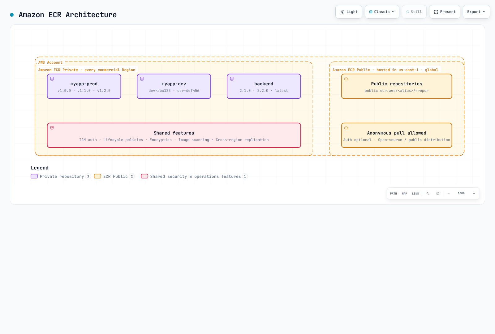

# Amazon ECR（弹性容器注册表）

> **最后更新**：2026 年 10 月 16 日

## ECR 概览

Amazon Elastic Container Registry（ECR）是 AWS 提供的全托管容器镜像仓库服务。它无需自行运维镜像仓库基础设施，并与 AWS 服务（尤其是 Amazon EKS）深度集成。

除非另有说明，CLI/CDK/IAM/生命周期策略示例均面向 ECR Private。这些是可选配置，并非应不加判断地一次执行的单一脚本。创建仓库时请选择一种方法，避免重复创建同一仓库。扫描和查询示例要求仓库及镜像标签已存在。请先配置 AWS 凭证，并替换示例中的账户和资源标识符。

```bash
export AWS_REGION=us-east-1
export AWS_DEFAULT_REGION="$AWS_REGION"
```

### 架构

ECR 是一项按区域提供的服务，包含两种不同产品：



[🔍 查看交互式图表](https://www.atomai.click/kubernetes-docs/archmaps/en-container-registry-02-amazon-ecr-0.html)

**ECR Private**：通过基于 IAM 的访问控制存放内部容器镜像。镜像按区域存储，也可以复制到其他区域。

**ECR Public**：用于公开分发镜像。管理 API 端点位于 `us-east-1` 和 `us-west-2`；镜像使用全局 `public.ecr.aws` URL。图中标出的 us-east-1 只是示例，并非唯一端点。

### 定价

| 项目 | 价格 |
|-----------|-------|
| **存储** | 按区域和存储类别定价；官方标准存储示例为每 GB 每月 $0.10 |
| **传输到受支持的同区域 AWS 计算服务** | ECR 不收取传输费；网络服务费用另计 |
| **跨区域/互联网传输** | 需根据源、目标、阶梯和免费额度查询；并非统一按 $0.02/GB 计费 |
| **ECR Public** | 存储、匿名传输和经过身份验证的传输分别有不同的免费额度 |
| **基础扫描** | 免费 |
| **增强扫描** | 按 Amazon Inspector 定价 |

还可能产生 AWS Signer、KMS 和 VPC 端点费用。请通过[当前 ECR 定价](https://aws.amazon.com/ecr/pricing/)进行实际估算，并查看[公共端点列表](https://docs.aws.amazon.com/general/latest/gr/ecr-public.html)了解 API 所在区域。

### 区域服务注意事项

ECR 是一项按区域提供的服务，主要影响如下：

- 推送到 `us-east-1` 的镜像不会自动出现在 `eu-west-1`
- 跨区域拉取会产生数据传输费用
- 多区域部署应配置复制
- VPC 端点具有区域性

## 创建和配置仓库

### AWS CLI

```bash
# Create a basic repository
aws ecr create-repository \
  --repository-name myapp \
  --region us-east-1

# Alternative example using a separate repository; the KMS key must exist
aws ecr create-repository \
  --repository-name myapp-secure \
  --image-tag-mutability IMMUTABLE \
  --image-scanning-configuration scanOnPush=true \
  --encryption-configuration encryptionType=KMS,kmsKey=alias/ecr-key \
  --tags Key=Environment,Value=production Key=Team,Value=platform \
  --region us-east-1
```

### AWS CDK（TypeScript）

```typescript
import * as cdk from 'aws-cdk-lib';
import * as ecr from 'aws-cdk-lib/aws-ecr';
import * as kms from 'aws-cdk-lib/aws-kms';
import { Construct } from 'constructs';

export class EcrStack extends cdk.Stack {
  constructor(scope: Construct, id: string, props?: cdk.StackProps) {
    super(scope, id, props);

    // KMS key for encryption
    const ecrKey = new kms.Key(this, 'EcrKey', {
      description: 'KMS key for ECR encryption',
      enableKeyRotation: true,
      alias: 'ecr-key',
    });

    // ECR Repository
    const repository = new ecr.Repository(this, 'MyAppRepo', {
      repositoryName: 'myapp',
      imageScanOnPush: true,
      imageTagMutability: ecr.TagMutability.IMMUTABLE,
      encryption: ecr.RepositoryEncryption.KMS,
      encryptionKey: ecrKey,
      lifecycleRules: [
        {
          rulePriority: 1,
          description: 'Keep last 100 production images',
          tagStatus: ecr.TagStatus.TAGGED,
          tagPatternList: ['v*'],
          maxImageCount: 100,
        },
        {
          rulePriority: 2,
          description: 'Expire untagged images after 3 days',
          tagStatus: ecr.TagStatus.UNTAGGED,
          maxImageAge: cdk.Duration.days(3),
        },
      ],
    });

    // Output repository URI
    new cdk.CfnOutput(this, 'RepositoryUri', {
      value: repository.repositoryUri,
      description: 'ECR Repository URI',
    });
  }
}
```

### 仓库设置

#### 镜像标签可变性

| 设置 | 说明 | 适用场景 |
|---------|-------------|----------|
| `MUTABLE`（默认） | 可以覆盖标签 | 开发、CI 构建 |
| `IMMUTABLE` | 已有标签不可覆盖 | 在对应标签仍存在期间固定稳定版本引用 |
| `IMMUTABLE_WITH_EXCLUSION` | 只有匹配例外规则的标签可覆盖 | 允许 `latest` 等明确的可变别名 |

```bash
# Update existing repository to immutable
aws ecr put-image-tag-mutability \
  --repository-name myapp \
  --image-tag-mutability IMMUTABLE
```

#### 加密选项

| 类型 | 说明 | 费用 |
|------|-------------|------|
| `AES256`（默认） | 使用 Amazon S3 管理的加密密钥（SSE-S3） | 不另收 KMS 密钥费用 |
| `KMS` | 使用 AWS 管理的 ECR 密钥，或指定客户管理的 KMS 密钥 | 需支付适用的 KMS 费用 |

KMS 加密的优势：
- 通过 CloudTrail 审计密钥使用情况
- 实施精细的访问控制
- 支持密钥轮换
- 明确管理密钥生命周期

密钥必须位于仓库所在区域。现有仓库的加密配置无法更改；请规划迁移到新仓库，并在变更基础设施前检查 `cdk diff`。

#### 推送时扫描

| 扫描类型 | 说明 | 费用 |
|-----------|-------------|------|
| 基础扫描 | 使用 AWS 原生技术扫描操作系统 CVE | 免费 |
| 增强扫描 | 使用 Amazon Inspector 持续监控 | 按 Inspector 定价 |

```bash
# Inspect existing rules before replacing account/region registry configuration
aws ecr get-registry-scanning-configuration
# Isolated-registry example; merge existing production rules rather than dropping them
aws ecr put-registry-scanning-configuration \
  --scan-type ENHANCED \
  --rules '[{"repositoryFilters":[{"filter":"*","filterType":"WILDCARD"}],"scanFrequency":"CONTINUOUS_SCAN"}]'

# Check scan findings
aws ecr describe-image-scan-findings \
  --repository-name myapp \
  --image-id imageTag=v1.0.0
```

配置新的基础扫描时，应使用注册表级别的 `BASIC` 规则和 `SCAN_ON_PUSH` 筛选条件。仓库级 `imageScanOnPush`/CLI 选项在创建示例中仅作为旧版兼容设置。基础扫描对每个镜像在 24 小时内的扫描次数有限制；请等待扫描完成后再解读结果。增强扫描则遵循其配置的适用条件和重新扫描周期。

#### 镜像签名

ECR 支持由 AWS Signer 管理的自动签名，也支持 Notation 等客户端签名。仅存储签名并不会自动强制执行 EKS 准入控制：还需单独配置受信任的身份/密钥、摘要验证和准入策略。请参阅 [ECR 镜像签名](https://docs.aws.amazon.com/AmazonECR/latest/userguide/image-signing.html)。

向启用托管签名的仓库推送镜像时，推送方还需要签名配置文件所需的权限，例如 `signer:SignPayload`。下面仅包含 ECR 的 IAM 示例并未授予这些额外权限。

## 身份验证和访问控制

### 使用 AWS CLI 登录 Docker

```bash
# Standard login (uses default profile)
aws ecr get-login-password --region us-east-1 | \
  docker login --username AWS --password-stdin 123456789012.dkr.ecr.us-east-1.amazonaws.com

# Login with specific profile
aws ecr get-login-password --region us-east-1 --profile production | \
  docker login --username AWS --password-stdin 123456789012.dkr.ecr.us-east-1.amazonaws.com

# Login script for CI/CD
#!/bin/bash
ACCOUNT_ID=$(aws sts get-caller-identity --query Account --output text)
REGION=${AWS_REGION:-us-east-1}
aws ecr get-login-password --region $REGION | \
  docker login --username AWS --password-stdin ${ACCOUNT_ID}.dkr.ecr.${REGION}.amazonaws.com
```

### Docker 凭证助手

安装并配置 ECR 凭证助手，以便自动进行身份验证：

```bash
# Install on Amazon Linux 2023; check upstream instructions for other distributions
sudo yum install -y amazon-ecr-credential-helper

# Install on Ubuntu / Debian
sudo apt-get install -y amazon-ecr-credential-helper

# Install on macOS
brew install docker-credential-helper-ecr

# Merge the following fragment into Docker config; do not overwrite other credentials/settings.
```

```json
{
  "credHelpers": {
    "123456789012.dkr.ecr.us-east-1.amazonaws.com": "ecr-login",
    "public.ecr.aws": "ecr-login"
  }
}
```

### IAM 策略

#### 基础拉取策略

```json
{
  "Version": "2012-10-17",
  "Statement": [
    {
      "Effect": "Allow",
      "Action": [
        "ecr:GetAuthorizationToken"
      ],
      "Resource": "*"
    },
    {
      "Effect": "Allow",
      "Action": [
        "ecr:BatchCheckLayerAvailability",
        "ecr:GetDownloadUrlForLayer",
        "ecr:BatchGetImage"
      ],
      "Resource": "arn:aws:ecr:us-east-1:123456789012:repository/myapp"
    }
  ]
}
```

#### 完整推送/拉取策略

```json
{
  "Version": "2012-10-17",
  "Statement": [
    {
      "Effect": "Allow",
      "Action": [
        "ecr:GetAuthorizationToken"
      ],
      "Resource": "*"
    },
    {
      "Effect": "Allow",
      "Action": [
        "ecr:BatchCheckLayerAvailability",
        "ecr:GetDownloadUrlForLayer",
        "ecr:BatchGetImage",
        "ecr:PutImage",
        "ecr:InitiateLayerUpload",
        "ecr:UploadLayerPart",
        "ecr:CompleteLayerUpload"
      ],
      "Resource": "arn:aws:ecr:us-east-1:123456789012:repository/*"
    }
  ]
}
```

#### CI/CD 流水线策略

```json
{
  "Version": "2012-10-17",
  "Statement": [
    {
      "Sid": "ECRAuth",
      "Effect": "Allow",
      "Action": "ecr:GetAuthorizationToken",
      "Resource": "*"
    },
    {
      "Sid": "ECRPushPull",
      "Effect": "Allow",
      "Action": [
        "ecr:BatchCheckLayerAvailability",
        "ecr:GetDownloadUrlForLayer",
        "ecr:BatchGetImage",
        "ecr:PutImage",
        "ecr:InitiateLayerUpload",
        "ecr:UploadLayerPart",
        "ecr:CompleteLayerUpload",
        "ecr:DescribeImages",
        "ecr:DescribeRepositories",
        "ecr:ListImages"
      ],
      "Resource": [
        "arn:aws:ecr:us-east-1:123456789012:repository/myapp",
        "arn:aws:ecr:us-east-1:123456789012:repository/myapp-*"
      ]
    },
    {
      "Sid": "ECRScanResults",
      "Effect": "Allow",
      "Action": [
        "ecr:DescribeImageScanFindings"
      ],
      "Resource": "arn:aws:ecr:us-east-1:123456789012:repository/myapp"
    }
  ]
}
```

### 跨账户访问

#### 仓库策略（源账户）

```json
{
  "Version": "2012-10-17",
  "Statement": [
    {
      "Sid": "AllowCrossAccountPull",
      "Effect": "Allow",
      "Principal": {
        "AWS": [
          "arn:aws:iam::111111111111:root",
          "arn:aws:iam::222222222222:root"
        ]
      },
      "Action": [
        "ecr:GetDownloadUrlForLayer",
        "ecr:BatchGetImage",
        "ecr:BatchCheckLayerAvailability"
      ]
    },
    {
      "Sid": "AllowCrossAccountPush",
      "Effect": "Allow",
      "Principal": {
        "AWS": "arn:aws:iam::333333333333:role/ci-cd-role"
      },
      "Action": [
        "ecr:GetDownloadUrlForLayer",
        "ecr:BatchGetImage",
        "ecr:BatchCheckLayerAvailability",
        "ecr:PutImage",
        "ecr:InitiateLayerUpload",
        "ecr:UploadLayerPart",
        "ecr:CompleteLayerUpload"
      ]
    }
  ]
}
```

#### 目标账户 IAM 策略

```json
{
  "Version": "2012-10-17",
  "Statement": [
    {
      "Sid": "ECRAuth",
      "Effect": "Allow",
      "Action": "ecr:GetAuthorizationToken",
      "Resource": "*"
    },
    {
      "Sid": "CrossAccountPull",
      "Effect": "Allow",
      "Action": [
        "ecr:BatchCheckLayerAvailability",
        "ecr:GetDownloadUrlForLayer",
        "ecr:BatchGetImage"
      ],
      "Resource": "arn:aws:ecr:us-east-1:123456789012:repository/myapp"
    }
  ]
}
```

## 深入了解生命周期策略

ECR 生命周期策略可自动清理镜像，以优化存储成本并保持仓库整洁。设计策略时，必须了解规则的评估机制。

### 规则评估顺序

生命周期策略**会先评估所有规则**，再按优先级应用评估结果：

1. 评估过程不受优先级影响；`rulePriority` 数值越小，应用优先级越高。
2. 如果镜像符合较高优先级规则的标签要求，较低优先级规则就不能将其过期。
3. 每个镜像最多由一条规则过期或归档。计数以镜像摘要为单位，而不是标签数量。
4. 优先级必须唯一。前缀集合和未标记规则必须符合所选存储类别的服务约束；`any` 规则应排在最后。


[🔍 查看交互式图表](https://www.atomai.click/kubernetes-docs/archmaps/en-container-registry-02-amazon-ecr-1.html)

### 选择条件

| 参数 | 说明 | 取值 |
|-----------|-------------|--------|
| `tagStatus` | 按是否有标签筛选 | `tagged`、`untagged`、`any` |
| `tagPrefixList` | 匹配以指定前缀开头的标签 | `["v1.", "release-"]` |
| `tagPatternList` | 文档规定的 `*` 通配符；多个模式之间为 AND 关系 | `["v*"]` |
| `countType` | 镜像计数方式 | `imageCountMoreThan`、`sinceImagePushed` |
| `countUnit` | `sinceImagePushed` 使用的单位 | `days` |
| `countNumber` | 所选计数方式的阈值 | 正整数 |

这既不是正则表达式，也不是完整的 Unix glob 匹配：不要用 `?`、`[0-9]`、`^` 或 `$` 验证 SemVer。每个字符串最多允许四个 `*` 通配符。这些示例中的发布标签由 CI 验证为 `v1.2.3`，并用 `v*` 选择。示例讨论活跃镜像过期；有关归档/恢复时间、引用构件及其他计数类型，请查阅[当前生命周期规则](https://docs.aws.amazon.com/AmazonECR/latest/userguide/LifecyclePolicies.html)。

### 策略 A：分离仓库（推荐）

最清晰的做法是将生产镜像和开发镜像放在不同仓库，并分别设置生命周期策略。

#### 生产仓库（`myapp-prod`）

```bash
aws ecr create-repository \
  --repository-name myapp-prod \
  --image-tag-mutability IMMUTABLE \
  --image-scanning-configuration scanOnPush=true
```

生命周期策略——保留最近 100 个 SemVer 版本：

```json
{
  "rules": [
    {
      "rulePriority": 1,
      "description": "Keep newest 100 v-prefixed release image digests; CI validates the version format",
      "selection": {
        "tagStatus": "tagged",
        "tagPatternList": [
          "v*"
        ],
        "countType": "imageCountMoreThan",
        "countNumber": 100
      },
      "action": {
        "type": "expire"
      }
    },
    {
      "rulePriority": 2,
      "description": "Expire untagged images after 1 day",
      "selection": {
        "tagStatus": "untagged",
        "countType": "sinceImagePushed",
        "countUnit": "days",
        "countNumber": 1
      },
      "action": {
        "type": "expire"
      }
    }
  ]
}
```

```bash
aws ecr put-lifecycle-policy \
  --repository-name myapp-prod \
  --lifecycle-policy-text file://lifecycle-policy-prod.json
```

#### 开发仓库（`myapp-dev`）

```bash
aws ecr create-repository \
  --repository-name myapp-dev \
  --image-tag-mutability MUTABLE \
  --image-scanning-configuration scanOnPush=true
```

生命周期策略——标记的镜像在 60 天后过期：

这是仅按年龄清理的策略，并不保证至少保留一定数量。增加一条低优先级的计数规则也不是安全保障。运行中和用于回滚的摘要需要另行保护。

```json
{
  "rules": [
    {
      "rulePriority": 1,
      "description": "Expire tagged development images older than 60 days",
      "selection": {
        "tagStatus": "tagged",
        "tagPatternList": [
          "*"
        ],
        "countType": "sinceImagePushed",
        "countUnit": "days",
        "countNumber": 60
      },
      "action": {
        "type": "expire"
      }
    },
    {
      "rulePriority": 2,
      "description": "Expire untagged images after 3 days",
      "selection": {
        "tagStatus": "untagged",
        "countType": "sinceImagePushed",
        "countUnit": "days",
        "countNumber": 3
      },
      "action": {
        "type": "expire"
      }
    }
  ]
}
```

```bash
aws ecr put-lifecycle-policy \
  --repository-name myapp-dev \
  --lifecycle-policy-text file://lifecycle-policy-dev.json
```

### 策略 B：在单个仓库中使用优先级规则

无法分离仓库时，可以在单个仓库中使用经过谨慎排序的优先级规则。

```json
{
  "rules": [
    {
      "rulePriority": 1,
      "description": "Keep newest 100 v-prefixed release image digests; CI validates the version format",
      "selection": {
        "tagStatus": "tagged",
        "tagPatternList": [
          "v*"
        ],
        "countType": "imageCountMoreThan",
        "countNumber": 100
      },
      "action": {
        "type": "expire"
      }
    },
    {
      "rulePriority": 2,
      "description": "Expire dev-* images older than 60 days",
      "selection": {
        "tagStatus": "tagged",
        "tagPatternList": [
          "dev-*"
        ],
        "countType": "sinceImagePushed",
        "countUnit": "days",
        "countNumber": 60
      },
      "action": {
        "type": "expire"
      }
    },
    {
      "rulePriority": 3,
      "description": "Expire stage-* images older than 60 days",
      "selection": {
        "tagStatus": "tagged",
        "tagPatternList": [
          "stage-*"
        ],
        "countType": "sinceImagePushed",
        "countUnit": "days",
        "countNumber": 60
      },
      "action": {
        "type": "expire"
      }
    },
    {
      "rulePriority": 4,
      "description": "Expire staging-* images older than 60 days",
      "selection": {
        "tagStatus": "tagged",
        "tagPatternList": [
          "staging-*"
        ],
        "countType": "sinceImagePushed",
        "countUnit": "days",
        "countNumber": 60
      },
      "action": {
        "type": "expire"
      }
    },
    {
      "rulePriority": 9,
      "description": "Expire untagged images after 3 days",
      "selection": {
        "tagStatus": "untagged",
        "countType": "sinceImagePushed",
        "countUnit": "days",
        "countNumber": 3
      },
      "action": {
        "type": "expire"
      }
    }
  ]
}
```

#### 重要限制：无法直接组合最小数量和镜像年龄

**重要**：一条规则只能选择一种计数类型。多条独立的过期规则并不是通用的布尔保留表达式，无法直接保证“保留小于 60 天的镜像，或保留最新的 10 个镜像”。针对不同标签组设置开发/预发布规则，与对同一批镜像组合保留条件是两回事。

按上述策略，即使仓库中只有 5 个开发镜像，第 2 优先级规则也会让所有超过 60 天的开发/预发布镜像过期。ECR 无法表达“镜像超过 60 天且仓库镜像数量超过 10 时才过期”。

**此限制会造成影响的场景**：

| 场景 | 开发镜像 | 行为 | 问题 |
|----------|-----------|---------|---------|
| 活跃开发 | 50 个镜像（其中 3 个超过 60 天） | 3 个旧镜像过期 | 符合预期 ✓ |
| 开发速度较慢 | 8 个镜像（其中 5 个超过 60 天） | 5 个旧镜像过期 | 只剩 3 个！ |
| 暂停的项目 | 10 个镜像（全部超过 60 天） | 所有镜像过期 | 一个也不剩！ |

分离仓库可以隔离环境，但不能为同一批镜像创建年龄/数量组合条件。若需要这种要求，就必须通过自定义流程作出判断；下面的示例仅执行只读操作。

### 策略 C：只读预览待保留候选项

自定义流程可以计算组合保留条件，但计算候选项和执行删除是两个独立操作。此示例不会调用删除 API。请设置 `REPOSITORY_NAME`，只授予相关仓库的 `ecr:DescribeImages` 权限，并使用支持当前 ECR 模型的 boto3 版本。此流程采取保守方式：仅考虑只有开发/预发布标签的普通镜像，并排除发布标签、未知标签、索引、签名和明确受保护的摘要。

#### 架构

```
┌─────────────────┐     ┌───────────────────┐     ┌─────────────────┐
│ EventBridge     │────▶│ Lambda Function   │────▶│ ECR             │
│ (Optional)      │     │ (Read-only report)│     │ (describe-images)│
└─────────────────┘     └───────────────────┘     └─────────────────┘
```

#### Lambda 函数（Python）

此示例同时保留最小数量和近期时间范围。在加入任何删除机制前，应独立检查活动工作负载、清单引用、回滚需求及并发重新打标签的情况。库存超过 10,000 条记录时会明确失败，而不会基于不完整的数据作出判断。

```python
# ecr_retention_preview.py -- read-only candidate report, never deletes images
import os
from datetime import datetime, timedelta, timezone

import boto3

ecr = boto3.client("ecr")


def retention_candidates(images, now, min_images=10, max_age_days=60, protected_digests=()):
    if type(min_images) is not int or min_images < 1:
        raise ValueError("min_images must be a positive integer")
    if type(max_age_days) is not int or max_age_days < 1:
        raise ValueError("max_age_days must be a positive integer")
    if not isinstance(now, datetime) or now.tzinfo is None:
        raise ValueError("now must be timezone-aware")
    if isinstance(protected_digests, str):
        raise ValueError("protected_digests must be a collection, not a string")
    protected = set(protected_digests)
    by_digest = {image["imageDigest"]: image for image in images if image.get("imageDigest")}
    eligible = []
    manifests = {
        "application/vnd.docker.distribution.manifest.v2+json",
        "application/vnd.oci.image.manifest.v1+json",
    }
    configs = {
        None,
        "application/vnd.docker.container.image.v1+json",
        "application/vnd.oci.image.config.v1+json",
    }
    for digest, image in by_digest.items():
        tags = image.get("imageTags") or []
        timestamp = image.get("lastActivatedAt") or image.get("imagePushedAt")
        if digest in protected or not tags:
            continue
        # A dev tag must not hide a release/protected tag on the same digest.
        if not all(tag.startswith(("dev-", "stage-", "staging-")) for tag in tags):
            continue
        # This example does not classify indexes, signatures or unknown artifacts.
        if image.get("imageManifestMediaType") not in manifests:
            continue
        if image.get("artifactMediaType") not in configs:
            continue
        if not isinstance(timestamp, datetime) or timestamp.tzinfo is None:
            continue
        eligible.append((timestamp, digest, tags))
    eligible.sort(reverse=True, key=lambda item: item[0])
    cutoff = now - timedelta(days=max_age_days)
    return [
        {"imageDigest": digest, "imageTags": tags, "timestamp": timestamp.isoformat()}
        for timestamp, digest, tags in eligible[min_images:]
        if timestamp < cutoff
    ]


def lambda_handler(event, context):
    repository = os.environ["REPOSITORY_NAME"]
    images = []
    paginator = ecr.get_paginator("describe_images")
    for page in paginator.paginate(repositoryName=repository, filter={"imageStatus": "ACTIVE"}):
        images.extend(page.get("imageDetails", []))
        if len(images) > 10000:
            raise ValueError("Inventory too large for this example; use a paged batch workflow")
    candidates = retention_candidates(
        images,
        datetime.now(timezone.utc),
        event.get("min_images", 10),
        event.get("max_age_days", 60),
        event.get("protected_digests", []),
    )
    return {
        "repository": repository,
        "dry_run": True,
        "candidate_count": len(candidates),
        "candidates_requiring_review": candidates,
    }
```

### 生命周期策略试运行

应用生命周期策略前，务必先预览其影响：

```bash
# Start a lifecycle policy preview
aws ecr start-lifecycle-policy-preview \
  --repository-name myapp \
  --lifecycle-policy-text file://lifecycle-policy.json

aws ecr wait lifecycle-policy-preview-complete --repository-name myapp

# Check preview results
aws ecr get-lifecycle-policy-preview \
  --repository-name myapp

```

示例响应结构（已省略部分内容）：

```json
{
    "registryId": "123456789012",
    "repositoryName": "myapp",
    "lifecyclePolicyText": "...",
    "status": "COMPLETE",
    "previewResults": [
        {
            "imageTags": ["v1.0.0"],
            "imageDigest": "sha256:abc123...",
            "imagePushedAt": "2024-01-15T10:30:00Z",
            "action": {
                "type": "EXPIRE"
            },
            "appliedRulePriority": 1
        }
    ]
}
```

## 多环境标签策略

### 标签约定

| 标签模式 | 说明 | 示例 | 环境 |
|-------------|-------------|---------|-------------|
| `vX.Y.Z` | 经 CI 验证的稳定发布版本 | `v1.2.3` | 生产 |
| `stage-X.Y.Z-rc.N` | 发布候选版本 | `stage-1.2.3-rc.1` | 预发布 |
| `stage-X.Y.Z-beta.N` | Beta 版本 | `stage-1.2.3-beta.2` | 预生产 |
| `dev-<sha>` | Git SHA（开发） | `dev-abc123f` | 开发 |
| `staging-<sha>` | Git SHA（预发布） | `staging-abc123f` | 预发布 |
| `<branch>-<sha>` | 分支名和 SHA | `feature-auth-abc123f` | 功能分支 |
| `latest` | 最近一次构建 | `latest` | 绝不用于生产 |

### 提升版本的工作流

```
Development → Staging → Production

┌─────────────┐     ┌─────────────┐     ┌─────────────┐
│ abc123f-dev │────▶│abc123f-stage│────▶│   v1.2.3    │
└─────────────┘     └─────────────┘     └─────────────┘
       │                   │                   │
       ▼                   ▼                   ▼
   myapp-dev          myapp-staging        myapp-prod
  (Repository)        (Repository)        (Repository)
```

### CI/CD 标签脚本

```bash
#!/bin/bash
# build-and-push.sh - Example tagging strategy

set -e

ACCOUNT_ID=$(aws sts get-caller-identity --query Account --output text)
REGION=${AWS_REGION:-us-east-1}
ECR_BASE="${ACCOUNT_ID}.dkr.ecr.${REGION}.amazonaws.com"

# Login to ECR
aws ecr get-login-password --region $REGION | \
  docker login --username AWS --password-stdin $ECR_BASE

# Get version info
GIT_SHA=$(git rev-parse --short HEAD)
GIT_BRANCH=$(git rev-parse --abbrev-ref HEAD)
BUILD_DATE=$(date -u +%Y%m%d)

# Determine environment and tags
case "$GIT_BRANCH" in
  main|master)
    # Production release - requires VERSION env var
    if [ -z "${VERSION:-}" ]; then
      echo "ERROR: VERSION environment variable required for production builds"
      exit 1
    fi
    REPO="${ECR_BASE}/myapp-prod"
    RELEASE_VERSION=${VERSION#v}
    [[ "$RELEASE_VERSION" =~ ^(0|[1-9][0-9]*)\.(0|[1-9][0-9]*)\.(0|[1-9][0-9]*)$ ]] || exit 1
    TAGS=("v$RELEASE_VERSION" "v$RELEASE_VERSION-${GIT_SHA}")
    ;;
  staging)
    REPO="${ECR_BASE}/myapp-staging"
    TAGS=("staging-${GIT_SHA}" "staging-${BUILD_DATE}")
    ;;
  develop)
    REPO="${ECR_BASE}/myapp-dev"
    TAGS=("dev-${GIT_SHA}" "dev-latest")
    ;;
  feature/*|bugfix/*)
    REPO="${ECR_BASE}/myapp-dev"
    BRANCH_SLUG=$(printf '%s' "$GIT_BRANCH" | sed 's/[^a-zA-Z0-9_.-]/-/g' | cut -c1-90)
    TAGS=("dev-${BRANCH_SLUG}-${GIT_SHA}")
    ;;
  *)
    echo "Unknown branch: $GIT_BRANCH"
    exit 1
    ;;
esac

# Build image
docker build -t myapp:local \
  --build-arg BUILD_DATE=$BUILD_DATE \
  --build-arg GIT_SHA=$GIT_SHA \
  --build-arg VERSION=${VERSION:-$GIT_SHA} \
  .

# Tag and push
for TAG in "${TAGS[@]}"; do
  docker tag myapp:local "${REPO}:${TAG}"
  docker push "${REPO}:${TAG}"
  echo "Pushed: ${REPO}:${TAG}"
done
```

### 标签不可变的最佳实践

在生产仓库中启用不可变标签，防止意外覆盖：

```bash
# Enable immutable tags
aws ecr put-image-tag-mutability \
  --repository-name myapp-prod \
  --image-tag-mutability IMMUTABLE

# Pushing a different digest under an existing immutable tag fails
docker push 123456789012.dkr.ecr.us-east-1.amazonaws.com/myapp-prod:v1.0.0
# Error: tag invalid: The image tag 'v1.0.0' already exists...
```

## 与 EKS 集成

### 镜像拉取身份与工作负载身份

应用容器启动**之前**就会拉取镜像，执行者是 kubelet/节点执行环境。kubelet 不会继承应用的 IRSA 或 Pod Identity SDK 凭证。

| 执行环境 | 初始 ECR 镜像拉取权限 |
|---|---|
| EKS 托管/自管理 EC2 节点 | 节点 IAM 角色的 ECR 拉取权限 |
| EKS Auto Mode | Auto Mode 节点角色的 ECR 拉取权限 |
| Fargate | Fargate Pod 执行角色 |
| 单独配置的提供方/Secret 设置 | 该提供方，或同一命名空间中的 `imagePullSecrets` |

请检查[节点角色](https://docs.aws.amazon.com/eks/latest/userguide/create-node-role.html)，例如 `AmazonEC2ContainerRegistryPullOnly`。应用容器不会直接承担 [Fargate 执行角色](https://docs.aws.amazon.com/eks/latest/userguide/pod-execution-role.html)。跨账户拉取还需要仓库策略和调用方 IAM 授权。

### IRSA 和 Pod Identity 的适用位置

已经运行的构建或运维 Pod 可以使用其工作负载角色调用 ECR API 或推送镜像，但这不能取代启动容器时的镜像拉取身份。IRSA 需要 OIDC/信任配置；Pod Identity 则需要受支持的运行环境、Agent、角色信任关系及 ServiceAccount 关联。请遵循 [EKS 工作负载身份文档](https://docs.aws.amazon.com/eks/latest/userguide/pod-identities.html)。

### 需要使用 imagePullSecrets 的环境

ECR 授权令牌有效期为 12 小时。以下独立脚本需要 AWS CLI、Python 3 和 kubectl。它会先构造新的配置，再更新 Kubernetes，**不会先删除现有 Secret**。Secret 和 Pod 必须在同一命名空间中，并且调用方必须有 Kubernetes API 凭证。

```bash
#!/usr/bin/env bash
set -euo pipefail
: "${AWS_REGION:?Set the ECR region}"
ECR_ACCOUNT_ID=${ECR_ACCOUNT_ID:-$(aws sts get-caller-identity --query Account --output text)}
export ECR_REGISTRY="$ECR_ACCOUNT_ID.dkr.ecr.$AWS_REGION.amazonaws.com"
PULL_SECRET_NAMESPACE=${PULL_SECRET_NAMESPACE:-default}
registry_secret_file=$(mktemp)
trap 'rm -f "$registry_secret_file"' EXIT
# Build the config before touching Kubernetes; an AWS failure keeps the old Secret.
aws ecr get-login-password --region "$AWS_REGION" | python3 -c '
import base64, json, os, sys
password = sys.stdin.read().strip()
if not password:
    raise SystemExit("No ECR password returned")
auth = base64.b64encode(("AWS:" + password).encode()).decode()
json.dump({"auths": {os.environ["ECR_REGISTRY"]: {"auth": auth}}}, sys.stdout)
' > "$registry_secret_file"
kubectl create secret generic ecr-secret \
  --namespace "$PULL_SECRET_NAMESPACE" \
  --type=kubernetes.io/dockerconfigjson \
  --from-file=.dockerconfigjson="$registry_secret_file" \
  --dry-run=client -o yaml | \
  kubectl apply --server-side --field-manager=ecr-credentials-sync -f -
```

此外，CronJob 还需要一个经过测试且包含上述三种工具的镜像、`ecr:GetAuthorizationToken` IAM 权限、对目标 Secret 的 get/create/patch 权限、短于 12 小时的刷新间隔以及失败监控。AWS CLI 镜像本身不包含 kubectl。不要让刷新任务自身使用的镜像依赖即将过期的 Secret。应谨慎处理字段管理器冲突，不要用 `--force-conflicts` 覆盖其他控制器。

### 私有 VPC 端点

使用 VPC 端点进行私有 AWS 网络连接；这不等于完全断网的隔离环境。有关首次 PTC 拉取、Windows 外部层及其他依赖项，请查看[当前端点指南](https://docs.aws.amazon.com/AmazonECR/latest/userguide/vpc-endpoints.html)。私有镜像通常需要以下端点：

- **ecr.api**：用于调用 ECR API 的接口端点
- **ecr.dkr**：用于 Docker 注册表协议的接口端点
- **s3**：用于访问镜像层存储的网关端点

```bash
# Create VPC Endpoints (AWS CLI)
aws ec2 create-vpc-endpoint \
  --vpc-id vpc-12345678 \
  --service-name com.amazonaws.us-east-1.ecr.api \
  --vpc-endpoint-type Interface \
  --subnet-ids subnet-11111111 subnet-22222222 \
  --security-group-ids sg-12345678 \
  --private-dns-enabled

aws ec2 create-vpc-endpoint \
  --vpc-id vpc-12345678 \
  --service-name com.amazonaws.us-east-1.ecr.dkr \
  --vpc-endpoint-type Interface \
  --subnet-ids subnet-11111111 subnet-22222222 \
  --security-group-ids sg-12345678 \
  --private-dns-enabled

aws ec2 create-vpc-endpoint \
  --vpc-id vpc-12345678 \
  --service-name com.amazonaws.us-east-1.s3 \
  --vpc-endpoint-type Gateway \
  --route-table-ids rtb-12345678
```

### 拉取直通缓存

ECR 拉取直通缓存（Pull-Through Cache）可以减少重复下载上游镜像的次数。但缓存未命中和刷新仍依赖上游服务可用性及其策略；缓存不能无条件绕过速率限制。


[🔍 查看交互式图表](https://www.atomai.click/kubernetes-docs/archmaps/en-container-registry-02-amazon-ecr-2.html)

#### 支持的上游注册表

| 上游注册表 | ECR 前缀 | 需要身份验证 | 备注 |
|---|---|---|---|
| Docker Hub | `docker-hub` | 是（Secrets Manager） | 减少重复下载；仍受上游策略约束 |
| Quay.io | `quay` | 否 | Red Hat / CoreOS 镜像 |
| GitHub Container Registry | `ghcr` | 是（Secrets Manager） | GitHub Actions 镜像 |
| registry.k8s.io | `k8s` | 否 | Kubernetes 核心组件 |
| ECR Public | `ecr-public` | 否 | AWS 公共镜像 |

#### Secrets Manager 配置（用于需要身份验证的注册表）

```bash
# Store Docker Hub credentials
aws secretsmanager create-secret \
  --name ecr-pullthroughcache/docker-hub \
  --secret-string '{"username":"your-dockerhub-username","accessToken":"dckr_pat_xxxxx"}'

# Store GitHub Container Registry credentials
aws secretsmanager create-secret \
  --name ecr-pullthroughcache/ghcr \
  --secret-string '{"username":"your-github-username","accessToken":"ghp_xxxxx"}'
```

#### 创建拉取直通缓存规则

```bash
# Docker Hub cache rule
aws ecr create-pull-through-cache-rule \
  --ecr-repository-prefix docker-hub \
  --upstream-registry-url registry-1.docker.io \
  --credential-arn "$(aws secretsmanager describe-secret --secret-id ecr-pullthroughcache/docker-hub --region "$AWS_REGION" --query ARN --output text)" \
  --region "$AWS_REGION"

# Quay.io cache rule
aws ecr create-pull-through-cache-rule \
  --ecr-repository-prefix quay \
  --upstream-registry-url quay.io

# GitHub Container Registry cache rule
aws ecr create-pull-through-cache-rule \
  --ecr-repository-prefix ghcr \
  --upstream-registry-url ghcr.io \
  --credential-arn "$(aws secretsmanager describe-secret --secret-id ecr-pullthroughcache/ghcr --region "$AWS_REGION" --query ARN --output text)" \
  --region "$AWS_REGION"

# Kubernetes registry cache rule
aws ecr create-pull-through-cache-rule \
  --ecr-repository-prefix k8s \
  --upstream-registry-url registry.k8s.io

# ECR Public cache rule
aws ecr create-pull-through-cache-rule \
  --ecr-repository-prefix ecr-public \
  --upstream-registry-url public.ecr.aws
```

#### 拉取直通缓存的 IAM 策略

此示例适用于拉取/导入缓存的调用方；规则创建管理权限另行配置。ECR 通过其服务关联角色获取上游密钥，因此不要向普通拉取客户端授予对这些密钥的宽泛访问权限。请参阅 [PTC 权限](https://docs.aws.amazon.com/AmazonECR/latest/userguide/pull-through-cache-iam.html)。

```json
{
  "Version": "2012-10-17",
  "Statement": [
    {
      "Sid": "RegistryAuthentication",
      "Effect": "Allow",
      "Action": "ecr:GetAuthorizationToken",
      "Resource": "*"
    },
    {
      "Sid": "ReadCachedImages",
      "Effect": "Allow",
      "Action": [
        "ecr:BatchGetImage",
        "ecr:GetDownloadUrlForLayer",
        "ecr:BatchCheckLayerAvailability"
      ],
      "Resource": [
        "arn:aws:ecr:us-east-1:123456789012:repository/docker-hub/*",
        "arn:aws:ecr:us-east-1:123456789012:repository/quay/*",
        "arn:aws:ecr:us-east-1:123456789012:repository/ghcr/*",
        "arn:aws:ecr:us-east-1:123456789012:repository/k8s/*",
        "arn:aws:ecr:us-east-1:123456789012:repository/ecr-public/*"
      ]
    },
    {
      "Sid": "ImportCacheMisses",
      "Effect": "Allow",
      "Action": [
        "ecr:BatchImportUpstreamImage",
        "ecr:CreateRepository"
      ],
      "Resource": [
        "arn:aws:ecr:us-east-1:123456789012:repository/docker-hub/*",
        "arn:aws:ecr:us-east-1:123456789012:repository/quay/*",
        "arn:aws:ecr:us-east-1:123456789012:repository/ghcr/*",
        "arn:aws:ecr:us-east-1:123456789012:repository/k8s/*",
        "arn:aws:ecr:us-east-1:123456789012:repository/ecr-public/*"
      ]
    }
  ]
}
```

#### 验证

```bash
# Verify cache rules
aws ecr describe-pull-through-cache-rules

# Test pull (Docker Hub nginx)
docker pull 123456789012.dkr.ecr.us-east-1.amazonaws.com/docker-hub/library/nginx:1.30.6

# Verify cached repository was created
aws ecr describe-repositories \
  --repository-names docker-hub/library/nginx

# Test Kubernetes registry image
docker pull 123456789012.dkr.ecr.us-east-1.amazonaws.com/k8s/pause:3.10
```

#### 使用明确的缓存镜像引用

在 Pod/Helm/Kustomize 镜像引用中使用真实的 ECR 缓存 URI。将 ECR URL 填入已弃用的 `registry.mirrors` 设置，并不构成完整的透明镜像配置。此设计还需要当前版本 containerd 的 hosts 设置、前缀映射、TLS 和有效的 ECR 身份验证。

## 多区域复制

### 配置

```bash
# Enable replication in registry settings
aws ecr put-replication-configuration \
  --replication-configuration '{
    "rules": [
      {
        "destinations": [
          {
            "region": "eu-west-1",
            "registryId": "123456789012"
          },
          {
            "region": "ap-northeast-1",
            "registryId": "123456789012"
          }
        ],
        "repositoryFilters": [
          {
            "filter": "myapp",
            "filterType": "PREFIX_MATCH"
          }
        ]
      }
    ]
  }'
```

### 灾难恢复注意事项

复制是异步的。已有镜像不会自动回填；配置完成后推送或恢复的镜像才会进入复制范围。目标端的仓库设置、策略和生命周期规则需要单独配置，例如通过创建模板配置。不能依靠删除操作在各区域之间同步保留状态。

RTO/RPO 必须根据完整恢复流程进行测量。标签不可变并不等于防止删除；连接到在线环境的 S3 存储也不自动构成隔离副本。宣布恢复就绪前，请确认目标端存在所需摘要、权限和保留设置相互独立，并且工作负载使用了相应区域的镜像引用。

### 跨区域拉取配置

Kubernetes 不会在 `image` 字段中展开 Shell 环境变量。请使用完整的注册表 URI，或渲染 overlay。以下占位符基础配置必须通过适当的区域 overlay 部署，并且目标仓库和镜像都应已存在。

```yaml
# base/deployment.yaml
apiVersion: apps/v1
kind: Deployment
metadata:
  name: myapp
spec:
  selector:
    matchLabels:
      app: myapp
  template:
    metadata:
      labels:
        app: myapp
    spec:
      containers:
      - name: app
        image: myapp:v1.0.0
```

```yaml
# base/kustomization.yaml
apiVersion: kustomize.config.k8s.io/v1beta1
kind: Kustomization
resources:
- deployment.yaml
```

```yaml
# overlays/us-east-1/kustomization.yaml
apiVersion: kustomize.config.k8s.io/v1beta1
kind: Kustomization
resources:
- ../../base
images:
- name: myapp
  newName: 123456789012.dkr.ecr.us-east-1.amazonaws.com/myapp
```

```yaml
# overlays/eu-west-1/kustomization.yaml
apiVersion: kustomize.config.k8s.io/v1beta1
kind: Kustomization
resources:
- ../../base
images:
- name: myapp
  newName: 123456789012.dkr.ecr.eu-west-1.amazonaws.com/myapp
```

使用 `kubectl kustomize overlays/eu-west-1` 进行渲染，并在应用到目标集群上下文前检查镜像 URI。此示例的复制配置使用 `myapp` 仓库前缀；生产环境中应选择实际需要的范围。

## 监控和成本优化

### CloudWatch 指标和扫描结果

ECR 在 `AWS/ECR` 命名空间下提供的原生仓库指标是 `RepositoryPullCount`，维度为 `RepositoryName`。请参阅[文档列出的指标](https://docs.aws.amazon.com/AmazonECR/latest/userguide/ecr-repository-metrics.html)。如果对假定存在的原生 `ImagePushCount` 或 `ImageScanFindingsSeverityCounts` 指标配置告警，就无法监控预期数据。

```bash
# Linux example using GNU date: repository pulls during the last seven days
aws cloudwatch get-metric-statistics \
  --namespace AWS/ECR --metric-name RepositoryPullCount \
  --dimensions Name=RepositoryName,Value=myapp \
  --start-time "$(date -u -d '7 days ago' +%Y-%m-%dT%H:%M:%SZ)" \
  --end-time "$(date -u +%Y-%m-%dT%H:%M:%SZ)" \
  --period 86400 --statistics Sum --region "$AWS_REGION"

# Query findings through ECR/Inspector APIs
aws ecr describe-image-scan-findings \
  --repository-name myapp --image-id imageTag=v1.0.0 \
  --query '{status:imageScanStatus.status,counts:imageScanFindings.findingSeverityCounts}' --region "$AWS_REGION"
```

可通过 EventBridge 使用基础扫描完成事件或 Inspector 发现事件发送通知。如需数值型 CloudWatch 告警，请明确根据这些事件/API 响应发布自定义指标，不要把自定义指标误认为 ECR 原生指标。缺少发现结果或结果为 null 并不代表漏洞数量为零；请先检查扫描状态和适用条件。

### 成本优化策略

#### 1. 检查逻辑镜像大小

汇总元数据大小时可能重复计算共享层，也可能漏掉归档存储等其他计费类别。不要直接把这些总数换算为存储账单或宣称的节省金额。

```bash
# Active-image metadata sizes are logical totals, not billed unique-layer storage.
aws ecr describe-repositories --region "$AWS_REGION" --output json | \
  jq -r '.repositories[].repositoryName' | while IFS= read -r repo; do
    size=$(aws ecr describe-images --repository-name "$repo" \
      --region "$AWS_REGION" --output json | \
      jq '[.imageDetails[].imageSizeInBytes // 0] | add // 0')
    printf '%s: %s logical image bytes\n' "$repo" "$size"
  done
```

#### 2. 检查未标记的镜像

```bash
# Read-only inventory; untagged does not mean unreferenced or safe to delete.
aws ecr list-images --repository-name myapp --filter tagStatus=UNTAGGED --output json
```

#### 3. 审核镜像大小

```bash
# List largest images
aws ecr describe-images --repository-name myapp \
  --query 'sort_by(imageDetails, &imageSizeInBytes)[-10:].{Tag:imageTags[0],Size:imageSizeInBytes,Pushed:imagePushedAt}' \
  --output table
```

#### 4. 优化镜像大小

```dockerfile
# Multi-stage build to reduce image size
FROM golang:1.27.2 AS builder
WORKDIR /app
COPY . .
RUN CGO_ENABLED=0 go build -o /app/server

FROM gcr.io/distroless/static-debian12
COPY --from=builder /app/server /server
ENTRYPOINT ["/server"]
```

#### 5. 监控成本

请在获准的计费上下文中使用 Cost Explorer/CUR。结束日期不包含在查询范围内。ECR 服务筛选条件不包含单独计费的 Inspector、Signer、KMS 或网络费用。

```bash
: "${START_DATE:?Set inclusive YYYY-MM-DD start}"
: "${END_DATE:?Set exclusive YYYY-MM-DD end}"
# Discover the exact billing service name rather than hard-coding a legacy label.
aws ce get-dimension-values --region us-east-1 \
  --time-period Start="$START_DATE",End="$END_DATE" \
  --dimension SERVICE --search-string 'Container Registry'

: "${ECR_BILLING_SERVICE:?Set the returned service name}"
aws ce get-cost-and-usage --region us-east-1 \
  --time-period Start="$START_DATE",End="$END_DATE" \
  --granularity MONTHLY --metrics UnblendedCost \
  --filter "$(jq -nc --arg service "$ECR_BILLING_SERVICE" \
    '{Dimensions:{Key:"SERVICE",Values:[$service]}}')"
```

### 清理工作流

请使用上方的只读候选预览，并明确列出允许操作的仓库。在批准删除前，重新检查活动镜像和回滚摘要、多架构引用、签名及复制情况。`BatchDeleteImage` 每次请求最多接受 100 个 ID，并可能逐镜像返回失败信息。切勿直接将不受限制的 `list-images` 结果传给删除操作，也不要把部分成功当作全部成功。

## 总结

Amazon ECR 是一项稳健的全托管容器镜像仓库服务，可与 AWS 生态系统无缝集成。重点如下：

### 仓库策略

- 尽可能将生产仓库和开发仓库**分开**
- 为生产仓库启用**不可变标签**
- 尽早实施**生命周期策略**以控制成本

### 安全

- 使用节点/Fargate 执行凭证拉取启动镜像；使用 IRSA/Pod Identity 访问工作负载 API
- 为生产环境启用推送时扫描，并使用增强扫描
- 配置 **VPC 端点**以进行私有连接，并核实其余网络依赖
- 检查扫描结果，并阻止部署含漏洞的镜像

### 成本管理

- 生命周期策略是控制成本的关键
- 定期监控并清理未标记的镜像
- 使用拉取直通缓存减少对外部注册表的依赖
- 通过多阶段构建缩减镜像大小

### 高可用性

- 为关键镜像配置**跨区域复制**
- 定期测试灾难恢复流程
- 使用区域端点降低延迟

## 参考资料

- [Amazon ECR 用户指南](https://docs.aws.amazon.com/AmazonECR/latest/userguide/)
- [ECR 生命周期策略](https://docs.aws.amazon.com/AmazonECR/latest/userguide/LifecyclePolicies.html)
- [ECR Private 注册表](https://docs.aws.amazon.com/AmazonECR/latest/userguide/Registries.html)
- [EKS 最佳实践——安全](https://aws.github.io/aws-eks-best-practices/security/docs/)
- [ECR 定价](https://aws.amazon.com/ecr/pricing/)
- [Amazon Inspector 与 ECR](https://docs.aws.amazon.com/inspector/latest/user/scanning-ecr.html)
