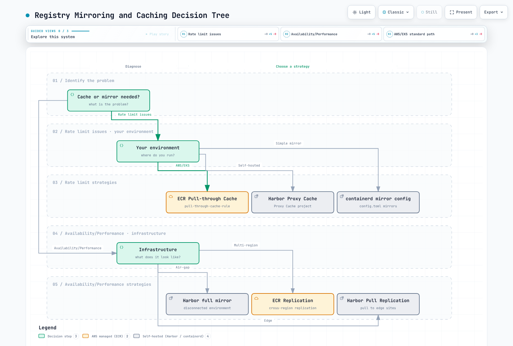

# 容器镜像仓库最佳实践

> **最后更新**：2026 年 10 月 16 日

## 简介

本文汇总 Docker Hub、Amazon ECR 和 Harbor 的容器镜像仓库管理最佳实践。无论选择哪种 Registry，这些建议都适用，重点是运维卓越性、安全和成本优化。

API/CLI 示例中的账户、区域、主机名和仓库值仅供说明。请先准备目标资源和凭据。对于 Harbor API 示例，请设置 `HARBOR_USER`，并通过 `curl --user` 提示输入密码。从创建响应中获取端点 ID。

## 标签管理

### 不可变标签

即使标签名称看起来像版本号，如果 Registry 没有强制不可变性，它仍然可能被覆盖。部署时固定已测试的 digest，并对发布标签应用不可变规则。不可变规则并不普遍阻止删除 artifact；请检查 Registry 的具体策略。

| Registry | 配置 |
|----------|---------------|
| Docker Hub | Repository Tag mutability 设置（本次审核时仍为 Beta） |
| Amazon ECR | `image-tag-mutability: IMMUTABLE` |
| Harbor | 项目标签不可变规则 |

```bash
# ECR: Enable immutable tags
aws ecr put-image-tag-mutability \
  --repository-name myapp \
  --image-tag-mutability IMMUTABLE

```

### 语义化版本

SemVer 的 `+build` 元数据不能直接作为合法的镜像标签。请在 OCI 标签中保留完整 SemVer，并将标签映射到允许的字母数字、下划线、点号和连字符语法。

发布镜像时使用 SemVer（语义化版本）：

```
MAJOR.MINOR.PATCH[-PRERELEASE][+BUILD]

Examples:
  1.0.0           - Initial release
  1.0.1           - Patch release (bug fixes)
  1.1.0           - Minor release (new features, backward compatible)
  2.0.0           - Major release (breaking changes)
  1.0.0-rc.1      - Release candidate
  1.0.0-beta.2    - Beta release
  1.0.0+build.123 - Build metadata
```

### 按环境制定标签策略

| 环境 | 标签模式 | 示例 | 是否可变 |
|-------------|-------------|---------|------------|
| 生产 | SemVer | `1.2.3` | 不可变 |
| 预发布 | SemVer-rc | `1.2.3-rc.1` | 不可变 |
| 开发 | 基于 SHA | `abc123f-dev` | 可变 |
| 功能分支 | Branch-SHA | `feature-auth-abc123f` | 可变 |
| CI 构建 | 构建号 | `build-456` | 可变 |

### `latest` 标签反模式

**生产环境绝不要使用 `latest`。** 使用 `latest` 会带来以下问题：

1. **不具确定性**：不同节点可能拉取不同镜像。
2. **无法回滚**：无法回到“上一个 latest”。
3. **拉取策略易混淆**：创建时省略策略会使 `latest` 默认采用 `Always`；但仍可重用缓存层。
4. **审计困难**：无法确定当前运行的是哪个版本。

```yaml
# BAD - Never do this in production
spec:
  containers:
  - name: app
    image: myregistry.com/myapp:latest
    imagePullPolicy: Always  # Checks the reference each start; cached layers can be reused

---
# GOOD - Use specific versions
spec:
  containers:
  - name: app
    image: myregistry.com/myapp:1.2.3
    # imagePullPolicy: IfNotPresent (default, efficient)
```

以下场景可以使用 `latest`：
- 本地开发
- 教程和示例
- Dockerfile 中的基础镜像（生产环境中应固定版本）

### 晋级工作流

应实现镜像晋级工作流，而不是重新构建镜像：


[🔍 查看交互式图表](https://www.atomai.click/kubernetes-docs/archmaps/en-container-registry-04-best-practices-10.html)

晋级脚本：

```bash
#!/usr/bin/env bash
set -euo pipefail
: "${AWS_REGION:?Set the registry region}"
: "${ECR_REGISTRY:?Set account.dkr.ecr.region.amazonaws.com}"
: "${SOURCE_REPO:?Set the source repository}"
: "${SOURCE_DIGEST:?Set the scanned sha256 digest}"
: "${TARGET_REPO:?Set the pre-created destination repository}"
: "${TARGET_TAG:?Set a new immutable release tag}"
aws ecr get-login-password --region "$AWS_REGION" \
  | skopeo login --username AWS --password-stdin "$ECR_REGISTRY"
skopeo copy --all --preserve-digests \
  "docker://${ECR_REGISTRY}/${SOURCE_REPO}@${SOURCE_DIGEST}" \
  "docker://${ECR_REGISTRY}/${TARGET_REPO}:${TARGET_TAG}"
```

## 镜像命名规范

### 标准格式

```
[REGISTRY/]NAMESPACE/REPOSITORY:TAG[@DIGEST]

Examples:
  nginx:1.30.6                                    # Docker Hub official
  myuser/myapp:v1.0.0                          # Docker Hub user
  123456789012.dkr.ecr.us-east-1.amazonaws.com/myapp:v1.0.0  # ECR
  harbor.example.com/production/myapp:v1.0.0   # Harbor
  ghcr.io/myorg/myapp:v1.0.0                   # GitHub Container Registry
```

### 组织结构

```
REGISTRY/
├── NAMESPACE (organization/team/environment)/
│   ├── REPOSITORY (application name)/
│   │   ├── TAG (version)
│   │   └── TAG
│   └── REPOSITORY/
└── NAMESPACE/
```

ECR 结构示例：

```
123456789012.dkr.ecr.us-east-1.amazonaws.com/
├── platform/
│   ├── ingress-controller:<supported-version>
│   ├── cert-manager:<supported-version>
│   └── external-dns:<supported-version>
├── myapp/
│   ├── api:v2.1.0
│   ├── web:v2.1.0
│   └── worker:v2.1.0
└── tools/
    ├── kubectl:<cluster-compatible-version>
    └── helm:<supported-version>
```

### 环境前缀

采用单仓库策略时：

```
myapp:v1.2.3                 # Production release
myapp:v1.2.3-staging         # Staging candidate
myapp:abc123f-dev            # Development build
myapp:abc123f-feature-auth   # Feature branch
```

### 多架构镜像

使用 manifest list 支持多架构：

```bash
# Build for multiple architectures
docker buildx build \
  --platform linux/amd64,linux/arm64 \
  --tag myregistry.com/myapp:v1.0.0 \
  --push .

# Inspect manifest
docker manifest inspect myregistry.com/myapp:v1.0.0
```

如有需要，针对架构指定镜像使用以下标签约定：

```
myapp:v1.0.0           # Manifest list (preferred)
myapp:v1.0.0-amd64     # AMD64-specific
myapp:v1.0.0-arm64     # ARM64-specific
```

## Registry 镜像同步与缓存

### 为什么要镜像/缓存？

1. **避免速率限制**：Docker Hub 会限制拉取次数。
2. **提高性能**：本地缓存可降低延迟。
3. **提高可靠性**：预加载镜像副本可减少外部依赖；但缓存未命中/刷新时仍需要访问上游。
4. **安全性**：可控制进入环境的镜像。
5. **节省成本**：减少跨区域/互联网传输费用。



[🔍 查看交互式图表](https://www.atomai.click/kubernetes-docs/archmaps/en-container-registry-04-best-practices-1.html)

### 拉取穿透缓存比较

| 功能 | ECR Pull-Through | Harbor Proxy | Distribution |
|---------|-----------------|--------------|--------------|
| 托管 | 是 | 否 | 否 |
| 上游支持 | ECR 支持的上游仓库 | Harbor 支持的适配器 | Docker Hub |
| 身份验证 | Secrets Manager | 内置 | 环境变量 |
| 扫描 | 取决于仓库/Registry 扫描配置 | 取决于项目/扫描器配置 | 无内置扫描器 |
| 高可用性 | 内置 | 自行管理 | 自行管理 |

### 配置 ECR Pull-Through Cache

在同一账户/区域的 Secrets Manager 中，使用 `ecr-pullthroughcache/` 前缀保存 Docker Hub 凭据，并包含 `username` 和 `accessToken` 键。应解析实际 Secret ARN，不要自行拼接。有关仓库创建/导入权限及服务相关角色，请参见 [Amazon ECR](02-amazon-ecr.md)。

```bash
# The upstream secret must already exist in this account and region.
: "${AWS_REGION:?Set the target AWS region}"
SECRET_ARN=$(aws secretsmanager describe-secret --region "$AWS_REGION" \
  --secret-id ecr-pullthroughcache/docker-hub --query ARN --output text)
aws ecr create-pull-through-cache-rule --region "$AWS_REGION" \
  --ecr-repository-prefix docker-hub \
  --upstream-registry-url registry-1.docker.io \
  --credential-arn "$SECRET_ARN"
```

拉取 URI：`ACCOUNT.dkr.ecr.REGION.amazonaws.com/docker-hub/library/nginx:1.30.6`。缓存未命中和刷新仍然依赖上游访问。

### 配置 Containerd 镜像源

此示例假设受信任的镜像站提供与 Docker Hub 相同的仓库路径。Containerd 2.x 使用 images 插件的 `config_path`；1.x 使用 CRI 插件路径。`resolve` capability 表示信任镜像站对标签到 digest 的解析结果。此配置不会自动转换 ECR/Harbor 项目前缀或凭据。

```toml
# containerd 2.x: /etc/containerd/config.toml
[plugins."io.containerd.cri.v1.images".registry]
  config_path = "/etc/containerd/certs.d"
# For containerd 1.x, use plugins."io.containerd.grpc.v1.cri".registry.
```

```toml
# /etc/containerd/certs.d/docker.io/hosts.toml
server = "https://registry-1.docker.io"
[host."https://mirror.example.com"]
  capabilities = ["pull", "resolve"]
  ca = "/etc/containerd/certs.d/docker.io/mirror-ca.crt"
```

`server` 配置允许回退到 Docker Hub，因此这不是仅供离线使用的配置。对于断网环境及经过身份验证的 ECR/Harbor 缓存，应使用明确的内部镜像 URI，并验证节点 CA 信任、imagePullSecrets 和实际拉取操作。

### 配置 Harbor 代理缓存

```bash
# 1. Create registry endpoint
curl --fail-with-body -X POST "https://harbor.example.com/api/v2.0/registries" \
  -H "Content-Type: application/json" \
  --user "$HARBOR_USER" \
  -d '{
    "name": "docker-hub",
    "type": "docker-hub",
    "url": "https://hub.docker.com",
    "credential": {
      "type": "basic",
      "access_key": "username",
      "access_secret": "password"
    }
  }'

# 2. Create proxy cache project
curl --fail-with-body -X POST "https://harbor.example.com/api/v2.0/projects" \
  -H "Content-Type: application/json" \
  --user "$HARBOR_USER" \
  -d '{
    "project_name": "dockerhub-cache",
    "registry_id": 1,
    "metadata": {"public": "true"}
  }'

# Usage: harbor.example.com/dockerhub-cache/library/nginx:latest
```

## 灾难恢复

### 多区域策略

```
┌─────────────────────────────────────────────────────────────────┐
│                    Primary Region (us-east-1)                    │
│  ┌─────────────┐                                                │
│  │  ECR / Harbor│──────────────────┐                            │
│  └─────────────┘                   │                            │
└────────────────────────────────────┼────────────────────────────┘
                                     │ Replication
                                     ▼
┌─────────────────────────────────────────────────────────────────┐
│                    DR Region (eu-west-1)                         │
│  ┌─────────────┐                                                │
│  │  ECR / Harbor│                                                │
│  └─────────────┘                                                │
└─────────────────────────────────────────────────────────────────┘
```

### ECR 跨区域复制

```hcl
resource "aws_ecr_replication_configuration" "dr" {
  replication_configuration {
    rule {
      destination {
        region      = "eu-west-1"
        registry_id = data.aws_caller_identity.current.account_id
      }

      # Only replicate production images
      repository_filter {
        filter      = "prod-"
        filter_type = "PREFIX_MATCH"
      }
    }
  }
}
```

### 使用 Harbor 复制进行灾难恢复

```bash
# Configure DR Harbor as endpoint
# Add destination credentials through the protected Harbor UI before using this endpoint.
curl --fail-with-body -X POST "https://harbor-primary.example.com/api/v2.0/registries" \
  -H "Content-Type: application/json" \
  --user "$HARBOR_USER" \
  -d '{
    "name": "harbor-dr",
    "type": "harbor",
    "url": "https://harbor-dr.example.com"
  }'

# Create event-based replication
curl --fail-with-body -X POST "https://harbor-primary.example.com/api/v2.0/replication/policies" \
  -H "Content-Type: application/json" \
  --user "$HARBOR_USER" \
  -d '{
    "name": "dr-replication",
    "dest_registry": {"id": 1},
    "trigger": {"type": "event_based"},
    "enabled": true,
    "replicate_deletion": false
  }'
```

### 备份流程与 RTO/RPO

ECR 复制是异步的，只适用于配置完成后推送/恢复的镜像；现有 artifact 需要回填。验证目标端策略、权限、扫描、加密、生命周期设置以及实际拉取。复制配置 API 会替换整个 Registry 配置，因此应先合并现有规则。

通过恢复演练测量 RPO/RTO，演练应涵盖复制延迟、故障检测、artifact/签名就绪情况以及集群/DNS 故障转移。事件复制不保证零 RPO 或五分钟 RTO。复制删除操作也可能删除灾备副本，因此应设计独立备份。

仅保存几个 Docker pull/save 标签并不能构成完整备份。应保留已测试 digest、所有目标平台、OCI manifest、签名/SBOM 和恢复说明的清单。使用[Harbor Skopeo 传输流程](03-harbor.md)中的显式清单/校验和；一致地备份 Harbor 元数据、blob、配置和密钥。存放在 S3 中的 tar 文件不是 Kubernetes 可以直接拉取的 Registry；应将其导入恢复用 Registry。

## 成本优化

### 成本估算

分别估算存储、区域/AZ/互联网传输、扫描/签名、PrivateLink/NAT、Registry 计算/数据库/备份和运维成本。示例 ECR 区域存储价格 `$0.10/GB-month` 并非完整账单。将 `imageSizeInBytes` 相加不等于去重后的计费层存储。固定的 500 GB 阈值不能决定 ECR 还是 Harbor 更便宜。

### 生命周期策略要点

下面的 ECR 示例会在仅用于开发的仓库中，过期三个开发标签前缀的镜像（30 天后）。同一 `tagPatternList` 中的多个模式采用 **AND**，不是 OR，因此每个前缀应分别使用一条规则。不要让发布/开发标签指向同一 digest；使用 Lifecycle Preview 保护已部署/用于回滚的 digest。未标记的镜像仍可能按 digest 部署，不能自动视为可安全删除。

```json
{
  "rules": [
    {
      "rulePriority": 1,
      "description": "Expire dev-* development artifacts after 30 days",
      "selection": {
        "tagStatus": "tagged",
        "tagPatternList": [
          "dev-*"
        ],
        "countType": "sinceImagePushed",
        "countNumber": 30,
        "countUnit": "days"
      },
      "action": {
        "type": "expire"
      }
    },
    {
      "rulePriority": 2,
      "description": "Expire feature-* development artifacts after 30 days",
      "selection": {
        "tagStatus": "tagged",
        "tagPatternList": [
          "feature-*"
        ],
        "countType": "sinceImagePushed",
        "countNumber": 30,
        "countUnit": "days"
      },
      "action": {
        "type": "expire"
      }
    },
    {
      "rulePriority": 3,
      "description": "Expire pr-* development artifacts after 30 days",
      "selection": {
        "tagStatus": "tagged",
        "tagPatternList": [
          "pr-*"
        ],
        "countType": "sinceImagePushed",
        "countNumber": 30,
        "countUnit": "days"
      },
      "action": {
        "type": "expire"
      }
    }
  ]
}
```

Harbor 保留规则采用 OR 并集，且使用不同于 ECR 的 schema。应遵循 [Harbor](03-harbor.md) UI/API dry-run 流程，并在删除后验证 GC。

### 优化镜像大小

使用兼容的 builder/runtime 镜像，并只复制运行时依赖。本 Python 示例会在相同 Python 基础版本之间传递虚拟环境。仍须验证本机扩展/系统库要求。使用 `.dockerignore` 排除秘密、本地虚拟环境和缓存，避免将它们放入构建上下文。

```dockerfile
FROM python:3.14-slim AS builder
WORKDIR /app
RUN python -m venv /opt/venv
COPY requirements.txt .
RUN /opt/venv/bin/pip install --no-cache-dir -r requirements.txt

FROM python:3.14-slim
WORKDIR /app
COPY --from=builder /opt/venv /opt/venv
COPY --chown=10001:10001 . .
ENV PATH="/opt/venv/bin:$PATH"
USER 10001:10001
CMD ["python", "app.py"]
```

镜像大小会随应用、架构、压缩和依赖项而变化。Distroless 并不会自动消除漏洞；应验证 builder/runtime ABI、CA 证书、用户 ID 和调试流程。发布时固定已测试的基础镜像 digest 及依赖锁定文件，并定期更新。

### 降低传输成本

使用区域本地 Registry 引用，并在故障转移之前验证复制。VPC endpoint 可减少 NAT 流量，但要计入接口端点小时费用/数据费用，以及 ECR API/DKR 和 S3 路径。完整区域 Kustomize overlay 请参见 [Amazon ECR](02-amazon-ecr.md)。

## 安全检查清单

### 镜像扫描

Docker Hub 使用 Docker Scout；ECR 提供 AWS 原生 Basic 扫描或基于 Inspector 的 Enhanced 扫描；Harbor 使用配置好的 Trivy/外部扫描器。应检查价格、支持的 artifact、重新扫描能力和数据库新鲜度。自动扫描与部署时强制执行相互独立；失败/未完成的结果不等于零发现。请遵循当前的 [ECR](02-amazon-ecr.md) 和 [Harbor](03-harbor.md) 流程。

### 准入控制器

结合[镜像签名验证](../security/07-image-security.md)与 [Kyverno Registry 策略](../security/01-kyverno-policy-management.md)。Registry 允许列表不会验证签名，也不会扫描漏洞。漏洞 attestations 需要可信签名者、实际 predicate schema/字段及扫描新鲜度。不要假定存在 `criticalCount` 字段，也不要使用截断的公钥。

在 Audit 模式下验证普通/init/ephemeral 容器及 CREATE/UPDATE 覆盖情况，再启用 Enforce。Gatekeeper constraint 必须先安装其匹配的 ConstraintTemplate。

### 最小权限访问

此策略允许从所选 ECR 仓库拉取。`GetAuthorizationToken` 不支持仓库级资源权限，且需要 `Resource: "*"`；实际拉取操作则按 ARN 限定。在 EKS 中，应将这些权限附加到节点角色或 Fargate Pod 执行角色。应用程序的 IRSA/Pod Identity 角色不会为其自身的初始镜像拉取提供凭据。

```json
{
  "Version": "2012-10-17",
  "Statement": [
    {
      "Sid": "RegistryToken",
      "Effect": "Allow",
      "Action": "ecr:GetAuthorizationToken",
      "Resource": "*"
    },
    {
      "Sid": "PullApprovedRepositories",
      "Effect": "Allow",
      "Action": [
        "ecr:BatchCheckLayerAvailability",
        "ecr:GetDownloadUrlForLayer",
        "ecr:BatchGetImage"
      ],
      "Resource": [
        "arn:aws:ecr:ap-northeast-2:123456789012:repository/myapp-prod",
        "arn:aws:ecr:ap-northeast-2:123456789012:repository/base-images/*"
      ]
    }
  ]
}
```

对于 Harbor，请使用按项目限定且仅有拉取权限的机器人账户，并设置过期/轮换。遵循当前 `/api/v2.0/robots` schema 以及 [Harbor](03-harbor.md) 中的命名空间级 imagePullSecrets 流程。

### 网络策略

Kubernetes NetworkPolicy 会控制所选 Pod 的流量。不要假设 Pod 出站策略会控制由节点 kubelet/containerd 执行的镜像拉取。在准入时验证允许的 Registry，并在节点/网络层控制节点对 Registry/DNS/ECR API/DKR/S3 的访问。应用 Pod 的出站策略还必须考虑 DNS 和必需的应用流量。

### 密钥管理

此流程要求安装提供 External Secrets Operator v1 API 的 CRD，并配置好 ClusterSecretStore。远程 Secret 中应保存完整且有效的 Docker config JSON；直接传递完整 JSON 可避免通过字符串插值传递带引号/反斜杠的密码时将其破坏。Pod/ServiceAccount 必须在同一命名空间引用生成的 Secret。

```yaml
apiVersion: external-secrets.io/v1
kind: ExternalSecret
metadata:
  name: registry-credentials
  namespace: production
spec:
  refreshInterval: 1h
  secretStoreRef:
    name: aws-secrets-manager
    kind: ClusterSecretStore
  target:
    name: registry-pull-secret
    creationPolicy: Owner
    template:
      engineVersion: v2
      type: kubernetes.io/dockerconfigjson
      data:
        .dockerconfigjson: "{{ .dockerconfigjson | toString }}"
  data:
  - secretKey: dockerconfigjson
    remoteRef:
      key: harbor-pull-dockerconfigjson
```

重复复制已存储的 ECR token 并不会续期其 12 小时有效期。应使用 EKS 原生镜像拉取身份，或显式配置 ECR token 生成器。监控 Secret store 的授权、加密和轮换故障。

## CI/CD 集成模式

### 使用 GitHub Actions 和 ECR

本例在本地 Docker 中构建单个 Linux/amd64 镜像，扫描**该镜像本身**，然后推送并签名。请先准备 ECR 仓库、通过 `aud`/`sub` 限制的 OIDC IAM 角色、推送权限和受支持的 runner。Actions 固定到经过审核的 release commit。如果重新构建同一 commit 时与不可变标签冲突，请复用经过验证的 digest 或分配新的构建 ID。

```yaml
name: Build scan and publish to ECR
on:
  push:
    branches: [main]
    tags: ['v*']
permissions:
  contents: read
  id-token: write
env:
  AWS_REGION: ap-northeast-2
  ECR_REPOSITORY: myapp
jobs:
  publish:
    runs-on: ubuntu-24.04
    steps:
    - uses: actions/checkout@3d3c42e5aac5ba805825da76410c181273ba90b1 # v7.0.1
    - uses: aws-actions/configure-aws-credentials@e1253824e5c10ff9df46874f81ed3ec929e19cfd # v6.3.0
      with:
        role-to-assume: arn:aws:iam::123456789012:role/github-actions-ecr
        aws-region: ${{ env.AWS_REGION }}
    - uses: aws-actions/amazon-ecr-login@03f1aad4c6c7ffd436567f42f9384779290529bd # v2.1.7
      id: login
    - uses: docker/setup-buildx-action@f87e5991a6d7451dcb8d9637bfbc97413f497069 # v4.4.1
    - uses: docker/build-push-action@c3c9e263c25d99ce0380d002d59b67737d91b0dc # v7.4.0
      with:
        context: .
        platforms: linux/amd64
        load: true
        push: false
        tags: ${{ steps.login.outputs.registry }}/${{ env.ECR_REPOSITORY }}:${{ github.sha }}
        cache-from: type=gha
        cache-to: type=gha,mode=max
    - uses: aquasecurity/trivy-action@ed142fd0673e97e23eac54620cfb913e5ce36c25 # v0.36.0
      with:
        version: v0.76.0
        image-ref: ${{ steps.login.outputs.registry }}/${{ env.ECR_REPOSITORY }}:${{ github.sha }}
        scan-type: image
        scanners: vuln
        exit-code: '1'
        severity: HIGH,CRITICAL
    - name: Publish scanned image and record digest
      id: publish
      env:
        REGISTRY: ${{ steps.login.outputs.registry }}
      run: |
        set -euo pipefail
        IMAGE="$REGISTRY/$ECR_REPOSITORY"
        docker push "$IMAGE:$GITHUB_SHA"
        DIGEST=$(aws ecr describe-images --repository-name "$ECR_REPOSITORY" \
          --image-ids "imageTag=$GITHUB_SHA" --query 'imageDetails[0].imageDigest' --output text)
        [[ "$DIGEST" =~ ^sha256:[a-f0-9]{64}$ ]]
        printf 'image=%s@%s\n' "$IMAGE" "$DIGEST" >> "$GITHUB_OUTPUT"
    - uses: sigstore/cosign-installer@6f9f17788090df1f26f669e9d70d6ae9567deba6 # v4.1.2
    - name: Sign the published digest with the job OIDC identity
      env:
        SIGNED_IMAGE: ${{ steps.publish.outputs.image }}
      run: cosign sign --yes "$SIGNED_IMAGE"
```

发布多平台镜像时，应扫描每个平台并晋级最终 index digest。使用 `publish.outputs.image` 进行部署和签名验证；SemVer 标签匹配本身不代表已批准发布。无密钥验证需要准入策略限制此工作流的 OIDC 签发者/身份。如果要上传 SARIF，请配置 Code Scanning 资格并授予 `security-events: write`。

### 使用 GitLab CI 和 Harbor

此 Docker executor 示例使用启用 TLS 的 DinD。请在隔离的专用 runner 上配置所需的 privileged 模式和共享 `/certs/client` volume。通过受保护的 masked `HARBOR_USERNAME`/`HARBOR_PASSWORD` 变量提供项目机器人凭据，并信任 Harbor CA。扫描和发布使用相同构建 artifact，且发布必须等待扫描成功。

```yaml
stages: [build, scan, publish]
workflow:
  rules:
    - if: '$CI_COMMIT_BRANCH == "main" || $CI_COMMIT_TAG'
variables:
  HARBOR_HOST: harbor.example.com
  IMAGE_NAME: harbor.example.com/myapp/app
  DOCKER_HOST: tcp://docker:2376
  DOCKER_TLS_CERTDIR: /certs
  DOCKER_TLS_VERIFY: "1"
  DOCKER_CERT_PATH: /certs/client
.docker:
  image: docker:29.9.0-cli
  services:
    - name: docker:29.9.0-dind
      alias: docker
build:
  extends: .docker
  stage: build
  script:
    - docker build -t "$IMAGE_NAME:$CI_COMMIT_SHA" .
    - docker save "$IMAGE_NAME:$CI_COMMIT_SHA" -o image.tar
  artifacts:
    paths: [image.tar]
    expire_in: 1 day
scan:
  stage: scan
  image:
    name: aquasec/trivy:0.76.0
    entrypoint: [""]
  needs:
    - job: build
      artifacts: true
  script:
    - trivy image --input image.tar --exit-code 1 --severity HIGH,CRITICAL
publish:
  extends: .docker
  stage: publish
  needs:
    - job: build
      artifacts: true
    - job: scan
      artifacts: false
  script:
    - printf '%s' "$HARBOR_PASSWORD" | docker login "$HARBOR_HOST" --username "$HARBOR_USERNAME" --password-stdin
    - docker load -i image.tar
    - docker push "$IMAGE_NAME:$CI_COMMIT_SHA"
```

### 部署与镜像更新

通过扫描/签名门禁后，将经过验证的 digest 更新到 GitOps 仓库，并应用审批、准入验证和 rollout 检查。Argo CD Image Updater 1.x 使用 `ImageUpdater` CR；仅复制旧 Application 注解并不够。根据 release 审批策略，安装匹配的 CRD 并配置 Argo CD 访问权限、Registry 凭据和 Git 回写授权。

## 使用 skopeo 管理镜像

[skopeo](https://github.com/containers/skopeo) 是用于在 Registry 之间检查、复制和同步容器镜像的命令行工具。它不需要 Docker daemon，也不需要 root 权限，因此适用于 CI/CD 流水线和隔离网络场景。

### 安装

```bash
# RHEL/CentOS/Amazon Linux
sudo yum install -y skopeo

# Ubuntu/Debian
sudo apt-get install -y skopeo

# macOS
brew install skopeo
```

### skopeo inspect：远程镜像检查

无需拉取镜像即可检查其元数据：

```bash
# Inspect Docker Hub image
skopeo inspect docker://docker.io/library/nginx:1.30.6

# Inspect ECR image (requires AWS auth)
skopeo inspect docker://123456789012.dkr.ecr.us-east-1.amazonaws.com/myapp:v1.0.0

# View raw manifest
skopeo inspect --raw docker://docker.io/library/nginx:1.30.6 | jq .

# Inspect specific architecture
skopeo --override-arch arm64 inspect docker://docker.io/library/nginx:1.30.6
```

### skopeo copy：跨 Registry 复制镜像

无需在本地拉取镜像即可直接在 Registry 之间复制：

```bash
# Docker Hub → ECR
skopeo copy --all \
  docker://docker.io/library/nginx:1.30.6 \
  docker://123456789012.dkr.ecr.us-east-1.amazonaws.com/nginx:1.30.6

# ECR → Harbor
skopeo copy --all \
  docker://123456789012.dkr.ecr.us-east-1.amazonaws.com/myapp:v1.0.0 \
  docker://harbor.example.com/myapp/backend:v1.0.0

# Format conversion (Docker → OCI)
skopeo copy --all \
  docker://docker.io/library/nginx:1.30.6 \
  oci:nginx-oci:1.30.6

# Save as OCI archive
skopeo copy --all \
  docker://docker.io/library/nginx:1.30.6 \
  oci-archive:nginx-1.30.6.tar
```

### skopeo sync：批量 Registry 同步

同步前先预览明确指定的标签。仅指定仓库且未指定标签时，可能会复制该仓库的所有标签。每个 `images-by-tag-regex` 的值都是字符串，而非列表。`--scoped` 会保留源 Registry/路径组件，以避免名称冲突；应分别准备目标项目/仓库和身份验证。

```bash
cat > sync-manifest.yaml <<'YAML'
docker.io:
  images:
    library/nginx:
      - "1.30.6"
  images-by-tag-regex:
    library/busybox: '^1\.38\.0$'
YAML
# Preview exact source/destination paths before creating target repositories.
skopeo sync --all --scoped --dry-run --src yaml --dest docker \
  sync-manifest.yaml harbor.internal/mirror
# After reviewing the preview and preparing destinations, remove --dry-run.
```

### 隔离网络中的镜像传输

skopeo 特别适合将镜像传输到断网环境：

```bash
# Step 1: Export images to tar on connected environment
skopeo copy --all docker://docker.io/library/nginx:1.30.6 oci-archive:nginx-1.30.6.tar
skopeo copy --all docker://docker.io/library/redis:7-alpine oci-archive:redis-7.tar
skopeo copy --all docker://registry.k8s.io/pause:3.10 oci-archive:pause-3.10.tar

# Step 2: Transfer via USB/secure file transfer to air-gapped environment

# Step 3: Import into Harbor on air-gapped environment
skopeo copy --all oci-archive:nginx-1.30.6.tar \
  docker://harbor.internal/library/nginx:1.30.6
skopeo copy --all oci-archive:redis-7.tar \
  docker://harbor.internal/library/redis:7-alpine
skopeo copy --all oci-archive:pause-3.10.tar \
  docker://harbor.internal/k8s/pause:3.10
```

> **提示**：与 `docker save/load` 不同，skopeo 不依赖 Docker daemon，因此即使未安装 Docker，也可在隔离服务器上使用。

### 工具比较

| 工具 | 本指南中的用途 | 需验证的条件 |
|---|---|---|
| Skopeo | 远程检查、复制/同步、OCI archive | 身份验证、manifest 转换、`--all`、referrer 支持 |
| Docker/Buildx | 构建、manifest 检查、推送 | Daemon/builder 设置；也存在 rootless 配置 |
| crane | 远程镜像检查/复制 | 已安装版本是否支持复制/导出和签名 |
| ctr | containerd 镜像存储/导入/导出 | Runtime socket 权限、命名空间和平台选择 |

`--all` 用于选择多平台 manifest；它不保证复制所有签名/SBOM referrer。需要保留 digest 时使用 `--preserve-digests`，并将失败视为失败。离线传输应遵循 [Harbor](03-harbor.md) 中的映射、校验和、数据库、CA 及恢复流程。

## 总结

### 关键要点

1. **标签管理**
   - 生产环境使用不可变标签
   - 发布时遵循 SemVer
   - 生产环境绝不使用 `latest`
   - 实施晋级工作流

2. **命名规范**
   - 建立统一的命名空间结构
   - 单仓库策略使用环境前缀
   - 支持多架构镜像

3. **镜像同步与缓存**
   - 实施拉取穿透缓存，避免速率限制
   - 镜像关键外部镜像
   - 使用已验证的镜像路径/身份验证，或明确的内部镜像 URI

4. **灾难恢复**
   - 启用跨区域复制
   - 定义并测试 RTO/RPO 目标
   - 自动化备份流程

5. **成本优化**
   - 在各环境实施生命周期策略
   - 通过多阶段构建优化镜像大小
   - 使用区域端点降低传输成本

6. **安全**
   - 启用推送时扫描
   - 实施准入控制器
   - 遵循最小权限原则
   - 使用网络策略

7. **CI/CD 集成**
   - 自动执行 build-scan-sign-deploy 流水线
   - 使用 OIDC 进行云身份验证
   - 实施安全门禁

### 快速参考矩阵

| 实践 | Docker Hub | ECR | Harbor |
|----------|------------|-----|--------|
| 不可变标签 | 标签可变性（Beta） | `IMMUTABLE` | 标签不可变规则 |
| 生命周期策略 | API 清理 | 原生支持 | 标签保留 |
| 漏洞扫描 | Docker Scout | AWS 原生/Inspector | Trivy 或已配置扫描器 |
| 镜像签名 | 外部签名/OCI artifact；验证兼容性 | Signer/OCI artifact | Cosign/Notation |
| 复制 | 不支持 | 跨区域 | Push/Pull |
| 拉取穿透缓存 | 不支持 | 原生支持 | Proxy 项目 |

### 新部署检查清单

- [ ] 已记录仓库命名规范
- [ ] 已定义并强制执行标签策略
- [ ] 已配置生命周期策略
- [ ] 已启用漏洞扫描
- [ ] 已实施镜像签名
- [ ] 已配置灾难恢复复制
- [ ] 已配置访问控制（RBAC/IAM）
- [ ] 已集成 CI/CD 流水线
- [ ] 已设置监控和告警
- [ ] 已启用成本监控
- [ ] 已测试备份流程

## 参考资料

- [Docker Hub 不可变标签](https://docs.docker.com/docker-hub/repos/manage/hub-images/immutable-tags/)
- [镜像标签语法](https://github.com/distribution/reference/blob/main/regexp.go)
- [Containerd Registry 配置](https://github.com/containerd/containerd/blob/main/docs/hosts.md)
- [Skopeo copy](https://github.com/containers/skopeo/blob/main/docs/skopeo-copy.1.md)
- [Skopeo sync](https://github.com/containers/skopeo/blob/main/docs/skopeo-sync.1.md)
- [External Secrets Docker config](https://external-secrets.io/latest/guides/common-k8s-secret-types/)
- [Argo CD Image Updater 1.3 镜像配置](https://github.com/argoproj-labs/argocd-image-updater/blob/v1.3.1/docs/configuration/images.md)
- [Docker build-push action](https://github.com/docker/build-push-action/tree/v7.4.0)
- [Trivy action](https://github.com/aquasecurity/trivy-action/tree/v0.36.0)
- [GitLab Docker-in-Docker TLS](https://docs.gitlab.com/ci/docker/using_docker_build/)
