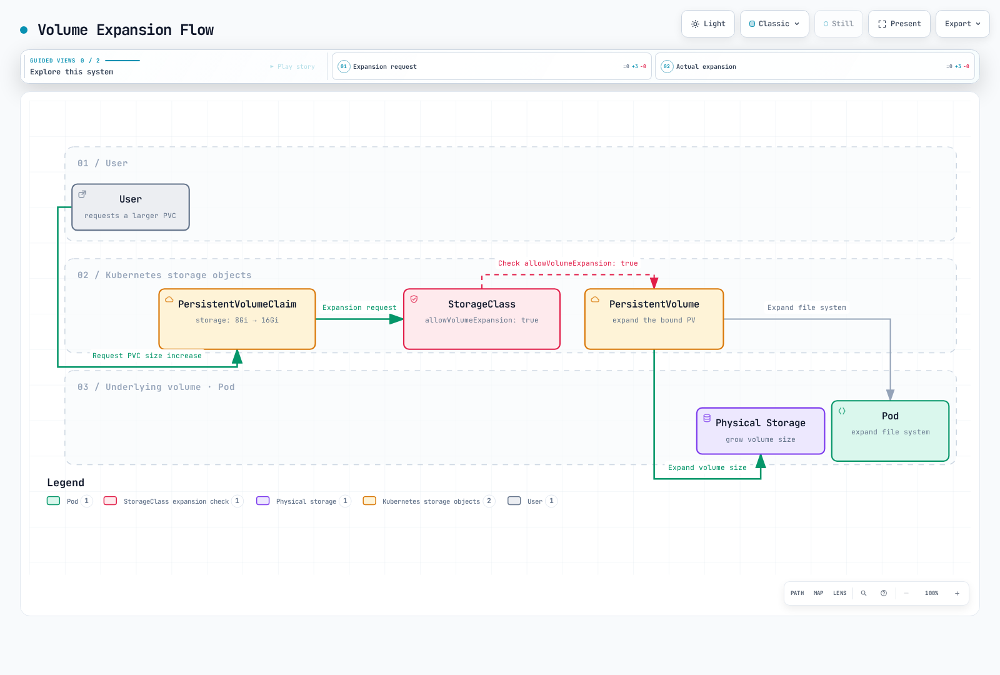
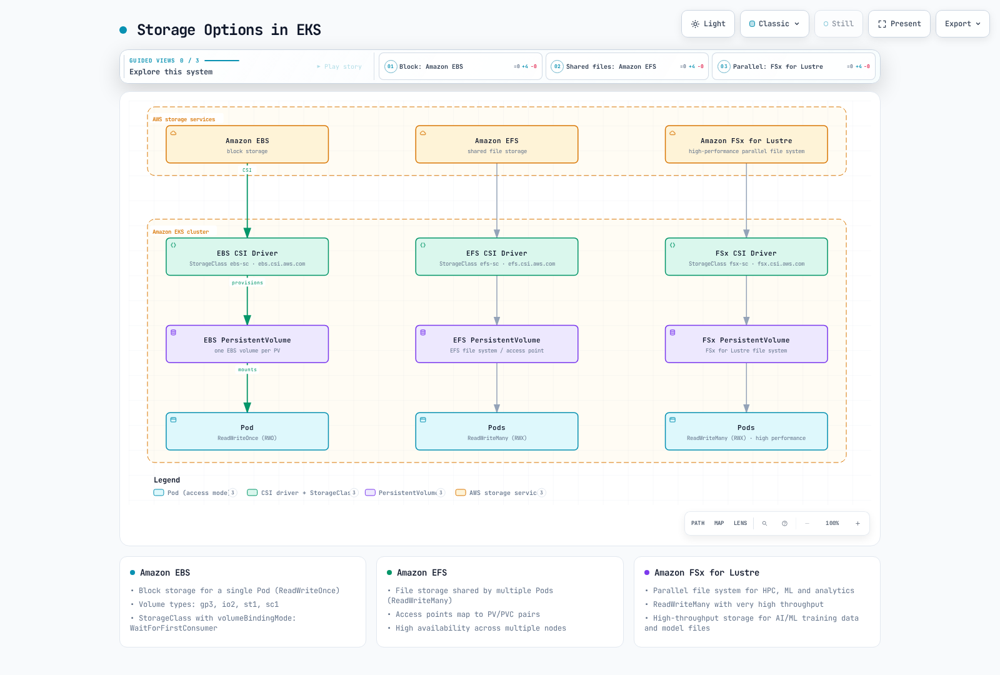

# 存储

> **支持的版本**：Kubernetes 1.35、1.36、1.37
> **最后更新**：2026年10月16日

在 Kubernetes 中，存储是容器化应用存储和管理数据的重要组成部分。在本章中，我们将详细探讨 Kubernetes 存储概念，包括 Volumes、Persistent Volumes、Persistent Volume Claims 和 Storage Classes。

## 实验环境设置

要按照本文档中的示例操作，你需要以下工具和环境：

### 必需工具
- kubectl，版本与 API server 相差不超过一个次要版本
- 可正常运行的 Kubernetes 集群（EKS、minikube、kind 等）
- 存储制备器（EKS 使用 EBS CSI driver）

第一个示例需要默认 StorageClass；否则，请将 `storageClassName` 设置为已安装的 StorageClass。下文的 EKS EBS 示例使用 EC2 节点上的标准 EBS CSI driver，并要求具有 IAM 权限；Auto Mode 使用 `ebs.csi.eks.amazonaws.com`。EBS 无法挂载到 Fargate 或 Hybrid Nodes。请将后续清单视为各自独立的示例，并满足其中注明的先决条件。

### 存储示例设置

```bash
# Create namespace
kubectl create namespace storage-demo

# Create a simple PVC and Pod
kubectl -n storage-demo apply -f - <<'EOF'
apiVersion: v1
kind: PersistentVolumeClaim
metadata:
  name: data-pvc
spec:
  accessModes:
    - ReadWriteOnce
  resources:
    requests:
      storage: 1Gi
---
apiVersion: v1
kind: Pod
metadata:
  name: data-pod
spec:
  containers:
  - name: data-container
    image: busybox
    command: ["sh", "-c", "while true; do echo $(date) >> /data/output.txt; sleep 5; done"]
    volumeMounts:
    - name: data-volume
      mountPath: /data
  volumes:
  - name: data-volume
    persistentVolumeClaim:
      claimName: data-pvc
EOF

# Check storage resources
kubectl -n storage-demo get pvc,pod
```

## 目录

1. [Volumes](#volumes)
2. [Persistent Volumes](#persistent-volumes)
3. [Persistent Volume Claims](#persistent-volume-claims)
4. [Storage Classes](#storage-classes)
5. [动态制备](#dynamic-provisioning)
6. [Volume 快照](#volume-snapshots)
7. [Volume 扩容](#volume-expansion)
8. [投射卷](#projected-volumes)
9. [通用临时卷](#generic-ephemeral-volumes)
10. [块卷模式](#block-volume-mode)
11. [Volume 克隆](#volume-cloning)
12. [存储 ResourceQuota](#storage-resourcequota)
13. [EKS 中的存储选项](#storage-options-in-eks)

## Volumes

> **核心概念**：Kubernetes Volumes 是目录，Pod 中的容器可以在其中存储和共享数据；数据是否能在容器重启后保留，取决于 Volume 类型。

Kubernetes Volumes 是目录，Pod 中的容器可以在其中存储和共享数据。挂载点属于 Pod，但后端数据的保留情况取决于 Volume 类型。emptyDir 数据会随 Pod 一起删除；持久化存储则可以在 Pod 生命周期结束后继续存在。

### Kubernetes 存储架构


[🔍 查看交互式图表](https://www.atomai.click/kubernetes-docs/archmaps/en-core-04-storage-0.html)

### 为什么需要 Volumes

1. **容器重启时保留数据**：容器重启时，其文件系统会重置，但使用 Volumes 可以让数据继续保留。
2. **在容器之间共享数据**：同一 Pod 中的多个容器可以通过 Volumes 共享数据。

### 主要 Volume 类型对比

| Volume 类型 | 生命周期 | 数据持久性 | 使用场景 | 特性 |
|------------|----------|-----------------|----------|----------|
| **emptyDir** | Pod | 临时 | 临时数据、缓存、检查点 | Pod 删除时数据也会删除 |
| **hostPath** | Node | Node 级别 | 访问 Node 文件系统、监控 | 存在安全风险——谨慎使用 |
| **configMap** | 配置 | 配置数据 | 应用配置 | 将配置数据作为 Volume 挂载 |
| **secret** | 配置 | 敏感数据 | 证书、密码 | 将敏感数据作为 Volume 挂载 |
| **persistentVolumeClaim** | 集群 | 永久 | 数据库、文件存储 | Pod 重启或重新调度后数据仍会保留 |

### emptyDir

Pod 被分配到某个 Node 时会创建 `emptyDir` Volume；只要 Pod 在该 Node 上运行，该 Volume 就会一直存在。Pod 从 Node 上移除时，`emptyDir` 中的数据会被永久删除。

```yaml
apiVersion: v1
kind: Pod
metadata:
  name: test-pd
spec:
  containers:
  - image: nginx
    name: test-container
    volumeMounts:
    - mountPath: /cache
      name: cache-volume
  volumes:
  - name: cache-volume
    emptyDir: {}
```

### hostPath

`hostPath` Volume 会将 Node 文件系统中的文件或目录挂载到 Pod 中。需要访问 Node 文件系统的 Pod 可以使用此 Volume，但由于存在安全风险，应谨慎使用。

```yaml
apiVersion: v1
kind: Pod
metadata:
  name: test-hostpath
spec:
  containers:
  - image: nginx
    name: test-container
    volumeMounts:
    - mountPath: /test-pd
      name: test-volume
  volumes:
  - name: test-volume
    hostPath:
      path: /data
      type: Directory  # DirectoryOrCreate, Directory, FileOrCreate, File, Socket, CharDevice, BlockDevice
```

```yaml
apiVersion: v1
kind: Pod
metadata:
  name: test-pd
spec:
  containers:
  - image: nginx
    name: test-container
    volumeMounts:
    - mountPath: /test-pd
      name: test-volume
  volumes:
  - name: test-volume
    hostPath:
      path: /data
      type: Directory
```

#### configMap

`configMap` Volume 会将 ConfigMap 数据挂载到 Pod 中。ConfigMaps 用于以键值对的形式存储配置数据。

```yaml
apiVersion: v1
kind: Pod
metadata:
  name: configmap-pod
spec:
  containers:
  - name: test
    image: busybox
    volumeMounts:
    - name: config-vol
      mountPath: /etc/config
  volumes:
  - name: config-vol
    configMap:
      name: log-config
      items:
      - key: log_level
        path: log_level
```

#### secret

`secret` Volume 会将 Secret 数据挂载到 Pod 中。Secrets 用于存储密码、令牌和密钥等敏感信息。

```yaml
apiVersion: v1
kind: Pod
metadata:
  name: secret-pod
spec:
  containers:
  - name: test
    image: busybox
    volumeMounts:
    - name: secret-vol
      mountPath: /etc/secret
      readOnly: true
  volumes:
  - name: secret-vol
    secret:
      secretName: mysecret
      items:
      - key: username
        path: my-username
```

#### nfs

`nfs` Volume 会将现有的 NFS（Network File System）共享挂载到 Pod 中。

```yaml
apiVersion: v1
kind: Pod
metadata:
  name: nfs-pod
spec:
  containers:
  - name: test
    image: busybox
    volumeMounts:
    - name: nfs-vol
      mountPath: /mnt/nfs
  volumes:
  - name: nfs-vol
    nfs:
      server: nfs-server.example.com
      path: /share
```

#### persistentVolumeClaim

`persistentVolumeClaim` Volume 会将 PersistentVolumeClaim 挂载到 Pod 中。这是最常用的 Volume 类型之一。

```yaml
apiVersion: v1
kind: Pod
metadata:
  name: pvc-pod
spec:
  containers:
  - name: test
    image: busybox
    volumeMounts:
    - name: pvc-vol
      mountPath: /mnt/pvc
  volumes:
  - name: pvc-vol
    persistentVolumeClaim:
      claimName: my-pvc
```

#### CSI（Container Storage Interface）

CSI Volumes 为 Kubernetes 与外部存储系统之间提供标准接口。借助 CSI，存储供应商可以开发自己的存储驱动程序，而无需修改 Kubernetes 代码。

```yaml
apiVersion: v1
kind: Pod
metadata:
  name: csi-pod
spec:
  containers:
  - name: test
    image: busybox
    volumeMounts:
    - name: csi-vol
      mountPath: /mnt/csi
  volumes:
  - name: csi-vol
    csi:
      driver: csi-driver.example.com
      volumeAttributes:
        foo: bar
      nodePublishSecretRef:
        name: csi-secret
```

## Persistent Volumes

Persistent Volume（PV）是由管理员制备的集群存储，也可以通过 Storage Class 动态制备。PV 的生命周期独立于 Pod；即使 Pod 被删除，PV 也会保留。


[🔍 查看交互式图表](https://www.atomai.click/kubernetes-docs/archmaps/en-core-04-storage-1.html)

### 创建 PV

```yaml
apiVersion: v1
kind: PersistentVolume
metadata:
  name: pv0001
  labels:
    release: stable
    environment: dev
spec:
  capacity:
    storage: 10Gi
  volumeMode: Filesystem
  accessModes:
    - ReadWriteOnce
  persistentVolumeReclaimPolicy: Retain
  storageClassName: slow
  mountOptions:
    - hard
    - nfsvers=4.1
  nfs:
    path: /tmp
    server: 172.17.0.2
```

### PV 访问模式

PV 支持以下访问模式：

- **ReadWriteOnce (RWO)**：Volume 可由单个 Node 以读写方式挂载。
- **ReadOnlyMany (ROX)**：Volume 可由多个 Node 以只读方式挂载。
- **ReadWriteMany (RWX)**：Volume 可由多个 Node 以读写方式挂载。
- **ReadWriteOncePod (RWOP)**：Volume 可由单个 Pod 以读写方式挂载（仅限 CSI；自 v1.29 起为稳定版）。

RWO 限制的是可写挂载的 **Node** 数量，而不是 Pod 数量：同一 Node 上的多个 Pod 可以共享该 Volume。RWOP 则通过支持该功能的 CSI driver 强制只允许单个 Pod 使用。访问模式不能替代文件系统权限。

### PV 回收策略

PV 可以采用以下回收策略：

- **Retain**：删除 PVC 时，PV 和数据都会保留。管理员必须手动清理。
- **Delete**：删除 PVC 时，PV 和外部存储资源都会自动删除。
- **Recycle**：删除 PVC 时，PV 中的数据会被删除，PV 随后可再次使用（已弃用）。

### PV 状态

PV 可以处于以下状态：

- **Available**：资源可用，尚未绑定到声明。
- **Bound**：已绑定到声明。
- **Released**：声明已删除，但集群尚未回收该资源。
- **Failed**：自动回收失败。

## Persistent Volume Claims

Persistent Volume Claim（PVC）是用户对存储的请求。PVC 与 PV 类似，但用户通过 PVC 请求存储，而管理员通过 PV 提供存储。

### 创建 PVC

```yaml
apiVersion: v1
kind: PersistentVolumeClaim
metadata:
  name: myclaim
spec:
  accessModes:
    - ReadWriteOnce
  volumeMode: Filesystem
  resources:
    requests:
      storage: 8Gi
  storageClassName: slow
  selector:
    matchLabels:
      release: "stable"
    matchExpressions:
      - {key: environment, operator: In, values: [dev]}
```

### PVC 与 PV 绑定

创建 PVC 后，Kubernetes 会查找并绑定满足 PVC 要求的 PV（存储容量、访问模式、Storage Class、选择器等）。如果没有匹配的 PV，则可以通过合适的 StorageClass 动态制备一个。具有非空选择器（如上所示）的 PVC 无法动态制备，因此在没有匹配的静态 PV 时会保持 Pending 状态。WaitForFirstConsumer 也会有意延迟绑定，直到调度发生。

### 使用 PVC

PVC 可用作 Pod 中的 Volumes：

```yaml
apiVersion: v1
kind: Pod
metadata:
  name: mypod
spec:
  containers:
    - name: myfrontend
      image: nginx
      volumeMounts:
      - mountPath: "/var/www/html"
        name: mypd
  volumes:
    - name: mypd
      persistentVolumeClaim:
        claimName: myclaim
```

## Storage Classes

Storage Classes 描述管理员提供的存储“类别”。Storage Classes 用于动态制备 PV。


[🔍 查看交互式图表](https://www.atomai.click/kubernetes-docs/archmaps/en-core-04-storage-2.html)

### 创建 Storage Class

```yaml
apiVersion: storage.k8s.io/v1
kind: StorageClass
metadata:
  name: standard
provisioner: ebs.csi.aws.com
parameters:
  type: gp3
  csi.storage.k8s.io/fstype: ext4
reclaimPolicy: Delete
allowVolumeExpansion: true
volumeBindingMode: WaitForFirstConsumer
```

此示例创建一个 Storage Class，用于制备 AWS EBS gp3 Volumes。

### 制备器

Storage Classes 指定用于制备 Volumes 的制备器。当前的 CSI 制备器包括：

- `ebs.csi.aws.com`：AWS EBS
- `efs.csi.aws.com`：AWS EFS
- `fsx.csi.aws.com`：FSx for Lustre
- `pd.csi.storage.gke.io`：Google Persistent Disk
- `disk.csi.azure.com` / `file.csi.azure.com`：Azure Disk/File
- `nfs.csi.k8s.io`：NFS CSI driver（需要现有的 NFS server）

旧版树内云插件已移除或迁移。请安装适当的 CSI driver；Kubernetes 没有内置的 `kubernetes.io/nfs` 动态制备器。

### Volume 绑定模式

Storage Classes 支持以下 Volume 绑定模式：

- **Immediate**：默认模式；创建 PVC 时立即制备 Volumes。
- **WaitForFirstConsumer**：延迟 Volume 制备，直到 Pod 尝试使用 PVC。这样可以确保 Volume 与 Pod 在同一区域中制备。

### 默认 Storage Class

可以为集群设置默认 Storage Class。如果 PVC 未指定 Storage Class，则使用默认 Storage Class。

```yaml
apiVersion: storage.k8s.io/v1
kind: StorageClass
metadata:
  name: standard
  annotations:
    storageclass.kubernetes.io/is-default-class: "true"
provisioner: ebs.csi.aws.com
parameters:
  type: gp3
  encrypted: "true"
volumeBindingMode: WaitForFirstConsumer
```

## 动态制备 {#dynamic-provisioning}

动态制备是一项功能，可在创建 PVC 时自动创建 PV。这样，用户就可以按需请求存储，而无需管理员预先创建 PV。

### 动态制备示例

1. 创建 Storage Class：

```yaml
apiVersion: storage.k8s.io/v1
kind: StorageClass
metadata:
  name: fast
provisioner: ebs.csi.aws.com
parameters:
  type: gp3
  iops: "3000"
  encrypted: "true"
allowVolumeExpansion: true
volumeBindingMode: WaitForFirstConsumer
```

2. 创建 PVC：

```yaml
apiVersion: v1
kind: PersistentVolumeClaim
metadata:
  name: myclaim
spec:
  accessModes:
    - ReadWriteOnce
  resources:
    requests:
      storage: 100Gi
  storageClassName: fast
```

3. 在 Pod 中使用 PVC：

```yaml
apiVersion: v1
kind: Pod
metadata:
  name: mypod
spec:
  containers:
    - name: myfrontend
      image: nginx
      volumeMounts:
      - mountPath: "/var/www/html"
        name: mypd
  volumes:
    - name: mypd
      persistentVolumeClaim:
        claimName: myclaim
```

## Volume 快照 {#volume-snapshots}

Kubernetes 支持创建 PV 的时间点副本的 Volume 快照。这适用于备份和恢复场景。


[🔍 查看交互式图表](https://www.atomai.click/kubernetes-docs/archmaps/en-core-04-storage-3.html)

请安装快照 CRDs、快照控制器，以及支持快照的 CSI driver。以下示例使用 EBS；源 PVC 和恢复用的 StorageClass 必须使用该 driver。请等待 `readyToUse: true`，并且请求的容量至少要达到快照的恢复大小。存储快照本身不能保证数据库一致性；请暂停写入，或使用支持数据库的备份方案。

### Volume Snapshot Class

```yaml
apiVersion: snapshot.storage.k8s.io/v1
kind: VolumeSnapshotClass
metadata:
  name: ebs-snapclass
driver: ebs.csi.aws.com
deletionPolicy: Delete
```

### 创建 Volume Snapshot

```yaml
apiVersion: snapshot.storage.k8s.io/v1
kind: VolumeSnapshot
metadata:
  name: new-snapshot
spec:
  volumeSnapshotClassName: ebs-snapclass
  source:
    persistentVolumeClaimName: myclaim
```

### 从快照创建 PVC

```yaml
apiVersion: v1
kind: PersistentVolumeClaim
metadata:
  name: restore-pvc
spec:
  storageClassName: standard
  dataSource:
    name: new-snapshot
    kind: VolumeSnapshot
    apiGroup: snapshot.storage.k8s.io
  accessModes:
    - ReadWriteOnce
  resources:
    requests:
      storage: 100Gi
```

## Volume 扩容 {#volume-expansion}

Kubernetes 支持扩展 PVC 的容量。为此，必须在 Storage Class 中设置 `allowVolumeExpansion: true`。



[🔍 查看交互式图表](https://www.atomai.click/kubernetes-docs/archmaps/en-core-04-storage-4.html)

### PVC 扩容

对于使用支持扩容的 EBS StorageClass 的现有 100Gi PVC，只需更改请求的容量：

```bash
kubectl patch pvc myclaim --type merge -p '{"spec":{"resources":{"requests":{"storage":"120Gi"}}}}'
```

请使用 PVC 所在的命名空间和现有 StorageClass。driver 和文件系统必须支持扩容；不支持缩容。不要更改已绑定 PVC 的 Storage Class，也不要直接编辑 PV 容量来模拟扩容。

## 投射卷 {#projected-volumes}

投射卷允许你将多个 Volume 源合并到单个 Volume 挂载中。当你需要在单个目录中同时公开 secrets、configMaps、downwardAPI 和 serviceAccountToken 时，这很有用。

### 支持的源

- **secret**：挂载 secret 数据
- **configMap**：挂载配置数据
- **downwardAPI**：公开 Pod 和容器元数据
- **serviceAccountToken**：挂载可配置有效期的 service account 令牌

### 投射卷示例

```yaml
apiVersion: v1
kind: Pod
metadata:
  name: projected-volume-pod
spec:
  containers:
  - name: app
    image: busybox
    command: ["sh", "-c", "ls -la /etc/projected && sleep 3600"]
    volumeMounts:
    - name: all-in-one
      mountPath: /etc/projected
      readOnly: true
  volumes:
  - name: all-in-one
    projected:
      sources:
      - secret:
          name: db-credentials
          items:
          - key: username
            path: db/username
          - key: password
            path: db/password
      - configMap:
          name: app-config
          items:
          - key: config.yaml
            path: config/app.yaml
      - downwardAPI:
          items:
          - path: labels
            fieldRef:
              fieldPath: metadata.labels
          - path: cpu-request
            resourceFieldRef:
              containerName: app
              resource: requests.cpu
      - serviceAccountToken:
          path: token
          expirationSeconds: 3600
          audience: api
```

此配置会在 `/etc/projected` 创建一个 Volume，其中包含：
- secret 中的 `/etc/projected/db/username` 和 `/etc/projected/db/password`
- configMap 中的 `/etc/projected/config/app.yaml`
- downwardAPI 中的 `/etc/projected/labels` 和 `/etc/projected/cpu-request`
- `/etc/projected/token`，其中包含会自动轮换的 service account 令牌

### Service Account 令牌投射

Service account 令牌投射可提供具有有限有效期和受众的令牌：

```yaml
apiVersion: v1
kind: Pod
metadata:
  name: token-projected-pod
spec:
  serviceAccountName: my-service-account
  containers:
  - name: app
    image: myapp:latest
    volumeMounts:
    - name: token
      mountPath: /var/run/secrets/tokens
  volumes:
  - name: token
    projected:
      sources:
      - serviceAccountToken:
          path: api-token
          expirationSeconds: 7200  # 2 hours
          audience: my-api-service
```

投射的令牌会轮换；应用必须重新读取文件。显式设置的 `audience` 必须与预期的验证方匹配，而且它不会自动获得访问 Kubernetes API 的权限。

## 通用临时卷 {#generic-ephemeral-volumes}

通用临时卷提供类似 PVC 的存储，并与 Pod 的生命周期绑定。与 emptyDir 不同，它们可以使用 PVC 和 StorageClasses 的全部功能，包括动态制备。

### 与 emptyDir 的区别

| 特性 | emptyDir | 通用临时卷 |
|---------|----------|--------------------------|
| **存储后端** | Node 本地存储或内存 | 任意 CSI driver |
| **制备方式** | 自动、简单 | 使用 StorageClass，动态制备 |
| **容量限制** | sizeLimit（软限制） | 完整的 PVC 容量管理 |
| **快照** | 不支持 | 支持（如果 CSI driver 支持） |
| **存储功能** | 基础功能 | 完整的 CSI 功能（加密、IOPS 等） |
| **持久性** | Pod 删除时丢失 | PVC 随 Pod 删除；后端数据遵循回收策略 |

### 通用临时卷示例

```yaml
apiVersion: v1
kind: Pod
metadata:
  name: ephemeral-volume-pod
spec:
  containers:
  - name: app
    image: busybox
    command: ["sh", "-c", "dd if=/dev/zero of=/scratch/data bs=1M count=100 && sleep 3600"]
    volumeMounts:
    - name: scratch
      mountPath: /scratch
  volumes:
  - name: scratch
    ephemeral:
      volumeClaimTemplate:
        metadata:
          labels:
            type: scratch-storage
        spec:
          accessModes:
          - ReadWriteOnce
          storageClassName: fast-ssd
          resources:
            requests:
              storage: 10Gi
```

### 使用场景

1. **CI/CD 流水线**：具有保证存储容量的临时构建产物
2. **数据处理**：具有特定性能要求的临时空间
3. **测试**：利用 CSI 功能创建临时数据库或缓存
4. **机器学习**：使用高性能存储保存临时模型检查点

### 使用通用临时卷的 Deployment

```yaml
apiVersion: apps/v1
kind: Deployment
metadata:
  name: ml-training
spec:
  replicas: 3
  selector:
    matchLabels:
      app: ml-training
  template:
    metadata:
      labels:
        app: ml-training
    spec:
      containers:
      - name: trainer
        image: ml-trainer:latest
        volumeMounts:
        - name: checkpoint-storage
          mountPath: /checkpoints
      volumes:
      - name: checkpoint-storage
        ephemeral:
          volumeClaimTemplate:
            spec:
              accessModes:
              - ReadWriteOnce
              storageClassName: high-iops
              resources:
                requests:
                  storage: 50Gi
```

通用临时 PVC 由其 Pod 所有，并会随 Pod 一同进行垃圾回收。底层数据是否删除取决于 PV 回收策略：`Retain` 会保留存储，以便手动清理。请将必须在 Pod 丢失后保留的检查点导出到持久化存储。

## 块卷模式 {#block-volume-mode}

除了文件系统卷，Kubernetes 还支持原始块卷。块卷会将存储作为没有文件系统的原始块设备呈现，适用于自行管理数据布局的应用。

### 文件系统模式与块模式对比

| 方面 | 文件系统（默认） | 块 |
|--------|---------------------|-------|
| **volumeMode** | `Filesystem` | `Block` |
| **挂载类型** | 挂载为目录 | 作为设备文件公开 |
| **文件系统** | ext4、xfs 等 | 无（原始设备） |
| **Pod 中的访问路径** | `/mnt/data/` | `/dev/xvda` |
| **使用场景** | 通用应用 | 数据库、专用应用 |

### 块卷 PV 和 PVC

```yaml
# PersistentVolume with Block mode
apiVersion: v1
kind: PersistentVolume
metadata:
  name: block-pv
spec:
  capacity:
    storage: 100Gi
  volumeMode: Block
  accessModes:
  - ReadWriteOnce
  persistentVolumeReclaimPolicy: Retain
  storageClassName: block-storage
  csi:
    driver: ebs.csi.aws.com
    volumeHandle: vol-0123456789abcdef0
  nodeAffinity:
    required:
      nodeSelectorTerms:
      - matchExpressions:
        - key: topology.kubernetes.io/zone
          operator: In
          values: [us-west-2a]
---
# PersistentVolumeClaim for Block volume
apiVersion: v1
kind: PersistentVolumeClaim
metadata:
  name: block-pvc
spec:
  volumeMode: Block
  accessModes:
  - ReadWriteOnce
  storageClassName: block-storage
  resources:
    requests:
      storage: 100Gi
```

### 在 Pod 中使用块卷

```yaml
apiVersion: v1
kind: Pod
metadata:
  name: block-volume-pod
spec:
  containers:
  - name: database
    image: custom-database:latest
    volumeDevices:
    - name: data
      devicePath: /dev/xvda
  volumes:
  - name: data
    persistentVolumeClaim:
      claimName: block-pvc
```

注意：块卷使用 `volumeDevices` 和 `devicePath`，而不是 `volumeMounts` 和 `mountPath`。

### 块卷的使用场景

1. **专用存储引擎**：仅适用于明确为原始块设备设计的软件；普通的 MySQL/PostgreSQL 数据目录需要文件系统
2. **自定义文件系统**：使用 ZFS 或 LVM 等专用文件系统的应用
3. **高性能存储**：需要直接 I/O，且不希望承担文件系统开销的应用
4. **存储虚拟化**：软件定义的存储解决方案

请将静态 EBS Volume ID 和 nodeAffinity 区域替换为实际 Volume 及其可用区。`custom-database` 镜像是占位符，实际镜像必须支持原始块设备。

## Volume 克隆 {#volume-cloning}

Volume 克隆会创建一个新的 PVC，并在其中复制现有 PVC 的内容。这适用于创建测试环境、复制数据或迁移工作负载。

### 先决条件

从 v1.51.0 起，EBS CSI 支持 PVC 克隆（[版本化示例](https://github.com/kubernetes-sigs/aws-ebs-csi-driver/blob/v1.67.0/examples/kubernetes/clone/README.md)）；请确认已安装的 driver 和 IAM 权限。FSx for Lustre CSI 未声明支持 `CLONE_VOLUME`；也不要据此推断 EFS 支持该功能。`kubectl get csidriver` 不会公开 CSI RPC 功能。

- CSI driver 必须支持 Volume 克隆
- 源 PVC 和目标 PVC 必须位于同一命名空间
- 在 driver 支持的情况下，可以使用不同的 StorageClasses；源 PVC 必须已绑定且可用（未被使用）
- 源 PVC 和目标 PVC 必须具有相同的 volumeMode

### PVC 克隆示例

```yaml
# Source PVC (existing)
apiVersion: v1
kind: PersistentVolumeClaim
metadata:
  name: source-pvc
  namespace: production
spec:
  accessModes:
  - ReadWriteOnce
  storageClassName: ebs-sc
  resources:
    requests:
      storage: 100Gi
---
# Clone PVC using dataSource
apiVersion: v1
kind: PersistentVolumeClaim
metadata:
  name: cloned-pvc
  namespace: production
spec:
  accessModes:
  - ReadWriteOnce
  storageClassName: ebs-sc
  resources:
    requests:
      storage: 100Gi  # Must be >= source size
  dataSource:
    kind: PersistentVolumeClaim
    name: source-pvc
```

### 克隆与快照对比

| 特性 | Volume 克隆 | Volume 快照 |
|---------|---------------|------------------|
| **结果** | 含有数据的新 PVC | 快照对象 |
| **使用场景** | 复制一个可用的源 Volume | 时间点备份 |
| **性能** | 取决于 driver/后端 | 取决于 driver/后端 |
| **跨命名空间** | 否 | 否 |
| **存储开销** | 取决于后端 | 取决于后端 |

### 用于测试的克隆

请先在 `staging` 中创建一个已绑定且数据一致的 `staging-source-pvc`。`dataSource` 不能直接引用 `production` 中的 PVC。克隆得到的 PVC 必须已经包含兼容的 PostgreSQL 数据目录；这不是初始化示例。

```yaml
apiVersion: v1
kind: PersistentVolumeClaim
metadata:
  name: test-db-clone
  namespace: staging
spec:
  accessModes:
  - ReadWriteOnce
  storageClassName: ebs-sc
  resources:
    requests:
      storage: 100Gi
  dataSource:
    kind: PersistentVolumeClaim
    name: staging-source-pvc
---
apiVersion: v1
kind: Pod
metadata:
  name: test-database
  namespace: staging
spec:
  containers:
  - name: postgres
    image: postgres:15
    volumeMounts:
    - name: data
      mountPath: /var/lib/postgresql/data
  volumes:
  - name: data
    persistentVolumeClaim:
      claimName: test-db-clone
```

## 存储 ResourceQuota {#storage-resourcequota}

ResourceQuota 可以限制命名空间中的存储用量，包括 PVC 数量和总存储容量。

### 与存储相关的配额字段

| 字段 | 说明 |
|-------|-------------|
| **persistentvolumeclaims** | 允许的 PVC 总数 |
| **requests.storage** | 所有 PVC 的总存储容量 |
| **\<storage-class\>.storageclass.storage.k8s.io/requests.storage** | 特定 StorageClass 的存储容量 |
| **\<storage-class\>.storageclass.storage.k8s.io/persistentvolumeclaims** | 特定 StorageClass 的 PVC 数量 |

### ResourceQuota 示例

```yaml
apiVersion: v1
kind: ResourceQuota
metadata:
  name: storage-quota
  namespace: team-a
spec:
  hard:
    # Total limits
    persistentvolumeclaims: "10"
    requests.storage: "500Gi"

    # Per-StorageClass limits
    ebs-sc.storageclass.storage.k8s.io/requests.storage: "200Gi"
    ebs-sc.storageclass.storage.k8s.io/persistentvolumeclaims: "5"

    efs-sc.storageclass.storage.k8s.io/requests.storage: "300Gi"
    efs-sc.storageclass.storage.k8s.io/persistentvolumeclaims: "5"
```

### 检查 ResourceQuota 状态

```bash
# View quota status
kubectl get resourcequota storage-quota -n team-a -o yaml

# Example output
status:
  hard:
    persistentvolumeclaims: "10"
    requests.storage: "500Gi"
  used:
    persistentvolumeclaims: "3"
    requests.storage: "150Gi"
```

### 用于存储的 LimitRange

LimitRange 可以强制限定 PVC 存储请求的最小值和最大值；它不会为缺少请求值的 PVC 设置默认值：

```yaml
apiVersion: v1
kind: LimitRange
metadata:
  name: storage-limits
  namespace: team-a
spec:
  limits:
  - type: PersistentVolumeClaim
    min:
      storage: 1Gi
    max:
      storage: 100Gi
```

这确保：
- PVC 的最小容量为 1Gi
- PVC 的最大容量为 100Gi
- 每个 PVC 都必须显式请求存储；LimitRange 不会为 PVC 设置默认值

## EKS 中的存储选项 {#storage-options-in-eks}

Amazon EKS 提供多种存储选项。每种选项都有不同的使用场景和性能特征，因此请务必根据应用的需求选择合适的存储。



[🔍 查看交互式图表](https://www.atomai.click/kubernetes-docs/archmaps/en-core-04-storage-5.html)

### Amazon EBS

Amazon EBS（Elastic Block Store）提供可挂载到 EC2 实例的块存储 Volumes。在 EKS 中，可以使用 EBS CSI driver 将 EBS Volumes 挂载到 Kubernetes Pod。

#### 安装 EBS CSI Driver

请按照 [EKS driver 安装指南](https://docs.aws.amazon.com/eks/latest/userguide/ebs-csi.html)操作，选择兼容的附加组件/driver 版本，并在创建 PVC 之前配置其 IAM 角色和 Node 先决条件。仅创建 StorageClass 并不会安装 driver。

#### EBS Storage Class

```yaml
apiVersion: storage.k8s.io/v1
kind: StorageClass
metadata:
  name: ebs-sc
provisioner: ebs.csi.aws.com
parameters:
  type: gp3
  csi.storage.k8s.io/fstype: ext4
  encrypted: "true"
volumeBindingMode: WaitForFirstConsumer
```

#### EBS Volume 类型

Amazon EBS 提供多种 Volume 类型：

1. **gp3**：通用型 SSD Volumes，适合大多数工作负载。提供 3,000 IOPS 和 125 MiB/s 的基准性能；当前各区域的 Volume 上限可达 80,000 IOPS 和 2,000 MiB/s，但受容量/IOPS 比例和实例限制。Outposts 的上限较低（[AWS 规格](https://docs.aws.amazon.com/ebs/latest/userguide/general-purpose.html)）。

2. **io2**：高性能 SSD Volumes，适合需要高 IOPS 的工作负载。当前 io2 Block Express 在适用的 Nitro 实例上最高支持 1,000 IOPS/GiB 和 256,000 IOPS，但受实例和 Volume 限制（[AWS 规格](https://docs.aws.amazon.com/ebs/latest/userguide/provisioned-iops.html)）。

3. **st1**：吞吐量优化型 HDD Volumes，适用于大数据、数据仓库和日志处理等吞吐量密集型工作负载。

4. **sc1**：冷 HDD Volumes，适用于不常访问的数据。

#### EBS Storage Class 示例（gp3）

```yaml
apiVersion: storage.k8s.io/v1
kind: StorageClass
metadata:
  name: ebs-gp3
provisioner: ebs.csi.aws.com
parameters:
  type: gp3
  iops: "3000"
  throughput: "125"
  encrypted: "true"
  kmsKeyId: "arn:aws:kms:us-west-2:111122223333:key/1234abcd-12ab-34cd-56ef-1234567890ab"
volumeBindingMode: WaitForFirstConsumer
```

#### EBS Storage Class 示例（io2）

```yaml
apiVersion: storage.k8s.io/v1
kind: StorageClass
metadata:
  name: ebs-io2
provisioner: ebs.csi.aws.com
parameters:
  type: io2
  iops: "10000"
  encrypted: "true"
volumeBindingMode: WaitForFirstConsumer
```

### Amazon EFS

Amazon EFS（Elastic File System）提供可扩展的文件存储，可供多个 EC2 实例同时访问。EFS 支持 ReadWriteMany 访问模式，因此适用于多个 Pod 需要共享同一 Volume 的情况。

#### 安装 EFS CSI Driver

请按照 [EKS driver 安装指南](https://docs.aws.amazon.com/eks/latest/userguide/efs-csi.html)操作，选择兼容的附加组件/driver 版本，并在创建 PVC 之前配置其 IAM 角色和 Node 先决条件。仅创建 StorageClass 并不会安装 driver。

#### 创建 EFS 文件系统

可以使用 AWS Management Console、AWS CLI 或 AWS CloudFormation 创建 EFS 文件系统。

AWS CLI 示例：

```bash
# Create EFS file system
aws efs create-file-system \
  --creation-token eks-efs \
  --performance-mode generalPurpose \
  --encrypted \
  --throughput-mode bursting \
  --tags Key=Name,Value=EKS-EFS

# Store file system ID
FS_ID=$(aws efs describe-file-systems \
  --creation-token eks-efs \
  --query "FileSystems[0].FileSystemId" \
  --output text)

# Create one mount target per Availability Zone
aws efs create-mount-target \
  --file-system-id "$FS_ID" \
  --subnet-id subnet-0eabfaa81fb22bcaf \
  --security-groups sg-068000ccf82dfba88
```

#### EFS Storage Class

```yaml
apiVersion: storage.k8s.io/v1
kind: StorageClass
metadata:
  name: efs-sc
provisioner: efs.csi.aws.com
parameters:
  provisioningMode: efs-ap
  fileSystemId: fs-1234abcd
  directoryPerms: "700"
```

#### 使用 PV 和 PVC 的 EFS Access Point

```yaml
# Persistent Volume
apiVersion: v1
kind: PersistentVolume
metadata:
  name: efs-pv
spec:
  capacity:
    storage: 5Gi
  volumeMode: Filesystem
  accessModes:
    - ReadWriteMany
  persistentVolumeReclaimPolicy: Retain
  storageClassName: efs-sc
  csi:
    driver: efs.csi.aws.com
    volumeHandle: fs-1234abcd::fsap-0123456789abcdef
---
# Persistent Volume Claim
apiVersion: v1
kind: PersistentVolumeClaim
metadata:
  name: efs-pvc
spec:
  accessModes:
    - ReadWriteMany
  storageClassName: efs-sc
  resources:
    requests:
      storage: 5Gi
```

请替换文件系统 ID 和 access point ID，并允许客户端安全组通过 NFS TCP 2049 端口访问挂载目标。动态制备会在现有文件系统上创建 access points，而不是创建文件系统本身。EFS PVC 容量只是绑定值，并非每个 PVC 的配额；EFS 容量会弹性增长。Fargate 仅支持静态 EFS 制备。

#### EFS 性能模式

EFS 提供两种性能模式：

1. **General Purpose**：默认模式，推荐用于大多数文件系统工作负载，延迟较低。

2. **Max I/O**：上一代模式，每次操作的延迟较高；AWS 建议新工作负载使用 General Purpose。Max I/O 与 Elastic 吞吐量不兼容。

#### EFS 吞吐量模式

EFS 提供三种吞吐量模式：

1. **Bursting**：基础吞吐量根据文件系统大小分配，突发积分可暂时提供更高吞吐量。

2. **Provisioned**：无论文件系统大小如何，都提供指定的吞吐量。

3. **Elastic**：根据工作负载自动扩展或缩减吞吐量。

### Amazon FSx for Lustre

Amazon FSx for Lustre 为高性能计算工作负载提供高性能文件系统。FSx for Lustre 适用于大规模数据处理、机器学习和分析工作负载。

#### 安装 FSx for Lustre CSI Driver

请按照 [EKS driver 安装指南](https://docs.aws.amazon.com/eks/latest/userguide/fsx-csi-create.html)操作，选择兼容的附加组件/driver 版本，并在创建 PVC 之前配置其 IAM 角色和 Node 先决条件。仅创建 StorageClass 并不会安装 driver。

#### 创建 FSx for Lustre 文件系统

AWS CLI 示例：

```bash
aws fsx create-file-system \
  --file-system-type LUSTRE \
  --storage-capacity 1200 \
  --subnet-ids subnet-0eabfaa81fb22bcaf \
  --lustre-configuration DeploymentType=SCRATCH_2
```

#### FSx for Lustre Storage Class

```yaml
apiVersion: storage.k8s.io/v1
kind: StorageClass
metadata:
  name: fsx-sc
provisioner: fsx.csi.aws.com
parameters:
  subnetId: subnet-0eabfaa81fb22bcaf
  securityGroupIds: sg-068000ccf82dfba88
  deploymentType: SCRATCH_2
  dataCompressionType: "NONE"
  weeklyMaintenanceStartTime: "7:09:00"
```

#### FSx for Lustre 部署类型

FSx for Lustre 区分 scratch 存储和持久化存储：

- **SCRATCH_1 / SCRATCH_2**：不复制数据的临时存储。文件服务器故障后不会被替换，受影响的数据可能丢失；SCRATCH_2 不会自动恢复这些数据。
- **PERSISTENT_1 / PERSISTENT_2**：具有复制功能并会自动替换组件的存储。支持的存储类别、容量增量、吞吐量选项和区域会因部署类型而异。

Scratch 的基准吞吐量为 200 MBps/TiB，最高可突增至该速率的六倍。`PerUnitStorageThroughput` 用于持久型 SSD/HDD 配置，不适用于 SCRATCH_2。持久型 SSD 选项包括 PERSISTENT_1 的 50/100/200 MBps/TiB，以及 PERSISTENT_2 的 125/250/500/1000 MBps/TiB。Intelligent-Tiering 使用不同的容量/吞吐量配置。选择容量前，请查阅[部署规格](https://docs.aws.amazon.com/fsx/latest/LustreGuide/using-fsx-lustre.html)和 API。

### 面向 vLLM 工作负载的 FSx for Lustre 配置

vLLM 等大规模 AI 模型工作负载（vLLM 是 LLM 推理和服务引擎）需要具备高吞吐量和低延迟的存储。FSx for Lustre 是满足这些要求的理想方案。

#### 面向 vLLM 的 FSx for Lustre Storage Class

```yaml
apiVersion: storage.k8s.io/v1
kind: StorageClass
metadata:
  name: fsx-lustre-vllm
provisioner: fsx.csi.aws.com
parameters:
  subnetId: subnet-0eabfaa81fb22bcaf
  securityGroupIds: sg-068000ccf82dfba88
  deploymentType: PERSISTENT_1
  perUnitStorageThroughput: "200"
  dataCompressionType: "NONE"
reclaimPolicy: Retain
volumeBindingMode: Immediate
```

FSx CSI driver 根据 PVC 请求推导容量，而不是使用 StorageClass 的 `storageCapacity` 参数。请替换子网/安全组 ID，安装兼容的 Lustre 客户端/CSI driver，并确保请求的容量符合所选部署类型的要求。下方的推理镜像是占位符，实际镜像必须提供模型服务命令。

#### vLLM 工作负载的 PVC

```yaml
apiVersion: v1
kind: PersistentVolumeClaim
metadata:
  name: vllm-model-storage
spec:
  accessModes:
    - ReadWriteMany
  resources:
    requests:
      storage: 4800Gi
  storageClassName: fsx-lustre-vllm
```

#### vLLM Deployment 示例

```yaml
apiVersion: apps/v1
kind: Deployment
metadata:
  name: vllm-inference
spec:
  replicas: 1
  selector:
    matchLabels:
      app: vllm-inference
  template:
    metadata:
      labels:
        app: vllm-inference
    spec:
      nodeSelector:
        node.kubernetes.io/instance-type: g5.12xlarge
      containers:
      - name: vllm
        image: vllm-inference:latest
        resources:
          limits:
            nvidia.com/gpu: 4
          requests:
            nvidia.com/gpu: 4
            memory: "64Gi"
            cpu: "32"
        volumeMounts:
        - name: model-storage
          mountPath: /models
      volumes:
      - name: model-storage
        persistentVolumeClaim:
          claimName: vllm-model-storage
```

#### vLLM 性能优化建议

1. **选择合适的吞吐量**：对于 vLLM 工作负载，建议根据测得的模型加载并发量和数据集访问情况选择吞吐量。

2. **优化存储容量**：结合模型和数据集大小分配足够的存储容量。

3. **网络优化**：确保 FSx for Lustre 文件系统和 EKS Node 位于同一可用区。

4. **选择实例类型**：使用 GPU 实例（例如 g5.12xlarge）来优化 vLLM 工作负载性能。

5. **内存配置**：根据模型大小分配足够的内存。

6. **文件系统挂载选项**：使用适当的挂载选项以获得最佳性能。

   ```bash
   mount -t lustre -o noatime,flock fs-1234abcd.fsx.us-west-2.amazonaws.com@tcp:/fsx /mnt/fsx
   ```

### 存储选项对比

| 存储选项 | 访问模式 | 使用场景 | 性能 | 成本 | 可扩展性 |
|---------------|-------------|----------|-------------|------|-------------|
| Amazon EBS | ReadWriteOnce | 挂载到单个 Node 的块存储 | 中到高 | 中 | 有限（单个 Node） |
| Amazon EFS | ReadWriteMany | 多个 Pod 共享的文件存储 | 中 | 中到高 | 高（多个 Node） |
| Amazon FSx for Lustre | ReadWriteMany | HPC、ML、分析 | 非常高 | 高 | 非常高（并行访问） |

### EKS 存储选择指南

1. **需要挂载到单个 Node 的块存储时**：Amazon EBS
   - 数据库
   - 有状态应用
   - 在单个 Node 上运行的工作负载

2. **需要多个 Pod 共享的文件存储时**：Amazon EFS
   - Web server 内容
   - 共享配置文件
   - 中等规模的数据处理

3. **需要高性能文件存储时**：Amazon FSx for Lustre
   - 大规模数据处理
   - 机器学习和 AI 工作负载（vLLM 等）
   - 高性能计算（HPC）
   - 大数据分析

## 总结

在本章中，我们学习了 Kubernetes 存储概念。Volumes 为 Pod 中的容器提供了存储和共享数据的方式；Persistent Volumes 和 Persistent Volume Claims 则提供了生命周期独立于 Pod 的存储。Storage Classes 通过动态制备，让用户能够按需请求存储。

在 EKS 中，有多种存储选项可供选择，包括 Amazon EBS、Amazon EFS 和 Amazon FSx for Lustre，每种选项都有不同的使用场景和性能特征。对于 vLLM 等大规模 AI 模型工作负载，具有高吞吐量和低延迟的 FSx for Lustre 是理想选择。FSx for Lustre 是一种并行文件系统，允许多个 Node 同时访问数据，因此适用于大规模模型训练和推理任务。

为应用选择合适的存储选项非常重要。需要挂载到单个 Node 的块存储时选择 Amazon EBS；需要多个 Pod 共享的文件存储时选择 Amazon EFS；需要高性能文件存储时选择 Amazon FSx for Lustre。

下一章中，我们将学习 Kubernetes 配置和 Secrets。

## 测验

要测试你对本章内容的掌握情况，请尝试[存储测验](../quizzes/core/04-storage-quiz.md)。

## 参考资料

- [Kubernetes 官方文档 - Volumes](https://kubernetes.io/docs/concepts/storage/volumes/)
- [Kubernetes 官方文档 - Persistent Volumes](https://kubernetes.io/docs/concepts/storage/persistent-volumes/)
- [Kubernetes 官方文档 - Storage Classes](https://kubernetes.io/docs/concepts/storage/storage-classes/)
- [Kubernetes 官方文档 - Volume Snapshots](https://kubernetes.io/docs/concepts/storage/volume-snapshots/)
- [AWS EBS CSI Driver](https://github.com/kubernetes-sigs/aws-ebs-csi-driver)
- [AWS EFS CSI Driver](https://github.com/kubernetes-sigs/aws-efs-csi-driver)
- [AWS FSx for Lustre CSI Driver](https://github.com/kubernetes-sigs/aws-fsx-csi-driver)
- [AWS 博客 - 扩展 LLM 推理工作负载：在 Amazon EKS 上使用 TensorRT-LLM 和 Triton 进行多节点部署](https://aws.amazon.com/ko/blogs/hpc/scaling-your-llm-inference-workloads-multi-node-deployment-with-tensorrt-llm-and-triton-on-amazon-eks/)
- [AWS Workshop - GenAI FSx EKS](https://catalog.workshops.aws/genaifsxeks/en-US/200-module2-genai/210-deploy)
