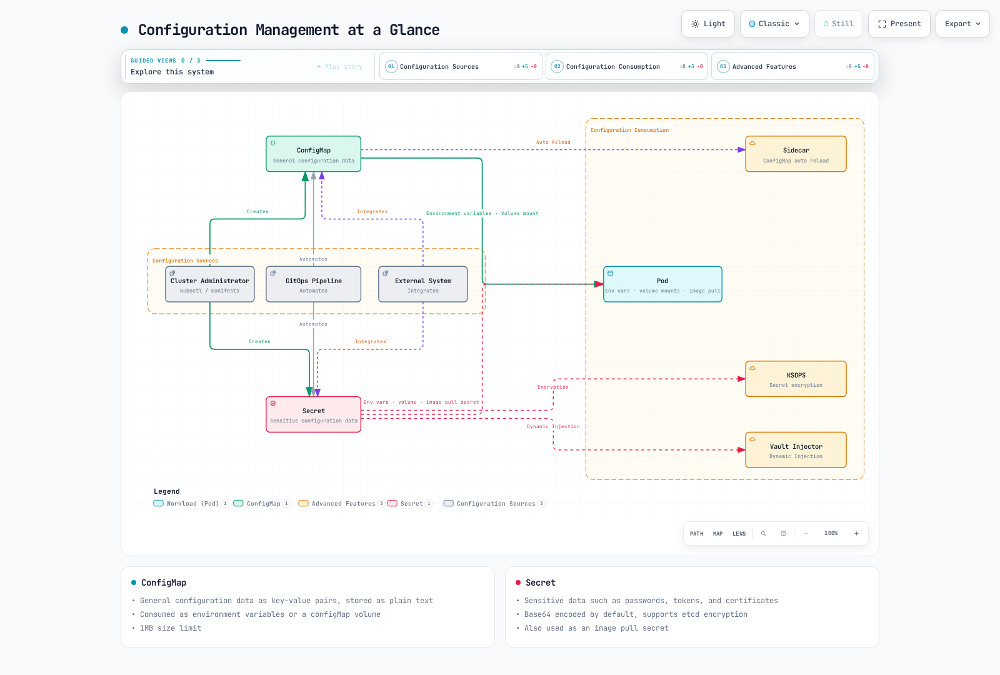
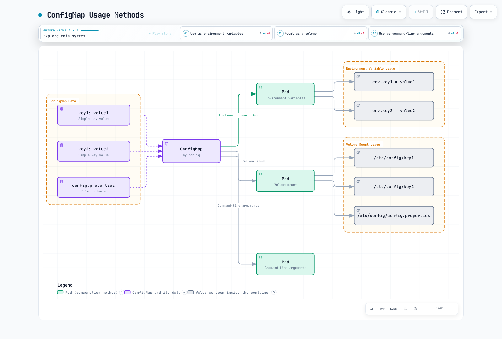
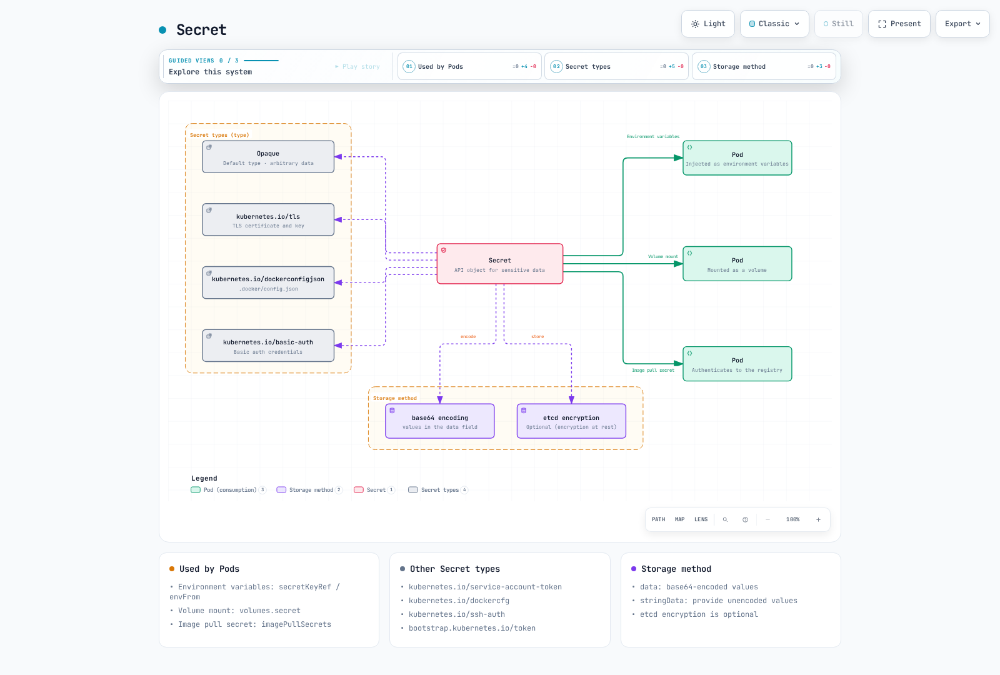
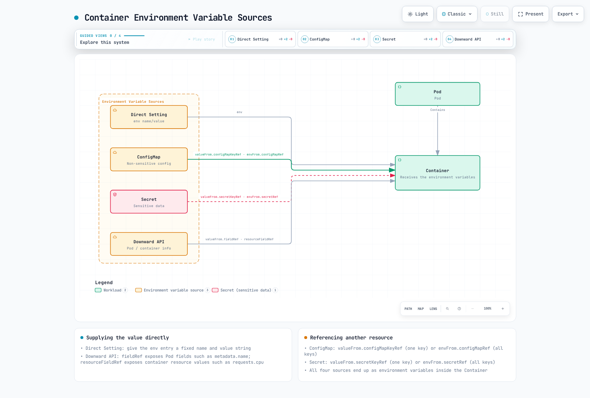
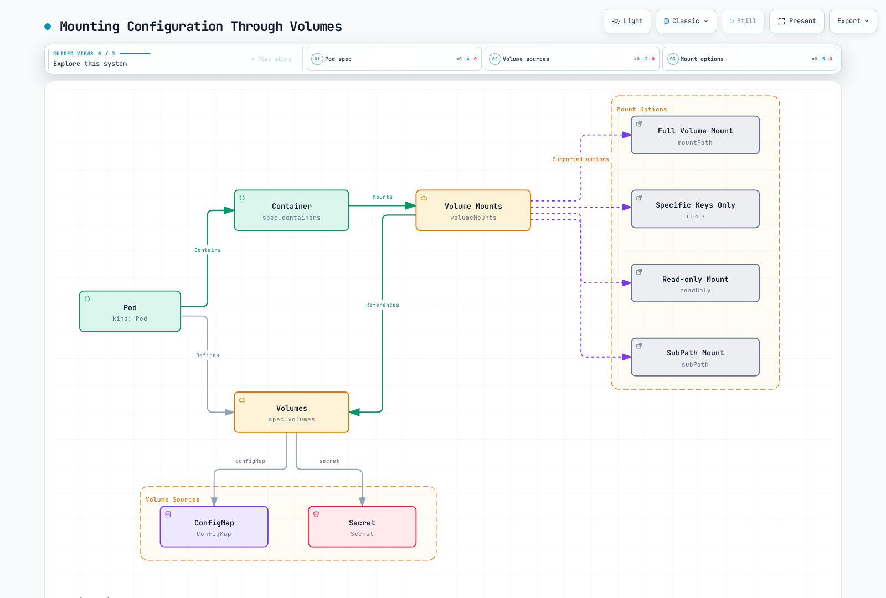
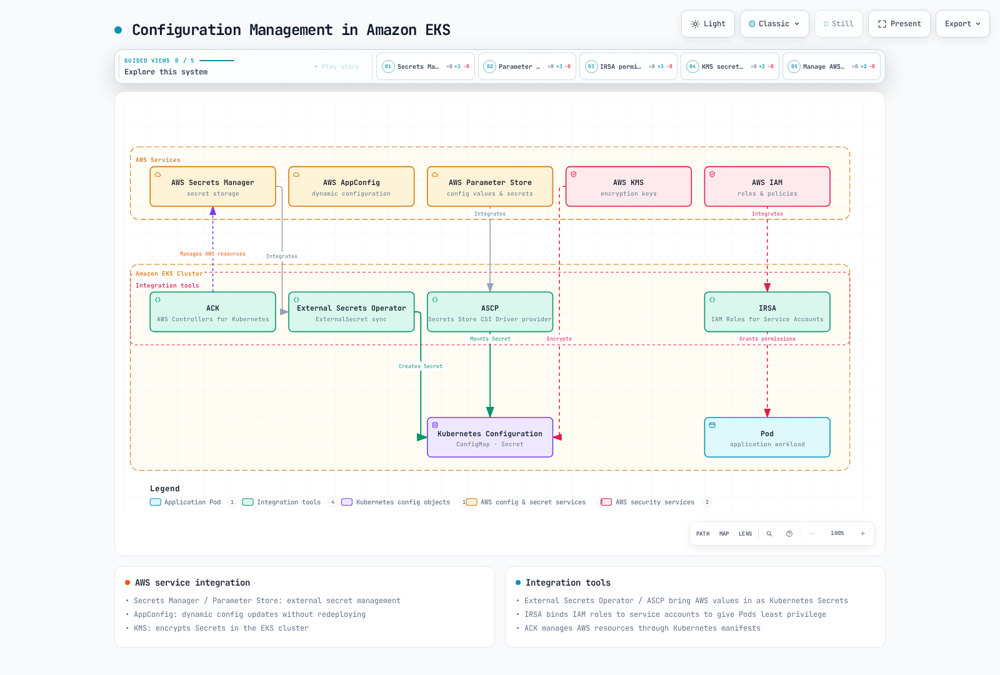

# 配置与 Secret

> **支持的版本**：Kubernetes 1.35、1.36、1.37
> **最后更新**：2026年10月16日

在 Kubernetes 中，配置管理是将应用程序设置与代码分开管理的重要组成部分。本章将详细探讨 Kubernetes 配置管理方法，包括 ConfigMap、Secret、环境变量，以及通过卷挂载配置。

## 实验环境设置

要跟随本文档中的示例操作，你需要准备以下工具和环境：

### 必需工具
- 与 API server 的版本相差不超过一个次要版本的 kubectl
- 可正常使用的 Kubernetes 集群（EKS、minikube、kind 等）

### 配置示例设置

```bash
# Create namespace
kubectl create namespace config-demo

# Create ConfigMap
kubectl -n config-demo create configmap app-config \
  --from-literal=APP_ENV=production \
  --from-literal=APP_DEBUG=false \
  --from-literal=APP_PORT=8080

# Create Secret
kubectl -n config-demo create secret generic app-secrets \
  --from-literal=DB_USER=admin \
  --from-literal=DB_PASSWORD=s3cr3t \
  --from-literal=API_KEY=abcdef123456

# Create Pod using ConfigMap and Secret
kubectl -n config-demo apply -f - <<'EOF'
apiVersion: v1
kind: Pod
metadata:
  name: config-test-pod
spec:
  containers:
  - name: test-container
    image: busybox
    command: ["sh", "-c", 'test -n "$DB_PASSWORD" && echo "Secret available" && sleep 3600']
    env:
    - name: APP_ENV
      valueFrom:
        configMapKeyRef:
          name: app-config
          key: APP_ENV
    - name: DB_PASSWORD
      valueFrom:
        secretKeyRef:
          name: app-secrets
          key: DB_PASSWORD
  restartPolicy: Never
EOF

# Check Pod logs
kubectl -n config-demo logs config-test-pod
```

## 配置管理概览



[🔍 查看交互式图表](https://www.atomai.click/kubernetes-docs/archmaps/en-core-05-configuration-secrets-0.html)

## 目录

1. [ConfigMap](#configmap)
2. [Secret](#secret)
3. [环境变量](#environment-variables)
4. [通过卷挂载配置](#mounting-configuration-through-volumes)
5. [配置最佳实践](#configuration-best-practices)
6. [Amazon EKS 中的配置管理](#configuration-management-in-amazon-eks)

## ConfigMap

> **核心概念**：ConfigMap 以键值对的形式存储配置数据，将应用程序代码与配置分离。

ConfigMap 是以键值对形式存储配置数据的 API 对象。使用 ConfigMap 可以将配置数据与容器镜像分离，让应用程序更具可移植性。

### ConfigMap 与 Secret 对比

| 特性 | ConfigMap | Secret |
|---------|-----------|--------|
| **用途** | 通用配置数据 | 敏感配置数据 |
| **API 表示形式** | UTF-8 `data` 或 base64 编码的 `binaryData` | base64 编码的 `data`；写入时可使用 `stringData` |
| **大小限制** | 1 MiB | 1 MiB |
| **静态加密** | 取决于 API server/平台配置 | 取决于 API server/平台配置 |
| **卷类型** | configMap | secret |
| **使用场景** | 环境变量、配置文件 | 密码、令牌、证书 |
| **自动更新** | 作为卷挂载时可能存在延迟 | 作为卷挂载时可能存在延迟 |

### ConfigMap 创建方法

ConfigMap 可以通过多种方式创建：

1. **命令式创建**：

```bash
# Create from literal values
kubectl create configmap my-config --from-literal=key1=value1 --from-literal=key2=value2

# Create from file
kubectl create configmap my-config --from-file=config.properties

# Create from directory
kubectl create configmap my-config --from-file=config-dir/
```

2. **声明式创建**：

```yaml
apiVersion: v1
kind: ConfigMap
metadata:
  name: my-config
data:
  # Simple key-value pairs
  database.host: "mysql"
  database.port: "3306"

  # File-like configuration
  config.yaml: |
    server:
      port: 8080
    logging:
      level: INFO
    features:
      enabled: true
```

### ConfigMap 使用方法

ConfigMap 可以通过以下方式使用：

1. **用作环境变量**：

```yaml
apiVersion: v1
kind: Pod
metadata:
  name: config-env-pod
spec:
  containers:
  - name: app
    image: nginx
    env:
    # Single key-value reference
    - name: DB_HOST
      valueFrom:
        configMapKeyRef:
          name: my-config
          key: database.host
    # All key-value references
    envFrom:
    - configMapRef:
        name: my-config
```



[🔍 查看交互式图表](https://www.atomai.click/kubernetes-docs/archmaps/en-core-05-configuration-secrets-1.html)

### 创建 ConfigMap

ConfigMap 可以通过多种方式创建：

#### 命令式

```bash
# Create from literal values
kubectl create configmap my-config --from-literal=key1=value1 --from-literal=key2=value2

# Create from file
kubectl create configmap my-config --from-file=config.properties

# Create from directory
kubectl create configmap my-config --from-file=config-dir/
```

#### 声明式

```yaml
apiVersion: v1
kind: ConfigMap
metadata:
  name: my-config
data:
  # Simple key-value pairs
  key1: value1
  key2: value2
  # File-like configuration
  config.properties: |
    property1=value1
    property2=value2
  # JSON configuration
  config.json: |
    {
      "property1": "value1",
      "property2": "value2"
    }
```

### 使用 ConfigMap

ConfigMap 可以通过以下方式在 Pod 中使用：

#### 用作环境变量

```yaml
apiVersion: v1
kind: Pod
metadata:
  name: configmap-pod
spec:
  containers:
  - name: test-container
    image: busybox
    command: [ "/bin/sh", "-c", "env" ]
    env:
    # Use single key-value pair
    - name: SPECIAL_KEY
      valueFrom:
        configMapKeyRef:
          name: my-config
          key: key1
    # Use all key-value pairs as environment variables
    envFrom:
    - configMapRef:
        name: my-config
  restartPolicy: Never
```

#### 挂载为卷

```yaml
apiVersion: v1
kind: Pod
metadata:
  name: configmap-pod
spec:
  containers:
  - name: test-container
    image: busybox
    command: [ "/bin/sh", "-c", "ls /etc/config/" ]
    volumeMounts:
    - name: config-volume
      mountPath: /etc/config
  volumes:
  - name: config-volume
    configMap:
      name: my-config
  restartPolicy: Never
```

#### 仅挂载指定键

```yaml
apiVersion: v1
kind: Pod
metadata:
  name: configmap-pod
spec:
  containers:
  - name: test-container
    image: busybox
    command: [ "/bin/sh", "-c", "cat /etc/config/key1" ]
    volumeMounts:
    - name: config-volume
      mountPath: /etc/config
  volumes:
  - name: config-volume
    configMap:
      name: my-config
      items:
      - key: key1
        path: key1
  restartPolicy: Never
```

### 更新 ConfigMap

作为完整卷挂载的可变 ConfigMap 和 Secret 最终会更新；更新延迟取决于 kubelet 同步以及变更检测/缓存设置。应用程序必须重新读取或重新加载文件。`subPath` 挂载不会接收更新。运行中的进程不会改变环境变量值；要使用新值，需要重新创建 Pod（例如，执行 Deployment 滚动更新）。

```bash
kubectl edit configmap my-config
```

或者

```yaml
apiVersion: v1
kind: ConfigMap
metadata:
  name: my-config
data:
  key1: updated-value1
  key2: value2
```

```bash
kubectl apply -f updated-configmap.yaml
```

## Secret

Secret 是用于存储密码、OAuth 令牌和 SSH 密钥等敏感信息的 API 对象。Secret 与 ConfigMap 类似，但提供了额外的安全功能来存储敏感数据。



[🔍 查看交互式图表](https://www.atomai.click/kubernetes-docs/archmaps/en-core-05-configuration-secrets-2.html)

### Secret 类型

Kubernetes 提供多种类型的 Secret：

- **Opaque**：默认类型，用于存储用户定义的任意数据。
- **kubernetes.io/service-account-token**：存储 ServiceAccount 令牌。
- **kubernetes.io/dockercfg**：存储 `.dockercfg` 文件的序列化形式。
- **kubernetes.io/dockerconfigjson**：存储 `.docker/config.json` 文件的序列化形式。
- **kubernetes.io/basic-auth**：存储基本身份验证凭据。
- **kubernetes.io/ssh-auth**：存储 SSH 身份验证凭据。
- **kubernetes.io/tls**：存储 TLS 证书和密钥。
- **bootstrap.kubernetes.io/token**：存储引导令牌数据。

### 创建 Secret

Secret 可以通过多种方式创建：

#### 命令式

```bash
# Create from literal values
kubectl create secret generic my-secret --from-literal=username=admin --from-literal=password=secret

# Create from files
kubectl create secret generic my-secret --from-file=username=username.txt --from-file=password=password.txt

# Create TLS secret
kubectl create secret tls my-tls-secret --cert=path/to/cert.crt --key=path/to/key.key

# Create Docker registry secret
kubectl create secret docker-registry my-registry-secret \
  --docker-server=DOCKER_REGISTRY_SERVER \
  --docker-username=DOCKER_USER \
  --docker-password=DOCKER_PASSWORD \
  --docker-email=DOCKER_EMAIL
```

#### 声明式

```yaml
apiVersion: v1
kind: Secret
metadata:
  name: my-secret
type: Opaque
data:
  # base64 encoded values
  username: YWRtaW4=  # admin
  password: c2VjcmV0  # secret
```

也可以使用 `stringData` 字段提供未编码的值：

```yaml
apiVersion: v1
kind: Secret
metadata:
  name: my-secret
type: Opaque
stringData:
  # Unencoded values
  username: admin
  password: secret
```

### 使用 Secret

Secret 可以通过以下方式在 Pod 中使用：

#### 用作环境变量

```yaml
apiVersion: v1
kind: Pod
metadata:
  name: secret-pod
spec:
  containers:
  - name: test-container
    image: busybox
    command: ["/bin/sh", "-c", 'test -n "$USERNAME" && echo "Secret available"']
    env:
    # Use single key-value pair
    - name: USERNAME
      valueFrom:
        secretKeyRef:
          name: my-secret
          key: username
    # Use all key-value pairs as environment variables
    envFrom:
    - secretRef:
        name: my-secret
  restartPolicy: Never
```

#### 挂载为卷

```yaml
apiVersion: v1
kind: Pod
metadata:
  name: secret-pod
spec:
  containers:
  - name: test-container
    image: busybox
    command: [ "/bin/sh", "-c", "ls /etc/secret/" ]
    volumeMounts:
    - name: secret-volume
      mountPath: /etc/secret
  volumes:
  - name: secret-volume
    secret:
      secretName: my-secret
  restartPolicy: Never
```

#### 镜像拉取 Secret

```yaml
apiVersion: v1
kind: Pod
metadata:
  name: private-image-pod
spec:
  containers:
  - name: private-image-container
    image: private-registry.example.com/my-app:v1
  imagePullSecrets:
  - name: my-registry-secret
```

### Secret 安全注意事项

Secret 默认使用 base64 编码，但这并非加密。为增强 Secret 的安全性，可考虑以下方法：

1. **etcd 加密**：对存储在 etcd 中的 Secret 加密。
2. **RBAC**：限制对 Secret 的访问。
3. **网络策略**：在支持的情况下，限制对 API 或外部存储的网络访问；Secret 对象的授权由 RBAC 强制执行，而非 NetworkPolicy。
4. **外部 Secret 管理工具**：使用 AWS Secrets Manager、HashiCorp Vault 等外部 Secret 管理工具。

此处展示的所有凭据都是用于学习的虚构值。不要记录 Secret 内容，也不要提交真实值或其 base64 等效内容；应优先使用受保护的输入文件或外部 Secret 管理器，而不是在 CLI 参数中直接提供字面值。即使用户没有直接读取 Secret 的权限，只要他们能创建使用该 Secret 的 Pod，就可能获取该 Secret。

#### etcd 加密配置

```yaml
apiVersion: apiserver.config.k8s.io/v1
kind: EncryptionConfiguration
resources:
  - resources:
    - secrets
    providers:
    - aescbc:
        keys:
        - name: key1
          secret: <base64 encoded key>
    - identity: {}
```

对于自行管理的集群，请使用 `--encryption-provider-config` 加载此文件，保护加密密钥，并重写现有 Secret 以将其加密。它不是可通过 `kubectl apply` 应用的资源。EKS 会管理自己的加密（见下文）。

## 环境变量 {#environment-variables}

环境变量是向容器传递配置信息的简单方式。Kubernetes 提供多种设置环境变量的方法。



[🔍 查看交互式图表](https://www.atomai.click/kubernetes-docs/archmaps/en-core-05-configuration-secrets-3.html)

### 直接设置

```yaml
apiVersion: v1
kind: Pod
metadata:
  name: env-pod
spec:
  containers:
  - name: test-container
    image: busybox
    command: [ "/bin/sh", "-c", "env" ]
    env:
    - name: ENVIRONMENT
      value: "production"
    - name: LOG_LEVEL
      value: "INFO"
  restartPolicy: Never
```

### 从 ConfigMap 设置

```yaml
apiVersion: v1
kind: Pod
metadata:
  name: env-pod
spec:
  containers:
  - name: test-container
    image: busybox
    command: [ "/bin/sh", "-c", "env" ]
    env:
    - name: ENVIRONMENT
      valueFrom:
        configMapKeyRef:
          name: my-config
          key: key1
  restartPolicy: Never
```

### 从 Secret 设置

```yaml
apiVersion: v1
kind: Pod
metadata:
  name: env-pod
spec:
  containers:
  - name: test-container
    image: busybox
    command: ["/bin/sh", "-c", 'test -n "$DATABASE_PASSWORD" && echo "Secret available"']
    env:
    - name: DATABASE_PASSWORD
      valueFrom:
        secretKeyRef:
          name: my-secret
          key: password
  restartPolicy: Never
```

### 通过 Downward API 设置

Downward API 允许将 Pod 和容器信息作为环境变量公开。

```yaml
apiVersion: v1
kind: Pod
metadata:
  name: downward-api-pod
  labels:
    app: myapp
spec:
  containers:
  - name: test-container
    image: busybox
    command: [ "/bin/sh", "-c", "env" ]
    env:
    - name: POD_NAME
      valueFrom:
        fieldRef:
          fieldPath: metadata.name
    - name: POD_NAMESPACE
      valueFrom:
        fieldRef:
          fieldPath: metadata.namespace
    - name: POD_IP
      valueFrom:
        fieldRef:
          fieldPath: status.podIP
    - name: NODE_NAME
      valueFrom:
        fieldRef:
          fieldPath: spec.nodeName
    - name: CONTAINER_CPU_REQUEST
      valueFrom:
        resourceFieldRef:
          containerName: test-container
          resource: requests.cpu
  restartPolicy: Never
```

## 通过卷挂载配置 {#mounting-configuration-through-volumes}

通过卷将配置文件挂载到容器中，与环境变量相比，能提供更加灵活的配置管理方式。



[🔍 查看交互式图表](https://www.atomai.click/kubernetes-docs/archmaps/en-core-05-configuration-secrets-4.html)

### ConfigMap 卷

```yaml
apiVersion: v1
kind: Pod
metadata:
  name: configmap-volume-pod
spec:
  containers:
  - name: test-container
    image: busybox
    command: [ "/bin/sh", "-c", "ls -la /etc/config" ]
    volumeMounts:
    - name: config-volume
      mountPath: /etc/config
  volumes:
  - name: config-volume
    configMap:
      name: my-config
  restartPolicy: Never
```

### Secret 卷

```yaml
apiVersion: v1
kind: Pod
metadata:
  name: secret-volume-pod
spec:
  containers:
  - name: test-container
    image: busybox
    command: [ "/bin/sh", "-c", "ls -la /etc/secret" ]
    volumeMounts:
    - name: secret-volume
      mountPath: /etc/secret
  volumes:
  - name: secret-volume
    secret:
      secretName: my-secret
  restartPolicy: Never
```

### 挂载指定文件

```yaml
apiVersion: v1
kind: Pod
metadata:
  name: specific-file-pod
spec:
  containers:
  - name: test-container
    image: busybox
    command: [ "/bin/sh", "-c", "cat /etc/config/config.properties" ]
    volumeMounts:
    - name: config-volume
      mountPath: /etc/config
  volumes:
  - name: config-volume
    configMap:
      name: my-config
      items:
      - key: config.properties
        path: config.properties
  restartPolicy: Never
```

### 只读挂载

```yaml
apiVersion: v1
kind: Pod
metadata:
  name: readonly-mount-pod
spec:
  containers:
  - name: test-container
    image: busybox
    command: [ "/bin/sh", "-c", "ls -la /etc/config" ]
    volumeMounts:
    - name: config-volume
      mountPath: /etc/config
      readOnly: true
  volumes:
  - name: config-volume
    configMap:
      name: my-config
  restartPolicy: Never
```

### SubPath 挂载

```yaml
apiVersion: v1
kind: Pod
metadata:
  name: subpath-mount-pod
spec:
  containers:
  - name: test-container
    image: busybox
    command: [ "/bin/sh", "-c", "cat /etc/config/config.properties" ]
    volumeMounts:
    - name: config-volume
      mountPath: /etc/config/config.properties
      subPath: config.properties
  volumes:
  - name: config-volume
    configMap:
      name: my-config
  restartPolicy: Never
```

## 配置最佳实践 {#configuration-best-practices}

在 Kubernetes 中管理配置时，请考虑以下最佳实践：

### 1. 将配置与代码分离

分别管理应用程序代码和配置。这样在更改配置时就不需要重新构建应用程序。

### 2. 按环境管理配置

针对开发、测试和生产等不同环境分别管理配置。可以使用命名空间隔离环境，并为每个环境使用不同的 ConfigMap 和 Secret。

```yaml
apiVersion: v1
kind: ConfigMap
metadata:
  name: my-config
  namespace: development
data:
  environment: development
  log_level: DEBUG
---
apiVersion: v1
kind: ConfigMap
metadata:
  name: my-config
  namespace: production
data:
  environment: production
  log_level: INFO
```

### 3. 使用 Secret 存储敏感信息

始终使用 Secret 存储密码、API 密钥和证书等敏感信息。ConfigMap 仅用于非敏感配置数据。

### 4. 保持不可变性

更改配置时，应创建新版本，而不是修改现有版本。这样可以更轻松地回滚，也便于跟踪配置变更历史。

```yaml
apiVersion: v1
kind: ConfigMap
metadata:
  name: my-config-v1
immutable: true
data:
  log_level: INFO
  # Configuration data
---
apiVersion: v1
kind: ConfigMap
metadata:
  name: my-config-v2
immutable: true
data:
  log_level: DEBUG
  # Updated configuration data
```

### 5. 配置变更时重启 Pod

作为环境变量使用的配置需要重启 Pod 才能更新。使用 Deployment 执行滚动更新。

```bash
kubectl rollout restart deployment/my-deployment
```

### 6. 验证配置

应用配置前先验证配置。无效配置可能导致应用程序故障。

### 7. 记录配置文档

记录配置选项及其影响。这有助于团队成员理解和管理配置。

### 资源请求与 QoS

Requests 指导调度和运行时资源分配，但不会强制应用程序使用相应数量的资源。CPU 限制会限制 CPU 使用，而内存限制可能触发 OOM 终止。对于测验中的容器级示例，Guaranteed 要求每个容器的 CPU 和内存 requests/limits 相等；BestEffort 不设置这两者，其他配置则属于 Burstable。Pod 级资源也会影响 QoS。节点压力驱逐还会考虑优先级以及相对于 requests 的资源使用量。请参阅[资源管理](https://kubernetes.io/docs/concepts/configuration/manage-resources-containers/)和[Pod QoS](https://kubernetes.io/docs/concepts/workloads/pods/pod-qos/)。

## Amazon EKS 中的配置管理 {#configuration-management-in-amazon-eks}

在 Amazon EKS 中，除了 Kubernetes 的基本配置管理功能外，还可以使用 AWS 的各种服务来管理配置和 Secret。本节将介绍在 EKS 中管理配置的多种方式，以及与 AWS 服务的集成。



[🔍 查看交互式图表](https://www.atomai.click/kubernetes-docs/archmaps/en-core-05-configuration-secrets-5.html)

### 集成 AWS Secrets Manager

AWS Secrets Manager 是一项服务，可用于安全地存储和管理数据库凭据、API 密钥及其他 Secret 信息。External Secrets Operator 用于协调 Kubernetes Secret。ASCP 配合 Secrets Store CSI Driver 可将外部值作为文件挂载；同步 Kubernetes Secret 和自动轮换则需要配置相应的可选驱动程序功能。

#### 安装 External Secrets Operator

```bash
# Install External Secrets Operator using Helm
helm repo add external-secrets https://charts.external-secrets.io
helm install external-secrets external-secrets/external-secrets \
  --namespace external-secrets \
  --create-namespace
```

#### 创建 SecretStore

```yaml
apiVersion: external-secrets.io/v1
kind: SecretStore
metadata:
  name: aws-secretsmanager
  namespace: my-namespace
spec:
  provider:
    aws:
      service: SecretsManager
      region: us-west-2
      auth:
        jwt:
          serviceAccountRef:
            name: my-serviceaccount
```

#### 创建 ExternalSecret

```yaml
apiVersion: external-secrets.io/v1
kind: ExternalSecret
metadata:
  name: database-credentials
  namespace: my-namespace
spec:
  refreshInterval: 1h
  secretStoreRef:
    name: aws-secretsmanager
    kind: SecretStore
  target:
    name: db-credentials
  data:
  - secretKey: username
    remoteRef:
      key: prod/db/credentials
      property: username
  - secretKey: password
    remoteRef:
      key: prod/db/credentials
      property: password
```

#### 设置 IRSA（IAM Roles for Service Accounts）

External Secrets Operator 需要适当的 IAM 权限才能访问 AWS Secrets Manager。可以使用 IRSA 将 IAM 角色与 Kubernetes ServiceAccount 关联。

```bash
# Create OIDC provider
eksctl utils associate-iam-oidc-provider \
  --cluster my-cluster \
  --approve

# Create IAM role and service account
eksctl create iamserviceaccount \
  --cluster my-cluster \
  --namespace my-namespace \
  --name my-serviceaccount \
  --attach-policy-arn arn:aws:iam::123456789012:policy/ReadAppDatabaseSecret \
  --approve
```

先创建 `ReadAppDatabaseSecret`，授予 `secretsmanager:GetSecretValue` 和 `secretsmanager:DescribeSecret` 权限，并将其限制在 `prod/db/credentials` 的完整 ARN 上；只有在客户管理的密钥有此要求时，才添加受限的 `kms:Decrypt` 权限。IAM 信任策略必须与此集群、命名空间和 ServiceAccount 匹配。在创建 SecretStore 之前，先安装 ESO/v1 CRD，并创建命名空间和 ServiceAccount。

### 使用 AWS Parameter Store

AWS Systems Manager Parameter Store 是一项服务，可用于分层存储和管理配置数据及 Secret 值。应根据轮换、生命周期和访问要求，在 Parameter Store 与 Secrets Manager 之间进行选择；费用取决于参数层级和 API 使用量。

#### 安装 ASCP（AWS Secrets and Configuration Provider）

```bash
# Install ASCP
helm repo add secrets-store-csi-driver https://kubernetes-sigs.github.io/secrets-store-csi-driver/charts
helm install csi-secrets-store secrets-store-csi-driver/secrets-store-csi-driver \
  --namespace kube-system

# Install AWS provider
kubectl apply -f https://raw.githubusercontent.com/aws/secrets-store-csi-driver-provider-aws/main/deployment/aws-provider-installer.yaml
```

#### 创建 SecretProviderClass

```yaml
apiVersion: secrets-store.csi.x-k8s.io/v1
kind: SecretProviderClass
metadata:
  name: aws-parameters
  namespace: my-namespace
spec:
  provider: aws
  parameters:
    objects: |
      - objectName: /my-app/config/log-level
        objectType: ssmparameter
      - objectName: /my-app/config/environment
        objectType: ssmparameter
```

#### 在 Pod 中使用 Parameter Store 值

```yaml
apiVersion: v1
kind: Pod
metadata:
  name: parameter-store-pod
  namespace: my-namespace
spec:
  serviceAccountName: parameter-reader
  containers:
  - name: app
    image: my-app:latest
    volumeMounts:
    - name: parameters-store-volume
      mountPath: "/mnt/parameters"
      readOnly: true
  volumes:
  - name: parameters-store-volume
    csi:
      driver: secrets-store.csi.k8s.io
      readOnly: true
      volumeAttributes:
        secretProviderClass: aws-parameters
```

创建 `parameter-reader`，并为其配置 IRSA 角色或 Pod Identity 关联，授予对这两个参数 ARN 的 `ssm:GetParameters` 权限，以及（如有需要）受限的 KMS 解密权限。前面创建的 Secrets Manager 角色不提供 SSM 权限。ASCP 需要受支持的节点/附加组件组合；CSI 挂载无法在 Fargate 上使用。Hybrid Nodes 需要明确支持的附加组件版本和凭据配置。

### 使用 AWS AppConfig 实现动态配置

AWS AppConfig 是一项用于管理和部署应用程序配置的服务。使用 AppConfig 可以动态更新配置，而无需重新部署应用程序。

#### AppConfig Agent 边车模式

应用程序从 Agent 的本地 HTTP 端点获取配置，并且必须刷新/重新加载配置。仅共享一个 emptyDir 并不会让 Agent 写入 `/config/config.json`。请先创建应用程序/环境/配置文件和 Deployment，并为 Pod 身份授予所需配置对应的 `appconfig:StartConfigurationSession` 和 `appconfig:GetLatestConfiguration` 权限。

```yaml
apiVersion: apps/v1
kind: Deployment
metadata:
  name: my-app
  namespace: my-namespace
spec:
  replicas: 3
  selector:
    matchLabels:
      app: my-app
  template:
    metadata:
      labels:
        app: my-app
    spec:
      serviceAccountName: appconfig-reader
      containers:
      - name: app
        image: my-app:latest
        env:
        - name: CONFIG_URL
          value: http://localhost:2772/applications/MyApp/environments/Production/configurations/MyConfig
      - name: appconfig-agent
        image: public.ecr.aws/aws-appconfig/aws-appconfig-agent:2.x
        env:
        - name: SERVICE_REGION
          value: us-west-2
        - name: POLL_INTERVAL
          value: "45s"
        - name: REQUEST_TIMEOUT
          value: "15s"
        - name: HTTP_PORT
          value: "2772"
        - name: HTTP_HOST
          value: localhost
        - name: PREFETCH_LIST
          value: MyApp:Production:MyConfig
```

应用程序镜像必须实现 CONFIG_URL 获取逻辑，并在边车启动期间进行重试。部署前，请创建 `appconfig-reader` 并为其配置受限的 AWS 身份；在生产环境中，请固定使用经过测试的 Agent 版本/摘要。这些是容器 Agent 的设置，不是 Lambda 扩展环境变量。

### 使用 EKS Fargate Profile 管理配置

使用 EKS Fargate 可在无需管理节点的情况下运行 Kubernetes Pod。你可以使用 Fargate Profile 配置 Pod 的执行环境。

Fargate Profile 是 EKS API 资源，而不是原生 Kubernetes 对象。例如，将私有子网 ID 和执行角色替换为实际值后，使用此 `eksctl` 配置并运行 `eksctl create fargateprofile -f fargate-profile.yaml`：

```yaml
apiVersion: eksctl.io/v1alpha5
kind: ClusterConfig
metadata:
  name: my-cluster
  region: us-west-2
fargateProfiles:
- name: my-profile
  podExecutionRoleARN: arn:aws:iam::123456789012:role/my-pod-execution-role
  selectors:
  - namespace: my-namespace
    labels:
      environment: production
  subnets:
  - subnet-1234567890abcdef0
  - subnet-0abcdef1234567890
```

### 使用 AWS KMS 加密 Secret {#secret-encryption-with-aws-kms}

运行 Kubernetes 1.28 或更高版本的 EKS 集群会使用 AWS 所有者密钥，对[所有 Kubernetes API 数据默认进行信封加密](https://docs.aws.amazon.com/eks/latest/userguide/envelope-encryption.html)，其中包括 Secret 和 ConfigMap。客户管理的 KMS 密钥是可选项；启用加密不需要客户管理的密钥。

要将客户管理的密钥关联到符合条件的现有集群，请使用 `associate-encryption-config`，而不是 `update-cluster-config`。应用前，请检查密钥的区域、策略、权限和关联限制。以下示例创建一个密钥并重复使用其返回的 ARN：

```bash
set -eu
KEY_ARN=$(aws kms create-key --region us-west-2 \
  --description "EKS customer-managed encryption key" \
  --query KeyMetadata.Arn --output text)
aws kms create-alias --region us-west-2 \
  --alias-name alias/eks-secrets --target-key-id "$KEY_ARN"

aws eks associate-encryption-config --region us-west-2 \
  --cluster-name my-cluster \
  --encryption-config "resources=secrets,provider={keyArn=$KEY_ARN}"
```

使用返回的更新 ID 执行 `aws eks describe-update` 检查是否完成，并检查 `aws eks describe-cluster --name my-cluster --region us-west-2 --query cluster.encryptionConfig` 的结果。未配置客户管理的密钥，并不意味着默认加密已禁用。

### 使用 AWS IAM 控制 Secret 访问

使用 IRSA（IAM Roles for Service Accounts）将 IAM 角色与 Kubernetes ServiceAccount 关联，可让 Pod 安全地访问 AWS 服务。

#### 创建 ServiceAccount

```yaml
apiVersion: v1
kind: ServiceAccount
metadata:
  name: my-service-account
  namespace: my-namespace
  annotations:
    eks.amazonaws.com/role-arn: arn:aws:iam::123456789012:role/my-iam-role
```

#### 在 Pod 中使用 ServiceAccount

```yaml
apiVersion: v1
kind: Pod
metadata:
  name: my-pod
  namespace: my-namespace
spec:
  serviceAccountName: my-service-account
  containers:
  - name: app
    image: my-app:latest
```

### EKS 配置最佳实践

在 EKS 中管理配置时，请考虑以下最佳实践：

1. **使用工作负载身份**：在受支持的计算环境中使用 EKS Pod Identity 或 IRSA，并授予受限权限。Fargate 应用程序使用 IRSA；其 Pod 执行角色用于基础设施，而非应用程序凭据。

2. **加密 Secret**：使用 KMS 加密 EKS 集群中的 Secret。

3. **外部 Secret 管理**：使用 AWS Secrets Manager 或 Parameter Store 等外部 Secret 管理服务来管理敏感信息。

4. **配置版本管理**：使用 AWS AppConfig 或 Parameter Store 管理配置版本。

5. **按环境隔离配置**：分别管理开发、测试和生产环境的配置。使用 Kubernetes 命名空间和 AWS 资源标签。

6. **精简 IAM 策略**：访问 AWS 服务时遵循最小权限原则。

7. **配置自动化**：使用 AWS CloudFormation、AWS CDK 或 Terraform 等工具实现配置管理自动化。

### EKS 配置管理工具

下面来看看有助于在 EKS 中管理配置的工具：

#### AWS Controllers for Kubernetes (ACK)

ACK 是一款可从 Kubernetes 管理 AWS 资源的工具。使用 ACK，可以通过 Kubernetes 清单创建和管理 AWS 资源。

```yaml
apiVersion: secretsmanager.services.k8s.aws/v1alpha1
kind: Secret
metadata:
  name: my-secret
  annotations:
    services.k8s.aws/deletion-policy: retain
spec:
  name: my-secret
  description: "My secret created via ACK"
  recoveryWindowInDays: 30
```

请先安装 ACK Secrets Manager 控制器及其 IAM 角色/CRD。此清单管理 Secret 容器元数据；它不会生成密码，也不会创建原生 Kubernetes Secret。请通过受控的 Secret 管理工作流填充 Secret 值。

#### eksctl

eksctl 是一个用于创建和管理 EKS 集群的命令行工具。你可以使用 eksctl 管理集群配置。

```yaml
# cluster.yaml
apiVersion: eksctl.io/v1alpha5
kind: ClusterConfig
metadata:
  name: my-cluster
  region: us-west-2
secretsEncryption:
  keyARN: arn:aws:kms:us-west-2:123456789012:key/1234abcd-12ab-34cd-56ef-1234567890ab
```

```bash
eksctl create cluster -f cluster.yaml
```

#### AWS CDK

AWS CDK (Cloud Development Kit) 是一款可使用编程语言定义 AWS 资源的工具。你可以使用 CDK 定义 EKS 集群及相关资源。

此辅助函数适用于已有的 CDK EKS 集群和 Secret 构造，仅授予对该 Secret 的读取权限。命名空间必须已存在，并且集群必须配置兼容的 kubectl Provider。

```typescript
import * as eks from 'aws-cdk-lib/aws-eks';
import * as secretsmanager from 'aws-cdk-lib/aws-secretsmanager';

export function addSecretReader(
  cluster: eks.Cluster,
  secret: secretsmanager.ISecret,
): eks.ServiceAccount {
  const serviceAccount = cluster.addServiceAccount('SecretReader', {
    name: 'my-service-account',
    namespace: 'my-namespace',
  });
  secret.grantRead(serviceAccount);
  return serviceAccount;
}
```

## 总结

本章介绍了 Kubernetes 配置管理方法。ConfigMap 和 Secret 提供了管理应用程序配置的基本方式，你可以通过环境变量和卷将这些配置传递给容器。我们还介绍了配置管理最佳实践和外部配置管理工具。

在 Amazon EKS 环境中，除了 Kubernetes 的基本配置管理功能，还可以结合 AWS 服务实现更强大、更安全的配置管理。通过集成 AWS Secrets Manager、Parameter Store、KMS 和 IAM 等服务，可以安全地管理 Secret，并通过 IRSA 向 Pod 授予最低限度的权限。此外，使用 AWS AppConfig 还可以动态更新配置，而无需重新部署应用程序。

有效的配置管理对于提升 Kubernetes 应用程序的可维护性、可扩展性和安全性至关重要。应根据应用程序的需求选择适当的配置管理策略，并遵循最佳实践。在 EKS 环境中，可以通过与 AWS 服务集成，构建更强大的配置管理解决方案。

下一章将介绍 Kubernetes 安全性。

## 测验

要测试你对本章内容的掌握情况，请尝试[配置与 Secret 测验](../quizzes/core/05-configuration-secrets-quiz.md)。

## 参考资料

- [Kubernetes 官方文档 - ConfigMap](https://kubernetes.io/docs/concepts/configuration/configmap/)
- [Kubernetes 官方文档 - Secret](https://kubernetes.io/docs/concepts/configuration/secret/)
- [Kubernetes 官方文档 - 环境变量](https://kubernetes.io/docs/tasks/inject-data-application/define-environment-variable-container/)
- [Kubernetes 官方文档 - 配置 Pod 使用 ConfigMap](https://kubernetes.io/docs/tasks/configure-pod-container/configure-pod-configmap/)
- [Kubernetes 官方文档 - 使用 Secret 安全地分发凭据](https://kubernetes.io/docs/tasks/inject-data-application/distribute-credentials-secure/)
- [Helm 官方文档](https://helm.sh/docs/)
- [Kustomize 官方文档](https://kustomize.io/)
- [External Secrets Operator 官方文档](https://external-secrets.io/latest/)
- [AWS Secrets Manager 官方文档](https://docs.aws.amazon.com/secretsmanager/latest/userguide/intro.html)
- [AWS Systems Manager Parameter Store 官方文档](https://docs.aws.amazon.com/systems-manager/latest/userguide/systems-manager-parameter-store.html)
- [AWS AppConfig 官方文档](https://docs.aws.amazon.com/appconfig/latest/userguide/what-is-appconfig.html)
- [EKS 官方文档 - IRSA](https://docs.aws.amazon.com/eks/latest/userguide/iam-roles-for-service-accounts.html)
- [EKS 官方文档 - Secret 加密](https://docs.aws.amazon.com/eks/latest/userguide/enable-kms.html)
- [AWS Controllers for Kubernetes (ACK) 官方文档](https://aws-controllers-k8s.github.io/community/)
