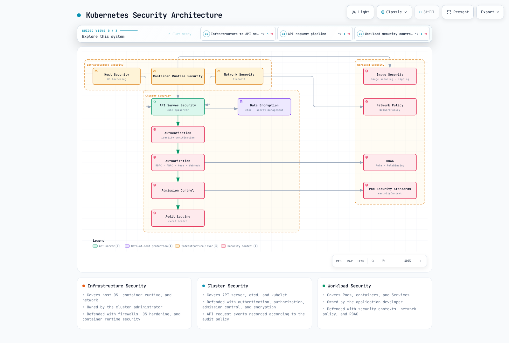
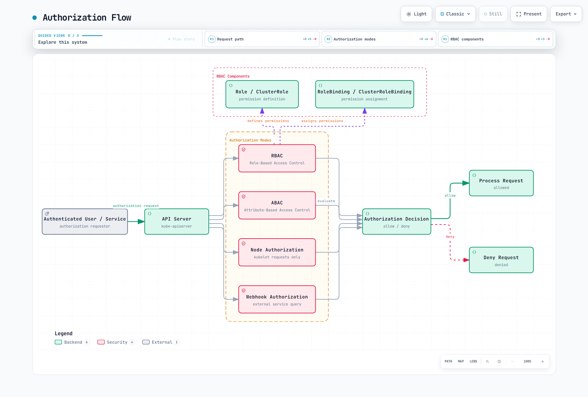
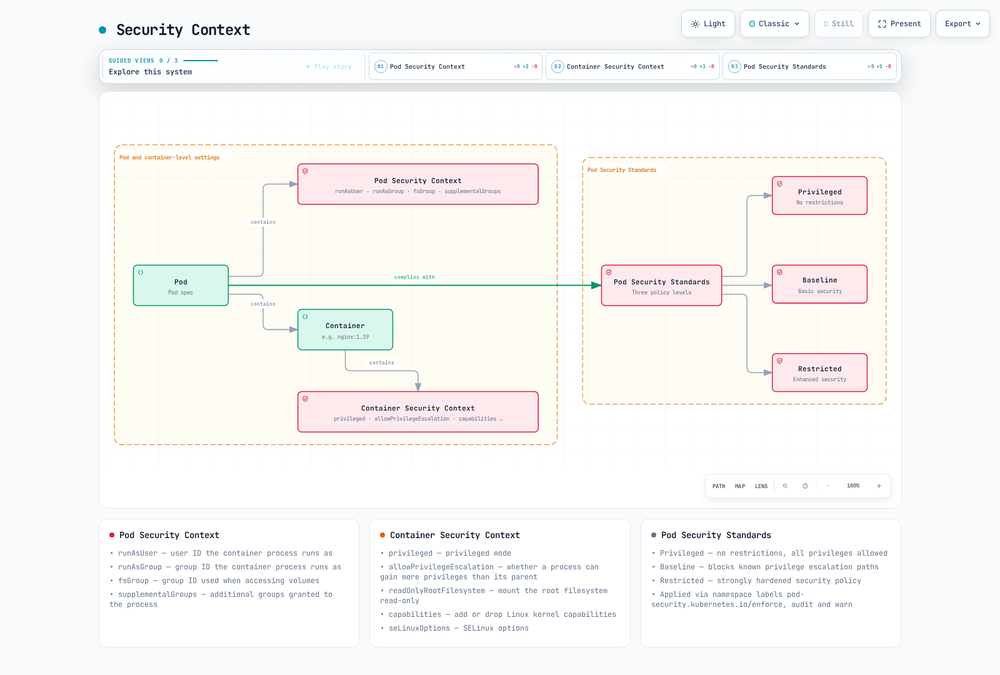
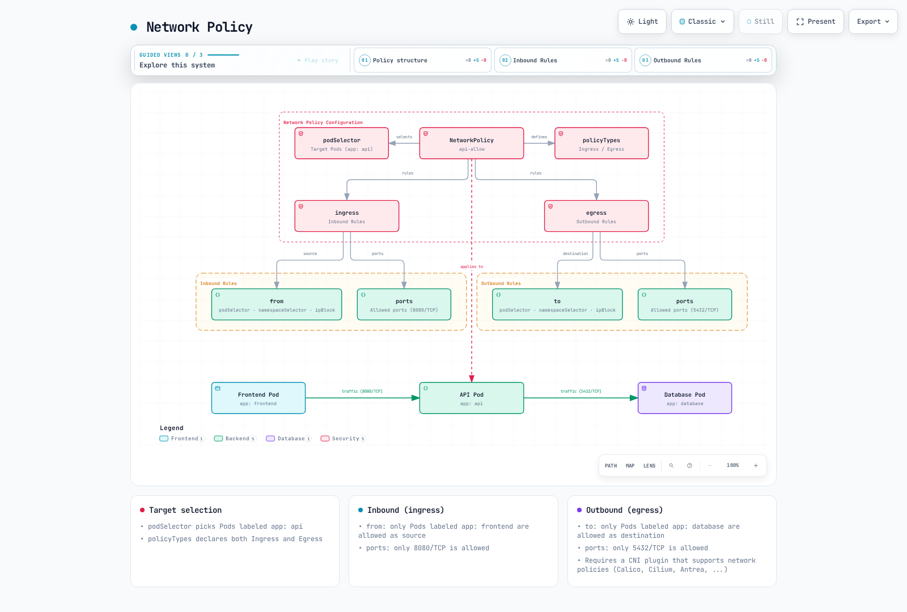
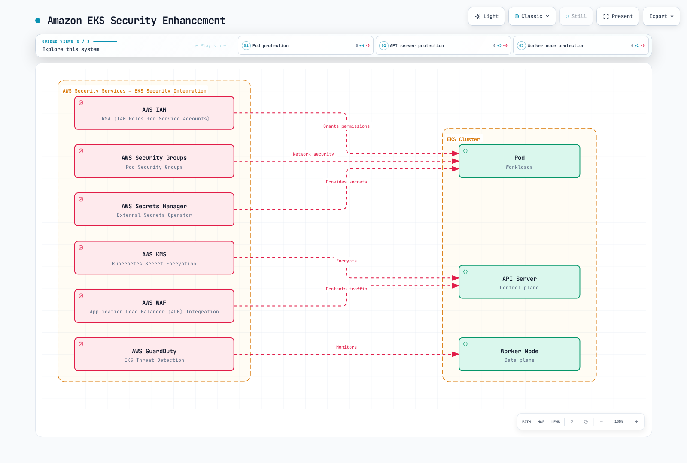

# Kubernetes 安全

> **支持的版本**：Kubernetes 1.35、1.36、1.37
> **最后更新**：2026 年 10 月 16 日

在 Kubernetes 中，安全是保护集群和应用程序的关键要素。本章将介绍 Kubernetes 安全概念、身份验证和授权机制、网络策略、安全上下文，以及如何增强 Amazon EKS 的安全性。

## 实验环境设置

要按照本文档中的示例操作，你需要准备以下工具和环境：

### 必需工具
- 版本与 API 服务器相差不超过一个次要版本的 kubectl
- 可正常工作的 Kubernetes 集群（EKS、minikube、kind 等）
- OpenSSL（用于创建证书）

### 安全示例设置

```bash
# Create namespace
kubectl create namespace security-demo

# Create service account
kubectl -n security-demo create serviceaccount demo-sa

# Create role
kubectl -n security-demo apply -f - <<EOF
apiVersion: rbac.authorization.k8s.io/v1
kind: Role
metadata:
  name: pod-reader
rules:
- apiGroups: [""]
  resources: ["pods"]
  verbs: ["get", "watch", "list"]
EOF

# Create role binding
kubectl -n security-demo apply -f - <<EOF
apiVersion: rbac.authorization.k8s.io/v1
kind: RoleBinding
metadata:
  name: read-pods
subjects:
- kind: ServiceAccount
  name: demo-sa
  namespace: security-demo
roleRef:
  kind: Role
  name: pod-reader
  apiGroup: rbac.authorization.k8s.io
EOF

# Create Pod with security context
kubectl -n security-demo apply -f - <<EOF
apiVersion: v1
kind: Pod
metadata:
  name: security-context-demo
spec:
  serviceAccountName: demo-sa
  securityContext:
    runAsUser: 1000
    runAsGroup: 3000
    fsGroup: 2000
    runAsNonRoot: true
    seccompProfile:
      type: RuntimeDefault
  containers:
  - name: sec-ctx-demo
    image: busybox
    command: ["sh", "-c", "sleep 3600"]
    securityContext:
      allowPrivilegeEscalation: false
      readOnlyRootFilesystem: true
EOF
```

## Kubernetes 安全架构



[🔍 查看交互式图表](https://www.atomai.click/kubernetes-docs/archmaps/en-core-06-security-0.html)

## 目录
1. [安全概述](#security-overview)
2. [身份验证](#authentication)
3. [授权](#authorization)
4. [安全上下文](#security-context)
5. [网络策略](#network-policy)
6. [Secret 管理](#secret-management)
7. [镜像安全](#image-security)
8. [Pod 安全标准](#pod-security-standards)
9. [审计](#audit)
10. [Amazon EKS 安全增强](#amazon-eks-security-enhancement)

## 安全概述 {#security-overview}

> **关键概念**：Kubernetes 安全遵循纵深防御方法，在基础设施、集群和工作负载层面提供多种安全机制。

Kubernetes 安全主要包括以下几个方面：

### 安全领域对比

| 安全领域 | 主要组件 | 负责方 | 安全机制 |
|--------------|-----------------|-------------------|---------------------|
| **基础设施安全** | 主机 OS、容器运行时、网络 | 集群管理员 | 防火墙、OS 加固、容器运行时安全 |
| **集群安全** | API 服务器、etcd、kubelet | 集群管理员 | 身份验证、授权、准入控制、加密 |
| **工作负载安全** | Pods、容器、Services | 应用程序开发者 | 安全上下文、网络策略、RBAC |

### 安全原则

1. **最小权限原则**：仅授予最低限度的必要权限
2. **纵深防御**：通过多个安全层进行防御
3. **默认拒绝**：拒绝所有未明确允许的操作
4. **安全加固**：采用比默认设置更严格的安全配置
5. **持续监控**：检测并响应安全事件

## 身份验证 {#authentication}

要访问 Kubernetes API 服务器，必须经过身份验证流程。Kubernetes 支持多种身份验证方式：


[🔍 查看交互式图表](https://www.atomai.click/kubernetes-docs/archmaps/en-core-06-security-1.html)

### X.509 证书

Kubernetes 使用 TLS 证书对客户端进行身份验证。这主要用于集群内部通信和管理员身份验证。

```bash
# Example kubeconfig setup for certificate-based authentication
kubectl config set-credentials admin --client-certificate=admin.crt --client-key=admin.key
```

### ServiceAccount 令牌

ServiceAccount 是 Pod 中运行的进程用于与 API 服务器通信的账户。当前的 Pod 通常通过 TokenRequest API 获取短期有效且绑定到 Pod 的投射令牌；kubelet 会轮换这些令牌，应用程序必须重新读取令牌文件。从 v1.24 开始，创建 ServiceAccount 不再自动创建长期有效的令牌 Secret。当不需要 API 凭据时（如本 Web 服务器示例），请设置 `automountServiceAccountToken: false`。如需显式创建短期令牌，请使用 `kubectl create token`；长期有效的令牌 Secret 属于旧版例外情况。

```yaml
apiVersion: v1
kind: ServiceAccount
metadata:
  name: my-service-account
  namespace: default
```

```yaml
apiVersion: v1
kind: Pod
metadata:
  name: my-pod
spec:
  serviceAccountName: my-service-account
  automountServiceAccountToken: false
  containers:
  - name: my-container
    image: nginx:1.30.6
```

### OpenID Connect (OIDC)

支持通过外部身份提供商（例如 Google 或 Microsoft Entra ID）进行身份验证。这对于在企业环境中实现单点登录 (SSO) 很有用。

为你的身份提供商配置一个受信任的 client-go ExecCredential 登录插件，并完成其登录流程。此 kubeconfig 用户片段使用了占位可执行文件；请将其替换为已安装的插件及其文档所述的参数。EKS IAM 身份验证使用 AWS 签名令牌（例如通过 `aws eks get-token`），而不是将 IAM 用作通用 OIDC 身份提供商。

```yaml
users:
- name: oidc-user
  user:
    exec:
      apiVersion: client.authentication.k8s.io/v1
      command: oidc-login-helper
      interactiveMode: IfAvailable
      provideClusterInfo: true
```

### Webhook 令牌身份验证

通过外部身份验证服务验证令牌的一种方法。API 服务器会将令牌转发给外部服务，由该服务验证令牌并返回用户信息。

### 身份验证代理

在 API 服务器前部署身份验证代理来处理用户身份验证的一种方法。代理会在 HTTP 标头中加入已验证的用户信息，并将其转发给 API 服务器。

## 授权 {#authorization}

如果身份验证是确认“你是谁”的过程，那么授权就是确定“你可以做什么”的过程。Kubernetes 支持多种授权模式：



[🔍 查看交互式图表](https://www.atomai.click/kubernetes-docs/archmaps/en-core-06-security-2.html)

### RBAC（基于角色的访问控制）

RBAC 是 Kubernetes 中最广泛使用的授权机制。通过 Role 和 RoleBinding，你可以向用户或 ServiceAccount 授予对特定资源的特定权限。

#### Role 和 ClusterRole

Role 的作用域限于命名空间；ClusterRole 的作用域为集群，可定义命名空间级或集群级权限。它们本身都不会授予访问权限：RoleBinding 会将命名空间级访问权限限制在其所在命名空间，而 ClusterRoleBinding 则授予集群范围的访问权限。

```yaml
# Namespace Role example
apiVersion: rbac.authorization.k8s.io/v1
kind: Role
metadata:
  namespace: default
  name: pod-reader
rules:
- apiGroups: [""]
  resources: ["pods"]
  verbs: ["get", "watch", "list"]
```

```yaml
# Cluster-wide ClusterRole example
apiVersion: rbac.authorization.k8s.io/v1
kind: ClusterRole
metadata:
  name: node-reader
rules:
- apiGroups: [""]
  resources: ["nodes"]
  verbs: ["get", "watch", "list"]
```

#### RoleBinding 和 ClusterRoleBinding

RoleBinding 会在特定命名空间中将 Role 或 ClusterRole 绑定到用户、组或 ServiceAccount。ClusterRoleBinding 会在整个集群范围内将 ClusterRole 绑定到用户、组或 ServiceAccount。

```yaml
# RoleBinding example
apiVersion: rbac.authorization.k8s.io/v1
kind: RoleBinding
metadata:
  name: read-pods
  namespace: default
subjects:
- kind: User
  name: jane
  apiGroup: rbac.authorization.k8s.io
roleRef:
  kind: Role
  name: pod-reader
  apiGroup: rbac.authorization.k8s.io
```

```yaml
# ClusterRoleBinding example
apiVersion: rbac.authorization.k8s.io/v1
kind: ClusterRoleBinding
metadata:
  name: read-nodes-global
subjects:
- kind: Group
  name: node-viewers
  apiGroup: rbac.authorization.k8s.io
roleRef:
  kind: ClusterRole
  name: node-reader
  apiGroup: rbac.authorization.k8s.io
```

### ABAC（基于属性的访问控制）

ABAC 是一种根据用户属性、资源属性、环境属性等授予权限的方法。在 Kubernetes 中，策略通过 JSON 文件定义。尽管它比 RBAC 更灵活，但由于管理复杂，因此使用不如 RBAC 普遍。

### Node 授权

Node 授权是 kubelet 访问 API 服务器时使用的一种特殊授权模式。kubelet 只能访问与其所在节点相关的资源（Pods、节点状态等）。

### Webhook 授权

通过外部服务作出授权决策的一种方法。API 服务器会将授权请求转发给外部服务，由该服务决定允许还是拒绝请求。

## 安全上下文 {#security-context}

安全上下文定义 Pod 或容器级别的安全设置。它支持对权限、访问控制、功能等进行精细控制。



[🔍 查看交互式图表](https://www.atomai.click/kubernetes-docs/archmaps/en-core-06-security-3.html)

### Pod 安全上下文

```yaml
apiVersion: v1
kind: Pod
metadata:
  name: security-context-pod
spec:
  securityContext:
    runAsUser: 1000
    runAsGroup: 3000
    fsGroup: 2000
    runAsNonRoot: true
    seccompProfile:
      type: RuntimeDefault
  containers:
  - name: security-context-container
    image: busybox:1.36
    command: ["sh", "-c", "sleep 3600"]
    securityContext:
      allowPrivilegeEscalation: false
      capabilities:
        drop:
        - ALL
      readOnlyRootFilesystem: true
```

在上面的示例中：
- `runAsUser`：容器进程运行时使用的用户 ID
- `runAsGroup`：容器进程运行时使用的组 ID
- `fsGroup`：访问卷时使用的组 ID
- `allowPrivilegeEscalation`：进程是否可以获得比其父进程更多的权限
- `capabilities`：添加或移除 Linux 内核功能
- `readOnlyRootFilesystem`：将根文件系统挂载为只读

### Pod 安全标准 {#pod-security-standards}

PodSecurityPolicy 已在 v1.25 中移除。Pod Security Admission（在 v1.25 中达到稳定状态）可以通过命名空间标签强制实施 Pod 安全标准。这些标准是策略定义，而不是 `PodSecurityStandard` API 资源。它们定义了三个级别：

1. **Privileged**：没有限制，允许所有权限
2. **Baseline**：阻止已知的权限提升途径
3. **Restricted**：严格加固的安全策略

```yaml
# Example applying Pod Security Standards to namespace
apiVersion: v1
kind: Namespace
metadata:
  name: my-namespace
  labels:
    pod-security.kubernetes.io/enforce: restricted
    pod-security.kubernetes.io/audit: restricted
    pod-security.kubernetes.io/warn: restricted
```

Restricted Linux 工作负载需要设置 `runAsNonRoot: true`、`allowPrivilegeEscalation: false`，使用允许的 seccomp 配置文件并丢弃 capabilities，同时还要限制主机访问。`readOnlyRootFilesystem` 是有用的加固措施，但它本身并非 Restricted 级别的要求。如需固定策略版本，请设置 `*-version` 命名空间标签。

## 网络策略 {#network-policy}

网络策略提供了控制 Pod 之间通信的方式。默认情况下，Kubernetes 集群中的所有 Pod 都可以互相通信，但可以使用网络策略限制通信。



[🔍 查看交互式图表](https://www.atomai.click/kubernetes-docs/archmaps/en-core-06-security-4.html)

```yaml
apiVersion: networking.k8s.io/v1
kind: NetworkPolicy
metadata:
  name: api-allow
  namespace: default
spec:
  podSelector:
    matchLabels:
      app: api
  policyTypes:
  - Ingress
  - Egress
  ingress:
  - from:
    - podSelector:
        matchLabels:
          app: frontend
    ports:
    - protocol: TCP
      port: 8080
  egress:
  - to:
    - podSelector:
        matchLabels:
          app: database
    ports:
    - protocol: TCP
      port: 5432
```

在上面的示例中：
- 为具有 `app=api` 标签的 Pod 定义网络策略
- 仅允许来自具有 `app=frontend` 标签的 Pod、发往端口 8080 的入站流量
- 仅允许发往具有 `app=database` 标签的 Pod 的端口 5432 的出站流量

要使用网络策略，集群的网络插件必须支持网络策略。Calico、Cilium 和 Antrea 等 CNI 插件都支持网络策略。

这些 podSelector 匹配 `default` 命名空间中的 Pod。策略是累加生效的，因此其他策略可能会允许更多流量；源端的出站规则和目标端的入站规则都必须允许连接。本示例未包含 DNS：如果应用程序需要解析 Service 名称，请为实际的集群 DNS 端点添加 TCP/UDP 53 端口访问权限。

## Secret 管理 {#secret-management}

Kubernetes Secret 用于存储和管理密码、API 密钥和证书等敏感信息。Secret API 对 `data` 使用 base64 编码；这种编码并不等于加密。静态数据保护取决于集群：自管理集群需要配置加密，而当前的 EKS 集群默认启用信封加密。无论哪种情况，都需要 RBAC 和安全的应用程序处理方式。

### Secret 加密

要加密存储在 etcd 中的 Secret，需要配置 API 服务器的加密配置：

```yaml
apiVersion: apiserver.config.k8s.io/v1
kind: EncryptionConfiguration
resources:
  - resources:
      - secrets
    providers:
      - aescbc:
          keys:
            - name: key1
              secret: <base64-encoded-key>
      - identity: {}
```

自管理 API 服务器必须使用 `--encryption-provider-config` 加载此文件；请保护密钥并重写现有的 Secret。这不是可以通过 kubectl 应用的 Kubernetes 资源。

### 外部 Secret 管理

如需更安全地管理 Secret，可以使用外部 Secret 管理系统：

- HashiCorp Vault
- AWS Secrets Manager
- Azure Key Vault
- Google Secret Manager
- External Secrets Operator

## 镜像安全 {#image-security}

容器镜像安全是 Kubernetes 安全的重要组成部分。

### 镜像漏洞扫描

扫描容器镜像中的漏洞，以识别并解决已知安全问题：

- Trivy
- Clair
- Anchore
- AWS ECR Scan
- Docker Hub Scan

### 镜像签名和验证

通过镜像签名验证镜像的来源和完整性：

- Notary
- Cosign
- Portieris
- AWS Signer
- Connaisseur

### 镜像策略

通过镜像策略限制仅从受信任的注册表拉取镜像：

```yaml
apiVersion: apiserver.config.k8s.io/v1
kind: AdmissionConfiguration
plugins:
- name: ImagePolicyWebhook
  configuration:
    imagePolicy:
      kubeConfigFile: /path/to/kubeconfig
      allowTTL: 50
      denyTTL: 50
      retryBackoff: 500
      defaultAllow: false
```

ImagePolicyWebhook 需要运行中的策略后端以及自管理 API 服务器准入配置；仅凭此文件并不能强制执行注册表规则。EKS 不提供任意 API 服务器标志；在 EKS 上请改用受支持的准入 Webhook/策略控制器。

## 审计 {#audit}

Kubernetes 审计提供了一种记录和分析集群中发生事件的机制。

### 审计策略

审计策略定义要记录哪些事件：

```yaml
apiVersion: audit.k8s.io/v1
kind: Policy
rules:
- level: Metadata
  resources:
  - group: ""
    resources: ["secrets", "serviceaccounts/token"]
  - group: "authentication.k8s.io"
    resources: ["tokenreviews"]
- level: Metadata
```

审计级别：
- `None`：不记录事件
- `Metadata`：仅记录请求元数据（用户、时间、资源等）
- `Request`：记录请求元数据和请求正文
- `RequestResponse`：记录请求元数据、请求正文和响应正文

### 审计日志后端

审计日志可以存储在各种后端中：
- 文件
- Webhook

内置后端为文件/日志和 Webhook。可以通过采集器将其输出转发到 Elasticsearch/Loki；它们不是原生的动态审计后端。本示例仅记录元数据，因此不会将 Secret/令牌正文复制到日志中。自管理集群必须在 API 服务器上配置审计策略和后端；EKS 审计日志通过控制平面日志记录启用。

## Amazon EKS 安全增强 {#amazon-eks-security-enhancement}

除了 Kubernetes 的基本安全功能外，Amazon EKS 还可以通过与 AWS 安全服务集成来增强安全性。



[🔍 查看交互式图表](https://www.atomai.click/kubernetes-docs/archmaps/en-core-06-security-5.html)

### IAM 角色和 ServiceAccount（IRSA）

使用 IRSA（ServiceAccount 的 IAM 角色），你可以将 IAM 角色与 Kubernetes ServiceAccount 关联，以安全地访问 AWS 服务。

```bash
# Create OIDC provider
eksctl utils associate-iam-oidc-provider --cluster my-cluster --approve

# Create IAM role and associate with service account
eksctl create iamserviceaccount \
  --name my-service-account \
  --namespace default \
  --cluster my-cluster \
  --attach-policy-arn arn:aws:iam::123456789012:policy/ReadApplicationBucket \
  --approve
```

请创建 `ReadApplicationBucket`，将 `s3:GetObject` 的作用范围限定为所需的 bucket/prefix，并仅在需要时授予 `s3:ListBucket`。不要通过宽泛的托管策略授予对所有 bucket 的访问权限。对于受支持的计算资源，EKS Pod Identity 是另一种选择；Fargate 应用程序使用 IRSA。

### 使用 AWS KMS 加密 Secret

EKS 1.28+ 默认使用 AWS 所有的 KMS 密钥加密所有 Kubernetes API 数据。客户托管密钥为可选项。请参阅[配置章节](./05-configuration-secrets.md#secret-encryption-with-aws-kms)中的正确作用范围关联示例；不要将 API 表示形式中的 base64 编码与托管的静态数据加密混淆。

### AWS 安全组

将 AWS 安全组应用于 EKS 集群节点和 Pod，以控制网络流量。

```bash
# Create security group
SECURITY_GROUP_ID=$(aws ec2 create-security-group \
  --vpc-id vpc-0123456789abcdef0 \
  --group-name eks-client-access --description "EKS client access example" \
  --query GroupId --output text)

# Add inbound rule
aws ec2 authorize-security-group-ingress \
  --group-id "$SECURITY_GROUP_ID" \
  --protocol tcp \
  --port 443 \
  --cidr 10.0.0.0/16
```

请根据你的环境替换 VPC/CIDR，并将安全组关联到预期资源；仅创建安全组并不能保护现有节点或 Pod。Pod 安全组还需要受支持的 VPC CNI 配置和 SecurityGroupPolicy。

### AWS WAF

AWS WAF 通过关联的 ALB 或 CloudFront 分配保护 HTTP(S) 应用程序流量；它不会直接附加到 EKS API 服务器、Pod 或 NLB。默认操作为 `Allow` 且没有规则的 Web ACL 不会阻止任何流量。请配置并测试规则，然后将区域 ACL 与应用程序 ALB 关联（两者必须位于同一区域），例如：

```bash
aws wafv2 associate-web-acl \
  --web-acl-arn "$WEB_ACL_ARN" \
  --resource-arn "$APPLICATION_ALB_ARN"
```

### AWS GuardDuty

使用 AWS GuardDuty 检测并响应 EKS 集群中的安全威胁。

首先检查目标账户/区域中的检测器。EKS 审计日志分析（`EKS_AUDIT_LOGS`）和 Runtime Monitoring（`RUNTIME_MONITORING`）是独立功能。Runtime Monitoring 还需要在受支持的节点上覆盖代理；EKS 自动代理管理使用 `EKS_ADDON_MANAGEMENT`。现有的 `EKS_RUNTIME_MONITORING` 用户必须按照迁移流程操作，而不是同时启用这两种运行时功能。

```bash
aws guardduty list-detectors
aws guardduty get-detector --detector-id "$DETECTOR_ID"
```

使用返回的 ID 设置 `DETECTOR_ID`，然后按照 [Runtime Monitoring 设置说明](https://docs.aws.amazon.com/guardduty/latest/ug/runtime-monitoring-configuration.html)操作并验证覆盖范围。GuardDuty 会生成发现项；自动修复需要单独配置工作流。

## 安全最佳实践

以下是增强 Kubernetes 集群和工作负载安全性的最佳实践。

### 集群安全

1. **保持版本为最新**：及时更新 Kubernetes 和所有组件，以修补已知漏洞。
2. **限制 API 服务器访问**：限制对 API 服务器的访问，仅在必要时允许公开访问。
3. **etcd 加密**：加密存储在 etcd 中的数据，以保护敏感信息。
4. **启用审计日志记录**：启用审计日志记录，以监控和分析集群活动。
5. **实施网络策略**：实施网络策略，以限制 Pod 间通信。

### 工作负载安全

1. **最小权限原则**：仅向 Pod 和容器授予最低限度的必要权限。
2. **非 root 用户**：以非 root 用户身份运行容器。
3. **只读文件系统**：尽可能将容器根文件系统挂载为只读。
4. **资源限制**：设置 CPU 和内存资源限制，以防止 DoS 攻击。
5. **配置安全上下文**：正确配置 Pod 和容器安全上下文。

### 镜像安全

1. **最小化基础镜像**：使用包含最少软件包的基础镜像。
2. **镜像漏洞扫描**：定期扫描容器镜像中的漏洞。
3. **镜像签名和验证**：通过镜像签名验证镜像的来源和完整性。
4. **受信任的注册表**：仅从受信任的注册表拉取镜像。
5. **定期更新镜像**：及时更新镜像，以修补已知漏洞。

### Secret 管理

1. **外部 Secret 管理**：使用外部 Secret 管理系统安全地管理 Secret。
2. **Secret 加密**：加密存储在 etcd 中的 Secret。
3. **Secret 轮换**：定期轮换 Secret，以增强安全性。
4. **最小权限访问**：仅允许必要的 Pod 访问 Secret。
5. **使用卷而非环境变量**：通过卷挂载 Secret，而不是使用环境变量。

## 结论

Kubernetes 安全必须在多个层面实施，并考虑集群基础设施、Kubernetes 组件和应用程序工作负载的所有安全领域。除了身份验证、授权、网络策略和安全上下文等 Kubernetes 基本安全功能外，还可以通过镜像安全、Secret 管理和审计日志记录等额外安全措施增强集群和工作负载的安全性。

使用 Amazon EKS 时，你还可以通过与各种 AWS 安全服务集成来进一步增强安全性。ServiceAccount 的 IAM 角色 (IRSA)、使用 AWS KMS 加密 Secret、AWS 安全组、AWS WAF 和 AWS GuardDuty 等服务都可以用于提升 EKS 集群的安全性。

安全是一项持续进行的工作，因此，定期开展安全评估和更新对于维持集群和工作负载的安全态势至关重要。

## 测验

要测试你对本章内容的掌握情况，请尝试[安全测验](../quizzes/core/06-security-quiz.md)。

## 参考资料

- [Kubernetes 官方文档 - 安全](https://kubernetes.io/docs/concepts/security/)
- [Kubernetes 官方文档 - 身份验证](https://kubernetes.io/docs/reference/access-authn-authz/authentication/)
- [Kubernetes 官方文档 - 授权](https://kubernetes.io/docs/reference/access-authn-authz/authorization/)
- [Kubernetes 官方文档 - RBAC](https://kubernetes.io/docs/reference/access-authn-authz/rbac/)
- [Kubernetes 官方文档 - 网络策略](https://kubernetes.io/docs/concepts/services-networking/network-policies/)
- [Kubernetes 官方文档 - 安全上下文](https://kubernetes.io/docs/tasks/configure-pod-container/security-context/)
- [Kubernetes 官方文档 - Pod 安全标准](https://kubernetes.io/docs/concepts/security/pod-security-standards/)
- [Kubernetes 官方文档 - Secrets](https://kubernetes.io/docs/concepts/configuration/secret/)
- [Kubernetes 官方文档 - 审计](https://kubernetes.io/docs/tasks/debug/debug-cluster/audit/)
- [Amazon EKS 官方文档 - 安全](https://docs.aws.amazon.com/eks/latest/userguide/security.html)
- [Amazon EKS 官方文档 - ServiceAccount 的 IAM 角色](https://docs.aws.amazon.com/eks/latest/userguide/iam-roles-for-service-accounts.html)
- [Amazon EKS 官方文档 - Secret 加密](https://docs.aws.amazon.com/eks/latest/userguide/enable-kms.html)
- [Amazon EKS 安全最佳实践](https://docs.aws.amazon.com/eks/latest/best-practices/security.html)
