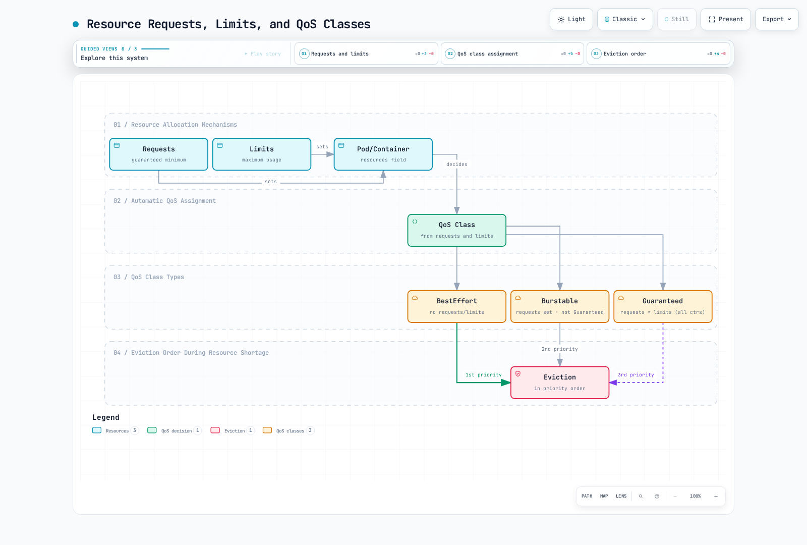
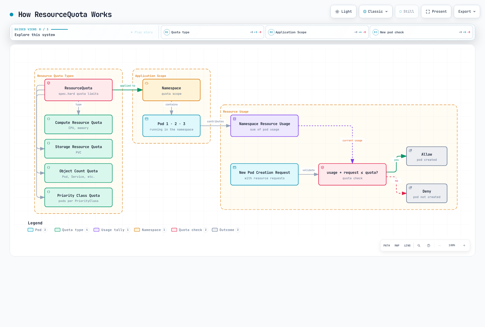
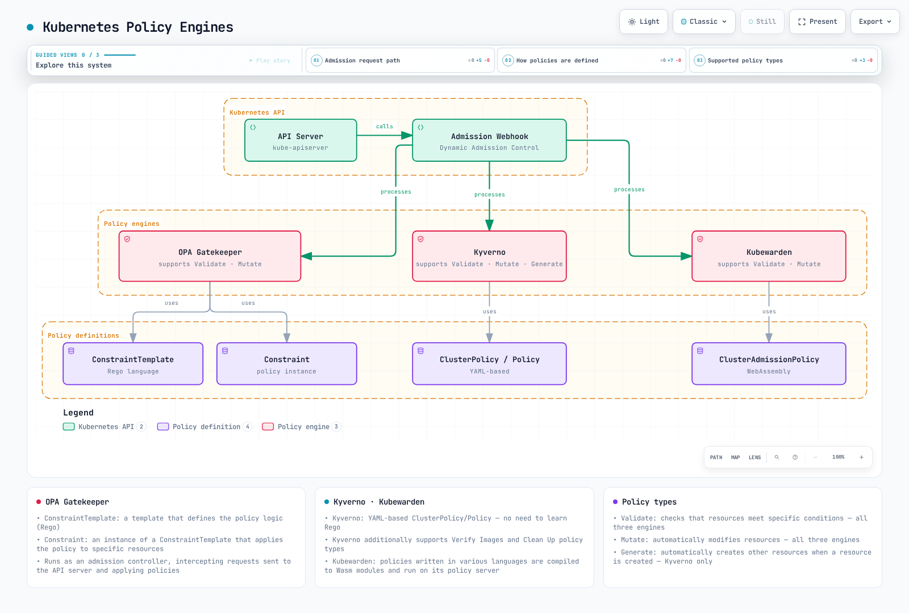

# Kubernetes 策略

> **支持的版本**：Kubernetes 1.35 - 1.37
> **最后更新**：2026 年 10 月 16 日

在 Kubernetes 中，策略是一组用于控制和规范集群及工作负载行为的规则。借助策略，你可以管理安全性、资源使用和网络通信等多个方面。在本章中，我们将了解 Kubernetes 中的不同策略类型、如何实施这些策略，以及如何在 Amazon EKS 中管理策略。

## 实验环境设置

要跟随本文档中的示例操作，你需要准备以下工具和环境：

### 必需工具
- 与 API server 的版本相差不超过一个次要版本的 kubectl
- 可正常工作的 Kubernetes 集群（EKS、minikube、kind 等）
- Kyverno CLI（可选）
- OPA Gatekeeper（可选）

### 策略示例设置

```bash
# Create namespace
kubectl create namespace policy-demo

# Create resource quota
kubectl -n policy-demo apply -f - <<EOF
apiVersion: v1
kind: ResourceQuota
metadata:
  name: demo-quota
spec:
  hard:
    requests.cpu: "1"
    requests.memory: 1Gi
    limits.cpu: "2"
    limits.memory: 2Gi
    pods: "10"
EOF

# Create network policy
kubectl -n policy-demo apply -f - <<EOF
apiVersion: networking.k8s.io/v1
kind: NetworkPolicy
metadata:
  name: default-deny
spec:
  podSelector: {}
  policyTypes:
  - Ingress
  - Egress
EOF

# Verify policies
kubectl -n policy-demo get resourcequota,networkpolicy
```

## Kubernetes 策略架构


[🔍 查看交互式图表](https://www.atomai.click/kubernetes-docs/archmaps/en-core-07-policies-0.html)

## 策略类型对比

| 策略类型 | 实现机制 | 应用级别 | 主要用途 | Kubernetes 版本支持 |
|------------|--------------------------|-------------------|-----------------|---------------------------|
| **资源策略** | ResourceQuota、LimitRange | 命名空间 | 限制和管理资源使用 | 所有版本 |
| **安全策略** | Pod Security Standards、Pod Security Admission（已移除 PSP） | Pod、命名空间 | 限制安全上下文 | PSP 已移除：1.25；PSA 已稳定：1.25 |
| **网络策略** | NetworkPolicy | Pod | 控制网络流量 | 1.8+ |
| **自定义策略** | OPA Gatekeeper、Kyverno | 集群、命名空间、Pod | 强制执行用户定义的策略 | 取决于已安装引擎的兼容性 |

## 资源策略

资源策略用于限制和管理 Kubernetes 集群中的计算资源（CPU、内存等）以及对象数量（Pod、Service 等）。

### ResourceQuota

ResourceQuota 限制命名空间内可使用的资源总量。

```yaml
apiVersion: v1
kind: ResourceQuota
metadata:
  name: compute-resources
  namespace: dev
spec:
  hard:
    requests.cpu: "1"
    requests.memory: 1Gi
    limits.cpu: "2"
    limits.memory: 2Gi
    pods: "10"
    services: "5"
    persistentvolumeclaims: "5"
    secrets: "10"
    configmaps: "10"
```

### LimitRange

LimitRange 为容器的 requests/limits 设置默认值，并验证容器、Pod 或 PVC 的资源范围。Pod 和 PVC 条目不会注入 request/limit 默认值。

```yaml
apiVersion: v1
kind: LimitRange
metadata:
  name: limit-mem-cpu-per-container
  namespace: dev
spec:
  limits:
  - default:
      cpu: 500m
      memory: 512Mi
    defaultRequest:
      cpu: 100m
      memory: 256Mi
    max:
      cpu: "1"
      memory: 1Gi
    min:
      cpu: 50m
      memory: 128Mi
    type: Container
```

## 目录
1. [策略概述](#policy-overview)
2. [资源分配策略](#resource-allocation-policies)
3. [Pod 安全策略](#pod-security-policies)
4. [网络策略](#network-policies)
5. [资源配额](#resource-quotas)
6. [LimitRange](#limitrange)
7. [策略引擎](#policy-engines)
8. [Amazon EKS 中的策略管理](#policy-management-in-amazon-eks)
9. [策略最佳实践](#policy-best-practices)
10. [结论](#conclusion)

## 策略概述 {#policy-overview}

Kubernetes 策略为集群管理员提供了一种方法，用于定义集群内资源和工作负载的约束。策略用于以下目的：

1. **增强安全性**：防止未经授权的操作并应用安全最佳实践
2. **资源管理**：限制资源使用并确保资源得到公平分配
3. **合规性**：确保符合组织策略和法规要求
4. **标准化**：应用一致的配置和部署实践

Kubernetes 可以通过内置资源（例如 NetworkPolicy、ResourceQuota、LimitRange）或第三方策略引擎（例如 OPA Gatekeeper、Kyverno）实现各种类型的策略。

## 资源分配策略 {#resource-allocation-policies}

资源分配策略用于控制 Pod 和容器可以使用的 CPU、内存等资源量。



[🔍 查看交互式图表](https://www.atomai.click/kubernetes-docs/archmaps/en-core-07-policies-1.html)

### 资源 Requests 和 Limits

你可以通过为 Pod 和容器设置资源 requests 和 limits 来管理资源使用：

```yaml
apiVersion: v1
kind: Pod
metadata:
  name: resource-demo
spec:
  containers:
  - name: resource-demo-container
    image: nginx
    resources:
      requests:
        memory: "64Mi"
        cpu: "250m"
      limits:
        memory: "128Mi"
        cpu: "500m"
```

- **requests**：调度预留和运行时资源分配的输入；实际使用量可以更低
- **limits**：运行时约束：CPU 会被限流，超出内存限制可能触发 OOM 终止

设置资源 requests 和 limits 有以下好处：

1. **资源保障**：调度器会将请求的容量纳入考量；这并不保证资源可用
2. **资源隔离**：防止一个 Pod 独占另一个 Pod 的资源
3. **高效调度**：调度器在放置 Pod 时会考虑节点资源容量

### QoS（服务质量）类别

Kubernetes 会根据 Pod 的资源 request 和 limit 设置自动分配 QoS 类别：

1. **Guaranteed**：在容器级配置中，所有容器的 CPU 和内存 requests/limits 均相等
2. **Burstable**：至少一个容器设置了资源 requests，但不满足 Guaranteed 条件
3. **BestEffort**：没有任何容器设置资源 requests 和 limits

节点压力驱逐会考虑用量是否超出 requests、Pod 优先级和相对用量。与 Guaranteed 相比，BestEffort 通常更容易受到影响，但 QoS 本身并不是严格的排序规则。Pod 级资源也可能影响 QoS；请参阅[官方 QoS 标准](https://kubernetes.io/docs/concepts/workloads/pods/pod-qos/)。

## Pod 安全策略 {#pod-security-policies}

Pod Security Policy (PSP) 自 Kubernetes 1.21 起已弃用，并在 1.25 版本中彻底移除。取而代之的是 Pod Security Standards 和 Pod Security Admission。


[🔍 查看交互式图表](https://www.atomai.click/kubernetes-docs/archmaps/en-core-07-policies-2.html)

### Pod Security Standards

Pod Security Standards 定义了三个策略级别：

1. **Privileged**：不设限制，允许所有权限
2. **Baseline**：阻止已知的权限提升路径
3. **Restricted**：严格强化的安全策略

### Pod Security Admission

Pod Security Admission 通过命名空间标签应用 Pod Security Standards：

```yaml
apiVersion: v1
kind: Namespace
metadata:
  name: my-namespace
  labels:
    pod-security.kubernetes.io/enforce: restricted
    pod-security.kubernetes.io/audit: restricted
    pod-security.kubernetes.io/warn: restricted
```

各标签的含义：
- **enforce**：阻止违反策略的 Pod 创建请求
- **audit**：在审计日志中记录违规情况
- **warn**：针对违规情况显示警告消息

## 网络策略 {#network-policies}

Network Policy 提供了一种控制 Pod 之间通信的方式。默认情况下，Kubernetes 集群中的所有 Pod 都可以相互通信，但网络策略可以限制这种通信。


[🔍 查看交互式图表](https://www.atomai.click/kubernetes-docs/archmaps/en-core-07-policies-3.html)

```yaml
apiVersion: networking.k8s.io/v1
kind: NetworkPolicy
metadata:
  name: api-allow
  namespace: default
spec:
  podSelector:
    matchLabels:
      app: api
  policyTypes:
  - Ingress
  - Egress
  ingress:
  - from:
    - podSelector:
        matchLabels:
          app: frontend
    ports:
    - protocol: TCP
      port: 8080
  egress:
  - to:
    - podSelector:
        matchLabels:
          app: database
    ports:
    - protocol: TCP
      port: 5432
```

在上面的示例中：
- 为带有 `app=api` 标签的 Pod 定义网络策略
- 仅允许来自带有 `app=frontend` 标签的 Pod、通过端口 8080 入站的流量
- 仅允许发往带有 `app=database` 标签的 Pod、通过端口 5432 出站的流量

要使用网络策略，集群的网络插件必须支持网络策略。Calico、Cilium 和 Antrea 等 CNI 插件都支持网络策略。

如果没有 namespace selector，Pod selector 只会匹配策略所在命名空间中的 Pod。标准 NetworkPolicy 采用累加方式；其他策略可以允许更多流量，而且连接的源端出站规则和目标端入站规则都必须允许该连接。此示例还会阻止 DNS，除非另有出站规则允许访问集群 DNS 端点的 TCP/UDP 53 端口。

### 网络策略类型

1. **Ingress 策略**：控制进入 Pod 的流量
2. **Egress 策略**：控制离开 Pod 的流量
3. **Ingress 和 Egress 策略**：控制两个方向的流量

### 网络策略 Selector

网络策略可以通过各种 selector 筛选流量：

1. **podSelector**：根据 Pod 标签进行选择
2. **namespaceSelector**：根据命名空间标签进行选择
3. **ipBlock**：根据 IP CIDR 范围进行选择

```yaml
# Example combining multiple selectors
ingress:
- from:
  - podSelector:
      matchLabels:
        app: frontend
    namespaceSelector:
      matchLabels:
        env: prod
  - ipBlock:
      cidr: 172.17.0.0/16
      except:
      - 172.17.1.0/24
```

## 资源配额 {#resource-quotas}

ResourceQuota 限制命名空间内可使用的资源总量。当多个团队或项目共享集群资源时，这可以防止某个团队独占所有资源。



[🔍 查看交互式图表](https://www.atomai.click/kubernetes-docs/archmaps/en-core-07-policies-4.html)

```yaml
apiVersion: v1
kind: ResourceQuota
metadata:
  name: compute-resources
  namespace: team-a
spec:
  hard:
    pods: "10"
    requests.cpu: "4"
    requests.memory: 8Gi
    limits.cpu: "8"
    limits.memory: 16Gi
```

在上面的示例中：
- `team-a` 命名空间最多可以创建 10 个非终止状态的 Pod
- 所有 Pod 的 CPU requests 总和不能超过 4 个核心
- 所有 Pod 的内存 requests 总和不能超过 8Gi
- 所有 Pod 的 CPU limits 总和不能超过 8 个核心
- 所有 Pod 的内存 limits 总和不能超过 16Gi

### 对象数量配额

除了 CPU 和内存，资源配额还可以限制命名空间内可创建的对象数量：

```yaml
apiVersion: v1
kind: ResourceQuota
metadata:
  name: object-counts
  namespace: team-b
spec:
  hard:
    configmaps: "10"
    persistentvolumeclaims: "5"
    replicationcontrollers: "20"
    secrets: "10"
    services: "10"
    services.loadbalancers: "2"
```

### Priority Class 配额

你还可以为特定优先级类别的 Pod 设置配额：

每个优先级类别使用单独的配额；`pods.high` 这类键并不存在。请在调度 Pod 之前创建相应的 PriorityClass。

```yaml
apiVersion: v1
kind: ResourceQuota
metadata:
  name: high-priority-quota
  namespace: team-c
spec:
  hard:
    pods: "5"
  scopeSelector:
    matchExpressions:
    - operator: In
      scopeName: PriorityClass
      values: ["high"]
---
apiVersion: v1
kind: ResourceQuota
metadata:
  name: medium-priority-quota
  namespace: team-c
spec:
  hard:
    pods: "3"
  scopeSelector:
    matchExpressions:
    - operator: In
      scopeName: PriorityClass
      values: ["medium"]
---
apiVersion: v1
kind: ResourceQuota
metadata:
  name: low-priority-quota
  namespace: team-c
spec:
  hard:
    pods: "2"
  scopeSelector:
    matchExpressions:
    - operator: In
      scopeName: PriorityClass
      values: ["low"]
```

## LimitRange

LimitRange 会为缺少的容器 requests/limits 应用默认值，并在准入期间验证最小值和最大值。它不会调整现有 Pod 的大小，也不会为 Pod/PVC 条目提供默认值。

```yaml
apiVersion: v1
kind: LimitRange
metadata:
  name: cpu-limit-range
  namespace: default
spec:
  limits:
  - default:
      cpu: 1
      memory: 512Mi
    defaultRequest:
      cpu: 500m
      memory: 256Mi
    max:
      cpu: 2
      memory: 1Gi
    min:
      cpu: 100m
      memory: 128Mi
    type: Container
```

在上面的示例中：
- **default**：容器未显式设置 limit 时应用的默认值
- **defaultRequest**：容器未显式设置 request 时应用的默认值
- **max**：容器可以设置的最大 limit
- **min**：容器可以设置的最小 request

LimitRange 可以应用于以下资源类型：
- Container
- Pod
- PersistentVolumeClaim

## 策略引擎 {#policy-engines}

Kubernetes 生态系统中有多种策略引擎，可以实现更加复杂和灵活的策略。



[🔍 查看交互式图表](https://www.atomai.click/kubernetes-docs/archmaps/en-core-07-policies-5.html)

### OPA Gatekeeper

OPA（Open Policy Agent）Gatekeeper 是一个开源项目，用于定义和强制执行 Kubernetes 集群策略。Gatekeeper 作为 Kubernetes 准入控制器运行，会拦截发送到 API server 的请求并应用策略。

Gatekeeper 由以下组件组成：

1. **ConstraintTemplate**：定义策略逻辑的模板
2. **Constraint**：ConstraintTemplate 的实例，用于将策略应用于特定资源

```yaml
# ConstraintTemplate example
apiVersion: templates.gatekeeper.sh/v1
kind: ConstraintTemplate
metadata:
  name: k8srequiredlabelkeys
spec:
  crd:
    spec:
      names:
        kind: K8sRequiredLabelKeys
      validation:
        openAPIV3Schema:
          type: object
          properties:
            labels:
              type: array
              items:
                type: string
  targets:
    - target: admission.k8s.gatekeeper.sh
      rego: |
        package k8srequiredlabelkeys
        violation[{"msg": msg, "details": {"missing_labels": missing}}] {
          provided := {label | input.review.object.metadata.labels[label]}
          required := {label | label := input.parameters.labels[_]}
          missing := required - provided
          count(missing) > 0
          msg := sprintf("missing required labels: %v", [missing])
        }
```

```yaml
# Constraint example
apiVersion: constraints.gatekeeper.sh/v1beta1
kind: K8sRequiredLabelKeys
metadata:
  name: require-app-label
spec:
  match:
    kinds:
      - apiGroups: [""]
        kinds: ["Pod"]
  parameters:
    labels: ["app", "owner"]
```

### Kyverno

Kyverno 是一个 Kubernetes 原生策略引擎，可通过基于 YAML 的策略验证、修改和生成 Kubernetes 资源。你可以使用与 Kubernetes 资源相似的语法编写策略，无需学习 Rego 语言。

```yaml
# Kyverno policy example
apiVersion: kyverno.io/v1
kind: ClusterPolicy
metadata:
  name: require-labels
spec:
  rules:
  - name: check-for-labels
    match:
      any:
      - resources:
          kinds:
          - Pod
    validate:
      failureAction: Enforce
      message: "The labels 'app' and 'owner' are required."
      pattern:
        metadata:
          labels:
            app: "?*"
            owner: "?*"
```

Kyverno 支持以下策略类型：

1. **Validate**：验证资源是否满足特定条件
2. **Mutate**：自动修改资源
3. **Generate**：创建某个资源时自动创建其他资源
4. **Verify Images**：验证镜像签名
5. **Clean Up**：CleanupPolicy/ClusterCleanupPolicy 用于计划删除匹配的资源；这与基于 owner reference 的垃圾回收相互独立

### Kubewarden

Kubewarden 是一种基于 WebAssembly 的策略引擎，允许使用多种编程语言编写策略。策略会被编译为 WebAssembly 模块，并在 Kubewarden policy server 上运行。

```yaml
# Kubewarden policy example
apiVersion: policies.kubewarden.io/v1
kind: ClusterAdmissionPolicy
metadata:
  name: require-labels
spec:
  module: "registry://ghcr.io/kubewarden/policies/safe-labels:<tested-tag>"
  mutating: false
  rules:
  - apiGroups: [""]
    apiVersions: ["v1"]
    resources: ["pods"]
    operations:
    - CREATE
    - UPDATE
  settings:
    mandatory_labels:
      - app
      - owner
```

在创建这些资源之前，请先安装策略引擎、其 CRD 和策略服务器。Gatekeeper 示例特意定义了 `K8sRequiredLabelKeys`，以避免与功能更丰富的库模板 `K8sRequiredLabels` 冲突。对于 Kubewarden，请选择经过测试并已发布的 safe-labels 标签或摘要，并使用其 `mandatory_labels` 设置；`<tested-tag>` 是占位符。

## Amazon EKS 中的策略管理 {#policy-management-in-amazon-eks}

在 Amazon EKS 中，你可以结合 Kubernetes 默认策略机制和各种 AWS 服务来管理策略。


[🔍 查看交互式图表](https://www.atomai.click/kubernetes-docs/archmaps/en-core-07-policies-6.html)

### 与 AWS IAM 集成

Amazon EKS 可以通过 IAM Roles for Service Accounts (IRSA) 向 Pod 授予访问 AWS 服务的权限。这有助于遵循最小权限原则。

```bash
# Create OIDC provider
eksctl utils associate-iam-oidc-provider --cluster my-cluster --approve

# Create IAM role and link to service account
eksctl create iamserviceaccount \
  --name my-service-account \
  --namespace default \
  --cluster my-cluster \
  --attach-policy-arn arn:aws:iam::123456789012:policy/ReadApplicationBucket \
  --approve
```

创建所引用的客户托管策略，并将读取权限限制在所需的 bucket/prefix；支持的计算资源也可以使用 EKS Pod Identity。IAM 控制的是 AWS API 访问权限，而不是 Kubernetes 资源授权。

### Pod 的 AWS Security Groups

Amazon EKS 支持在 Pod 级别应用 AWS security group。这样可以更精细地控制 Pod 之间的通信。

```yaml
apiVersion: vpcresources.k8s.aws/v1beta1
kind: SecurityGroupPolicy
metadata:
  name: allow-db-access
  namespace: default
spec:
  podSelector:
    matchLabels:
      app: web
  securityGroups:
    groupIds:
      - sg-0123456789abcdef0
```

请将 security group ID 替换为集群 VPC 中的一个组，并确保其规则允许所需的应用流量和 DNS 流量。Pod security group 需要使用受支持的 VPC CNI 配置、具备相应 IAM 权限并使用兼容的计算资源；Windows 和 EKS Auto Mode 不支持此功能。

### AWS Config 和 AWS Organizations

AWS Config 会评估资源的合规性；它本身不会拒绝 CreateCluster。在适用的成员账户/OUs 中，Organizations service control policy (SCP) 可以拒绝未包含必需请求标签的创建请求，例如：

```json
{
  "Version": "2012-10-17",
  "Statement": [
    {
      "Effect": "Deny",
      "Action": "eks:CreateCluster",
      "Resource": "*",
      "Condition": {
        "Null": {
          "aws:RequestTag/Environment": "true"
        }
      }
    }
  ]
}
```

### AWS Firewall Manager

Firewall Manager 集中管理受支持的 AWS 防护措施，例如 WAF、VPC security groups、Network Firewall 和 DNS Firewall。它不会协调 Kubernetes NetworkPolicy 对象；应通过 Kubernetes/GitOps 策略工具管理这些对象。

## 策略最佳实践 {#policy-best-practices}

以下是在 Kubernetes 集群中有效管理策略的最佳实践。

### 策略设计

1. **最小权限原则**：设计仅授予最低必要权限的策略。
2. **逐步应用**：不要一次性应用所有策略；应逐步应用，以尽量减少影响。
3. **审计模式**：在强制执行之前，以审计模式运行策略以评估影响。
4. **清晰的文档**：清楚地记录每项策略的目的和影响。

### 资源管理

1. **命名空间隔离**：按团队或项目划分命名空间，并为每个命名空间设置适当的资源配额。
2. **默认限制**：使用 LimitRange 为所有容器设置默认资源限制。
3. **QoS 类别考量**：根据工作负载的重要性设置适当的 QoS 类别。

### 网络安全

1. **默认拒绝策略**：设置默认拒绝所有流量的策略，并明确仅允许必要的通信。
2. **精细化策略**：设置可精细控制 Pod 之间通信的网络策略。
3. **定期审查**：定期审查并更新网络策略。

### 策略自动化

1. **集成 CI/CD**：将策略验证集成到 CI/CD 管道中，以便在部署前发现策略违规。
2. **策略测试**：先在测试环境中测试策略，确认没有问题后再应用到生产环境。
3. **策略版本控制**：将策略作为代码进行管理，并使用版本控制系统跟踪变更。

## 结论 {#conclusion}

Kubernetes 策略是控制集群和工作负载安全性、资源使用及网络通信的强大工具。你可以结合内置策略机制（ResourceQuota、LimitRange、NetworkPolicy 等）和第三方策略引擎（OPA Gatekeeper、Kyverno 等），构建适合组织需求的策略框架。

在使用 Amazon EKS 时，你还可以借助各种 AWS 服务（IAM、Security Groups、AWS Config、AWS Organizations、AWS Firewall Manager 等）进一步加强策略管理。通过集成这些服务，你可以有效管理集群和工作负载的安全性、合规性和资源。

策略领域在不断发展，因此定期审查和更新策略以应对新的威胁和需求十分重要。此外，建议将策略作为代码进行管理并实现自动化，以提高一致性和效率。

## 测验

要测试你在本章中学到的内容，请尝试[策略测验](../quizzes/core/07-policies-quiz.md)。

## 参考资料

- [Kubernetes 官方文档 - Resource Quotas](https://kubernetes.io/docs/concepts/policy/resource-quotas/)
- [Kubernetes 官方文档 - LimitRange](https://kubernetes.io/docs/concepts/policy/limit-range/)
- [Kubernetes 官方文档 - Network Policies](https://kubernetes.io/docs/concepts/services-networking/network-policies/)
- [Kubernetes 官方文档 - Pod Security Standards](https://kubernetes.io/docs/concepts/security/pod-security-standards/)
- [Kubernetes 官方文档 - Pod Security Admission](https://kubernetes.io/docs/concepts/security/pod-security-admission/)
- [OPA Gatekeeper 官方文档](https://open-policy-agent.github.io/gatekeeper/website/docs/)
- [Kyverno 官方文档](https://kyverno.io/docs/)
- [Kubewarden 官方文档](https://docs.kubewarden.io/)
- [Amazon EKS 官方文档 - IAM Roles for Service Accounts](https://docs.aws.amazon.com/eks/latest/userguide/iam-roles-for-service-accounts.html)
- [Amazon EKS 官方文档 - Security Groups for Pods](https://docs.aws.amazon.com/eks/latest/userguide/security-groups-for-pods.html)
- [AWS Config 官方文档](https://docs.aws.amazon.com/config/latest/developerguide/WhatIsConfig.html)
- [AWS Organizations 官方文档](https://docs.aws.amazon.com/organizations/latest/userguide/orgs_introduction.html)
- [AWS Firewall Manager 官方文档](https://docs.aws.amazon.com/waf/latest/developerguide/fms-chapter.html)
