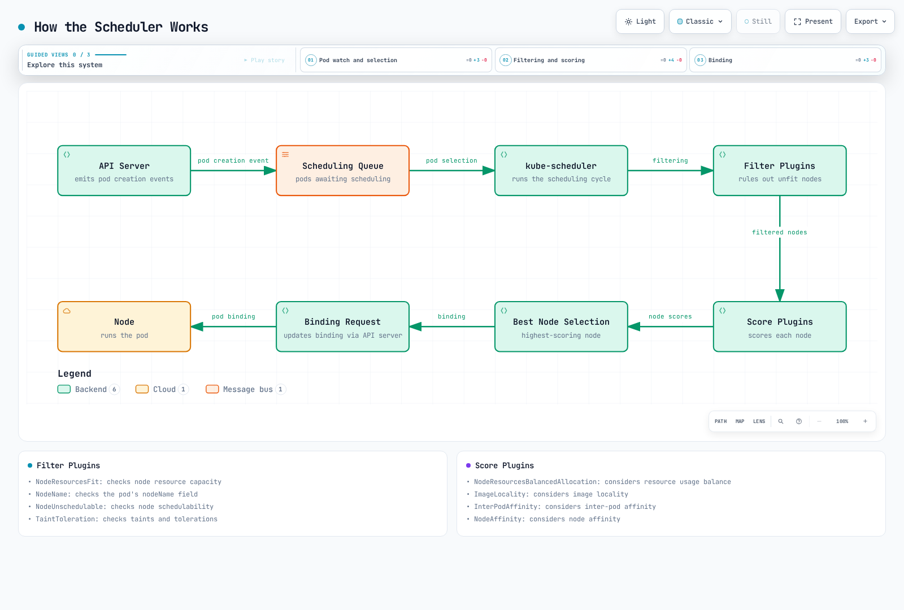
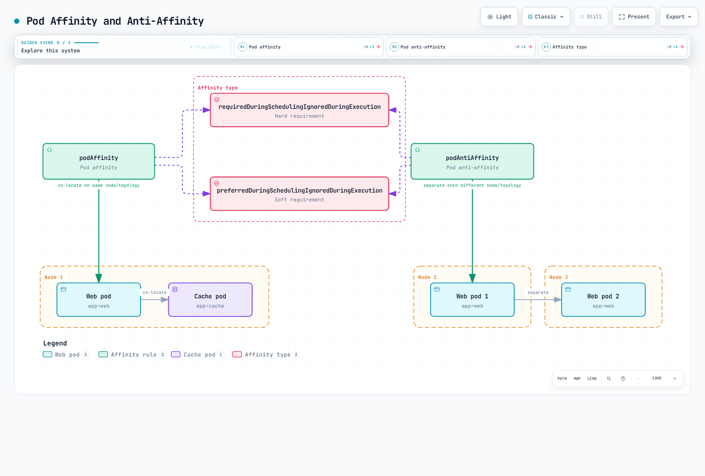
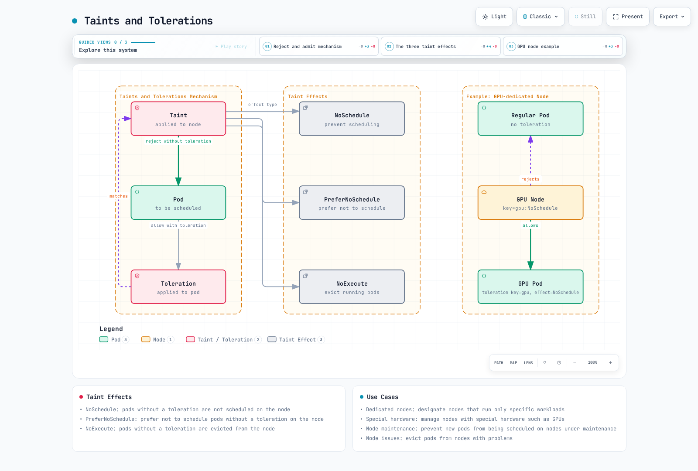
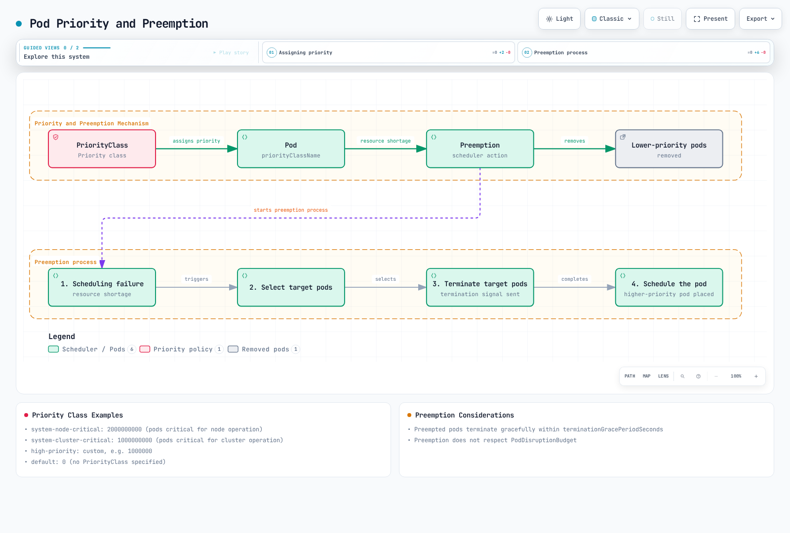
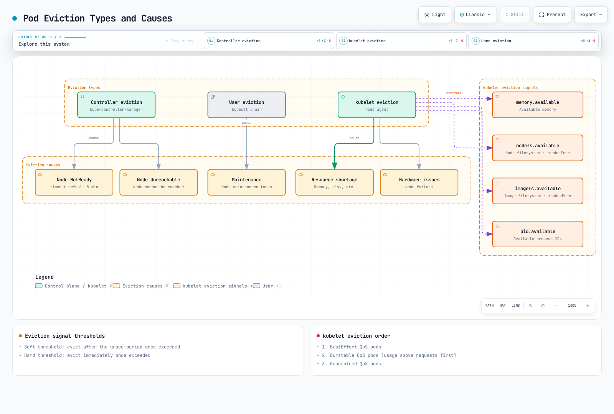
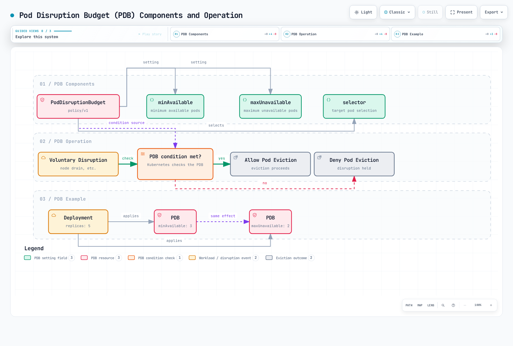
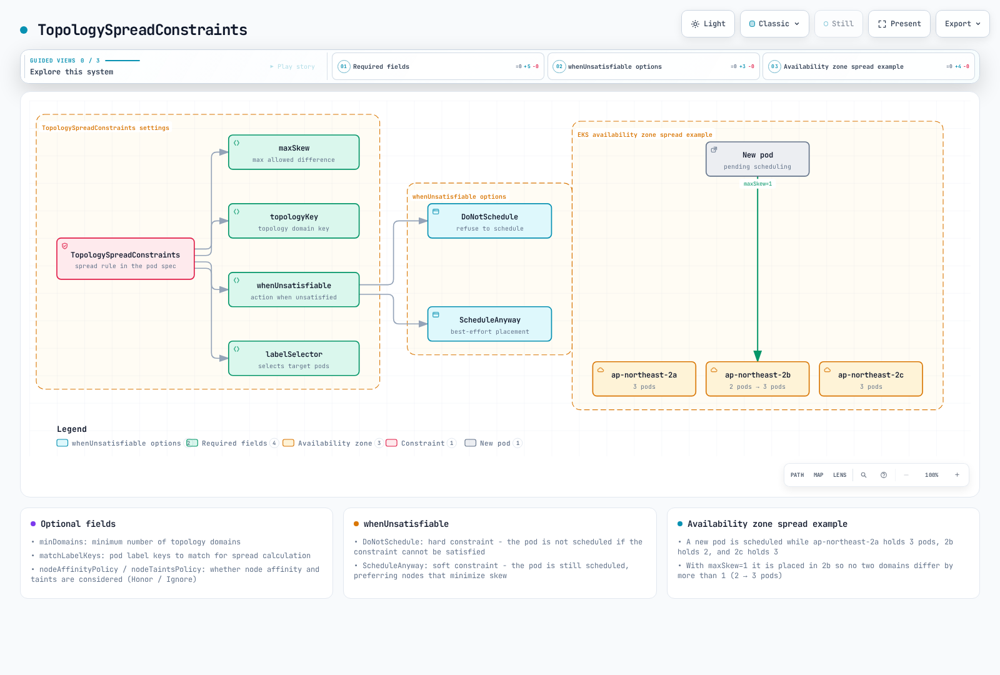
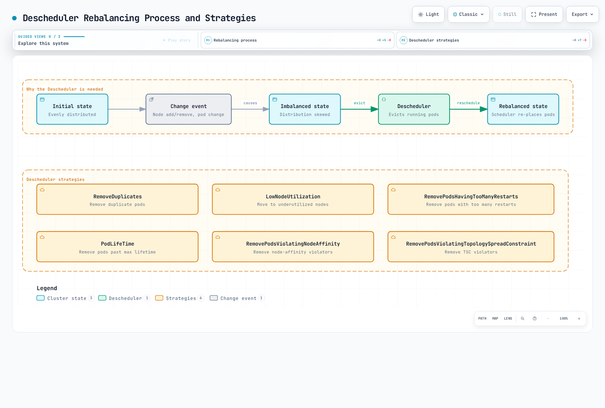
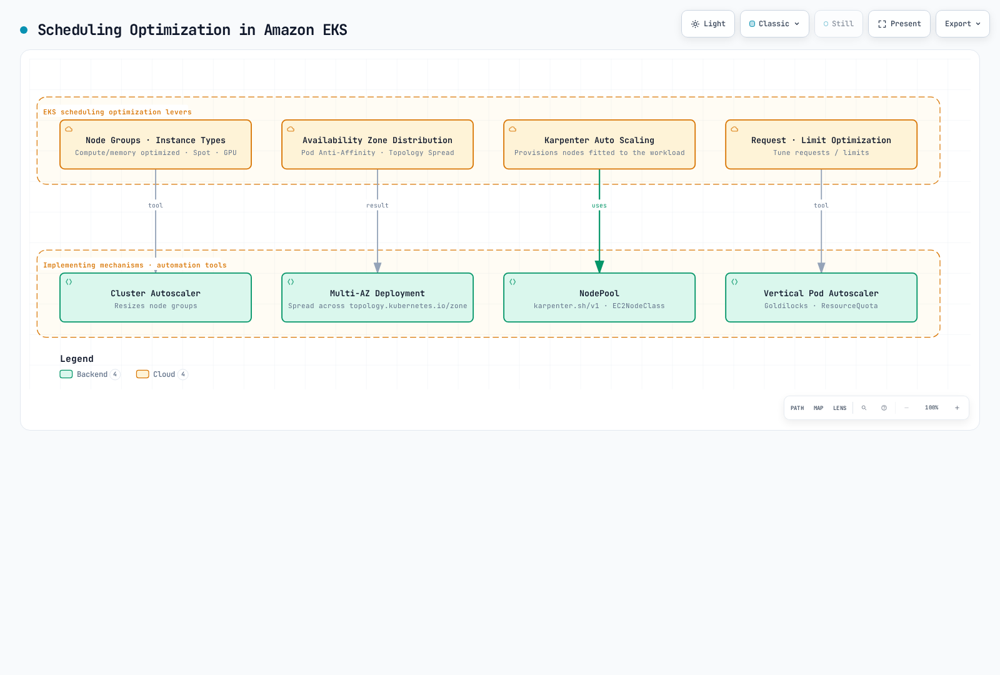

# Kubernetes 调度、抢占与驱逐

> **支持的版本**：Kubernetes 1.34 - 1.37（Descheduler v0.37 示例）
> **最后更新**：October 16, 2026

在 Kubernetes 中，调度是将 Pod 放置到合适节点上的过程。抢占是移除较低优先级 Pod，为较高优先级 Pod 腾出空间的过程；驱逐则会终止一个 Pod，其工作负载控制器可能会创建一个替代 Pod，再由调度器将其放置到其他位置。在本章中，我们将学习 Kubernetes 调度机制、节点选择、抢占、驱逐，以及 Amazon EKS 中的调度优化方法。

## 实验环境设置

要跟随本文档中的示例操作，你需要以下工具和环境：

### 必需工具
- 与 API 服务器相差不超过一个次要版本的 kubectl
- 正常运行的 Kubernetes 集群（EKS、minikube、kind 等）
- 包含多个节点的集群（用于调度测试）

### 调度示例设置

```bash
# Create namespace
kubectl create namespace scheduling-demo

# Add labels to nodes (if you have multiple nodes)
kubectl label nodes <node-name> disktype=ssd
kubectl label nodes <node-name> gpu=true

# Create a pod using node affinity
kubectl -n scheduling-demo apply -f - <<EOF
apiVersion: v1
kind: Pod
metadata:
  name: nginx-ssd
  labels:
    app: nginx
spec:
  affinity:
    nodeAffinity:
      requiredDuringSchedulingIgnoredDuringExecution:
        nodeSelectorTerms:
        - matchExpressions:
          - key: disktype
            operator: In
            values:
            - ssd
  containers:
  - name: nginx
    image: nginx
EOF

# Create priority class
kubectl apply -f - <<EOF
apiVersion: scheduling.k8s.io/v1
kind: PriorityClass
metadata:
  name: high-priority
value: 1000000
globalDefault: false
description: "This priority class should be used for critical service pods only."
EOF

# Create Pod Disruption Budget (PDB)
kubectl -n scheduling-demo apply -f - <<EOF
apiVersion: policy/v1
kind: PodDisruptionBudget
metadata:
  name: nginx-pdb
spec:
  minAvailable: 1
  selector:
    matchLabels:
      app: nginx
EOF
```

## Kubernetes 调度架构


[🔍 查看交互式图表](https://www.atomai.click/kubernetes-docs/archmaps/en-core-08-scheduling-preemption-eviction-0.html)

## 调度概念对比

| 概念 | 用途 | 使用场景 | Kubernetes 版本 |
|---------|---------|-----------|-------------------|
| **Node Selector** | 将 Pod 放置到带有特定标签的节点上 | 简单的节点选择 | 所有版本 |
| **Node Affinity** | 定义复杂的节点选择规则 | 高级节点选择 | 1.6+ |
| **Pod Affinity** | 将 Pod 放置在其他 Pod 附近 | 将相关服务放在一起 | 1.6+ |
| **Pod Anti-Affinity** | 将 Pod 放置在远离其他 Pod 的位置 | 确保高可用性 | 1.6+ |
| **Taints and Tolerations** | 仅允许特定 Pod 使用节点 | 专用节点、节点隔离 | 1.6+ |
| **Topology Spread Constraints** | 将 Pod 分散到不同的拓扑域 | 在可用区之间分布 | 1.16+（1.19 GA） |
| **Priority and Preemption** | 为重要工作负载设置优先级 | 保障关键服务 | 1.8+（1.14 GA） |
| **Pod Disruption Budget** | 限制同时受到干扰的 Pod 数量 | 确保高可用性 | 1.4+（1.21 GA） |

## 基本调度概念

> **核心概念**：Kubernetes 调度器是一个控制平面组件，负责选择运行 Pod 的最优节点。它分两个阶段运行：过滤和评分。

### 调度流程

1. **过滤阶段（Predicates）**
   - 确定一组合适的、能够运行该 Pod 的节点
   - 考虑资源需求、节点选择器、亲和性规则、污点/容忍度等
   - 如果不满足任何一项条件，就排除该节点

2. **评分阶段（Priorities）**
   - 为通过过滤的节点分配分数
   - 考虑资源利用率、Pod 分布、亲和性偏好等
   - 选择得分最高的节点

3. **绑定阶段**
   - 将 Pod 分配到所选节点
   - 将绑定信息更新到 API 服务器

## 目录
1. [调度概述](#scheduling-overview)
2. [调度器的工作原理](#how-the-scheduler-works)
3. [节点选择](#node-selection)
4. [Pod 亲和性与反亲和性](#pod-affinity-and-anti-affinity)
5. [污点与容忍度](#taints-and-tolerations)
6. [Node Affinity](#node-affinity)
7. [Pod 优先级与抢占](#pod-priority-and-preemption)
8. [Pod 驱逐](#pod-eviction)
9. [Pod Disruption Budget (PDB)](#pod-disruption-budget-pdb)
10. [节点压力驱逐](#node-pressure-eviction)
11. [TopologySpreadConstraints](#topologyspreadconstraints)
12. [Pod 删除成本](#pod-deletion-cost)
13. [Descheduler](#descheduler)
14. [Amazon EKS 中的调度优化](#scheduling-optimization-in-amazon-eks)
15. [调度最佳实践](#scheduling-best-practices)
16. [结论](#conclusion)

## 调度概述 {#scheduling-overview}

Kubernetes 调度器是一个控制平面组件，负责将 Pod 放置到合适的节点上。调度器会考虑各种因素，以确定放置 Pod 的最优节点：

1. **资源需求**：Pod 请求的 CPU、内存和其他资源
2. **硬件/软件/策略约束**：节点选择器、Node Affinity、污点等
3. **亲和性/反亲和性规范**：与其他 Pod 的放置关系
4. **数据局部性**：将 Pod 放置在靠近数据的位置
5. **工作负载间干扰**：尽量减少不同工作负载之间的干扰
6. **自定义目标**：基于截止时间或工作负载干扰感知的调度需要合适的自定义逻辑；默认调度器不会推断应用程序的截止时间

### 调度流程

调度流程大致分为两个阶段：

1. **过滤**：确定一组能够运行该 Pod 的节点
   - 检查是否满足资源需求
   - 检查节点选择器、亲和性、污点等约束

2. **评分**：对通过过滤的节点评分，以选择最优节点
   - 平衡资源利用率
   - Pod 间亲和性/反亲和性
   - 数据局部性
   - 污点/容忍度

## 调度器的工作原理 {#how-the-scheduler-works}

Kubernetes 调度器按以下流程运行：



[🔍 查看交互式图表](https://www.atomai.click/kubernetes-docs/archmaps/en-core-08-scheduling-preemption-eviction-1.html)

1. **监视 Pod 队列**：调度器监视 API 服务器中的未调度 Pod。
2. **节点过滤**：确定一组能够运行该 Pod 的节点。
3. **节点评分**：为通过过滤的节点评分。
4. **节点选择**：选择得分最高的节点。
5. **绑定**：将 Pod 绑定到所选节点。

### 调度插件

Kubernetes 调度器采用可扩展的插件架构设计。各种插件在调度流程的不同阶段运行：

1. **过滤插件**：筛除无法运行该 Pod 的节点
   - NodeResourcesFit：检查节点资源容量
   - NodeName：检查 Pod 的 nodeName 字段
   - NodeUnschedulable：检查节点是否可调度
   - TaintToleration：检查污点和容忍度

2. **评分插件**：为节点分配分数
   - NodeResourcesBalancedAllocation：考虑资源使用的均衡性
   - ImageLocality：考虑镜像局部性
   - InterPodAffinity：考虑 Pod 间亲和性
   - NodeAffinity：考虑 Node Affinity

### NodeResourcesFit 评分策略：LeastAllocated 与 MostAllocated {#noderesourcesfit-scoring-strategy-leastallocated-vs-mostallocated}

`NodeResourcesFit` 同时是一个过滤插件（节点是否有足够的可分配 CPU/内存供 Pod 使用？）和一个评分插件。其评分插件行为由 `scoringStrategy.type` 控制，可通过 `KubeSchedulerConfiguration` 配置：

- **`LeastAllocated`**（默认）：已分配资源越少的节点得分越高。新 Pod 会倾向于调度到最空闲的节点，从而均匀分散负载。
- **`MostAllocated`**：已分配资源越多的节点得分越高（前提是 Pod 仍能放得下）。新 Pod 会优先集中到最繁忙的节点上，让其他节点保持未使用或空闲。
- **`RequestedToCapacityRatio`**：可配置的曲线，可在两者之间进行权衡；适用于 GPU 等扩展资源，能够按需自定义曲线，而不局限于纯粹的最小值/最大值策略。

```yaml
apiVersion: kubescheduler.config.k8s.io/v1
kind: KubeSchedulerConfiguration
profiles:
- schedulerName: most-allocated-scheduler
  pluginConfig:
  - name: NodeResourcesFit
    args:
      scoringStrategy:
        type: MostAllocated
        resources:
        - name: cpu
          weight: 1
        - name: memory
          weight: 1
```

Amazon EKS 的控制平面完全由 AWS 管理，因此你无法直接编辑默认 kube-scheduler 的 `KubeSchedulerConfiguration`。要使用 `MostAllocated`，请运行第二个调度器（一个使用此配置运行 `kube-scheduler` 二进制文件的 `Deployment`，并通过专用 `ServiceAccount` 绑定到 `system:kube-scheduler`/`system:volume-scheduler`），然后使用 `spec.schedulerName` 将特定 Pod 指向该调度器，如下文的[多个调度器](#multiple-schedulers)所示。这与[构建自定义调度器](../scheduling/01-custom-scheduler-part1.md)中使用的模式相同。

**已验证的测试：分散调度与装箱行为。** 为确认实际差异，我们准备了一个临时的 3 个工作节点的 `kind` 集群（`kubectl version` v1.37.0，隔离运行，测试后拆除；未接触任何共享基础设施），并通过固定到 `nodeName` 的填充 Pod 注入不均匀的基线负载（每个节点可分配 16 个 CPU）：`worker`=12 个 Pod（75%）、`worker2`=6 个 Pod（37%）、`worker3`=0 个 Pod（0%）。随后，在相同初始状态下，对六个完全相同的 1-CPU Pod 进行了两次调度：一次使用默认调度器（`LeastAllocated`），一次使用配置了 `MostAllocated` 的第二个调度器：

| 调度器/策略 | 6 个新 Pod 的放置位置 | 最终 CPU 利用率（worker / worker2 / worker3） |
|---|---|---|
| 默认（`LeastAllocated`） | 全部 6 个都在 `worker3` 上（最空闲的节点） | 75% / 37% / 37%（三个节点现在都已使用） |
| `MostAllocated` | `worker` 上 3 个，`worker2` 上 3 个（两个最繁忙的节点） | 93% / 56% / 0%（`worker3` 完全保持空闲） |

`LeastAllocated` 会逐渐提高 `worker3` 的负载，直到它与 `worker2` 相当，因此每个节点最终都会被部分使用，没有哪个节点能够安全缩容。`MostAllocated` 则继续将负载集中到已经繁忙的节点上，让 `worker3` 保持空闲：这正是集群自动扩缩器或 Karpenter 整合过程随后会终止的节点。

因此，对于与 Karpenter 或 Cluster Autoscaler 配合运行的**批处理/短时作业工作负载**，通常建议使用 `MostAllocated`：将作业装箱到更少的节点上，可以最大限度地增加完全空闲、符合整合条件的节点数量，从而直接降低计算成本。对于长期运行且对延迟敏感的服务，`LeastAllocated` 仍然是更好的默认选择，因为分散负载可以让每个节点保留余量，以吸收流量突增或应对 `kubectl drain`，而不会将压力集中到某个装满的节点上。

请在[调度器评分策略实验](../labs/core/08-scheduling-preemption-eviction-lab.md)中按照步骤亲自复现这一完全相同的对比。

### 多个调度器 {#multiple-schedulers}

Kubernetes 可以同时运行多个调度器。这样就能为特定工作负载实现自定义调度逻辑。

```yaml
apiVersion: v1
kind: Pod
metadata:
  name: custom-scheduled-pod
spec:
  schedulerName: my-custom-scheduler
  containers:
  - name: container
    image: nginx
```

在上面的示例中，`schedulerName` 字段指定用于调度 Pod 的调度器。

## 节点选择 {#node-selection}

Kubernetes 提供了多种机制，可将 Pod 放置到指定节点上。


[🔍 查看交互式图表](https://www.atomai.click/kubernetes-docs/archmaps/en-core-08-scheduling-preemption-eviction-2.html)

### Node Selector

Node Selector 是一种最简单的方式，可将 Pod 限制为只能放置到带有特定标签的节点上。

```yaml
apiVersion: v1
kind: Pod
metadata:
  name: gpu-pod
spec:
  nodeSelector:
    gpu: "true"
  containers:
  - name: gpu-container
    image: busybox:1.36
    command: ["sh", "-c", "sleep 3600"]
    resources:
      limits:
        nvidia.com/gpu: 1
```

在上面的示例中，Pod 只会放置到带有 `gpu=true` 标签的节点上。

GPU 示例只测试调度：节点必须确实有 GPU，并且有正常工作的设备插件来声明 `nvidia.com/gpu`。仅有 `gpu=true` 标签并不会分配 GPU 资源。

### nodeName

你可以使用 `nodeName` 字段将 Pod 直接放置到指定节点上。此方法会绕过调度器，通常不建议使用。

```yaml
apiVersion: v1
kind: Pod
metadata:
  name: specific-node-pod
spec:
  nodeName: worker-node-1
  containers:
  - name: container
    image: nginx
```

在上面的示例中，Pod 会被直接放置到名为 `worker-node-1` 的节点上。

## Pod 亲和性与反亲和性 {#pod-affinity-and-anti-affinity}

Pod 亲和性和反亲和性提供了根据 Pod 之间的关系来放置 Pod 的方法。



[🔍 查看交互式图表](https://www.atomai.click/kubernetes-docs/archmaps/en-core-08-scheduling-preemption-eviction-3.html)

### Pod Affinity

Pod Affinity 会将 Pod 放置在与带有特定标签的 Pod 相同的节点或拓扑域中。

```yaml
apiVersion: v1
kind: Pod
metadata:
  name: frontend
spec:
  affinity:
    podAffinity:
      requiredDuringSchedulingIgnoredDuringExecution:
      - labelSelector:
          matchExpressions:
          - key: app
            operator: In
            values:
            - cache
        topologyKey: kubernetes.io/hostname
  containers:
  - name: frontend
    image: nginx
```

在上面的示例中，`frontend` Pod 会与带有 `app=cache` 标签的 Pod 放置在同一主机上。

### Pod Anti-Affinity

Pod Anti-Affinity 会将 Pod 放置在与带有特定标签的 Pod 不同的节点或拓扑域中。

```yaml
apiVersion: v1
kind: Pod
metadata:
  name: frontend
  labels:
    app: frontend
spec:
  affinity:
    podAntiAffinity:
      requiredDuringSchedulingIgnoredDuringExecution:
      - labelSelector:
          matchExpressions:
          - key: app
            operator: In
            values:
            - frontend
        topologyKey: kubernetes.io/hostname
  containers:
  - name: frontend
    image: nginx
```

在上面的示例中，`frontend` Pod 会与其他带有 `app=frontend` 标签的 Pod 放置在不同的主机上。此方法有助于将同一应用程序的实例分散到多个节点上，以实现高可用性。

### 亲和性类型

Pod Affinity 和 Pod Anti-Affinity 有两种类型：

1. **requiredDuringSchedulingIgnoredDuringExecution**：调度时必须满足的硬性要求
2. **preferredDuringSchedulingIgnoredDuringExecution**：优先满足但非必须的软性要求

```yaml
# preferredDuringSchedulingIgnoredDuringExecution example
affinity:
  podAffinity:
    preferredDuringSchedulingIgnoredDuringExecution:
    - weight: 100
      podAffinityTerm:
        labelSelector:
          matchExpressions:
          - key: app
            operator: In
            values:
            - cache
        topologyKey: kubernetes.io/hostname
```

在上面的示例中，`weight` 字段表示此偏好的权重。存在多个偏好时，权重越高的偏好越重要。

## 污点与容忍度 {#taints-and-tolerations}

污点和容忍度是用于让节点拒绝特定 Pod 的机制。



[🔍 查看交互式图表](https://www.atomai.click/kubernetes-docs/archmaps/en-core-08-scheduling-preemption-eviction-4.html)

### 污点

在节点上设置污点，可以限制 Pod 被调度到这些节点上。

```bash
# Add taint to node
kubectl taint nodes node1 key=value:NoSchedule
```

污点有三种效果：

1. **NoSchedule**：没有容忍度的 Pod 不会被调度到该节点上
2. **PreferNoSchedule**：尽量不将没有容忍度的 Pod 调度到该节点上
3. **NoExecute**：没有容忍度的 Pod 会被从节点上驱逐

### 容忍度

在 Pod 上设置容忍度，可以允许其被调度到带有污点的节点上。

```yaml
apiVersion: v1
kind: Pod
metadata:
  name: nginx
spec:
  tolerations:
  - key: "key"
    operator: "Equal"
    value: "value"
    effect: "NoSchedule"
  containers:
  - name: nginx
    image: nginx
```

在上面的示例中，Pod 可以被调度到带有 `key=value:NoSchedule` 污点的节点上。

### 使用场景

污点和容忍度的常见使用场景：

1. **专用节点**：指定节点仅运行特定工作负载
2. **特殊硬件**：管理带有 GPU 等特殊硬件的节点
3. **节点维护**：阻止新 Pod 被调度到正在维护的节点上
4. **节点故障**：从出现问题的节点上驱逐 Pod

### 默认污点

Kubernetes 会为一些节点应用默认污点：

- **node.kubernetes.io/not-ready**：节点未就绪
- **node.kubernetes.io/unreachable**：节点不可达
- **node.kubernetes.io/memory-pressure**：节点存在内存压力
- **node.kubernetes.io/disk-pressure**：节点存在磁盘压力
- **node.kubernetes.io/pid-pressure**：节点存在 PID 压力
- **node.kubernetes.io/network-unavailable**：节点网络不可用
- **node.kubernetes.io/unschedulable**：节点不可调度

## Node Affinity

Node Affinity 提供了更具表达力的方式，可将 Pod 放置到特定节点集合上。与 Node Selector 相比，它允许指定更复杂的条件。

### Node Affinity 类型

Node Affinity 有两种类型：

1. **requiredDuringSchedulingIgnoredDuringExecution**：调度时必须满足的硬性要求
2. **preferredDuringSchedulingIgnoredDuringExecution**：优先满足但非必须的软性要求

```yaml
apiVersion: v1
kind: Pod
metadata:
  name: with-node-affinity
spec:
  affinity:
    nodeAffinity:
      requiredDuringSchedulingIgnoredDuringExecution:
        nodeSelectorTerms:
        - matchExpressions:
          - key: topology.kubernetes.io/zone
            operator: In
            values:
            - us-west-2a
            - us-west-2b
      preferredDuringSchedulingIgnoredDuringExecution:
      - weight: 1
        preference:
          matchExpressions:
          - key: another-node-label-key
            operator: In
            values:
            - another-node-label-value
  containers:
  - name: with-node-affinity
    image: nginx
```

在上面的示例中，Pod 只会放置到 `topology.kubernetes.io/zone` 标签为 `us-west-2a` 或 `us-west-2b` 的节点上。此外，Pod 优先放置到带有 `another-node-label-key=another-node-label-value` 标签的节点上。

### 运算符

Node Affinity 支持多种运算符：

- **In**：标签值与指定值之一匹配
- **NotIn**：标签值与指定值均不匹配
- **Exists**：存在具有指定键的标签
- **DoesNotExist**：不存在具有指定键的标签
- **Gt**：标签值大于指定值
- **Lt**：标签值小于指定值

## Pod 优先级与抢占 {#pod-priority-and-preemption}

Kubernetes 提供了 Pod 优先级和抢占功能，确保重要工作负载能够获得集群资源。



[🔍 查看交互式图表](https://www.atomai.click/kubernetes-docs/archmaps/en-core-08-scheduling-preemption-eviction-5.html)

### PriorityClass

PriorityClass 定义 Pod 的相对重要性。优先级值越高，Pod 越重要。

```yaml
apiVersion: scheduling.k8s.io/v1
kind: PriorityClass
metadata:
  name: high-priority
value: 1000000
globalDefault: false
description: "This priority class should be used for critical workloads."
```

在上面的示例中，`value` 字段表示优先级值。值越大，优先级越高。如果 `globalDefault` 字段设为 `true`，则没有指定优先级类的 Pod 将使用此优先级类。

### 为 Pod 应用 PriorityClass

要为 Pod 应用优先级类，请使用 `priorityClassName` 字段。

```yaml
apiVersion: v1
kind: Pod
metadata:
  name: high-priority-pod
spec:
  priorityClassName: high-priority
  containers:
  - name: container
    image: nginx
```

### 抢占

抢占是移除较低优先级 Pod，以便调度较高优先级 Pod 的过程。当调度器无法找到能够调度较高优先级 Pod 的节点时，会抢占较低优先级 Pod 以获取资源。

抢占流程：
1. 调度器无法找到能够调度较高优先级 Pod 的节点
2. 调度器选择一个节点，通过抢占移除较低优先级 Pod
3. 通过 API 请求删除选中的低优先级 Pod；kubelet/运行时负责执行终止操作
4. Pod 优雅终止后，将较高优先级 Pod 调度到该节点上

### 抢占注意事项

使用抢占时需要考虑以下事项：

1. **优雅终止期限**：被抢占的 Pod 会按照 `terminationGracePeriodSeconds` 指定的时间进行优雅终止
2. **PodDisruptionBudget**：调度器会尽量避免违反 PDB，但如果没有合适的受害 Pod 可以避免违反 PDB，则抢占可能会违反 PDB
3. **系统优先级类**：Kubernetes 为系统组件提供了优先级类
   - `system-cluster-critical`：对集群运行至关重要的 Pod
   - `system-node-critical`：对节点运行至关重要的 Pod

## Pod 驱逐 {#pod-eviction}

Pod 驱逐会终止一个 Pod；其工作负载控制器可能会创建一个替代 Pod，再由调度器将其放置到其他位置。驱逐可能由多种原因触发。



[🔍 查看交互式图表](https://www.atomai.click/kubernetes-docs/archmaps/en-core-08-scheduling-preemption-eviction-6.html)

### 驱逐类型

1. **由 kube-controller-manager 驱逐**：
   - taint-eviction-controller 处理 NoExecute 污点。Pod 通常会获得 300 秒的 not-ready/unreachable 容忍时间；驱逐遵循其容忍度设置
   - 节点处于 Unreachable 状态时

2. **由 kubelet 驱逐**：
   - 节点资源不足（内存、磁盘等）
   - 硬件故障可能导致节点不可用；但这并不是通用的 kubelet 压力驱逐信号

3. **由用户驱逐**：
   - 执行 `kubectl drain` 命令
   - 节点维护任务

### kubelet 驱逐信号

kubelet 会监控以下驱逐信号：

1. **memory.available**：可用内存
2. **nodefs.available**：节点文件系统可用空间
3. **nodefs.inodesFree**：节点文件系统可用 inode
4. **imagefs.available**：镜像文件系统可用空间
5. **imagefs.inodesFree**：镜像文件系统可用 inode
6. **pid.available**：可用进程 ID

可以为每个信号设置软阈值和硬阈值：

- **软阈值**：超过阈值后，在 `grace-period` 之后驱逐 Pod
- **硬阈值**：超过阈值后立即驱逐 Pod

```yaml
# kubelet configuration example
evictionHard:
  memory.available: "100Mi"
  nodefs.available: "10%"
  nodefs.inodesFree: "5%"
  imagefs.available: "15%"
  imagefs.inodesFree: "5%"
evictionSoft:
  memory.available: "200Mi"
  nodefs.available: "15%"
evictionSoftGracePeriod:
  memory.available: "1m"
  nodefs.available: "2m"
evictionMaxPodGracePeriod: 30
evictionPressureTransitionPeriod: "30s"
```

### 驱逐优先级

kubelet 根据使用量是否超过 requests、Pod 优先级以及使用量相对于 requests 的比例来排列候选对象。它不会简单地先驱逐所有 BestEffort Pod，再驱逐所有 Burstable Pod，最后驱逐所有 Guaranteed Pod。磁盘/PID 压力的统计方式有所不同；QoS 并不是通用的驱逐顺序规则。

## Pod Disruption Budget (PDB)

Pod Disruption Budget (PDB) 是在自愿中断期间维持应用程序可用性的一种方式。PDB 会限制能够同时受到干扰的 Pod 数量。



[🔍 查看交互式图表](https://www.atomai.click/kubernetes-docs/archmaps/en-core-08-scheduling-preemption-eviction-7.html)

### PDB 定义

```yaml
apiVersion: policy/v1
kind: PodDisruptionBudget
metadata:
  name: frontend-pdb
spec:
  minAvailable: 2
  selector:
    matchLabels:
      app: frontend
```

或

```yaml
apiVersion: policy/v1
kind: PodDisruptionBudget
metadata:
  name: frontend-pdb
spec:
  maxUnavailable: 1
  selector:
    matchLabels:
      app: frontend
```

在上面的示例中：
- `minAvailable`：必须始终保持可用的 Pod 最小数量
- `maxUnavailable`：同一时间允许不可用的 Pod 最大数量
- `selector`：选择 PDB 所适用 Pod 的标签选择器

### PDB 的工作方式

1. 发生节点排空等自愿中断时，Kubernetes 会检查 PDB
2. 如果满足 PDB 条件，则继续驱逐 Pod
3. 如果不满足 PDB 条件，则拒绝驱逐 Pod

PDB 会控制常规 drain/Descheduler 操作等 Eviction API 请求。直接删除 Pod、控制器滚动更新以及节点压力驱逐不会经过此限制。`minAvailable: 2` 和 `maxUnavailable: 1` 仅在期望副本数为 3 的工作负载中等效；两者都不会创建替代容量。

### PDB 最佳实践

1. **为所有关键工作负载设置 PDB**：为所有需要高可用性的工作负载设置 PDB
2. **选择合适的值**：根据工作负载特征选择合适的 `minAvailable` 或 `maxUnavailable` 值
3. **考虑副本数量**：`minAvailable` 可以等于副本数，以阻止自愿驱逐，但这可能导致维护停滞；应明确配置允许的中断数量
4. **定期测试**：通过节点排空等任务测试 PDB 的运行情况

## 节点压力驱逐 {#node-pressure-eviction}

节点压力驱逐是指因节点资源不足而驱逐 Pod 的机制。

### 节点条件状态

kubelet 会报告以下节点条件状态：

1. **MemoryPressure**：节点内存不足
2. **DiskPressure**：节点磁盘空间不足
3. **PIDPressure**：节点可用进程 ID 不足

发生这些情况时，kubelet 会驱逐 Pod 以腾出资源。

### 驱逐策略配置

可以在 kubelet 配置中设置驱逐策略：

```yaml
# kubelet configuration example
evictionHard:
  memory.available: "100Mi"
  nodefs.available: "10%"
  nodefs.inodesFree: "5%"
  imagefs.available: "15%"
  imagefs.inodesFree: "5%"
evictionSoft:
  memory.available: "200Mi"
  nodefs.available: "15%"
evictionSoftGracePeriod:
  memory.available: "1m"
  nodefs.available: "2m"
evictionMinimumReclaim:
  memory.available: "50Mi"
  nodefs.available: "5%"
evictionMaxPodGracePeriod: 30
evictionPressureTransitionPeriod: "30s"
```

在上面的示例中：
- `evictionMinimumReclaim`：驱逐后必须回收的最小资源量
- `evictionPressureTransitionPeriod`：压力状态转换之间的等待时间

## TopologySpreadConstraints

TopologySpreadConstraints 可精细控制 Pod 在可用区、节点或区域等拓扑域之间的分布方式。与 Pod Anti-Affinity 相比，此功能更灵活，有助于实现高可用性和高效的资源利用。



[🔍 查看交互式图表](https://www.atomai.click/kubernetes-docs/archmaps/en-core-08-scheduling-preemption-eviction-8.html)

### 关键字段

| 字段 | 描述 | 必填 |
|-------|-------------|----------|
| **maxSkew** | 对于 DoNotSchedule，目标域与全局最小值之间允许的差值；ScheduleAnyway 会将偏斜度作为偏好 | 是 |
| **topologyKey** | 定义拓扑域的节点标签键 | 是 |
| **whenUnsatisfiable** | 无法满足约束时采取的操作：`DoNotSchedule` 或 `ScheduleAnyway` | 是 |
| **labelSelector** | 选择要计数的 Pod；通常应指定此项以及匹配的 Pod 标签 | 否（null 不匹配任何 Pod） |
| **minDomains** | 计算偏斜度所需的最小符合条件域数量（自 v1.30 起稳定） | 否 |
| **matchLabelKeys** | 用于计算分布的 Pod 标签键（1.27+） | 否 |

### whenUnsatisfiable 选项

- **DoNotSchedule**：如果无法满足约束，调度器就不会调度该 Pod（硬性约束）
- **ScheduleAnyway**：调度器仍会调度该 Pod，并优先选择能够减小偏斜度的节点（软性约束）

### EKS 可用区分布示例

```yaml
apiVersion: apps/v1
kind: Deployment
metadata:
  name: web-app
spec:
  replicas: 6
  selector:
    matchLabels:
      app: web
  template:
    metadata:
      labels:
        app: web
    spec:
      topologySpreadConstraints:
      - maxSkew: 1
        topologyKey: topology.kubernetes.io/zone
        whenUnsatisfiable: DoNotSchedule
        labelSelector:
          matchLabels:
            app: web
      - maxSkew: 1
        topologyKey: kubernetes.io/hostname
        whenUnsatisfiable: ScheduleAnyway
        labelSelector:
          matchLabels:
            app: web
      containers:
      - name: web
        image: nginx:1.30.6
        resources:
          requests:
            cpu: 100m
            memory: 128Mi
```

此配置可确保：
1. Pod 在各可用区之间均匀分布（硬性约束）
2. Pod 优先分布到每个可用区内的不同节点上（软性约束）

### minDomains 和 matchLabelKeys

```yaml
apiVersion: apps/v1
kind: Deployment
metadata:
  name: app-with-min-domains
spec:
  replicas: 4
  selector:
    matchLabels:
      app: distributed-app
  template:
    metadata:
      labels:
        app: distributed-app
        version: v1
    spec:
      topologySpreadConstraints:
      - maxSkew: 1
        topologyKey: topology.kubernetes.io/zone
        whenUnsatisfiable: DoNotSchedule
        labelSelector:
          matchLabels:
            app: distributed-app
        minDomains: 3
        matchLabelKeys:
        - version
      containers:
      - name: app
        image: myapp:v1
```

- **minDomains**：如果符合条件的域少于 3 个，全局最小值将变为零。使用 maxSkew 1 时，每个符合条件的域仍可调度一个匹配的 Pod；后续 Pod 则可能保持 Pending。它不会立即阻止所有 Pod。
- **matchLabelKeys**：在选择器中自动使用 Pod 的 `version` 标签值，无需修改选择器即可按修订版本分散 Pod。

### 相较于 Pod Anti-Affinity 的优势

| 方面 | TopologySpreadConstraints | Pod Anti-Affinity |
|--------|---------------------------|-------------------|
| **灵活性** | 允许受控偏斜（maxSkew > 1） | 二选一：相同域或不同域 |
| **软性约束** | 使用 `ScheduleAnyway` 尽力满足 | 使用 `preferredDuringScheduling`，但控制力较弱 |
| **多层级** | 可使用不同 topologyKey 设置多个约束 | 需要复杂的嵌套规则 |
| **性能** | 大规模场景下调度器性能更好 | Pod 数量较多时可能拖慢调度 |
| **使用场景** | 在允许一定偏差的前提下均匀分布 | 严格隔离 |

## Pod 删除成本 {#pod-deletion-cost}

Pod 删除成本是 ReplicaSet 控制器在缩容时采用的一种尽力而为的偏好。HPA 会更改期望副本数，但不会选择具体要删除的 Pod。此注解不会保护 Jobs/StatefulSets、防止驱逐，也不保证删除顺序。

### 工作原理

当控制器（例如 HPA 或手动缩容）需要减少副本时，会考虑：
1. 先删除删除成本较低的 Pod
2. 默认删除成本为 0
3. 有效范围：-2147483648 到 2147483647

### 基本示例

```yaml
apiVersion: v1
kind: Pod
metadata:
  name: worker-pod
  annotations:
    controller.kubernetes.io/pod-deletion-cost: "100"
spec:
  containers:
  - name: worker
    image: worker:latest
```

### HPA 缩容优先级控制

使用删除成本，在 HPA 缩容时保护重要 Pod：

```yaml
apiVersion: apps/v1
kind: Deployment
metadata:
  name: web-service
spec:
  replicas: 5
  selector:
    matchLabels:
      app: web
  template:
    metadata:
      labels:
        app: web
      # Lower cost pods are deleted first during scale-down
      annotations:
        controller.kubernetes.io/pod-deletion-cost: "0"
    spec:
      containers:
      - name: web
        image: nginx:1.30.6
```

### 缓存保护模式

如果缓存将使用基于 CPU 利用率的 HPA 进行扩缩容，请为其设置明确的 CPU requests。以下是调度示例，并非完整的 Redis 生产配置：

```yaml
apiVersion: apps/v1
kind: Deployment
metadata:
  name: cache-service
spec:
  replicas: 3
  selector:
    matchLabels:
      app: cache
  template:
    metadata:
      labels:
        app: cache
    spec:
      automountServiceAccountToken: false
      containers:
      - name: cache
        image: redis:7
        resources:
          requests:
            cpu: 100m
            memory: 128Mi
```

测量缓存的实际热度后，获得授权的操作员/控制器可以在缩容前为选定的、由 ReplicaSet 所有的 Pod 添加一次注解：

```bash
kubectl -n default annotate pod "$CACHE_POD" \
  controller.kubernetes.io/pod-deletion-cost="1000" --overwrite
```

将 `CACHE_POD` 设置为实际的缓存 Pod。频繁写入注解会增加 API 负载。自定义更新器需要 Redis 和 Kubernetes 客户端工具，以及范围严格受限的 Pod patch 权限；仅凭运行时间不能证明缓存处于热状态。此示例不会安装更新器。

### 实际使用场景

1. **由 ReplicaSet 管理的有状态缓存**：优先保留热副本
2. **领导者选举**：让领导者 Pod 运行更长时间
3. **连接排空**：为长连接提供处理时间
4. **缓存预热**：保留已预热缓存的 Pod
5. **局限性**：Job 和 StatefulSet 控制器不会使用此偏好

## Descheduler

Descheduler 是一个 Kubernetes 组件，会从节点驱逐 Pod，以便调度器将其重新调度到更合适的节点。与只负责放置新 Pod 的调度器不同，Descheduler 有助于随着时间推移保持 Pod 的最佳放置状态。



[🔍 查看交互式图表](https://www.atomai.click/kubernetes-docs/archmaps/en-core-08-scheduling-preemption-eviction-9.html)

### 为什么需要重新调度

1. **集群变更**：添加新节点、节点标签发生变化
2. **Pod 漂移**：初始放置随时间推移变得不再理想
3. **亲和性违规**：集群变更后规则遭到违反
4. **资源不均衡**：部分节点利用率过高，其他节点利用率过低
5. **失败的 Pod**：Pod 陷入重启循环

### 主要策略

| 策略 | 描述 | 使用场景 |
|----------|-------------|----------|
| **RemoveDuplicates** | 移除同一节点上的重复 Pod | 节点故障后确保 HA |
| **LowNodeUtilization** | 将 Pod 从利用率过高的节点迁移到利用率较低的节点 | 平衡集群资源 |
| **RemovePodsHavingTooManyRestarts** | 驱逐重启次数过多的 Pod | 清理有问题的 Pod |
| **PodLifeTime** | 驱逐超过指定时长的 Pod | 强制重新调度 |
| **RemovePodsViolatingInterPodAntiAffinity** | 驱逐违反反亲和性规则的 Pod | 恢复亲和性合规状态 |
| **RemovePodsViolatingNodeAffinity** | 驱逐违反 Node Affinity 的 Pod | 恢复亲和性合规状态 |
| **RemovePodsViolatingTopologySpreadConstraint** | 驱逐违反分布约束的 Pod | 恢复均匀分布 |

### Helm 安装

Descheduler v0.37.0 是经过验证的示例版本，其目标 Kubernetes 版本为 v1.37，测试窗口还包括此前两个次要版本。将其应用到其他版本前，请检查兼容性矩阵。将经过审核的 Helm 值保存到 `descheduler-values.yaml`，其中包含 `schedule` 和 `deschedulerPolicy.profiles`（下文展示的策略配置文件）；旧的 `strategies.*.enabled` 值无法配置此 API。

```bash
helm repo add descheduler https://kubernetes-sigs.github.io/descheduler/
helm upgrade --install descheduler descheduler/descheduler \
  --version 0.37.0 --namespace kube-system \
  --values descheduler-values.yaml
```

### DeschedulerPolicy 配置

```yaml
apiVersion: descheduler/v1alpha2
kind: DeschedulerPolicy
profiles:
- name: default
  pluginConfig:
  - name: DefaultEvictor
    args:
      nodeFit: true
  - name: RemoveDuplicates
    args:
      excludeOwnerKinds: [StatefulSet]
  - name: LowNodeUtilization
    args:
      thresholds:
        cpu: 20
        memory: 20
        pods: 20
      targetThresholds:
        cpu: 50
        memory: 50
        pods: 50
  - name: RemovePodsHavingTooManyRestarts
    args:
      podRestartThreshold: 100
      includingInitContainers: true
  - name: PodLifeTime
    args:
      maxPodLifeTimeSeconds: 86400
      labelSelector:
        matchLabels:
          app.kubernetes.io/lifecycle: ephemeral
  - name: RemovePodsViolatingNodeAffinity
    args:
      nodeAffinityType: [requiredDuringSchedulingIgnoredDuringExecution]
  - name: RemovePodsViolatingTopologySpreadConstraint
    args:
      constraints: [DoNotSchedule]
  plugins:
    balance:
      enabled:
      - RemoveDuplicates
      - LowNodeUtilization
      - RemovePodsViolatingTopologySpreadConstraint
    deschedule:
      enabled:
      - RemovePodsHavingTooManyRestarts
      - PodLifeTime
      - RemovePodsViolatingNodeAffinity
```

### 遵守 PDB

Descheduler 会遵守 Pod Disruption Budget (PDB)。如果驱逐某个 Pod 会违反 PDB，Descheduler 就不会驱逐该 Pod：

```yaml
apiVersion: policy/v1
kind: PodDisruptionBudget
metadata:
  name: web-pdb
spec:
  minAvailable: 2
  selector:
    matchLabels:
      app: web
```

配置此 PDB 后，Descheduler 会确保在重新调度操作期间至少有 2 个带有 `app: web` 标签的 Pod 保持可用。

上面的策略是 Descheduler 配置文件，而不是供 kubectl apply 使用的 API 对象。它使用 Balance 插件重新分布 Pod 组，并使用 Deschedule 插件处理单个 Pod 的决策。LowNodeUtilization 通常评估的是资源 requests，而非实时 CPU 使用量；驱逐也无法保证替代 Pod 会被放置到其他节点上。启用定期驱逐前，请检查安全措施并在 dry-run 模式下进行测试。

### Descheduler CronJob 示例

```yaml
apiVersion: batch/v1
kind: CronJob
metadata:
  name: descheduler
  namespace: kube-system
spec:
  schedule: "*/30 * * * *"
  concurrencyPolicy: Forbid
  jobTemplate:
    spec:
      template:
        spec:
          serviceAccountName: descheduler
          containers:
          - name: descheduler
            image: registry.k8s.io/descheduler/descheduler:v0.37.0
            args:
            - --policy-config-file=/policy/policy.yaml
            - --v=3
            volumeMounts:
            - name: policy
              mountPath: /policy
          volumes:
          - name: policy
            configMap:
              name: descheduler-policy
          restartPolicy: OnFailure
```

独立的 CronJob 是 Helm 的替代方案，而非额外安装。它需要 `descheduler` ServiceAccount/RBAC，以及一个包含 `policy.yaml` 键的 `descheduler-policy` ConfigMap；请使用官方 Chart/清单提供这些前置条件。

> **深入了解**：有关自定义调度器的详细信息，请参阅：
> - [自定义调度器第 1 部分：基本概念](../scheduling/01-custom-scheduler-part1.md)
> - [自定义调度器第 2 部分：实现](../scheduling/02-custom-scheduler-part2.md)
> - [自定义调度器第 3 部分：高级功能](../scheduling/03-custom-scheduler-part3.md)

## Amazon EKS 中的调度优化 {#scheduling-optimization-in-amazon-eks}

在 Amazon EKS 中，你可以使用 Kubernetes 调度功能优化工作负载。



[🔍 查看交互式图表](https://www.atomai.click/kubernetes-docs/archmaps/en-core-08-scheduling-preemption-eviction-11.html)

### 节点组和实例类型

在 EKS 中，你可以利用不同的节点组和实例类型，为工作负载提供合适的资源：

1. **各种实例类型**：计算优化型、内存优化型、存储优化型等
2. **Spot 实例**：用于降低工作负载成本的 Spot 实例
3. **GPU 实例**：用于 AI/ML 工作负载的 GPU 实例

你可以使用节点标签和污点，将特定工作负载放置到特定节点组上：

针对现有集群使用经过审核的 eksctl 配置，确保 Region、受支持的 GPU 实例/AMI 和所需 IAM 权限均匹配：

```yaml
# gpu-nodegroup.yaml
apiVersion: eksctl.io/v1alpha5
kind: ClusterConfig
metadata:
  name: my-cluster
  region: us-west-2
managedNodeGroups:
- name: gpu-nodes
  instanceType: p3.2xlarge
  desiredCapacity: 1
  privateNetworking: true
  labels:
    workload-type: gpu
  taints:
  - key: gpu
    value: "true"
    effect: NoSchedule
```

```bash
eksctl create nodegroup --config-file=gpu-nodegroup.yaml
```

### 可用区分布

在 EKS 中，你可以使用 Pod Anti-Affinity 和拓扑分布约束，将工作负载分散到多个可用区：

```yaml
apiVersion: apps/v1
kind: Deployment
metadata:
  name: web-server
spec:
  replicas: 3
  selector:
    matchLabels:
      app: web
  template:
    metadata:
      labels:
        app: web
    spec:
      topologySpreadConstraints:
      - maxSkew: 1
        topologyKey: topology.kubernetes.io/zone
        whenUnsatisfiable: DoNotSchedule
        labelSelector:
          matchLabels:
            app: web
      containers:
      - name: web
        image: nginx
```

在上面的示例中，`topologySpreadConstraints` 会将 Pod 均匀分布到多个可用区。

### 使用 Karpenter 自动扩缩容

在 Amazon EKS 中，你可以使用 Karpenter 自动预置适合工作负载的节点：

```yaml
apiVersion: karpenter.sh/v1
kind: NodePool
metadata:
  name: default
spec:
  template:
    spec:
      requirements:
        - key: karpenter.sh/capacity-type
          operator: In
          values: ["spot", "on-demand"]
        - key: kubernetes.io/arch
          operator: In
          values: ["amd64", "arm64"]
      nodeClassRef:
        group: karpenter.k8s.aws
        kind: EC2NodeClass
        name: default-class
  limits:
    cpu: 1000
    memory: 1000Gi
  disruption:
    consolidationPolicy: WhenEmpty
    consolidateAfter: 30s
---
apiVersion: karpenter.k8s.aws/v1
kind: EC2NodeClass
metadata:
  name: default-class
spec:
  role: KarpenterNodeRole-my-cluster
  amiSelectorTerms:
    - alias: al2023@latest
  subnetSelectorTerms:
    - tags:
        karpenter.sh/discovery: my-cluster
  securityGroupSelectorTerms:
    - tags:
        karpenter.sh/discovery: my-cluster
```

Karpenter 会根据 Pod 资源需求选择最合适的实例类型，以优化成本。

### 资源 Request 和 Limit 优化

在 EKS 中优化工作负载的资源 requests 和 limits 非常重要：

1. **Vertical Pod Autoscaler (VPA)**：根据工作负载的实际资源使用情况优化资源 requests
2. **Goldilocks**：展示 VPA 建议，以支持资源 request 优化
3. **Resource Quotas**：限制每个命名空间的资源使用量

```yaml
# VPA example
apiVersion: autoscaling.k8s.io/v1
kind: VerticalPodAutoscaler
metadata:
  name: frontend-vpa
spec:
  targetRef:
    apiVersion: apps/v1
    kind: Deployment
    name: frontend
  updatePolicy:
    updateMode: "Recreate"
```

## 调度最佳实践 {#scheduling-best-practices}

优化 Kubernetes 和 EKS 中调度的最佳实践：

1. **设置合适的资源 requests 和 limits**：
   - 根据工作负载的实际资源使用情况设置资源 requests
   - 为重要工作负载设置合适的资源 limits
   - 使用 VPA 自动优化资源 requests

2. **工作负载分布**：
   - 使用 Pod Anti-Affinity 将重要工作负载分散到多个节点上
   - 使用拓扑分布约束将工作负载分散到多个可用区
   - 使用 Node Affinity 将特定工作负载放置到特定节点上

3. **节点资源优化**：
   - 使用各种实例类型，为工作负载提供合适的资源
   - 使用 Spot 实例优化成本
   - 使用 Karpenter 自动预置适合工作负载的节点

4. **PDB 配置**：
   - 为重要工作负载设置 PDB
   - 根据工作负载特征选择合适的 `minAvailable` 或 `maxUnavailable` 值
   - 定期测试 PDB 的运行情况

5. **优先级和抢占配置**：
   - 为重要工作负载设置高优先级类
   - 为系统组件使用 `system-cluster-critical` 或 `system-node-critical` 优先级类
   - 了解并测试抢占的影响

6. **节点污点与容忍度**：
   - 为专用工作负载设置专用节点
   - 为正在维护的节点应用污点
   - 设置合适的容忍度

## 结论 {#conclusion}

Kubernetes 调度、抢占和驱逐机制在高效管理集群资源及维持工作负载可用性方面发挥着重要作用。了解并使用这些功能，可以帮助你优化 Amazon EKS 集群中的工作负载，并确保其可靠运行。

调度优化是一个持续的过程，应根据工作负载特征和集群状态不断调整。使用监控工具跟踪集群资源使用情况，并按需调整调度策略非常重要。

## 测验

要检验你在本章中学到的内容，请尝试[调度、抢占与驱逐测验](../quizzes/core/08-scheduling-preemption-eviction-quiz.md)。
