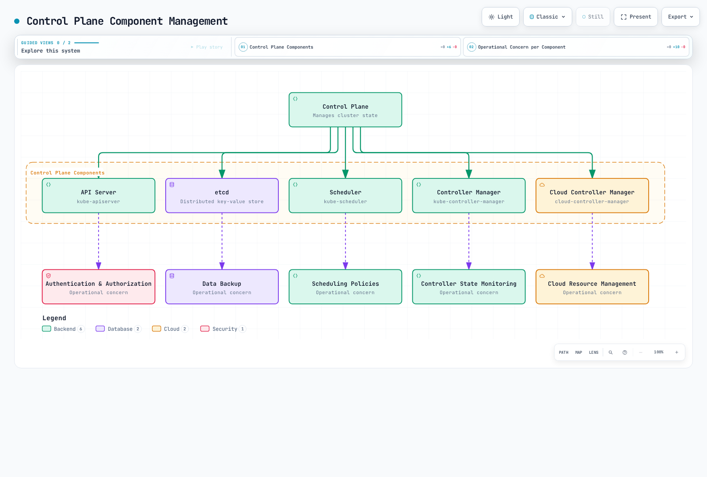
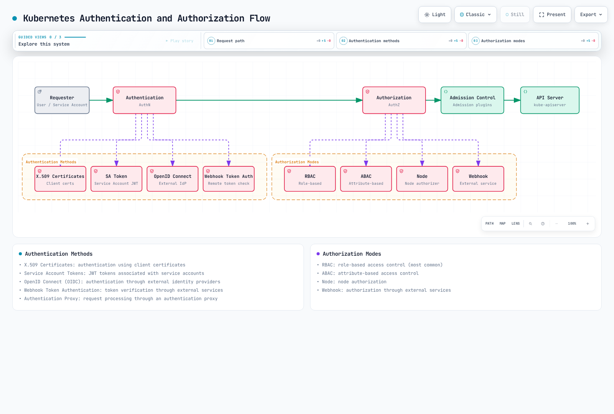
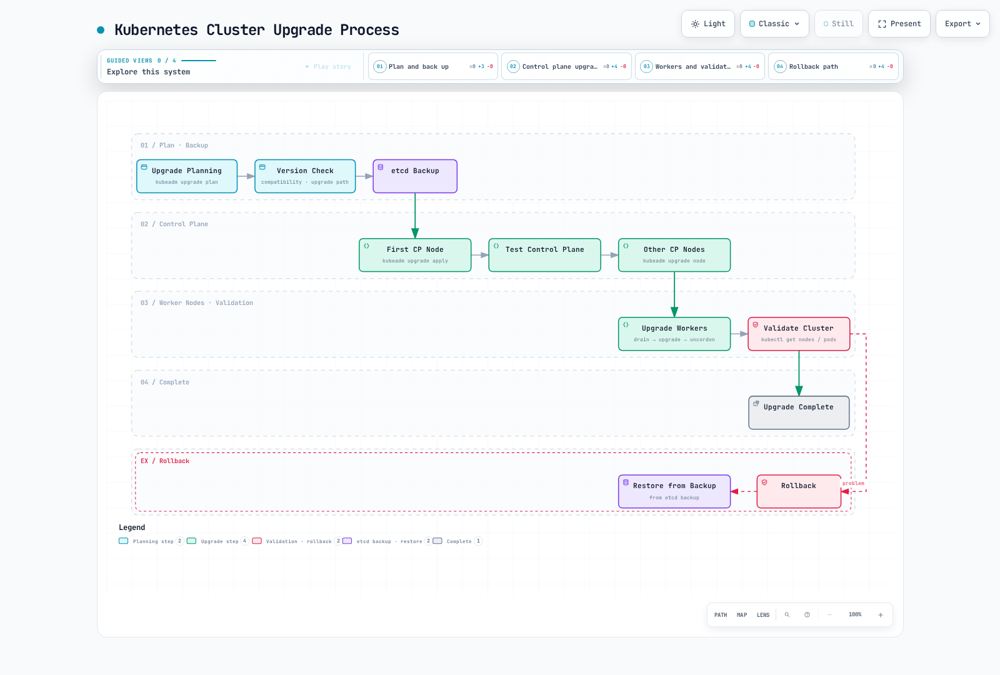
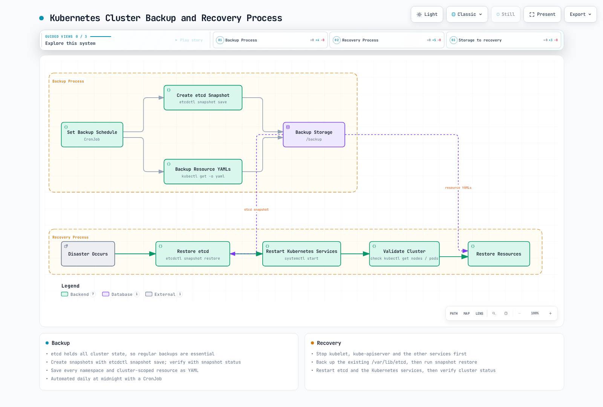
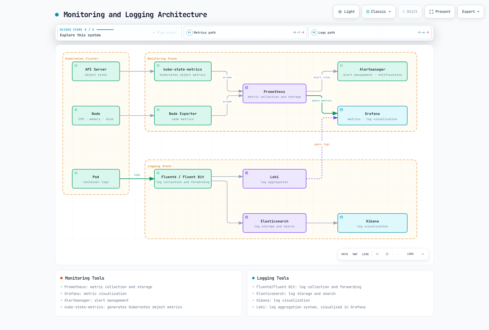
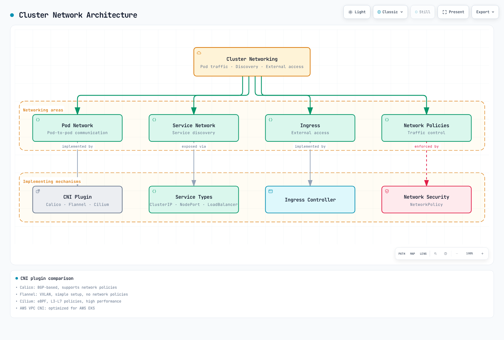
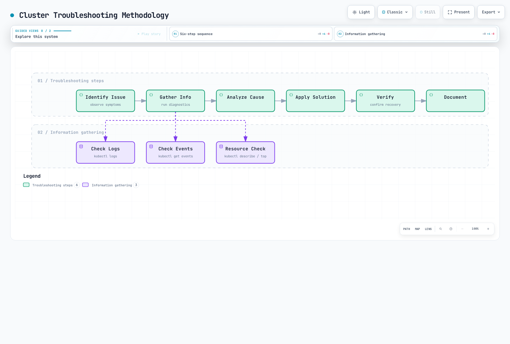
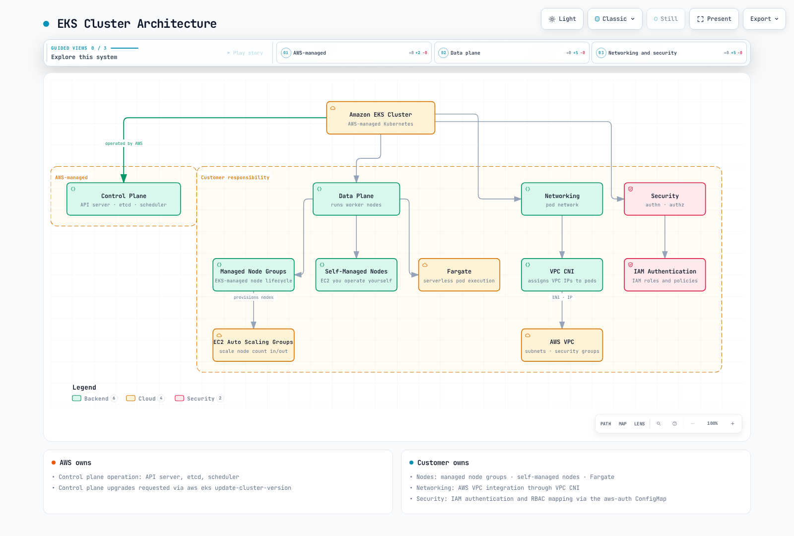

# Kubernetes 集群管理

> **支持的版本**：Kubernetes 1.34–1.37 的 EKS 标准支持（截至 2026 年 10 月 12 日核查）
> **最后更新**：2026 年 10 月 16 日

Kubernetes 集群管理是一项重要工作，包括集群设置、维护、监控、故障排除和升级。本章将探讨 Kubernetes 集群管理的各个方面，以及在 Amazon EKS 中管理集群的最佳实践。

自管理 kubeadm 操作与 EKS 服务操作并不相同。EKS 不会开放控制平面主机、静态 Pod 清单或直接访问 etcd 的权限。请将下方代码块视为相互独立的示例，而不是按顺序运行的一段脚本。请针对实际集群版本检查上游支持情况及附加组件兼容性。

## 核心概念

- **集群生命周期管理**：从创建集群到停用集群的整个过程
- **控制平面管理**：管理 API server、scheduler 和 controller manager 等核心组件
- **节点管理**：添加、移除和维护工作节点
- **资源分配**：设置 CPU、内存、存储等资源的分配和限制
- **升级策略**：制定集群和应用升级策略，以尽量减少停机时间

## 目录
1. [集群管理概述](#cluster-administration-overview)
2. [集群组件管理](#cluster-component-management)
3. [资源管理](#resource-management)
4. [集群网络](#cluster-networking)
5. [身份验证和授权管理](#authentication-and-authorization-management)
6. [集群升级](#cluster-upgrades)
7. [备份和恢复](#backup-and-recovery)
8. [监控和日志记录](#monitoring-and-logging)
9. [故障排除](#troubleshooting)
10. [Amazon EKS 集群管理](#amazon-eks-cluster-administration)
11. [集群管理最佳实践](#cluster-administration-best-practices)
12. [结论](#conclusion)

## 环境设置

集群管理需要使用以下工具：

请参考 [kubectl 官方安装指南](https://kubernetes.io/docs/tasks/tools/install-kubectl-linux/)，并确保 kubectl 与 API server 的次要版本相差不超过一个版本。对于自管理集群，请从目标次要版本的 `pkgs.k8s.io` 仓库安装 kubeadm/kubelet；旧版 `1.x.y-00` 软件包示例已过时。安装前，请从已配置的仓库中选择一个确切的软件包版本。

请按照 [Helm 官方说明](https://helm.sh/docs/intro/install/)和 [k9s 发布版本](https://github.com/derailed/k9s/releases)安装 Helm 和 k9s，并检查平台架构和校验和。管理 EKS 还需要经过身份验证的 AWS CLI 和兼容的 eksctl。

```bash
kubectl version --client
helm version
k9s version
# Self-managed nodes only, after configuring the target minor repository:
apt-cache madison kubeadm
```


## 集群管理概述 {#cluster-administration-overview}

Kubernetes 集群管理是管理集群整个生命周期的过程，主要包括以下方面：

1. **集群设置和配置**：创建集群、添加节点、设置网络、配置存储等。
2. **运维管理**：资源监控、性能优化、容量规划、故障排除
3. **安全管理**：身份验证、授权、网络策略、安全上下文等
4. **升级和补丁**：升级集群版本、应用安全补丁
5. **备份和恢复**：备份集群数据、制定灾难恢复计划

下图展示了 Kubernetes 集群管理的主要领域及相关工具：

## 集群组件管理 {#cluster-component-management}

Kubernetes 集群由控制平面组件和节点组件组成。管理每个组件对于集群的稳定性和性能至关重要。

### 控制平面组件管理



[🔍 查看交互式图表](https://www.atomai.click/kubernetes-docs/archmaps/en-core-09-cluster-administration-0.html)

#### API Server 管理

API server 是控制平面的核心组件，用于公开 Kubernetes API。

```bash
# Check API server logs
kubectl logs -n kube-system kube-apiserver-<master-node-name>

# Check API server configuration (kubeadm cluster)
sudo cat /etc/kubernetes/manifests/kube-apiserver.yaml

# Check API server status
kubectl get --raw='/readyz?verbose'
```

#### etcd 管理

etcd 是一个分布式键值存储，用于存储 Kubernetes API 状态。

```bash
# etcd backup
ETCDCTL_API=3 etcdctl --endpoints=https://127.0.0.1:2379 \
  --cacert=/etc/kubernetes/pki/etcd/ca.crt \
  --cert=/etc/kubernetes/pki/etcd/server.crt \
  --key=/etc/kubernetes/pki/etcd/server.key \
  snapshot save /backup/etcd-snapshot-$(date +%Y-%m-%d).db

# Check etcd status
ETCDCTL_API=3 etcdctl --endpoints=https://127.0.0.1:2379 \
  --cacert=/etc/kubernetes/pki/etcd/ca.crt \
  --cert=/etc/kubernetes/pki/etcd/server.crt \
  --key=/etc/kubernetes/pki/etcd/server.key \
  endpoint health
```

### 节点管理

节点是运行容器化应用的工作机器。

```bash
# List nodes
kubectl get nodes

# Check node detailed information
kubectl describe node <node-name>

# Add node label
kubectl label node <node-name> environment=production

# Set node to maintenance mode
kubectl drain <node-name> --ignore-daemonsets

# Return node after maintenance
kubectl uncordon <node-name>
```

### 组件状态监控

```bash
# Check control plane component status
kubectl get --raw='/readyz?verbose'

# Check system pod status
kubectl get pods -n kube-system

# Check node resource usage
kubectl top nodes
```


[🔍 查看交互式图表](https://www.atomai.click/kubernetes-docs/archmaps/en-core-09-cluster-administration-1.html)

### 集群管理工具

有多种工具可用于 Kubernetes 集群管理：

1. **kubectl**：用于与 Kubernetes 集群交互的命令行工具
2. **kubeadm**：用于创建和管理 Kubernetes 集群的工具
3. **kops**：用于创建、升级和管理 Kubernetes 集群的工具
4. **eksctl**：用于创建和管理 Amazon EKS 集群的工具
5. **Helm**：Kubernetes 应用包管理器
6. **Headlamp**：Kubernetes Web UI；旧版 Kubernetes Dashboard 项目已归档
7. **Prometheus 和 Grafana**：监控和告警工具
8. **Fluentd 和 Elasticsearch**：日志工具

## 集群组件管理

Kubernetes 集群由多个组件组成，有效管理这些组件十分重要。

### 控制平面组件

控制平面组件负责管理集群的整体状态：

1. **kube-apiserver**：公开 Kubernetes API 的组件
2. **etcd**：存储集群数据的键值存储
3. **kube-scheduler**：将 Pod 调度到节点的组件
4. **kube-controller-manager**：运行控制器的组件
5. **cloud-controller-manager**：与云服务提供商交互的组件

下图展示了 Kubernetes 控制平面组件及其交互方式：


[🔍 查看交互式图表](https://www.atomai.click/kubernetes-docs/archmaps/en-core-09-cluster-administration-2.html)

#### 控制平面组件监控

监控控制平面组件的状态十分重要：

```bash
# Check control plane component status
kubectl get --raw='/readyz?verbose'

# Check API server logs
kubectl logs -n kube-system kube-apiserver-<node-name>

# Check etcd status
kubectl exec -n kube-system etcd-<node-name> -- etcdctl \
  --endpoints=https://127.0.0.1:2379 \
  --cacert=/etc/kubernetes/pki/etcd/ca.crt \
  --cert=/etc/kubernetes/pki/etcd/healthcheck-client.crt \
  --key=/etc/kubernetes/pki/etcd/healthcheck-client.key endpoint health
```

#### 控制平面组件配置

下方清单仅为标志/配置片段，省略了主机网络、证书挂载及 kubeadm 生成的其他设置；请勿使用此片段替换正在运行的控制平面清单。镜像版本应与集群升级计划一致。

控制平面组件配置管理方式：

```yaml
# kube-apiserver configuration example
apiVersion: v1
kind: Pod
metadata:
  name: kube-apiserver
  namespace: kube-system
spec:
  containers:
  - command:
    - kube-apiserver
    - --advertise-address=192.168.1.10
    - --allow-privileged=true
    - --authorization-mode=Node,RBAC
    - --client-ca-file=/etc/kubernetes/pki/ca.crt
    - --enable-admission-plugins=NodeRestriction
    - --enable-bootstrap-token-auth=true
    - --etcd-cafile=/etc/kubernetes/pki/etcd/ca.crt
    - --etcd-certfile=/etc/kubernetes/pki/apiserver-etcd-client.crt
    - --etcd-keyfile=/etc/kubernetes/pki/apiserver-etcd-client.key
    - --etcd-servers=https://127.0.0.1:2379
    - --kubelet-client-certificate=/etc/kubernetes/pki/apiserver-kubelet-client.crt
    - --kubelet-client-key=/etc/kubernetes/pki/apiserver-kubelet-client.key
    - --kubelet-preferred-address-types=InternalIP,ExternalIP,Hostname
    - --secure-port=6443
    - --service-account-key-file=/etc/kubernetes/pki/sa.pub
    - --service-account-signing-key-file=/etc/kubernetes/pki/sa.key
    - --service-account-issuer=https://kubernetes.default.svc.cluster.local
    - --service-cluster-ip-range=10.96.0.0/12
    - --tls-cert-file=/etc/kubernetes/pki/apiserver.crt
    - --tls-private-key-file=/etc/kubernetes/pki/apiserver.key
    image: registry.k8s.io/kube-apiserver:v1.36.5
    name: kube-apiserver
```

### 节点组件

节点组件在每个节点上运行并管理 Pod：

1. **kubelet**：在每个节点上运行的代理，负责确保 Pod 和容器处于运行状态
2. **kube-proxy**：维护网络规则并处理连接转发
3. **容器运行时**：运行容器的软件（containerd、CRI-O，或搭配外部 CRI 适配器的 Docker Engine）

#### 节点管理

节点管理常用命令：

```bash
# List nodes
kubectl get nodes

# Check node detailed information
kubectl describe node <node-name>

# Add node label
kubectl label node <node-name> key=value

# Add node taint
kubectl taint node <node-name> key=value:NoSchedule

# Set node to maintenance mode
kubectl cordon <node-name>

# Drain node
kubectl drain <node-name> --ignore-daemonsets
```

Drain 操作可能会因独立运行的 Pod、PDB 或本地数据而停止。请调查原因，而不要默认添加 `--force` 或 `--delete-emptydir-data`；后一个选项会明确授权丢失 emptyDir 数据。维护前请等待 drain 完成，并确认工作负载健康。

#### 节点故障排除

节点故障排除命令：

```bash
# Check node status
kubectl describe node <node-name> | grep Conditions -A 10

# Check node resource usage
kubectl top node <node-name>

# Check kubelet logs
journalctl -u kubelet

# Check container runtime status
systemctl status docker  # When using Docker
systemctl status containerd  # When using containerd
```

## 资源管理 {#resource-management}

有效管理 Kubernetes 集群资源对于保持集群稳定性和性能十分重要。

### Namespace 管理

使用可丢弃的 namespace 练习生命周期操作。删除 namespace 会删除其作用域内的资源；请先检查并备份所需数据。`get all` 只会返回一部分工作负载资源。

```bash
kubectl create namespace admin-demo
kubectl get all -n admin-demo
# Cleanup only the disposable exercise namespace:
kubectl delete namespace admin-demo
```

### ResourceQuota

ResourceQuota 用于限制每个 namespace 的资源使用量：

```yaml
apiVersion: v1
kind: ResourceQuota
metadata:
  name: compute-resources
  namespace: dev
spec:
  hard:
    requests.cpu: "1"
    requests.memory: 1Gi
    limits.cpu: "2"
    limits.memory: 2Gi
    pods: "10"
```

在上述示例中，`dev` namespace 最多可有 10 个 Pod，CPU requests 为 1 个 CPU、内存 requests 为 1Gi，CPU limits 为 2 个 CPU、内存 limits 为 2Gi。

### LimitRange

LimitRange 用于为 namespace 中的单个资源设置默认值和限制：

```yaml
apiVersion: v1
kind: LimitRange
metadata:
  name: limit-range
  namespace: dev
spec:
  limits:
  - default:
      cpu: 500m
      memory: 512Mi
    defaultRequest:
      cpu: 200m
      memory: 256Mi
    max:
      cpu: 1
      memory: 1Gi
    min:
      cpu: 100m
      memory: 128Mi
    type: Container
```

在上述示例中，`dev` namespace 中所有容器的默认 limits 为 500m CPU 和 512Mi 内存，默认 requests 为 200m CPU 和 256Mi 内存，最大值为 1 个 CPU 和 1Gi 内存，最小值为 100m CPU 和 128Mi 内存。

### Horizontal Pod Autoscaler (HPA)

HPA 根据 CPU 使用率或自定义指标自动调整 Pod 数量：

```yaml
apiVersion: autoscaling/v2
kind: HorizontalPodAutoscaler
metadata:
  name: frontend-hpa
spec:
  scaleTargetRef:
    apiVersion: apps/v1
    kind: Deployment
    name: frontend
  minReplicas: 2
  maxReplicas: 10
  metrics:
  - type: Resource
    resource:
      name: cpu
      target:
        type: Utilization
        averageUtilization: 80
```

在上述示例中，`frontend` Deployment 的目标是 CPU 平均使用率达到 requests CPU 的 80%，但实际调整会受到容差、缺失指标、稳定窗口和扩缩策略的影响。副本数最少为 2 个，最多为 10 个。

### Vertical Pod Autoscaler (VPA)

VPA 会自动调整 Pod 的 CPU 和内存 requests：

```yaml
apiVersion: autoscaling.k8s.io/v1
kind: VerticalPodAutoscaler
metadata:
  name: frontend-vpa
spec:
  targetRef:
    apiVersion: apps/v1
    kind: Deployment
    name: frontend
  updatePolicy:
    updateMode: "Recreate"
```

在上述示例中，`frontend` Deployment 中 Pod 的 CPU 和内存 requests 会根据实际资源使用情况自动调整。

## 集群网络 {#cluster-networking}

Kubernetes 集群网络负责管理 Pod、Service 和节点之间的通信。

### 集群网络模型

Kubernetes 网络模型的基本要求：

1. 所有 Pod 都可以在无需 NAT 的情况下相互通信
2. 节点代理（kubelet）可以与该节点上的所有 Pod 通信
3. 外部连接取决于路由和出口策略；不存在通用的 Pod NAT 模式要求

下图展示了 Kubernetes 网络组件和通信流：


[🔍 查看交互式图表](https://www.atomai.click/kubernetes-docs/archmaps/en-core-09-cluster-administration-3.html)

### CNI（Container Network Interface）插件

Kubernetes 通过 CNI 插件实现网络功能。常见的 CNI 插件包括：

1. **Calico**：具备增强型网络策略和安全功能的 CNI
2. **Flannel**：提供简单的覆盖网络
3. **Cilium**：基于 eBPF 的网络和安全解决方案
4. **AWS VPC CNI**：与 AWS VPC 集成的 CNI
5. **Weave Net（历史项目）**：已归档；新安装时请选择仍在维护的替代方案

#### CNI 插件安装和配置

CNI 插件安装示例（Calico）：

请选择一种 CNI，或采用有文档记录的链式配置/迁移方案。不得在同一个正在运行的集群中依次安装 Calico、Flannel 和 Cilium 这些替代方案。请使用受支持且固定版本的发布版，并遵循特定于提供商的说明；在 EKS 上，请按照[网络章节](./03-services-networking.md)中的 VPC CNI 或计划中的替代 CNI 流程操作。

```bash
# Inspect the installed networking components before making changes
kubectl get daemonsets -A
kubectl get pods -A -l k8s-app=calico-node
```


### Service 网络

Kubernetes Service 为 Pod 集合提供稳定的端点：

1. **ClusterIP**：只能在集群内部访问的 Service
2. **NodePort**：可通过所有节点上的指定端口访问的 Service
3. **LoadBalancer**：可通过外部负载均衡器访问的 Service
4. **ExternalName**：为外部 Service 提供 CNAME 记录

#### Service CIDR 配置

Service CIDR 定义 Service IP 地址范围：

```bash
# Set service CIDR in kube-apiserver configuration
--service-cluster-ip-range=10.96.0.0/12
```

### CoreDNS 管理

CoreDNS 为 Kubernetes 提供 DNS 服务：

```bash
# Check CoreDNS status
kubectl get pods -n kube-system -l k8s-app=kube-dns

# Check CoreDNS configuration
kubectl get configmap -n kube-system coredns -o yaml
```

CoreDNS 配置示例：

```yaml
apiVersion: v1
kind: ConfigMap
metadata:
  name: coredns
  namespace: kube-system
data:
  Corefile: |
    .:53 {
        errors
        health {
           lameduck 5s
        }
        ready
        kubernetes cluster.local in-addr.arpa ip6.arpa {
           pods insecure
           fallthrough in-addr.arpa ip6.arpa
           ttl 30
        }
        prometheus :9153
        forward . /etc/resolv.conf
        cache 30
        loop
        reload
        loadbalance
    }
```

### NetworkPolicy

NetworkPolicy 用于控制 Pod 之间的通信：

```yaml
apiVersion: networking.k8s.io/v1
kind: NetworkPolicy
metadata:
  name: db-network-policy
  namespace: default
spec:
  podSelector:
    matchLabels:
      role: db
  policyTypes:
  - Ingress
  - Egress
  ingress:
  - from:
    - podSelector:
        matchLabels:
          role: frontend
    ports:
    - protocol: TCP
      port: 3306
  egress:
  - to:
    - podSelector:
        matchLabels:
          role: monitoring
    ports:
    - protocol: TCP
      port: 9090
```

在上述示例中，带有 `role=db` 标签的 Pod 仅允许带有 `role=frontend` 标签的 Pod 通过 TCP 端口 3306 入站通信，并允许其通过 TCP 端口 9090 向带有 `role=monitoring` 标签的 Pod 出站通信。

## 身份验证和授权管理 {#authentication-and-authorization-management}

Kubernetes 身份验证和授权管理是集群安全的核心要素。

下图展示了 Kubernetes 身份验证和授权流程：



[🔍 查看交互式图表](https://www.atomai.click/kubernetes-docs/archmaps/en-core-09-cluster-administration-4.html)

### 身份验证

Kubernetes 支持多种身份验证方法：

1. **X.509 证书**：使用客户端证书进行身份验证
2. **Service Account Token**：与 Service Account 关联的 JWT Token
3. **OpenID Connect (OIDC)**：通过外部身份提供商进行身份验证
4. **Webhook Token 身份验证**：通过外部服务验证 Token
5. **身份验证代理**：通过身份验证代理处理请求

#### X.509 证书管理

创建和管理 X.509 证书：

```bash
# Generate a protected private key and CSR
umask 077
openssl genrsa -out user.key 2048
openssl req -new -key user.key -out user.csr -subj "/CN=user/O=group"

# Submit CSR to Kubernetes
cat <<EOF | kubectl apply -f -
apiVersion: certificates.k8s.io/v1
kind: CertificateSigningRequest
metadata:
  name: user-csr
spec:
  request: $(cat user.csr | base64 | tr -d '\n')
  signerName: kubernetes.io/kube-apiserver-client
  usages:
  - client auth
EOF

# Approve CSR
kubectl certificate approve user-csr
kubectl wait --for=jsonpath='{.status.certificate}' csr/user-csr --timeout=60s

# Get certificate
kubectl get csr user-csr -o jsonpath='{.status.certificate}' | base64 --decode > user.crt
```

#### OIDC 身份验证配置

OIDC 身份验证配置示例：

```bash
# Add OIDC flags to kube-apiserver configuration
--oidc-issuer-url=https://accounts.google.com
--oidc-client-id=kubernetes
--oidc-username-claim=email
--oidc-groups-claim=groups
```

### 授权

Kubernetes 支持多种授权模式：

1. **RBAC（基于角色的访问控制）**：基于角色的访问控制
2. **ABAC（基于属性的访问控制）**：基于属性的访问控制
3. **Node**：节点授权
4. **Webhook**：通过外部服务进行授权

#### RBAC 配置

RBAC 是最常见的授权机制：

```yaml
# Role example
apiVersion: rbac.authorization.k8s.io/v1
kind: Role
metadata:
  namespace: default
  name: pod-reader
rules:
- apiGroups: [""]
  resources: ["pods"]
  verbs: ["get", "watch", "list"]

# RoleBinding example
---
apiVersion: rbac.authorization.k8s.io/v1
kind: RoleBinding
metadata:
  name: read-pods
  namespace: default
subjects:
- kind: User
  name: user
  apiGroup: rbac.authorization.k8s.io
roleRef:
  kind: Role
  name: pod-reader
  apiGroup: rbac.authorization.k8s.io
```

在上述示例中，`user` 有权查看 `default` namespace 中的 Pod。

#### ClusterRole 和 ClusterRoleBinding

用于管理集群范围资源的权限：

```yaml
# ClusterRole example
apiVersion: rbac.authorization.k8s.io/v1
kind: ClusterRole
metadata:
  name: node-reader
rules:
- apiGroups: [""]
  resources: ["nodes"]
  verbs: ["get", "watch", "list"]

# ClusterRoleBinding example
---
apiVersion: rbac.authorization.k8s.io/v1
kind: ClusterRoleBinding
metadata:
  name: read-nodes
subjects:
- kind: User
  name: user
  apiGroup: rbac.authorization.k8s.io
roleRef:
  kind: ClusterRole
  name: node-reader
  apiGroup: rbac.authorization.k8s.io
```

在上述示例中，`user` 有权查看集群中的所有节点。

### Service Account 管理

Pod 使用 Service Account 与 API server 通信：

```yaml
# Create service account
apiVersion: v1
kind: ServiceAccount
metadata:
  name: my-service-account
  namespace: default

# Grant permissions to service account
---
apiVersion: rbac.authorization.k8s.io/v1
kind: RoleBinding
metadata:
  name: my-service-account-binding
  namespace: default
subjects:
- kind: ServiceAccount
  name: my-service-account
  namespace: default
roleRef:
  kind: Role
  name: pod-reader
  apiGroup: rbac.authorization.k8s.io

# Use service account in pod
---
apiVersion: v1
kind: Pod
metadata:
  name: my-pod
spec:
  serviceAccountName: my-service-account
  containers:
  - name: my-container
    image: nginx
```

### 安全上下文

安全上下文用于定义 Pod 和容器的权限及访问控制：

```yaml
apiVersion: v1
kind: Pod
metadata:
  name: security-context-pod
spec:
  securityContext:
    runAsUser: 1000
    runAsGroup: 3000
    fsGroup: 2000
    runAsNonRoot: true
    seccompProfile:
      type: RuntimeDefault
  containers:
  - name: security-context-container
    image: busybox:1.36
    command: ["sh", "-c", "sleep 3600"]
    securityContext:
      allowPrivilegeEscalation: false
      capabilities:
        drop:
        - ALL
      readOnlyRootFilesystem: true
```

在上述示例中，Pod 以 UID 1000 和 GID 3000 运行；容器无法提升权限，所有 Linux capabilities 均被移除，且根文件系统以只读方式挂载。

## 集群升级 {#cluster-upgrades}

升级 Kubernetes 集群是应用新功能、性能改进和安全补丁的必要操作。

下图展示了 Kubernetes 集群升级流程：



[🔍 查看交互式图表](https://www.atomai.click/kubernetes-docs/archmaps/en-core-09-cluster-administration-5.html)

### 升级规划

规划集群升级时需要考虑：

1. **版本兼容性**：检查 Kubernetes 版本之间的兼容性
2. **升级路径**：检查受支持的升级路径
3. **停机时间**：规划升级期间预计的停机时间
4. **回滚计划**：制定出现问题时的回滚计划
5. **对应用的影响**：评估升级对应用的影响

### 控制平面升级

使用 kubeadm 升级控制平面：

请遵循[特定版本的 kubeadm 升级流程](https://kubernetes.io/docs/tasks/administer-cluster/kubeadm/kubeadm-upgrade/)。启用目标次要版本的 pkgs.k8s.io 仓库，并选择一个确切的已发布软件包版本；每次只升级一个次要版本。

1. 备份 etcd，并验证工作负载/附加组件的兼容性。在第一个控制平面节点上升级 kubeadm，运行 `kubeadm upgrade plan`，然后运行 `kubeadm upgrade apply <target-version>`。
2. 在其他控制平面节点上升级 kubeadm，并运行 `kubeadm upgrade node`。
3. 升级 kubelet 前，先 drain 每个节点。如果 drain 失败，请停止流程并解决原因。将 kubelet/kubectl 升级到兼容版本，重新加载 systemd，重启 kubelet，验证节点为 Ready 且工作负载正常，然后从管理客户端执行 uncordon。
4. 在每个工作节点上升级 kubeadm 并运行 `kubeadm upgrade node`，然后按顺序执行 drain/kubelet/验证/uncordon。请勿使用通用的整套系统升级代替 Kubernetes 特定版本的升级流程。

请在明确指定的节点或管理客户端上运行命令；一连串嵌套的 `ssh` 会话并不是多节点自动化脚本。

### 工作节点升级

工作节点升级流程：

请遵循[特定版本的 kubeadm 升级流程](https://kubernetes.io/docs/tasks/administer-cluster/kubeadm/kubeadm-upgrade/)。启用目标次要版本的 pkgs.k8s.io 仓库，并选择一个确切的已发布软件包版本；每次只升级一个次要版本。

1. 备份 etcd，并验证工作负载/附加组件的兼容性。在第一个控制平面节点上升级 kubeadm，运行 `kubeadm upgrade plan`，然后运行 `kubeadm upgrade apply <target-version>`。
2. 在其他控制平面节点上升级 kubeadm，并运行 `kubeadm upgrade node`。
3. 升级 kubelet 前，先 drain 每个节点。如果 drain 失败，请停止流程并解决原因。将 kubelet/kubectl 升级到兼容版本，重新加载 systemd，重启 kubelet，验证节点为 Ready 且工作负载正常，然后从管理客户端执行 uncordon。
4. 在每个工作节点上升级 kubeadm 并运行 `kubeadm upgrade node`，然后按顺序执行 drain/kubelet/验证/uncordon。请勿使用通用的整套系统升级代替 Kubernetes 特定版本的升级流程。

请在明确指定的节点或管理客户端上运行命令；一连串嵌套的 `ssh` 会话并不是多节点自动化脚本。

### 升级验证

升级后验证集群状态：

```bash
# Check node versions
kubectl get nodes

# Check component status
kubectl get --raw='/readyz?verbose'

# Check pod status
kubectl get pods --all-namespaces

# Test cluster functionality
kubectl create deployment nginx --image=nginx
kubectl expose deployment nginx --port=80
kubectl get svc nginx
```
## 备份和恢复 {#backup-and-recovery}

Kubernetes 集群备份和恢复是灾难恢复规划的重要组成部分。

下图展示了 Kubernetes 集群备份和恢复流程：



[🔍 查看交互式图表](https://www.atomai.click/kubernetes-docs/archmaps/en-core-09-cluster-administration-6.html)

### etcd 备份

etcd 存储 Kubernetes 集群的所有状态信息，因此定期备份十分重要：

```bash
# Create etcd snapshot
ETCDCTL_API=3 etcdctl --endpoints=https://127.0.0.1:2379 \
  --cacert=/etc/kubernetes/pki/etcd/ca.crt \
  --cert=/etc/kubernetes/pki/etcd/server.crt \
  --key=/etc/kubernetes/pki/etcd/server.key \
  snapshot save /backup/etcd-snapshot-$(date +%Y-%m-%d-%H-%M-%S).db

# Check snapshot status
etcdutl snapshot status --write-out=table /backup/etcd-snapshot-2023-01-01-12-00-00.db
```

### etcd 恢复

从 etcd 快照恢复：

对于自管理灾难恢复，请根据特定发行版的操作手册停止所有 API server 和受影响的 etcd 进程。仅停止 kubelet 并不会停止已运行的静态 Pod 容器。请使用兼容的 etcdutl 将快照恢复到新目录；在确认恢复成功之前，请保留原始数据。下面的单成员命令仅为示例，并不适用于多成员 HA 恢复：

```bash
etcdutl snapshot status "$SNAPSHOT_FILE" --write-out=table
etcdutl snapshot restore "$SNAPSHOT_FILE" \
  --data-dir=/var/lib/etcd-restore \
  --name=etcd-1 \
  --initial-cluster=etcd-1=https://127.0.0.1:2380 \
  --initial-cluster-token=restored-cluster \
  --initial-advertise-peer-urls=https://127.0.0.1:2380 \
  --bump-revision=1000000000 --mark-compacted
```

将 SNAPSHOT_FILE 设置为已验证的快照。对于 HA，请在每个成员上恢复同一快照，为每个成员使用唯一名称/对等 URL，并使用相同的完整成员列表。选择一个大于快照创建后变更数量的 revision 增量。更新 etcd 清单/服务，使其指向恢复路径，并设置正确的所有权和证书；验证仲裁/健康状态后，再重启 API server/controller。请参阅[官方恢复指南](https://etcd.io/docs/v3.6/op-guide/recovery/)。EKS 用户无法直接恢复由服务管理的控制平面 etcd。

### 资源备份

这些导出文件是受保护的资源清单，并非完整且可移植的恢复方案。它们包含 Secret，需要限制访问权限并进行加密，也不包含 PV 数据。请使用 `umask 077` 并检查每条命令是否失败；按顺序恢复 CRD/依赖项，并根据需要移除服务器生成的元数据。`kubectl get all` 只会返回部分资源类型。

将 Kubernetes 资源备份为 YAML 文件：

```bash
# Export listable resources (includes sensitive Secrets)
set -eu
umask 077
for ns in $(kubectl get ns -o jsonpath='{.items[*].metadata.name}'); do
  mkdir -p /backup/resources/$ns
  for resource in $(kubectl api-resources --verbs=list --namespaced=true -o name); do
    kubectl get -n "$ns" "$resource" -o yaml > "/backup/resources/$ns/$resource.yaml"
  done
done

# Backup cluster-scoped resources
mkdir -p /backup/resources/cluster-scoped
for resource in $(kubectl api-resources --verbs=list --namespaced=false -o name); do
  kubectl get "$resource" -o yaml > "/backup/resources/cluster-scoped/$resource.yaml"
done
```

### 备份自动化

仅适用于自管理 kubeadm 的示例：请将工具镜像替换为包含兼容 etcdctl 的已验证镜像，匹配控制平面标签/污点和证书路径，并创建备份 PVC。所选主机必须能通过示例中的 loopback 地址访问 etcd，并允许挂载 PVC。此配置不能用于 EKS 托管控制平面。请验证快照并将其复制到受保护的外部存储；仅使用集群内 PVC 并不能实现灾难恢复。

使用 CronJob 自动执行备份任务：

```yaml
apiVersion: batch/v1
kind: CronJob
metadata:
  name: etcd-backup
  namespace: kube-system
spec:
  concurrencyPolicy: Forbid
  schedule: "0 0 * * *"  # Run daily at midnight
  jobTemplate:
    spec:
      template:
        spec:
          hostNetwork: true
          automountServiceAccountToken: false
          nodeSelector:
            node-role.kubernetes.io/control-plane: ""
          tolerations:
          - key: node-role.kubernetes.io/control-plane
            operator: Exists
            effect: NoSchedule
          containers:
          - name: etcd-backup
            image: example.invalid/etcd-backup-tools:replace-me
            command:
            - /bin/sh
            - -c
            - |
              set -eu
              umask 077
              ETCDCTL_API=3 etcdctl --endpoints=https://127.0.0.1:2379 \
                --cacert=/etc/kubernetes/pki/etcd/ca.crt \
                --cert=/etc/kubernetes/pki/etcd/healthcheck-client.crt \
                --key=/etc/kubernetes/pki/etcd/healthcheck-client.key \
                snapshot save /backup/etcd-snapshot-$(date +%Y-%m-%d-%H-%M-%S).db
            volumeMounts:
            - name: etcd-ca
              mountPath: /etc/kubernetes/pki/etcd/ca.crt
              readOnly: true
            - name: etcd-client-cert
              mountPath: /etc/kubernetes/pki/etcd/healthcheck-client.crt
              readOnly: true
            - name: etcd-client-key
              mountPath: /etc/kubernetes/pki/etcd/healthcheck-client.key
              readOnly: true
            - name: backup
              mountPath: /backup
          restartPolicy: OnFailure
          volumes:
          - name: etcd-ca
            hostPath:
              path: /etc/kubernetes/pki/etcd/ca.crt
              type: File
          - name: etcd-client-cert
            hostPath:
              path: /etc/kubernetes/pki/etcd/healthcheck-client.crt
              type: File
          - name: etcd-client-key
            hostPath:
              path: /etc/kubernetes/pki/etcd/healthcheck-client.key
              type: File
          - name: backup
            persistentVolumeClaim:
              claimName: etcd-backup-pvc
```

## 监控和日志记录 {#monitoring-and-logging}

有效的监控和日志记录是集群管理的核心要素。

下图展示了 Kubernetes 集群监控和日志记录架构：



[🔍 查看交互式图表](https://www.atomai.click/kubernetes-docs/archmaps/en-core-09-cluster-administration-7.html)

### 监控工具

Kubernetes 集群监控工具：

1. **Prometheus**：指标采集和存储
2. **Grafana**：指标可视化
3. **Alertmanager**：告警管理
4. **kube-state-metrics**：生成 Kubernetes 对象指标
5. **metrics-server**：提供资源使用指标

#### 安装 Prometheus 和 Grafana

使用 Helm 安装 Prometheus 和 Grafana：

```bash
# Add Helm repository
helm repo add prometheus-community https://prometheus-community.github.io/helm-charts
helm repo update

# Install Prometheus stack
helm install prometheus prometheus-community/kube-prometheus-stack \
  --namespace monitoring \
  --create-namespace
```

#### 关键监控指标

需要监控的关键指标：

1. **节点指标**：CPU、内存、磁盘和网络使用情况
2. **Pod 指标**：CPU、内存使用情况和重启次数
3. **容器指标**：CPU、内存和文件系统使用情况
4. **API Server 指标**：请求延迟、请求数和错误率
5. **etcd 指标**：磁盘 I/O、leader 变更次数和提交延迟

### 日志工具

Kubernetes 集群日志工具：

1. **Elasticsearch**：日志存储和搜索
2. **Fluentd/Fluent Bit**：日志采集和转发
3. **Kibana**：日志可视化
4. **Loki**：日志聚合系统
5. **Grafana**：日志可视化

#### 安装 EFK（Elasticsearch、Fluentd、Kibana）堆栈

使用 Helm 安装 EFK 堆栈：

独立的 Elastic Stack Helm chart 仓库已归档。对于仍受维护的部署，请使用 Elastic Cloud on Kubernetes (ECK)，然后定义 Elasticsearch/Kibana 资源和兼容的日志采集器。仅安装 Operator 并不会创建 EFK 堆栈：

```bash
helm repo add elastic https://helm.elastic.co
helm upgrade --install elastic-operator elastic/eck-operator \
  --namespace elastic-system --create-namespace \
  --version "${ECK_CHART_VERSION:?Select a supported ECK chart version}"
```

请将仪表板置于 ClusterIP/经过身份验证的访问之后；按照 [ECK 指南](https://www.elastic.co/docs/deploy-manage/deploy/cloud-on-k8s/install-using-helm-chart)配置存储、TLS、凭据、采集器解析和 RBAC。

#### 日志采集配置

此示例解析 CRI 日志封装格式，而不是假设日志使用 Docker JSON。采集器镜像必须包含元数据/输出插件，挂载节点日志和可写的位置文件存储，并配置范围受限的元数据 RBAC。请为实际的 Elasticsearch 服务配置 TLS/身份验证；仅设置占位主机并不能完成 ECK 集成。请根据所选采集器处理部分记录/多行记录。

Fluentd 配置示例：

```yaml
apiVersion: v1
kind: ConfigMap
metadata:
  name: fluentd-config
  namespace: logging
data:
  fluent.conf: |
    <source>
      @type tail
      path /var/log/containers/*.log
      pos_file /var/log/fluentd-containers.log.pos
      tag kubernetes.*
      read_from_head true
      <parse>
        @type regexp
        expression /^(?<time>[^ ]+) (?<stream>stdout|stderr) (?<logtag>[^ ]*) (?<log>.*)$/
        time_type string
        time_format %Y-%m-%dT%H:%M:%S.%N%:z
      </parse>
    </source>

    <filter kubernetes.**>
      @type kubernetes_metadata
      kubernetes_url https://kubernetes.default.svc
      bearer_token_file /var/run/secrets/kubernetes.io/serviceaccount/token
      ca_file /var/run/secrets/kubernetes.io/serviceaccount/ca.crt
    </filter>

    <match kubernetes.**>
      @type elasticsearch
      host elasticsearch-master
      port 9200
      logstash_format true
      logstash_prefix k8s
    </match>
```

## 故障排除 {#troubleshooting}

Kubernetes 集群故障排除是集群管理的重要组成部分。

### Pod 故障排除

Pod 故障排除命令：

```bash
# Check pod status
kubectl get pod <pod-name> -o wide

# Check pod detailed information
kubectl describe pod <pod-name>

# Check pod logs
kubectl logs <pod-name>
kubectl logs <pod-name> -c <container-name>  # For multi-container pods
kubectl logs <pod-name> --previous  # Logs from previous container

# Execute command in pod
kubectl exec -it <pod-name> -- /bin/sh
```

### 节点故障排除

节点故障排除命令：

```bash
# Check node status
kubectl get node <node-name> -o wide

# Check node detailed information
kubectl describe node <node-name>

# Check node resource usage
kubectl top node <node-name>

# SSH to node
ssh <node-name>

# Check node system logs
journalctl -u kubelet

# Check node resource usage
top
df -h
free -m
```

### 网络故障排除

网络故障排除命令：

```bash
# Check service status
kubectl get svc <service-name>

# Check service detailed information
kubectl describe svc <service-name>

# Check endpoints
kubectl get endpointslices -l kubernetes.io/service-name=<service-name>

# Check DNS
kubectl run -it --rm --restart=Never busybox --image=busybox -- nslookup <service-name>

# Test network connectivity
kubectl run -it --rm --restart=Never busybox --image=busybox -- wget -O- <service-name>:<port>

# Check network policies
kubectl get networkpolicy
kubectl describe networkpolicy <policy-name>
```

### 控制平面故障排除

控制平面故障排除命令：

```bash
# Check component status
kubectl get --raw='/readyz?verbose'

# Check API server logs
kubectl logs -n kube-system kube-apiserver-<node-name>

# Check controller manager logs
kubectl logs -n kube-system kube-controller-manager-<node-name>

# Check scheduler logs
kubectl logs -n kube-system kube-scheduler-<node-name>

# Check etcd logs
kubectl logs -n kube-system etcd-<node-name>
```

## Amazon EKS 集群管理 {#amazon-eks-cluster-administration}

Amazon EKS 是一项托管 Kubernetes 服务，可自动处理集群管理的许多方面。

下图展示了 Amazon EKS 集群架构和管理组件：


[🔍 查看交互式图表](https://www.atomai.click/kubernetes-docs/archmaps/en-core-09-cluster-administration-8.html)

### EKS 集群配置

更改端点访问设置前，请设置实际的管理员 CIDR，并确认私有访问仍可用。集群版本升级必须升级到下一个受支持的次要版本，并确保附加组件/节点兼容；请勿将示例用于降级或跳过次要版本。请轮询返回的更新 ID；如果更新失败，应停止后续依赖操作。

EKS 集群配置管理：

```bash
# Check EKS cluster information
aws eks describe-cluster --name my-cluster

# Update EKS cluster
aws eks update-cluster-config \
  --name my-cluster \
  --resources-vpc-config "endpointPublicAccess=true,endpointPrivateAccess=true,publicAccessCidrs=${ADMIN_CIDR:?Set an approved administrator public CIDR}"

# Update EKS cluster version
aws eks update-cluster-version \
  --name my-cluster \
  --kubernetes-version "${TARGET_VERSION:?Select the next EKS-supported minor version}"
```

### EKS 节点组管理

EKS 节点组管理：

```bash
# Check node group information
aws eks describe-nodegroup \
  --cluster-name my-cluster \
  --nodegroup-name my-nodegroup

# Scale node group
aws eks update-nodegroup-config \
  --cluster-name my-cluster \
  --nodegroup-name my-nodegroup \
  --scaling-config minSize=2,maxSize=10,desiredSize=5

# Update node group
aws eks update-nodegroup-version \
  --cluster-name my-cluster \
  --nodegroup-name my-nodegroup
```

### EKS 附加组件管理

使用 `aws eks describe-cluster --name my-cluster --query cluster.version --output text` 读取当前版本；使用该版本查询附加组件，并选择兼容的固定版本。创建/更新前，请检查现有配置/IAM，不要重复创建已受管理的附加组件。移除示例使用 `--preserve`，在移除 EKS 管理的同时保留正在运行的 CNI；卸载正在运行的网络组件则是另一项会造成中断的操作。

EKS 附加组件管理：

```bash
# Check available add-ons
aws eks describe-addon-versions --addon-name vpc-cni \
  --kubernetes-version "${CLUSTER_VERSION:?Set the actual cluster version}"

# Install add-on
aws eks create-addon \
  --cluster-name my-cluster \
  --addon-name vpc-cni \
  --addon-version "${CNI_ADDON_VERSION:?Select a compatible pinned VPC CNI add-on version}"

# Update add-on
aws eks update-addon \
  --cluster-name my-cluster \
  --addon-name vpc-cni \
  --addon-version "${CNI_ADDON_VERSION:?Select a compatible pinned VPC CNI add-on version}"

# Delete add-on
aws eks delete-addon \
  --cluster-name my-cluster \
  --addon-name vpc-cni --preserve
```

### EKS 集群升级

EKS 集群升级流程：

1. **控制平面升级**：
   ```bash
   aws eks update-cluster-version \
     --name my-cluster \
     --kubernetes-version "${TARGET_VERSION:?Select the next EKS-supported minor version}"
   ```

2. **附加组件升级**：
   ```bash
   aws eks update-addon \
     --cluster-name my-cluster \
     --addon-name vpc-cni \
     --addon-version "${CNI_ADDON_VERSION:?Select a compatible pinned VPC CNI add-on version}"
   ```

3. **节点组升级**：
   ```bash
   aws eks update-nodegroup-version \
     --cluster-name my-cluster \
     --nodegroup-name my-nodegroup
   ```

### EKS 集群监控

控制平面日志导出 api/audit/authenticator/controllerManager/scheduler 日志。Container Insights 需要 CloudWatch agent/附加组件以及范围受限的遥测 IAM 权限；update-cluster-logging 不会启用它。CloudWatch observability 附加组件会安装 CloudWatch/Fluent Bit 组件，而不是 Prometheus/Grafana。请参阅[官方附加组件设置指南](https://docs.aws.amazon.com/AmazonCloudWatch/latest/monitoring/install-CloudWatch-Observability-EKS-addon.html)。

EKS 集群监控工具：

1. **Amazon CloudWatch**：指标、日志和告警
2. **AWS CloudTrail**：API 调用日志
3. **Amazon Managed Grafana**：指标可视化
4. **Amazon Managed Service for Prometheus**：指标采集和存储

启用 EKS 控制平面日志：

```bash
# Enable EKS control-plane logs
eksctl utils update-cluster-logging \
  --enable-types all \
  --cluster my-cluster \
  --approve
```

## 集群管理最佳实践 {#cluster-administration-best-practices}

Kubernetes 和 EKS 集群管理最佳实践：

### 集群配置最佳实践

1. **基础设施即代码 (IaC)**：使用 Terraform、AWS CDK、eksctl 等工具管理集群配置
2. **版本控制**：将集群配置存储在版本控制系统中
3. **多环境**：分离开发、预发布和生产环境
4. **网络隔离**：配置适当的网络隔离和安全组
5. **最小权限原则**：仅授予最低限度的必要权限

### 运维最佳实践

1. **定期备份**：定期备份 etcd 和重要资源
2. **监控和告警**：构建完善的监控和告警系统
3. **集中式日志记录**：集中收集并分析日志
4. **自动化**：自动执行重复性任务
5. **灾难恢复规划**：制定清晰的灾难恢复计划并进行测试

### 安全最佳实践

1. **定期更新**：定期更新集群和节点
2. **NetworkPolicy**：配置适当的网络策略
3. **加密**：对静态和传输中的数据进行加密
4. **安全上下文**：配置适当的安全上下文
5. **镜像扫描**：扫描容器镜像中的漏洞

### 资源管理最佳实践

1. **资源 requests 和 limits**：为所有 Pod 设置适当的资源 requests 和 limits
2. **Namespace 隔离**：按 namespace 隔离工作负载
3. **ResourceQuota**：为每个 namespace 设置 ResourceQuota
4. **HPA 和 VPA**：配置自动扩缩
5. **节点亲和性和污点**：优化工作负载放置

### EKS 专属最佳实践

1. **托管节点组**：尽可能使用托管节点组
2. **Fargate**：使用 Fargate 运行无服务器工作负载
3. **EKS 附加组件**：使用官方 EKS 附加组件
4. **Service Account 的 IAM 角色 (IRSA)**：按 Pod 管理 IAM 权限
5. **VPC CNI 自定义配置**：根据网络要求配置 VPC CNI

## 结论 {#conclusion}

Kubernetes 集群管理对于保持集群稳定性、安全性和性能发挥着重要作用。本章介绍了集群管理的各个方面，包括集群组件管理、资源管理、网络、身份验证和授权管理、升级、备份和恢复、监控和日志记录以及故障排除。

使用 Amazon EKS 可以降低 Kubernetes 控制平面管理的复杂性，并通过与 AWS 服务集成来简化集群管理。不过，要有效管理集群，仍需理解 Kubernetes 的基本概念和最佳实践。

集群管理是一项持续进行的工作，必须根据集群需求和工作负载特征不断调整。应使用监控工具跟踪集群状态，通过自动化减少重复性任务，并遵循最佳实践来保持集群稳定性和安全性。

## 集群网络

Kubernetes 集群网络负责管理 Pod 间通信、Service 发现和外部访问。

### 网络架构



[🔍 查看交互式图表](https://www.atomai.click/kubernetes-docs/archmaps/en-core-09-cluster-administration-9.html)

### CNI 插件管理

CNI（Container Network Interface）插件负责处理 Kubernetes 集群的网络。

请选择一种 CNI，或采用有文档记录的链式配置/迁移方案。不得在同一个正在运行的集群中依次安装 Calico、Flannel 和 Cilium 这些替代方案。请使用受支持且固定版本的发布版，并遵循特定于提供商的说明；在 EKS 上，请按照[网络章节](./03-services-networking.md)中的 VPC CNI 或计划中的替代 CNI 流程操作。

```bash
# Inspect the installed networking components before making changes
kubectl get daemonsets -A
kubectl get pods -A -l k8s-app=calico-node
```


### CNI 插件对比

| CNI 插件 | 网络模型 | NetworkPolicy 支持 | 性能 | 特性 |
|-----------|---------------|----------------------|-------------|----------|
| **Calico** | BGP | 是 | 高 | 网络策略功能强大，基于路由 |
| **Flannel** | VXLAN/host-gateway | 否 | 中 | 设置简单，功能有限 |
| **Cilium** | eBPF | 是 | 很高 | L3-L7 策略，性能高 |
| **Weave Net** | VXLAN | 是 | 中 | 支持加密、多集群 |
| **AWS VPC CNI** | AWS VPC | 是，需使用受支持的版本/配置 | 取决于工作负载 | 与 EKS 原生集成 |

### 网络故障排除

```bash
# Test pod network connectivity
kubectl run -it --rm network-test --image=busybox -- sh
# Inside the container
ping <target-ip>
traceroute <target-ip>
wget -O- <service-name>

# DNS troubleshooting
kubectl run -it --rm dns-test --image=busybox -- sh
# Inside the container
nslookup kubernetes.default.svc.cluster.local
cat /etc/resolv.conf

# Check service endpoints
kubectl get endpointslices -l kubernetes.io/service-name=<service-name>

# Check network policies
kubectl describe networkpolicy -n <namespace>
```
## 身份验证和授权管理

Kubernetes 身份验证和授权管理是集群安全的核心要素。RBAC（基于角色的访问控制）用于管理用户和 Service Account 的权限。

### 身份验证方法

Kubernetes 支持多种身份验证方法：

1. **X.509 证书**：使用客户端证书进行身份验证
2. **Service Account Token**：用于 Pod 内访问 API server
3. **OpenID Connect (OIDC)**：与外部身份提供商集成
4. **Webhook Token 身份验证**：与外部身份验证服务集成
5. **身份验证代理**：通过代理进行身份验证

### RBAC 配置

```yaml
# role.yaml - namespace-scoped role
apiVersion: rbac.authorization.k8s.io/v1
kind: Role
metadata:
  namespace: default
  name: pod-reader
rules:
- apiGroups: [""]
  resources: ["pods"]
  verbs: ["get", "watch", "list"]
```

```yaml
# rolebinding.yaml - binding role to user
apiVersion: rbac.authorization.k8s.io/v1
kind: RoleBinding
metadata:
  name: read-pods
  namespace: default
subjects:
- kind: User
  name: jane
  apiGroup: rbac.authorization.k8s.io
roleRef:
  kind: Role
  name: pod-reader
  apiGroup: rbac.authorization.k8s.io
```

```yaml
# clusterrole.yaml - cluster-scoped role
apiVersion: rbac.authorization.k8s.io/v1
kind: ClusterRole
metadata:
  name: namespace-reader
rules:
- apiGroups: [""]
  resources: ["namespaces"]
  verbs: ["get", "watch", "list"]
```

```yaml
# clusterrolebinding.yaml - binding cluster role to user
apiVersion: rbac.authorization.k8s.io/v1
kind: ClusterRoleBinding
metadata:
  name: read-namespaces-global
subjects:
- kind: Group
  name: namespace-viewers
  apiGroup: rbac.authorization.k8s.io
roleRef:
  kind: ClusterRole
  name: namespace-reader
  apiGroup: rbac.authorization.k8s.io
```

### 创建用户证书

对于自管理的客户端证书身份验证，请提交 CSR，并由获授权的审批人核验所申请的身份/组。不要分发集群 CA 私钥。EKS 用户访问应使用 IAM/access entry。

```bash
umask 077
openssl genrsa -out jane.key 2048
openssl req -new -key jane.key -out jane.csr -subj "/CN=jane/O=dev"
cat <<EOF | kubectl apply -f -
apiVersion: certificates.k8s.io/v1
kind: CertificateSigningRequest
metadata:
  name: jane-csr
spec:
  request: $(base64 < jane.csr | tr -d '\n')
  signerName: kubernetes.io/kube-apiserver-client
  expirationSeconds: 86400
  usages:
  - client auth
EOF
# Authorized approver only, after reviewing the CSR identity:
kubectl certificate approve jane-csr
kubectl wait --for=jsonpath='{.status.certificate}' csr/jane-csr --timeout=60s
kubectl get csr jane-csr -o jsonpath='{.status.certificate}' | base64 --decode > jane.crt
kubectl config set-credentials jane --client-certificate=jane.crt --client-key=jane.key
kubectl config set-context jane-context --cluster=kubernetes --user=jane
```

### Service Account 管理

```bash
# Create service account
kubectl create serviceaccount app-service-account

# Bind role to service account
kubectl create rolebinding app-service-account-binding \
  --role=pod-reader \
  --serviceaccount=default:app-service-account

# Inspect ServiceAccount metadata (projected tokens are not listed here)
kubectl describe serviceaccount app-service-account
```

### 权限验证

```bash
# Check user permissions
kubectl auth can-i get pods --as jane

# Check permissions in a specific namespace
kubectl auth can-i create deployments --as jane --namespace production
```
## 集群升级

升级 Kubernetes 集群是应用新功能、安全补丁和错误修复的必要操作。必须仔细规划并执行升级。

### 升级规划


[🔍 查看交互式图表](https://www.atomai.click/kubernetes-docs/archmaps/en-core-09-cluster-administration-10.html)

### 升级策略对比

| 策略 | 说明 | 优点 | 缺点 | 适用环境 |
|----------|-------------|------------|---------------|---------------------|
| **就地升级** | 直接升级现有集群 | 节省资源，流程简单 | 回滚复杂，可能停机 | 开发、测试环境 |
| **蓝绿部署** | 创建新版本集群并切换 | 回滚安全，可验证 | 资源重复，成本增加 | 生产环境 |
| **金丝雀部署** | 仅将部分工作负载迁移到新集群 | 逐步验证，降低风险 | 管理复杂，需要双重运行 | 关键生产环境 |

### 使用 kubeadm 升级

请遵循[特定版本的 kubeadm 升级流程](https://kubernetes.io/docs/tasks/administer-cluster/kubeadm/kubeadm-upgrade/)。启用目标次要版本的 pkgs.k8s.io 仓库，并选择一个确切的已发布软件包版本；每次只升级一个次要版本。

1. 备份 etcd，并验证工作负载/附加组件的兼容性。在第一个控制平面节点上升级 kubeadm，运行 `kubeadm upgrade plan`，然后运行 `kubeadm upgrade apply <target-version>`。
2. 在其他控制平面节点上升级 kubeadm，并运行 `kubeadm upgrade node`。
3. 升级 kubelet 前，先 drain 每个节点。如果 drain 失败，请停止流程并解决原因。将 kubelet/kubectl 升级到兼容版本，重新加载 systemd，重启 kubelet，验证节点为 Ready 且工作负载正常，然后从管理客户端执行 uncordon。
4. 在每个工作节点上升级 kubeadm 并运行 `kubeadm upgrade node`，然后按顺序执行 drain/kubelet/验证/uncordon。请勿使用通用的整套系统升级代替 Kubernetes 特定版本的升级流程。

请在明确指定的节点或管理客户端上运行命令；一连串嵌套的 `ssh` 会话并不是多节点自动化脚本。

### 升级后验证

```bash
# Check cluster version
kubectl version

# Check node versions
kubectl get nodes

# Check component status
kubectl get --raw='/readyz?verbose'

# Check workload status
kubectl get pods -A
```
## 备份和恢复

Kubernetes 集群备份和恢复是灾难恢复规划的重要组成部分。主要备份目标包括 etcd 数据库、持久卷数据和 Kubernetes 资源定义。

### etcd 备份和恢复

etcd 是存储集群所有状态信息的核心组件。

对于自管理灾难恢复，请根据特定发行版的操作手册停止所有 API server 和受影响的 etcd 进程。仅停止 kubelet 并不会停止已运行的静态 Pod 容器。请使用兼容的 etcdutl 将快照恢复到新目录；在确认恢复成功之前，请保留原始数据。下面的单成员命令仅为示例，并不适用于多成员 HA 恢复：

```bash
etcdutl snapshot status "$SNAPSHOT_FILE" --write-out=table
etcdutl snapshot restore "$SNAPSHOT_FILE" \
  --data-dir=/var/lib/etcd-restore \
  --name=etcd-1 \
  --initial-cluster=etcd-1=https://127.0.0.1:2380 \
  --initial-cluster-token=restored-cluster \
  --initial-advertise-peer-urls=https://127.0.0.1:2380 \
  --bump-revision=1000000000 --mark-compacted
```

将 SNAPSHOT_FILE 设置为已验证的快照。对于 HA，请在每个成员上恢复同一快照，为每个成员使用唯一名称/对等 URL，并使用相同的完整成员列表。选择一个大于快照创建后变更数量的 revision 增量。更新 etcd 清单/服务，使其指向恢复路径，并设置正确的所有权和证书；验证仲裁/健康状态后，再重启 API server/controller。请参阅[官方恢复指南](https://etcd.io/docs/v3.6/op-guide/recovery/)。EKS 用户无法直接恢复由服务管理的控制平面 etcd。

### Kubernetes 资源备份

```bash
# Export selected resources, not a full cluster backup
set -eu
umask 077
mkdir -p /backup/resources/$(date +%Y-%m-%d)
for ns in $(kubectl get ns -o jsonpath='{.items[*].metadata.name}'); do
  kubectl -n $ns get all -o yaml > /backup/resources/$(date +%Y-%m-%d)/$ns-all.yaml
done

# Backup specific resource types
for resource in deployments services configmaps secrets; do
  kubectl get $resource -A -o yaml > /backup/resources/$(date +%Y-%m-%d)/$resource.yaml
done
```

### 使用 Velero 备份和恢复

请根据官方兼容性矩阵选择兼容的 Velero/AWS 插件版本。IRSA 示例假设集群已配置 OIDC 提供商，并且有一个信任 velero ServiceAccount 的范围受限角色。安装前，请配置备份存储桶、卷快照/文件备份支持、加密和恢复权限；并非所有 PVC 都会自动受到保护。

Velero 是用于备份和恢复 Kubernetes 集群资源及持久卷的工具。

```bash
# Install Velero (using AWS S3 backup storage)
velero install \
  --provider aws \
  --plugins "${VELERO_AWS_PLUGIN_IMAGE:?Select a plugin compatible with your Velero release}" \
  --bucket velero-backup \
  --backup-location-config region=us-west-2 \
  --snapshot-location-config region=us-west-2 \
  --no-secret \
  --sa-annotations "eks.amazonaws.com/role-arn=${VELERO_ROLE_ARN:?Set the preconfigured IRSA role ARN}"

# Full cluster backup
velero backup create full-cluster-backup --include-namespaces '*'

# Backup specific namespace
velero backup create production-backup --include-namespaces production

# Check backup status
velero backup describe full-cluster-backup

# Restore from backup
velero restore create --from-backup full-cluster-backup
```

### 备份策略对比

| 备份方式 | 备份目标 | 优点 | 缺点 | 恢复时间 |
|--------------|---------------|------------|---------------|---------------|
| **etcd 快照** | 集群状态 | 内置功能，完整保留状态 | 不包含卷数据，需要手动操作 | 中 |
| **资源 YAML 备份** | Kubernetes 对象 | 实现简单，可选择性恢复 | 不包含卷数据，资源关系复杂 | 慢 |
| **Velero** | 资源和卷 | 自动化、定期调度、卷快照 | 需要安装额外工具 | 快 |
| **云服务提供商快照** | 受支持的磁盘/文件系统 | 使用后端原生恢复点 | 不会捕获整个 Kubernetes/EKS 集群 | 取决于数据/后端 |

## 监控和日志记录

有效管理集群需要完善的监控和日志记录系统，以便尽早发现并解决问题。

### 监控架构


[🔍 查看交互式图表](https://www.atomai.click/kubernetes-docs/archmaps/en-core-09-cluster-administration-11.html)

### 安装 Prometheus 和 Grafana

```bash
# Install Prometheus and Grafana using Helm
helm repo add prometheus-community https://prometheus-community.github.io/helm-charts
helm repo update

helm install prometheus prometheus-community/kube-prometheus-stack \
  --namespace monitoring \
  --create-namespace \
  --set grafana.enabled=true \
  --set prometheus.service.type=ClusterIP

# Check services
kubectl get svc -n monitoring

# Access Grafana (using port forwarding)
kubectl port-forward svc/prometheus-grafana 3000:80 -n monitoring
# Obtain credentials from the configured Grafana Secret; do not assume a published default password
```

### 安装 EFK 堆栈（Elasticsearch、Fluentd、Kibana）

独立的 Elastic Stack Helm chart 仓库已归档。对于仍受维护的部署，请使用 Elastic Cloud on Kubernetes (ECK)，然后定义 Elasticsearch/Kibana 资源和兼容的日志采集器。仅安装 Operator 并不会创建 EFK 堆栈：

```bash
helm repo add elastic https://helm.elastic.co
helm upgrade --install elastic-operator elastic/eck-operator \
  --namespace elastic-system --create-namespace \
  --version "${ECK_CHART_VERSION:?Select a supported ECK chart version}"
```

请将仪表板置于 ClusterIP/经过身份验证的访问之后；按照 [ECK 指南](https://www.elastic.co/docs/deploy-manage/deploy/cloud-on-k8s/install-using-helm-chart)配置存储、TLS、凭据、采集器解析和 RBAC。

### 关键监控指标

| 指标类型 | 描述 | 关键指标 | 监控工具 |
|-------------|-------------|-------------|-----------------|
| **节点指标** | 节点级资源使用情况 | CPU、内存、磁盘、网络 | node-exporter、Prometheus |
| **Pod 指标** | 容器资源使用情况 | CPU、内存使用量、限制 | cAdvisor、Prometheus |
| **集群指标** | 集群状态和资源 | Pod 数量、节点/对象状态、期望/当前副本数 | kube-state-metrics |
| **应用指标** | 自定义应用指标 | 请求数、延迟、错误率 | Prometheus 客户端库 |

### 日志采集和分析

```bash
# Check logs for a specific pod
kubectl logs <pod-name> -n <namespace>

# Check logs from previous instance
kubectl logs <pod-name> -n <namespace> --previous

# Check logs for a specific container (multi-container pod)
kubectl logs <pod-name> -c <container-name> -n <namespace>

# Stream logs
kubectl logs -f <pod-name> -n <namespace>

# Check logs for all pods (using label selector)
kubectl logs -l app=nginx -n <namespace>
```

### 告警配置

可以使用 Prometheus Alertmanager 配置告警：

在 monitoring 中创建一个受保护的 `slack-webhook` Secret，并将 `url` 作为键，然后将这些 Helm 值合并到现有的 kube-prometheus-stack 发布版本中。请勿提交 webhook URL。Operator 不会自动使用独立的 ConfigMap。

```yaml
# alertmanager-values.yaml
alertmanager:
  alertmanagerSpec:
    secrets:
    - slack-webhook
  config:
    global:
      resolve_timeout: 5m
      slack_api_url_file: /etc/alertmanager/secrets/slack-webhook/url
    route:
      receiver: slack-notifications
      group_wait: 30s
      group_interval: 5m
      repeat_interval: 4h
      group_by: [alertname, cluster, service]
    receivers:
    - name: slack-notifications
      slack_configs:
      - channel: '#alerts'
        send_resolved: true
        title: '{{ range .Alerts }}{{ .Annotations.summary }}{{ end }}'
        text: '{{ range .Alerts }}{{ .Annotations.description }}{{ end }}'
```

升级时请保留当前 chart 版本和其他值；在依赖告警通知之前，请验证 Alertmanager 已重新加载且状态正常。
## 故障排除

Kubernetes 集群故障排除是系统管理员和运维人员的一项重要技能。有效排查问题需要采用系统化方法。

### 故障排除方法



[🔍 查看交互式图表](https://www.atomai.click/kubernetes-docs/archmaps/en-core-09-cluster-administration-12.html)

### 常见问题和解决方案

| 问题类型 | 症状 | 诊断命令 | 常见解决方案 |
|-------------|----------|---------------------|-----------------|
| **Pod 无法启动** | Pod 处于 Pending 或 ContainerCreating 状态 | `kubectl describe pod <pod-name>` | 检查资源限制、镜像是否可用、卷挂载情况 |
| **Service 连接问题** | 无法通过 Service 访问 Pod | `kubectl describe svc <service-name>`、`kubectl get endpointslices -l kubernetes.io/service-name=<service-name>` | 检查标签选择器、Pod 状态、网络策略 |
| **节点问题** | 节点处于 NotReady 状态 | `kubectl describe node <node-name>`、`kubectl get events` | 检查 kubelet 状态、系统资源和网络连接 |
| **DNS 问题** | 无法通过 Service 名称连接 | `kubectl exec -it <pod-name> -- nslookup kubernetes.default` | 检查 CoreDNS Pod、kube-dns Service 和网络策略 |
| **身份验证/授权问题** | 访问 API server 被拒绝 | `kubectl auth can-i <verb> <resource>` | 检查 RBAC 设置、证书有效性和 Service Account |

### Pod 故障排除

```bash
# Check pod status
kubectl get pod <pod-name> -o wide

# Check pod details
kubectl describe pod <pod-name>

# Check pod logs
kubectl logs <pod-name>
kubectl logs <pod-name> --previous  # Logs from previous container

# Execute command in pod
kubectl exec -it <pod-name> -- /bin/sh

# Check pod events
kubectl get events --field-selector involvedObject.name=<pod-name>
```

### 节点故障排除

```bash
# Check node status
kubectl get nodes
kubectl describe node <node-name>

# Check node resource usage
kubectl top node <node-name>

# Check node system logs (SSH required)
ssh <node-ip> 'sudo journalctl -u kubelet'

# Check kubelet status (SSH required)
ssh <node-ip> 'sudo systemctl status kubelet'
```

### 网络故障排除

```bash
# Check service and endpoints
kubectl get svc <service-name>
kubectl get endpointslices -l kubernetes.io/service-name=<service-name>

# DNS troubleshooting
kubectl run -it --rm dns-test --image=busybox -- sh
# Inside the container
nslookup kubernetes.default.svc.cluster.local
cat /etc/resolv.conf

# Network connectivity test
kubectl run -it --rm network-test --image=nicolaka/netshoot -- sh
# Inside the container
ping <target-ip>
traceroute <target-ip>
curl <service-name>:<port>
```
## Amazon EKS 集群管理

Amazon EKS（Elastic Kubernetes Service）是 AWS 上的一项托管 Kubernetes 服务，由 AWS 管理控制平面。客户对节点承担的责任取决于所使用的托管节点组、Auto Mode、Fargate 或自管理计算模式；工作负载安全和配置仍由客户负责。

### EKS 集群架构



[🔍 查看交互式图表](https://www.atomai.click/kubernetes-docs/archmaps/en-core-09-cluster-administration-13.html)

### 创建 EKS 集群

```bash
# Create cluster using eksctl
eksctl create cluster \
  --name my-cluster \
  --version 1.36 \
  --region us-west-2 \
  --nodegroup-name standard-workers \
  --node-type t3.medium \
  --nodes 3 \
  --nodes-min 1 \
  --nodes-max 5 \
  --managed

# Alternative: create control plane using AWS CLI (not after the eksctl example)
aws eks create-cluster \
  --name my-cluster \
  --role-arn arn:aws:iam::123456789012:role/eks-cluster-role \
  --kubernetes-version 1.36 \
  --resources-vpc-config "subnetIds=${EKS_SUBNET_IDS:?Set two or more appropriate subnets},securityGroupIds=${EKS_SECURITY_GROUP_ID:?Set the intended security group},endpointPrivateAccess=true,endpointPublicAccess=true,publicAccessCidrs=${ADMIN_CIDR:?Set an approved administrator public CIDR}"
```

### 节点组管理

```bash
# Create managed node group
eksctl create nodegroup \
  --cluster my-cluster \
  --region us-west-2 \
  --name my-nodegroup \
  --node-type t3.medium \
  --nodes 3 \
  --nodes-min 1 \
  --nodes-max 5

# Scale node group
eksctl scale nodegroup \
  --cluster my-cluster \
  --name my-nodegroup \
  --nodes 5 \
  --region us-west-2

# Update node group
aws eks update-nodegroup-version \
  --cluster-name my-cluster \
  --nodegroup-name my-nodegroup \
  --region us-west-2
```

### EKS 集群升级

```bash
# Check cluster version
aws eks describe-cluster --name my-cluster --query "cluster.version"

# Upgrade cluster control plane
aws eks update-cluster-version \
  --name my-cluster \
  --kubernetes-version "${TARGET_VERSION:?Select the next EKS-supported minor version}"

# Upgrade managed node group
aws eks update-nodegroup-version \
  --cluster-name my-cluster \
  --nodegroup-name my-nodegroup
```

### EKS 集群身份验证和授权

集群必须使用 `API` 或 `API_AND_CONFIG_MAP` 身份验证模式。迁移旧版 aws-auth 映射时，请做好规划并保留现有管理员/节点访问权限。此示例仅授予查看者角色访问 default namespace 的权限：

```bash
aws eks describe-cluster --name my-cluster --query cluster.accessConfig.authenticationMode
aws eks create-access-entry --cluster-name my-cluster \
  --principal-arn arn:aws:iam::123456789012:role/cluster-viewer --type STANDARD
aws eks associate-access-policy --cluster-name my-cluster \
  --principal-arn arn:aws:iam::123456789012:role/cluster-viewer \
  --policy-arn arn:aws:eks::aws:cluster-access-policy/AmazonEKSViewPolicy \
  --access-scope type=namespace,namespaces=default
```

请参阅 [EKS access entry 指南](https://docs.aws.amazon.com/eks/latest/userguide/access-entries.html)。管理 EKS access entry 的权限与 Kubernetes 工作负载权限彼此独立。

### EKS 集群监控

控制平面日志导出 api/audit/authenticator/controllerManager/scheduler 日志。Container Insights 需要 CloudWatch agent/附加组件以及范围受限的遥测 IAM 权限；update-cluster-logging 不会启用它。CloudWatch observability 附加组件会安装 CloudWatch/Fluent Bit 组件，而不是 Prometheus/Grafana。请参阅[官方附加组件设置指南](https://docs.aws.amazon.com/AmazonCloudWatch/latest/monitoring/install-CloudWatch-Observability-EKS-addon.html)。

```bash
# Enable EKS control-plane logs
eksctl utils update-cluster-logging \
  --enable-types all \
  --cluster my-cluster \
  --region us-west-2

# Install CloudWatch observability (not Prometheus/Grafana)
aws eks create-addon \
  --cluster-name my-cluster \
  --addon-name amazon-cloudwatch-observability \
  --addon-version "${CLOUDWATCH_ADDON_VERSION:?Select a compatible add-on version}"
```
## 集群管理最佳实践

有效管理 Kubernetes 集群的最佳实践对于确保稳定性、安全性和性能十分重要。

### 集群设置最佳实践

1. **多可用区配置**：将节点分布在多个可用区，以实现高可用性
2. **合理调整规模**：选择适合工作负载的节点类型和数量
3. **配置自动扩缩**：启用 cluster autoscaler 和 Horizontal Pod Autoscaler
4. **应用网络策略**：从默认拒绝策略开始，只允许必要的通信
5. **设置 ResourceQuota**：为每个 namespace 设置资源限制

### 运维最佳实践

1. **使用声明式配置**：将所有资源定义为 YAML 文件并纳入版本控制
2. **采用 GitOps**：将 Git 作为唯一事实来源，并构建自动化部署流水线
3. **定期备份**：定期备份 etcd 数据和持久卷数据
4. **监控和告警**：构建完善的监控系统，并为关键指标设置告警
5. **集中式日志记录**：将所有日志收集到中央日志系统，便于分析

### 安全最佳实践

1. **最小权限原则**：使用 RBAC 仅授予最低限度的必要权限
2. **网络分段**：使用网络策略限制 Pod 间通信
3. **镜像扫描**：实施容器镜像扫描以检测漏洞
4. **Secret 管理**：使用外部 Secret 管理工具（例如 AWS Secrets Manager、HashiCorp Vault）
5. **定期安全审计**：定期审计集群配置和权限

### 升级最佳实践

1. **逐步升级**：逐步升级，而不是一次性全部升级
2. **先在测试环境中验证**：在生产环境升级前，先在测试环境中验证
3. **创建备份**：升级前执行完整备份
4. **回滚计划**：制定发生问题时回滚到先前版本的计划
5. **设置升级窗口**：在使用量较低的时段进行升级

### 成本优化最佳实践

1. **选择合适的节点规格**：为工作负载选择最优节点类型
2. **使用 Spot Instances**：对非关键工作负载使用 Spot Instances
3. **配置自动扩缩**：根据需求配置自动扩容和缩容
4. **优化资源 requests 和 limits**：根据实际使用情况设置资源 requests 和 limits
5. **识别闲置资源**：定期识别并移除闲置资源

### 文档最佳实践

1. **记录架构**：记录集群架构、网络和安全设置
2. **记录运维流程**：记录常见运维任务、故障排除流程和紧急响应计划
3. **变更管理**：记录并跟踪所有集群变更
4. **创建操作手册**：为常见场景提供分步指南
5. **知识共享**：在团队内定期开展知识分享和培训

## 结论

Kubernetes 集群管理是一项复杂工作，涉及多个方面。从集群设置到运维、监控、故障排除和升级，都需要采用系统化的方法。

要有效管理集群，请重点关注以下方面：

1. **集群组件管理**：确保控制平面和节点组件稳定运行
2. **资源管理**：高效分配和使用资源
3. **网络**：安全、高效地配置网络
4. **安全**：妥善管理身份验证和授权
5. **备份和恢复**：防止数据丢失并规划灾难恢复
6. **监控和日志记录**：监控集群状态和性能
7. **故障排除**：采用系统化的故障排除方法

使用 Amazon EKS 等托管 Kubernetes 服务时，理解服务提供商与用户之间的共同责任模型十分重要。AWS 管理控制平面，而计算资源责任因运行模式而异；客户仍需管理应用配置和安全。

遵循最佳实践并使用合适的工具，可以运行稳定、安全且高效的 Kubernetes 集群。持续学习和改进以提升集群管理能力也十分重要。

---

> **参考资料**：
> - [Kubernetes 官方文档：集群管理](https://kubernetes.io/docs/tasks/administer-cluster/)
> - [Amazon EKS 用户指南](https://docs.aws.amazon.com/eks/latest/userguide/what-is-eks.html)
> - [Kubernetes 最佳实践：集群管理](https://kubernetes.io/docs/setup/best-practices/)
> - [etcd 文档：备份和恢复](https://etcd.io/docs/v3.6/op-guide/recovery/)
> - [Prometheus 文档](https://prometheus.io/docs/introduction/overview/)

## 测验

要检验你对本章内容的掌握情况，请尝试[集群管理测验](../quizzes/core/09-cluster-administration-quiz.md)。
