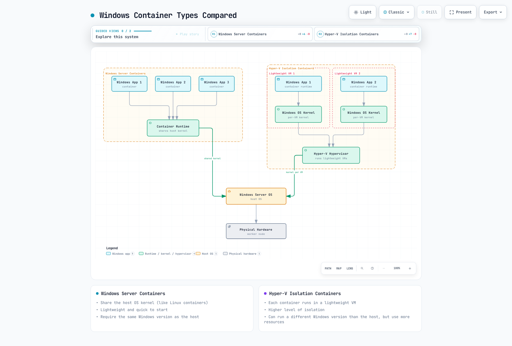
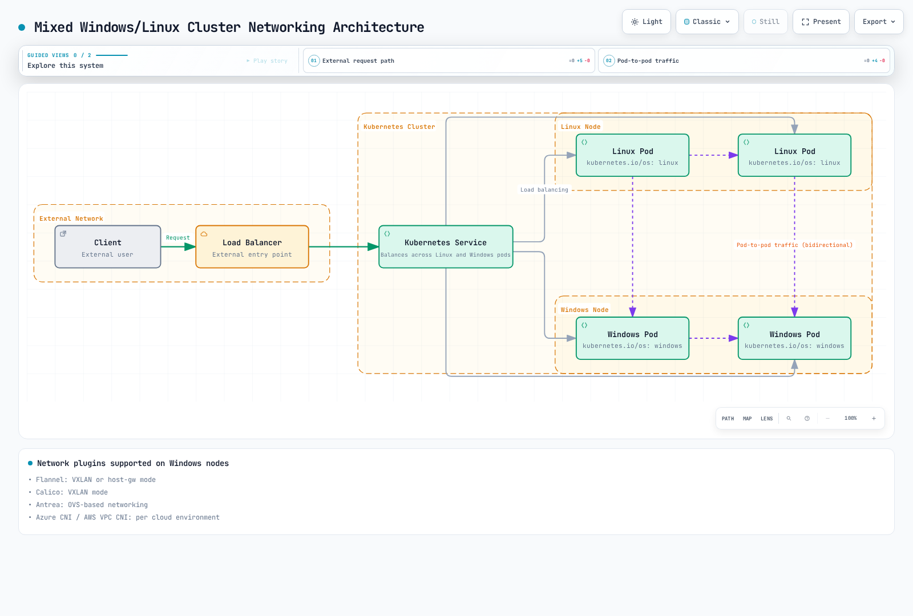
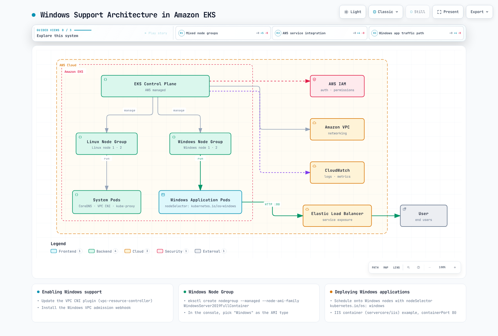

# Kubernetes 中的 Windows

> **审阅的上游 Kubernetes 版本**：Kubernetes 1.35、1.36、1.37
> **最后更新**：2026年9月11日

Kubernetes 最初是为 Linux 容器设计的，从 1.14 版开始正式支持在生产环境中运行 Windows 容器。本章介绍如何在 Kubernetes 中运行 Windows 工作负载、相关架构与限制，以及 Amazon EKS 对 Windows 的支持。

## 目录
1. [Windows 容器概述](#windows-container-overview)
2. [Kubernetes Windows 支持架构](#kubernetes-windows-support-architecture)
3. [Windows 节点限制](#windows-node-limitations)
4. [Windows 节点设置](#windows-node-setup)
5. [部署 Windows 容器](#deploying-windows-containers)
6. [网络](#networking)
7. [存储](#storage)
8. [监控和日志记录](#monitoring-and-logging)
9. [安全](#security)
10. [Amazon EKS 中的 Windows 支持](#windows-support-in-amazon-eks)
11. [最佳实践](#best-practices)
12. [结论](#conclusion)

## Windows 容器概述 {#windows-container-overview}

Windows 容器是在 Windows 操作系统上运行的容器，可用于容器化并部署 Windows 应用程序。

### Windows 容器类型

Windows 提供两种隔离类型。Kubernetes **仅支持进程隔离**；下文介绍 Hyper-V 隔离仅用于背景说明，并非 Kubernetes 的部署选项：

1. **Windows Server 容器**：与 Linux 容器类似，它们共享主机操作系统内核。此类容器轻量、启动迅速，但主机与镜像的组合必须受 Microsoft 支持。

2. **Hyper-V 隔离容器**：每个容器都在轻量级虚拟机中运行，隔离性更强。它们可以运行与主机不同版本的 Windows，但会占用更多资源。

下图对比了两种 Windows 容器的架构：



[🔍 查看交互式图表](https://www.atomai.click/kubernetes-docs/archmaps/en-core-10-windows-in-kubernetes-0.html)

### Windows 容器镜像

Windows 容器镜像基于 Microsoft 提供的基础镜像：

1. **Windows Server Core**：提供最精简 Windows Server 环境的轻量级镜像。
2. **Nano Server**：占用空间更小的超轻量级镜像。
3. **Windows**：提供更广泛 Windows API 的镜像；容器镜像不包含完整的桌面/GUI 服务器。

Dockerfile 示例：

```dockerfile
FROM mcr.microsoft.com/windows/servercore/iis:windowsservercore-ltsc2022
COPY website/ C:/inetpub/wwwroot/
EXPOSE 80
# Inherit the IIS image entrypoint (ServiceMonitor.exe).
```

## Kubernetes Windows 支持架构 {#kubernetes-windows-support-architecture}

Kubernetes 的 Windows 支持采用混合环境。控制平面组件始终运行在 Linux 上，工作节点则可以运行 Linux 或 Windows。

### 架构概述

Kubernetes 的 Windows 支持架构如下：

1. **Linux 控制平面**：kube-apiserver、kube-controller-manager、kube-scheduler 和 etcd 始终运行在 Linux 上。
2. **Linux 工作节点**：运行 CoreDNS、metrics-server 等系统组件。
3. **Windows 工作节点**：运行 Windows 应用工作负载。


[🔍 查看交互式图表](https://www.atomai.click/kubernetes-docs/archmaps/en-core-10-windows-in-kubernetes-1.html)

### Windows 节点组件

Windows 节点上运行的 Kubernetes 组件包括：

1. **kubelet**：管理节点上的 Pod 和容器。
2. **kube-proxy**：管理网络规则。
3. **CNI 插件**：配置网络。
4. **CSI 插件**：管理存储。

## Windows 节点限制 {#windows-node-limitations}

在 Kubernetes 中使用 Windows 节点时，需要了解以下限制。

### 功能限制

1. 不支持 `privileged`。节点代理可以使用启用了 hostProcess 和 hostNetwork 的 **HostProcess 容器**；应谨慎限制其主机权限。
2. 普通 Windows Pod 不能使用 hostNetwork；HostProcess 容器是例外。
3. `spec.os.name: windows` 的 Pod 不得设置仅适用于 Linux 的字段，例如 runAsUser、fsGroup、seccomp、capabilities 或 readOnlyRootFilesystem。
4. 为不同操作系统使用各自的镜像和 nodeSelector 来配置独立的 DaemonSet。
5. 不支持以内存为后端的 emptyDir、原始块设备 volumeDevices、PIDPressure 和 Linux 风格的 OOM 驱逐。
6. CPU 和内存限制通过 Windows 机制实现。Windows 没有 Linux OOM killer；内存耗尽可能导致分配失败或分页，并使性能下降。

### 网络限制

请查阅 Windows HNS/CNI 支持矩阵，了解 L2bridge、overlay 等模式。一个 Pod 内的容器共享网络和 localhost，但不共享进程命名空间或根文件系统。请针对所选操作系统、CNI 和集群组合核实 NetworkPolicy、Service 和 DSR 的支持情况。

### 操作系统版本兼容性

Kubernetes v1.37 支持 Windows Server 2022 和 2025 工作节点。本章示例使用 **Windows Server 2022 + ltsc2022**。请同时核对 Microsoft 的兼容性矩阵和发行版支持政策，并按月应用安全更新。Hyper-V 隔离不能绕过 Kubernetes 的兼容性要求。

## Windows 节点设置 {#windows-node-setup}

下面介绍如何向 Kubernetes 集群添加 Windows 节点。

### 前提条件

使用受支持的 Kubernetes/Windows 组合、Linux 控制平面、支持 Windows 的 CNI，以及兼容 CRI 的 containerd。Docker Engine 单独使用并未实现 CRI；Kubernetes 1.24 已移除内置 dockershim。EKS 节点请遵循下文的 EKS 专属说明。

### 准备 Windows 节点

在管理员 PowerShell 中启用 Containers 功能，并完成所需重启。以下步骤适用于**自管理的 kubeadm 工作节点**。从官方 sig-windows-tools 的已审核提交中下载 `hostprocess/Install-Containerd.ps1` 和 `hostprocess/PrepareNode.ps1`，执行前先检查脚本并验证校验和。选择受支持的 containerd 补丁版本和与集群兼容的 kubelet 版本。检查安装程序创建的防火墙规则，并将 10250 端口限制为仅允许所需控制平面来源访问。

```powershell
$ErrorActionPreference = "Stop"
$ContainerdVersion = Read-Host "Validated containerd version (without v)"
$KubernetesVersion = Read-Host "Cluster-compatible Kubernetes version (vX.Y.Z)"
if (-not $ContainerdVersion -or -not $KubernetesVersion) { throw "Versions required" }
.\Install-Containerd.ps1 -ContainerDVersion $ContainerdVersion
.\PrepareNode.ps1 -KubernetesVersion $KubernetesVersion
```

### 使用 kubeadm 加入 Windows 节点

在 Linux 控制平面上生成加入令牌：

```bash
kubeadm token create --print-join-command
```

在 Windows 节点上运行加入命令：

```powershell
# Run kubeadm join command
kubeadm join <control-plane-host>:<control-plane-port> --token <token> --discovery-token-ca-cert-hash sha256:<hash>

```

### 设置 Windows 节点标签

检查 kubelet 发布的操作系统、架构和构建版本标签。不要覆盖操作系统标签来强制调度。`spec.os.name` 用于声明 Pod 的操作系统，但不能代替调度器选择器；还需使用 nodeSelector。

```bash
kubectl get nodes -L kubernetes.io/os,kubernetes.io/arch,node.kubernetes.io/windows-build
```

## 部署 Windows 容器 {#deploying-windows-containers}

下面介绍如何将 Windows 容器部署到 Kubernetes。

### 使用节点选择器

部署 Windows 工作负载时，应使用节点选择器，确保它们被调度到 Windows 节点：

```yaml
apiVersion: apps/v1
kind: Deployment
metadata:
  name: iis-deployment
spec:
  replicas: 2
  selector:
    matchLabels:
      app: iis
  template:
    metadata:
      labels:
        app: iis
    spec:
      os:
        name: windows
      nodeSelector:
        kubernetes.io/os: windows
      containers:
      - name: iis
        image: mcr.microsoft.com/windows/servercore/iis:windowsservercore-ltsc2022
        resources:
          limits:
            cpu: 1
            memory: 800Mi
          requests:
            cpu: .1
            memory: 300Mi
        ports:
        - containerPort: 80
```

### 资源请求和限制

Windows 容器的资源请求和限制与 Linux 容器的处理方式不同：

1. **CPU 限制**：Windows 上的 CPU 限制采用不同机制。例如，CPU 限制为 1 表示最多可使用单个 CPU 核心的 100%。
2. **内存限制**：Windows 容器会遵守内存限制，但某些系统进程可能带来额外开销。

### 容器自定义

在 Windows 容器中运行自定义脚本：

```yaml
apiVersion: v1
kind: Pod
metadata:
  name: windows-custom-script
spec:
  os:
    name: windows
  nodeSelector:
    kubernetes.io/os: windows
  containers:
  - name: windows-container
    image: mcr.microsoft.com/windows/servercore:ltsc2022
    command:
    - powershell.exe
    - -Command
    - |
      while ($true) {
        Write-Host "Hello from Windows container"
        Start-Sleep -Seconds 10
      }
```

### 多容器 Pod

Windows 也支持多容器 Pod，但存在一些限制：

```yaml
apiVersion: v1
kind: Pod
metadata:
  name: windows-multi-container
spec:
  os:
    name: windows
  nodeSelector:
    kubernetes.io/os: windows
  containers:
  - name: writer
    image: mcr.microsoft.com/windows/servercore:ltsc2022
    command: [powershell.exe, -Command, 'while ($true) { Add-Content C:\shared-logs\app.log "Log at $(Get-Date)"; Start-Sleep 10 }']
    volumeMounts:
    - name: logs
      mountPath: C:\shared-logs
  - name: logger
    image: mcr.microsoft.com/windows/servercore:ltsc2022
    command: [powershell.exe, -Command, 'while (-not (Test-Path C:\shared-logs\app.log)) { Start-Sleep 2 }; Get-Content C:\shared-logs\app.log -Wait']
    volumeMounts:
    - name: logs
      mountPath: C:\shared-logs
      readOnly: true
  volumes:
  - name: logs
    emptyDir: {}
```

## 网络 {#networking}

Windows 节点上的网络特性与 Linux 节点不同。

下图展示了混合 Windows 和 Linux 节点 Kubernetes 集群的网络架构：



[🔍 查看交互式图表](https://www.atomai.click/kubernetes-docs/archmaps/en-core-10-windows-in-kubernetes-2.html)

### 支持的网络插件

Windows 节点支持的网络插件包括：

1. **Flannel**：VXLAN 或 host-gw 模式。
2. **Calico**：VXLAN 模式。
3. **Antrea**：基于 OVS 的网络。
4. **Azure CNI**：用于 Azure 环境。
5. **AWS VPC CNI**：用于 AWS 环境。

### Flannel 设置示例

将 Linux Flannel 清单直接复制到 Windows DaemonSet 并不可行。Windows 需要相应的二进制文件、HNS、CNI 路径、RBAC 和 HostProcess 配置。请遵循发行版的 Windows 安装流程，并协调 Linux 网络配置与 Windows 的 win-overlay/win-bridge 设置。检查 Flannel Windows VXLAN 对 VNI 4096/UDP 4789 的要求。给普通应用 Pod 添加 hostNetwork 并不能完成安装。

### 暴露 Service

在 Windows 节点上暴露 Service 的方法：

```yaml
apiVersion: v1
kind: Service
metadata:
  name: iis-service
spec:
  selector:
    app: iis
  ports:
  - port: 80
    targetPort: 80
  type: LoadBalancer
```

### 网络策略

要在 Windows 节点上使用网络策略，需要选择支持该功能的 CNI 插件（例如 Calico）：

```yaml
apiVersion: networking.k8s.io/v1
kind: NetworkPolicy
metadata:
  name: allow-frontend-to-backend
  namespace: default
spec:
  podSelector:
    matchLabels:
      app: backend
      os: windows
  ingress:
  - from:
    - podSelector:
        matchLabels:
          app: frontend
    ports:
    - protocol: TCP
      port: 80
```

## 存储 {#storage}

下面介绍 Windows 节点上可用的存储选项。

下图展示了 Windows 节点上可用的各种存储方式：


[🔍 查看交互式图表](https://www.atomai.click/kubernetes-docs/archmaps/en-core-10-windows-in-kubernetes-3.html)

### 支持的卷类型

Windows 节点支持以下卷类型：

1. **emptyDir**：临时存储（不支持以内存为后端的 emptyDir）。
2. **hostPath**：主机节点文件系统。
3. **configMap**：配置数据。
4. **secret**：敏感数据。
5. **CSI/PVC**：与 Windows 兼容的 Azure Files、Azure Disk、EBS 或 SMB CSI 驱动和文件系统卷；请核实每个驱动对操作系统及文件系统的支持情况。

### emptyDir 卷示例

```yaml
apiVersion: v1
kind: Pod
metadata:
  name: windows-emptydir
spec:
  os:
    name: windows
  nodeSelector:
    kubernetes.io/os: windows
  containers:
  - name: windows-container
    image: mcr.microsoft.com/windows/servercore:ltsc2022
    volumeMounts:
    - name: temp-volume
      mountPath: C:\temp
    command:
    - powershell.exe
    - -Command
    - |
      Set-Content -Path C:\temp\test.txt -Value "Hello from Windows"
      while ($true) {
        Get-Content -Path C:\temp\test.txt
        Start-Sleep -Seconds 10
      }
  volumes:
  - name: temp-volume
    emptyDir: {}
```

### hostPath 卷示例

```yaml
apiVersion: v1
kind: Pod
metadata:
  name: windows-hostpath
spec:
  os:
    name: windows
  nodeSelector:
    kubernetes.io/os: windows
  containers:
  - name: windows-container
    image: mcr.microsoft.com/windows/servercore:ltsc2022
    volumeMounts:
    - name: logs-volume
      mountPath: C:\logs
    command:
    - powershell.exe
    - -Command
    - |
      Set-Content -Path C:\logs\app.log -Value "Application log"
      while ($true) {
        Add-Content -Path C:\logs\app.log -Value "Log entry at $(Get-Date)"
        Start-Sleep -Seconds 10
      }
  volumes:
  - name: logs-volume
    hostPath:
      path: C:\k\logs
      type: DirectoryOrCreate
```

### ConfigMap 和 Secret 卷示例

```yaml
apiVersion: v1
kind: ConfigMap
metadata:
  name: windows-config
data:
  config.json: |
    {
      "setting1": "value1",
      "setting2": "value2"
    }
---
apiVersion: v1
kind: Secret
metadata:
  name: windows-secret
type: Opaque
data:
  username: YWRtaW4=  # admin
  password: cGFzc3dvcmQ=  # password
---
apiVersion: v1
kind: Pod
metadata:
  name: windows-config-secret
spec:
  os:
    name: windows
  nodeSelector:
    kubernetes.io/os: windows
  containers:
  - name: windows-container
    image: mcr.microsoft.com/windows/servercore:ltsc2022
    volumeMounts:
    - name: config-volume
      mountPath: C:\config
    - name: secret-volume
      mountPath: C:\secret
      readOnly: true
    command:
    - powershell.exe
    - -Command
    - |
      Get-Content -Path C:\config\config.json
      if (-not (Test-Path C:\secret\username) -or -not (Test-Path C:\secret\password)) { throw "Secret files missing" }
      while ($true) { Start-Sleep -Seconds 10 }
  volumes:
  - name: config-volume
    configMap:
      name: windows-config
  - name: secret-volume
    secret:
      secretName: windows-secret
```

### 使用 CSI 驱动程序

前提条件：创建名为 `windows-csi` 的 StorageClass，并安装兼容 Windows 的 CSI 驱动和文件系统（例如使用 NTFS 和 WaitForFirstConsumer 的 EBS CSI）。仅有这个名称并不会安装驱动。EBS 卷与可用区绑定；应使用文件系统模式，而不是原始块设备模式。

示例：

```yaml
apiVersion: v1
kind: PersistentVolumeClaim
metadata:
  name: windows-pvc
spec:
  accessModes:
  - ReadWriteOnce
  resources:
    requests:
      storage: 10Gi
  storageClassName: windows-csi
---
apiVersion: v1
kind: Pod
metadata:
  name: windows-csi-pod
spec:
  os:
    name: windows
  nodeSelector:
    kubernetes.io/os: windows
  containers:
  - name: windows-container
    image: mcr.microsoft.com/windows/servercore:ltsc2022
    volumeMounts:
    - name: data-volume
      mountPath: C:\data
    command:
    - powershell.exe
    - -Command
    - |
      Set-Content -Path C:\data\file.txt -Value "Persistent data"
      while ($true) { Start-Sleep -Seconds 10 }
  volumes:
  - name: data-volume
    persistentVolumeClaim:
      claimName: windows-pvc
```

## 监控和日志记录 {#monitoring-and-logging}

下面介绍 Windows 节点和容器的监控与日志记录方法。

### 监控

Windows 节点的监控工具包括：

1. **Prometheus Windows Exporter**：收集 Windows 节点指标。
2. **metrics-server**：提供基本资源使用指标。
3. **Datadog、Dynatrace、New Relic**：商业监控解决方案。

在 Windows 节点上安装 Prometheus Windows Exporter：

```powershell
# Download a supported release MSI, verify its checksum, then install locally.
$ExporterMsi = (Resolve-Path .\windows_exporter.msi).Path
Start-Process msiexec.exe -ArgumentList "/i `"$ExporterMsi`" ENABLED_COLLECTORS=cpu,memory,logical_disk,net,service,os,system REMOVE=FirewallException /quiet" -Wait
# Restrict any separately configured port 9182 firewall rule to Prometheus sources.
```

Prometheus 配置：

```yaml
scrape_configs:
  - job_name: 'windows-nodes'
    static_configs:
      - targets: ['windows-node-1:9182', 'windows-node-2:9182']
```

### 日志记录

收集 Windows 容器日志的工具包括：

1. **Fluent Bit**：轻量级日志收集器。
2. **Fluentd**：日志收集和转发工具。
3. **Elasticsearch**：日志存储和检索工具。
4. **Azure Monitor**：用于 Azure 环境。
5. **CloudWatch Logs**：用于 AWS 环境。

在 Windows 节点上安装 Fluent Bit：

请配置实际的 Elasticsearch 端点、身份验证方式和可信 CA。ServiceAccount 需要读取 Security 事件日志的权限，以及对 checkpoint 路径的写入权限。

```powershell
# Install a supported Windows Fluent Bit release, verify its checksum,
# and arrange bin/ and conf/ under C:\fluent-bit before continuing.

# Create configuration file
@"
[SERVICE]
    Flush        5
    Daemon       Off
    Log_Level    info

[INPUT]
    Name         winlog
    Channels     Application,System,Security
    DB           C:\fluent-bit\winlog.db

[OUTPUT]
    Name         es
    Match        *
    Host         elasticsearch-host
    Port         9200
    Index        windows_logs
    Suppress_Type_Name On
    tls          On
    tls.verify   On
"@ | Out-File -FilePath C:\fluent-bit\conf\fluent-bit.conf -Encoding ascii

# Register service
sc.exe create fluent-bit binPath= "C:\fluent-bit\bin\fluent-bit.exe -c C:\fluent-bit\conf\fluent-bit.conf"
Start-Service fluent-bit
```

### 应用程序日志收集

将 Microsoft LogMonitor 集成到应用镜像中，并在 LogMonitorConfig.json 中定义实际的文件、ETW 或 Event Log 来源，以便将 IIS 日志输出到 stdout。请测试入口点，确保 ServiceMonitor 和 IIS 的生命周期仍然正确。上方的共享文件 sidecar 示例只演示卷共享；它不处理文件轮转，也不能避免重启期间的记录重复或丢失。生产级收集器需要处理 checkpoint 和日志轮转。`kubectl logs` 读取 stdout/stderr，不会自动收集 IIS 文件日志。

## 安全 {#security}

下面介绍 Windows 节点和容器的安全注意事项。

### Windows 节点安全

Windows 节点安全建议：

1. **应用最新更新**：定期应用 Windows 安全更新。
2. **配置防火墙**：正确配置 Windows Defender Firewall。
3. **遵循最小权限原则**：仅授予必要权限。
4. **安装防病毒软件**：安装适当的防病毒软件。
5. **应用组策略**：使用组策略强化安全设置。

### Windows 容器安全

Windows 容器安全建议：

1. **使用最小基础镜像**：尽可能使用较小的镜像（例如 Nano Server）。
2. **扫描镜像**：检查容器镜像是否存在漏洞。
3. **文件系统权限**：限制 NTFS ACL，并在受支持时使用只读数据挂载；Windows 不支持 readOnlyRootFilesystem。
4. **使用非特权用户**：让应用以非特权用户身份运行。
5. **应用网络策略**：配置适当的网络策略。

### RunAsUsername

在 Windows 容器中，可以使用 `securityContext.windowsOptions.runAsUserName` 而不是 `runAsUser`，指定容器内进程所用的用户：

```yaml
apiVersion: v1
kind: Pod
metadata:
  name: windows-runasusername
spec:
  os:
    name: windows
  nodeSelector:
    kubernetes.io/os: windows
  securityContext:
    windowsOptions:
      runAsUserName: "ContainerUser"
  containers:
  - name: windows-container
    image: mcr.microsoft.com/windows/servercore:ltsc2022
    command:
    - powershell.exe
    - -Command
    - |
      whoami
      while ($true) { Start-Sleep -Seconds 10 }
```

### 组托管服务帐户（gMSA）

`gmsaCredentialSpecName` 引用的是集群范围的 **GMSACredentialSpec**，而不是 Secret。需要安装 CRD 和变更/验证 webhook，并授予 ServiceAccount `use` RBAC 权限。请替换示例中的域名和主机名，并使用 CredentialSpec 模块生成 AD SID/GUID/NetBIOS/DNS 值。此示例使用已加入域的主机；非域加入主机所需的受支持可移植身份配置需要另行设置。

先检查 `Get-KdsRootKey`。如果需要新密钥，应由 AD 管理员运行 `Add-KdsRootKey -EffectiveImmediately`，并预留目录复制时间（最长可达 10 小时）。将生效时间回拨 10 小时只适用于单个域控制器的测试环境。gMSA 提供网络凭据；它不会让容器加入域，也不会将 `whoami` 的结果改成 gMSA 名称。请验证实际服务的 Kerberos 身份验证，并检查 `klist`。

```powershell
# On an authorized AD administration host, after KDS readiness is confirmed:
Import-Module ActiveDirectory
New-ADGroup -Name 'WebAppHosts' -SamAccountName 'WebAppHosts' -GroupScope DomainLocal
Add-ADGroupMember -Identity 'WebAppHosts' -Members 'ContainerHost01$'
New-ADServiceAccount -Name WebApp1 -DNSHostName WebApp1.contoso.com -ServicePrincipalNames http/WebApp1.contoso.com -PrincipalsAllowedToRetrieveManagedPassword WebAppHosts
# Install/review the official CredentialSpec PowerShell module first.
Import-Module CredentialSpec
New-CredentialSpec -AccountName WebApp1 -Path C:\gmsa-credspec.json
$spec = Get-Content C:\gmsa-credspec.json -Raw | ConvertFrom-Json
@{ apiVersion='windows.k8s.io/v1'; kind='GMSACredentialSpec'; metadata=@{name='gmsa-cred-spec'}; credspec=$spec } |
    ConvertTo-Json -Depth 20 | Set-Content C:\gmsa-resource.json -Encoding utf8
```

```bash
# Requires the GMSA CRD and mutating/validating webhooks installed by an administrator.
kubectl apply -f gmsa-resource.json
```

```yaml
apiVersion: v1
kind: ServiceAccount
metadata:
  name: windows-app
  namespace: default
---
apiVersion: rbac.authorization.k8s.io/v1
kind: ClusterRole
metadata:
  name: use-webapp-gmsa
rules:
- apiGroups: [windows.k8s.io]
  resources: [gmsacredentialspecs]
  resourceNames: [gmsa-cred-spec]
  verbs: [use]
---
apiVersion: rbac.authorization.k8s.io/v1
kind: RoleBinding
metadata:
  name: use-webapp-gmsa
  namespace: default
roleRef:
  apiGroup: rbac.authorization.k8s.io
  kind: ClusterRole
  name: use-webapp-gmsa
subjects:
- kind: ServiceAccount
  name: windows-app
  namespace: default
---
apiVersion: v1
kind: Pod
metadata:
  name: windows-gmsa
  namespace: default
spec:
  os:
    name: windows
  serviceAccountName: windows-app
  nodeSelector:
    kubernetes.io/os: windows
  securityContext:
    windowsOptions:
      gmsaCredentialSpecName: gmsa-cred-spec
      runAsUserName: 'NT AUTHORITY\NETWORK SERVICE'
  containers:
  - name: windows-container
    image: mcr.microsoft.com/windows/servercore:ltsc2022
    command: [powershell.exe, -Command, 'whoami; Start-Sleep -Seconds 3600']
```

## Amazon EKS 中的 Windows 支持 {#windows-support-in-amazon-eks}

下面介绍如何在 Amazon EKS 中运行 Windows 工作负载。

下图展示了 Amazon EKS 中的 Windows 支持架构：



[🔍 查看交互式图表](https://www.atomai.click/kubernetes-docs/archmaps/en-core-10-windows-in-kubernetes-4.html)

### 在 EKS 中启用 Windows 支持

EKS 管理负责 Windows IPAM 的 VPC resource controller。不要安装旧版 release-1.11 controller/webhook 清单。为集群 IAM 角色授予 `AmazonEKSVPCResourceController` 权限，并按照当前 AWS 设置说明，在 `kube-system/amazon-vpc-cni` 中设置 `enable-windows-ipam: "true"`。保留现有键值，并在适用时通过所属 Helm/附加组件工作流进行配置。

请提供 Linux 节点，或使用受支持的 Fargate 设置运行 CoreDNS。Windows 不支持 EKS Auto Mode、Fargate 工作负载、Hybrid Nodes、IPv6、自定义网络和 Pod 安全组。Windows 节点角色访问条目类型为 `EC2_WINDOWS`；使用旧版 aws-auth 映射时，需要添加 `eks:kube-proxy-windows` 组。

### 创建 Windows 节点组

使用 eksctl 创建 Windows 节点组：

```bash
eksctl create nodegroup \
  --cluster my-cluster \
  --region us-west-2 \
  --name windows-ng \
  --node-type t3.large \
  --nodes 2 \
  --nodes-min 1 \
  --nodes-max 4 \
  --managed \
  --node-ami-family WindowsServer2022FullContainer
```

使用 AWS Management Console 创建 Windows 节点组：

1. 在 EKS 控制台中选择集群。
2. 选择“Compute”选项卡。
3. 单击“Add node group”。
4. 填写节点组详细信息。
5. 将 AMI 类型选为“Windows”。
6. 配置其余设置并创建节点组。

### 在 EKS 中部署 Windows 应用程序

在 EKS 中部署 Windows 应用程序的示例：

```yaml
apiVersion: apps/v1
kind: Deployment
metadata:
  name: windows-server-iis
spec:
  selector:
    matchLabels:
      app: windows-server-iis
      tier: backend
      track: stable
  replicas: 2
  template:
    metadata:
      labels:
        app: windows-server-iis
        tier: backend
        track: stable
    spec:
      os:
        name: windows
      nodeSelector:
        kubernetes.io/os: windows
      containers:
      - name: windows-server-iis
        image: mcr.microsoft.com/windows/servercore/iis:windowsservercore-ltsc2022
        ports:
        - name: http
          containerPort: 80
        resources:
          limits:
            cpu: 1
            memory: 800Mi
          requests:
            cpu: .1
            memory: 300Mi
---
apiVersion: v1
kind: Service
metadata:
  name: windows-server-iis-service
  labels:
    app: windows-server-iis
spec:
  ports:
  - port: 80
    protocol: TCP
  selector:
    app: windows-server-iis
  type: LoadBalancer
```

### EKS 中的 Windows 容器日志

CloudWatch Observability EKS 附加组件 1.5.0 及更高版本支持 Windows Container Insights。请选择与集群兼容的附加组件版本，并配置 IAM 权限和 Windows 代理。Windows Application Signals 不受支持。

从 kubelet 的 CRI 日志路径收集 Windows stdout/stderr（通常为 `C:\var\log\pods` 和 `C:\var\log\containers`）；请核对发行版实际路径，不要直接套用 Linux 的 `/var/log` 和 Docker parser 配置。EKS 将 kubelet/kube-proxy 日志写入 **EKS Windows** 事件日志。把 .evtx 文件挂载到普通容器中，并不能让 winlog 读取主机事件 API。应使用主机服务或经过审核的 HostProcess 收集器。

## 最佳实践 {#best-practices}

下面介绍在 Kubernetes 中运行 Windows 工作负载的最佳实践。

### 集群设计最佳实践

1. **混合节点池**：按需组合 Linux 和 Windows 节点。
2. **节点标签和污点**：用适当的节点标签和污点隔离工作负载。
3. **版本兼容性**：验证 Kubernetes 与 Windows 版本的兼容性。
4. **选择网络插件**：选择支持 Windows 的网络插件。
5. **高可用性**：为关键工作负载配置高可用性。

### 应用程序设计最佳实践

1. **优化容器镜像**：使用小巧、高效的容器镜像。
2. **设置资源请求和限制**：配置适当的资源请求和限制。
3. **采用无状态设计**：尽可能设计无状态应用程序。
4. **配置日志和监控**：有效配置日志记录和监控。
5. **强化安全性**：应用适当的安全上下文和网络策略。

### 运维最佳实践

1. **定期更新**：定期更新 Windows 节点和容器镜像。
2. **自动化**：自动化部署和管理任务。
3. **备份和恢复**：定期备份重要数据。
4. **准备故障排除工具**：建立适当的排查工具和流程。
5. **记录文档**：记录配置和操作流程。

### EKS 专属最佳实践

1. **托管节点组**：尽可能使用托管节点组。
2. **IAM Roles for Service Accounts (IRSA)**：按 Pod 管理 IAM 权限。
3. **配置 VPC CNI**：根据网络需求配置 VPC CNI。
4. **配置安全组**：设置适当的安全组。
5. **优化成本**：选择合适的实例类型和规格。

## 结论 {#conclusion}

Kubernetes 对 Windows 的支持不断发展，现在可以在生产环境中运行 Windows 工作负载。Windows 节点可与 Linux 节点在同一集群中并存，从而在一个 Kubernetes 集群中管理多种工作负载。

Windows 容器可将 .NET Framework 应用、Windows 服务和其他 Windows 专属工作负载容器化，并利用 Kubernetes 的编排能力。但与 Linux 容器相比仍存在一些限制，因此应充分了解并妥善应对。

Amazon EKS 为 Windows 节点提供托管服务，使部署和管理 Windows 工作负载更方便。利用 EKS 的 Windows 支持，可以简化将 Windows 应用迁移到现代容器环境的过程。

要在 Kubernetes 中成功运行 Windows 工作负载，需要做好规划、设计和运维，并遵循相应最佳实践，从而高效管理 Windows 与 Linux 工作负载，发挥 Kubernetes 的优势。

## 测验

要检验本章所学内容，请尝试[Windows in Kubernetes 测验](../quizzes/core/10-windows-in-kubernetes-quiz.md)。

## 验证参考资料

- https://kubernetes.io/docs/concepts/windows/intro/
- https://kubernetes.io/docs/tasks/administer-cluster/kubeadm/adding-windows-nodes/
- https://kubernetes.io/docs/tasks/configure-pod-container/create-hostprocess-pod/
- https://kubernetes.io/docs/tasks/configure-pod-container/configure-gmsa/
- https://learn.microsoft.com/en-us/virtualization/windowscontainers/deploy-containers/version-compatibility
- https://github.com/microsoft/windows-container-tools/tree/main/LogMonitor
- https://docs.aws.amazon.com/eks/latest/userguide/windows-support.html
- https://docs.aws.amazon.com/AmazonCloudWatch/latest/monitoring/install-CloudWatch-Observability-EKS-addon.html
