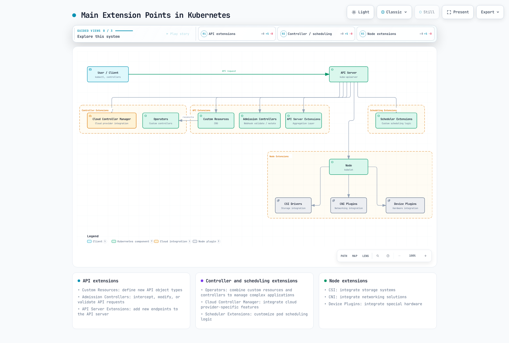
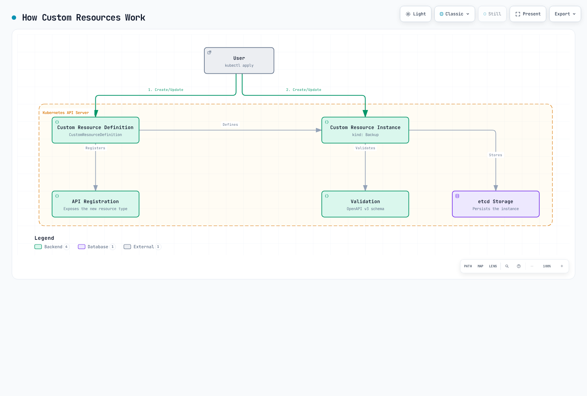
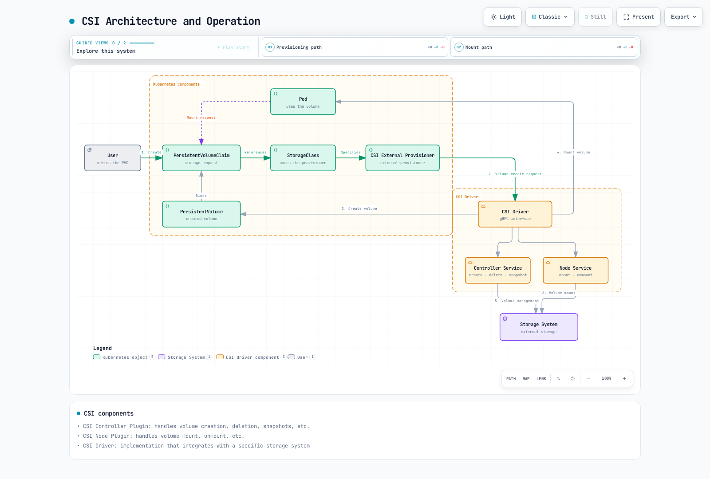

# 扩展 Kubernetes

> **审阅的上游 Kubernetes 版本**：Kubernetes 1.35、1.36、1.37
> **最后更新**：October 12, 2026

Kubernetes 是一个设计时便考虑了可扩展性的平台，允许您以多种方式扩展其功能。本章将探讨扩展 Kubernetes 的各种方法，以及如何在 Amazon EKS 中利用扩展功能。

## 目录
1. [Kubernetes 扩展概述](#kubernetes-extension-overview)
2. [自定义资源](#custom-resources)
3. [Operator 模式](#operator-pattern)
4. [准入控制器](#admission-controllers)
5. [API Server 扩展](#api-server-extensions)
6. [调度器扩展](#scheduler-extensions)
7. [Cloud Controller Manager](#cloud-controller-manager)
8. [CSI（容器存储接口）](#csi-container-storage-interface)
9. [CNI（容器网络接口）](#cni-container-network-interface)
10. [设备插件](#device-plugins)
11. [Amazon EKS 中的扩展功能](#extension-features-in-amazon-eks)
12. [最佳实践](#best-practices)
13. [结论](#conclusion)

## Kubernetes 扩展概述

Kubernetes 提供了多种扩展点，可用于扩展和自定义其基础功能。主要扩展点包括：

1. **自定义资源**：定义新的 API 对象类型
2. **Operator**：结合自定义资源和控制器来管理复杂应用程序
3. **准入控制器**：拦截、修改或验证 API 请求
4. **API Server 扩展**：向 API Server 添加新端点
5. **调度器扩展**：自定义 Pod 调度逻辑
6. **Cloud Controller Manager**：集成云提供商特定功能
7. **CSI（容器存储接口）**：集成存储系统
8. **CNI（容器网络接口）**：集成网络解决方案
9. **设备插件**：集成特殊硬件

下图展示了 Kubernetes 中的主要扩展点：



[🔍 查看交互式图表](https://www.atomai.click/kubernetes-docs/archmaps/en-core-11-extending-kubernetes-0.html)

### 选择扩展方法

选择合适扩展方法时的考虑因素：

1. **使用场景**：您想要扩展的功能类型
2. **复杂性**：实现和维护的复杂性
3. **性能影响**：扩展对集群性能的影响
4. **升级兼容性**：与 Kubernetes 版本升级的兼容性
5. **社区支持**：扩展方法获得的社区支持程度

## 自定义资源

自定义资源是一种扩展 Kubernetes API 以定义新对象类型的方法。

下图展示了自定义资源的工作方式：



[🔍 查看交互式图表](https://www.atomai.click/kubernetes-docs/archmaps/en-core-11-extending-kubernetes-1.html)

### 自定义资源定义（CRD）

CRD 是定义新资源类型的最简单方法：

```yaml
apiVersion: apiextensions.k8s.io/v1
kind: CustomResourceDefinition
metadata:
  name: backups.example.com
spec:
  group: example.com
  names:
    kind: Backup
    listKind: BackupList
    plural: backups
    singular: backup
    shortNames:
    - bk
  scope: Namespaced
  versions:
  - name: v1
    served: true
    storage: true
    schema:
      openAPIV3Schema:
        type: object
        properties:
          spec:
            type: object
            properties:
              source:
                type: string
              destination:
                type: string
              schedule:
                type: string
            required:
            - source
            - destination
          status:
            type: object
            properties:
              phase:
                type: string
              lastBackupTime:
                type: string
                format: date-time
    subresources:
      status: {}
    additionalPrinterColumns:
    - name: Status
      type: string
      jsonPath: .status.phase
    - name: Age
      type: date
      jsonPath: .metadata.creationTimestamp
```

在上面的示例中，我们定义了一个名为 `Backup` 的新资源类型，并指定了该资源的架构和附加打印列。

### 创建自定义资源实例

在 CRD 的 Established 条件为 true 后，创建一个实例。CRD 存储并验证数据；没有控制器时，它不会执行备份。

```yaml
apiVersion: example.com/v1
kind: Backup
metadata:
  name: daily-backup
spec:
  source: /data
  destination: s3://my-bucket/backups
  schedule: "0 0 * * *"
```

### 自定义资源验证

您可以在 CRD 中使用 OpenAPI v3 架构来验证自定义资源：

```yaml
openAPIV3Schema:
  type: object
  properties:
    spec:
      type: object
      properties:
        replicas:
          type: integer
          minimum: 1
          maximum: 10
        image:
          type: string
          minLength: 1
      required:
      - replicas
      - image
```

在上面的示例中，`replicas` 字段必须是 1 到 10 之间的整数，`image` 字段必须非空；镜像可用性和签名检查需要单独的策略。

### 版本管理

CRD 支持多个版本，以便实现 API 演进：

```yaml
versions:
- name: v1alpha1
  served: true
  storage: false
- name: v1beta1
  served: true
  storage: false
- name: v1
  served: true
  storage: true
```

在上面的示例中，提供 `v1alpha1`、`v1beta1` 和 `v1` 三个版本，但新的写入使用 `v1`。这是一个 versions 片段：请为每个版本包含结构化架构。现有对象不会自动重写；在移除旧的 storedVersions 条目之前，请迁移存储。

### 转换 Webhook

您可以使用转换 Webhook 来处理不同版本之间的转换：

```yaml
# Merge this spec fragment into the complete CRD above.
spec:
  conversion:
    strategy: Webhook
    webhook:
      clientConfig:
        service:
          namespace: default
          name: example-conversion-webhook
          path: /convert
        caBundle: <base64-encoded-ca-cert>
      conversionReviewVersions:
      - v1
```

## Operator 模式

Operator 模式是一种通过结合自定义资源和控制器，将复杂应用程序的运维知识自动化的方法。

下图展示了 Operator 模式的工作方式：


[🔍 查看交互式图表](https://www.atomai.click/kubernetes-docs/archmaps/en-core-11-extending-kubernetes-2.html)

### Operator 概念

一个 Operator 由以下组件构成：

1. **自定义资源定义（CRD）**：定义要管理的资源架构
2. **控制器**：监视自定义资源并将其协调为期望状态的逻辑
3. **Kubernetes API Client**：与 Kubernetes API 交互的客户端

### Operator 示例

数据库 Operator 示例：

```yaml
# Custom Resource Definition
apiVersion: apiextensions.k8s.io/v1
kind: CustomResourceDefinition
metadata:
  name: databases.example.com
spec:
  group: example.com
  names:
    kind: Database
    listKind: DatabaseList
    plural: databases
    singular: database
    shortNames:
    - db
  scope: Namespaced
  versions:
  - name: v1
    served: true
    storage: true
    schema:
      openAPIV3Schema:
        type: object
        properties:
          spec:
            type: object
            properties:
              engine:
                type: string
                enum:
                - mysql
                - postgresql
              version:
                type: string
              storageSize:
                type: string
              replicas:
                type: integer
                minimum: 1
            required:
            - engine
            - version
            - storageSize
          status:
            type: object
            properties:
              phase:
                type: string
              endpoint:
                type: string
    subresources:
      status: {}
```

```yaml
# Database Instance
apiVersion: example.com/v1
kind: Database
metadata:
  name: my-db
spec:
  engine: postgresql
  version: "17"
  storageSize: 10Gi
  replicas: 3
```

### Operator 开发工具

用于开发 Operator 的工具：

1. **Operator SDK**：使用 Go、Ansible 或 Helm 开发 Operator
2. **KUDO（Kubernetes Universal Declarative Operator）**：以声明方式开发 Operator
3. **Kubebuilder**：基于 Go 的 Operator 开发框架
4. **Metacontroller**：基于 Webhook 的 Operator 开发

#### Operator SDK 示例

使用 Operator SDK 创建 Operator：

```bash
: "${OPERATOR_IMAGE:?Set a registry image tag or digest you control}"
# Install a reviewed supported Operator SDK release and verify its checksum first.

# Create new operator project
operator-sdk init --domain example.com --repo github.com/example/database-operator

# Create API
operator-sdk create api --group database --version v1 --kind Database --resource --controller

# Implement controller (main.go, controllers/database_controller.go, etc.)

# Build and deploy operator
make docker-build docker-push IMG="$OPERATOR_IMAGE"
make deploy IMG="$OPERATOR_IMAGE"
```

### 常用 Operator

常用的开源 Operator：

1. **Prometheus Operator**：管理 Prometheus 监控栈
2. **Elasticsearch Operator**：管理 Elasticsearch 集群
3. **CoreOS etcd Operator（已归档）**：历史性的 etcd 自动化示例；不建议作为当前安装方案。
4. **PostgreSQL Operator**：管理 PostgreSQL 数据库
5. **OpenTelemetry Operator**：部署 Jaeger v2；之前的 Jaeger Operator 仅支持已淘汰的 Jaeger v1。
6. **Strimzi Kafka Operator**：管理 Apache Kafka 集群
7. **Istio 集群内 Operator（在 1.24 中移除）**：历史示例；请使用受支持的 Helm/istioctl 安装工作流程。
## 准入控制器

准入控制器是拦截对 Kubernetes API server 的请求并对其进行修改或验证的插件。

下图展示了准入控制器的工作方式：


[🔍 查看交互式图表](https://www.atomai.click/kubernetes-docs/archmaps/en-core-11-extending-kubernetes-3.html)

### 准入控制器类型

Kubernetes 有两类准入控制器：

1. **变更准入控制器**：可以修改资源
2. **验证准入控制器**：只能验证资源

### 内置准入控制器

Kubernetes 有多个内置准入控制器：

1. **NamespaceLifecycle**：防止在正在删除的命名空间中创建资源
2. **LimitRanger**：为 Pod 和容器设置默认资源限制
3. **ServiceAccount**：为 Pod ServiceAccount 设置默认值/进行验证，并注入投影令牌卷，除非禁用自动挂载；单独的控制器会创建默认账户。
4. **DefaultStorageClass**：为 PVC 分配默认存储类
5. **ResourceQuota**：限制每个命名空间的资源使用量
6. **PodSecurity**：强制实施命名空间 Pod Security Standards；PodSecurityPolicy 已在 1.25 中移除。
7. **NodeRestriction**：限制节点可修改的资源

### Webhook 准入控制器

您可以使用 Webhook 准入控制器来实现自定义逻辑：

```yaml
# Mutating Webhook Configuration
apiVersion: admissionregistration.k8s.io/v1
kind: MutatingWebhookConfiguration
metadata:
  name: pod-mutating-webhook
webhooks:
- name: pod-mutator.example.com
  clientConfig:
    service:
      namespace: default
      name: pod-mutating-webhook
      path: "/mutate"
    caBundle: <base64-encoded-ca-cert>
  rules:
  - apiGroups: [""]
    apiVersions: ["v1"]
    resources: ["pods"]
    operations: ["CREATE"]
    scope: "Namespaced"
  admissionReviewVersions: ["v1"]
  sideEffects: None
  timeoutSeconds: 5
```

```yaml
# Validating Webhook Configuration
apiVersion: admissionregistration.k8s.io/v1
kind: ValidatingWebhookConfiguration
metadata:
  name: pod-validating-webhook
webhooks:
- name: pod-validator.example.com
  clientConfig:
    service:
      namespace: default
      name: pod-validating-webhook
      path: "/validate"
    caBundle: <base64-encoded-ca-cert>
  rules:
  - apiGroups: [""]
    apiVersions: ["v1"]
    resources: ["pods"]
    operations: ["CREATE", "UPDATE"]
    scope: "Namespaced"
  admissionReviewVersions: ["v1"]
  sideEffects: None
  timeoutSeconds: 5
```

### Webhook Server 实现

这些 Go 代码片段属于同一个文件，并实现 v1 AdmissionReview 处理程序。将 /mutate 和 /validate 连接到使用与 Service 匹配的证书和 CA bundle 的 HTTPS。它们不会执行外部副作用，对 dry-run 是安全的；请将 Webhook 配置的范围限定到预期的命名空间。标签检查是策略示例，并非完整的镜像引用或签名验证。

```go
package main

import (
    "encoding/json"
    "net/http"
    "strings"
    admissionv1 "k8s.io/api/admission/v1"
    corev1 "k8s.io/api/core/v1"
    metav1 "k8s.io/apimachinery/pkg/apis/meta/v1"
)

func readPodReview(w http.ResponseWriter, r *http.Request) (*admissionv1.AdmissionRequest, *corev1.Pod, bool) {
    if r.Method != http.MethodPost || r.Body == nil {
        http.Error(w, "POST body required", http.StatusBadRequest)
        return nil, nil, false
    }
    var review admissionv1.AdmissionReview
    if err := json.NewDecoder(http.MaxBytesReader(w, r.Body, 2<<20)).Decode(&review); err != nil {
        http.Error(w, "Invalid AdmissionReview JSON", http.StatusBadRequest)
        return nil, nil, false
    }
    req := review.Request
    if review.APIVersion != "admission.k8s.io/v1" || review.Kind != "AdmissionReview" || req == nil || req.UID == "" {
        http.Error(w, "AdmissionReview v1 request and UID required", http.StatusBadRequest)
        return nil, nil, false
    }
    if req.Kind.Group != "" || req.Kind.Version != "v1" || req.Kind.Kind != "Pod" ||
        (req.Operation != admissionv1.Create && req.Operation != admissionv1.Update) {
        http.Error(w, "Only Pod CREATE/UPDATE is supported", http.StatusBadRequest)
        return nil, nil, false
    }
    var pod corev1.Pod
    if err := json.Unmarshal(req.Object.Raw, &pod); err != nil {
        http.Error(w, "Invalid Pod JSON", http.StatusBadRequest)
        return nil, nil, false
    }
    return req, &pod, true
}

func writeReview(w http.ResponseWriter, response admissionv1.AdmissionResponse) {
    review := admissionv1.AdmissionReview{
        TypeMeta: metav1.TypeMeta{APIVersion: "admission.k8s.io/v1", Kind: "AdmissionReview"},
        Response: &response,
    }
    data, err := json.Marshal(review)
    if err != nil {
        http.Error(w, "Response encoding failed", http.StatusInternalServerError)
        return
    }
    w.Header().Set("Content-Type", "application/json")
    _, _ = w.Write(data)
}

func writePatch(w http.ResponseWriter, req *admissionv1.AdmissionRequest, patches []map[string]interface{}) {
    response := admissionv1.AdmissionResponse{UID: req.UID, Allowed: true}
    if len(patches) > 0 {
        data, err := json.Marshal(patches)
        if err != nil {
            http.Error(w, "Patch encoding failed", http.StatusInternalServerError)
            return
        }
        patchType := admissionv1.PatchTypeJSONPatch
        response.PatchType, response.Patch = &patchType, data
    }
    writeReview(w, response)
}

func deny(w http.ResponseWriter, req *admissionv1.AdmissionRequest, message string) {
    writeReview(w, admissionv1.AdmissionResponse{
        UID: req.UID, Allowed: false,
        Result: &metav1.Status{Status: "Failure", Reason: metav1.StatusReasonForbidden, Code: 403, Message: message},
    })
}
func mutateHandler(w http.ResponseWriter, r *http.Request) {
    req, pod, ok := readPodReview(w, r)
    if !ok { return }
    if pod.Labels["injected-by"] == "mutating-webhook" {
        writePatch(w, req, nil)
        return
    }
    if pod.Labels == nil { pod.Labels = map[string]string{} }
    pod.Labels["injected-by"] = "mutating-webhook"
    // Add the whole map, preserving existing labels. Works when labels was absent.
    writePatch(w, req, []map[string]interface{}{{"op": "add", "path": "/metadata/labels", "value": pod.Labels}})
}
```

```go
func validateHandler(w http.ResponseWriter, r *http.Request) {
    req, pod, ok := readPodReview(w, r)
    if !ok { return }
    images := []string{}
    for _, c := range pod.Spec.Containers { images = append(images, c.Image) }
    for _, c := range pod.Spec.InitContainers { images = append(images, c.Image) }
    for _, c := range pod.Spec.EphemeralContainers { images = append(images, c.Image) }
    for _, image := range images {
        if strings.Contains(image, "@") { continue } // Digest references have no implicit latest tag.
        last := image[strings.LastIndex(image, "/")+1:]
        if !strings.Contains(last, ":") || strings.HasSuffix(last, ":latest") {
            deny(w, req, "Use an explicit non-latest tag or digest for every container")
            return
        }
    }
    writeReview(w, admissionv1.AdmissionResponse{UID: req.UID, Allowed: true})
}
```

### 常用准入控制器项目

1. **OPA Gatekeeper**：使用 Open Policy Agent 强制实施策略
2. **Kyverno**：基于 YAML 的策略引擎
3. **Istio**：Service Mesh 边车注入
4. **cert-manager**：TLS 证书管理

## API Server 扩展

API Server 扩展是一种向 Kubernetes API server 添加新端点的方法。

### 扩展 API Server

扩展 API Server 是独立于 Kubernetes API server 运行并提供自定义 API 的服务器：

```yaml
# APIService Definition
apiVersion: apiregistration.k8s.io/v1
kind: APIService
metadata:
  name: v1.example.com
spec:
  group: example.com
  version: v1
  groupPriorityMinimum: 1000
  versionPriority: 15
  service:
    name: example-api
    namespace: default
  caBundle: <base64-encoded-ca-cert>
```

### 扩展 API Server 实现

扩展 API Server 由以下组件构成：

1. **API Server**：提供与 Kubernetes API server 类似的接口
2. **资源处理程序**：处理特定资源类型的请求
3. **存储后端**：存储资源数据

这是实现概述，不是一个独立程序。请从与您的 k8s.io 依赖项相匹配的官方 sample-apiserver 版本开始；配置安全服务、委托身份验证/授权、实际的 example.com/v1 类型、存储和关闭上下文。APIService group/version 必须与服务器匹配。

```go
// Extension API Server Example
func main() {
    // Server configuration
    config := genericapiserver.NewRecommendedConfig(apiserver.Codecs)
    config.OpenAPIConfig = genericapiserver.DefaultOpenAPIConfig(
        sampleopenapi.GetOpenAPIDefinitions,
        openapi.NewDefinitionNamer(apiserver.Scheme),
    )
    config.EnableIndex = true
    config.EnableDiscovery = true

    // Create server
    server, err := config.Complete().New("sample-apiserver", genericapiserver.NewEmptyDelegate())
    if err != nil {
        log.Fatalf("Error creating server: %v", err)
    }

    // Set API group info
    apiGroupInfo := genericapiserver.NewDefaultAPIGroupInfo(
        samplev1.GroupName,
        apiserver.Scheme,
        metav1.ParameterCodec,
        apiserver.Codecs,
    )

    // Set storage
    apiGroupInfo.VersionedResourcesStorageMap["v1"] = map[string]rest.Storage{
        "widgets": NewWidgetStorage(),
    }

    // Install API group
    if err := server.InstallAPIGroup(&apiGroupInfo); err != nil {
        log.Fatalf("Error installing API group: %v", err)
    }

    // Run server
    if err := server.PrepareRun().Run(stopCh); err != nil {
        log.Fatalf("Error running server: %v", err)
    }
}
```

### 聚合层

聚合层使多个 API Server 表现为单个 API Server：

```
                                   +-----------------+
                                   |                 |
                                   |  kube-apiserver |
                                   |                 |
                                   +-------+---------+
                                           |
                                           v
                      +--------------------+--------------------+
                      |                                         |
                      |                                         |
          +-----------v-----------+               +------------v------------+
          |                       |               |                         |
          |  metrics-server       |               |  example-apiserver      |
          |                       |               |                         |
          +-----------------------+               +-------------------------+
```

## 调度器扩展

调度器扩展是一种自定义 Kubernetes 调度器行为的方法。

### 调度器框架

Kubernetes 1.15 引入的调度器框架允许通过插件扩展调度流水线的各个阶段：

1. **队列排序**：对调度队列中的 Pod 排序
2. **预过滤**：在过滤前检查 Pod 和集群状态
3. **过滤**：过滤掉无法运行 Pod 的节点
4. **后过滤**：在过滤后执行操作
5. **预评分**：在计算评分前执行操作
6. **评分**：为节点分配评分
7. **评分标准化**：标准化评分
8. **预留**：为 Pod 预留资源
9. **许可**：允许、拒绝或延迟 Pod 调度
10. **预绑定**：在绑定前执行操作
11. **绑定**：将 Pod 绑定到节点
12. **后绑定**：在绑定后执行操作

### 调度器配置

调度器配置示例：

```yaml
apiVersion: kubescheduler.config.k8s.io/v1
kind: KubeSchedulerConfiguration
leaderElection:
  leaderElect: true
profiles:
- schedulerName: custom-scheduler
  pluginConfig:
  - name: NodeResourcesFit
    args:
      scoringStrategy:
        type: MostAllocated
        resources:
        - name: cpu
          weight: 1
        - name: memory
          weight: 1
```

### 自定义调度器

以下 Deployment 需要一个已构建的 custom-scheduler 镜像、一个名为 custom-scheduler-config 且包含前述 config.yaml 的 ConfigMap，以及一个具有经审核调度/Lease RBAC 的 ServiceAccount。请使用集群内身份验证；工作节点不能挂载托管控制平面的 scheduler.conf。schedulerName 必须与 Pod 匹配。

```yaml
apiVersion: apps/v1
kind: Deployment
metadata:
  name: custom-scheduler
  namespace: kube-system
spec:
  replicas: 1
  selector:
    matchLabels:
      app: custom-scheduler
  template:
    metadata:
      labels:
        app: custom-scheduler
    spec:
      serviceAccountName: custom-scheduler
      nodeSelector:
        kubernetes.io/os: linux
      containers:
      - name: custom-scheduler
        image: example/custom-scheduler:REPLACE_WITH_TESTED_RELEASE
        command: [/custom-scheduler, --config=/etc/scheduler/config.yaml]
        volumeMounts:
        - name: config
          mountPath: /etc/scheduler
          readOnly: true
      volumes:
      - name: config
        configMap:
          name: custom-scheduler-config
```

为 Pod 指定自定义调度器：

```yaml
apiVersion: v1
kind: Pod
metadata:
  name: custom-scheduled-pod
spec:
  schedulerName: custom-scheduler
  containers:
  - name: container
    image: nginx:1.30.4
```

## Cloud Controller Manager

Cloud Controller Manager 提供 Kubernetes 与云提供商之间的接口。

### Cloud Controller Manager 组件

Cloud Controller Manager 由以下控制器构成：

1. **Node Controller**：通过云提供商 API 更新节点信息
2. **Route Controller**：在云网络中设置路由
3. **Service Controller**：创建、更新和删除云负载均衡器

### AWS Cloud Controller Manager

外部 AWS CCM 用于 **AWS 上自主管理的 Kubernetes**。请选择与 Kubernetes 兼容的 cloud-provider-aws 版本，并遵循其现有集群流程以满足 ServiceAccount/RBAC、IAM、集群标签、节点命名和 `--cloud-provider=external` 迁移前提条件。其镜像仓库为 `registry.k8s.io/provider-aws/cloud-controller-manager`。任意的 cloud.conf 条目无法替代 VPC/子网标签。

您不能将此 DaemonSet 安装到 AWS 托管的 EKS 控制平面中，也不能挂载其 scheduler.conf。在 EKS 上，请使用服务托管的云集成及受支持的 AWS Load Balancer Controller 或 Auto Mode 功能，并确保每个资源只有一个控制器所有者。

## CSI（容器存储接口）

CSI 在 Kubernetes 与存储系统之间提供标准接口。

下图展示了 CSI 的架构和操作：



[🔍 查看交互式图表](https://www.atomai.click/kubernetes-docs/archmaps/en-core-11-extending-kubernetes-4.html)

### CSI 架构

CSI 由以下组件构成：

1. **CSI Controller Plugin**：处理卷创建、删除、快照等操作
2. **CSI Node Plugin**：处理卷挂载、卸载等操作
3. **CSI Driver**：与特定存储系统集成的实现

```
+-------------------+
|                   |
|  Kubernetes       |
|  (External        |
|   Provisioner)    |
|                   |
+--------+----------+
         |
         | gRPC
         v
+--------+----------+
|                   |
|  CSI Driver       |
|                   |
+--------+----------+
         |
         | Storage Protocol
         v
+--------+----------+
|                   |
|  Storage System   |
|                   |
+-------------------+
```

### CSI Driver 部署

以下是驱动程序编写者模板，而不是完整安装。请从供应商处提供驱动程序镜像/参数、兼容的 sidecar 版本、ServiceAccounts/RBAC 和 CSIDriver 注册。NodePlugin 在 Linux 上运行，需要文档中规定的主机路径和特权。

```yaml
# CSI Controller Service
apiVersion: apps/v1
kind: Deployment
metadata:
  name: csi-controller
spec:
  replicas: 1
  selector:
    matchLabels:
      app: csi-controller
  template:
    metadata:
      labels:
        app: csi-controller
    spec:
      serviceAccountName: csi-controller
      nodeSelector:
        kubernetes.io/os: linux
      containers:
      - name: csi-provisioner
        image: registry.k8s.io/sig-storage/csi-provisioner:REPLACE_WITH_COMPATIBLE_RELEASE
        args:
        - "--csi-address=$(ADDRESS)"
        - "--v=5"
        env:
        - name: ADDRESS
          value: /var/lib/csi/sockets/pluginproxy/csi.sock
        volumeMounts:
        - name: socket-dir
          mountPath: /var/lib/csi/sockets/pluginproxy/
      - name: csi-attacher
        image: registry.k8s.io/sig-storage/csi-attacher:REPLACE_WITH_COMPATIBLE_RELEASE
        args:
        - "--csi-address=$(ADDRESS)"
        - "--v=5"
        env:
        - name: ADDRESS
          value: /var/lib/csi/sockets/pluginproxy/csi.sock
        volumeMounts:
        - name: socket-dir
          mountPath: /var/lib/csi/sockets/pluginproxy/
      - name: csi-driver
        image: example/csi-driver:v1.0.0
        args:
        - "--endpoint=$(CSI_ENDPOINT)"
        - "--nodeid=$(NODE_ID)"
        env:
        - name: CSI_ENDPOINT
          value: unix:///var/lib/csi/sockets/pluginproxy/csi.sock
        - name: NODE_ID
          valueFrom:
            fieldRef:
              fieldPath: spec.nodeName
        volumeMounts:
        - name: socket-dir
          mountPath: /var/lib/csi/sockets/pluginproxy/
      volumes:
      - name: socket-dir
        emptyDir: {}

---
# CSI Node Service
apiVersion: apps/v1
kind: DaemonSet
metadata:
  name: csi-node
spec:
  selector:
    matchLabels:
      app: csi-node
  template:
    metadata:
      labels:
        app: csi-node
    spec:
      serviceAccountName: csi-node
      nodeSelector:
        kubernetes.io/os: linux
      hostNetwork: true
      containers:
      - name: csi-node-driver-registrar
        image: registry.k8s.io/sig-storage/csi-node-driver-registrar:REPLACE_WITH_COMPATIBLE_RELEASE
        args:
        - "--csi-address=$(ADDRESS)"
        - "--kubelet-registration-path=$(DRIVER_REG_SOCK_PATH)"
        - "--v=5"
        env:
        - name: ADDRESS
          value: /csi/csi.sock
        - name: DRIVER_REG_SOCK_PATH
          value: /var/lib/kubelet/plugins/example.csi.k8s.io/csi.sock
        volumeMounts:
        - name: plugin-dir
          mountPath: /csi
        - name: registration-dir
          mountPath: /registration
      - name: csi-driver
        image: example/csi-driver:v1.0.0
        args:
        - "--endpoint=$(CSI_ENDPOINT)"
        - "--nodeid=$(NODE_ID)"
        env:
        - name: CSI_ENDPOINT
          value: unix:///csi/csi.sock
        - name: NODE_ID
          valueFrom:
            fieldRef:
              fieldPath: spec.nodeName
        securityContext:
          privileged: true
        volumeMounts:
        - name: plugin-dir
          mountPath: /csi
        - name: pods-mount-dir
          mountPath: /var/lib/kubelet/pods
          mountPropagation: "Bidirectional"
      volumes:
      - name: plugin-dir
        hostPath:
          path: /var/lib/kubelet/plugins/example.csi.k8s.io
          type: DirectoryOrCreate
      - name: registration-dir
        hostPath:
          path: /var/lib/kubelet/plugins_registry
          type: Directory
      - name: pods-mount-dir
        hostPath:
          path: /var/lib/kubelet/pods
          type: Directory
```

### 存储类和 PVC

使用 CSI Driver 的存储类和 PVC 示例：

```yaml
# Storage Class
apiVersion: storage.k8s.io/v1
kind: StorageClass
metadata:
  name: example-csi
provisioner: example.csi.k8s.io
parameters:
  type: ssd
  csi.storage.k8s.io/fstype: ext4
reclaimPolicy: Delete
allowVolumeExpansion: true
volumeBindingMode: WaitForFirstConsumer

---
# PVC
apiVersion: v1
kind: PersistentVolumeClaim
metadata:
  name: example-pvc
spec:
  accessModes:
  - ReadWriteOnce
  resources:
    requests:
      storage: 10Gi
  storageClassName: example-csi
```

### 常用 CSI Driver

1. **AWS EBS CSI Driver**：AWS EBS 卷管理
2. **AWS EFS CSI Driver**：AWS EFS 文件系统管理
3. **GCE PD CSI Driver**：Google Compute Engine 持久磁盘管理
4. **Azure Disk CSI Driver**：Azure 磁盘管理
5. **Ceph RBD CSI Driver**：Ceph RBD 卷管理
6. **NFS CSI Driver**：NFS 卷管理

## CNI（容器网络接口）

CNI 在 Kubernetes 与网络解决方案之间提供标准接口。

下图展示了 CNI 的架构和操作：


[🔍 查看交互式图表](https://www.atomai.click/kubernetes-docs/archmaps/en-core-11-extending-kubernetes-5.html)

### CNI 架构

CNI 由以下组件构成：

1. **CNI Plugin**：配置容器网络接口
2. **IPAM Plugin**：IP 地址分配和管理
3. **Meta Plugin**：将多个插件组合在一起

```
+-------------------+
|                   |
|  Kubernetes       |
|  CRI runtime      |
|  (via kubelet)    |
+--------+----------+
         |
         | CNI Spec
         v
+--------+----------+
|                   |
|  CNI Plugin       |
|                   |
+--------+----------+
         |
         | Network Configuration
         v
+--------+----------+
|                   |
|  Network          |
|                   |
+-------------------+
```

### CNI Plugin 配置

此单节点 bridge/host-local 示例说明了 CNI 契约；集群需要唯一的每节点子网和跨节点路由。CNI 由 CRI 运行时调用，而不是由现代 kubelet 直接调用。

```json
{
  "cniVersion": "0.4.0",
  "name": "example-network",
  "type": "bridge",
  "bridge": "cni0",
  "isGateway": true,
  "ipMasq": true,
  "ipam": {
    "type": "host-local",
    "subnet": "10.244.0.0/24",
    "routes": [
      { "dst": "0.0.0.0/0" }
    ]
  }
}
```

### 常用 CNI 插件

1. **Calico**：具有增强网络策略和安全功能的 CNI
2. **Flannel**：提供简单的 Overlay 网络
3. **Cilium**：基于 eBPF 的网络和安全解决方案
4. **Weave Net（已归档）**：历史性的多主机网络项目；请评估仍在维护的替代方案。
5. **AWS VPC CNI**：与 AWS VPC 集成的 CNI
6. **Azure CNI**：与 Azure 虚拟网络集成的 CNI
7. **Antrea**：基于 Open vSwitch 的网络解决方案

### CNI 插件安装

Calico CNI 插件安装示例：

```bash
# Use the official Calico installation guide for your distribution.
# Select a supported release and inspect the operator/custom-resources manifests.
# Do not install a second primary CNI over an existing cluster network.
kubectl get nodes -o wide
kubectl -n kube-system get daemonsets
```

## 设备插件

设备插件为 Kubernetes 与特殊硬件之间提供接口。

### 设备插件架构

设备插件由以下组件构成：

1. **设备插件服务器**：处理设备发现、分配、初始化等
2. **kubelet**：与设备插件通信，将设备分配给 Pod

```
+-------------------+
|                   |
|  Kubernetes       |
|  (kubelet)        |
|                   |
+--------+----------+
         |
         | Device Plugin API
         v
+--------+----------+
|                   |
|  Device Plugin    |
|                   |
+--------+----------+
         |
         | Device Management
         v
+--------+----------+
|                   |
|  Hardware Device  |
|                   |
+-------------------+
```

### NVIDIA GPU 设备插件

NVIDIA GPU 设备插件部署示例：

首先配置兼容的 NVIDIA 驱动程序、Container Toolkit 和容器运行时。固定经过测试的官方 NVIDIA device-plugin Helm chart 版本，并选择 Linux GPU 节点。当 GPU Operator 或 Auto Mode 已拥有该插件时，请避免重复安装。

### GPU 请求 Pod

请求 GPU 的 Pod 示例：

```yaml
apiVersion: v1
kind: Pod
metadata:
  name: gpu-pod
spec:
  restartPolicy: Never
  nodeSelector:
    kubernetes.io/os: linux
  containers:
  - name: cuda-container
    image: nvidia/cuda:REPLACE_WITH_DRIVER_COMPATIBLE_TAG
    command: ["nvidia-smi"]
    resources:
      limits:
        nvidia.com/gpu: 1
```

### 常用设备插件

1. **NVIDIA GPU Device Plugin**：NVIDIA GPU 管理
2. **AMD GPU Device Plugin**：AMD GPU 管理
3. **FPGA Device Plugin**：FPGA 设备管理
4. **InfiniBand Device Plugin**：InfiniBand 设备管理
5. **SR-IOV Network Device Plugin**：SR-IOV 网络设备管理

## Amazon EKS 中的扩展功能

EKS 的版本支持不同于上游。截至 2026-10-12，EKS 标准支持涵盖 1.34–1.37；还请检查每个 add-on/controller 的兼容性矩阵。

Amazon EKS 支持多种扩展功能，以扩展 Kubernetes 集群功能。

下图展示了 Amazon EKS 中的扩展功能架构：


[🔍 查看交互式图表](https://www.atomai.click/kubernetes-docs/archmaps/en-core-11-extending-kubernetes-6.html)

### EKS Add-ons

Amazon EKS 提供以下 add-on：

1. **Amazon VPC CNI**：与 AWS VPC 集成的网络
2. **CoreDNS**：集群内的 DNS 服务
3. **kube-proxy**：网络代理
4. **Amazon EBS CSI Driver**：EBS 卷管理
5. **AWS Load Balancer Controller**：使用受支持的 Helm/manifests 单独安装；不要假设每个扩展都是 EKS 托管 add-on。

```bash
set -euo pipefail
: "${CLUSTER_NAME:?Set cluster name}"
KUBERNETES_VERSION=$(aws eks describe-cluster --name "$CLUSTER_NAME" --query cluster.version --output text)
aws eks list-addons --cluster-name "$CLUSTER_NAME"
aws eks describe-addon-versions --addon-name amazon-ebs-csi-driver --kubernetes-version "$KUBERNETES_VERSION"
# Choose a compatible version and prepare the controller's scoped IAM role first.
: "${ADDON_VERSION:?Set reviewed compatible add-on version}"
: "${EBS_ROLE_ARN:?Set EBS CSI IRSA role ARN}"
aws eks create-addon --cluster-name "$CLUSTER_NAME" --addon-name amazon-ebs-csi-driver \
  --addon-version "$ADDON_VERSION" --service-account-role-arn "$EBS_ROLE_ARN"
# For an existing installation, use update-addon instead of create-addon.
# To stop EKS management while retaining the workload (not uninstall it):
# aws eks delete-addon --cluster-name "$CLUSTER_NAME" --addon-name amazon-ebs-csi-driver --preserve
```

### AWS Controllers for Kubernetes（ACK）

ACK 是一组 Operator，可从 Kubernetes 管理 AWS 资源：

```bash
set -euo pipefail
: "${ACK_VERSION:?Set a reviewed S3 controller chart version}"
: "${AWS_REGION:?Set target service region}"
# First prepare ack-s3-controller ServiceAccount with scoped IRSA/Pod Identity permissions.
helm upgrade --install ack-s3-controller oci://public.ecr.aws/aws-controllers-k8s/s3-chart \
  --version "$ACK_VERSION" --namespace ack-system --create-namespace \
  --set aws.region="$AWS_REGION" --set serviceAccount.create=false \
  --set serviceAccount.name=ack-s3-controller
# Creating a Bucket CR provisions a real AWS resource: review IAM, naming and retention first.
```

以下 Bucket 示例会在配置控制器和 IAM 权限后预置真实 AWS 资源。请将名称替换为全局唯一的值，并审查生命周期/保留设置。删除 Kubernetes 对象可能会删除 Bucket；请根据您的数据保留要求配置控制器删除策略。

```yaml
apiVersion: s3.services.k8s.aws/v1alpha1
kind: Bucket
metadata:
  name: example-bucket
spec:
  name: replace-with-your-globally-unique-bucket-name
```

### AWS Load Balancer Controller

AWS Load Balancer Controller 将 Kubernetes Service 和 Ingress 与 AWS 负载均衡器集成：

```yaml
# ALB Ingress example
apiVersion: networking.k8s.io/v1
kind: Ingress
metadata:
  name: example-ingress
  annotations:
    alb.ingress.kubernetes.io/scheme: internet-facing
    alb.ingress.kubernetes.io/target-type: ip
spec:
  ingressClassName: alb
  rules:
  - host: example.com
    http:
      paths:
      - path: /
        pathType: Prefix
        backend:
          service:
            name: example-service
            port:
              number: 80
```

### Service Accounts 的 IAM 角色（IRSA）

IRSA 通过将 AWS IAM 角色与 Kubernetes Service Accounts 关联，使 Pods 能够安全地访问 AWS 服务：

```bash
# Create OIDC provider
: "${S3_READ_POLICY_ARN:?Set a customer-managed policy restricted to your bucket/prefix}"
eksctl utils associate-iam-oidc-provider \
  --cluster my-cluster \
  --approve

# Create IAM role and service account
eksctl create iamserviceaccount \
  --cluster my-cluster \
  --namespace default \
  --name my-service-account \
  --attach-policy-arn "$S3_READ_POLICY_ARN" \
  --approve

# Pod using service account
cat <<EOF | kubectl apply -f -
apiVersion: v1
kind: Pod
metadata:
  name: s3-reader
spec:
  serviceAccountName: my-service-account
  restartPolicy: Never
  containers:
  - name: aws-cli
    image: public.ecr.aws/aws-cli/aws-cli:REPLACE_WITH_TESTED_RELEASE
    command: [aws]
    args: [sts, get-caller-identity]
EOF
```

## 最佳实践

让我们探讨实现 Kubernetes 扩展功能时需要考虑的最佳实践。

### 设计最佳实践

1. **使用标准接口**：尽可能使用 CSI、CNI 等标准接口
2. **声明式 API 设计**：设计声明式 API，而不是命令式 API
3. **遵循 Kubernetes 设计原则**：遵循控制器模式、水平触发等原则
4. **版本管理**：管理 API 版本并保持兼容性
5. **最小权限原则**：仅授予必要的最少权限

### 实现最佳实践

1. **利用可复用库**：利用 client-go、controller-runtime 等库
2. **适当的错误处理**：妥善处理和记录错误情况
3. **指数退避**：重试时使用指数退避
4. **设置资源限制**：设置内存和 CPU 限制
5. **状态报告**：准确报告资源状态

### 部署最佳实践

1. **渐进式发布**：逐步发布，而不是一次性更改所有内容
2. **版本管理**：避免对镜像使用 latest 标签
3. **健康检查**：配置适当的存活和就绪探针
4. **日志和监控**：配置全面的日志和监控
5. **文档**：记录 API 和用法

### 安全最佳实践

1. **最小权限原则**：仅授予必要的最少权限
2. **使用 RBAC**：配置适当的 RBAC 策略
3. **网络策略**：配置适当的网络策略
4. **镜像扫描**：扫描容器镜像中的漏洞
5. **Secret 管理**：安全地管理 Secret

### EKS 特定最佳实践

1. **使用托管 Add-ons**：尽可能使用 EKS 托管 add-on
2. **使用 IRSA**：使用 IRSA 进行每 Pod IAM 权限管理
3. **VPC CNI 配置**：根据网络要求配置 VPC CNI
4. **安全组**：配置适当的安全组
5. **成本优化**：选择适当的实例类型和大小

## 结论

Kubernetes 提供多种扩展点，用于扩展和自定义其基础功能。自定义资源、Operator、准入控制器、API Server 扩展、调度器扩展、CSI、CNI 和设备插件让您能够使 Kubernetes 适应各种环境和要求。

Amazon EKS 支持这些扩展功能，并额外提供 EKS add-on、ACK、AWS Load Balancer Controller 和 IRSA 等 AWS 特定功能，以简化 Kubernetes 与 AWS 服务之间的集成。

实现 Kubernetes 扩展功能时，遵循使用标准接口、声明式 API 设计和最小权限原则等最佳实践非常重要。这样，您便能构建稳定且可扩展的 Kubernetes 环境。

## 测验

要测试您在本章所学的知识，请尝试 [扩展 Kubernetes 测验](../quizzes/core/11-extending-kubernetes-quiz.md)。

## 验证参考资料

- https://kubernetes.io/releases/
- https://kubernetes.io/docs/reference/access-authn-authz/admission-controllers/
- https://kubernetes.io/docs/reference/access-authn-authz/extensible-admission-controllers/
- https://kubernetes.io/docs/tasks/extend-kubernetes/custom-resources/custom-resource-definitions/
- https://kubernetes.io/docs/tasks/extend-kubernetes/custom-resources/custom-resource-definition-versioning/
- https://kubernetes.io/docs/tasks/extend-kubernetes/configure-aggregation-layer/
- https://kubernetes.io/docs/concepts/scheduling-eviction/scheduling-framework/
- https://github.com/kubernetes/kubernetes/blob/v1.37.0/pkg/scheduler/apis/config/types.go
- https://github.com/kubernetes/cloud-provider-aws/blob/master/docs/prerequisites.md
- https://github.com/kubernetes/cloud-provider-aws/blob/master/examples/existing-cluster/base/aws-cloud-controller-manager-daemonset.yaml
- https://github.com/kubernetes-sigs/kubebuilder/blob/master/README.md
- https://github.com/operator-framework/operator-sdk/blob/master/README.md
- https://github.com/NVIDIA/k8s-device-plugin/blob/main/README.md
- https://github.com/jaegertracing/jaeger-operator/blob/main/README.md
- https://istio.io/latest/blog/2024/in-cluster-operator-deprecation-announcement/
- https://docs.aws.amazon.com/eks/latest/userguide/eks-add-ons.html
- https://docs.aws.amazon.com/eks/latest/userguide/lbc-helm.html
- https://docs.aws.amazon.com/eks/latest/userguide/kubernetes-versions-standard.html
- https://github.com/aws-controllers-k8s/community/blob/main/docs/content/docs/user-docs/install.md
- https://github.com/aws-controllers-k8s/s3-controller/blob/main/helm/values.yaml