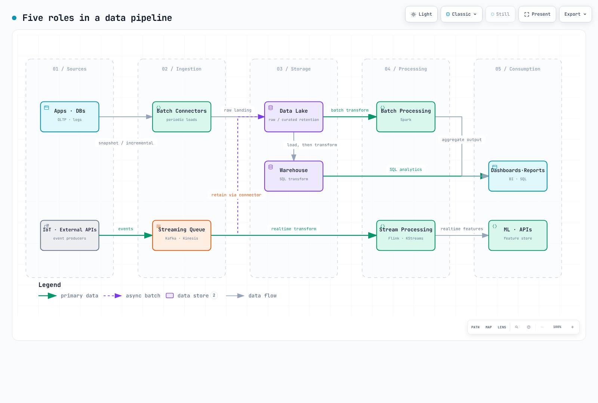

# 现代数据流水线剖析：五种角色

> **最后更新**：2026 年 9 月 12 日

::: tip 本文定位
了解 Kafka、Spark、Airflow 和 Flink 各自的角色，以及流水线组件之间的契约。
:::

数据源、摄取、存储、处理和消费是**概念角色**。产品不必只承担其中一种角色，每条流水线也不一定要先存储再处理。数据流可以先处理再存储；转换也可以在数据仓库内部运行。应先定义架构、数据新鲜度、保留、重放和输出去重契约。

[查看交互式图表](https://www.atomai.click/kubernetes-docs/archmaps/en-data-on-eks-01-data-pipeline-anatomy-0.html)

## 1. 数据源：变更与负载

数据源包括应用程序数据库、日志、物联网设备和外部 API。可根据需要选择完整快照、增量查询或基于日志的 CDC。基于日志的 CDC 依赖数据库复制日志、保留策略和权限；不同连接器与数据格式对架构变更的支持也各不相同。

只读副本和基于日志的提取可以降低生产数据库的负载，但并非所有数据库/连接器组合都支持。应检查初始快照带来的负载、复制延迟，以及复制日志缺失后的恢复方式。

## 2. 摄取：批次与事件

| 模式 | 行为 | 示例 | 延迟因素 |
| --- | --- | --- | --- |
| 批量摄取 | 按计划或条件分批提取/加载数据 | Airbyte、JDBC 批处理作业 | 计划、数据量和目标端 |
| 事件摄取 | 持续发布并消费变更/事件 | Kafka、Kinesis、Pulsar | 生产者、传输、消费者和接收端延迟 |

Apache Sqoop 已于 2021 年 6 月退役，因此不应作为新采用的示例。批量和流式摄取可以分别使用，也可以组合使用。

Kafka offset 可以重放**仍然保留的记录**。时间/大小保留策略、日志压缩和 tombstone 策略都可能移除历史事件。仅设置保留时长并不能保证保有完整的事件历史。

仅靠重放无法实现端到端的 exactly-once 行为。源位置和处理状态需要一致地恢复；接收端事务、幂等性和外部副作用也必须遵循同一契约。故障后重新执行一条记录，与将它最终造成的效果应用两次并不是一回事。

[Kafka 八章运维指南和第 9 部分基准测试](./kafka/README.md)介绍了在 EKS 上的选型。

## 3. 存储：原始数据与查询模型

| 选项 | 示例 | 设计考量 |
| --- | --- | --- |
| 数据湖 | S3 文件/对象 | 原始数据与精选数据、保留、访问、质量和查询成本 |
| 数据仓库 | Redshift、Snowflake、BigQuery | 加载与 SQL 转换、表、性能和治理 |
| Lakehouse | Iceberg、Delta Lake、Hudi | 格式/引擎兼容性、并发和维护 |

在数据湖中保留原始数据有助于重放，但这不是唯一常见方案。重新处理仍需要实际保留的数据和相应访问权限。

**ETL** 指先提取、再转换、最后加载到目标端。**ELT** 指先提取、再加载、然后在目标端转换。把已经精选的数据结果移入数据仓库，并不会仅仅因为涉及数据仓库就变成 ELT。同时使用数据湖和数据仓库，也无法决定转换顺序。

## 4. 处理：有界与持续输入

Spark 支持批处理和 Structured Streaming；Flink 也能处理数据流和有界输入。批处理/流处理的分类并不会让产品只能承担彼此排斥的角色。

可能的设计包括先通过流处理给出快速的暂定结果，再根据迟到数据修正；也可以在结算时进行批量重算。流处理并非天然近似，批处理也并非天然精确。事件时间、水位线、允许的迟到时间、去重、状态/检查点和输出契约共同决定最终结果。

请参阅 [Spark](./spark/README.md) 和 [Flink](./flink/README.md) 指南，了解引擎运维。

## 5. 消费：结果契约

BI、报表、ML 特征存储和数据 API 都会消费处理结果。将“五分钟的仪表板延迟”“收盘后修正结算”或“一秒的推荐特征目标”等要求转化为可测量的契约。这些数字只是示例，并非产品性能保证。

## 横向运维事项

- **编排**：Airflow 等工具管理面向批处理工作的依赖关系、计划和重试。它们不是处理每个流式事件的引擎；有两条流水线也不代表必然需要 Airflow。
- **架构契约**：注册表兼容性会在实际实施检查的注册、序列化或 CI 路径中得到约束。它不会自动阻止所有源数据库 DDL 或业务语义变更。应将[兼容性策略](./kafka/04-schema-registry.md)与实际消费者测试结合起来。
- **可观测性**：检查数据沿袭、新鲜度、缺失/重复数据、质量指标和恢复历史。

## 从 EKS 视角看

Kafka、Spark 和 Flink 使用各自的 Operator/部署模型。Airflow 使用 Helm、executor 以及 KubernetesPodOperator 等任务操作器。Airflow 中的 “Operator” 与 Kubernetes 控制器不是同一个概念。存储、分析和受管工作区也可以运行在外部 AWS 服务中。请参阅[受管替代方案](./README.md)，比较不同方案的管理责任。

## 参考资料

概念划分最初来自 Abhishek Agrawal 的信息图 “Anatomy of a Modern Data Pipeline”；契约与运维建议另行审查。

- [ETL 和 ELT（AWS）](https://docs.aws.amazon.com/whitepapers/latest/data-warehousing-on-aws/data-processing.html)
- [Kafka 交付语义与日志压缩](https://kafka.apache.org/43/design/design/)
- [Flink 状态与检查点](https://nightlies.apache.org/flink/flink-docs-stable/docs/concepts/stateful-stream-processing/)
- [Spark Structured Streaming](https://spark.apache.org/docs/latest/streaming/index.html)
- [Apache Sqoop 退役说明](https://attic.apache.org/projects/sqoop.html)
