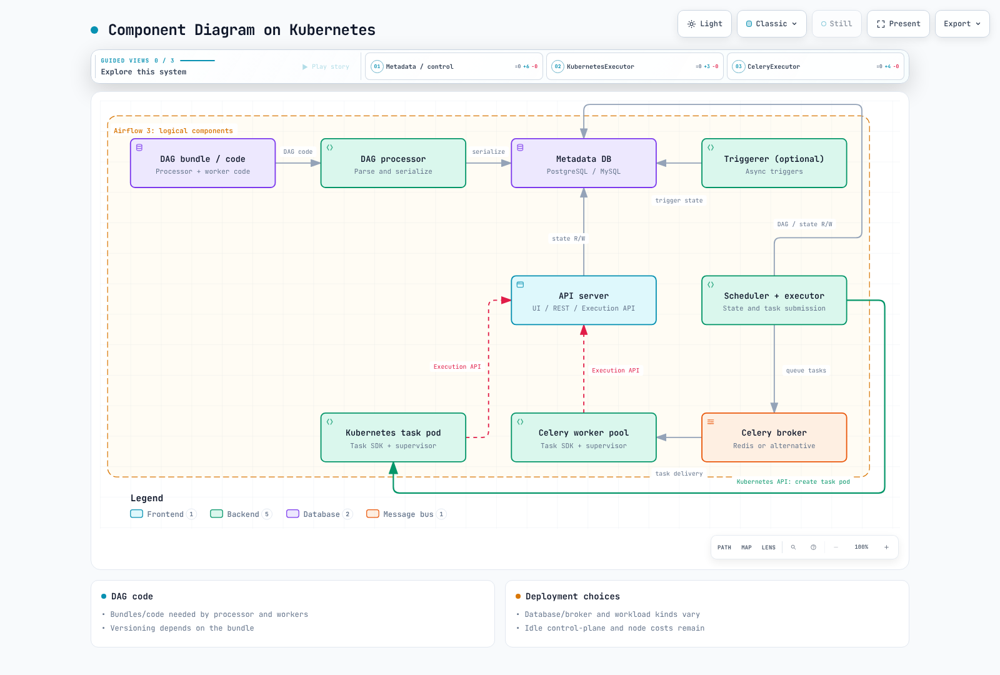

# 第 1 部分：Kubernetes 上的 Airflow 架构

> **审查基线**：Airflow 3.3.1 / Helm chart 1.22.0
> **已检查的最新上游补丁版本**：Airflow 3.3.2；示例仍使用 3.3.1 · 2026 年 10 月 12 日

## 1. 组件与任务执行

Airflow 根据 DAG 依赖关系调度并观测任务实例。任务可以在执行器的工作进程、外部 Pod 或任务调用的服务中运行。Kubernetes API 服务器负责处理请求和状态；调度器与 kubelet 负责放置并启动 Pod。

| 组件 | 职责与范围 |
| --- | --- |
| Scheduler + executor | 评估 DAG / 任务是否就绪，提交工作，管理状态和心跳；读取并写入元数据 |
| DAG processor | 访问 bundle，解析 / 序列化 DAG 并更新版本相关元数据；在 Airflow 3 中是必需的独立角色 |
| API server | UI、REST API v2 和 Execution API；通过 auth manager 和部署配置处理身份验证 / 授权 |
| 任务运行时 / worker | 执行 operator / Task SDK 代码，并与执行 API 和所需服务通信 |
| Triggerer | 在异步循环中运行延迟任务的 trigger；未使用延迟任务时可以不部署 |
| 元数据库 | 共享 DAG / 任务状态、序列化结构及相关元数据 |

### Airflow 3 的 Execution API

在常见的受监督 Python Task SDK 执行模式中，worker 会启动一个 supervisor 进程，由它运行 task-runner 子进程。用户任务代码通过套接字与 supervisor 通信；supervisor 使用短期任务 JWT 调用 **Execution API**。SDK 对 Connections、Variables、XComs 和状态的公开访问方式取代了任务代码直接访问元数据库的做法。

worker 到 API server 的寻址、身份验证和网络连接都是实际依赖。仅画出一条 scheduler 到 worker 的箭头无法说明 Airflow 3 的执行路径。还应单独检查执行器内部实现、系统 worker，以及 Celery 结果后端等存储；不要据此泛化为“任何后端进程都不会连接任何数据库”。像 local dag.test 这样的进程内执行，也不一定会走与受监督部署相同的子进程 / HTTP 路径。

### Triggerer 与 worker 的区别

operator 在 worker 上启动后，可以注册一个 trigger，并在等待期间延迟执行。Triggerer 运行该 trigger；事件发生后，任务会重新排入调度并在 worker 上恢复。它不会在 Triggerer 中运行整个 operator。延迟任务会释放 worker slot，默认情况下也会释放 pool slot；pool 行为可以配置。普通异步任务可能仍占用 worker slot，二者并不相同。

## 2. Airflow 2 到 3 的实际变化

Airflow 2 已于 2026 年 4 月 22 日结束生命周期。下表用于说明迁移背景。

| 方面 | Airflow 2.x | Airflow 3.x |
| --- | --- | --- |
| UI / API | 基于 Flask 的 webserver | 基于 FastAPI 的 api-server 和任务 Execution API 路径 |
| DAG 解析 | Manager 和文件处理子进程；可选的独立 dag-processor | 独立 DAG processor 成为必需角色 |
| DAG 结构 | 早已支持基于序列化 DAG 的调度 | 延续使用序列化结构和版本元数据 |
| Scheduler HA | 已支持基于数据库的多 scheduler | 仍需验证 HA、容量和数据库负载 |
| 并发执行器 | 自 2.10.0 起支持 | 保留并通用化配置 |
| 固定的混合执行器 | 可使用 LocalKubernetesExecutor 和 CeleryKubernetesExecutor | 自 3.0 起不再支持 |

声称 Airflow 2 在 scheduler 的同一个 Python 循环中解析所有文件，或声称 scheduler HA 直到 Airflow 3 才成为可能，都不准确。职责分离有助于独立调优，但新 DAG 解析缓慢、CPU / 内存 / 数据库资源争用，以及过高的解析并发度，仍可能影响调度延迟。仅增加副本并不能保证可靠性。

## 3. 元数据、消息代理和 DAG 代码

Airflow 3.3.1 列出的已测试数据库版本包括 PostgreSQL 14–18、MySQL 8.0 / 8.4 / Innovation 和 SQLite 3.15.0 及以上版本。**SQLite 用于开发 / 测试，不适用于生产环境**。不支持 MariaDB。本系列使用 PostgreSQL 示例，并不表示不支持 MySQL。托管数据库仍需实际配置 HA、备份保留和删除策略。

CeleryExecutor 需要兼容的消息代理，可选 Redis 或 RabbitMQ 等。KubernetesExecutor 和 LocalExecutor 本身不需要 Redis。应区分元数据存储、消息代理和所选 Celery 结果后端。Connections / Variables 可以使用 secrets backend；XCom 负载也可以使用其他后端存储。

**DAG processor 和 worker 都需要可执行的 DAG / 任务代码及其依赖包**。正常任务执行不要求 API server 解析 DAG 文件，但插件、auth manager 和 trigger 仍需要通过合适的方式分发代码 / 依赖项。

| DAG bundle | 当前版本控制支持情况 |
| --- | --- |
| GitDagBundle | 支持 |
| LocalDagBundle | 不支持；使用当前本地代码 |
| S3DagBundle / GCSDagBundle | 不支持；这与对象存储版本控制不同 |

git-sync 仍包含在 chart 1.22.0 中。渲染结果显示 processor / triggerer 的 sidecar 和 init container，以及 Kubernetes 任务 Pod 模板中的一个 init container。可根据实际情况选择 git-sync、将 DAG 烘焙进镜像、共享卷或远程 bundle。请确认 bundle 是否保留了本次运行对应的代码版本，以及重试时会读取哪一版代码。



[交互式图表](https://www.atomai.click/kubernetes-docs/archmaps/en-data-on-eks-airflow-01-architecture-0.html)

## 4. 执行器选择与并发执行器

| 选项 | 执行单元 | 成本、延迟和隔离注意事项 |
| --- | --- | --- |
| LocalExecutor | scheduler 一侧的本地任务进程 | 无需单独的消息代理；与 scheduler 共用资源 / 边界 |
| KubernetesExecutor | 每个任务实例对应一个 worker Pod | Pod / 镜像启动延迟；限制和身份取决于实际 Pod 规范 |
| CeleryExecutor | 消费消息代理消息的 worker 池 | 预热的 worker 可以快速启动；扩缩至零会引入冷启动 |

即使 KubernetesExecutor 没有空闲 worker Pod，控制平面、数据库、节点和日志开销仍然存在。单独使用 Pod 并不会自动形成强安全边界。KubernetesPodOperator 是一个会启动另一个 Pod 的 **operator**，它不同于 KubernetesExecutor。

配置并发执行器时，第一个配置项是默认执行器。任务的 executor 字段可选择其他执行器；DAG 可以通过 `default_args={"executor": "KubernetesExecutor"}` 设置任务默认值，并允许各任务单独覆盖。所选执行器 / 别名必须已配置，并且 provider、版本和权限兼容。此功能始于 2.10.0，与 3.0 移除混合执行器是两回事。

## 5. 为第 2 部分做准备，并了解验证的局限

Chart 1.22.0 的目标版本是 Helm **3.19.0+** 和 Airflow **3.1.0+**。Airflow 3.3.1 列出的已测试 Kubernetes 版本为 **1.30–1.35**。这并不构成对未来版本的全面支持承诺，也不意味着建议选择较旧的 EKS 1.30。还需检查 EKS 支持周期，以及所选 provider / chart 的兼容性。

第 2 部分将准备镜像、数据库 / 消息代理连接、DAG 分发、权限和存储。不要假设 API server、scheduler、processor 和 triggerer 始终是轻量组件；请测量 DAG 数量、解析开销、API 负载和任务并发度。

```bash
helm version --short
helm repo add apache-airflow https://airflow.apache.org
helm repo update apache-airflow
helm show chart apache-airflow/airflow --version 1.22.0
kubectl config current-context
# Prints the namespace manifest; does not create it.
kubectl create namespace airflow --dry-run=client -o yaml
```

不要预期一定恰好有四个 Deployment。在渲染后的 chart 变体中，triggerer 会根据持久化配置使用 StatefulSet 或 Deployment；根据 values 的不同，还会有 StatsD、数据库、消息代理或 worker 等资源。使用外部数据库时，集群内无需运行 PostgreSQL Pod。

本章使用 3.3.1 override 渲染 KubernetesExecutor、CeleryExecutor 和 git-sync 变体。渲染结果不等于真实数据库、任务、镜像拉取或 HA 故障恢复测试；第 2 部分中的环境检查仍然必不可少。

- [Airflow 3.3.1 架构](https://airflow.apache.org/docs/apache-airflow/3.3.1/core-concepts/overview.html)
- [支持的版本和生命周期](https://airflow.apache.org/docs/apache-airflow/3.3.1/installation/supported-versions.html)
- [Airflow 先决条件](https://airflow.apache.org/docs/apache-airflow/3.3.1/installation/prerequisites.html)
- [执行器配置和历史](https://airflow.apache.org/docs/apache-airflow/3.3.1/core-concepts/executor/index.html)
- [DAG bundle](https://airflow.apache.org/docs/apache-airflow/3.3.1/administration-and-deployment/dag-bundles.html)
- [可延迟 operator 和 trigger](https://airflow.apache.org/docs/apache-airflow/3.3.1/authoring-and-scheduling/deferring.html)
- [Airflow 2.11 DAG 处理](https://airflow.apache.org/docs/apache-airflow/2.11.0/authoring-and-scheduling/dagfile-processing.html)
- [Airflow 2.11 scheduler HA](https://airflow.apache.org/docs/apache-airflow/2.11.0/administration-and-deployment/scheduler.html)
- [官方 Helm chart](https://airflow.apache.org/docs/helm-chart/1.22.0/index.html)

[第 2 部分：Helm 部署](02-helm-deployment.md)

[README](README.md)

[测验](../../quizzes/data-on-eks/airflow/01-architecture-quiz.md)
