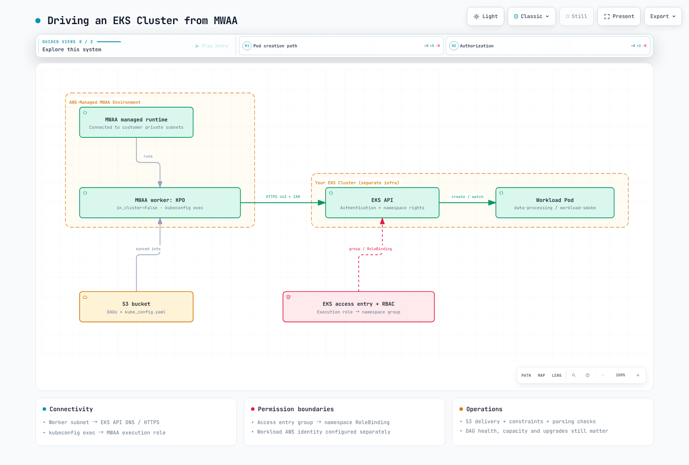

# 第 4 部分：Amazon MWAA 集成

> **最后更新**：2026 年 10 月 12 日；MWAA Airflow 3.3.1 / Python 3.12；Kubernetes provider 10.21.0。
> **已检查的上游最新补丁版本**：Airflow 3.3.2（截至 2026 年 10 月 12 日，MWAA 尚未列出该版本）。

本章面向**已预置的 Amazon MWAA 环境**，这类环境会向客户的 EKS 集群提交工作。使用 YAML 工作流定义的 **MWAA Serverless** 是另一种独立部署选项；不要直接套用本章的环境 / DAG 文件 / 成本模型。

## 1. 管理边界和当前版本

MWAA 调度器 / worker 使用 AWS 托管的 Fargate 基础设施，并连接到所选客户 VPC 中的私有子网。AWS 也负责管理元数据数据库。因此，该服务并非与你的 VPC 无关。不过，**MWAA 调度器 Pod 不会部署到你的 EKS 集群中供 kubectl 管理**。在 Airflow 3 中，MWAA webserver 还会托管 Execution API。

AWS 负责运维底层服务。你仍需管理 DAG、依赖项、IAM、VPC 连通性、容量设置、告警、恢复流程，以及升级到受支持的版本。托管基础设施并不能消除环境故障，也不能免除容量规划。

官方支持表列出 Airflow **3.3.1 自 2026-09-01 起可用**，3.2.1 自 2026-05-19 起可用。上游 3.3.1 于 2026-08-12 发布。上游 3.3.2 随后于 2026-09-17 发布；截至 2026-10-12，MWAA 表格仍将 3.3.1 列为最新版本。上游补丁并不会自动在 MWAA 中可用。请查阅 [AWS MWAA 支持版本表](https://docs.aws.amazon.com/mwaa/latest/userguide/airflow-versions.html)，确认当前版本和区域可用性。

不要假设存在固定的三个月延迟，而应检查所需补丁、provider、区域和实际环境版本。现有环境不会自动切换到每个新获支持的 Airflow 版本。

| 方面 | EKS 上自管理的 Airflow | 已预置的 MWAA |
| --- | --- | --- |
| 运维 | 设计 Kubernetes 资源、数据库、升级和恢复 | AWS 管理服务基础设施；用户仍负责 DAG、权限、连通性、容量选择和升级 |
| 版本 / 执行器 | 验证自己选择的组合 | 在受支持的运行时 / 配置选项中选择 |
| Python 包 | 自行构建镜像或采用其他交付机制 | 使用带匹配版本约束的 S3 requirements.txt |
| 系统依赖 | 在镜像 / 节点策略范围内配置 | 启动脚本可以安装 Linux 运行时；应验证支持情况、启动时间和网络 |
| DAG 交付 | 配置 GitDagBundle、git-sync 或其他路径 | 文档化的基线：S3 DAG 文件夹和辅助文件同步 |
| 外部工作负载 | 使用 KPO 和其他集成来运行独立镜像 | KPO / EKS 集成也可运行独立的工作负载镜像 |

启动脚本会在安装 requirements 和启动 Airflow 之前运行；官方示例包括通过 sudo 安装运行时。因此，全面禁止系统软件包的说法不正确。此功能与不受限制地替换托管基础镜像或执行器是两回事。

本示例采用 Git → CI → S3 → MWAA 的流程。仅使用 S3 交付并不能证明所有 Airflow 3 bundle 功能都不可用。在采用单独的 bundle 设置前，应验证特定 MWAA 版本允许且支持的配置。Git 轮询和 S3 同步都会产生解析延迟；push 或 merge 后都不能保证立即执行。

## 2. 访问 EKS 所需的三个条件

1. **网络**：worker 子网需要通过 DNS 和 HTTPS 443 访问 EKS API 端点。对于私有端点，应检查路由、Security Group 和 DNS。添加身份验证并不能解决连接超时。
2. **身份验证**：必须通过 EKS access entry 或现有 aws-auth 配置识别 MWAA 执行角色。kubeconfig exec 插件会使用执行时可用的 IAM 凭证。
3. **授权**：将映射后的 Kubernetes 组绑定到 namespace Role。EKS 身份验证、Kubernetes RBAC 和子 Pod 的 AWS 数据权限是不同的层次。

请使用现有的 MWAA 3.3.1 环境、现有 EKS 集群、AWS CLI v2 和 kubectl。检查当前 EKS 支持情况以及 provider / 客户端兼容性。本章不要求创建新集群或授予宽泛的管理员身份。

### Access entry 和命名空间 RBAC

以下设置由集群管理员执行。请替换角色 ARN、集群和区域，并先检查是否已存在 access entry。

```bash
aws eks describe-cluster \
  --name data-eks-cluster --region us-east-1 \
  --query 'cluster.accessConfig.authenticationMode'

# Administrator action; API or API_AND_CONFIG_MAP mode is required.
aws eks create-access-entry \
  --cluster-name data-eks-cluster --region us-east-1 \
  --principal-arn arn:aws:iam::123456789012:role/mwaa-execution-role-my-environment \
  --type STANDARD \
  --kubernetes-groups mwaa-pod-launcher
```

Access entry 也适用于 API_AND_CONFIG_MAP 模式。在 API-only 模式下，编辑 aws-auth 并不会授予访问权限。对于旧版 CONFIG_MAP 集群，请使用现有映射或规划迁移。身份验证模式切换包含不可逆变更，因此本示例不会悄悄修改该模式。

保存并应用下面的 workload-access.yaml。RoleBinding 会将此授权限制在 data-processing 命名空间内。ClusterRoleBinding 无法表达此命名空间边界。

```yaml
apiVersion: v1
kind: Namespace
metadata:
  name: data-processing
---
apiVersion: v1
kind: ServiceAccount
metadata:
  name: workload-smoke
  namespace: data-processing
automountServiceAccountToken: false
---
apiVersion: rbac.authorization.k8s.io/v1
kind: Role
metadata:
  name: mwaa-pod-launcher
  namespace: data-processing
rules:
- apiGroups:
  - ''
  resources:
  - pods
  verbs:
  - create
  - get
  - list
  - watch
  - patch
  - delete
- apiGroups:
  - ''
  resources:
  - pods/log
  verbs:
  - get
---
apiVersion: rbac.authorization.k8s.io/v1
kind: RoleBinding
metadata:
  name: mwaa-pod-launcher
  namespace: data-processing
subjects:
- kind: Group
  name: mwaa-pod-launcher
  apiGroup: rbac.authorization.k8s.io
roleRef:
  apiGroup: rbac.authorization.k8s.io
  kind: Role
  name: mwaa-pod-launcher
```

该 Role 可以影响该命名空间中的所有 Pod。其他 access-policy / RBAC 授权会累加，因此应检查完整权限集。对于可能选择其他 service account 或危险 Pod spec 的不可信作者，应使用准入控制。本同步示例不需要 XCom / exec 权限。

## 3. Kubeconfig 和依赖项交付

应生成一个全新的文件，不要将个人 kubeconfig context 合并到制品中。生成该文件的管理员需要在目标上具有 eks:DescribeCluster 权限。

```bash
set -eu
mkdir -p ./mwaa-staging
test ! -e ./mwaa-staging/kube_config.yaml
aws eks update-kubeconfig \
  --name data-eks-cluster --region us-east-1 \
  --alias data-eks-cluster \
  --kubeconfig ./mwaa-staging/kube_config.yaml
```

检查生成的 cluster、context、CA 和 exec.command。删除引用开发人员本地 AWS_PROFILE 的 exec.env 项，以便 MWAA 执行角色使用默认凭证链。除非确实要使用单独的角色承担流程，否则不要添加 exec --role 参数。不要存储长期密钥或静态令牌。还要在 MWAA 运行时验证 aws 可执行文件及 get-token 路径。

下面的 requirements.txt 适用于**本章的 Airflow 3.3.1 / Python 3.12 环境**。先检查镜像中已包含的 provider；添加或变更后，应验证实际安装版本。不要使用未固定版本的 apache-airflow extra，以免意外更改 Airflow 核心版本。

```text
--constraint https://raw.githubusercontent.com/apache/airflow/constraints-3.3.1/constraints-3.12.txt
apache-airflow-providers-cncf-kubernetes==10.21.0
```

按 MWAA 要求启用 bucket 版本控制和 Block Public Access。上传 requirements.txt 后，应更新环境所引用的对象版本并检查安装日志。仅覆盖对象本身并不能完成整个依赖项更新流程。

请在已配置的 S3 DAG 前缀下保留此目录结构。将生成的 kube_config.yaml 放在 DAG 旁边之前，请先检查该文件。

```text
dags/
  mwaa_eks_smoke.py
  kube_config.yaml
  templates/
    base-pod-template.yaml
```

```yaml
apiVersion: v1
kind: Pod
metadata:
  labels:
    app: airflow-kpo-smoke
spec:
  serviceAccountName: workload-smoke
  automountServiceAccountToken: false
  restartPolicy: Never
  securityContext:
    runAsNonRoot: true
    runAsUser: 65532
    seccompProfile:
      type: RuntimeDefault
  containers:
  - name: base
    image: python:3.12-slim
    resources:
      requests:
        cpu: 100m
        memory: 64Mi
      limits:
        cpu: 500m
        memory: 128Mi
    securityContext:
      allowPrivilegeEscalation: false
      readOnlyRootFilesystem: true
      capabilities:
        drop:
        - ALL
```

```python
from datetime import datetime, timedelta, timezone
from pathlib import Path

from airflow.sdk import DAG
from airflow.providers.cncf.kubernetes.operators.pod import KubernetesPodOperator

BUNDLE_DIR = Path(__file__).resolve().parent

with DAG(
    dag_id="mwaa_eks_smoke",
    start_date=datetime(2026, 9, 1, tzinfo=timezone.utc),
    schedule=None,
    catchup=False,
) as dag:
    run_smoke = KubernetesPodOperator(
        task_id="run_smoke",
        name="mwaa-eks-smoke",
        namespace="data-processing",
        image="python:3.12-slim",
        cmds=["python", "-B", "-c"],
        arguments=["import sys; print('MWAA_EKS_OK run_id=' + sys.argv[1])", "{{ run_id }}"],
        pod_template_file=str(BUNDLE_DIR / "templates/base-pod-template.yaml"),
        in_cluster=False,
        config_file=str(BUNDLE_DIR / "kube_config.yaml"),
        service_account_name="workload-smoke",
        random_name_suffix=True,
        reattach_on_restart=True,
        deferrable=False,
        do_xcom_push=False,
        get_logs=True,
        log_events_on_failure=False,
        startup_timeout_seconds=120,
        active_deadline_seconds=180,
        execution_timeout=timedelta(minutes=5),
        on_finish_action="delete_pod",
        on_kill_action="delete_pod",
    )
```



[交互式图表](https://www.atomai.click/kubernetes-docs/archmaps/en-data-on-eks-airflow-04-mwaa-integration-0.html)

## 4. 验证执行并选择运维模式

DAG 成功解析后，手动触发 mwaa_eks_smoke，并检查 task 状态和 MWAA_EKS_OK 日志。运行期间，检查 Pod 实际使用的 service account、镜像和资源。成功后删除 Pod 是已配置的清理行为。请使用 MWAA CloudWatch task logging 查看保留的日志。

| 现象 | 要检查的边界 |
| --- | --- |
| DNS / 连接超时 | worker 子网 → EKS API 的路由、DNS 和 Security Group |
| Unauthorized | exec 凭证、实际 IAM 角色和 access entry |
| Forbidden | 命名空间、组、RoleBinding 和所需 verb |
| ImagePullBackOff | EKS 节点 / Fargate 的镜像拉取身份和注册表连通性 |
| DAG 导入 / exec-binary 错误 | MWAA 已安装的软件包、同步文件和 aws 可执行文件 |

工作负载 Pod 不会自动继承 MWAA 执行角色。真正需要访问 S3 时，应单独授予数据权限，例如为该 Pod 的 service account 配置 IRSA 或 Pod Identity。KPO 可以运行其他镜像；MWAA 并不局限于 PyPI 包或低重要性流水线。

比较执行器 / 运行时灵活性、受支持的版本、运维容量、网络边界和恢复要求。比较成本时，应固定吞吐量 / 延迟目标，并计入环境类型 / worker 范围、EKS、数据库、存储、NAT、日志和工程投入。不要根据没有依据的“自托管可节省 30–60%”说法作出选择。

## 验证范围和参考资料

已审阅版本表、官方 constraints、provider 源码以及示例 Python / YAML / shell 结构。未执行 MWAA 更新、EKS access entry 创建、RBAC 应用或端到端运行。请使用上面的检查来验证特定账户的连通性和执行行为。


- [MWAA 支持的版本和可用日期](https://docs.aws.amazon.com/mwaa/latest/userguide/airflow-versions.html)
- [MWAA 架构](https://docs.aws.amazon.com/mwaa/latest/userguide/what-is-mwaa.html)
- [启动脚本和 Linux 运行时](https://docs.aws.amazon.com/mwaa/latest/userguide/using-startup-script.html)
- [Python 依赖项和 constraints](https://docs.aws.amazon.com/mwaa/latest/userguide/working-dags-dependencies.html)
- [MWAA 与 EKS](https://docs.aws.amazon.com/mwaa/latest/userguide/mwaa-eks-example.html)
- [EKS 访问管理](https://aws.amazon.com/blogs/containers/a-deep-dive-into-simplified-amazon-eks-access-management-controls/)
- [MWAA Serverless](https://docs.aws.amazon.com/mwaa/latest/mwaa-serverless-userguide/what-is-mwaa-serverless.html)

[第 5 部分：运维](05-operations.md)

[README](README.md)

[测验](../../quizzes/data-on-eks/airflow/04-mwaa-integration-quiz.md)
