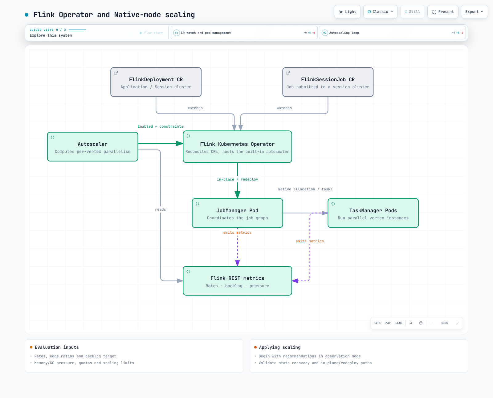

# 第 2 部分：Flink Kubernetes Operator

> **最后更新**：2026 年 9 月 12 日。Operator / Helm chart 1.15.0；Flink 2.2.1 / Java 17。

Operator 会协调所需的集群 / 作业状态，并管理升级、快照、恢复和自动扩缩。它不保证每次变更都能实现零停机或零数据丢失。Native / Standalone 和 Application / Session 的边界请参见第 1 部分。

## 1. 资源和运维边界

| CR | 作用 |
| --- | --- |
| FlinkDeployment | Application 或 Session 集群的期望状态 |
| FlinkSessionJob | 提交到现有受管 Session 集群的作业 |
| FlinkStateSnapshot | 管理与 FlinkDeployment / SessionJob 关联的 savepoint / checkpoint |
| FlinkBlueGreenDeployment | 通过两个子 Deployment 实现蓝绿切换 |

SessionJob 有独立的 spec，但会共享 JM / TM 容量，并受到底层集群故障影响。Application 集群也不能与共享的 EKS 节点、网络、存储或配额完全隔离。蓝绿 CR 不会自动确保 Kafka consumer group、transactional ID 或 sink 写入安全切换。请验证状态 / 数据路径兼容性、重复处理情况和临时所需的额外容量。

## 2. 安装：准备 cert-manager 和命名空间

使用受支持的 EKS / Kubernetes 版本以及兼容的 kubectl / Helm。
此版本的 webhook chart 默认会创建 **cert-manager Certificate 和 Issuer 资源**，而不是内部的证书生成 Job。首先验证已安装兼容版本的 cert-manager，以及其 controller / webhook / cainjector。安装失败时，禁用验证并非默认补救办法。

下面的 operator-values.yaml 会将工作负载命名空间限制为 data-processing，并固定到已验证的 Operator 镜像 digest。chart 的简短默认 tag 和 1.15.0 tag 解析到同一个多架构 digest。

```yaml
watchNamespaces:
- data-processing
image:
  repository: ghcr.io/apache/flink-kubernetes-operator
  tag: 1.15.0
  digest: sha256:5372e4461b433ee37391b0ee3fc3e4029980d14e9b64576b0cb78493d1cafe3a
webhook:
  create: true
```

```bash
# Existing cert-manager installation; adjust its namespace if necessary.
kubectl get crd certificates.cert-manager.io issuers.cert-manager.io
kubectl rollout status deployment/cert-manager -n cert-manager --timeout=180s
kubectl rollout status deployment/cert-manager-webhook -n cert-manager --timeout=180s
kubectl rollout status deployment/cert-manager-cainjector -n cert-manager --timeout=180s

# Create the watched workload namespace before Helm creates its SA/RBAC.
kubectl create namespace data-processing --dry-run=client -o yaml | kubectl apply -f -

helm repo add flink-operator-repo https://downloads.apache.org/flink/flink-kubernetes-operator-1.15.0/
helm repo update flink-operator-repo
helm upgrade --install flink-kubernetes-operator flink-operator-repo/flink-kubernetes-operator \
  --version 1.15.0 \
  --namespace flink-operator --create-namespace \
  -f operator-values.yaml \
  --wait --timeout 10m

kubectl wait --for=condition=Ready certificate/flink-operator-serving-cert \
  -n flink-operator --timeout=180s
kubectl get serviceaccount/flink -n data-processing
```

空的 watchNamespaces 会监视所有命名空间。使用上面的显式列表时，chart 还会在该工作负载命名空间中创建 flink job service account、Role 和 RoleBinding；该命名空间必须预先存在。应一并检查监视范围、实际 RBAC 和其他授权；命名空间范围本身并不能在不可信租户之间实现完全隔离。

升级时，应结合 chart 版本 / values 审查 CRD 变更、webhook 兼容性和运行中的作业。仅运行 Helm upgrade 不会更新 crds/ 目录下的所有现有 CRD。CRD 和镜像应与已审查的发行版本保持一致。

## 3. 先使用内置作业验证执行

flink-smoke.yaml 会运行官方镜像中的 StateMachineExample。它不会假设该镜像中存在虚构的 order-events JAR 或入口类。这是一个**通过无状态升级运行的长时间演示**，并不是生产级的状态保留配置。

```yaml
apiVersion: flink.apache.org/v1beta1
kind: FlinkDeployment
metadata:
  name: flink-smoke
  namespace: data-processing
spec:
  image: flink:2.2.1-java17
  flinkVersion: v2_2
  mode: native
  flinkConfiguration:
    taskmanager.numberOfTaskSlots: '2'
  serviceAccount: flink
  jobManager:
    resource:
      memory: 2048m
      cpu: 1
  taskManager:
    resource:
      memory: 2048m
      cpu: 1
  job:
    jarURI: local:///opt/flink/examples/streaming/StateMachineExample.jar
    parallelism: 2
    upgradeMode: stateless
    state: running
```

```bash
# This readiness sequence is for the initial deployment.
kubectl apply -f flink-smoke.yaml
kubectl wait --for=condition=Running flinkdeployment/flink-smoke \
  -n data-processing --timeout=300s
kubectl get flinkdeployment/flink-smoke -n data-processing -o yaml
kubectl get pods -n data-processing -l app=flink-smoke
kubectl logs deployment/flink-smoke -n data-processing --tail=100
```

在 Native 模式下，Operator / Flink 会创建 JM Deployment，JM ResourceManager 会动态管理 TM Pod。Native TM 不一定是 Deployment。请将此模式与 Standalone 模式下由外部管理的 TM Deployment 区分开。

1.15.0 的状态条件是 **Running**，而不是 Available。对于正在运行的 Application 作业，或处于 READY 状态的 Session JM Deployment，该条件会变为 True。这并不能证明数据正确、checkpoint 成功或达到目标吞吐量。
此实现不会填充该条件的 observedGeneration。更新现有 CR 后，不要把保留下来的 Running=True 当作新 spec 已完成协调的证据。还应检查协调状态以及实际镜像 / 配置 / 作业状态。

## 4. 有状态部署的其他要求

应将真正的应用 JAR 与兼容的运行时 / connector 一起打包，或使用受支持的制品交付路径。对于 SessionJob，也要检查 Operator 允许的制品 scheme / host。

仅有 S3 URL 和 service-account 注解并不足以完成有状态部署：

- 在 JM / TM 镜像中安装适用的 S3 filesystem 插件和凭证提供程序。
- 验证 IRSA 或 Pod Identity 的信任 / 关联关系，以及 Agent / SDK 和 bucket 前缀 / KMS 权限。
- 配置 checkpoint 间隔、可访问的 checkpoint / savepoint 存储，以及 HA 元数据 / 恢复。
- 验证状态序列化器、Operator UID、最大并行度和 connector 状态兼容性。

第 3 部分介绍后端 / 插件 / checkpoint 配置；第 4 部分介绍 HA。
RocksDB 使用本地磁盘 I/O，恢复时可能需要下载状态。应测量 TM 内存 / 磁盘 / 网络容量以及重新调度所需时间。仅跨节点 / AZ 分散部署并不能保证作业连续性；请规划 requests、taints、affinity 和备用容量。

## 5. 将升级模式与恢复前提结合选择

| 模式 | 状态处理 | 检查内容 |
| --- | --- | --- |
| stateless | 不使用先前状态重新启动 | 是否可以接受重放，包括 source offset 和外部副作用 |
| savepoint | 创建并恢复 savepoint | 可运行的作业、存储 / 状态兼容性和失败回退策略 |
| last-state | 使用可访问的 HA 元数据或最后一个 checkpoint / savepoint 恢复 | checkpoint、有效元数据 / 状态、凭证和实际可恢复性 |

Savepoint 并非总是最慢、最安全且需要全局暂停的选项。耗时和可恢复性取决于作业、后端和状态变更。若使用默认的 last-state 回退策略，并且 HA 元数据可访问，则不健康作业的 savepoint 升级可能切换到 last-state。应明确回退策略。

last-state 并不保证元数据丢失后仍能恢复，也不保证能从过期 / 不兼容的状态恢复。checkpoint 最大年龄限制也可能导致健康作业使用 savepoint。SessionJob 可以使用 last-state，但需要底层 Session 配置和 checkpoint 存储；仅设置一个模式字符串并不足够。

## 6. 自动扩缩：从观测开始

autoscaler 的主要目标是作业顶点的并行度。其吞吐量模型使用 source 摄取 / 延迟、处理速率 / 忙碌时间以及边的输出比率。对于下游顶点，它会累加**上游目标速率 × 该边的输出比率**。这与简单地累加已观测到的上游输出速率不同。

它不同于基于 CPU 的 HPA，但并非忽略所有 CPU / 内存信号。已审查的代码会检查 GC / 内存压力以及 CPU / 内存配额，并可选择调整 TM 内存。内存调优默认关闭。

将以下**观测模式**配置合并到现有 spec 中。实际重新扩缩已禁用。设计新作业时选择 pipeline.max-parallelism；对于现有状态，不要随意更改该值。

```yaml
flinkConfiguration:
  job.autoscaler.enabled: 'true'
  job.autoscaler.scaling.enabled: 'false'
  job.autoscaler.utilization.target: '0.6'
  job.autoscaler.utilization.min: '0.4'
  job.autoscaler.utilization.max: '0.8'
  job.autoscaler.stabilization.interval: 5m
  job.autoscaler.metrics.window: 10m
  job.autoscaler.catch-up.duration: 10m
  pipeline.max-parallelism: '360'
```

当前键为 utilization.target / min / max；较旧的 target.utilization 和 boundary 设置已弃用。此处的 0.4 / 0.8 定义利用率区间，但决策还会考虑积压、重启时间、指标窗口、配额、上下限和稳定时间。瞬时忙碌时间超过阈值并不保证会立即重新扩缩。

catch-up.duration 是**重新扩缩后处理积压的目标时间**。积压 6,000 条记录时，需要在 600 秒内额外处理每秒 10 条，或在 60 秒内额外处理每秒 100 条。时间越短，所需容量越大；设为零会禁用基于积压的扩缩。这不是忽略积压的宽限期。

3–60 分钟的指标窗口是调优起点，并非普遍要求。请结合稳定时间、缩容间隔和 SLO 共同调整。最大并行度可被多个不同数值整除，有助于 autoscaler 与 key-group / partition 对齐，但**Flink 本身并不要求每个并行度都能整除最大并行度**。对齐模式、source 分区以及 keyed / non-keyed 输入都会影响选择。

扩缩会应用并行度覆盖，并尽可能原位使用 adaptive scheduler 的资源需求 API。根据支持情况、变更类型、配置和执行结果，它可能回退到完整重新部署。它并非总是 last-state 升级。原位扩缩仍可能重启 task 并恢复状态。只有在审查建议并测试有状态恢复和峰值负载后，才启用 scaling.enabled。



[交互式图表](https://www.atomai.click/kubernetes-docs/archmaps/en-data-on-eks-flink-02-flink-kubernetes-operator-0.html)

## 验证范围

已验证官方 chart digest，并使用 Helm 渲染了默认、命名空间范围受限和禁用 webhook 的对比配置。已检查 CRD schema、镜像清单、发布版 readiness / scaling 源码以及示例结构。未执行 Kubernetes 部署、证书签发、S3 / HA 操作、在线作业吞吐量测试或重新扩缩。

## 参考资料

- [已发布的 Operator 1.15.0 chart](https://downloads.apache.org/flink/flink-kubernetes-operator-1.15.0/)
- [已发布的 chart values](https://github.com/apache/flink-kubernetes-operator/blob/release-1.15.0/helm/flink-kubernetes-operator/values.yaml)
- [自定义资源和 Native / Standalone 模式](https://github.com/apache/flink-kubernetes-operator/blob/release-1.15.0/docs/content/docs/custom-resource/overview.md)
- [作业管理和恢复](https://github.com/apache/flink-kubernetes-operator/blob/release-1.15.0/docs/content/docs/custom-resource/job-management.md)
- [Autoscaler 配置](https://github.com/apache/flink-kubernetes-operator/blob/release-1.15.0/flink-autoscaler/src/main/java/org/apache/flink/autoscaler/config/AutoScalerOptions.java)
- [Autoscaler 指标评估](https://github.com/apache/flink-kubernetes-operator/blob/release-1.15.0/flink-autoscaler/src/main/java/org/apache/flink/autoscaler/ScalingMetricEvaluator.java)
- [Running 条件实现](https://github.com/apache/flink-kubernetes-operator/blob/release-1.15.0/flink-kubernetes-operator-api/src/main/java/org/apache/flink/kubernetes/operator/api/utils/ConditionsUtils.java)

[第 3 部分：状态与 checkpoint](03-state-checkpointing-streaming.md)

[README](README.md)

[测验](../../quizzes/data-on-eks/flink/02-flink-kubernetes-operator-quiz.md)
