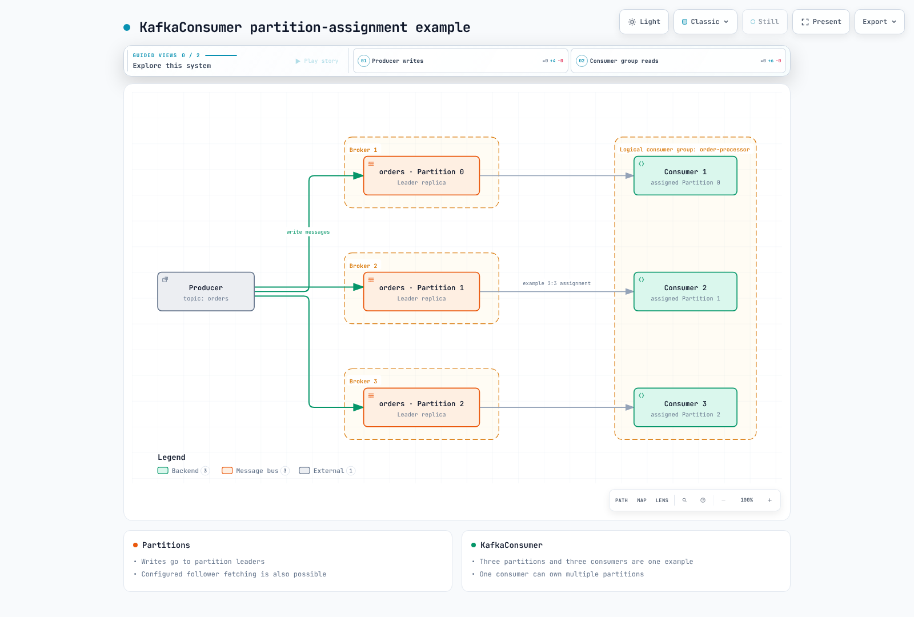

# 第 1 部分：Kafka 基础知识

> **最后更新**：2026 年 10 月 16 日。Apache Kafka 4.3.1，由 Strimzi 1.3.0 提供支持。
> **验证**：十九项检查使用 Kafka 4.3.1 的实际配置类验证了有效性、默认值和冲突。未启动 Broker 或 EKS 集群。

## 1. Broker、Topic 和分区

Kafka 将事件存储在分区日志中，使生产者和消费者可以独立推进。一个 Broker 可以存储多个 Topic 的分区副本；它不必容纳整个 Topic。

| 术语 | 含义 |
| --- | --- |
| Broker | 存储数据副本并处理请求的服务器角色 |
| Topic | 逻辑事件类别 |
| 分区 | 有序的追加日志；保留策略和压缩可能会删除记录 |
| Offset | 某个分区内的位置，而非全局 ID；删除和事务可能造成可见的间隙 |
| 副本因子 | 分区副本的数量，通过创建/重新分配元数据进行管理 |
| Leader / follower | Leader 处理写入，follower 负责复制；配置了 follower 获取时，也可以为消费者读取提供服务 |
| ISR | 与 Leader 保持足够同步的副本，其中包括 Leader 自身 |



[查看交互式图表](https://www.atomai.click/kubernetes-docs/archmaps/en-data-on-eks-kafka-01-kafka-fundamentals-0.html)

3:3 图表只是一个示例。使用 KafkaConsumer `subscribe()` 自动进行 group 分配时，同一时间一个分区只会分配给一个 group 成员；一个成员可以拥有多个分区。手动使用 `assign()` 时，则单独管理分配。多个 group 可以独立消费同一个 Topic。Kafka 4.x 的 Share Groups/KafkaShareConsumer 使用不同的共享和确认模型。

## 2. 顺序和分区键

Kafka 定义的是**分区内**的日志顺序。它不会自动建立全局 Topic 顺序，也不会自动按业务事件时间戳排序。

要确保相同 key 始终路由到相同位置，需要保持序列化方式、分区器和分区数一致。增加分区数可能会改变基于哈希的映射。自定义分区器和显式选定的分区也会影响路由。多个生产者、重试以及应用程序并行处理，都需要各自的顺序契约。

空 key 的路由取决于客户端/分区器。key 的基数高并不能单独保证负载均衡；少数出现频率特别高的 key 仍可能造成热点分区。

此命令会在**至少有三个 Broker 且已可连接的集群**中创建 Topic。对于经过身份验证的监听器，请添加 `--command-config client.properties`。不要将此命令原样用于下面的单节点学习配置。

```bash
: "${DOCS_BOOTSTRAP:?Set the existing Kafka bootstrap host:port}"
kafka-topics.sh --create --bootstrap-server "$DOCS_BOOTSTRAP" \
  --topic orders --partitions 6 --replication-factor 3 \
  --config min.insync.replicas=2
```

## 3. Consumer Group 和 Offset

当消费者数量超过分区数量时，基于分区的 group 可能会有空闲成员。生产者吞吐量、磁盘、网络和应用程序处理也会影响并发能力；仅凭分区数量无法预测吞吐量。

### 区分 group 协议

Kafka 4.3 Java consumer 默认将 `group.protocol` 设为 `classic`。

| 选项 | 分配方式和超时 |
| --- | --- |
| `classic` | 客户端 assignor 以及 `session.timeout.ms` / `heartbeat.interval.ms` |
| `consumer` | 服务端 assignor 以及 Broker 的 `group.consumer.session.timeout.ms` / `group.consumer.heartbeat.interval.ms` |

Classic eager rebalance 会撤销一大批分配。CooperativeStickyAssignor 会增量移动需要重新分配的分区。较新的 consumer 协议也会在服务端执行增量协调。并非每次 rebalance 都必然会暂停整个 group。不要将 classic 的客户端 assignor/超时假设套用到新协议上。

`max.poll.interval.ms` 默认值为 300000 ms。使用静态成员身份（`group.instance.id`）时，超过该值不会立即重新分配分区：consumer 会停止发送心跳，适用的 session timeout 也会影响重新分配。

### Offset 和业务完成状态

已提交的 Offset 通常表示下一个要读取的位置。客户端的 fetch 位置与外部工作是否完成是两回事。对于异步/并行处理，不要在某些记录的工作仍未完成时提交越过这些记录的 Offset。

| 方法 | 含义和注意事项 |
| --- | --- |
| 自动提交 | `enable.auto.commit=true`，默认间隔为 5000 ms；无法确定业务是否已完成 |
| `commitSync()` | 等待调用完成；对延迟的影响取决于批处理和调用频率 |
| `commitAsync()` | 通过回调跟踪失败/进度；不要盲目重试过时的 Offset，以免已提交的进度倒退 |

处理前提交可能会在故障后丢失工作；处理后提交则可能在恢复时重复执行操作。应结合应用程序输出，一并测试故障、重启和 rebalance。

## 4. Exactly-Once 的适用范围

`enable.idempotence` 可在重试期间避免同一次生产者传输被重复写入日志。它不是应用程序将同一业务事件作为新的发送再次提交时使用的通用去重 key。

对于 Kafka 到 Kafka 的处理，应在同一事务中提交输出记录和**下一个输入 Offset**，并让消费者使用 `read_committed` 读取。设置 `transactional.id` 字符串并不能实现该处理逻辑。外部数据库/API 需要单独定义 sink 事务、幂等性和恢复契约。

**`producer.properties`**

```properties
bootstrap.servers=127.0.0.1:19092
key.serializer=org.apache.kafka.common.serialization.StringSerializer
value.serializer=org.apache.kafka.common.serialization.StringSerializer
acks=all
enable.idempotence=true
transactional.id=orders-writer-1
max.in.flight.requests.per.connection=5
delivery.timeout.ms=120000
```

**`consumer.properties`**

```properties
bootstrap.servers=127.0.0.1:19092
key.deserializer=org.apache.kafka.common.serialization.StringDeserializer
value.deserializer=org.apache.kafka.common.serialization.StringDeserializer
group.id=order-processor
group.protocol=consumer
enable.auto.commit=false
isolation.level=read_committed
max.poll.interval.ms=300000
```

事务处理包括 `initTransactions()`、`beginTransaction()`、发送输出、`sendOffsetsToTransaction(...)`、`commitTransaction()` 以及中止/恢复处理。并发生产者需要各自不同的 transactional ID；应为逻辑写入方设计稳定的重启和 fencing 行为。

显式启用幂等性要求 `acks=all`、`retries>0` 和 `max.in.flight.requests.per.connection<=5`。发生冲突时会抛出 ConfigException。隐式默认的幂等性可能会因冲突设置而被禁用。较大的 retries 值不能覆盖 `delivery.timeout.ms` 等截止时间。

## 5. KRaft 元数据

KRaft 于 Kafka 2.8 中以早期访问形式推出，在 3.3 中达到生产就绪状态，并在 Kafka 4.0 移除 ZooKeeper 后成为唯一模式。专用 controller 进程不必处理 Broker 数据流量，因此 controller 不一定是数据 Broker 的子集。

Controller voter 会复制元数据 Raft 日志，其中一个 controller 处于活动状态。生产部署通常使用三个或五个 voter。偶数规模的组同样可以计算出多数票；在实现相同容错能力的情况下，奇数规模能更高效地利用资源。

`__cluster_metadata` 是内部元数据日志的名称，并非通过 KafkaProducer/KafkaConsumer 管理的普通应用程序 Topic。移除 ZooKeeper 并不意味着不再需要负责 controller quorum、存储、升级和监控。

### 动态和静态 quorum

动态 quorum 使用 `controller.quorum.bootstrap.servers` 作为发现种子，而非 voter 成员列表。初始存储格式化和 quorum 引导必须在 cluster ID、目录 ID 和初始 voter 方面保持一致。更改时应使用受支持的 controller 添加/移除流程。

静态 `controller.quorum.voters` 在 Kafka 4.3.1 中仍受支持。动态 quorum 不要设置该项。仅更改种子地址并不会自动迁移静态 quorum。

此文件用于**单节点本地学习**，而非高可用部署。它使用回环 PLAINTEXT 监听器。启动前，新数据目录需要执行适当的存储格式化/引导流程。切勿随意格式化现有 Kafka 数据。

**`combined-lab.properties`**

```properties
# Local, single-node configuration for learning; not an HA deployment.
process.roles=broker,controller
node.id=1
controller.quorum.bootstrap.servers=127.0.0.1:19093
listeners=BROKER://127.0.0.1:19092,CONTROLLER://127.0.0.1:19093
advertised.listeners=BROKER://127.0.0.1:19092,CONTROLLER://127.0.0.1:19093
listener.security.protocol.map=BROKER:PLAINTEXT,CONTROLLER:PLAINTEXT
controller.listener.names=CONTROLLER
inter.broker.listener.name=BROKER
log.dirs=./kafka-lab-data
# Single-node internal-topic settings are for this lab only.
offsets.topic.replication.factor=1
transaction.state.log.replication.factor=1
transaction.state.log.min.isr=1
share.coordinator.state.topic.replication.factor=1
share.coordinator.state.topic.min.isr=1
```

自定义 `BROKER` 监听器需要显式协议映射。在相关配置中，Kafka 4.3.1 可以为默认的仅供 controller 使用的 `CONTROLLER` 监听器提供 PLAINTEXT 映射；缺少映射行并不意味着所有 controller 配置都无效。

在 EKS 上，请使用 Strimzi 在第 2 部分生成的设置、证书和存储。不要直接编辑由 Operator 管理的 Pod server.properties。为生产监听器配置所需的 TLS、身份验证和授权。

## 6. 复制、写入可用性和持久性

仅有 RF=3 并不能保证在任意两个 Broker 故障时所有数据都能幸存。应考虑实际复制进度、确认时的 ISR、符合条件的 Leader 选举、存储/网络故障以及 controller quorum。

如果三个副本最初都属于健康的 ISR，在其他条件不变的情况下，使用 `min.insync.replicas=2` 和 `acks=all` 的分区在一个 Broker 故障后仍可由两个 ISR 成员继续提供服务。Leader 转换仍可能导致错误/重试。如果 ISR 低于最小值，写入会失败或被拒绝；错误详情取决于发生时机。

| acks | 确认方式 | 说明 |
| --- | --- | --- |
| `0` | 无需等待 Broker 响应 | 存储状态未确认；返回的 Offset 为 -1 |
| `1` | Leader 记录后响应 | 在 follower 完成复制之前 Leader 可能丢失 |
| `all` / `-1` | 等待当前完整 ISR | 应结合最小 ISR、复制和 Leader 选举策略进行评估 |

`acks=all` 并不意味着每条记录都已在每个磁盘上完成 fsync。acks 本身也不能保证吞吐量或 p99 排名。应在负载、批处理和网络条件相当的情况下测量确认开销。

可以按如下方式更改最小 ISR。更改副本因子本身需要重新分配副本，不能将 `replication.factor` 添加为普通 Topic 配置。

```bash
kafka-configs.sh --bootstrap-server "$DOCS_BOOTSTRAP" \
  --alter --entity-type topics --entity-name orders \
  --add-config min.insync.replicas=2
```


## 后续步骤和参考资料

- [Strimzi Operator](./02-strimzi-operator.md)
- [Kafka 概述](./README.md)
- [测验](../../quizzes/data-on-eks/kafka/01-kafka-fundamentals-quiz.md)
- [Kafka 设计](https://kafka.apache.org/43/design/design/)
- [Consumer 配置](https://kafka.apache.org/43/configuration/consumer-configs/)
- [Producer 配置](https://kafka.apache.org/43/configuration/producer-configs/)
- [KRaft 运维](https://kafka.apache.org/43/operations/kraft/)
- [Strimzi 1.3.0 发布和迁移公告](https://github.com/strimzi/strimzi-kafka-operator/releases/tag/1.3.0)
