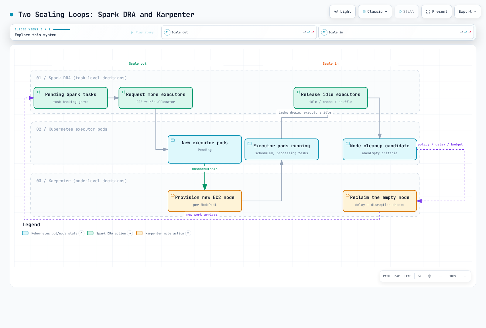

# 第 4 部分：性能和成本调优

> **审查基线**：2026 年 9 月 12 日 · 上游 Spark 4.2.0 · Karpenter 1.14

## 范围和测量

本章使用第 1 部分介绍的直接 spark-submit 路径。Spark 4.2 要求 Kubernetes 1.34+；还应检查 EKS、kubectl 和 Karpenter 的兼容性。第 2 部分的 Operator 和第 3 部分的 EMR 具有不同的提交和 Pod 自定义路径。未经审查不要将所有设置原样复制到这些路径。本章中的数值是较小的起始值，不是经测量得出的性能最优值。

**Karpenter 根据 Pending Pod 预置节点不需要 metrics-server**。Karpenter 会根据 Pod requests 和调度约束工作。metrics-server 有助于观测使用情况以及支持 kubectl top / HPA 等消费者；它不会提供 Spark task 积压数据，也不会直接预置 EC2。

应通过 Spark UI / event log 测量 stage / task 时间、spill、shuffle fetch 等待、数据倾斜、GC 和 executor 丢失，同时观察节点 CPU、内存、磁盘和网络限制。确认瓶颈后，再决定是否使用 R 系列或 NVMe；不要假设它们总是更快。检查 AQE、分区、join 策略和数据格式，每次只改变一个因素。

## 1. 选择节点和实例存储

旧示例中的 R5d / R5ad / R5dn 只是众多可选实例的一部分。应根据 CPU、内存、磁盘和网络需求、当前 AZ 容量和总成本比较 M / C / R / I 系列。R 系列并非总是最适合 shuffle；C 系列也并非天生不适合 Spark。

Graviton 是值得评估的 Spark 选项。可能已经有经过测试的多架构镜像，因此并非总要自行构建镜像。应检查 JNI、编解码器、BLAS、Python wheel 和自定义插件对 arm64 的支持情况。下面的示例为了保持路径一致而选择 amd64，并不声称 amd64 更快。

**Nitro / NVMe 并不能说明磁盘是实例存储**。Nitro 也会以 NVMe 形式呈现 EBS。未挂载的磁盘不一定为空，也不一定可以安全格式化。已删除旧示例中格式化未挂载 NVMe 设备的循环，因为它可能误判 EBS / 根设备。

## 2. 在 AL2023 上使用受管临时存储

执行本实验前，应让管理员准备两个 EC2NodeClass：

- `spark-general`：经过审查、用于 driver 的通用节点配置。
- `spark-nvme`：新的、专用于 executor 的配置，使用与 Kubernetes 发行版 / 架构匹配的**固定 AL2023 AMI**，并设置适当的 IAM / 子网 / Security Group。

将以下字段合并到完整的 spark-nvme 配置中。它是一个**片段**，不能作为独立的 kubectl apply 资源。更改现有 NodeClass 可能导致漂移和节点替换；不要在运行中的节点上临时尝试磁盘格式化。

```yaml
spec:
  instanceStorePolicy: RAID0
```

对于 AL2023，Karpenter 会通过 NodeConfig 配置 instance-store RAID0，并将其用于 kubelet / containerd 临时存储，包括节点可分配容量。这样无需固定使用 /dev/nvme1n1，也无需使用 hostPath。其他 AMI 系列或自定义 bootstrap 应遵循其文档化流程。

实例存储是临时空间，在停止、终止或故障时可能丢失。RAID0 不是复制或备份。虽然它没有单独的 EBS 卷费用，但实例价格、空闲容量和重新计算仍然会产生成本。适当规格的 EBS 也是一种选择；应同时考虑卷和实例的吞吐量限制。不要假设每个 EKS 节点都有 20GB 根卷或使用相同的底层文件系统。

## 3. Driver 使用 On-Demand，Executor 使用 Spot

On-Demand 可以降低 driver 遭遇 Spot 回收的风险，但不能避免故障、维护或 Karpenter 漂移 / 过期。无论 Cluster 还是 Client 模式，driver SparkContext / 协调状态都很重要。应分别设计作业重跑和数据恢复。

另存为 nodepools.yaml，并引用两个已准备好的 NodeClass。Executor 需要 instance-store 容量。此配置只使用 Spot：Spot 容量不足时，Pod 可能一直处于 Pending，且不会自动回退到 On-Demand。如果需要回退，应明确设计策略和成本上限。

```yaml
apiVersion: karpenter.sh/v1
kind: NodePool
metadata:
  name: spark-driver
spec:
  template:
    metadata:
      labels:
        workload-pool: spark-driver
    spec:
      requirements:
      - key: kubernetes.io/arch
        operator: In
        values:
        - amd64
      - key: kubernetes.io/os
        operator: In
        values:
        - linux
      - key: karpenter.sh/capacity-type
        operator: In
        values:
        - on-demand
      - key: karpenter.k8s.aws/instance-category
        operator: In
        values:
        - m
        - r
      - key: karpenter.k8s.aws/instance-generation
        operator: Gt
        values:
        - '5'
      taints:
      - key: spark-role
        value: driver
        effect: NoSchedule
      nodeClassRef:
        group: karpenter.k8s.aws
        kind: EC2NodeClass
        name: spark-general
  limits:
    cpu: '64'
    memory: 512Gi
  disruption:
    consolidationPolicy: WhenEmpty
    consolidateAfter: 120s
---
apiVersion: karpenter.sh/v1
kind: NodePool
metadata:
  name: spark-executor
spec:
  template:
    metadata:
      labels:
        workload-pool: spark-executor
    spec:
      requirements:
      - key: kubernetes.io/arch
        operator: In
        values:
        - amd64
      - key: kubernetes.io/os
        operator: In
        values:
        - linux
      - key: karpenter.sh/capacity-type
        operator: In
        values:
        - spot
      - key: karpenter.k8s.aws/instance-category
        operator: In
        values:
        - m
        - r
        - i
      - key: karpenter.k8s.aws/instance-generation
        operator: Gt
        values:
        - '5'
      - key: karpenter.k8s.aws/instance-local-nvme
        operator: Gt
        values:
        - '0'
      taints:
      - key: spark-role
        value: executor
        effect: NoSchedule
      nodeClassRef:
        group: karpenter.k8s.aws
        kind: EC2NodeClass
        name: spark-nvme
  limits:
    cpu: '256'
    memory: 2048Gi
  disruption:
    consolidationPolicy: WhenEmpty
    consolidateAfter: 120s
```

Pool 标签 / selector 用于选择目标节点；toleration 允许 Pod 放置到带相应 taint 的节点上。Toleration 不会强制放置，其他 Pod 也可能具备相同 toleration。NoSchedule 不会驱逐已经运行的 Pod。NodePool 限制是最终一致的容量护栏，在并发扩容期间可能短暂超限，并非精确的支出上限。

另存为 driver-template.yaml。这是由 Spark 补全的 **Spark Pod template**，不是独立的 Pod 部署。

```yaml
apiVersion: v1
kind: Pod
spec:
  securityContext:
    runAsNonRoot: true
    runAsUser: 185
    fsGroup: 185
  tolerations:
  - key: spark-role
    operator: Equal
    value: driver
    effect: NoSchedule
  containers:
  - name: spark-kubernetes-driver
    securityContext:
      allowPrivilegeEscalation: false
      capabilities:
        drop:
        - ALL
      seccompProfile:
        type: RuntimeDefault
    resources:
      requests:
        ephemeral-storage: 2Gi
      limits:
        ephemeral-storage: 4Gi
```

另存为 executor-template.yaml。

```yaml
apiVersion: v1
kind: Pod
spec:
  securityContext:
    runAsNonRoot: true
    runAsUser: 185
    fsGroup: 185
  tolerations:
  - key: spark-role
    operator: Equal
    value: executor
    effect: NoSchedule
  containers:
  - name: spark-kubernetes-executor
    securityContext:
      allowPrivilegeEscalation: false
      capabilities:
        drop:
        - ALL
      seccompProfile:
        type: RuntimeDefault
    resources:
      requests:
        ephemeral-storage: 10Gi
      limits:
        ephemeral-storage: 20Gi
    volumeMounts:
    - name: spark-local-dir-scratch
      mountPath: /var/data/spark-local
  automountServiceAccountToken: false
  volumes:
  - name: spark-local-dir-scratch
    emptyDir:
      sizeLimit: 16Gi
```

此 emptyDir 使用已准备好的、由 NVMe 提供支持的 kubelet 文件系统；其他节点配置可能使用不同的底层存储。卷名必须以 `spark-local-dir-` 开头，包括末尾的连字符和后缀。旧名称 `spark-local-dir` 不会被识别，并可能在同一路径额外挂载一个 emptyDir。

仅设置 spark.local.dir 也可以让 Kubernetes Spark 在该位置创建 emptyDir；不需要 hostPath。可识别的临时目录挂载会填入 SPARK_LOCAL_DIRS。sizeLimit 并不会预留容量：节点磁盘可能会先耗尽。应同时观测 requests / limits、日志、可写层和磁盘压力。tmpfs 会占用 RAM，需要纳入内存预算。

## 4. 两个扩缩循环和终止

另存为 performance.properties，并复用第 1 部分中的命名空间和 RBAC。

```properties
spark.kubernetes.namespace=spark-jobs
spark.kubernetes.container.image=spark:4.2.0-scala2.13-java21-ubuntu
spark.kubernetes.authenticate.driver.serviceAccountName=spark-driver
spark.kubernetes.authenticate.executor.serviceAccountName=spark-executor
spark.kubernetes.driver.podTemplateFile=driver-template.yaml
spark.kubernetes.executor.podTemplateFile=executor-template.yaml
spark.kubernetes.driver.node.selector.workload-pool=spark-driver
spark.kubernetes.executor.node.selector.workload-pool=spark-executor
spark.kubernetes.driver.node.selector.karpenter.sh/capacity-type=on-demand
spark.kubernetes.executor.node.selector.karpenter.sh/capacity-type=spot
spark.driver.cores=1
spark.driver.memory=1g
spark.kubernetes.driver.limit.cores=1
spark.executor.cores=2
spark.executor.memory=4g
spark.kubernetes.executor.limit.cores=2
spark.executor.instances=2
spark.dynamicAllocation.enabled=true
spark.dynamicAllocation.shuffleTracking.enabled=true
spark.dynamicAllocation.minExecutors=1
spark.dynamicAllocation.initialExecutors=2
spark.dynamicAllocation.maxExecutors=10
spark.dynamicAllocation.executorIdleTimeout=60s
spark.kubernetes.allocation.batch.size=5
spark.kubernetes.allocation.batch.delay=1s
spark.decommission.enabled=true
spark.storage.decommission.enabled=true
spark.kubernetes.executor.terminationGracePeriodSeconds=120s
```

```bash
# Prerequisite: Part 1's spark-jobs namespace and driver/executor RBAC.
# All template/property files below must be present in the submitter's working directory.
K8S_API_SERVER="$(kubectl config view --minify -o jsonpath='{.clusters[0].cluster.server}')"
: "${K8S_API_SERVER:?Select the intended Kubernetes context first}"
spark-submit \
  --master "k8s://${K8S_API_SERVER}" --deploy-mode cluster \
  --name spark-performance-smoke \
  --properties-file performance.properties \
  --class org.apache.spark.examples.SparkPi \
  local:///opt/spark/examples/jars/spark-examples.jar 10
```

Spark DRA 根据 task 积压和空闲 / 缓存 / shuffle 状态调整 executor 数量。spark.kubernetes.allocation.batch.size 和 batch.delay 控制 Kubernetes allocator 创建 Pod 的速率；它们并非 DRA 专用。Karpenter 根据不可调度 Pod 的请求和约束提供容量。镜像拉取、IP / 配额 / AZ 容量不足以及 taint 不匹配也会延迟 Pod 启动。

对于普通运行中的 Spark Pod，WhenEmpty 和 120s 是较保守的初始整合策略。Karpenter 对“空闲”的定义也可能包含不产生中断成本的残留 Pod，例如 DaemonSet。将仅运行 executor 的节点视为空节点之前，还要检查其他普通工作负载。

consolidateAfter 大于 executorIdleTimeout 并不保证 DRA 会先释放 executor。这些计时器从不同事件开始，缓存数据 / shuffle tracking 可能让 executor 保留更久。漂移、过期和 Spot 中断都不同于整合。PDB、do-not-disrupt 和中断预算不能阻止 Spot 回收。



[交互式图表](https://www.atomai.click/kubernetes-docs/archmaps/en-data-on-eks-spark-04-performance-tuning-0.html)

### Decommission 的实际限制

Spot stop / terminate 通常会提前两分钟发出通知，但尽力而为。休眠会立即开始，不会收到这两分钟通知。Karpenter 的 Spot 处理需要 EventBridge 到 SQS 的配置、中断队列和相应权限。仅设置 Spark 标志并不会接收 AWS 中断通知。

如第 1 部分已验证，Spark 4.2 的 decommission 标志会注入官方镜像中的 /opt/decom.sh preStop。应检查实际脚本、信号、Pod 宽限期和节点 drain 路径。spark.kubernetes.executor.terminationGracePeriodSeconds=120s 是宽限期请求，不保证云端剩余生命周期或 block 迁移完成。覆盖 lifecycle hook 可能会改变行为。

迁移依赖对等节点容量、网络和时间。Shuffle 回退需要明确设置 spark.storage.decommission.fallbackStorage.path，并确保文件系统和权限可用。任意远程存储或 History Server 都不会自动成为回退存储。RDD 缓存和 shuffle 的恢复方式也不同。重新计算、重复丢失、fetch / task 重试上限或无法读取源数据都可能使作业失败；不能保证 executor 丢失不会造成影响。

## 5. 验证资源和成本

| 设置 | Kubernetes 影响 |
|---|---|
| Driver / executor memory | Request 和 limit 包含 heap 及适用的 overhead / 其他内存 |
| Driver / executor cores | 默认 CPU request 和 Spark 特定角色的并发度；不会自动生成 CPU limit |
| spark.kubernetes.*.request.cores | 显式 CPU request，与 task-slot 数量不同 |
| spark.kubernetes.*.limit.cores | 显式 CPU limit |
| Template ephemeral-storage | 临时空间 / 日志的临时存储预算；底层存储取决于节点配置 |

使用 4g heap 的 JVM executor 加上默认 10% overhead，经整数换算后增加 409MiB，总计 4505MiB。PySpark、off-heap 和显式 overhead 设置应单独考虑；4g 并不是整个 Pod 的内存。Driver 不一定总要比 executor 大；较小的 executor 也并非永远更好。

应比较每个成功作业的成本和 p95 完成时间，并计入重试、空闲容量、存储 / 网络和日志，而不能只比较实例小时价格。EMR 运行时行为（例如 executor 预分配）可能与上游不同；应检查所选发行版本的配置。

已根据 CRD 和 Spark 原生 feature-step 构造过程检查示例。这不等同于 EC2 预置、磁盘初始化、Spot 中断测试或大型 shuffle 性能基准测试。


- [Karpenter instanceStorePolicy 和 AMI 行为](https://karpenter.sh/docs/concepts/nodeclasses/#specinstancestorepolicy)
- [Karpenter 中断和 interruption 处理](https://karpenter.sh/docs/concepts/disruption/)
- [Karpenter 调度](https://karpenter.sh/docs/concepts/scheduling/)
- [EKS AL2023 instance-store 配置实现](https://github.com/awslabs/amazon-eks-ami/blob/main/templates/al2023/runtime/bin/setup-local-disks)
- [Spark 4.2 Kubernetes 配置](https://spark.apache.org/docs/4.2.0/running-on-kubernetes.html)
- [Spark 本地目录功能实现](https://github.com/apache/spark/blob/v4.2.0/resource-managers/kubernetes/core/src/main/scala/org/apache/spark/deploy/k8s/features/LocalDirsFeatureStep.scala)
- [Spark 4.2 配置](https://spark.apache.org/docs/4.2.0/configuration.html)
- [Spot 中断通知限制](https://docs.aws.amazon.com/AWSEC2/latest/UserGuide/spot-instance-termination-notices.html)
- [EMR 特定的性能和存储指导](https://docs.aws.amazon.com/emr/latest/EMR-on-EKS-DevelopmentGuide/best-practices.html)

[第 5 部分：最佳实践](./05-best-practices.md)

[README](./README.md)

[测验](../../quizzes/data-on-eks/spark/04-performance-tuning-quiz.md)
