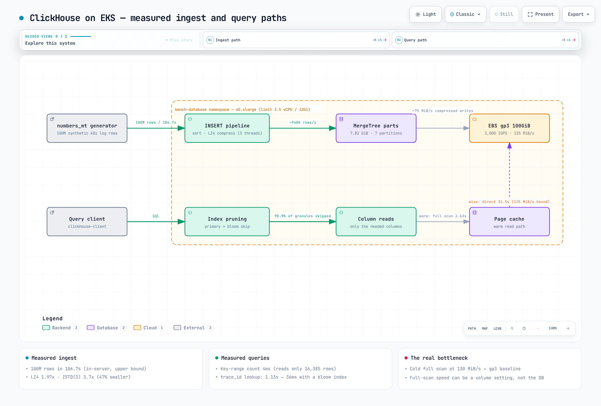

# EKS 上 ClickHouse 的实测基准

> **记录的测试环境**：ClickHouse 24.8（实测版本；24.x 系列现已结束生命周期，详见“测试环境”中的版本说明）、Kubernetes 1.36（Amazon EKS）
> **最后更新**：2026 年 10 月 12 日

每份基准测试报告都说“ClickHouse 很快”，但很难找到在**普通 EKS 节点和默认 gp3 卷**上测出的数据。本文在刻意精简的环境中（4 vCPU 节点和默认配置的 100 GiB gp3 卷）加载 1 亿行 Kubernetes 日志，并测量实际表现。以下是报告的历史结果。此页面未包含完整的原始 query_log、所有确切查询或缓存状态，因此无法保证复现出完全相同的数值。对于下方的新运行示例，应保存确切 SQL、设置、版本和原始结果。



[🔍 查看交互式图表](https://www.atomai.click/kubernetes-docs/archmaps/en-database-01-clickhouse-on-eks-0.html)

## TL;DR：实测结果

| 测量项 | 结果 |
|-------------|--------|
| 写入（服务器内部生成并插入） | 1 亿行 / 106.7 秒 = **约 94 万行/秒** |
| 存储大小（默认 LZ4） | 15.37 GiB → **7.82 GiB（1.97×）** |
| 存储大小（ZSTD(3)） | 15.37 GiB → **4.16 GiB（3.7×）**，比 LZ4 小 47% |
| 按 ORDER BY 键范围计数（1 小时窗口） | **4 毫秒**（计数 59,916 行，只读取 1 亿行中的 16,385 行） |
| 按 Pod 对 ERROR 数量分组（2 天窗口） | **0.36 秒**（扫描 2,800 万行） |
| `LIKE '%timeout%'` 全表扫描 | 热缓存 **2.63 秒** / 请求 Direct I/O 时 **31.5 秒**（12×） |
| `trace_id` 点查找 | 全表扫描 1.13 秒 → 使用 bloom filter 索引后 **0.036 秒（31×）** |

## 测试环境

| 项目 | 值 |
|------|-------|
| 集群 | Amazon EKS、Kubernetes 1.36、ap-northeast-2 |
| 节点 | **m5.xlarge**（4 vCPU、16 GiB），由 Karpenter 预配的专用节点 1 台（基准 Pod 单独运行于该节点） |
| Pod 资源 | requests 为 2.5 vCPU / 9 Gi，limits 为 3.5 vCPU / 12 Gi |
| 存储 | EBS **gp3 100 GiB，默认设置**（基线为 3,000 IOPS / 125 MiB/s），EBS CSI 驱动 |
| ClickHouse | 官方镜像 `clickhouse/clickhouse-server:24.8`（24.8.14.39），默认配置 |
| 每小时费用 | 按需 m5.xlarge 为 $0.236/小时 + gp3 100 GiB 按每 GB 月费 $0.0912 计价（首尔区域，通过 Pricing API 于 2026-09 查询） |

> **版本说明。** 实测时，24.8 是 LTS 版本；但 ClickHouse 的[安全策略](https://github.com/ClickHouse/ClickHouse/blob/master/SECURITY.md)现在已不再将任何 24.x 版本列为受支持版本（截至 2026 年 10 月 12 日，受支持的分支为 26.9、26.8 LTS、26.7 和 26.3 LTS）。新部署应使用当前的 LTS 标签。下方测量的机制（主键裁剪、LZ4/ZSTD 编解码器、bloom filter 跳过索引）在当前版本中都存在；但用于容量规划前，应在实际部署版本上重新运行测试。

这个环境刻意没有使用高端配置。此基准想回答的问题不是“ClickHouse 在专用 i 系列 NVMe 机器上有多快”，而是“在集群已有的通用节点和默认 gp3 卷上能达到什么水平”。

### 部署清单

此**重新运行**示例使用受支持的 LTS 26.3.33.24；历史 24.8 测量结果保持不变。它需要常规 EC2 EBS CSI/IAM 和 PVC 预配。保留默认用户的网络限制，并通过 `kubectl exec` 中的 localhost 客户端执行基准测试。记录镜像摘要、EBS 配置以及实际 CPU/内存使用量。

```yaml
apiVersion: v1
kind: Namespace
metadata:
  name: bench-database
---
apiVersion: storage.k8s.io/v1
kind: StorageClass
metadata:
  name: bench-clickhouse-gp3
provisioner: ebs.csi.aws.com
parameters:
  type: gp3
  encrypted: "true"
  iops: "3000"
  throughput: "125"
volumeBindingMode: WaitForFirstConsumer
reclaimPolicy: Delete
---
apiVersion: v1
kind: PersistentVolumeClaim
metadata:
  name: clickhouse-data
  namespace: bench-database
spec:
  accessModes: ["ReadWriteOnce"]
  storageClassName: bench-clickhouse-gp3
  resources:
    requests:
      storage: 100Gi
---
apiVersion: v1
kind: Pod
metadata:
  name: clickhouse
  namespace: bench-database
  annotations:
    karpenter.sh/do-not-disrupt: "true"
spec:
  nodeSelector:
    node.kubernetes.io/instance-type: m5.xlarge
  containers:
    - name: clickhouse
      image: clickhouse/clickhouse-server:26.3.33.24
      resources:
        requests: { cpu: "2500m", memory: 9Gi }
        limits: { cpu: "3500m", memory: 12Gi }
      readinessProbe:
        exec:
          command: ["clickhouse-client", "--host", "127.0.0.1", "--query", "SELECT 1"]
        initialDelaySeconds: 5
        periodSeconds: 5
      volumeMounts:
        - name: data
          mountPath: /var/lib/clickhouse
  volumes:
    - name: data
      persistentVolumeClaim:
        claimName: clickhouse-data
```

> 对于生产环境中的生命周期/恢复自动化，可以使用由 [Altinity clickhouse-operator](https://github.com/Altinity/clickhouse-operator) 管理的 `ClickHouseInstallation`，而不是裸 Pod。此处使用裸 Pod 是为了简化测量目标。

## 数据集：1 亿行逼真的 Kubernetes 日志

均匀随机数据（generateRandom）会扭曲压缩率，因此这些行按照真实日志的方式生成：**重复模板加上可变字段**，包含 10 个命名空间、每个命名空间一个 Pod 名称（Pod 后缀由选择命名空间时使用的同一 bucket 哈希得到，因此只有 10 个不同的 Pod 值；这是一个会影响压缩数值的简化，见测量 2）、0.8% 的 ERROR 比率以及跨度为 7 天的时间戳。

```sql
CREATE TABLE logs
(
  timestamp   DateTime64(3),
  namespace   LowCardinality(String),
  pod         String,
  container   LowCardinality(String),
  level       LowCardinality(String),
  message     String,
  trace_id    String,
  duration_ms Float32
)
ENGINE = MergeTree
PARTITION BY toDate(timestamp)
ORDER BY (namespace, timestamp);
```

```sql
INSERT INTO logs (timestamp, namespace, pod, container, level, trace_id, duration_ms, message)
WITH
  ['payment','order','user','search','catalog','cart','shipping','auth','gateway','recommend'] AS nss,
  ['GET /api/v1/orders','POST /api/v1/payments','GET /api/v1/users','GET /api/v1/search',
   'POST /api/v1/cart/items','GET /api/v1/products','POST /api/v1/shipments','POST /oauth/token',
   'GET /healthz','GET /api/v1/recommendations'] AS eps
SELECT
  toDateTime64('2026-08-25 00:00:00', 3) + toIntervalMillisecond(number * 6) AS timestamp,
  nss[(cityHash64(number) % 10) + 1] AS namespace,
  concat(namespace, '-7c7dd4f9c-', substring(lower(hex(sipHash64(cityHash64(number) % 10))), 1, 5)) AS pod,
  if(cityHash64(number + 2) % 10 < 8, 'app', 'istio-proxy') AS container,
  multiIf(cityHash64(number + 3) % 1000 < 8, 'ERROR',
          cityHash64(number + 3) % 1000 < 50, 'WARN',
          cityHash64(number + 3) % 1000 < 300, 'DEBUG', 'INFO') AS level,
  lower(hex(sipHash128(number))) AS trace_id,
  round(if(level = 'ERROR', 2000 + (cityHash64(number + 4) % 30000) / 10,
           (cityHash64(number + 4) % 20000) / 100), 1) AS duration_ms,
  multiIf(
    level = 'ERROR', concat('upstream request timeout after ', toString(round(duration_ms)),
                            'ms endpoint=', eps[(cityHash64(number + 5) % 10) + 1],
                            ' status=503 trace_id=', trace_id),
    concat(eps[(cityHash64(number + 5) % 10) + 1], ' completed status=200 in ',
           toString(duration_ms), 'ms trace_id=', trace_id)
  ) AS message
FROM numbers_mt(100000000)
SETTINGS max_threads = 3, max_insert_threads = 2, max_memory_usage = 9000000000;
```

## 测量 1：写入：106.7 秒写入 1 亿行

```text
Elapsed: 106.747 sec  →  ~936,800 rows/s, 7 daily partitions, 36 active parts
```

**应正确理解这个数字。** 行数据是在服务器内生成并直接插入的（INSERT…SELECT），因此不包含网络传输和文本解析成本；它测量的是**服务器内部路径**。它还包括数据生成所需的 CPU 工作，因此并非外部写入的理论上限。客户端、格式、网络、批处理和并发都会改变外部吞吐量，影响方向可能不同。标题中的结果仍然是实测值：在 3.5 vCPU 限制下，ClickHouse 在默认 125 MiB/s 的 gp3 卷上完成排序、压缩和写入，速度约为每秒 94 万行。最终压缩后大小除以运行时间约为 75 MiB/s，这并不是实测的物理 EBS 写入速率。应单独检查页面缓存/回写、合并以及持久化刷新条件。

## 测量 2：压缩：哪些列消耗存储预算

整体压缩结果为：15.37 GiB → 7.82 GiB（默认 LZ4，**1.97×**）。逐列细分更值得关注：

| 列 | 压缩后 | 未压缩 | 比率 |
|--------|-----------|--------------|-------|
| message | 3.97 GiB | 8.75 GiB | 2.2× |
| **trace_id** | **3.08 GiB** | 3.07 GiB | **1.0×（难以压缩）** |
| timestamp | 404.07 MiB | 762.94 MiB | 1.89× |
| duration_ms | 289.17 MiB | 381.47 MiB | 1.32× |
| level | 45.88 MiB | 95.72 MiB | 2.09× |
| container | 39.27 MiB | 95.72 MiB | 2.44× |
| pod | 9.32 MiB | 2.15 GiB | **236×** |
| namespace | 488.63 KiB | 95.72 MiB | **201×** |

这些大小和比率与 `system.parts_columns` 报告的结果完全一致（对压缩/未压缩字节总和使用 `formatReadableSize`）；比率根据原始字节数计算，而不是根据四舍五入后的大小计算。

有两点特别突出：

1. **LowCardinality 加 ORDER BY 局部性，效果非常显著**：namespace 是第一个 ORDER BY 键，因此相同值会长段连续出现：95.7 MiB 降到 489 KiB。pod 因相同原因压缩了 236 倍，但有一项注意：此生成器在每个命名空间中只生成一个 Pod 名称（只有 10 个不同值），因此 pod 的行为类似 namespace 的副本。真实集群中，每个命名空间有数十个 Pod，重启时还会出现新名称，pod 列的压缩效果会明显变差。
2. **高熵 ID 会占用约 40% 的存储空间**：本次运行中，32 个字符的十六进制 trace_id 几乎无法用 LZ4 压缩（1.0×），占 7.82 GiB 总量中的 3.08 GiB（39.4%）。设计日志 schema 时，“是否将 ID 保存为字符串”是影响存储成本最大的单一因素。十六进制编码每字节承载 4 位信息，因此其他编解码器仍有压缩空间。采用 UUID/FixedString(16) 的二进制表示可以减小原始宽度，但应测量最终存储量、编解码器/索引影响和查询兼容性。

### LZ4 与 ZSTD(3)：存储减少 47%，扫描慢 1.9 倍

同一数据被重新插入 `CODEC(ZSTD(3))` 表中：

| | LZ4（默认） | ZSTD(3) |
|---|--------------|---------|
| 压缩后大小 | 7.82 GiB（1.97×） | **4.16 GiB（3.7×）** |
| 重新压缩插入（1 亿行） | - | 120.0 秒 |
| `LIKE '%timeout%'` 全表扫描（热缓存） | **2.63 秒** | 4.9 秒 |

存储空间减少 47%，但受 CPU 限制的全表扫描慢了 1.9 倍。**热数据使用 LZ4，并由 TTL 驱动重新压缩为 ZSTD**，是一种可评估的方案。最佳编解码器取决于实际数据、CPU 和 I/O 限制。

## 测量 3：查询：什么快、什么慢，以及原因

每个查询在清除 mark/uncompressed 缓存后执行：① 使用 `min_bytes_to_use_direct_io=1` 绕过页面缓存（请求 Direct I/O）运行一次；② 使用热缓存运行三次（报告最小值）。

| # | 查询模式 | 直接读盘 | 热缓存 | 读取行数（`read_rows`） |
|---|--------------|----------------|------|-----------|
| Q1 | `WHERE namespace='payment' AND timestamp BETWEEN …`（1 小时计数） | 13 毫秒 | **4 毫秒** | 16,385（0.016%），结果为 59,916 |
| Q2 | 按 Pod 统计 ERROR 数量，按 2 天窗口 GROUP BY（此处的 `LIMIT 10` 没有实际作用：数据集只有 10 个 Pod） | 0.57 秒 | **0.36 秒** | 2,800 万 |
| Q3 | `message LIKE '%timeout%'` 全范围全表扫描 | **31.5 秒** | 2.63 秒 | 1 亿 |
| Q4 | 按命名空间计算 duration p50/p99，全范围 | 1.34 秒 | **1.03 秒** | 1 亿（无过滤条件） |
| Q5 | `trace_id = '…'` 点查找（无索引） | 24.3 秒 | 1.13 秒 | 1 亿 |

解读方法：

- **Q1 为何只需 4 毫秒**：PARTITION BY（day）和 ORDER BY（namespace, timestamp）相互匹配，因此 1 小时的 `payment` 时间窗口是一个连续的键范围。查询要统计 59,916 行，但 `system.query_log` 只显示读取了 16,385 行：从 24.6 开始，ClickHouse 可以直接根据索引统计完全位于主键范围内的 granule，只解压范围两端的不完整 granule（约两个、每个 8,192 行的 granule）。应通过 `EXPLAIN indexes = 1` 和实际 `read_rows` 确认此优化是否适用；并非每个计数查询都能使用。
- **Q3 的 31.5 秒（直接读盘）与 2.63 秒（热缓存）**：从磁盘读取约 4 GiB 压缩后的 message 列，速度为 4 GiB ÷ 31.5 秒 ≈ **130 MiB/s，处于 gp3 卷上限（125 MiB/s）和此 m5.xlarge 自身 EBS 基线（1,150 Mbps ≈ 137 MiB/s）之间的狭窄范围**；两个限制很接近，因此本次测试无法判断首先触及了哪个限制。同一查询从页面缓存读取时则受 CPU 限制（约 3,800 万行/秒）。这是全表扫描性能可能受**卷吞吐量设置**影响、而非仅受数据库属性影响的实测证据。（参见 [EBS gp2 与 gp3 基准测试](../storage/01-ebs-gp2-gp3-benchmark.md)。）Q5 无索引测试也呈现同样情况：3.08 GiB trace_id ÷ 24.3 秒 ≈ 130 MiB/s。
- **Q4 为何能在约 1 秒内全表扫描 1 亿行**：这充分体现了列式存储的优势：按列大小计算，它只需访问 duration_ms（289 MiB）和 namespace（0.5 MiB），而不是 7.8 GiB；热缓存运行受计算 1 亿个 Float32 分位数的 CPU 运算限制。
- **Q2/Q4 的短时测量无法隔离物理磁盘吞吐量。** 最终大小/耗时的比值高于 125 MiB/s，本身不能证明命中了页面缓存。清除 mark/uncompressed 缓存也不会清除 OS 页面缓存。原始运行在查明缓存/读取方式/短窗口影响前就结束了；重新运行时应同时保留 query_log ProfileEvents 和节点/EBS I/O 指标。

## 测量 4：bloom filter 跳过索引：1.13 秒 → 0.036 秒

trace_id 点查找不在 ORDER BY 键中，因此默认会全表扫描（1.13 秒）。添加跳过索引：

```sql
ALTER TABLE logs ADD INDEX trace_bf trace_id TYPE bloom_filter(0.01) GRANULARITY 4;
ALTER TABLE logs MATERIALIZE INDEX trace_bf;  -- asynchronous; wait for system.mutations.is_done
```

| | 无索引 | bloom_filter(0.01) |
|---|---------|-------------------|
| 热缓存查找时间 | 1.13 秒 | **0.036 秒（31×）** |
| 读取行数 | 1 亿 | **108 万（跳过 98.9%）** |
| 读取数据量 | 3.82 GiB | 42.6 MiB |
| 索引大小 | - | 119.7 MiB（表的 1.5%） |

在可观测性日志存储中，“跳转到某个 trace ID”是最常见的查询；增加 1.5% 的存储并花 20 秒物化索引，可换取 31 倍的性能提升。如果使用 Grafana 查询 ClickHouse 日志后端，应针对实际选择率、误报、写入/合并成本和查询计划评估此索引。

## 从成本角度看

2026-09-11 的 Pricing API 查询确认，首尔区域 Linux m5.xlarge 按需价格为 `$0.236/h`，gp3 价格为 `$0.0912/GB-month`。EBS 按**预配容量**计费。无论数据集占用 7.82 还是 4.16 GiB，此示例中的 100 GiB 卷费用都是**每月 9.12 美元**；根据已用字节估算的 `$0.71/$0.38` 并非实际卷账单。

按每天 1 亿行、持续 30 天计算，这种合成数据的 LZ4 压缩率意味着仅数据就约占 235 GiB，无法放入示例中的 100 GiB 卷。容量规划还需包括合并工作空间、索引、副本、备份和余量。仅预配 235 GiB 的费用约为**每月 21.43 美元**，尚未计入节点、EKS、网络和运维成本。只对比 EBS 存储与 CloudWatch Logs 摄取费用，无法证明总体成本更低。

## 如何复现

以下是用于比较模式的新运行示例。此处没有保留历史 Q1/Q2 窗口和 Q5 ID 的确切值，因此不能声称可以复现原始行数/耗时。应一并保存准确 SQL、版本、时区、读取设置和原始结果。

```sql
-- Q1: explicit example window for a new run, not recovered historical SQL.
SELECT count() FROM logs
WHERE namespace = 'payment'
  AND timestamp >= toDateTime64('2026-08-26 00:00:00', 3)
  AND timestamp < toDateTime64('2026-08-26 01:00:00', 3);

-- Q2: a two-day example window.
SELECT namespace, pod, count() AS errors FROM logs
WHERE level = 'ERROR'
  AND timestamp >= toDateTime64('2026-08-26 00:00:00', 3)
  AND timestamp < toDateTime64('2026-08-28 00:00:00', 3)
GROUP BY namespace, pod ORDER BY errors DESC LIMIT 10;

-- Q3: full-range message scan.
SELECT count() FROM logs WHERE message LIKE '%timeout%';

-- Q4: approximate quantiles; all candidate rows are still processed.
SELECT namespace, quantiles(0.5, 0.99)(duration_ms) AS p50_p99
FROM logs GROUP BY namespace;

-- Q5: a trace ID that the generator creates for number=42.
SELECT * FROM logs
WHERE trace_id = lower(hex(sipHash128(toUInt64(42))));
```

```bash
kubectl apply -f clickhouse.yaml
kubectl wait -n bench-database pod/clickhouse --for=condition=Ready --timeout=300s
kubectl exec -n bench-database clickhouse -- \
  clickhouse-client --host 127.0.0.1 --query 'SELECT version(), timezone()'
# Save the CREATE TABLE block as schema.sql and INSERT block as insert.sql.
kubectl exec -i -n bench-database clickhouse -- \
  clickhouse-client --host 127.0.0.1 --multiquery < schema.sql
kubectl exec -i -n bench-database clickhouse -- \
  clickhouse-client --host 127.0.0.1 --time --multiquery < insert.sql
# Run the selected query with a unique ID; store its exact SQL with the results.
kubectl exec -i -n bench-database clickhouse -- \
  clickhouse-client --host 127.0.0.1 --query_id benchmark-q3-run1 \
  --time --multiquery < q3.sql
```

需要请求 Direct I/O 时，可在该 SELECT 语句后追加 `SETTINGS min_bytes_to_use_direct_io=1`。使用默认读取设置重复测试，并保留每个样本和中位数，而不仅仅是最小值。运行 `SYSTEM FLUSH LOGS` 后，导出匹配的 query_log 行；比较前，应等到 `system.mutations` 中的索引物化完成。还要记录查询/文件系统/OS 缓存和后台合并条件。

删除专用的 `bench-database` 命名空间和 `bench-clickhouse-gp3` StorageClass 前，应将结果导出到集群以外。此示例的 Delete 回收策略会在删除 PVC 时删除基准数据。

## 注意事项

- **单节点、单次运行环境。** 在复制/分片环境或其他实例类型上，绝对值会不同。可迁移的结论是相对规律：裁剪、列式存储、缓存影响和索引影响。
- 写入数据测量的是服务器内生成/插入，而不是外部采集吞吐量（参见测量 1）。
- 合成数据的压缩率会受到字段组成影响。将高熵 trace_id 放在 message 中使数据相对保守；但 pod 列只有 10 个不同名称（参见测量 2），因此结果较乐观。实际日志可能因 schema 而压缩得更好或更差。
- 首次热缓存运行较慢，因为缓存尚未填满（Q3：首次 8.7 秒，之后 2.6 秒）。表中的热缓存值是三次运行中的最小值。

## 延伸阅读

- [ClickHouse 作为日志后端](../observability/logging/04-clickhouse.md)：与采集流水线（Fluent Bit/Vector）集成
- [EBS gp2 与 gp3 实测基准](../storage/01-ebs-gp2-gp3-benchmark.md)：与解读 Q3 有关的卷/实例吞吐量限制
- [Kubernetes 上的数据库概述](./README.md)：Operator 生态以及托管与自托管之间的决策框架

## 审查来源

- [ClickHouse 支持策略](https://github.com/ClickHouse/ClickHouse/blob/master/SECURITY.md)
- [官方 Docker 镜像行为](https://github.com/ClickHouse/ClickHouse/blob/master/docker/server/README.md)
- [分位数采样](https://clickhouse.com/docs/sql-reference/aggregate-functions/reference/quantile)
- [数据跳过索引](https://clickhouse.com/docs/optimize/skipping-indexes)
- [部分计数优化](https://github.com/ClickHouse/ClickHouse/pull/60463)
- [EBS 定价](https://aws.amazon.com/ebs/pricing/)
