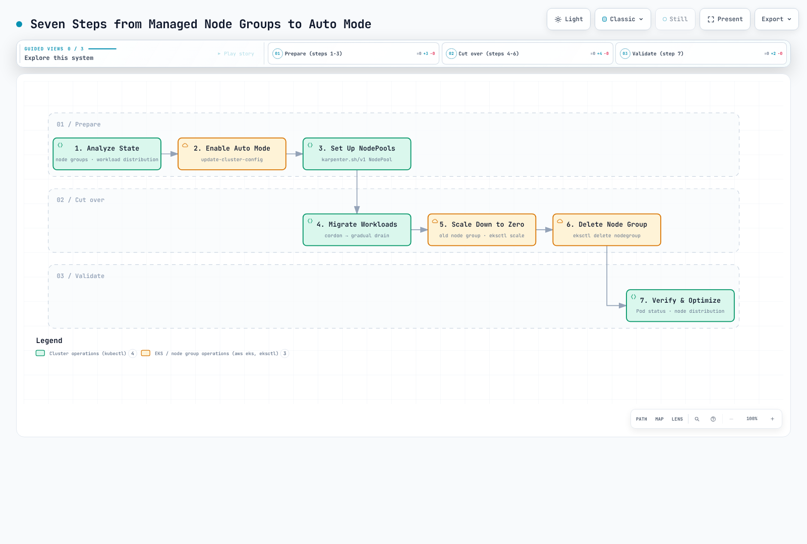

# 从托管节点组迁移到 Auto Mode

> **支持的版本**：EKS Auto Mode GA；示例已针对 EKS 1.36 进行审查
> **最后更新**：2026年9月12日

迁移需要在移除旧容量**之前**检查应用、存储和控制器所有权。以下示例是分阶段操作，使用本地检查过的架构和 CLI 固定样例；它们并非经过验证的生产环境零停机流程。本次审计期间未对云或集群进行任何变更。



[🔍 查看交互式图表](https://www.atomai.click/kubernetes-docs/archmaps/en-eks-auto-mode-09-migration-guide-0.html)

图表中的最后验证步骤并不授权在没有前置健康检查和回滚计划的情况下进行驱逐、缩容至零或删除。

## 1. 清点资源并绑定操作上下文

使用当前受支持的 EKS/附加组件组合。以前的 1.29 最低版本是历史性的功能下限，并非当前受支持版本的指导。确认兼容的 VPC CNI、kube-proxy、EBS CSI、快照控制器，以及在已安装时确认 Pod Identity Agent；使用官方迁移最低要求**以及**适用于实际 Kubernetes 版本的兼容性列表。

记录控制器所有权、工作负载放置位置、系统代理、卷/AZ、负载均衡器类别、IAM、恢复流程和成本。以下防护检查账户、集群 ARN/创建时间/API 端点，以及节点组 ARN/创建时间。这些是特定时间点的身份检查，并非防止并发控制器操作的原子锁。如果端点经过特意配置的代理，应审查替代方案，而不是悄悄绕过不匹配。

```bash
set -euo pipefail
: "${EXPECTED_ACCOUNT_ID:?Set the intended account}"
: "${AWS_REGION:?Set the cluster region}"
: "${CLUSTER_NAME:?Set the cluster name}"
: "${OLD_NODEGROUP:?Set the reviewed managed node group}"
: "${KUBECONFIG:?Set the reviewed kubeconfig}"
export KUBECONFIG
export KUBE_CONTEXT="${KUBE_CONTEXT:-$CLUSTER_NAME}"
check_account() {
  local actual
  actual=$(aws sts get-caller-identity --region "$AWS_REGION" --query Account --output text) || return
  test "$actual" = "$EXPECTED_ACCOUNT_ID" || { printf 'Account mismatch.\n' >&2; return 1; }
}
check_account
umask 077
export WORK_DIR
WORK_DIR=$(mktemp -d "$PWD/auto-migration.XXXXXXXX")
aws eks describe-cluster --name "$CLUSTER_NAME" --region "$AWS_REGION" --output json \
  > "$WORK_DIR/cluster-before.json"
aws eks describe-nodegroup --cluster-name "$CLUSTER_NAME" --nodegroup-name "$OLD_NODEGROUP" \
  --region "$AWS_REGION" --output json > "$WORK_DIR/nodegroup-before.json"
guard_context() {
  check_account || return
  local endpoint
  aws eks describe-cluster --name "$CLUSTER_NAME" --region "$AWS_REGION" --output json \
    > "$WORK_DIR/cluster-current.json" || return
  endpoint=$(kubectl --context "$KUBE_CONTEXT" config view --minify \
    -o jsonpath='{.clusters[0].cluster.server}') || return
  jq -e --arg endpoint "$endpoint" --slurpfile before "$WORK_DIR/cluster-before.json" '
    .cluster.arn == $before[0].cluster.arn and
    .cluster.createdAt == $before[0].cluster.createdAt and
    .cluster.endpoint == $endpoint and .cluster.status == "ACTIVE"
  ' "$WORK_DIR/cluster-current.json" >/dev/null
}
guard_nodegroup() {
  guard_context || return
  aws eks describe-nodegroup --cluster-name "$CLUSTER_NAME" --nodegroup-name "$OLD_NODEGROUP" \
    --region "$AWS_REGION" --output json > "$WORK_DIR/nodegroup-current.json" || return
  jq -e --slurpfile before "$WORK_DIR/nodegroup-before.json" '
    .nodegroup.nodegroupArn == $before[0].nodegroup.nodegroupArn and
    .nodegroup.createdAt == $before[0].nodegroup.createdAt and .nodegroup.status == "ACTIVE"
  ' "$WORK_DIR/nodegroup-current.json" >/dev/null
}
guard_nodegroup
printf 'Private migration evidence: %s\n' "$WORK_DIR"
```

```bash
kubectl --context "$KUBE_CONTEXT" --request-timeout=15s \
  get deployments,statefulsets,daemonsets,jobs,cronjobs -A -o json |
jq '[.items[] | (.spec.template // .spec.jobTemplate.spec.template) as $t |
 {kind,namespace:.metadata.namespace,name:.metadata.name,uid:.metadata.uid,
  nodeSelector:$t.spec.nodeSelector,affinity:$t.spec.affinity,tolerations:$t.spec.tolerations,
  serviceAccountName:$t.spec.serviceAccountName,hostNetwork:$t.spec.hostNetwork,
  pvcNames:[$t.spec.volumes[]?.persistentVolumeClaim.claimName // empty]}]' \
  > "$WORK_DIR/workload-placement.json"
kubectl --context "$KUBE_CONTEXT" --request-timeout=15s get pods -A -o json |
jq '[.items[] | {namespace:.metadata.namespace,name:.metadata.name,node:.spec.nodeName,
  phase:.status.phase,deletionTimestamp:.metadata.deletionTimestamp,
  ready:([.status.conditions[]?|select(.type=="Ready")|.status]|first // "NotReported"),
  owners:[.metadata.ownerReferences[]?|{kind,name,controller}]}]' \
  > "$WORK_DIR/pod-state.json"
```

这些私有文件包含操作元数据；请保留以供恢复使用。查询失败仍然是失败。`kubectl top` 需要可用的 metrics API，而当前 CPU 快照不能替代工作负载历史记录。

| 现有配置 | 迁移注意事项 |
|------------------------|-------------------------|
| 自定义 AMI/bootstrap/user data | Auto Mode 使用托管的 Bottlerocket，而不是任意 AL2023/自定义 AMI/userData |
| 节点 IAM 权限 | 准备节点角色/配置文件/访问条目；将工作负载权限迁移到经过审查的 IRSA/Pod Identity，而不是回退到节点角色/IMDS |
| 集群 IAM 角色 | 将所需 Auto Mode 权限/信任关系添加到现有角色；通过 CLI 启用不会自动创建所有角色 |
| 选择器/亲和性/污点 | 纳入 Deployments、StatefulSets、DaemonSets、Jobs 和 CronJobs；有意移除相互冲突的放置规则 |
| 替代 CNI/网络配置 | 启用前检查文档说明的兼容性；NodeClass 无法修复不受支持的网络配置 |
| 扩缩容/IaC 所有权 | 协调 Cluster Autoscaler、GitOps 和原始 IaC 所有者，避免它们撤销迁移变更 |

### 数据、负载均衡器和混合节点 DNS

驱动程序/控制器使用不同的接口：

| 资源 | 自行管理 | Auto Mode |
|----------|--------------|-----------|
| EBS StorageClass provisioner | `ebs.csi.aws.com` | `ebs.csi.eks.amazonaws.com` |
| NLB Service loadBalancerClass | `service.k8s.aws/nlb` | `eks.amazonaws.com/nlb` |
| ALB IngressClass controller | `ingress.k8s.aws/alb` | `eks.amazonaws.com/alb` |
| TargetGroupBinding apiVersion | `elbv2.k8s.aws/v1beta1` | `eks.amazonaws.com/v1` |
| 计算类别 | `karpenter.k8s.aws/v1 EC2NodeClass` | `eks.amazonaws.com/v1 NodeClass` |

编辑 StorageClass 名称不会让现有 PVC 切换驱动程序，托管控制器也不会自动接管现有负载均衡器。对于 EBS，请使用经过测试的备份/快照恢复方案，或遵循 AWS 当前文档中关于**停止工作负载、Retain、静态 PV/PVC 重建**的流程。后一种做法会重用 EBS 卷，但会重新创建 Kubernetes 绑定对象；这不是原位切换驱动程序。验证备份恢复、卷/AZ/KMS 所有权、回收策略、finalizer、绑定和应用一致性。此处不提供破坏性卷迁移脚本。

在自行管理的 AWS Load Balancer Controller 仍拥有资源期间，请保留该控制器。创建/测试新的托管负载均衡器，并在停用旧负载均衡器之前，通过经过审查的蓝绿 DNS 方案切换流量。分别审查类别不可变性、注解和 TargetGroupBinding 所有权；更改 API 组并不是安全的接管操作。

Auto Mode 节点使用节点本地 DNS。**只要仍有任何非 Auto 节点需要 CoreDNS Deployment，就应保留它**。为剩余节点类型保留所需的 CNI/proxy/storage/identity 代理，并限定其放置范围；纯 Auto Mode 的托管组件并不能作为提前移除混合集群依赖的理由。

## 2. 启用 Auto Mode，但不创建不受限的默认节点池

先完成 [Getting Started](./01-getting-started.md) 中的 IAM/访问准备。现有集群角色需要文档所述的 Compute、**BlockStoragePolicyV2**、LoadBalancing、Networking 和 Cluster 策略，以及所需的 `sts:TagSession` 信任关系。此示例要求使用 API 或 API_AND_CONFIG_MAP 身份验证，并预先准备好自定义节点角色/配置文件及 EC2 访问条目。

此分阶段流程从**不启用任何内置节点池**开始。因此，下一步会创建自己的 NodeClass；不要假定 `default` 已存在。启用不受限的通用节点池，可能会在预期切换之前调度现有的待处理工作负载。此示例会拒绝已运行 Auto Mode 的集群，而不会替换其现有节点池列表。

使用特定更新 ID 等待操作完成。集群状态为 `ACTIVE` 并不能单独证明此配置更新已成功。

```bash
wait_eks_update() {
  local id="$1" group="${2:-}" attempt status
  local extra=()
  test -n "$group" && extra=(--nodegroup-name "$group")
  for ((attempt=0; attempt<120; attempt++)); do
    aws eks describe-update --name "$CLUSTER_NAME" --region "$AWS_REGION" \
      --update-id "$id" "${extra[@]}" --output json > "$WORK_DIR/update-current.json" || return
    status=$(jq -er '.update.status' "$WORK_DIR/update-current.json") || return
    case "$status" in
      Successful) return 0 ;;
      Failed|Cancelled)
        jq '{id:.update.id,status:.update.status,errorCodes:[.update.errors[]?.errorCode]}' \
          "$WORK_DIR/update-current.json" >&2
        return 1 ;;
      InProgress) sleep 10 ;;
      *) printf 'Unknown update state; inspect saved evidence.\n' >&2; return 1 ;;
    esac
  done
  printf 'Update still unconfirmed; stop and retain its ID.\n' >&2
  return 1
}
```

```bash
guard_context
jq -e '.cluster.computeConfig.enabled != true and
       (.cluster.accessConfig.authenticationMode == "API" or
        .cluster.accessConfig.authenticationMode == "API_AND_CONFIG_MAP")' \
  "$WORK_DIR/cluster-current.json" >/dev/null
jq -n --arg name "$CLUSTER_NAME" '{
  name:$name,
  computeConfig:{enabled:true,nodePools:[]},
  storageConfig:{blockStorage:{enabled:true}},
  kubernetesNetworkConfig:{elasticLoadBalancing:{enabled:true}}
}' > "$WORK_DIR/enable-request.json"
aws eks update-cluster-config --region "$AWS_REGION" \
  --cli-input-json "file://$WORK_DIR/enable-request.json" --output json \
  > "$WORK_DIR/enable-response.json"
update_id=$(jq -er '.update.id' "$WORK_DIR/enable-response.json")
wait_eks_update "$update_id"
guard_context
jq -e '.cluster.computeConfig.enabled == true and
       .cluster.computeConfig.nodePools == [] and
       .cluster.storageConfig.blockStorage.enabled == true and
       .cluster.kubernetesNetworkConfig.elasticLoadBalancing.enabled == true' \
  "$WORK_DIR/cluster-current.json" >/dev/null
```

Compute、block storage 和托管负载均衡必须同时启用或同时禁用。原生请求验证并不能证明 IAM/服务准入一定会成功；遇到错误时应停止并保留更新证据。如果响应结果不确定，不要盲目重试。身份验证模式变更有单独的迁移/回滚限制。

## 3. 创建选择性节点池并测试两种节点

将 NodeClass 中的配置文件/子网/安全组占位符替换为经过审查的现有资源。配置文件对应的角色需要正确的节点访问条目；这些清单不会创建 IAM、VPC 或应用凭证。

```yaml
apiVersion: v1
kind: Namespace
metadata:
  name: migration-lab
  labels:
    pod-security.kubernetes.io/enforce: restricted
    pod-security.kubernetes.io/enforce-version: v1.36
    pod-security.kubernetes.io/warn: restricted
    pod-security.kubernetes.io/warn-version: v1.36
    pod-security.kubernetes.io/audit: restricted
    pod-security.kubernetes.io/audit-version: v1.36
---
apiVersion: eks.amazonaws.com/v1
kind: NodeClass
metadata:
  name: migration-nodeclass
spec:
  instanceProfile: eks-migration-node-profile
  subnetSelectorTerms:
  - tags:
      Name: private-subnet
  securityGroupSelectorTerms:
  - tags:
      Name: worker-restricted
  advancedNetworking:
    associatePublicIPAddress: false
  ephemeralStorage:
    size: 100Gi
    iops: 3000
    throughput: 125
---
apiVersion: karpenter.sh/v1
kind: NodePool
metadata:
  name: migration-pool
spec:
  template:
    spec:
      requirements:
      - key: eks.amazonaws.com/instance-category
        operator: In
        values:
        - m
      - key: karpenter.sh/capacity-type
        operator: In
        values:
        - on-demand
      nodeClassRef:
        group: eks.amazonaws.com
        kind: NodeClass
        name: migration-nodeclass
      expireAfter: 168h
      terminationGracePeriod: 24h
      taints:
      - key: migration
        value: auto-mode
        effect: NoSchedule
    metadata:
      labels:
        migration: auto-mode
  disruption:
    consolidationPolicy: WhenEmptyOrUnderutilized
    consolidateAfter: 2m
    budgets:
    - nodes: '1'
  limits:
    cpu: '32'
    memory: 128Gi
---
apiVersion: apps/v1
kind: Deployment
metadata:
  name: legacy-canary
  namespace: migration-lab
spec:
  replicas: 2
  selector:
    matchLabels:
      app: legacy-canary
  template:
    metadata:
      labels:
        app: legacy-canary
    spec:
      containers:
      - name: web
        image: nginxinc/nginx-unprivileged:1.30.6@sha256:455cebcadcac0b597cdeaab077d93fb8ad59a98f7ed001dcf8f8693154b5d3d3
        resources:
          requests:
            cpu: 100m
            memory: 64Mi
          limits:
            cpu: 500m
            memory: 128Mi
        ports:
        - containerPort: 8080
        securityContext:
          allowPrivilegeEscalation: false
          capabilities:
            drop:
            - ALL
          readOnlyRootFilesystem: true
        volumeMounts:
        - name: tmp
          mountPath: /tmp
        readinessProbe:
          httpGet:
            path: /
            port: 8080
          periodSeconds: 5
      terminationGracePeriodSeconds: 60
      automountServiceAccountToken: false
      nodeSelector:
        eks.amazonaws.com/nodegroup: REPLACE_WITH_OLD_NODEGROUP
      tolerations: []
      securityContext:
        runAsNonRoot: true
        runAsUser: 101
        runAsGroup: 101
        fsGroup: 101
        seccompProfile:
          type: RuntimeDefault
      volumes:
      - name: tmp
        emptyDir:
          sizeLimit: 128Mi
  strategy:
    type: RollingUpdate
    rollingUpdate:
      maxSurge: 1
      maxUnavailable: 0
---
apiVersion: apps/v1
kind: Deployment
metadata:
  name: auto-canary
  namespace: migration-lab
spec:
  replicas: 2
  selector:
    matchLabels:
      app: auto-canary
  template:
    metadata:
      labels:
        app: auto-canary
    spec:
      containers:
      - name: web
        image: nginxinc/nginx-unprivileged:1.30.6@sha256:455cebcadcac0b597cdeaab077d93fb8ad59a98f7ed001dcf8f8693154b5d3d3
        resources:
          requests:
            cpu: 100m
            memory: 64Mi
          limits:
            cpu: 500m
            memory: 128Mi
        ports:
        - containerPort: 8080
        securityContext:
          allowPrivilegeEscalation: false
          capabilities:
            drop:
            - ALL
          readOnlyRootFilesystem: true
        volumeMounts:
        - name: tmp
          mountPath: /tmp
        readinessProbe:
          httpGet:
            path: /
            port: 8080
          periodSeconds: 5
      terminationGracePeriodSeconds: 60
      automountServiceAccountToken: false
      nodeSelector:
        karpenter.sh/nodepool: migration-pool
        eks.amazonaws.com/compute-type: auto
      tolerations:
      - key: migration
        operator: Equal
        value: auto-mode
        effect: NoSchedule
      securityContext:
        runAsNonRoot: true
        runAsUser: 101
        runAsGroup: 101
        fsGroup: 101
        seccompProfile:
          type: RuntimeDefault
      volumes:
      - name: tmp
        emptyDir:
          sizeLimit: 128Mi
  strategy:
    type: RollingUpdate
    rollingUpdate:
      maxSurge: 1
      maxUnavailable: 0
```

使用旧版 canary 前，请替换 `REPLACE_WITH_OLD_NODEGROUP`。完整的 nginx 示例使用了运维章节中经过审查的非 root 镜像和安全上下文。它们测试基本的放置/就绪情况，但不测试应用状态、身份或流量路径。

Auto canary 同时选择精确的节点池和 `eks.amazonaws.com/compute-type=auto`。仅使用 `karpenter.sh/nodepool`，也会匹配自行管理的 Karpenter 节点。容忍度允许 Pod 放置，但本身并不能选择节点池。

| MNG 设置 | Auto Mode 对应项 |
|-------------|-------------------|
| 实例类型 / 容量类型 | 精确的实例要求或有意放宽的类别；容量类型要求 |
| 标签 / 污点 | `spec.template.metadata.labels` / `spec.template.spec.taints` |
| 最小/期望/最大节点数 | 不等同于 CPU/内存 `spec.limits`；如果需要固定的期望节点数，请考虑单独的静态节点池语义 |
| 子网 / 安全组 | 自定义 NodeClass 选择器和经过审查的规则 |
| AMI / bootstrap | Auto Mode 不支持任意 AMI 系列/userData 映射 |

## 4. 分批迁移，遇到失败即停止

先从有代表性的低风险工作负载开始，然后迁移到暂存/非关键生产工作负载；只有在依赖项通过检查后，才迁移关键工作负载。应修改**所属控制器/GitOps 的期望配置**，而不仅仅是实时 Pod。

审查完整的放置策略：如果添加 Auto 选择器时保留旧节点组选择器，两者的组合可能导致无法调度。不要使用 `affinity: null` 清除无关的 Pod 亲和性、安全放置规则或容忍度。StatefulSets、运行中的 Jobs 和本地卷工作负载需要各自的数据感知流程。

对于非零副本数的 Deployment，以下命令会检查 rollout 和观测到的副本就绪情况：

```bash
: "${WORKLOAD_NAMESPACE:?Select the namespace}"
: "${DEPLOYMENT_NAME:?Select one migrated Deployment}"
kubectl --context "$KUBE_CONTEXT" -n "$WORKLOAD_NAMESPACE" rollout status \
  "deployment/$DEPLOYMENT_NAME" --timeout=10m
kubectl --context "$KUBE_CONTEXT" --request-timeout=15s -n "$WORKLOAD_NAMESPACE" \
  get deployment "$DEPLOYMENT_NAME" -o json |
jq -e '(.spec.replicas // 1) as $desired |
  $desired > 0 and .status.observedGeneration >= .metadata.generation and
  .status.updatedReplicas == $desired and .status.readyReplicas == $desired and
  .status.availableReplicas == $desired' >/dev/null
```

还要验证实际请求、DNS、负载均衡器目标、卷/读写行为、身份、日志/指标和应用 SLO。Deployment 滚动更新设置与 PDB Eviction API 保护是不同的控制机制。单凭 `rollout status` 成功或 Pod 状态为 `Running`，不足以证明端到端可用；已完成的 Jobs 状态为 `Succeeded` 可能是正常情况。

### 可选：驱逐单个节点

只有在审查替代容量、工作负载放置、PDB 和数据持久性之后，才选择**一个**旧的托管节点及其记录的 UID：

```bash
: "${NODE_NAME:?Select exactly one old managed node}"
: "${EXPECTED_NODE_UID:?Set its previously reviewed UID}"
guard_nodegroup
kubectl --context "$KUBE_CONTEXT" --request-timeout=15s get node "$NODE_NAME" -o json \
  > "$WORK_DIR/node-before-drain.json"
jq -e --arg uid "$EXPECTED_NODE_UID" --arg group "$OLD_NODEGROUP" '
  .metadata.uid == $uid and .metadata.labels["eks.amazonaws.com/nodegroup"] == $group and
  .metadata.labels["eks.amazonaws.com/compute-type"] != "auto" and
  .metadata.deletionTimestamp == null and
  any(.status.conditions[]?; .type=="Ready" and .status=="True")
' "$WORK_DIR/node-before-drain.json" >/dev/null
kubectl --context "$KUBE_CONTEXT" drain "$NODE_NAME" --ignore-daemonsets --timeout=10m
printf 'Drain returned successfully. Validate application health before selecting another node.\n'
```

这里没有批量 cordon/drain 循环、固定等待时间的健康检查关卡，也没有“失败后继续”的逻辑。默认情况下，drain 会拒绝处理未受管理的 Pods/本地 emptyDir 数据，除非已进行有意处理；不要添加 `--force`、`--disable-eviction` 或 `--delete-emptydir-data` 来掩盖失败。drain 失败/中断可能会导致节点保持 cordoned：请检查该节点，并且仅在恢复计划要求时恢复调度。选择另一个节点之前，请验证受影响应用的状态。

## 5. 只有在旧工作负载清空后才缩容

**更改 MNG 的期望大小不会遵守 PDB**：EKS 使用 ASG 缩容。这与托管节点组版本更新期间的常规 drain 不同。将期望大小减半并等待五分钟，并不是安全的稳定措施。

与原始扩缩容/IaC 所有者协调，并阻止新的应用工作负载调度到旧节点上。以下 API 示例会检查所有已观测到的旧节点是否都已 cordoned，且不包含活跃的非 DaemonSet Pods，然后请求将最小和期望大小设为零。它无法消除忽略 cordon 或替换节点的控制器造成的竞争条件；请继续启用迁移放置控制。审查所有剩余 DaemonSet/系统依赖项，并先导出所需的已完成 job 工件。

```bash
guard_nodegroup
kubectl --context "$KUBE_CONTEXT" --request-timeout=15s get nodes \
  -l "eks.amazonaws.com/nodegroup=$OLD_NODEGROUP" -o json > "$WORK_DIR/old-nodes.json"
jq -e 'all(.items[]; .spec.unschedulable == true)' "$WORK_DIR/old-nodes.json" >/dev/null
kubectl --context "$KUBE_CONTEXT" --request-timeout=15s get pods -A -o json \
  | jq '{items:[.items[]|{metadata:{name:.metadata.name,namespace:.metadata.namespace,
         ownerReferences:.metadata.ownerReferences},spec:{nodeName:.spec.nodeName},
         status:{phase:.status.phase}}]}' > "$WORK_DIR/pods-before-scale.json"
jq --slurpfile nodes "$WORK_DIR/old-nodes.json" '
  ($nodes[0].items|map(.metadata.name)) as $names |
  [.items[] | select(.spec.nodeName as $n | $names|index($n)) |
   select(.status.phase!="Succeeded" and .status.phase!="Failed") |
   select(any(.metadata.ownerReferences[]?; .kind=="DaemonSet" and .controller==true)|not) |
   {namespace:.metadata.namespace,name:.metadata.name,phase:.status.phase}]
' "$WORK_DIR/pods-before-scale.json" > "$WORK_DIR/old-active-workloads.json"
jq -e 'length == 0' "$WORK_DIR/old-active-workloads.json" >/dev/null

guard_nodegroup
aws eks update-nodegroup-config --cluster-name "$CLUSTER_NAME" --nodegroup-name "$OLD_NODEGROUP" \
  --region "$AWS_REGION" --scaling-config minSize=0,desiredSize=0 --output json \
  > "$WORK_DIR/scale-zero-response.json"
update_id=$(jq -er '.update.id' "$WORK_DIR/scale-zero-response.json")
wait_eks_update "$update_id" "$OLD_NODEGROUP"
```

等待实际旧节点/实例消失，并重新检查应用健康状况。在约定的回滚期限内，保留节点组定义和记录的扩缩容配置。期望容量为零并不保证能够立即恢复容量。

## 6. 通过其所有者退役旧基础设施

工作负载/数据/流量验证成功并经过审慎设定的稳定期后，应通过**原始所有者**删除旧节点组：Terraform、CloudFormation、eksctl 或其他管理流程。直接通过 EKS API 删除由 IaC 管理的节点组可能导致状态漂移，并遗留堆栈、IAM 角色或其他资源。

以下操作仅适用于经过审查的**直接由 API 管理**的节点组。它要求期望大小为零，会重新检查节点/工作负载状态，并拒绝可见的 CloudFormation 所有权标签。此检查无法发现所有外部 IaC 所有者；确认所有权仍是前提条件。

```bash
guard_nodegroup
kubectl --context "$KUBE_CONTEXT" --request-timeout=15s get nodes \
  -l "eks.amazonaws.com/nodegroup=$OLD_NODEGROUP" -o json > "$WORK_DIR/old-nodes.json"
jq -e 'all(.items[]; .spec.unschedulable == true)' "$WORK_DIR/old-nodes.json" >/dev/null
kubectl --context "$KUBE_CONTEXT" --request-timeout=15s get pods -A -o json \
  | jq '{items:[.items[]|{metadata:{name:.metadata.name,namespace:.metadata.namespace,
         ownerReferences:.metadata.ownerReferences},spec:{nodeName:.spec.nodeName},
         status:{phase:.status.phase}}]}' > "$WORK_DIR/pods-before-scale.json"
jq --slurpfile nodes "$WORK_DIR/old-nodes.json" '
  ($nodes[0].items|map(.metadata.name)) as $names |
  [.items[] | select(.spec.nodeName as $n | $names|index($n)) |
   select(.status.phase!="Succeeded" and .status.phase!="Failed") |
   select(any(.metadata.ownerReferences[]?; .kind=="DaemonSet" and .controller==true)|not) |
   {namespace:.metadata.namespace,name:.metadata.name,phase:.status.phase}]
' "$WORK_DIR/pods-before-scale.json" > "$WORK_DIR/old-active-workloads.json"
jq -e 'length == 0' "$WORK_DIR/old-active-workloads.json" >/dev/null

: "${NODEGROUP_MANAGEMENT:?Use the original IaC owner, or explicitly set direct-api for an API-managed group}"
test "$NODEGROUP_MANAGEMENT" = direct-api
guard_nodegroup
jq -e '.nodegroup.scalingConfig.desiredSize == 0 and
  ((.nodegroup.tags // {} | keys | map(select(startswith("aws:cloudformation:"))) | length) == 0)' \
  "$WORK_DIR/nodegroup-current.json" >/dev/null
aws eks delete-nodegroup --cluster-name "$CLUSTER_NAME" --nodegroup-name "$OLD_NODEGROUP" \
  --region "$AWS_REGION" --output json > "$WORK_DIR/delete-nodegroup-response.json"
aws eks wait nodegroup-deleted --cluster-name "$CLUSTER_NAME" --nodegroup-name "$OLD_NODEGROUP" \
  --region "$AWS_REGION"
```

删除等待器必须成功。AccessDenied、凭证过期或其他查询失败并不表示资源不存在。应单独审计由其他所有者管理的 IAM/网络/存储资源以及账单；节点组 API 对象已删除并不能证明所有相关成本都已停止。此前示例中一到两周的稳定期是规划选择，并非普遍要求。

## 7. 最终验证和优化

保留每一批次的验证证据，并执行最终的清理后审计：检查预期控制器/Pod 的就绪状态、放置位置、PVC 健康状况、DNS、应用流量、IAM、日志/指标和完整的成本分配。**在共存期间**持续跟踪成本，因为两套计算资源以及可能存在的两套负载均衡器都可能产生费用。

此前提到的 Pending 0–5 / 连续五分钟 >10、启动时间 <90s / >120s、可用性 >99.9% / <99.5%，以及 API 响应时间 <200ms / >500ms，都是未经验证的示例阈值。应使用实际数据发布方、应用目标和测量基线，而不是假定的 Auto Mode 默认指标。

## 与自行管理的 Karpenter 共存

AWS 支持直接进行共存迁移。其 **v1.1** 要求是迁移功能下限；还必须满足当前的 Kubernetes 兼容性矩阵（例如，Kubernetes 1.36 至少需要 Karpenter 1.13）。在创建独立的带污点 Auto Mode 节点池并迁移选定工作负载组的同时，保持现有控制器运行。

迁移期间，不要修改/删除共享的 `nodepools.karpenter.sh` 或 `nodeclaims.karpenter.sh` CRD。通过 class 引用和精确节点池记录所有权，而不要依赖通用 Karpenter 标签。旧工作负载清空后，应仅在旧 NodePools/NodeClaims 的控制器仍能完成 finalization 时，退役由旧控制器拥有的资源。确认其实例/依赖项已清理后，再卸载自行管理的版本及其所拥有的 IAM/队列资源。不要先卸载控制器，也不要用删除命名空间代替资源清理。

## 移除 Auto 容量之前先回滚容量和放置配置

这是**工作负载/基础设施迁移回滚**，不是 Kubernetes 控制平面版本回滚。

1. 保留 Auto 节点池。先恢复或配置兼容的旧容量；如果旧节点组已删除，保存的扩缩容 JSON 不能重新创建它。
2. 根据当前工作负载需求审查记录的扩缩容值。对于仍然存在且身份未变的节点组，可使用以下命令恢复此前的设置：

```bash
guard_nodegroup
jq --arg name "$CLUSTER_NAME" --arg group "$OLD_NODEGROUP" '{
  clusterName:$name,nodegroupName:$group,scalingConfig:.nodegroup.scalingConfig
}' "$WORK_DIR/nodegroup-before.json" > "$WORK_DIR/restore-capacity-request.json"
aws eks update-nodegroup-config --region "$AWS_REGION" \
  --cli-input-json "file://$WORK_DIR/restore-capacity-request.json" --output json \
  > "$WORK_DIR/restore-capacity-response.json"
update_id=$(jq -er '.update.id' "$WORK_DIR/restore-capacity-response.json")
wait_eks_update "$update_id" "$OLD_NODEGROUP"
```

3. 等待足够数量的旧节点进入 Ready 状态，并确认网络/DNS/identity/storage 代理正常工作。更新成功状态并不能证明 Pod 容量已就绪。取消 cordon 仍存在的旧节点之前，先审查节点 UID。
4. 恢复经过审查的控制器放置/流量/数据方案。明确移除相互冲突的 Auto 选择器，同时保留无关亲和性。验证旧资源池上的实际工作负载就绪情况和应用行为。
5. 只有在此之后，才能通过其所有者退役确切的、由迁移创建的 Auto 节点池/资源。删除 NodePool 可能会级联删除其节点；绝不要将其作为回滚的第一步，也不要选择所有带有 Karpenter 标签的节点。

禁用 Auto Mode 是可选操作，且与上述步骤分开。首先解决所有由 Auto 管理的计算、存储和负载均衡器依赖项。如果适合进行此变更，三个标志必须放在同一个请求中；以下代码片段仅用于准备请求文件以供审查：

```bash
jq -n --arg name "$CLUSTER_NAME" '{
  name:$name,
  computeConfig:{enabled:false},
  storageConfig:{blockStorage:{enabled:false}},
  kubernetesNetworkConfig:{elasticLoadBalancing:{enabled:false}}
}' > "$WORK_DIR/disable-request.json"
```

如有需要，请通过经过审查的流程提交，并执行上下文检查和更新 ID 跟踪。禁用 Auto Mode 不会恢复应用选择器、数据或流量，也不会撤销身份验证模式变更。

## 参考资料

- [在现有集群上启用 Auto Mode](https://docs.aws.amazon.com/eks/latest/userguide/auto-enable-existing.html)
- [迁移参考：EBS 和负载均衡器](https://docs.aws.amazon.com/eks/latest/userguide/migrate-auto.html)
- [托管节点组迁移](https://docs.aws.amazon.com/eks/latest/userguide/auto-migrate-mng.html)
- [自行管理的 Karpenter 迁移](https://docs.aws.amazon.com/eks/latest/userguide/auto-migrate-karpenter.html)
- [托管节点组扩缩容和 PDB 行为](https://docs.aws.amazon.com/eks/latest/userguide/update-managed-node-group.html)
- [Auto Mode 网络和混合节点 DNS](https://docs.aws.amazon.com/eks/latest/userguide/auto-networking.html)
- [NodeClass 身份和访问条目](https://docs.aws.amazon.com/eks/latest/userguide/create-node-class.html)
- [Karpenter/Kubernetes 兼容性](https://karpenter.sh/docs/upgrading/compatibility/)
- [安全地 drain Kubernetes 节点](https://kubernetes.io/docs/tasks/administer-cluster/safely-drain-node/)
- [Kubernetes Pod 中断](https://kubernetes.io/docs/concepts/workloads/pods/disruptions/)

< [上一页：工作负载优化](./08-workload-optimization.md) | [目录](./README.md) | [返回 EKS 主题](../README.md) >
