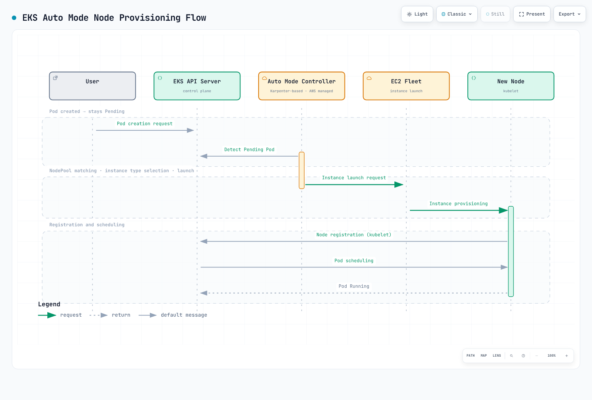

# EKS Auto Mode 运维指南

> **支持的版本**：EKS Auto Mode GA；示例基线为 EKS 1.36
> **最后更新**：2026年11月16日

Amazon EKS Auto Mode 可自动管理 Kubernetes 节点，包括根据工作负载要求进行配置和优化。本指南介绍 Auto Mode 的概念、配置和运维。AWS 管理 Auto Mode 基础设施；您仍需负责应用可用性、资源请求、安全、监控以及集群/VPC 配置。投入生产使用前，请在您的环境中验证示例。

### 2026年11月更新：支持 Pod 安全组

自 2026年11月11日起，EKS Auto Mode 支持 Pod 安全组，因此您可以为单个 Pod 应用专用的 EC2 安全组规则。同一节点上的不同工作负载可以使用不同的安全组，从而为 Pod 提供网络层隔离，而无需为每个应用创建单独的节点池。详情请参阅[公告](https://aws.amazon.com/about-aws/whats-new/2026/11/amazon-eks-auto-mode-security-groups-for-pods/)。

### 2026年11月更新：支持动态资源分配（DRA）

2026年11月9日，AWS 宣布 EKS Auto Mode 和 Karpenter 支持 Kubernetes 动态资源分配（DRA），适用于 NVIDIA GPU 和 Elastic Fabric Adapter（EFA）网络设备。工作负载通过 DRA 声明所需的设备属性，并可在多个 Pod 之间共享 GPU 设备。Karpenter 在所有 Kubernetes 版本上都支持 DRA；EKS Auto Mode 在 Kubernetes 1.36 及更高版本上支持该功能，适用于除 AWS GovCloud（美国）和中国区域以外的所有 AWS 区域。详情请参阅[公告](https://aws.amazon.com/about-aws/whats-new/2026/11/amazon-eks-auto-mode-karpenter-dra/)。

### 2026年10月更新：EKS 1.37 默认值

EKS 1.37 于 2026年10月1日推出。新建的自定义 NodePool 若未指定合并策略，默认使用 `Balanced`；内置的 `general-purpose` 和 `system` 池也使用 `Balanced`，且无法更改其策略。如果希望自定义池采用其他行为，请显式设置 `WhenEmptyOrUnderutilized`。本指南中的 NodePool 示例并非都设置了该字段，因此在 EKS 1.37 上创建这些示例时，会使用 `Balanced`。请参阅 [EKS 标准支持版本说明](https://docs.aws.amazon.com/eks/latest/userguide/kubernetes-versions-standard.html)中的 Kubernetes 1.37 部分。

### 2026年7月更新：支持 EFA 和置放群组

2026年7月22日，AWS 宣布 EKS Auto Mode 和开源 Karpenter 节点池支持 Elastic Fabric Adapter（EFA）网络设备配置和 EC2 置放群组。

在支持 EFA 的实例上，网络接口可配置为仅 EFA 接口或标准 ENI。仅 EFA 接口不会占用 VPC IP 地址，同时仍可提供完整的互连带宽。节点池配置还可指定集群、分散或分区置放策略。这些选项适用于需要高吞吐量或故障隔离的分布式训练和推理工作负载。详情请参阅[公告](https://aws.amazon.com/about-aws/whats-new/2026/07/amazon-eks-efa-placement-groups/)。

### 2026年7月更新：支持 ARC 可用区转移

自 2026年7月10日起，EKS Auto Mode 集群支持 Amazon Application Recovery Controller（ARC）可用区转移和自动转移。在集群上启用 ARC 可用区转移即可；Auto Mode 无需额外标志，也无需管理 Karpenter 版本。

在可用区转移期间，Auto Mode 会停止在受影响的可用区中配置容量，并暂停该可用区节点的主动中断操作，例如合并和漂移。如果在健康可用区中安排替换节点仍依赖受影响的可用区，Auto Mode 也会阻止这些可用区中的主动中断操作。集群注册后，需单独配置 ARC 可用区自动转移。

可用区转移无法使可用区级卷或严格绑定可用区的工作负载具备可移植性。ARC 不收取可用区转移费用；替换容量和常规基础设施费用仍然适用。详情请参阅[公告](https://aws.amazon.com/about-aws/whats-new/2026/07/eks-auto-mode-arc-zonal-shift)和 [ARC 可用区转移文档](https://docs.aws.amazon.com/eks/latest/userguide/zone-shift-enable.html)。

## 目录

1. [开始使用 Auto Mode](./01-getting-started.md) - 创建集群并启用 Auto Mode
2. [NodePool 配置和优化](./02-nodepool-configuration.md) - 默认和自定义 NodePool
3. [了解扩缩行为](./03-scaling-behavior.md) - 配置、合并、漂移检测
4. [Spot 实例使用策略](./04-spot-strategies.md) - 混合容量和中断处理
5. [运维和管理](./05-operations.md) - 中断预算、滚动替换、监控
6. [成本管理和优化](./06-cost-management.md) - 成本分析、Spot 节省、规格调整
7. [节点生命周期管理](./07-node-lifecycle.md) - 到期、AMI 管理、新鲜度策略
8. [工作负载专项优化](./08-workload-optimization.md) - Web、批处理、GPU、AI/ML 工作负载
9. [从托管节点组迁移](./09-migration-guide.md) - 迁移步骤和并存运行

---

## EKS Auto Mode 简介

### 什么是 Auto Mode？

EKS Auto Mode 是一项由 AWS 管理的全自动节点管理解决方案。它基于 Karpenter；AWS 负责运行托管基础设施控制器。用户配置工作负载约束、自定义 NodePool/NodeClass 和中断预算，而不必为 Auto Mode 另行安装 Karpenter 控制器。

```
+-----------------------------------------------------------------------------+
|                           EKS Auto Mode Architecture                         |
+-----------------------------------------------------------------------------+
|                                                                              |
|  +---------------------------------------------------------------------+    |
|  |                    EKS Control Plane (AWS Managed)                   |    |
|  |  +------------+  +------------+  +------------+  +------------+    |    |
|  |  | API Server |  |   etcd     |  | Controller |  |  Karpenter |    |    |
|  |  |            |  |            |  |  Manager   |  | Controller |    |    |
|  |  +------------+  +------------+  +------------+  +------------+    |    |
|  +---------------------------------------------------------------------+    |
|                                    |                                         |
|                                    v                                         |
|  +---------------------------------------------------------------------+    |
|  |                        NodePool Resources                            |    |
|  |  +------------------+  +------------------+  +------------------+  |    |
|  |  |  general-purpose |  |      system      |  |   custom-pool    |  |    |
|  |  | (Default Provided)|  | (Default Provided)|  |  (User Defined)  |  |    |
|  |  +------------------+  +------------------+  +------------------+  |    |
|  +---------------------------------------------------------------------+    |
|                                    |                                         |
|                                    v                                         |
|  +---------------------------------------------------------------------+    |
|  |                     EC2 Instances (Auto Managed)                     |    |
|  |  +--------------+  +--------------+  +--------------+              |    |
|  |  |   m6i.2xl    |  |   c7g.xl     |  |   r6i.4xl    |   ...        |    |
|  |  |  (On-Demand) |  |   (Spot)     |  |  (On-Demand) |              |    |
|  |  +--------------+  +--------------+  +--------------+              |    |
|  +---------------------------------------------------------------------+    |
|                                                                              |
+-----------------------------------------------------------------------------+
```

### 与现有管理方式的比较

| 功能 | 托管节点组 | Fargate | Auto Mode |
|---------|---------------------|---------|-----------|
| 节点管理 | AWS 管理节点组；您配置容量和更新 | AWS 管理每个 Pod 的基础设施 | AWS 管理已启动的节点和基础设施控制器 |
| 扩缩 | 如果已安装，则由 Cluster Autoscaler 负责；否则需显式扩缩组 | 按 Pod 配置 Fargate 资源 | 基于 Karpenter 为无法调度的 Pod 配置资源 |
| 配置时间 | 取决于容量、引导过程和工作负载 | 取决于容量、镜像和工作负载；并非即时完成 | 取决于容量、引导过程、镜像和约束；不保证固定耗时 |
| 实例选择 | 配置实例类型 | 托管计算规格 | 在 NodePool 和工作负载约束范围内选择 |
| Spot | 托管节点组支持 | EKS Fargate 不支持 | NodePool 允许时支持 |
| GPU 工作负载 | 在适用的节点上支持 | 不支持 | 在兼容的加速型实例上支持；仍需满足工作负载/运行时要求 |
| DaemonSet | 支持 | 不支持 | 在托管节点限制范围内支持 |
| 成本控制 | 资源请求、实例选择和自动扩缩策略 | Pod 资源规格和副本数 | 资源请求、允许的容量和合并策略；不保证节省成本 |
| 主机自定义 | AMI/启动模板选项 | 不支持主机自定义 | AWS 托管的 Bottlerocket 变体；支持的 NodeClass 设置 |

### 内部架构和运行原则

基于 Karpenter 的控制器由 AWS 在您的工作节点之外运行。图示为概念示意：调度器识别无法调度的 Pod，之后将其绑定到节点；API Server 存储这些对象。仅凭 Pod 处于 Pending 状态，不能断定增加节点就能解决问题。



[🔍 查看交互式图表](https://www.atomai.click/kubernetes-docs/archmaps/en-eks-auto-mode-readme-0.html)

### 支持的区域和限制

#### 区域和支持的版本

[EKS 常见问题](https://aws.amazon.com/eks/faqs/)列出了提供 Auto Mode 的 EKS 区域，其中包括 GovCloud（美国），但不包括中国区域。请另外确认区域内实例/功能的可用情况。先前列出的简短区域清单并不完整。

常见问题中原有的 `1.29+` 功能最低版本要求，并不意味着仍可创建所有这些版本，也不意味着它们都仍处于标准支持期。截至 2026年10月12日，EKS 1.34–1.37 处于标准支持期；本指南中的示例仍采用经过审核的 1.36 基线。有关生命周期日期和延长支持费用，请参阅[当前 EKS 版本日历](https://docs.aws.amazon.com/eks/latest/userguide/kubernetes-versions.html)。

#### 需要检查的限制

| 项目 | 指南 |
|------|----------|
| 容量和规模 | 检查已应用的 EKS/EC2 配额、子网 IP 容量和工作负载约束；在您的环境中验证预期规模 |
| NodePool 限制 | 用户定义的资源限制不同于 AWS 账户/服务配额；请验证规模和替换余量 |
| 操作系统 | AWS 会选择其托管的 Bottlerocket 变体；AL2023 或任意自定义 AMI 不能作为 Auto Mode AMI 选项 |
| Windows | Auto Mode 不提供 Windows 节点；如有需要，请使用兼容的独立节点组 |
| DNS 和存储 | Auto Mode 节点提供本地 CoreDNS；混合型集群会为其他节点保留 CoreDNS。托管节点磁盘加密并不意味着每个动态 PVC 都已加密；请显式设置 StorageClass |

请使用 [Service Quotas](https://docs.aws.amazon.com/eks/latest/userguide/service-quotas.html) 和 [NodeClass 参考文档](https://docs.aws.amazon.com/eks/latest/userguide/create-node-class.html)核实相关限制。本次审查期间未查询实际账户配额和实例容量。

---

## 后续步骤

成功配置 EKS Auto Mode 后，我们建议您学习以下主题：

1. **[EKS 成本优化](../eks/07-eks-cost-optimization.md)**：Spot、Savings Plans、资源优化
2. **[EKS 监控和日志记录](../eks/06-eks-monitoring-logging.md)**：CloudWatch、Prometheus、Grafana
3. **[EKS 安全](../eks/05-eks-security.md)**：IAM、网络策略、Pod 安全
4. **[深入了解 Karpenter](../autoscaling/02-karpenter.md)**：直接安装 Karpenter 和高级功能

## 相关测验

要检验您的学习成果，请尝试 [EKS Auto Mode 测验](../quizzes/eks-auto-mode/01-getting-started-quiz.md)。

---

## 参考资料

- [AWS EKS Auto Mode 官方文档](https://docs.aws.amazon.com/eks/latest/userguide/automode.html)
- [Karpenter 官方文档](https://karpenter.sh/)
- [EKS 最佳实践指南](https://docs.aws.amazon.com/eks/latest/best-practices/)
- [AWS 成本优化指南](https://aws.amazon.com/pricing/cost-optimization/)
- [增强安全性、网络控制和性能的 EKS Auto Mode 新功能（AWS Containers Blog，2025-10-16）](https://aws.amazon.com/blogs/containers/new-amazon-eks-auto-mode-features-for-enhanced-security-network-control-and-performance/)
- [从自行管理的 Karpenter 迁移到 EKS Auto Mode](https://docs.aws.amazon.com/eks/latest/userguide/auto-migrate-karpenter.html)

- [Auto Mode 架构和职责](https://docs.aws.amazon.com/eks/latest/userguide/automode.html)
- [EKS Fargate 限制](https://docs.aws.amazon.com/eks/latest/userguide/fargate.html)

---

< [返回 EKS 主题](../README.md) | [下一篇：开始使用](./01-getting-started.md) >
