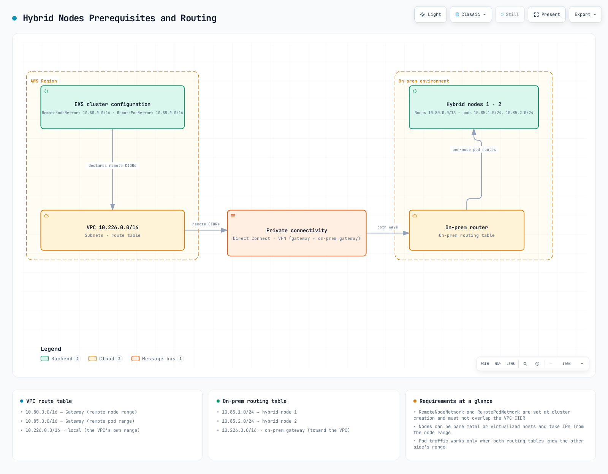
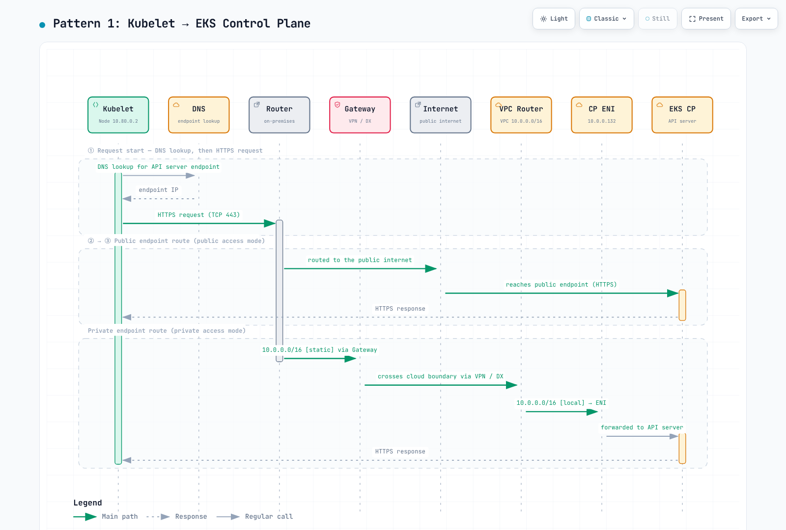
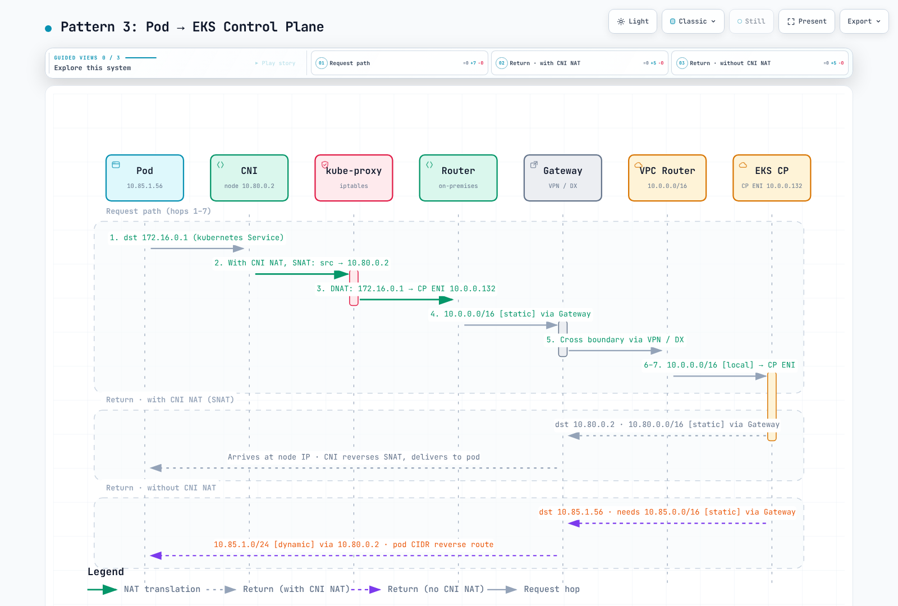
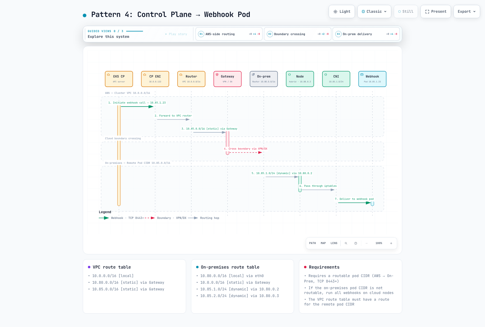
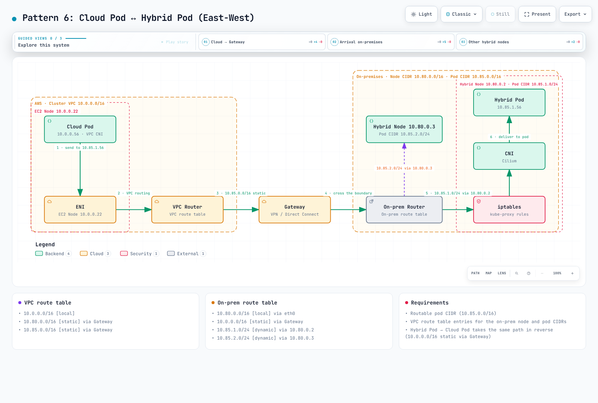
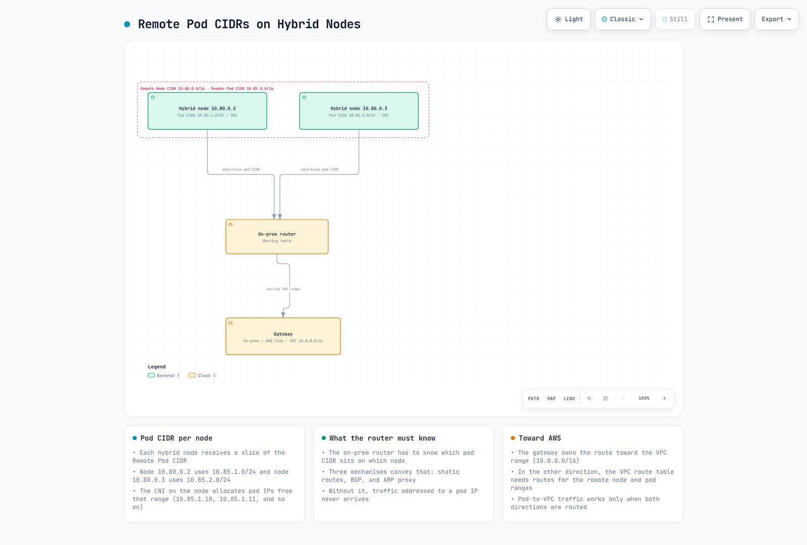
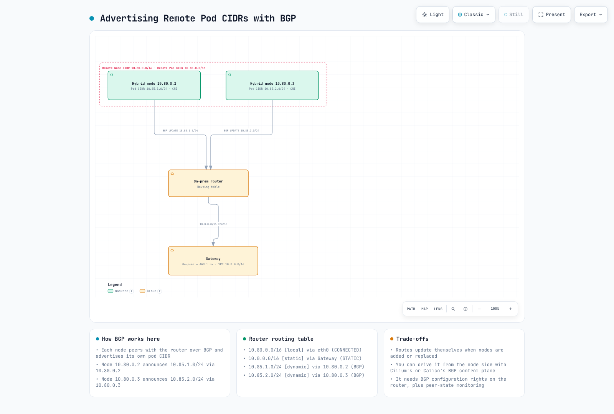
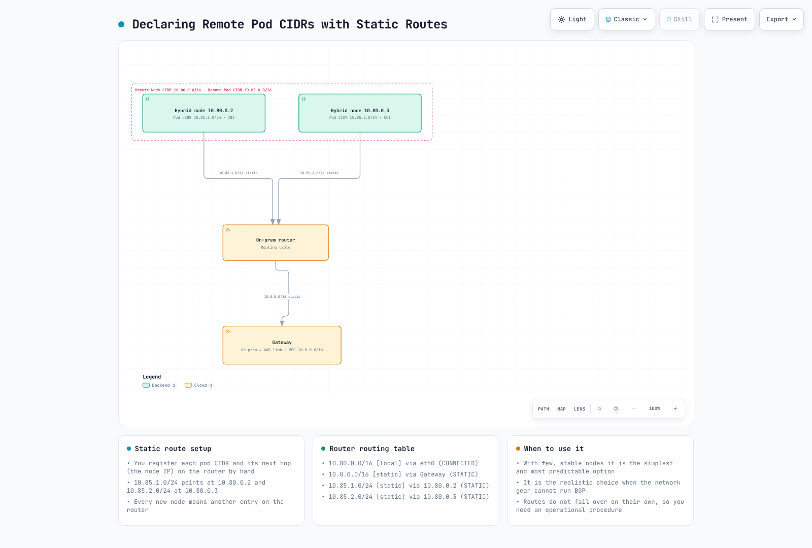

# 网络配置

> **支持的版本**：EKS 1.36 示例；AWS 维护的 Cilium 1.18.3-0 参考版本，要求兼容的主机/内核
> **最后更新**：October 18, 2026

分别验证路由、DNS、TLS、凭证和应用流量。这些示例已使用本地 schema 和测试夹具进行检查，其中包括模拟的 Terraform provider；没有更改任何 AWS 资源、路由器、防火墙或运行中的集群。这些图示是基于 AWS 概念制作的仓库插图，并非 AWS 对此配置的验证。



[🔍 查看交互式图示](https://www.atomai.click/kubernetes-docs/archmaps/en-eks-hybrid-nodes-prereq-0.html)

**安全团队配套文档：**[混合节点网络隔离审查](11-network-separation-security.md)介绍新的控制平面到本地部署环境的连接、端点类型、权限和数据边界，以及审查证据。仅有私有连接并不能证明符合规范。

## 网络架构概述

控制平面→混合节点流量和私有 Kubernetes API 流量使用集群 VPC 网络路径。Kubelet 到公有 API 端点的流量则使用其配置的公有路由；“所有流量始终都经过 VPC ENI”的说法过于宽泛。Direct Connect 公有 VIF、私有连接和公有互联网路径是不同的选择。

EKS 控制平面 ENI/IP 可能发生变化。请审查集群的实际归属和获批的控制平面子网范围，不要将共享 VPC 中的所有 `Amazon EKS*` ENI 都视为属于此集群。

在执行只读诊断前，绑定账户和 Kubernetes 上下文：

```bash
set -euo pipefail
: "${EXPECTED_ACCOUNT_ID:?Set the intended account}"
: "${AWS_REGION:?Set the cluster Region}"
: "${CLUSTER_NAME:?Set the reviewed cluster name}"
: "${KUBECONFIG:?Set the reviewed kubeconfig}"
export KUBECONFIG KUBE_CONTEXT="${KUBE_CONTEXT:-$CLUSTER_NAME}"
check_account() {
  local account
  account=$(aws sts get-caller-identity --region "$AWS_REGION" --query Account --output text) || return
  test "$account" = "$EXPECTED_ACCOUNT_ID" || { printf 'Account mismatch.\n' >&2; return 1; }
}
check_account
umask 077
export WORK_DIR
WORK_DIR=$(mktemp -d "$PWD/hybrid-network.XXXXXXXX")
aws eks describe-cluster --region "$AWS_REGION" --name "$CLUSTER_NAME" --output json \
  > "$WORK_DIR/cluster.json"
endpoint=$(kubectl --context "$KUBE_CONTEXT" config view --minify \
  -o jsonpath='{.clusters[0].cluster.server}')
jq -e --arg endpoint "$endpoint" '
  .cluster.status=="ACTIVE" and .cluster.endpoint==$endpoint and
  (.cluster.remoteNetworkConfig.remoteNodeNetworks|length)>0
' "$WORK_DIR/cluster.json" >/dev/null
printf 'Private diagnostics: %s\n' "$WORK_DIR"
```

## CIDR 范围要求

远程节点/Pod 网络应使用互不重叠的 IPv4 **RFC1918 或 CGNAT** 地址范围，并与 VPC 和 Kubernetes Service CIDR 分开。每种远程网络类型最多支持 15 个 CIDR。目前 EKS 支持通过 API 工作流在现有集群上配置远程网络；这并非只能在创建集群时配置。

| 网络行为 | 含义 |
|------------------|---------|
| 可路由的 Pod IP | 获批的路由允许云端/控制平面客户端发起与 Pod IP 的连接 |
| 经伪装的出站流量 | SNAT 可为由 Pod 发起的连接提供返回路径；这不会自动允许新的入站连接 |
| 不可路由的 Pod 网络 | 直接的云端→Pod 流量需要其他受支持的路径；传统设计中应使用云托管的 webhook/API 服务 |

不可路由并不意味着 Pod 无法发起任何 AWS API 调用。对于直接的混合/云端 Pod 通信以及由混合环境托管的 webhook，请提供实际的 Pod 路由。网关/代理替代方案有各自单独的要求。

## 所需防火墙端口

| 流量方向 | 协议 / 端口 |
|------|-----------------|
| Node/Pod → Kubernetes API | 到实际集群端点的 TCP443 |
| 控制平面 ENI → kubelet | TCP10250，并启用 kubelet 身份验证/授权 |
| 控制平面 → webhook 或聚合 API Pod | 其配置的 TCP 端口，而不是通用的“8443+”范围 |
| DNS 客户端 ↔ 实际解析器 | UDP/TCP53 及有状态返回流量 |
| 参与节点之间的 Cilium VXLAN | UDP8472 |
| Cilium Geneve，仅在为该设计选择且受支持时使用 | UDP6081 |
| Cilium 健康检查 | TCP4240 以及所需的 ICMP/健康端点可达性 |
| BGP 节点↔路由器 | 为配置的主/备 peer 使用 TCP179 |
| VPN 网关传输 | UDP500/4500 及适用的 IPsec 传输要求 |
| 应用 / AWS 凭证和镜像仓库服务 | 仅限其实际目的地和端口 |

请通过网络所有者应用防火墙变更，并保留连接跟踪和现有规则。旧的宽泛 `10.0.0.0/8` INPUT 规则、未限定范围的 DNS/VXLAN 放行规则，以及保存整个规则集的做法，都不是可安全复用的防火墙策略。不要将未经身份验证的 kubelet 10255 作为现代环境的可选要求开放。

## AWS 端点访问

**EKS 管理 API PrivateLink 端点不是 Kubernetes API server 端点。**

| `com.amazonaws.<region>.*` 的服务后缀 | 用途 / 需要时机 |
|------------------------------------------------|-----------------------|
| `eks` | AWS EKS 管理调用，例如 DescribeCluster |
| `eks-auth` | 使用 EKS Pod Identity 时 |
| `ecr.api`、`ecr.dkr` | 私有 ECR API/镜像仓库；镜像层还需要 S3 访问 |
| `s3` | 私有 S3 访问；本地部署环境无法直接使用 VPC gateway endpoint |
| `ssm`、适用的 SSM messaging 服务 | SSM 凭证/管理功能 |
| `rolesanywhere` | 使用该 provider 时获取 IAM Roles Anywhere 凭证 |
| `sts` | 实际客户端 STS/IRSA/AssumeRole 调用；在本地签署 EKS token 本身并不会产生客户端 STS 网络请求 |
| `logs`、`monitoring`、其他选定服务 | 仅当所选 agent/workload 会调用这些服务时 |
| `oidc-eks` | 当前 EKS OIDC discovery/JWKS PrivateLink 服务（如有提供） |
| `eks-proxy` | AWS 控制台资源视图；不是公有应用 SDK/API |

请确认目标区域中是否提供这些服务。私有 ECR 端点不会让**公有 ECR**、CloudFront 或任意软件包仓库变成私有服务。例如，位于公有 ECR 的 AWS Cilium OCI chart 需要经过批准且可访问/已镜像的分发路径。

OIDC discovery/JWKS 是匿名的公钥材料。`oidc-eks` 仅接受其默认的完全访问端点策略；请使用 SG/路由控制可达性，并使用 IAM trust `aud`/`sub` 条件进行角色授权。STS 会在 AWS 内部验证 IRSA token，这与此 VPC endpoint 相互独立。

对于 Roles Anywhere CreateSession 端点策略，principal 必须为 `*`，因为策略评估发生在证书身份验证之前；请按文档限制获批的 trust-anchor 资源和受支持的证书条件。不要将一个通用端点策略复制到这些不同服务上。端点策略用于筛选端点流量；它们不能取代 IAM/role trust，也不会在全局范围内禁用公有服务端点。

```bash
check_account
vpc_id=$(jq -er '.cluster.resourcesVpcConfig.vpcId' "$WORK_DIR/cluster.json")
aws ec2 describe-vpc-endpoints --region "$AWS_REGION" \
  --filters "Name=vpc-id,Values=$vpc_id" --output json |
  jq '[.VpcEndpoints[]|{id:.VpcEndpointId,service:.ServiceName,type:.VpcEndpointType,
      state:.State,privateDNS:.PrivateDnsEnabled,dnsOptions:.DnsOptions,
      subnets:.SubnetIds,groups:.Groups,dnsEntries:.DnsEntries}]'
```

### S3 私有 DNS 和构件分发

S3 **interface endpoint 支持私有 DNS**。仅限入站 Resolver 的选项会将本地部署环境的查询导向 interface endpoint，同时要求 VPC 内流量使用 S3 gateway endpoint。启用此选项期间，请保留该 gateway。或者，清除此选项，让所有相关 S3 流量都使用 interface endpoint。

私有 DNS 并非 TLS 重写。将 `hybrid-assets.eks.amazonaws.com` 映射到 S3 endpoint 的 PHZ/CNAME，不会让 S3 获得 CloudFront 主机名的证书或对象/Host 路由行为。不要通过禁用 TLS 验证让此类镜像生效。请使用受支持的构件准备/客户端配置路径、具有自身主机名/证书且获批的镜像，或在经过验证的镜像中预装依赖项。

## VPC 私有端点（受限互联网连接） {#vpc-private-endpoints-air-gap-private-connectivity}

此处的“air-gap”指受限的互联网访问并保留所需的 AWS 连接，而非断开连接的集群。

以下完整 Terraform 示例使用现有 VPC、端点子网和 TGW。它不会创建 VPN/DX 专线、TGW attachment、本地部署路由或 EKS 私有 DNS 配置。请验证 VPC DNS support/hostnames 以及实际不同的 AZ；仅有两个不同的子网 ID 并不能证明 AZ 多样性。

请与原始基础设施所有者合作，并在规划替换之前导入/接管现有资源。默认端点集用于展示 SSM；请根据所选 provider/workload 进行调整。端点和 Resolver ENI 会产生费用。Provider 账户防护和限定范围的入站规则都是有意设置的；响应流量使用有状态 SG 跟踪。

```hcl
terraform {
  required_version = ">= 1.9, < 2.0"
  required_providers {
    aws = {
      source  = "hashicorp/aws"
      version = "= 6.69.1"
    }
  }
}

provider "aws" {
  region              = var.region
  allowed_account_ids = [var.expected_account_id]
}

variable "expected_account_id" {
  type = string
  validation {
    condition     = can(regex("^[0-9]{12}$", var.expected_account_id))
    error_message = "Set the reviewed 12-digit account ID."
  }
}

variable "region" {
  type = string
}

variable "name_prefix" {
  type    = string
  default = "hybrid-network"
}

variable "vpc_id" {
  type = string
}

variable "endpoint_subnet_ids" {
  type = set(string)
  validation {
    condition     = length(var.endpoint_subnet_ids) >= 2
    error_message = "Provide subnets in at least two verified Availability Zones."
  }
}

variable "s3_gateway_route_table_ids" {
  type = set(string)
  validation {
    condition     = length(var.s3_gateway_route_table_ids) > 0
    error_message = "Provide the reviewed VPC route tables for the S3 gateway endpoint."
  }
}

variable "client_ipv4_cidrs" {
  type = set(string)
  validation {
    condition = length(var.client_ipv4_cidrs) > 0 && alltrue([
      for c in var.client_ipv4_cidrs : can(cidrnetmask(c)) && c != "0.0.0.0/0"
    ])
    error_message = "Provide scoped IPv4 CIDRs for the actual VPC/on-premises clients."
  }
}

variable "onprem_dns_client_cidrs" {
  type = set(string)
  validation {
    condition = length(var.onprem_dns_client_cidrs) > 0 && alltrue([
      for c in var.onprem_dns_client_cidrs : can(cidrnetmask(c)) && c != "0.0.0.0/0"
    ])
    error_message = "Scope inbound DNS to the actual on-premises resolvers."
  }
}

variable "onprem_dns_servers" {
  type = set(string)
  validation {
    condition = length(var.onprem_dns_servers) > 0 && alltrue([
      for ip in var.onprem_dns_servers : can(cidrnetmask("${ip}/32"))
    ])
    error_message = "Provide actual IPv4 addresses of the on-premises DNS servers."
  }
}

variable "onprem_domain" {
  type    = string
  default = "corp.example.internal"
  validation {
    condition = length(var.onprem_domain) <= 253 && length(split(".", trimsuffix(var.onprem_domain, "."))) >= 2 && alltrue([
      for label in split(".", trimsuffix(var.onprem_domain, ".")) :
      length(label) <= 63 && can(regex("^[A-Za-z0-9]([A-Za-z0-9-]*[A-Za-z0-9])?$", label))
    ]) && !can(regex("(^|\\.)(amazonaws\\.com|api\\.aws|cluster\\.local)\\.?$", lower(var.onprem_domain)))
    error_message = "Use a specific owned DNS suffix; do not forward root, AWS or Kubernetes service zones back to on-premises."
  }
}

variable "interface_services" {
  type    = set(string)
  default = ["eks", "ecr.api", "ecr.dkr", "ssm", "ssmmessages"]
  validation {
    condition     = !contains(var.interface_services, "s3")
    error_message = "S3 has its own gateway/interface configuration below."
  }
}

variable "endpoint_policy_json" {
  type    = map(string)
  default = {}
  validation {
    condition = !contains(keys(var.endpoint_policy_json), "oidc-eks") && alltrue([
      for policy in values(var.endpoint_policy_json) : can(jsondecode(policy))
    ])
    error_message = "Use valid service-specific JSON policies; oidc-eks supports only its default full-access policy."
  }
}

variable "controlplane_route_table_ids" {
  type = set(string)
}

variable "remote_ipv4_cidrs" {
  type = set(string)
  validation {
    condition = alltrue([
      for c in var.remote_ipv4_cidrs : can(cidrnetmask(c)) && c != "0.0.0.0/0"
    ])
    error_message = "Use reviewed remote node, Pod and required DNS/service IPv4 CIDRs."
  }
}

variable "existing_transit_gateway_id" {
  type = string
}
```
```hcl
# Import/adopt existing resources through their owner before using this example.
# The existing VPC must have DNS support/hostnames and working hybrid routes.
resource "aws_security_group" "endpoints" {
  name_prefix = "${var.name_prefix}-vpce-"
  description = "HTTPS clients for interface endpoints"
  vpc_id      = var.vpc_id
}

resource "aws_vpc_security_group_ingress_rule" "endpoint_https" {
  for_each          = var.client_ipv4_cidrs
  security_group_id = aws_security_group.endpoints.id
  cidr_ipv4         = each.value
  ip_protocol       = "tcp"
  from_port         = 443
  to_port           = 443
}

resource "aws_vpc_endpoint" "service" {
  for_each            = var.interface_services
  vpc_id              = var.vpc_id
  service_name        = "com.amazonaws.${var.region}.${each.value}"
  vpc_endpoint_type   = "Interface"
  private_dns_enabled = true
  subnet_ids          = var.endpoint_subnet_ids
  security_group_ids  = [aws_security_group.endpoints.id]
  policy              = lookup(var.endpoint_policy_json, each.key, null)
  tags                = { Name = "${var.name_prefix}-${each.key}" }
}

# S3 inbound-Resolver-only private DNS requires this gateway endpoint.
resource "aws_vpc_endpoint" "s3_gateway" {
  vpc_id            = var.vpc_id
  service_name      = "com.amazonaws.${var.region}.s3"
  vpc_endpoint_type = "Gateway"
  route_table_ids   = var.s3_gateway_route_table_ids
  tags             = { Name = "${var.name_prefix}-s3-gateway" }
}

resource "aws_vpc_endpoint" "s3_interface" {
  vpc_id              = var.vpc_id
  service_name        = "com.amazonaws.${var.region}.s3"
  vpc_endpoint_type   = "Interface"
  private_dns_enabled = true
  subnet_ids          = var.endpoint_subnet_ids
  security_group_ids  = [aws_security_group.endpoints.id]
  dns_options {
    private_dns_only_for_inbound_resolver_endpoint = true
  }
  depends_on = [aws_vpc_endpoint.s3_gateway]
  tags       = { Name = "${var.name_prefix}-s3-interface" }
}

resource "aws_security_group" "dns_inbound" {
  name_prefix = "${var.name_prefix}-dns-in-"
  description = "DNS from on-premises resolvers"
  vpc_id      = var.vpc_id
}

resource "aws_security_group" "dns_outbound" {
  name_prefix = "${var.name_prefix}-dns-out-"
  description = "DNS to reviewed on-premises resolvers"
  vpc_id      = var.vpc_id
}

locals {
  inbound_dns_rules = {
    for pair in setproduct(var.onprem_dns_client_cidrs, toset(["tcp", "udp"])) :
    "${pair[0]}-${pair[1]}" => { cidr = pair[0], protocol = pair[1] }
  }
  outbound_dns_rules = {
    for pair in setproduct(var.onprem_dns_servers, toset(["tcp", "udp"])) :
    "${pair[0]}-${pair[1]}" => { ip = pair[0], protocol = pair[1] }
  }
}

resource "aws_vpc_security_group_ingress_rule" "dns" {
  for_each          = local.inbound_dns_rules
  security_group_id = aws_security_group.dns_inbound.id
  cidr_ipv4         = each.value.cidr
  ip_protocol       = each.value.protocol
  from_port         = 53
  to_port           = 53
}

resource "aws_vpc_security_group_egress_rule" "dns" {
  for_each          = local.outbound_dns_rules
  security_group_id = aws_security_group.dns_outbound.id
  cidr_ipv4         = "${each.value.ip}/32"
  ip_protocol       = each.value.protocol
  from_port         = 53
  to_port           = 53
}

resource "aws_route53_resolver_endpoint" "inbound" {
  name                   = "${var.name_prefix}-inbound"
  direction              = "INBOUND"
  resolver_endpoint_type = "IPV4"
  security_group_ids     = [aws_security_group.dns_inbound.id]
  dynamic "ip_address" {
    for_each = var.endpoint_subnet_ids
    content {
      subnet_id = ip_address.value
    }
  }
}

resource "aws_route53_resolver_endpoint" "outbound" {
  name                   = "${var.name_prefix}-outbound"
  direction              = "OUTBOUND"
  resolver_endpoint_type = "IPV4"
  security_group_ids     = [aws_security_group.dns_outbound.id]
  dynamic "ip_address" {
    for_each = var.endpoint_subnet_ids
    content {
      subnet_id = ip_address.value
    }
  }
}

resource "aws_route53_resolver_rule" "onprem" {
  domain_name          = var.onprem_domain
  name                 = "${var.name_prefix}-onprem"
  rule_type            = "FORWARD"
  resolver_endpoint_id = aws_route53_resolver_endpoint.outbound.id
  dynamic "target_ip" {
    for_each = var.onprem_dns_servers
    content {
      ip   = target_ip.value
      port = 53
    }
  }
}

resource "aws_route53_resolver_rule_association" "onprem" {
  resolver_rule_id = aws_route53_resolver_rule.onprem.id
  vpc_id           = var.vpc_id
}

output "inbound_resolver_ips" {
  value = [for address in aws_route53_resolver_endpoint.inbound.ip_address : address.ip]
}

# VPC return routes only. Existing TGW attachment routes/propagation and
# on-premises routing must be managed separately by their infrastructure owner.
locals {
  remote_routes = {
    for pair in setproduct(var.controlplane_route_table_ids, var.remote_ipv4_cidrs) :
    "${pair[0]}-${pair[1]}" => { table = pair[0], cidr = pair[1] }
  }
}

resource "aws_route" "hybrid" {
  for_each               = local.remote_routes
  route_table_id         = each.value.table
  destination_cidr_block = each.value.cidr
  transit_gateway_id     = var.existing_transit_gateway_id
  # A VGW topology uses gateway_id instead; do not set both target fields.
}
```

S3 gateway 依赖关系是显式的。请将所需的本地部署 DNS/服务范围纳入 `remote_ipv4_cidrs`，而不仅仅是节点/Pod 网络：示例中的 DNS server `192.168.1.10/11` 需要获批的 `192.168.1.0/24` 路由或相应的主机路由。对于 VGW 返回路由，请使用 `gateway_id` 而不是 `transit_gateway_id`；不要将 TGW ID 放入 VGW/gateway 字段，也不要同时配置两个目标。仅有 VPC 路由并不能建立 TGW/VPN/本地部署路由。

## DNS 配置

本地部署的解析器可以有条件地将选定的 AWS/服务名称以及实际集群端点名称转发到 Route 53 Resolver 入站 IP。请使用实际端点返回的地址。宽泛地转发 `amazonaws.com` 可能会影响无关服务；请谨慎选择区域并避免转发环路。

```text
// Example service zones only. Replace these Resolver IPs with actual outputs.
zone "eks.ap-northeast-2.amazonaws.com" {
    type forward;
    forward only;
    forwarders { 10.0.1.10; 10.0.2.10; };
};
zone "s3.ap-northeast-2.amazonaws.com" {
    type forward;
    forward only;
    forwarders { 10.0.1.10; 10.0.2.10; };
};
```

此 BIND 片段仅覆盖所示服务区域，不会自动覆盖 Kubernetes API 主机名。请从经过验证的服务清单中添加实际集群端点的 DNS 名称/后缀和其他所需名称。Resolver outbound 规则处理本地部署区域；该区域必须由所选 DNS server 提供权威解析/可访问，而不能再转发回同一环路。

### CoreDNS 自定义域名配置

如果所选设计会从 CoreDNS 直接转发，请将经过审查的 server block 合并到现有 Corefile；不要覆盖整个托管 ConfigMap：

```text
# Fragment to merge through the CoreDNS configuration owner.
corp.example.internal:53 {
    errors
    cache 30
    forward . 192.168.1.10 192.168.1.11 {
        max_concurrent 1000
    }
}
```

请保留现有 Kubernetes 区域、健康/就绪状态和 reload 行为。检查实际的解析器文件和 systemd-resolved/stub 布局；将 DNS server 转发回自身可能造成环路。针对某个区域，请选择适当的 VPC 转发路径或显式 CoreDNS 转发，而不要叠加相互矛盾的路由。

对于托管 EKS add-on，请获取**已安装版本的**配置 schema，并验证完整的拟议值，同时保留无关的现有设置：

```bash
check_account
aws eks describe-addon --region "$AWS_REGION" --cluster-name "$CLUSTER_NAME" \
  --addon-name coredns --output json > "$WORK_DIR/coredns-addon.json"
addon_version=$(jq -er '.addon.addonVersion' "$WORK_DIR/coredns-addon.json")
aws eks describe-addon-configuration --region "$AWS_REGION" --addon-name coredns \
  --addon-version "$addon_version" --output json > "$WORK_DIR/coredns-schema-response.json"
jq -r '.configurationSchema' "$WORK_DIR/coredns-schema-response.json" \
  > "$WORK_DIR/coredns-schema.json"
# Prepare the full intended values, preserving unrelated existing configuration.
: "${COREDNS_CANDIDATE_JSON:?Set the reviewed full configurationValues JSON file}"
export COREDNS_CANDIDATE_JSON
python3 - <<'PY'
import json, os
from pathlib import Path
import jsonschema
folder = Path(os.environ["WORK_DIR"])
schema = json.loads((folder / "coredns-schema.json").read_text())
candidate = json.loads(Path(os.environ["COREDNS_CANDIDATE_JSON"]).read_text())
validator = jsonschema.validators.validator_for(schema)
validator.check_schema(schema)
validator(schema).validate(candidate)
print("Configuration matches the fetched schema; rollout and DNS behavior are not yet verified")
PY
```

这是本地 schema 检查，并非 rollout。应用配置前，请协调托管 add-on/GitOps 的所有权、自动扩缩和恢复方案。

### CoreDNS 放置和本地性

AWS 建议在混合集群中，云端节点和混合节点上各至少运行一个 CoreDNS 副本。每个位置运行两个副本可以作为弹性选择；四个副本并非通用最低要求，也不构成保证。

请验证所有预期 DNS 节点上的实际 zone label。混合节点需要由所有者定义 `topology.kubernetes.io/zone` 值，例如 `onprem-dc1`；compute-type label 不会自动成为该 zone 或 taint。请合并放置偏好，不要删除无关的 affinity/toleration：

```json
{
  "affinity": {
    "podAntiAffinity": {
      "preferredDuringSchedulingIgnoredDuringExecution": [
        {
          "weight": 100,
          "podAffinityTerm": {
            "labelSelector": {
              "matchLabels": {
                "k8s-app": "kube-dns"
              }
            },
            "topologyKey": "kubernetes.io/hostname"
          }
        },
        {
          "weight": 50,
          "podAffinityTerm": {
            "labelSelector": {
              "matchLabels": {
                "k8s-app": "kube-dns"
              }
            },
            "topologyKey": "topology.kubernetes.io/zone"
          }
        }
      ]
    }
  }
}
```

软 affinity/spread 是一种偏好，并不保证实现 2+2 分布或成功引导。仅靠放置也无法确保客户端选择本地 DNS 副本。

AWS 文档中的 Service Traffic Distribution 示例使用 `PreferClose`。使用 Cilium 时，请配置受支持的 `loadBalancer.serviceTopology` 设置，并由所有者滚动受影响的 agent，然后再依赖此功能。请检查实际数据平面/版本和健康的本地端点。

```json
{
  "spec": {
    "trafficDistribution": "PreferClose"
  }
}
```
```bash
kubectl --context "$KUBE_CONTEXT" --request-timeout=15s -n kube-system \
  get service kube-dns -o json |
  jq '{name:.metadata.name,uid:.metadata.uid,clusterIP:.spec.clusterIP,
       clusterIPs:.spec.clusterIPs,ports:.spec.ports,trafficDistribution:.spec.trafficDistribution}'
kubectl --context "$KUBE_CONTEXT" --request-timeout=15s -n kube-system \
  get endpointslices -l kubernetes.io/service-name=kube-dns -o json |
  jq '[.items[]|{name:.metadata.name,addressType,ports,
       endpoints:[.endpoints[]?|{addresses,nodeName,zone,conditions,hints}]}]'
kubectl --context "$KUBE_CONTEXT" --request-timeout=15s -n kube-system \
  get pods -l k8s-app=kube-dns -o json |
  jq '[.items[]|{name:.metadata.name,node:.spec.nodeName,phase:.status.phase,
       ready:([.status.conditions[]?|select(.type=="Ready")|.status]|first // "NotReported")}]'
```

检查实际 Service IP、EndpointSlice zone/hint 和 Pod 就绪状态。`10.100.0.10` 是某个特定 Service CIDR 的示例，并非通用的集群 DNS 地址。本地副本不会让断开连接的 EKS 集群变成完全独立的 DNS/控制平面。

## 流量模式

图示使用说明性地址和简化的处理阶段。请检查实际 Service 数据平面使用的是 kube-proxy iptables、nftables/IPVS，还是 Cilium 的 eBPF 替代方案。

### 模式 1：Kubelet → EKS 控制平面

Kubelet 会解析配置的 Kubernetes API 端点并与之连接。私有和公有访问使用不同的路由；两者都不应与 EKS 管理 PrivateLink 端点混淆。



[🔍 查看交互式图示](https://www.atomai.click/kubernetes-docs/archmaps/en-eks-hybrid-nodes-02-network-configuration-10.html)

### 模式 2：EKS 控制平面 → Kubelet

控制平面通过 TCP10250 访问所报告且可路由的节点地址。此路径支持日志、exec 和 port-forward，并需要反向路由、防火墙许可和 kubelet 身份验证。


[🔍 查看交互式图示](https://www.atomai.click/kubernetes-docs/archmaps/en-eks-hybrid-nodes-02-network-configuration-11.html)

### 模式 3：Pod → EKS 控制平面

使用 Kubernetes Service IP 的 Pod 需要通过 Service 转换连接到所选 API 端点。如果应用了出站 SNAT，响应会发往节点地址，并由连接跟踪反向转换；如果没有 SNAT，则 Pod 地址需要有返回路由。



[🔍 查看交互式图示](https://www.atomai.click/kubernetes-docs/archmaps/en-eks-hybrid-nodes-02-network-configuration-12.html)

图示中的 SNAT 在 DNAT 之前的编号，并非通用的 hook 顺序。在 iptables 路径中，Service DNAT 通常先于路由和适用的 POSTROUTING SNAT。eBPF 路径有所不同。下结论前，请捕获实际数据包/连接状态。

### 模式 4：EKS 控制平面 → Pod（Webhook）

API server 需要能够访问所选 webhook Pod IP/端口。请使用配置的端口；旧版“8443+”图例不是有效的端口范围要求。



[🔍 查看交互式图示](https://www.atomai.click/kubernetes-docs/archmaps/en-eks-hybrid-nodes-02-network-configuration-13.html)

### 模式 5：混合节点上的 Pod ↔ Pod

使用受支持的 VXLAN overlay 时，系统会通过**外层节点 IP**访问目标节点。底层网络无需仅仅为了传输封装数据包而配置到内层目标 Pod CIDR 的路由。


[🔍 查看交互式图示](https://www.atomai.click/kubernetes-docs/archmaps/en-eks-hybrid-nodes-02-network-configuration-14.html)

封装后的图示转发标签使用 `10.85.x.0/24`，应视为旧版简化表示：外层数据包的路由目标是 `10.80.0.x`。同一 L2 网段上的节点可以直接通信，无需经过路由器。

VXLAN 使用 UDP 封装内层 Ethernet frame。在 IPv4/无额外封装的示例中，50 字节开销解释了为何要将 MTU 从 1500 调整到 1450；额外隧道会改变此计算。Cilium VXLAN 使用 UDP8472；标准 VXLAN 通常使用 4789。Geneve 使用 UDP6081。当前 Cilium 隧道配置区分 VXLAN/Geneve；IP-in-IP 不能作为旧版 `--tunnel` 建议所选 overlay 的可互换默认方案。

VNI 字段为 24 位；Cilium 可以在封装元数据中携带安全身份。它并不是加密的租户隔离。请将网络策略和实际身份传播分开考虑。

### 模式 6：云端 Pod ↔ 混合 Pod

直接的 Pod-IP 流量需要在 VPC、WAN 和本地部署网络之间配置相关 Pod 路由。只有当请求实际目标为 Service VIP 时，才需要 Service 转换。



[🔍 查看交互式图示](https://www.atomai.click/kubernetes-docs/archmaps/en-eks-hybrid-nodes-02-network-configuration-15.html)

图中的 kube-proxy/iptables 模块取决于数据平面；直接的 Pod-IP 数据包本身并不需要 kube-proxy DNAT。

### kube-proxy 和 kubelet 详细信息

在 kube-proxy **iptables 模式**下，常见的 chain 路径为：

```text
KUBE-SERVICES → KUBE-SVC-* → KUBE-SEP-* → endpoint DNAT
```

当有三个符合条件且权重相同的 endpoint，且没有覆盖优先级更高的 affinity/locality 策略时，条件概率分别为 1/3、对剩余数据包的 1/2、以及其余数据包，最终会产生大致均等的选择结果。这只是示例，并非捕获的输出，也不代表所有数据平面的规则结构：

```text
# KUBE-SERVICES chain (nat table)
-A KUBE-SERVICES -d 172.20.0.10/32 -p tcp -m tcp --dport 80 -j KUBE-SVC-XXXXXX

# KUBE-SVC chain (load balancing)
-A KUBE-SVC-XXXXXX -m statistic --mode random --probability 0.33333 -j KUBE-SEP-AAAAAA
-A KUBE-SVC-XXXXXX -m statistic --mode random --probability 0.50000 -j KUBE-SEP-BBBBBB
-A KUBE-SVC-XXXXXX -j KUBE-SEP-CCCCCC

# KUBE-SEP chain (DNAT)
-A KUBE-SEP-AAAAAA -p tcp -j DNAT --to-destination 10.85.0.15:8080
-A KUBE-SEP-BBBBBB -p tcp -j DNAT --to-destination 10.85.0.16:8080
-A KUBE-SEP-CCCCCC -p tcp -j DNAT --to-destination 10.85.1.20:8080
```

| 安全的 kubelet 端点 | 用途 |
|------------------------|---------|
| `/pods` | Pod 信息 |
| `/exec/{namespace}/{pod}/{container}` | Container exec 流 |
| `/containerLogs/{namespace}/{pod}/{container}` | Container 日志；不是先前的 `/logs/...` 路径 |
| `/metrics`、`/healthz` | 经授权的指标/健康端点 |

请使用受支持的经 API server 中介的诊断方法和适当的授权。节点实际的 `status.addresses` 很重要；不要用主机名或无关对象中的第一个地址代替。

## 选择 CNI 设计：仅 Cilium 或与 VPC CNI 混合使用

VPC CNI 与混合节点不兼容，因此**混合节点始终运行 Cilium（或 Calico）。**所以，“仅用 Cilium 还是与 VPC CNI 混合使用？”这个问题实际上是在问**集群是否包含云端节点；如果包含，它们运行哪种 CNI。**

| 标准 | ① 仅混合节点的集群（仅 Cilium） | ② 混合模式（云端使用 VPC CNI + 混合节点使用 Cilium） | ③ 云端节点也使用 Cilium |
|---|---|---|---|
| AWS 支持 | 受支持（混合节点上使用 Cilium） | 受支持。AWS 推荐的混合模式设计 | 云端不受支持：AWS 不支持在 AWS Cloud 中的节点上运行 Cilium |
| Webhook 放置 | 在混合节点上运行。控制平面连接到 Pod IP，因此本地 Pod CIDR 必须通过 BGP 或静态路由可路由 | 在云端节点上运行。本地 Pod CIDR 无需可路由 | 取决于云端 Cilium 的 IPAM 和路由；必须自行验证 |
| 云端到本地 Pod 流量 | 不适用 | 可路由的本地 Pod CIDR 或 [Hybrid Nodes gateway](10-hybrid-nodes-gateway.md) | 自行设计隧道或路由。Hybrid Nodes gateway 要求云端节点（包括 gateway 节点）使用 VPC CNI（或 Auto Mode 内置网络），因此不能使用 |
| 扩容和 Auto Mode | 没有云端容量就无法实现 | Karpenter 可添加云端节点。Auto Mode 使用内置网络 | Auto Mode 不能替换其 CNI。Karpenter 节点上的 Cilium 也需自行运维 |
| 策略和可观测性 | 单一 CNI（NetworkPolicy、Cilium 策略、Hubble） | 每个 CNI 都会强制执行标准 Kubernetes NetworkPolicy。Cilium 特定策略和 Hubble 仅在混合节点一侧可用 | 单一 CNI，但云端的事件响应和升级由你或供应商负责 |

选择方法：

- **有云端节点：②。**这是 AWS 支持范围内的混合设计。在云端运行 webhook，并使用扩容和 Hybrid Nodes gateway。在混合模式下，两侧都至少运行一个 CoreDNS 副本；控制平面或 VPC 需要访问混合 Pod IP 的功能（ALB/NLB IP target、Metrics Server、AMP collection）需要可路由的本地 Pod CIDR（[混合模式 Webhook 运维](08-operations.md#mixed-mode-webhook-operations)）。
- **仅有本地部署节点：①。**使用单一 CNI 更简单，但 webhook 在混合节点上运行，因此需要[可路由的 Pod CIDR](#routable-pod-cidr-configuration)。
- **谨慎考虑 ③。**云端节点上的 Cilium 不在 AWS 支持范围内，而且不能使用 Hybrid Nodes gateway 和 Auto Mode。只有在有供应商支持协议且单一 CNI 的优势超过这些限制时才考虑。

参考资料：
- [为混合节点配置 CNI](https://docs.aws.amazon.com/eks/latest/userguide/hybrid-nodes-cni.html)
- [为混合节点配置 webhook：混合模式集群注意事项](https://docs.aws.amazon.com/eks/latest/userguide/hybrid-nodes-webhooks.html)
- [开始使用 EKS Hybrid Nodes gateway](https://docs.aws.amazon.com/eks/latest/userguide/hybrid-nodes-gateway-getting-started.html)

## 可路由的 Pod CIDR 配置 {#routable-pod-cidr-configuration}



[🔍 查看交互式图示](https://www.atomai.click/kubernetes-docs/archmaps/en-eks-hybrid-nodes-02-network-configuration-0.html)

### 选项 1：BGP（推荐）



[🔍 查看交互式图示](https://www.atomai.click/kubernetes-docs/archmaps/en-eks-hybrid-nodes-02-network-configuration-1.html)

AWS 专门的 CNI 支持页面列出了 AWS 维护的 Cilium 1.17/1.18 build。此处的参考版本为 1.18.3-0，需使用兼容的内核/OS；不要盲目替换为上游 1.19。AWS 的其他页面仍提及 Calico BGP 及保留的示例。这并不能证明 Calico 项目已弃用；请确认现有部署的支持范围。

通过**现有固定版本的 Cilium release**所有者启用 BGP，合并配置值并审查 operator/agent rollout：

```yaml
bgpControlPlane:
  enabled: true
operator:
  rollOutPods: true
```

在经过审查的 1.18.3 CRD 中，AWS 风格的 `v2alpha1` API 仍在提供服务（这些 CRD 也提供 `v2`）。使用此示例无需替换 CRD。对于 Cilium 1.19+，请改用 `cilium.io/v2` BGP CRD（`v2alpha1` BGP CRD 已弃用），且旧版 `CiliumBGPPeeringPolicy` 已在 1.19 中移除。

以下配置选择混合节点，将 peer 的通告 selector 与通告 label 关联起来，并且仅通告其 Pod CIDR：

```yaml
apiVersion: cilium.io/v2alpha1
kind: CiliumBGPClusterConfig
metadata:
  name: hybrid-bgp-config
spec:
  nodeSelector:
    matchLabels:
      eks.amazonaws.com/compute-type: hybrid
  bgpInstances:
  - name: hybrid-instance
    localASN: 65001
    peers:
    - name: on-prem-router
      peerASN: 65000
      peerAddress: 10.80.1.1
      peerConfigRef:
        name: on-prem-peer
```
```yaml
apiVersion: cilium.io/v2alpha1
kind: CiliumBGPPeerConfig
metadata:
  name: on-prem-peer
spec:
  timers:
    holdTimeSeconds: 90
    keepAliveTimeSeconds: 30
  gracefulRestart:
    enabled: true
    restartTimeSeconds: 120
  families:
  - afi: ipv4
    safi: unicast
    advertisements:
      matchLabels:
        advertise: hybrid-pods
```
```yaml
apiVersion: cilium.io/v2alpha1
kind: CiliumBGPAdvertisement
metadata:
  name: hybrid-pod-cidrs
  labels:
    advertise: hybrid-pods
spec:
  advertisements:
  - advertisementType: PodCIDR
```

此示例假定所选节点能够按照预期的 peering 拓扑访问路由器 `10.80.1.1`。不同机架/loopback 可能需要不同且互不重叠的 selector，以及经过审查的 multihop 设置。TCP179、ASN、身份验证、路由筛选器、协商计时器和 graceful-restart 过期路由行为都需要网络所有者审查。

仅建立 BGP session 并不能证明预期前缀已通告、被接受或安装到路由器的转发表中。Cilium BGP control plane 通告可达性；它不能替代所有内核/底层网络路由。

```bash
cilium --context "$KUBE_CONTEXT" bgp peers
cilium --context "$KUBE_CONTEXT" bgp routes
kubectl --context "$KUBE_CONTEXT" --request-timeout=15s \
  get ciliumbgpclusterconfigs,ciliumbgppeerconfigs,ciliumbgpadvertisements -o json |
  jq '[.items[]|{kind,name:.metadata.name,status:.status}]'
```

#### ASN 和路由器配置

RFC6996 私有范围为 **64512–65534** 和 **4200000000–4294967294**。之前笼统地规定“仅能使用 16 位范围”是不正确的。不要将所有 1–64511 的值都描述为可自由使用的公有 ASN；公有/保留/文档示例分配另有规定。

请使用已经协调一致的网络 ASN。在这些示例中，`localASN=65001` 表示 Cilium 节点，`peerASN=65000` 表示其本地路由器。TGW 的 ASN 属于另一个上游关系：Cilium 不会仅仅因为 TGW 存在就自动与其建立 peer。Site-to-Site VPN BGP 会在已配置的 VPN/customer gateway 路径上终止；TGW Connect 是另一种独立的传输/设计。

以下供应商配置片段仅为示意性起点，并未在设备上测试。请由路由器所有者根据平台/版本特定的导入/导出前缀筛选器、限制和恢复方案进行合并。不要随意更改运行中路由器的全局 ASN。

**Cisco IOS / IOS-XE**

```text
router bgp 65000
 neighbor 10.80.1.10 remote-as 65001
 neighbor 10.80.1.10 description "EKS Hybrid Node - Cilium BGP"
 !
 address-family ipv4 unicast
  neighbor 10.80.1.10 activate
  neighbor 10.80.1.10 soft-reconfiguration inbound
 exit-address-family
```

**Cisco NX-OS (Nexus)**

```text
router bgp 65000
  address-family ipv4 unicast
  neighbor 10.80.1.10
    remote-as 65001
    description EKS-Hybrid-Cilium
    address-family ipv4 unicast
      soft-reconfiguration inbound
```

**Juniper Junos (MX / QFX / SRX)**

```text
set protocols bgp group eks-hybrid type external
set protocols bgp group eks-hybrid peer-as 65001
set protocols bgp group eks-hybrid neighbor 10.80.1.10 description "EKS Hybrid Node"
set protocols bgp group eks-hybrid family inet unicast
set routing-options autonomous-system 65000
```

**Arista EOS**

```text
router bgp 65000
   neighbor 10.80.1.10 remote-as 65001
   neighbor 10.80.1.10 description EKS-Hybrid-Cilium
   !
   address-family ipv4
      neighbor 10.80.1.10 activate
```

**MikroTik RouterOS 7.20+**

```text
/routing/bgp/instance
add name=hybrid as=65000
/routing/bgp/connection
add name=hybrid-node-001 instance=hybrid remote.address=10.80.1.10 remote.as=65001 local.role=ebgp address-families=ip disabled=yes
# Review input/output filters and routing before enabling the connection.
```

**FRRouting (FRR)，参考版本 10.7.1**

```text
ip prefix-list HYBRID_PODS seq 10 permit 10.85.0.0/16 ge 25 le 25
route-map FROM_HYBRID permit 10
 match ip address prefix-list HYBRID_PODS
route-map TO_HYBRID deny 10
router bgp 65000
 bgp router-id 10.80.1.1
 bgp ebgp-requires-policy
 neighbor 10.80.1.10 remote-as 65001
 address-family ipv4 unicast
  neighbor 10.80.1.10 activate
  neighbor 10.80.1.10 route-map FROM_HYBRID in
  neighbor 10.80.1.10 route-map TO_HYBRID out
 exit-address-family
```

RouterOS 7.20+ 会显式定义 BGP instance。FRR 的传统默认设置要求配置 eBGP 策略；如果没有筛选器，已建立的 session 可能显示 `(Policy)` 并且不交换任何路由。FRR 示例仅接受经过审查的 `/25` Pod 地址块，并且不会向 Cilium 导出路由；请根据实际 IPAM 设计调整筛选器和上游路由。

### 选项 2：静态路由



[🔍 查看交互式图示](https://www.atomai.click/kubernetes-docs/archmaps/en-eks-hybrid-nodes-02-network-configuration-2.html)

在 Cilium **cluster-pool IPAM** 中，读取所有已分配的 `CiliumNode.spec.ipam.podCIDRs`。分配顺序不保证与节点注册顺序一致。一个 `/16` 从几何上可容纳 512 个 `/25` 地址块，每个 `/25` 有 128 个地址；但这并不保证支持 512 个节点，也不保证每个节点有 128 个可供应用 Pod 使用的 IP。保留地址、节点/CNI 使用情况以及 kubelet/资源限制也会产生影响。

这是针对经过审查的新地址池的 Cilium Helm values 片段，而非适用于整个 kubelet 的 `podCIDR` 设置。不要通过更改现有已分配 CIDR 或地址块大小来走捷径迁移：

```yaml
ipam:
  mode: cluster-pool
  operator:
    clusterPoolIPv4PodCIDRList:
    - 10.85.0.0/16
    clusterPoolIPv4MaskSize: 25
```

不要将 `.addresses[0]` 用作下一跳：它可能是 Cilium 内部地址。以下脚本会交叉核对 IPv4 InternalIP 与 Kubernetes Node，验证所有 Pod 前缀是否都在获批的远程范围内，拒绝重叠/缺失状态，并生成 **JSON 候选项**，而非可执行 shell 命令：

```bash
kubectl --context "$KUBE_CONTEXT" --request-timeout=15s get nodes \
  -l eks.amazonaws.com/compute-type=hybrid -o json |
  jq '{items:[.items[]|{metadata:{name:.metadata.name,uid:.metadata.uid},
       status:{addresses:.status.addresses}}]}' > "$WORK_DIR/hybrid-nodes.json"
kubectl --context "$KUBE_CONTEXT" --request-timeout=15s get ciliumnodes.cilium.io -o json |
  jq '{items:[.items[]|{metadata:{name:.metadata.name,uid:.metadata.uid},
       spec:{addresses:.spec.addresses,ipam:{podCIDRs:.spec.ipam.podCIDRs}}}]}' \
  > "$WORK_DIR/cilium-nodes.json"
```
```bash
python3 - <<'PY'
import ipaddress, json, os
from pathlib import Path
folder = Path(os.environ["WORK_DIR"])
network = json.loads((folder / "cluster.json").read_text())["cluster"]["remoteNetworkConfig"]
node_ranges = [ipaddress.ip_network(c, strict=True) for n in network["remoteNodeNetworks"] for c in n["cidrs"]]
pod_ranges = [ipaddress.ip_network(c, strict=True) for n in network.get("remotePodNetworks", []) for c in n["cidrs"]]
if not pod_ranges:
    raise SystemExit("A reviewed routable remote Pod range is required for this route plan")
nodes = {n["metadata"]["name"]: n for n in json.loads((folder / "hybrid-nodes.json").read_text())["items"]}
claims = json.loads((folder / "cilium-nodes.json").read_text())["items"]
rows, seen = [], []
for item in claims:
    name = item["metadata"]["name"]
    if name not in nodes:
        continue
    node = nodes[name]
    ips = [ipaddress.ip_address(a["address"]) for a in node["status"]["addresses"]
           if a["type"] == "InternalIP" and ":" not in a["address"]]
    if len(ips) != 1 or not any(ips[0] in n for n in node_ranges):
        raise SystemExit(f"Review the unique IPv4 InternalIP and remote-node range for {name}")
    cilium_ips = [ipaddress.ip_address(a["ip"]) for a in item["spec"].get("addresses", [])
                  if a["type"] == "InternalIP" and ":" not in a["ip"]]
    if cilium_ips != ips:
        raise SystemExit(f"Kubernetes/Cilium InternalIP mismatch for {name}")
    cidrs = item["spec"]["ipam"].get("podCIDRs") or []
    if not cidrs:
        raise SystemExit(f"No allocated cluster-pool Pod CIDRs for {name}; do not invent a route")
    for raw in cidrs:
        cidr = ipaddress.ip_network(raw, strict=True)
        if cidr.version != 4 or not any(cidr.subnet_of(p) for p in pod_ranges):
            raise SystemExit(f"Unapproved Pod CIDR for {name}: {cidr}")
        if any(cidr.overlaps(previous) for previous in seen):
            raise SystemExit("Overlapping or duplicate Pod routes require investigation")
        seen.append(cidr)
        rows.append({"node": name, "nodeUID": node["metadata"]["uid"],
                     "ciliumNodeUID": item["metadata"]["uid"], "destination": str(cidr), "nextHop": str(ips[0])})
if set(nodes) != {row["node"] for row in rows}:
    raise SystemExit("Some hybrid nodes have no matching Cilium allocation")
(folder / "reviewed-route-candidates.json").write_text(json.dumps(rows, indent=2) + "\n")
print(json.dumps(rows, indent=2))
PY
```

这是 cluster-pool IPAM 的某个时间点规划，并非对节点身份的原子租约，也不是路由控制器。变更前请重新验证。Calico BlockAffinity 是不同的模型；请检查其状态、借用/地址池行为和实际路由，不要盲目复用此生成器。

所有者审查后，手动路由器语法可能如下：

```text
# Illustrative syntax after validating the route plan on the intended router:
# Linux
ip route add 10.85.0.0/25 via 10.80.1.10
# Cisco IOS / IOS-XE
ip route 10.85.0.0 255.255.255.128 10.80.1.10 name hybrid-node-001-pods
# FRR
ip route 10.85.0.0/25 10.80.1.10
```

请通过实际网络管理器/设备配置持久化变更。`up ip route ...` 行属于 ifupdown 段落，而不是独立的 Bash 脚本，也不适用于所有现代 Linux 网络管理器。静态路由需要漂移/故障跟踪；原先“1–5 个节点”的阈值只是规划经验，并非技术限制。

### 选项 3：ARP 代理

AWS 将代理 ARP 描述为一种可能的 L2 方法。它需要适当的链路内邻居发现行为，以及经过专门配置的 CNI/主机实现；仅启用通用 Cilium 并不能证明此路径已就绪。


[🔍 查看交互式图示](https://www.atomai.click/kubernetes-docs/archmaps/en-eks-hybrid-nodes-02-network-configuration-3.html)

ARP 广播不会通过 TGW/VPN/DX 的三层路由传输。此选项并不会消除 VPC/WAN 返回路由要求。在用其替换 BGP/静态设计之前，请验证实际 L2 行为和故障转移。

## 网络策略

策略取决于选择器、方向和负责执行策略的数据平面。Kubernetes NetworkPolicy 的 allow 是累加的：另一个匹配的策略也可能允许流量。Cilium 显式 deny 和 L7 行为需要单独评估。这些示例是应在受控 namespace 中测试的替代方案，而不是要求叠加所有 allow 规则并期待策略更严格。

### Kubernetes NetworkPolicy

```yaml
apiVersion: networking.k8s.io/v1
kind: NetworkPolicy
metadata:
  name: allow-frontend-to-backend
  namespace: bookinfo
spec:
  podSelector:
    matchLabels:
      app: reviews
  policyTypes:
  - Ingress
  ingress:
  - from:
    - podSelector:
        matchLabels:
          app: productpage
    ports:
    - protocol: TCP
      port: 9080
```

此策略选择 `reviews` 入站流量，并允许同一 namespace 中匹配的 `productpage` Pod 使用 TCP9080。它不会隔离所有 Pod/方向，也不会覆盖所有其他策略。

### CiliumNetworkPolicy 和 L7

```yaml
apiVersion: cilium.io/v2
kind: CiliumNetworkPolicy
metadata:
  name: allow-frontend-to-backend
  namespace: bookinfo
spec:
  endpointSelector:
    matchLabels:
      app: reviews
  ingress:
  - fromEndpoints:
    - matchLabels:
        app: productpage
        k8s:io.kubernetes.pod.namespace: bookinfo
    toPorts:
    - ports:
      - port: '9080'
        protocol: TCP
```
```yaml
apiVersion: cilium.io/v2
kind: CiliumNetworkPolicy
metadata:
  name: frontend-http-contract
  namespace: bookinfo
spec:
  endpointSelector:
    matchLabels:
      app: reviews
  ingress:
  - fromEndpoints:
    - matchLabels:
        app: productpage
        k8s:io.kubernetes.pod.namespace: bookinfo
    toPorts:
    - ports:
      - port: '9080'
        protocol: TCP
      rules:
        http:
        - method: GET
          path: /api/v1/.*
```

HTTP 规则是对不受限 L4 allow 的替代方案，并非叠加到其上后便会自动施加限制。请使用实际应用路径。HTTP 检查需要适当的可见性；加密的 mesh/TLS 流量不会自动变得可检查。

### 基于 DNS 的出站流量

单独的 `external-api-client` 示例允许通过 **Cilium 识别的 CoreDNS Pod**进行 DNS 查询，并通过观测到的 API 地址访问 HTTPS：

```yaml
apiVersion: cilium.io/v2
kind: CiliumNetworkPolicy
metadata:
  name: allow-external-api
  namespace: bookinfo
spec:
  endpointSelector:
    matchLabels:
      app: external-api-client
  egress:
  - toEndpoints:
    - matchLabels:
        k8s:io.kubernetes.pod.namespace: kube-system
        k8s:k8s-app: kube-dns
    toPorts:
    - ports:
      - port: '53'
        protocol: ANY
      rules:
        dns:
        - matchPattern: '*'
  - toFQDNs:
    - matchName: api.example.com
    toPorts:
    - ports:
      - port: '443'
        protocol: TCP
```

请验证实际的解析器/身份布局。NodeLocal DNS、主机 DNS 或非 Cilium 管理的 endpoint 可能需要不同的受支持规则。FQDN IP 观测并非远程 API 身份验证；请考虑 DNS 缓存和共享地址。Cilium 特定的 L7/FQDN 功能也超出了 AWS 列出的默认 Kubernetes NetworkPolicy 支持范围。

## Webhook 配置

传统的直接路由设计要求控制平面能够访问 webhook Pod IP。如果没有合适的 Pod 返回路径，请使用放置位置适当的云托管组件。请单独验证其他网关/代理设计。

```yaml
affinity:
  nodeAffinity:
    requiredDuringSchedulingIgnoredDuringExecution:
      nodeSelectorTerms:
      - matchExpressions:
        - key: eks.amazonaws.com/compute-type
          operator: NotIn
          values:
          - hybrid
```

这是 Pod template affinity 片段，而非完整的 Deployment。`NotIn hybrid` 条件并不能证明存在符合条件且健康的云端容量，也不能证明所有其他调度约束均已满足。

AWS Load Balancer Controller、CloudWatch/ADOT operator 和 cert-manager 都有 webhook 放置要求。请区分它们的 operator 与节点采集器。**Metrics Server 是聚合 API 服务，不是 admission webhook**，但仍需要控制平面能够访问 Pod。请测试实际 API 调用和 webhook，而不只是查看 Pod phase。

## 只读连接诊断

### Kubernetes API TLS 和计时

```bash
set -euo pipefail
endpoint=$(jq -er '.cluster.endpoint' "$WORK_DIR/cluster.json")
case "$endpoint" in https://*) ;; *) printf 'HTTPS endpoint required.\n' >&2; exit 1;; esac
jq -er '.cluster.certificateAuthority.data' "$WORK_DIR/cluster.json" |
  base64 --decode > "$WORK_DIR/cluster-ca.pem"
openssl x509 -in "$WORK_DIR/cluster-ca.pem" -noout >/dev/null
curl --silent --show-error --connect-timeout 5 --max-time 15 \
  --cacert "$WORK_DIR/cluster-ca.pem" --output "$WORK_DIR/api-response.txt" \
  --write-out '{"httpCode":%{http_code},"remoteIP":"%{remote_ip}","dnsTotalSeconds":%{time_namelookup},"connectTotalSeconds":%{time_connect},"tlsTotalSeconds":%{time_appconnect},"totalSeconds":%{time_total}}\n' \
  "$endpoint/readyz" > "$WORK_DIR/api-timing.json"
cat "$WORK_DIR/api-timing.json"
```

集群 CA 和主机名必须通过验证。HTTP401/403 响应可以证明 TLS 端点可达但缺少授权；这不等于应用健康检查成功。Curl 计时字段是累计阶段，而非纯 RTT 测量。ICMP ping 没有响应并不能证明 EKS API 已宕机。

### VPN 状态和指标

```bash
: "${VPN_ID:?Select the reviewed VPN connection}"
: "${TUNNEL_IP:?Select its actual AWS tunnel outside IP}"
check_account
# Select telemetry only: do not dump customer gateway configuration or pre-shared keys.
aws ec2 describe-vpn-connections --region "$AWS_REGION" --vpn-connection-ids "$VPN_ID" \
  --query 'VpnConnections[].{id:VpnConnectionId,state:State,telemetry:VgwTelemetry}' \
  --output json > "$WORK_DIR/vpn-state.json"
jq -e --arg ip "$TUNNEL_IP" 'length==1 and any(.[0].telemetry[]?; .OutsideIpAddress==$ip)' \
  "$WORK_DIR/vpn-state.json" >/dev/null
export VPN_ID TUNNEL_IP
python3 - <<'PY'
import ipaddress, json, os
from datetime import datetime, timedelta, timezone
from pathlib import Path
ipaddress.ip_address(os.environ["TUNNEL_IP"])
now = datetime.now(timezone.utc)
end = now.replace(minute=now.minute - now.minute % 5, second=0, microsecond=0)
body = {"Namespace": "AWS/VPN", "MetricName": "TunnelState",
        "Dimensions": [{"Name": "VpnId", "Value": os.environ["VPN_ID"]},
                       {"Name": "TunnelIpAddress", "Value": os.environ["TUNNEL_IP"]}],
        "StartTime": (end - timedelta(minutes=15)).isoformat(), "EndTime": end.isoformat(),
        "Period": 300, "Statistics": ["Minimum", "Maximum"]}
(Path(os.environ["WORK_DIR"]) / "vpn-metric-request.json").write_text(json.dumps(body, indent=2) + "\n")
PY
aws cloudwatch get-metric-statistics --region "$AWS_REGION" \
  --cli-input-json "file://$WORK_DIR/vpn-metric-request.json" --output json \
  > "$WORK_DIR/vpn-metric-result.json"
jq '{label:.Label,datapoints:(.Datapoints|sort_by(.Timestamp))}' "$WORK_DIR/vpn-metric-result.json"
```

`available` 是 VPN 资源状态，并非隧道健康状态。对于 UP/static 或 ESTABLISHED/BGP，TunnelState 为 1；其他状态为 0；聚合值可能是小数。请将无数据与 DOWN 区分开，并验证两条隧道、路由和实际工作负载行为。此查询不会输出 customer gateway 配置/预共享密钥。

AWS 的一般连接建议是**带宽 100 Mbps，RTT 不超过 200ms**。选择 VPN 或 Direct Connect 时，除线路标称带宽外，还应评估实际往返延迟、丢包、故障转移路径和工作负载响应时间。

## 参考资料

- [混合网络](https://docs.aws.amazon.com/eks/latest/userguide/hybrid-nodes-networking.html)
- [EKS PrivateLink：管理、OIDC 和控制台端点](https://docs.aws.amazon.com/eks/latest/userguide/vpc-interface-endpoints.html)
- [S3 interface endpoint 和私有 DNS](https://docs.aws.amazon.com/AmazonS3/latest/userguide/privatelink-interface-endpoints.html)
- [Roles Anywhere 端点策略](https://docs.aws.amazon.com/rolesanywhere/latest/userguide/vpc-interface-endpoints.html)
- [当前混合 CNI 支持](https://docs.aws.amazon.com/eks/latest/userguide/hybrid-nodes-cni.html)
- [AWS 混合 BGP 流程](https://docs.aws.amazon.com/eks/latest/userguide/hybrid-nodes-cilium-bgp.html)
- [混合模式 DNS 和 webhook](https://docs.aws.amazon.com/eks/latest/userguide/hybrid-nodes-webhooks.html)
- [混合路由概念](https://docs.aws.amazon.com/eks/latest/userguide/hybrid-nodes-concepts-kubernetes.html)
- [混合流量流参考](https://docs.aws.amazon.com/eks/latest/userguide/hybrid-nodes-concepts-traffic-flows.html)
- [Cilium 1.18.3 路由源文件](https://github.com/cilium/cilium/blob/v1.18.3/Documentation/network/concepts/routing.rst)
- [Cilium 1.18.3 DNS 策略源文件](https://github.com/cilium/cilium/blob/v1.18.3/Documentation/security/dns.rst)
- [RFC6996 私有 ASN](https://www.rfc-editor.org/rfc/rfc6996.html)
- [RouterOS BGP 参考](https://help.mikrotik.com/docs/spaces/ROS/pages/328220/BGP)
- [FRR 10.7.1 BGP 参考源文件](https://github.com/FRRouting/frr/blob/frr-10.7.1/doc/user/bgp.rst)
- [VPN 指标](https://docs.aws.amazon.com/vpn/latest/s2svpn/monitoring-cloudwatch-vpn.html)
- [Kubernetes 1.36.5 kubelet server 源文件](https://github.com/kubernetes/kubernetes/blob/v1.36.5/pkg/kubelet/server/server.go)
- [Kubernetes NetworkPolicy 语义](https://kubernetes.io/docs/concepts/services-networking/network-policies/)


< [上一页：前提条件](01-prerequisites.md) | [目录](./README.md) | [下一页：受限互联网设置](03-airgap-setup.md) >
