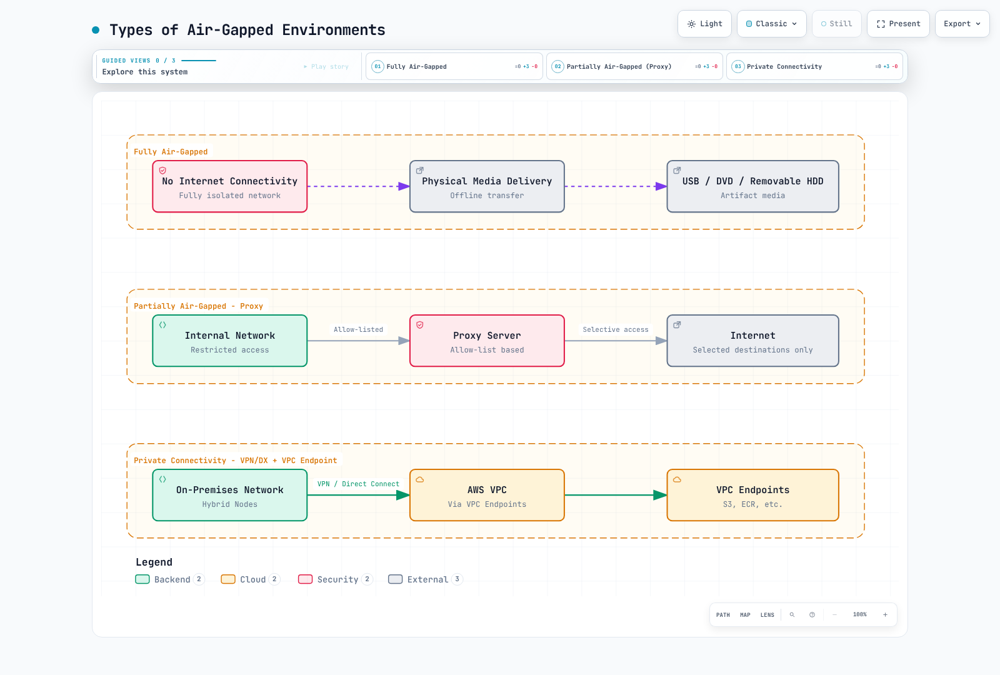

# 受限互联网环境设置（S3、私有端点和代理）

< [上一章：网络配置](./02-network-configuration.md) | [目录](./README.md) | [下一章：节点引导](./04-node-bootstrap.md) >

> **支持的版本**：EKS Hybrid Nodes；已检查 nodeadm v1.0.20 源码。请为集群选择 Kubernetes、操作系统、运行时和附加组件版本组合。
> **最后更新**：September 16, 2026

本章介绍如何为公共互联网访问受限的 Hybrid Nodes 做准备。**Hybrid Nodes 仍然需要连接由 AWS 托管的 EKS 控制平面以及用于凭证的 AWS 服务。**通过物理方式传输软件，并不会使 Hybrid Nodes 成为断网的 Kubernetes 发行版。

以下示例是准备和审查流程，并非经过测试的生产部署。审计验证了源代码、配置和本地故障场景；并未构建操作系统映像、发布构件、注册节点或验证真实的私有网络。由于 TLS 主机名验证失败，审计环境无法获取公共构件清单。没有绕过任何证书检查，也不会根据此次获取失败推断当前构件补丁或摘要。

**安全团队配套文档：**[Hybrid Nodes 网络隔离审查](11-network-separation-security.md)介绍新的控制平面到本地网络连接、端点类型、权限和数据边界，以及审查证据。仅有私有连接并不能证明符合合规要求。

## 连接和隔离边界

| 模式 | 提供的能力 | Hybrid Nodes 注意事项 |
|---|---|---|
| 物理隔离网络 | 不与 AWS 建立实时连接 | 无法提供所需的 EKS 控制平面和凭证服务连接 |
| 受控出站代理 | 经批准的外部 HTTPS 目标和日志 | 分别配置安装程序、包管理器、主机守护进程和适用的 Pod |
| VPN/Direct Connect 加私有端点 | 通过私有路径连接集群和受支持的 AWS API | 需要双向路由、DNS、安全组和授权；端点无法覆盖所有公共下载主机 |
| 离线软件传输 | 受控导入经审查构件的方式 | 可与 AWS 私有连接配合使用，但不能取代该连接 |

网络限制可以降低暴露风险，但不能保证符合法规要求、消除数据外泄或防止所有供应链攻击。证书信任、获批发布者、签名、补丁、操作员访问和应用数据流仍是独立的控制措施。私有连接仍依赖 AWS 服务和本地网络。



[🔍 查看交互式图表](https://www.atomai.click/kubernetes-docs/archmaps/en-eks-hybrid-nodes-03-airgap-setup-0.html)

> **图表说明：**物理隔离选项仅用于比较，并非受支持的 Hybrid Nodes 运行模式。

## 架构和构件职责


[🔍 查看交互式图表](https://www.atomai.click/kubernetes-docs/archmaps/en-eks-hybrid-nodes-03-airgap-setup-1.html)

> **图表修正：**`hybrid-assets.eks.amazonaws.com → PHZ → S3` 这种快捷方式并不是可用的透明镜像。请使用下文的安装路径。仅更改 DNS 并不能提供原始主机名的 TLS 证书、S3 对象路由或请求授权。

| 构件 | 准备和交付方式 |
|---|---|
| Hybrid `nodeadm` | 从 `aws/eks-hybrid` 批准一个版本；在以 root 身份运行前验证来源和校验和。这与 EC2 的 `amazon-eks-ami` nodeadm 不同 |
| kubelet、kubectl、CNI 插件、ECR 凭证提供程序、IAM 验证器 | 从经批准的构件清单中选择一个确定的版本/构建/操作系统/架构组合 |
| IAM Roles Anywhere 签名辅助程序 | 选择并验证其自身版本；不要随意选取数组中的第一个条目 |
| SSM 安装程序/代理 | 独立的区域下载、签名和注册路径；不会被自定义 EKS 构件清单完全重定向 |
| containerd、runc、iptables 和操作系统依赖项 | 经批准的操作系统/运行时包组合，包括传递依赖项和已签名的仓库元数据 |
| CNI、CoreDNS、kube-proxy、沙箱和工作负载映像 | 清点实际清单、init 容器、映像摘要和平台；二进制清单不包含映像标签 |

Amazon VPC CNI（`aws-node` / `vpc-cni-init`）不是 Hybrid Nodes 使用的 CNI。请按照[网络配置](./02-network-configuration.md)中的受支持 Hybrid CNI 流程操作。仅当所选 CNI 数据路径使用 kube-proxy 时，才包含 kube-proxy。CNI 插件二进制包并不等同于已部署的 CNI 控制器。

## 选择安装路径

### 路径 A：预装操作系统映像

在受控构建主机上安装经批准的 Hybrid nodeadm，并使用集群选定的 Kubernetes 版本和凭证提供程序运行 `nodeadm install`。AWS 文档介绍了这种映像构建用途。将已安装的构件和 nodeadm 跟踪器保留在映像中。

```bash
# Controlled image builder only; installs software on this host.
set -euo pipefail
: "${KUBERNETES_VERSION:?Approved cluster-compatible version}"
: "${REGION:?}" "${CREDENTIAL_PROVIDER:?ssm or iam-ra}"
case "$CREDENTIAL_PROVIDER" in ssm|iam-ra) ;; *) exit 1 ;; esac
sudo nodeadm install "$KUBERNETES_VERSION" \
  --credential-provider "$CREDENTIAL_PROVIDER" --region "$REGION"
```

默认运行时来源是操作系统发行版；RHEL 不支持此来源。对于 RHEL，请选择文档所述的 Docker 包来源，或预装兼容的运行时并使用 `--containerd-source none`。AL2023 不支持 Docker 来源。`none` 不会替你安装 containerd。

**不要**初始化/注册构建主机后克隆其身份。通过经批准的逐节点流程交付每个节点的 SSM 激活信息或 IAM Roles Anywhere 证书/私钥。不要将激活码、私钥、SSM 注册状态、kubelet 证书或操作员凭证烘焙进可复用映像。Bottlerocket 有自己的准备/引导流程，不使用此 nodeadm 流程。

新的 SSM 安装/升级需要使用 nodeadm **1.0.19 或更高版本**，因为较旧版本包含过时的 SSM 签名密钥。本章检查的是 **v1.0.20**，而不是不受限制的 `latest` 二进制文件。

### 路径 B：自定义构件清单

已发布的 **v1.0.20 源码**支持以下标志，尽管用户指南的标志表未列出全部标志：

| 命令/设置 | 经检查版本中的实际行为 |
|---|---|
| `install --manifest-override file:///path/manifest.json` | 读取本地清单；YAML 解码器也接受 JSON |
| `install --manifest-override https://mirror.example.com/manifest.json` | 使用普通 HTTP 客户端下载清单 |
| `install --private-mode` | 要求提供 `--manifest-override`；跳过操作系统包安装，但仍会安装凭证和 EKS 构件 |
| `init --manifest-override ... --private-mode` | 要求提供清单参数并从中获取 Region 元数据；不会取消 AWS 身份验证或 EKS 连接要求 |
| 单个构件的 `uri` / `checksum_uri` | 通过 HTTP(S) 获取，不使用 S3 SigV4 签名。`file://` **清单**并不意味着支持 `file://` **构件** URL |
| `gzip_uri` | 存在时优先于 `uri`；解压后执行校验和验证 |

使用这些标志前，请检查实际部署二进制文件的 `install --help` 和 `init --help`。私有模式并不是完整的离线包安装程序。请预装带有 systemd 单元的 containerd、runc、iptables、CA 证书和所有必需的操作系统依赖项。

使用 `--credential-provider ssm` 时，v1.0.20 仍会分别构建区域 `ssm-setup-cli` 和签名 URL。清单中的 `ssm_releases` 字段不会重定向此安装路径。请规划访问这些 S3 对象以及后续代理安装/注册所需依赖项的方式，或者使用经过验证的预装映像流程。

### 审查清单并选择一个版本组合

上游清单包含 `supported_eks_releases`、`iam_roles_anywhere_releases` 和 `region_config`。Kubernetes 记录包括 `major_minor_version`、`latest_patch_version`、`patch_releases[].version`、**`patch_version`**、**`release_date`** 和各构件 URL。多个构建版本可能共用同一个补丁版本。先前的 `1.33.3` 示例是历史架构示例，并不能证明当前批准的补丁版本。

保留下载的上游清单、其获取日期/哈希和批准记录。选择前请验证其 HTTPS 来源。以下本地选择器要求指定确切的 Kubernetes 补丁版本、构建日期、签名辅助程序版本和架构。它会拒绝有歧义的选择、缺失的构件、重复的 YAML 键和未知的 Region。它会保留实际 Region 元数据，而不是猜测 ECR 账户。

在准备主机上将其保存为 `select-mirror.py`；需要 Python 3 和 PyYAML：

```python
#!/usr/bin/env python3
"""Build a local review plan, not an installer. Requires PyYAML."""
import copy
import datetime
import json
import re
import sys
from pathlib import Path
from urllib.parse import urlsplit

import yaml


class UniqueLoader(yaml.SafeLoader):
    pass


def mapping(loader, node, deep=False):
    result = {}
    for key_node, value_node in node.value:
        key = loader.construct_object(key_node, deep=deep)
        if key in result:
            raise ValueError("duplicate YAML key")
        result[key] = loader.construct_object(value_node, deep=deep)
    return result


UniqueLoader.add_constructor(
    yaml.resolver.BaseResolver.DEFAULT_MAPPING_TAG, mapping
)


def https_url(value):
    if not isinstance(value, str) or any(c.isspace() for c in value):
        raise ValueError("URL must be a nonempty HTTPS URL")
    parsed = urlsplit(value)
    if (parsed.scheme != "https" or not parsed.hostname or parsed.username
            or parsed.password or parsed.query or parsed.fragment):
        raise ValueError("HTTPS URL must not contain credentials, query or fragment")
    return value


def select(manifest, version, build_date, iam_version, arch, region, mirror):
    if not re.fullmatch(r"1\.\d+\.\d+", version):
        raise ValueError("an exact approved Kubernetes patch is required")
    datetime.date.fromisoformat(build_date)
    if arch not in ("amd64", "arm64"):
        raise ValueError("unsupported architecture")
    mirror = https_url(mirror).rstrip("/")
    region_info = manifest["region_config"][region]  # No account fallback.
    if (region_info.get("partition") != "aws"
            or region_info.get("dns_suffix") != "amazonaws.com"
            or not region_info.get("cred_providers", {}).get("iam-ra")
            or not re.fullmatch(r"\d{12}", str(region_info.get("ecr_account_id", "")))):
        raise ValueError("review a supported commercial Region with IAM Roles Anywhere")
    minor, patch = version.rsplit(".", 1)
    releases = [
        release
        for family in manifest["supported_eks_releases"]
        if family["major_minor_version"] == minor
        for release in family["patch_releases"]
        if release["version"] == version and release["patch_version"] == patch
        and release["release_date"] == build_date
    ]
    iam = [
        release for release in manifest["iam_roles_anywhere_releases"]
        if release["version"] == iam_version
    ]
    if len(releases) != 1 or len(iam) != 1:
        raise ValueError("release selection must be unique")
    eks_release, iam_release = copy.deepcopy(releases[0]), copy.deepcopy(iam[0])
    plan = []
    for release, names in [
        (eks_release, ["kubelet", "kubectl", "cni-plugins",
                       "ecr-credential-provider", "aws-iam-authenticator"]),
        (iam_release, ["aws_signing_helper"]),
    ]:
        chosen = []
        for name in names:
            matches = [a for a in release["artifacts"]
                       if a["name"] == name and a["arch"] == arch and a["os"] == "linux"]
            if len(matches) != 1:
                raise ValueError("missing or duplicate artifact: " + name)
            artifact = matches[0]
            item_id = "a%02d" % len(plan)
            plan.append({"id": item_id, "name": name,
                         "uri": https_url(artifact["uri"]),
                         "checksum_uri": https_url(artifact["checksum_uri"])})
            # Use the original, uncompressed URI; its checksum is not a gzip-file hash.
            artifact.pop("gzip_uri", None)
            artifact["uri"] = mirror + "/" + item_id + "/data"
            artifact["checksum_uri"] = mirror + "/" + item_id + "/data.sha256"
            chosen.append(artifact)
        release["artifacts"] = chosen
    selected = {
        "supported_eks_releases": [{
            "major_minor_version": minor, "latest_patch_version": patch,
            "patch_releases": [eks_release],
        }],
        "iam_roles_anywhere_releases": [iam_release],
        "region_config": {region: copy.deepcopy(region_info)},
    }
    return selected, {"artifacts": plan}


def main():
    if len(sys.argv) != 9:
        raise ValueError(
            "usage: select-mirror.py UPSTREAM VERSION BUILD_DATE IAM_VERSION "
            "ARCH REGION HTTPS_MIRROR_PREFIX NEW_OUTPUT_DIR"
        )
    source, version, date, iam, arch, region, mirror, output = sys.argv[1:]
    manifest = yaml.load(Path(source).read_text(), Loader=UniqueLoader)
    selected, plan = select(manifest, version, date, iam, arch, region, mirror)
    out = Path(output)
    out.mkdir(mode=0o700, parents=False, exist_ok=False)
    (out / "upstream.yaml").write_bytes(Path(source).read_bytes())
    (out / "manifest.json").write_text(json.dumps(selected, indent=2) + "\n")
    (out / "plan.json").write_text(json.dumps(plan, indent=2) + "\n")


if __name__ == "__main__":
    main()
```

输出目录必须是新目录。HTTPS 镜像前缀必须映射到发布时使用的同一不可变对象前缀。此脚本只生成计划；既不会下载文件，也不会向镜像服务进行身份验证。

```bash
set -euo pipefail
: "${APPROVED_PATCH:?}" "${APPROVED_BUILD_DATE:?}" "${APPROVED_IAM_VERSION:?}"
: "${ARCH:?amd64 or arm64}" "${REGION:?}"
: "${MIRROR_PREFIX:?HTTPS URL for this reviewed candidate}"
: "${NEW_PLAN_DIR:?A new local directory}"
python3 select-mirror.py upstream.yaml "$APPROVED_PATCH" "$APPROVED_BUILD_DATE" \
  "$APPROVED_IAM_VERSION" "$ARCH" "$REGION" "$MIRROR_PREFIX" "$NEW_PLAN_DIR"
```

下载前请审查所有来源主机和选出的六个构件。这是 **IAM Roles Anywhere 构件示例**，不是 SSM 安装程序镜像。它不包含 nodeadm 本身、操作系统包、映像、签名密钥或证书。

保存为 `download-plan.sh`：

```bash
#!/usr/bin/env bash
# Download into a new plan directory. No AWS writes or host installation.
set -euo pipefail
umask 077
cd -- "${1:?Use the directory produced by select-mirror.py}"
test ! -e checksums.sha256
test ! -e queue.tsv
jq -er '.artifacts[] | [.id, .uri, .checksum_uri] | @tsv' plan.json > queue.tsv
test "$(wc -l < queue.tsv)" -eq 6
while IFS=$'\t' read -r item_id uri checksum_uri; do
  [[ "$item_id" =~ ^a[0-9]{2}$ ]]
  mkdir -- "$item_id"  # Refuse a partial run or existing directory.
  curl --fail --show-error --silent --location \
    --proto '=https' --proto-redir '=https' --connect-timeout 10 \
    --max-time 300 --max-filesize 268435456 \
    "$uri" -o "$item_id/data"
  curl --fail --show-error --silent --location \
    --proto '=https' --proto-redir '=https' --connect-timeout 10 \
    --max-time 30 --max-filesize 4096 \
    "$checksum_uri" -o "$item_id/upstream.sha256"
  expected=$(python3 - "$item_id/upstream.sha256" <<'CHECKSUM_PY'
import pathlib, re, sys
text = pathlib.Path(sys.argv[1]).read_text().strip()
match = re.fullmatch(r"([0-9a-fA-F]{64})(?:[ \t]+[^\r\n]+)?", text)
if not match:
    raise SystemExit("missing, malformed or multi-record upstream checksum")
print(match.group(1).lower())
CHECKSUM_PY
)
  actual=$(sha256sum "$item_id/data")
  [[ "${actual%% *}" == "$expected" ]]
  # nodeadm v1.0.20 requires GNU format: digest, space, filename.
  printf '%s  data\n' "$expected" > "$item_id/data.sha256"
done < queue.tsv
sha256sum manifest.json plan.json upstream.yaml a*/data a*/data.sha256 \
  > checksums.sha256
sha256sum --strict --check checksums.sha256
printf '%s\n' 'Six artifacts verified locally; publishing and node installation remain separate.'
```

每个构件的大小限制为有意设定的 256 MiB；如果经批准的构件超过此限制，请重新审查。下载失败、校验和格式错误或哈希不匹配都会使脚本停止。部分下载目录会保留以供检查；解决原因后，请启动新的候选版本。不要删除共享的 `/tmp` 目录，也不要跳过缺失的校验和。

这些哈希用于将选定文件与获取到的校验和绑定起来。它们不是独立签名，也不能证明已遭入侵的发布者值得信任。请保护经审查的清单/校验和记录，并在可用时验证发布者。

## 私有 S3 发布和授权

使用**预先创建且归你所有的**存储桶，并启用 Block Public Access、经批准的加密、版本控制/保留策略以及分离的发布者/读取者权限。以下示例不会创建存储桶，也不会替换其策略。AccessDenied、凭证过期和超时都属于失败，不能作为存储桶/对象不存在的证据。

现有存储桶的示例*读取者策略语句*如下：

```json
{
  "Sid": "ReadApprovedHybridArtifacts",
  "Effect": "Allow",
  "Principal": {"AWS": "arn:aws:iam::111122223333:role/HybridArtifactReader"},
  "Action": "s3:GetObject",
  "Resource": "arn:aws:s3:::example-hybrid-artifacts/hybrid-candidates/*",
  "Condition": {"StringEquals": {"aws:SourceVpce": "vpce-0123456789abcdef0"}}
}
```

请替换账户、角色、存储桶、前缀和端点，并经审查确认其值。此语句仅授予一种访问路径；不会撤销其他现有授权。对于所有来自单个端点以外请求设置存储桶范围的 `Deny s3:*`，也可能阻止已连接的发布者和管理恢复操作。应用此类边界前，请明确设计这些路径。

指定主体的策略要求签名请求。**nodeadm 的普通 HTTPS 下载器不会因为节点具有 IAM 角色就变成经过 IAM 身份验证的 S3 客户端。**有两种可行的设计可供验证：

1. 使用经过身份验证的准备代理/CLI 获取经批准的文件，然后通过由组织控制、具有适当网络访问控制且为自身主机名配置了证书的 HTTPS 构件服务提供这些文件。
2. 使用预装映像路径，不依赖运行时二进制镜像。

返回 `403` 的私有 S3 对象 URL，无法通过 DNS 覆盖修复。不要将承载令牌的预签名 URL 或凭证放进清单、进程参数或发布日志。如果组织选择在私有网络中限制对非机密二进制文件的未认证读取，那属于另一项需明确审查的策略，并非上述指定主体策略。

保存为 `publish-plan.sh`。仅在存储桶所有者批准候选版本和权限后运行；此脚本会**写入 S3 对象**：

```bash
#!/usr/bin/env bash
# Owner-approved publication only; creates billable S3 objects, never a bucket.
set -euo pipefail
umask 077
cd -- "${1:?Use a verified plan directory}"
: "${REGION:?}" "${BUCKET:?}" "${EXPECTED_ACCOUNT_ID:?}" "${PREFIX:?}"
[[ "$EXPECTED_ACCOUNT_ID" =~ ^[0-9]{12}$ ]]
[[ "$PREFIX" =~ ^hybrid-candidates/[A-Za-z0-9-]+$ ]]
sha256sum --strict --check checksums.sha256
aws s3api head-bucket --region "$REGION" --bucket "$BUCKET" \
  --expected-bucket-owner "$EXPECTED_ACCOUNT_ID"
# Manifest is last. Any failed write stops; retain the partial prefix for review.
for file in a{00..05}/data a{00..05}/data.sha256 checksums.sha256 \
            upstream.yaml plan.json manifest.json; do
  test -f "$file"
  aws s3api put-object --region "$REGION" --bucket "$BUCKET" \
    --expected-bucket-owner "$EXPECTED_ACCOUNT_ID" \
    --key "$PREFIX/$file" --body "$file" --if-none-match '*' \
    --server-side-encryption AES256 --checksum-algorithm SHA256 \
    --output json > "${file//\//_}.upload.json"
done
printf '%s\n' 'Candidate uploaded. Verify readback, mirror URL mapping and hashes before promotion.'
```

对于要求 SSE-KMS 的存储桶，请改用其经批准的密钥和 KMS 权限，不要使用 AES256 示例。条件写入可以防止覆盖现有键，但不能使多对象上传具备原子性。清单会最后上传；失败的候选版本在完成回读和实际 HTTPS 镜像映射验证前仍不会发布。请记录返回的对象 VersionId/校验和及保留策略；S3 ETag 并非通用的 SHA-256 摘要。

## DNS 和私有端点要求

`hybrid-assets.eks.amazonaws.com` 是 AWS CloudFront 下载主机。创建此名称的 PHZ 并将其别名指向 S3，并不能保留：

- TLS 证书/SNI 主机名；
- HTTP Host 标头以及 S3 存储桶/对象键映射；
- 原始路径，尤其是上传方将所有名称展平时；
- 请求授权。

不要通过禁用 TLS 检查来解决此问题。请通过受控代理保持已批准来源可访问、使用预装映像，或使用具有实际镜像 URL 的受支持清单覆盖方式。

S3 **接口**端点可通过 VPN/Direct Connect 为本地客户端提供服务。支持 S3 私有 DNS。**仅对入站 Resolver 使用私有 DNS**的选项要求为 VPC 侧维护 S3 网关端点；另一种方式是让 VPC 和本地请求都通过接口端点路由。单独使用网关端点无法从本地直接访问。

请根据经审查的 VPC 和端点 ID 选择端点，而不是选择某个 Region 中遇到的第一个 S3 端点。请使用[网络配置](./02-network-configuration.md)中的 DNS/路由流程。EKS 管理 API 端点不是 Kubernetes API 端点；私有 ECR 端点无法提供对公共 ECR 或 CloudFront 的常规访问。

## 安装和初始化已准备好的节点

对于自定义 IAM Roles Anywhere 路径，运行时、操作系统依赖项、经批准的 nodeadm 和镜像服务都必须已准备就绪。此命令会在目标节点上安装软件：

```bash
set -euo pipefail
: "${APPROVED_PATCH:?}" "${REGION:?}" "${LOCAL_MANIFEST:?Absolute local path}"
[[ "$LOCAL_MANIFEST" = /* ]]
test -s "$LOCAL_MANIFEST"
sudo nodeadm install "$APPROVED_PATCH" --region "$REGION" \
  --credential-provider iam-ra --containerd-source none \
  --manifest-override "file://$LOCAL_MANIFEST" --private-mode
```

请使用[先决条件](./01-prerequisites.md)和[节点引导](./04-node-bootstrap.md)准备逐节点配置。例如，SSM 配置的**格式**如下：

```yaml
apiVersion: node.eks.aws/v1alpha1
kind: NodeConfig
spec:
  cluster:
    name: my-hybrid-cluster
    region: ap-northeast-2
  hybrid:
    ssm:
      activationCode: REPLACE_WITH_NODE_ACTIVATION_CODE
      activationId: REPLACE_WITH_NODE_ACTIVATION_ID
```

请使用节点上安装的确切凭证提供程序；此 SSM 格式不是上述 IAM Roles Anywhere 命令所用的配置。妥善保护填入内容后的文件（归 root 所有，权限模式为 `0600`），切勿提交此文件，也不要将机密放入 shell 历史记录。手动提供 API 端点/CA 字段并不能免除文档所述集群发现和身份验证流程的要求。

```bash
# Local config validation; this is not a join or an end-to-end network test.
sudo nodeadm config check --config-source file:///etc/eks/nodeconfig.yaml
```

网络、身份和 CNI 先决条件通过后，所有者可以运行 `nodeadm init`。在私有清单路径中，请再次传入经批准的清单：

```bash
# Mutates the target node and registers it with EKS.
sudo nodeadm init --config-source file:///etc/eks/nodeconfig.yaml \
  --manifest-override file:///etc/eks/manifest.json --private-mode
```

经检查的版本中没有 `nodeadm init --dry-run`。不要仅仅为了让不完整的准备流程通过而跳过初始化验证。

## 容器映像交付

私有 ECR 拉取需要 ECR API 和 DKR 路径、S3 层下载路径、DNS 以及适当的映像拉取权限。成功调用 `describe-repositories` 并不能证明可以下载映像层。请预先填充并测试任何拉取缓存；ECR 端点文档说明，首次拉取未缓存映像时还需要额外的互联网访问。

请使用已部署附加组件清单中的实际注册表账户/Region/映像引用。不要通过在 Kubernetes 补丁版本后追加 `-eksbuild.1` 来构造映像标签，也不要从无关集群复制过时的 pause/CoreDNS 版本。

nodeadm 会在 `/etc/eks/image-credential-provider/ecr-credential-provider` 安装 ECR 辅助程序，并在 `/etc/eks/image-credential-provider/config.json` 初始化其配置。请检查生成的 kubelet 配置，而不是在其他目录下写入未使用的文件。`ctr images pull` 是单独的客户端，不会自动使用 kubelet 的 exec 凭证提供程序。

### 离线映像传输

选择经批准的摘要和所需平台。对于多平台归档文件，在源/目标格式支持的情况下保留索引和摘要：

```bash
# Preparation host: downloads images; requires reviewed registry authentication.
set -euo pipefail
: "${SOURCE_DIGEST_REF:?registry/repository@sha256:approved-digest}"
: "${NEW_IMAGE_DIR:?New directory}"
[[ "$SOURCE_DIGEST_REF" =~ @sha256:[0-9a-f]{64}$ ]]
mkdir -m 700 -- "$NEW_IMAGE_DIR"
skopeo copy --all --preserve-digests "docker://$SOURCE_DIGEST_REF" \
  "oci-archive:$NEW_IMAGE_DIR/image.tar:approved"
(cd "$NEW_IMAGE_DIR" && sha256sum image.tar > image.tar.sha256)
```

传输归档文件及其经过独立保护的批准/哈希记录。导入或推送前，请在该目录中运行 `sha256sum --strict --check image.tar.sha256`，并在失败时停止。对于内部注册表目标：

```bash
# Internal staging host: writes an image to the reviewed destination registry.
set -euo pipefail
: "${DEST_DIGEST_REF:?approved-registry/repository@sha256:approved-digest}"
[[ "$DEST_DIGEST_REF" =~ @sha256:[0-9a-f]{64}$ ]]
sha256sum --strict --check image.tar.sha256
skopeo copy --all --preserve-digests oci-archive:image.tar:approved \
  "docker://$DEST_DIGEST_REF"
```

不要禁用注册表 TLS 验证。更改压缩方式/清单格式可能导致无法保留摘要；请停止并审查更改后的映像身份，而不是默默声称其未变。

直接预加载到 containerd 也是一种选择，但必须针对已部署的运行时进行测试：Kubernetes 使用 `k8s.io` 命名空间；导入的引用必须与 Pod/沙箱引用相符；所有所需平台的 Blob 都必须存在。归档文件的 `approved` 注释不会自动成为 Pod 请求的注册表名称。映像垃圾回收和 `imagePullPolicy` 也可能导致后续拉取。仅成功导入 tar 文件，并不能证明离线 Pod 能够启动。

## 已签名的本地包仓库

将操作系统发行版、架构、传递依赖项和元数据作为经过审查的组合进行镜像。保留供应商签名，或使用单独受信任的密钥为组织维护的仓库签名。

已**准备并签名**的本地平面仓库的 Ubuntu 客户端配置示例：

```text
deb [signed-by=/etc/apt/keyrings/hybrid-mirror.gpg] file:///srv/apt-repo ./
```

仓库必须包含有效的 `Release` 以及 `InRelease` 或 `Release.gpg`，不能只有 `Packages.gz`。请通过独立的可信路径分发并验证密钥指纹。不要使用 `trusted=yes` 跳过仓库身份验证。

DNF/YUM 仓库配置示例：

```ini
[hybrid-local]
name=Reviewed hybrid packages
baseurl=file:///srv/yum-repo
enabled=1
gpgcheck=1
repo_gpgcheck=1
gpgkey=file:///etc/pki/rpm-gpg/RPM-GPG-KEY-hybrid-mirror
```

这需要有效的包签名和已签名的仓库元数据。元数据签名密钥和包签名密钥可能不同；请配置经批准的密钥集。验证失败时不要将 `gpgcheck=0`。包安装和服务重启应安排在映像构建或已清空工作负载的维护操作中进行，而不是放进随意运行的在线节点验证脚本。

## 代理配置

首先为每个客户端构建目标映射。包括回环地址、实际的私有 API/注册表名称，以及必须绕过代理的节点/Pod/Service 网段。不同客户端对 CIDR 和后缀的匹配方式各异。不要盲目将 **`.eks.amazonaws.com`** 放入 `NO_PROXY`：它也会匹配公共的 `hybrid-assets.eks.amazonaws.com` 下载主机。

经审查且不包含机密信息的代理配置 shell 示例：

```bash
export HTTP_PROXY=http://proxy.internal.example.com:3128
export HTTPS_PROXY=http://proxy.internal.example.com:3128
export NO_PROXY=localhost,127.0.0.1,::1,.svc,.cluster.local,registry.internal.example.com
export http_proxy="$HTTP_PROXY" https_proxy="$HTTPS_PROXY" no_proxy="$NO_PROXY"
```

请添加实际的私有 API 主机名/IP 和其他绕过代理的目标；这不是完整的站点配置。登录 shell 的环境不会配置已运行的 systemd 服务。不要 source `/etc/environment` 或反复向其中追加内容。

对于 `containerd.service` 和 `kubelet.service`，请在 `/etc/systemd/system/UNIT.service.d/http-proxy.conf` 下使用由所有者管理的 drop-in：

```ini
[Service]
Environment="HTTP_PROXY=http://proxy.internal.example.com:3128"
Environment="HTTPS_PROXY=http://proxy.internal.example.com:3128"
Environment="NO_PROXY=localhost,127.0.0.1,::1,.svc,.cluster.local,registry.internal.example.com"
```

请审查现有 drop-in，并仅在获批的构建/维护阶段重启受影响的单元。containerd TOML 中的 `[proxy.http]` 段并不是 HTTP 代理配置。

| 组件 | 配置和条件 |
|---|---|
| nodeadm 进程 | 通过 `sudo` 仅传递经审查的代理环境；不要使用 `sudo -E` 转发整个操作员环境 |
| containerd / kubelet | 使用独立的 systemd 环境；生成的 kubelet 配置和主机环境属于不同层 |
| Ubuntu 上使用文档所述 snap 安装的 SSM | `snap.amazon-ssm-agent.amazon-ssm-agent.service.d/http-proxy.conf` |
| AL2023/RHEL 上的 SSM | `amazon-ssm-agent.service.d/http-proxy.conf`；请确认实际安装的单元 |
| IAM Roles Anywhere 凭证进程 | nodeadm 在生成 `--with-proxy` 时会检测代理变量；调用它的守护进程也必须接收正确的环境 |
| 使用 `spec.hybrid.enableCredentialsFile: true` 的 IAM Roles Anywhere | 在此模式下，`aws_signing_helper_update.service` **确实存在**；请在初始化前配置其 drop-in。不要假定所有 IAM Roles Anywhere 安装中都存在此服务 |
| apt | 由所有者管理的 `/etc/apt/apt.conf.d/` 文件，其中包含 `Acquire::http::Proxy` 和 `Acquire::https::Proxy` |
| snap | 实际使用 snap 时，设置 `snap set system proxy.http=... proxy.https=...` |
| dnf / yum | 审查并更新现有配置中的 `proxy` 设置；不要替换其他设置，也不要追加重复项 |
| kube-proxy / 其他 Pod | 仅在其流量需要代理时配置其 Pod 环境 |

对于文档所述的代理拓扑，请在集群创建后、加入 Hybrid Nodes 前配置 kube-proxy。保留现有的 `NODE_NAME` 环境变量和所有命令参数。以下内容是**战略合并补丁片段**，并非独立的 DaemonSet：

```yaml
spec:
  template:
    spec:
      containers:
        - name: kube-proxy
          env:
            - name: HTTP_PROXY
              value: http://proxy.internal.example.com:3128
            - name: HTTPS_PROXY
              value: http://proxy.internal.example.com:3128
            - name: NO_PROXY
              value: localhost,127.0.0.1,::1,.svc,.cluster.local
```

请审查/扩展绕过代理的目标，并通过附加组件所有者应用配置。内置 DaemonSet 的战略合并会使用容器/env 名称；JSON Patch `add /containers/0/env` 可能会替换整个现有环境，并且假定容器索引固定。如果所选 CNI 会取代 kube-proxy，不要仅为此示例部署 kube-proxy。

## 验证和受控更新

| 检查项 | 所需证据 | 不足以证明的内容 |
|---|---|---|
| 构件完整性 | 每个选定文件、校验和、经批准的清单和版本组合均匹配 | 跳过缺失文件或接受零个已验证文件 |
| DNS/TLS | 预期路由上的目标正确，且主机名/CA 验证通过 | 一个 `10.*` 地址、任意 `172.*` 地址或 `curl -k` |
| S3 | 对确切存储桶/键/版本进行实际授权回读，并验证预期所有者和哈希 | 列出前缀或将 API 错误视为对象不存在 |
| ECR | 通过工作负载的凭证路径拉取实际所需的摘要/平台和各层 | `describe-repositories` 或单独执行未经身份验证的 `ctr` 调用 |
| nodeadm 配置 | 使用受保护且已填充的文件运行 `nodeadm config check` 并成功 | 将缺失配置视为成功，或使用不存在的 `init --dry-run` |
| 节点运行 | 凭证刷新、Kubernetes API 信任/身份验证、CNI/DNS 和有界工作负载测试 | 本地解析器检查成功或一次 `/healthz` 响应 |

在授权进行 AWS 读取的情况下，请使用文档所述的 `nodeadm debug --config-source file:///etc/eks/nodeconfig.yaml` 进行连接/身份诊断。此命令会联系服务，且可能输出敏感诊断上下文；请妥善保护输出，并在分享前进行脱敏。不要将未知/失败的检查改判为“可用于生产”。

更新自动化应先**发现候选版本**，然后要求完成来源验证、兼容性审查、操作系统/映像扫描、本地验证、代表性节点试运行和批准，之后才能晋级。请在新的不可变版本/构建前缀下发布，保留先前获批的版本组合，并记录回滚限制。不要运行 cron 作业，静默覆盖生产环境的 `latest` 键；`nodeadm upgrade` 会造成中断，因此需要疏散工作负载。

层缓存、压缩以及仅同步所需平台的映像可以减少传输量。应用这些技术前后，请比较实际传输字节数，并针对所选映像和图层复用情况计算节省量。如果经批准的内容经过重新压缩，请重新检查其摘要，并将更改后的构件提交审批。

## 主要参考资料

- [AWS Hybrid nodeadm 参考](https://docs.aws.amazon.com/eks/latest/userguide/hybrid-nodes-nodeadm.html)
- [准备 Hybrid 操作系统](https://docs.aws.amazon.com/eks/latest/userguide/hybrid-nodes-os.html)
- [Hybrid 代理配置](https://docs.aws.amazon.com/eks/latest/userguide/hybrid-nodes-proxy.html)
- [nodeadm v1.0.20 安装标志](https://github.com/aws/eks-hybrid/blob/v1.0.20/cmd/nodeadm/install/install.go)和[初始化标志](https://github.com/aws/eks-hybrid/blob/v1.0.20/cmd/nodeadm/init/init.go)
- [构件选择/下载实现](https://github.com/aws/eks-hybrid/blob/v1.0.20/internal/aws/source.go)和[SSM 来源](https://github.com/aws/eks-hybrid/blob/v1.0.20/internal/ssm/source.go)
- [S3 接口端点/私有 DNS](https://docs.aws.amazon.com/AmazonS3/latest/userguide/privatelink-interface-endpoints.html)
- [ECR VPC 端点](https://docs.aws.amazon.com/AmazonECR/latest/userguide/vpc-endpoints.html)
- [Skopeo copy](https://github.com/containers/skopeo/blob/main/docs/skopeo-copy.1.md)
- [APT 仓库身份验证](https://manpages.ubuntu.com/manpages/noble/man8/apt-secure.8.html)
- [DNF 仓库签名设置](https://github.com/rpm-software-management/dnf/blob/master/doc/conf_ref.rst)
- [S3 PutObject 条件、加密和校验和](https://docs.aws.amazon.com/AmazonS3/latest/API/API_PutObject.html)
- [Kubernetes 映像名称、摘要和拉取策略](https://kubernetes.io/docs/concepts/containers/images/)

< [上一章：网络配置](./02-network-configuration.md) | [目录](./README.md) | [下一章：节点引导](./04-node-bootstrap.md) >
