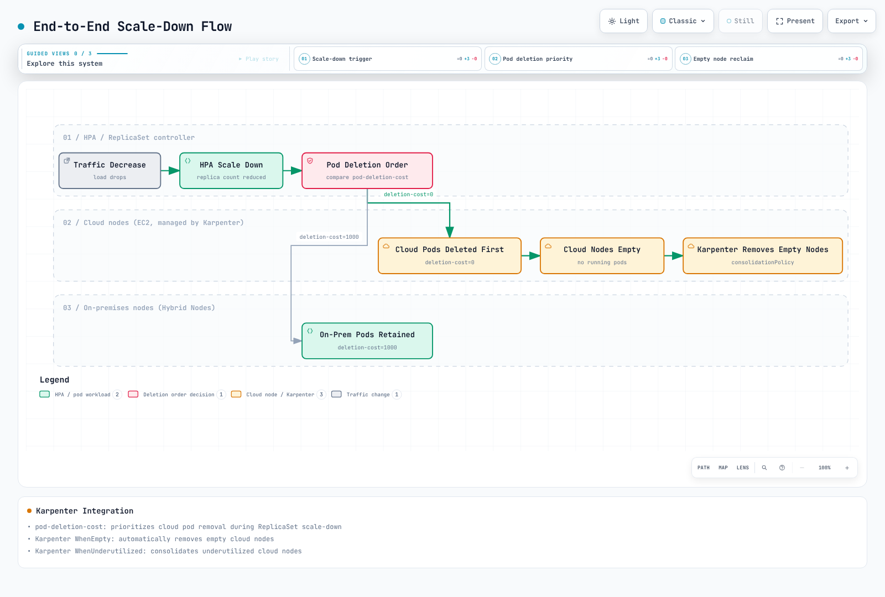

# 工作负载放置策略

< [上一章：GPU 集成](./05-gpu-integration.md) | [目录](./README.md) | [下一章：节点生命周期管理](./07-node-lifecycle.md) >

> **支持的版本**：支持的 EKS 版本及兼容的 Karpenter；已审查 Kubernetes 1.36.5 和 Karpenter/provider 1.14.1（固定的审查基线）接口。
> **最后更新**：2026 年 10 月 18 日

本章介绍如何将工作负载放置在 Hybrid 节点和云节点上，并说明云突发扩容和 Pod 删除成本的限制。示例是经过本地验证的配置/补丁模式。本次审计没有创建云容量、修改节点、运行应用或 GPU 工作负载。

## 放置约束和权限

| 机制 | 功能 | 无法保证的内容 |
|---|---|---|
| `nodeSelector` / required node affinity | 调度时筛选符合条件的节点 | 数据存在、依赖项健康，或标签更改后迁移现有 Pod |
| Preferred node affinity | 添加调度偏好 | 严格优先放置在本地机房、固定比例，或自动迁移正在运行的 Pod |
| Taint / toleration | 排除缺少相应 toleration 的 Pod | 匹配的 toleration 不会吸引 Pod，也不能证明 Pod 正在使用 GPU |
| Pod anti-affinity / topology spread | 控制或评估符合条件的故障域之间的分布 | 在共享物理主机、电源、存储或网络故障时保证完整可用性 |
| PDB | 限制受支持的主动驱逐请求 | 一般可用性、放置，或防止所有删除/缩容路径 |

将 `eks.amazonaws.com/compute-type=hybrid` 标签与由所有者管理的位置标签搭配使用。对 compute-type 标签使用 `DoesNotExist` 并不能定义“云”：有效的云节点也可能带有 compute-type 标签，而未标记的节点也不能证明其位于获准的云位置。

示例中，Hybrid 节点使用 [节点引导](./04-node-bootstrap.md) 中的 `workload.example.com/location=onprem`，而下方特定的 Karpenter 池使用 `cloud`。标签是运维输入，不是独立的数据驻留或安全控制。存储拓扑、出站流量、IAM 和可信的节点管理仍然很重要。

通过实际节点所有者的配置设置位置标签：例如，nodeadm 的 `--node-labels=workload.example.com/location=onprem` kubelet 标志，或相应的 Bottlerocket 节点标签设置。仅包含凭证的最小 NodeConfig 不会自动添加此自定义标签。

### 可选 taint

Hybrid taint 是可选的。添加之前，请确保所需的 CNI、DNS、GPU 基础设施和应用 Pod 都具有必要的 toleration；前面的 GPU 示例不会自动容忍所有新定义的 taint。

```bash
# Identified node only; owner-approved scheduling-policy change.
set -euo pipefail
: "${KUBECONFIG:?}" "${CONTEXT:?}" "${NODE_NAME:?}"
kubectl --kubeconfig "$KUBECONFIG" --context "$CONTEXT" \
  taint node "$NODE_NAME" eks.amazonaws.com/compute-type=hybrid:NoSchedule
```

对于 GPU 专用 taint，请使用经过审查的约定，例如 `nvidia.com/gpu=present:NoSchedule`，并使基础设施/工作负载 toleration 与之匹配。仅使用 CPU 的 Pod 也可以容忍此 taint；准入和资源请求策略是另外需要考虑的问题。

`NoSchedule` 会影响新的调度，而 `PreferNoSchedule` 是一种软性避让偏好。`NoExecute` 可以根据 Pod 的 toleration 及任何 `tolerationSeconds` 驱逐现有 Pod。更改标签或添加 `IgnoredDuringExecution` 的 required affinity 规则，都不会自动迁移已在运行的 Pod。

## 准备云突发扩容池

Karpenter 会为符合条件的待处理 Pod 创建 EC2 容量，但不会添加本地机房服务器。HPA/KEDA 或应用控制器会调整副本需求；节点预配器则是独立的控制循环。AWS 配额、实例供应情况、子网 IP、IAM、节点引导和工作负载依赖项，都可能阻止扩容。

使用受集群 Kubernetes 次版本支持的 Karpenter；当前兼容性矩阵要求 **Kubernetes 1.36 至少使用 1.13**。此示例根据固定为审查基线的 **1.14.1** CRD 进行了检查；未反映 1.15.0（2026 年 10 月 10 日）中的更改。这是自主管理型 Karpenter `EC2NodeClass` 示例，并非 Auto Mode `NodeClass`。

```yaml
apiVersion: karpenter.sh/v1
kind: NodePool
metadata:
  name: cloud-burst-pool
spec:
  template:
    metadata:
      labels:
        workload.example.com/location: cloud
    spec:
      taints:
        - key: workload.example.com/cloud-burst
          value: "true"
          effect: NoSchedule
      requirements:
        - key: kubernetes.io/arch
          operator: In
          values: [amd64]
        - key: kubernetes.io/os
          operator: In
          values: [linux]
        - key: topology.kubernetes.io/zone
          operator: In
          values: [ap-northeast-2a, ap-northeast-2b]
        - key: karpenter.sh/capacity-type
          operator: In
          values: [spot, on-demand]
        - key: node.kubernetes.io/instance-type
          operator: In
          values: [m6i.xlarge, m6i.2xlarge, m6i.4xlarge]
      nodeClassRef:
        group: karpenter.k8s.aws
        kind: EC2NodeClass
        name: hybrid-cloud-burst
  limits:
    cpu: "1000"
    memory: 4000Gi
  disruption:
    consolidationPolicy: WhenEmpty
    consolidateAfter: 30s
    budgets:
      - nodes: "1"
---
apiVersion: karpenter.k8s.aws/v1
kind: EC2NodeClass
metadata:
  name: hybrid-cloud-burst
spec:
  amiFamily: AL2023
  amiSelectorTerms:
    - id: ami-0123456789abcdef0
  subnetSelectorTerms:
    - id: subnet-0123456789abcdef0
    - id: subnet-0fedcba9876543210
  securityGroupSelectorTerms:
    - id: sg-0123456789abcdef0
  instanceProfile: REPLACE_WITH_APPROVED_EC2_NODE_INSTANCE_PROFILE
```

**应用前，请替换所有示例 AWS 资源 ID 和实例配置文件**。请为相应的 Region、架构和 Kubernetes 版本选择获准且不可变的 AL2023 AMI；按 AMI ID 选择时，`amiFamily: AL2023` 会提供引导系列。此处的实例配置文件是预先准备好的 **EC2 节点配置文件**，而不是 SSM/IAM Roles Anywhere Hybrid 角色。子网/安全组必须确实符合预期的私有网络和可用区设置。

可用区限制应放在 `requirements` 中；切勿通过将 AWS 可用区写入模板标签来伪造它。此池的选择性 opt-in taint 会将符合条件的工作负载限制为具有匹配 toleration 的工作负载，但不会授予数据或注册表访问权限。

保留的 `1000` CPU / `4000Gi` 限制是较大的**规划示例**，并非建议的分配量或支出上限。使用前请调整其大小。Karpenter 对限制的检查具有最终一致性，因此快速预配可能导致超出限制。`budgets: [{nodes: "1"}]` 限制适用的主动干扰并发数；它不是最低容量预留。

使用一个完整的 NodePool 定义。使用相同名称应用第二个不完整对象，并不能安全地“继承上面的设置”。对过期时间、AMI 选择和干扰策略的更改都需要单独经过审查的推出流程。

## 本地、仅云端和可突发扩容的工作负载

创建经批准的实验室命名空间，例如 `hybrid-placement-lab`，并在运行工作负载前准备真实的镜像摘要、应用安全设置、探针、存储和注册表访问权限。这些示例的副本数均为**零**，并且有意使用不可用的镜像。此前的 3/5/10 副本数是可能的容量规划情景，并非实测容量，也不代表应用一定能够运行。

```yaml
apiVersion: apps/v1
kind: Deployment
metadata:
  name: hybrid-local-processor
  namespace: hybrid-placement-lab
spec:
  replicas: 0
  selector:
    matchLabels:
      app: hybrid-local-processor
  template:
    metadata:
      labels:
        app: hybrid-local-processor
    spec:
      nodeSelector:
        eks.amazonaws.com/compute-type: hybrid
        workload.example.com/location: onprem
      tolerations:
        - key: eks.amazonaws.com/compute-type
          operator: Equal
          value: hybrid
          effect: NoSchedule
      automountServiceAccountToken: false
      securityContext:
        runAsNonRoot: true
        runAsUser: 65532
        seccompProfile:
          type: RuntimeDefault
      containers:
        - name: processor
          image: registry.example.invalid/approved/data-processor:replace-with-approved-digest
          securityContext:
            allowPrivilegeEscalation: false
            capabilities:
              drop: ["ALL"]
          resources:
            requests:
              cpu: "2"
              memory: 4Gi
            limits:
              cpu: "4"
              memory: 8Gi
---
apiVersion: apps/v1
kind: Deployment
metadata:
  name: hybrid-cloud-api
  namespace: hybrid-placement-lab
spec:
  replicas: 0
  selector:
    matchLabels:
      app: hybrid-cloud-api
  template:
    metadata:
      labels:
        app: hybrid-cloud-api
    spec:
      nodeSelector:
        workload.example.com/location: cloud
        karpenter.sh/nodepool: cloud-burst-pool
      tolerations:
        - key: workload.example.com/cloud-burst
          operator: Equal
          value: "true"
          effect: NoSchedule
      automountServiceAccountToken: false
      securityContext:
        runAsNonRoot: true
        runAsUser: 65532
        seccompProfile:
          type: RuntimeDefault
      containers:
        - name: api
          image: registry.example.invalid/approved/inference-api:replace-with-approved-digest
          securityContext:
            allowPrivilegeEscalation: false
            capabilities:
              drop: ["ALL"]
          resources:
            requests:
              cpu: "2"
              memory: 4Gi
            limits:
              cpu: "4"
              memory: 8Gi
---
apiVersion: apps/v1
kind: Deployment
metadata:
  name: hybrid-burst-app
  namespace: hybrid-placement-lab
spec:
  replicas: 0
  selector:
    matchLabels:
      app: hybrid-burst-app
  template:
    metadata:
      labels:
        app: hybrid-burst-app
    spec:
      tolerations:
        - key: eks.amazonaws.com/compute-type
          operator: Equal
          value: hybrid
          effect: NoSchedule
        - key: workload.example.com/cloud-burst
          operator: Equal
          value: "true"
          effect: NoSchedule
      affinity:
        nodeAffinity:
          requiredDuringSchedulingIgnoredDuringExecution:
            nodeSelectorTerms:
              - matchExpressions:
                  - key: eks.amazonaws.com/compute-type
                    operator: In
                    values: [hybrid]
                  - key: workload.example.com/location
                    operator: In
                    values: [onprem]
              - matchExpressions:
                  - key: workload.example.com/location
                    operator: In
                    values: [cloud]
                  - key: karpenter.sh/nodepool
                    operator: In
                    values: [cloud-burst-pool]
          preferredDuringSchedulingIgnoredDuringExecution:
            - weight: 100
              preference:
                matchExpressions:
                  - key: workload.example.com/location
                    operator: In
                    values: [onprem]
      topologySpreadConstraints:
        - maxSkew: 2
          topologyKey: topology.kubernetes.io/zone
          whenUnsatisfiable: ScheduleAnyway
          labelSelector:
            matchLabels:
              app: hybrid-burst-app
      automountServiceAccountToken: false
      securityContext:
        runAsNonRoot: true
        runAsUser: 65532
        seccompProfile:
          type: RuntimeDefault
      containers:
        - name: app
          image: registry.example.invalid/approved/latency-app:replace-with-approved-digest
          securityContext:
            allowPrivilegeEscalation: false
            capabilities:
              drop: ["ALL"]
          resources:
            requests:
              cpu: "1"
              memory: 2Gi
            limits:
              cpu: "2"
              memory: 4Gi
```

本地处理器同时要求 Hybrid 标签和本地机房标签。云 API 要求使用由指定所有者管理的云突发扩容池。其他经批准的 EC2 组需要各自明确的选择规则；缺少标签并不是后备授权方式。

突发扩容应用有两个 **OR** 节点亲和性条件：经批准的本地机房节点集合，或经批准的云池。同一条件中的表达式是 **AND** 条件。该应用倾向于放置在本地机房，但调度器评分、资源请求、taint 和拓扑偏好也会产生影响。Karpenter 在规划新节点时可以放宽调度偏好；这不是容量饱和度传感器，也不保证优先填满每个本地机房节点槽位。

诸如 100 和 50 这样的权重是调度评分，并非 2:1 的容量分配。一个节点可以承载多个 Pod，也可能没有兼容的 Pod，因此“八个节点意味着 Pod1–8 在本地，Pod9 及之后都能使用无限云容量”并不是有效模型。

本地机房容量恢复后，正在运行的云端 Pod 不会自动迁回。任何重新平衡都需要单独的受控推出/驱逐策略，并且要考虑数据和可用性。

对于本地机房 GPU 训练和云端 CPU API，请明确列出 GPU 要求和数据移动方式。使用 [GPU 集成](./05-gpu-integration.md)中有界的 Job/分配模式。此前的 **4 GPU / 16 CPU / 64Gi** 训练请求是容量规划示例；它需要实际的 GPU 容量、兼容设备以及持久的输入/检查点访问。使用反复重启的 Deployment 运行有限时长的训练进程，不能替代 Job 或适当的训练控制器。

### 拓扑和数据局部性

使用 `topology.kubernetes.io/zone` 前，请准确设置故障域标签；云节点应使用真实的 AWS 可用区值，本地机房则应使用有意义的故障域。不要为了满足选择器而将每台 Hybrid 主机都标记为 AWS 可用区。

在 `ScheduleAnyway` 下，突发扩容示例中的分布规则是评分偏好，可能会超过 `maxSkew`。对于 `DoNotSchedule`，会根据符合条件的故障域之间的**全局最小值**检查偏斜；配置了 `minDomains` 时也会考虑该值，因此并非总是简单计算集群中所有可用区之间的最大值减最小值。

如果符合条件的节点/故障域不足，严格的分布或反亲和性可能会使 Pod 保持 Pending。节点是否符合条件还取决于亲和性、taint 和拓扑策略。强制分散和最大限度利用本地机房容量可能互相冲突；请有意识地选择折衷方案。

容量充足时，required hostname 反亲和性可以避免匹配的副本运行在同一个 Kubernetes Node 上。但它不能保证其余副本健康、具有足够的服务容量，或不会受到共同的物理故障影响。

数据局部性标签不会创建或复制数据。对于本地持久数据，请使用管理完善的本地 PV/PVC，并配置 PV 节点亲和性和适当的 `WaitForFirstConsumer` 绑定流程。原始 `hostPath: /mnt/data` 既不能验证数据集，也不能提供可移植的持久性。绑定到本地存储的 Pod 不能简单地回退到 EC2 节点；请规划数据复制、可访问的存储或单独的应用路径。

## Pod 删除成本是一种偏好

`controller.kubernetes.io/pod-deletion-cost` 是 Pod 上的整数注解。有效范围为 **−2147483648 至 2147483647**；若未设置，默认值为 0；允许使用负值。ReplicaSet 会以**尽力而为**的方式，在其 Pod 中优先选择较低值的 Pod 进行缩容删除。

对于经审查的 Kubernetes 1.36.5 控制器，以下比较会先于删除成本：

1. 先处理未分配的 Pod，再处理已分配的 Pod。
2. 先处理 Pending，再处理 Unknown，最后处理 Running。
3. 先处理 NotReady，再处理 Ready。
4. 之后才是先处理删除成本较低的 Pod，再处理成本较高的 Pod。

后续比较还包括副本共置情况、就绪时长、重启次数和创建时间。因此，成本为 1000 的不健康本地机房 Pod，可能会先于成本为 0 的健康云端 Pod 被删除。成本 1000 并不能保护 Pod 免受驱逐、推出、节点故障、手动删除或其他控制器的影响。

原先的“10 个副本 → 4 个；删除所有 6 个云端 Pod 并保留全部 4 个本地机房 Pod”只是**有条件的示例**：所有 Pod 都必须属于同一 ReplicaSet，具备相容的高优先级比较条件，并且状态稳定。这并非有保证的结果，尤其是在 Deployment 的不同修订版本之间更是如此。

本地机房容量也涉及电力、维护和机会成本；保留本地容量是一项需要评估的运营目标，并非普遍适用的经济规则。删除成本值本身不会强制执行支出预算或可用性目标。

## 在绑定到由你管理的单个 Pod 后设置成本

普通的 Pod `CREATE` 准入请求通常没有已分配的 `spec.nodeName`。仅处理 CREATE 请求的变更 Webhook 无法可靠地推断最终节点位置。此前的 Webhook 示例也缺少可用的 Service/TLS/backend/RBAC 设置，并且可能因其 failure policy 而阻止 Pod 创建。不要将其作为生产解决方案安装。

对于小规模的受控操作，可在**调度完成后**计算成本。以下脚本读取一个选定的 Pod，检查其控制器 ReplicaSet UID 和节点分类，并生成供审查的私有 JSON Patch。它不会扫描或修改所有命名空间。

请根据应用所有者实际的 Deployment/ReplicaSet 所有权链设置 `NAMESPACE`、`POD_NAME` 和 `EXPECTED_RS_UID`，不要仅依据共享标签设置。脚本只识别本章中的位置约定和云池。

```bash
#!/usr/bin/env bash
# Read one owned, scheduled ReplicaSet Pod and write a reviewable JSON Patch.
# This script does not mutate the cluster.
set -euo pipefail
umask 077
: "${KUBECONFIG:?}" "${CONTEXT:?}" "${NAMESPACE:?}" "${POD_NAME:?}"
: "${EXPECTED_RS_UID:?UID of the ReplicaSet owned by the application operator}"
[[ "$NAMESPACE" =~ ^[a-z0-9]([-a-z0-9]*[a-z0-9])?$ && ${#NAMESPACE} -le 63 ]]
[[ "$POD_NAME" =~ ^[a-z0-9]([-a-z0-9.]*[a-z0-9])?$ && ${#POD_NAME} -le 253 ]]
PLAN_DIR=$(mktemp -d ./deletion-cost-review.XXXXXXXX)
kubectl --kubeconfig "$KUBECONFIG" --context "$CONTEXT" \
  get pod "$POD_NAME" -n "$NAMESPACE" -o json |
  jq '{metadata: {name: .metadata.name, namespace: .metadata.namespace,
      uid: .metadata.uid, resourceVersion: .metadata.resourceVersion,
      ownerReferences: .metadata.ownerReferences,
      deletionTimestamp: .metadata.deletionTimestamp},
    nodeName: .spec.nodeName,
    hasAnnotations: (.metadata.annotations | type == "object"),
    currentCost: .metadata.annotations["controller.kubernetes.io/pod-deletion-cost"]}' \
    > "$PLAN_DIR/pod.json"
jq -e --arg ns "$NAMESPACE" --arg pod "$POD_NAME" --arg owner "$EXPECTED_RS_UID" '
  .metadata.namespace == $ns and .metadata.name == $pod and
  (.metadata.uid | type == "string" and length > 0) and
  (.metadata.resourceVersion | type == "string" and length > 0) and
  .metadata.deletionTimestamp == null and
  ([.metadata.ownerReferences[]? | select(.controller == true)] | length == 1) and
  any(.metadata.ownerReferences[]?; .controller == true and
    .apiVersion == "apps/v1" and .kind == "ReplicaSet" and .uid == $owner) and
  (.nodeName | type == "string" and length > 0)' "$PLAN_DIR/pod.json" > /dev/null
NODE_NAME=$(jq -er '.nodeName' "$PLAN_DIR/pod.json")
[[ "$NODE_NAME" =~ ^[a-z0-9]([-a-z0-9.]*[a-z0-9])?$ ]]
kubectl --kubeconfig "$KUBECONFIG" --context "$CONTEXT" \
  get node "$NODE_NAME" -o json |
  jq '{metadata: {name: .metadata.name, uid: .metadata.uid, labels: {
    compute: .metadata.labels["eks.amazonaws.com/compute-type"],
    location: .metadata.labels["workload.example.com/location"],
    nodepool: .metadata.labels["karpenter.sh/nodepool"]}}}' > "$PLAN_DIR/node.json"
desired=$(jq -er --arg node "$NODE_NAME" '
  if .metadata.name != $node or (.metadata.uid | type != "string" or length == 0) then
    error("unexpected Node identity")
  elif .metadata.labels.compute == "hybrid" and .metadata.labels.location == "onprem" then "1000"
  elif .metadata.labels.compute != "hybrid" and .metadata.labels.location == "cloud"
       and .metadata.labels.nodepool == "cloud-burst-pool" then "0"
  else error("unknown or conflicting node classification") end' "$PLAN_DIR/node.json")
jq --arg cost "$desired" '
  [{op:"test",path:"/metadata/uid",value:.metadata.uid},
   {op:"test",path:"/metadata/resourceVersion",value:.metadata.resourceVersion},
   {op:"test",path:"/spec/nodeName",value:.nodeName}]
  + (if .hasAnnotations then [] else
       [{op:"add",path:"/metadata/annotations",value:{}}] end)
  + (if .currentCost == $cost then [] else
       [{op:"add",path:"/metadata/annotations/controller.kubernetes.io~1pod-deletion-cost",
         value:$cost}] end)' "$PLAN_DIR/pod.json" > "$PLAN_DIR/patch.json"
printf 'Review private snapshots and patch in %s; nothing was applied.\n' "$PLAN_DIR"
```

应用前，请检查快照和预期注解。补丁会测试 Pod UID、resourceVersion 和已绑定节点，因此如果 Pod 已被替换或发生并发修改，操作会失败，而不会覆盖更新后的 Pod。补丁只添加删除成本键，并保留其他无关注解。

请在 shell 中将 `PLAN_DIR` 设置为脚本打印的目录；子进程不会在调用它的 shell 中设置该变量。

```bash
# Cluster write, only after the named Pod/owner and generated patch are reviewed.
set -euo pipefail
: "${KUBECONFIG:?}" "${CONTEXT:?}" "${NAMESPACE:?}" "${POD_NAME:?}" "${PLAN_DIR:?}"
kubectl --kubeconfig "$KUBECONFIG" --context "$CONTEXT" \
  patch pod "$POD_NAME" -n "$NAMESPACE" --type=json \
  --patch-file "$PLAN_DIR/patch.json"
```

如果测试失败或节点分类发生变化，请根据最新状态重新生成并审查补丁。不要删除测试，也不要对无关 Pod 使用 `--overwrite`。如果已有其他控制器管理此注解，请协调其所有权。

避免根据快速变化的指标持续更新成本；Kubernetes 文档指出，这会增加 API 更新开销。生产环境中的绑定后控制器需要具备严格限定的权限、所有权检查、有界重试和冲突处理。此前未实现的全命名空间 CronJob、缺失的 ServiceAccount/ConfigMap，以及可变的 `bitnami/kubectl:latest` 镜像，都不属于这样的控制器。

命名空间 RBAC 可以限制 Pod 补丁操作的边界；普通 RBAC 无法将任意 Pod 标签选择器作为授权条件。节点元数据读取者和应用命名空间写入者应适当分离。此单 Pod 管理示例不会授予集群范围的写权限。

## 与 Karpenter 的交互

Karpenter 1.14.1 也会在其**归一化驱逐成本启发式**中读取 `pod-deletion-cost`，并同时考虑 Pod 优先级；因此，说只有 ReplicaSet 会使用它是不准确的。Karpenter 会结合 Pod 成本、节点信息和干扰信息进行判断。成本值 1000 并不意味着保留概率提高一千倍。

| 控制项 | 范围 |
|---|---|
| ReplicaSet 删除成本 | ReplicaSet 缩容候选 Pod 之间的优先级偏好 |
| Karpenter 干扰成本 | 候选节点评估时使用的启发式；并非禁止驱逐 |
| `WhenEmpty` | 在配置的延迟/检查之后，可整合没有相关工作负载 Pod 的符合条件节点 |
| `WhenEmptyOrUnderutilized` | 整合期间可以迁移工作负载，具体受适用约束影响 |
| PDB / 干扰预算 / 生命周期设置 | 范围各不相同的控制项；都不能由成本注解替代 |

空节点不保证立即消失：调和、干扰预算、finalizer 和云端终止流程仍会产生影响。亲和性/分布偏好也可能减少整合机会。应综合评估这些因素，而不是假设每次 HPA 缩容都会对应删除一个云节点。



[🔍 查看交互式图表](https://www.atomai.click/kubernetes-docs/archmaps/en-eks-hybrid-nodes-06-workload-placement-0.html)

> **图表修正**：优先删除云端 Pod 并完整保留本地机房 Pod，是尽力而为的目标，并非不变条件。“空”节点中仍可能包含 DaemonSet Pod。对于 v1 示例，旧的 `WhenUnderutilized` 标签应改为 `WhenEmptyOrUnderutilized`。请阅读上文的排序规则和生命周期条件。

### 演示视频：云端突发扩容与 Pod 删除成本

[](https://presentation.atomai.click/eks-hybrid-nodes-1h/media/v2-bursting.mp4)

这段无声视频展示了工作负载在 Hybrid 节点满载后溢出到 Karpenter 突发扩容节点；缩容时，由于 Kyverno 为 Hybrid 节点上的 Pod 设置了 `pod-deletion-cost`，云端 Pod 先离开。视频于 2026 年 10 月 18 日在模拟环境中录制（用 EC2 主机模拟经 TGW 连接的本地机房；这不是受支持的生产配置），运行的是场景 B（Kyverno 已启用、Karpenter 功能已关闭、Pod 请求为 910m）。录制中，扩容后 35 秒有 15 个副本全部 Ready（8 个位于 Hybrid 节点，7 个位于突发扩容节点）；缩容至 10 个后，8 个留在 Hybrid 节点、2 个在云端；缩容至 3 个后，3 个都留在 Hybrid 节点。视频后续的 A/B/C 对比中，每种场景都只运行了一次，时间为 2026 年 10 月 15 日（Pod 请求为 930m），因此细微差异可能只是噪声。`pod-deletion-cost` 只能尽力影响缩容选择，不适用于节点故障或驱逐。完整演练请参阅[1 小时课程演示文稿](https://presentation.atomai.click/eks-hybrid-nodes-1h/index.html)。

## 主要参考资料

- [将 Pod 分配给节点](https://kubernetes.io/docs/concepts/scheduling-eviction/assign-pod-node/)
- [Taint 和 toleration](https://kubernetes.io/docs/concepts/scheduling-eviction/taint-and-toleration/)
- [Pod 拓扑分布](https://kubernetes.io/docs/concepts/scheduling-eviction/topology-spread-constraints/)
- [ReplicaSet 删除成本](https://kubernetes.io/docs/concepts/workloads/controllers/replicaset/#pod-deletion-cost)
- [Kubernetes 1.36.5 缩容比较](https://github.com/kubernetes/kubernetes/blob/v1.36.5/pkg/controller/controller_utils.go)
- [Pod 中断与 PDB 范围](https://kubernetes.io/docs/concepts/workloads/pods/disruptions/)
- [本地卷和 PV 节点亲和性](https://kubernetes.io/docs/concepts/storage/volumes/#local)
- [StorageClass 卷绑定](https://kubernetes.io/docs/concepts/storage/storage-classes/#volume-binding-mode)
- [Karpenter NodePool](https://karpenter.sh/docs/concepts/nodepools/) 和 [兼容性](https://karpenter.sh/docs/upgrading/compatibility/)
- [Karpenter 干扰](https://karpenter.sh/docs/concepts/disruption/)
- [Karpenter 1.14.1 驱逐成本实现](https://github.com/kubernetes-sigs/karpenter/blob/v1.14.1/pkg/utils/disruption/disruption.go)

< [上一章：GPU 集成](./05-gpu-integration.md) | [目录](./README.md) | [下一章：节点生命周期管理](./07-node-lifecycle.md) >
