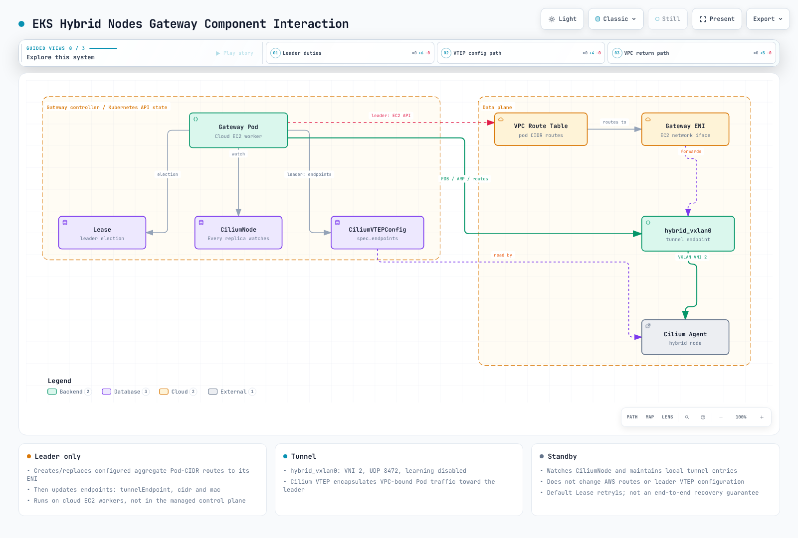
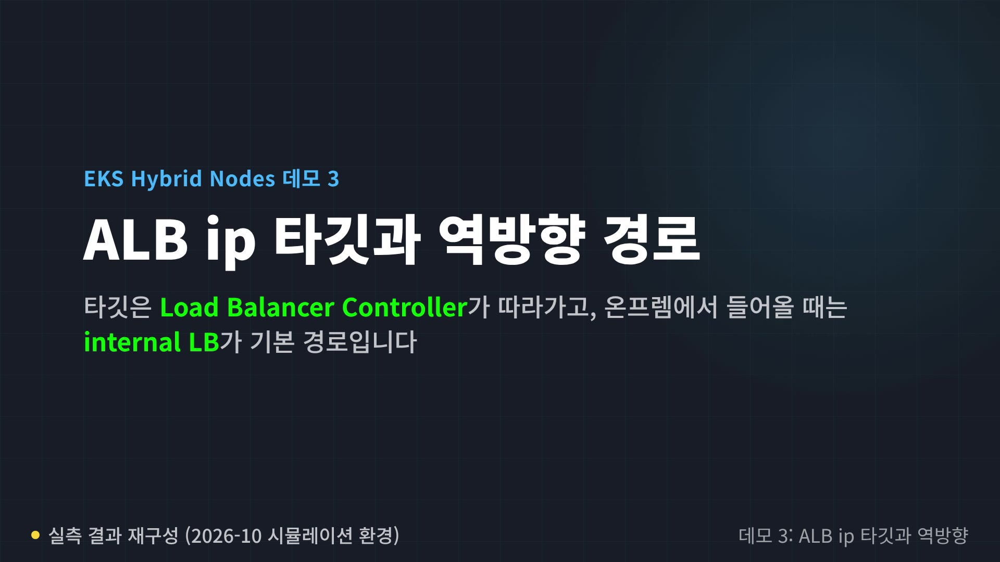

# EKS 混合节点网关

< [上一页：裸金属操作系统设置](./09-bare-metal-os-setup.md) | [目录](./README.md) >

> **验证基线**：Gateway/chart 1.0.2；使用 EKS 支持的 Kubernetes 版本，以及满足网关先决条件的 AWS 维护版 Cilium 发行版。
> **最后更新**：2026 年 10 月 18 日

---

## 概述

EKS 混合节点网关是一个开源网络组件，可自动建立 Amazon VPC 与在本地或边缘环境中的 Hybrid Nodes 上运行的 Kubernetes Pod 之间的连接。该网关于 2026 年 4 月 21 日宣布正式推出，会自动管理其负责的 Pod 路由和 VXLAN 转发状态。底层网络可达性、路由所有权、防火墙/MTU 规划、发布和清理仍需显式配置。

该网关通过在 VPC 中专用的 EC2 网关实例与本地由 Cilium 管理的 Hybrid Nodes 之间建立 VXLAN 隧道来工作。它会自动配置 VPC 路由表、管理转发数据库（FDB）条目，并配置 Cilium VTEP（VXLAN 隧道端点）集成，使 VPC 中的 Pod 能够直接与 Hybrid Nodes 上的 Pod 通信。要成功转发流量，仍取决于经过审核的底层网络、CNI、IAM、安全规则和应用路径。

**主要特征：**

- **开源**：完整源码可在 [github.com/aws/eks-hybrid-nodes-gateway](https://github.com/aws/eks-hybrid-nodes-gateway) 获取
- **不收取网关软件费用**：EC2、存储、Auto Mode 费用（仅当网关节点运行在 Auto Mode 上时；托管或自管理节点组也可使用）、跨 AZ 流量、连接和可观测性仍会产生费用
- **自动路由管理**：领导者会配置聚合 VPC Pod 路由；每个副本会分别协调每个 CiliumNode 的本地隧道状态
- **高可用性**：支持采用基于 Lease 的领导者选举机制进行故障转移的双副本 Deployment
- **Cilium 集成**：利用 Cilium 的 VTEP 功能，通过 VXLAN 隧道实现透明的 Pod 间路由

### 学习目标

完成本文档后，你将能够：

1. **说明 EKS 混合节点网关的架构**，包括 VXLAN 隧道、领导者选举和 VPC 路由管理
2. **使用 Helm 部署和配置网关**，包括 IAM 角色、安全组和 Cilium VTEP 集成
3. **跟踪 VPC Pod 与 Hybrid Node Pod 之间双向的流量路径**
4. **通过多副本网关部署实现高可用性**，并了解故障转移行为
5. **运维和排查网关部署问题**，包括监控、扩缩容和常见故障场景
6. **比较 Hybrid Nodes 网络方案**，并判断何时使用网关、何时使用手动路由
7. **在生产环境网关部署中应用安全、性能和成本优化最佳实践**

### 问题：混合环境中的手动 Pod 路由

在网关推出之前，要实现 VPC 与 Hybrid Nodes 之间 Pod 级别的通信，需要投入大量手动工作：

```
Before Gateway (Manual Approach):
=================================

1. Configure BGP peering between on-prem routers and VPC (or use static routes)
2. Manually manage VPC route table entries for every hybrid Pod CIDR
3. Set up and maintain VPN tunnels or Direct Connect with proper route propagation
4. Handle route updates when nodes join/leave the cluster
5. Troubleshoot routing asymmetries and MTU issues across multiple hops
6. Maintain custom scripts or controllers to keep routes in sync

After Gateway (Automated Approach):
====================================

1. Deploy gateway via Helm chart
2. Gateway automatically:
   - Creates VXLAN tunnels to hybrid nodes
   - Programs VPC route table entries
   - Configures Cilium VTEP for transparent routing
   - Handles failover via leader election
   - Updates routes as nodes come and go
```

网关将原本复杂、容易出错、需要多个团队协作的网络挑战，转变为通过一次 Helm 安装并设置少量配置值即可完成的工作。

---

## 深入了解架构

### 高层架构

EKS 混合节点网关位于 VPC 与本地网络的边界，充当 Pod 流量的 VXLAN 桥接。以下图示展示了整体架构：


[🔍 查看交互式图示](https://www.atomai.click/kubernetes-docs/archmaps/en-eks-hybrid-nodes-10-hybrid-nodes-gateway-0.html)

### VXLAN 隧道机制

网关使用 VXLAN（可扩展虚拟局域网）在 VPC 与本地环境之间封装 Pod 流量。以下介绍如何建立和维护隧道：

#### 网关侧 VXLAN 接口

网关 Pod 在 EC2 实例上启动时，会使用以下参数创建 `hybrid_vxlan0` 网络接口：

| 参数 | 值 | 说明 |
|-----------|-------|-------------|
| **接口名称** | `hybrid_vxlan0` | 网关上的 VXLAN 隧道接口 |
| **VNI（VXLAN 网络标识符）** | 2 | 网关默认值，与 Cilium VTEP 路径兼容；不是 CiliumVTEPConfig 字段 |
| **UDP 端口** | 8472 | 网关/Cilium VXLAN 端口；VXLAN 的 IANA 分配端口是 4789 |
| **本地 IP** | 网关 EC2 实例私有 IP | VXLAN 封装数据包的源 IP |
| **学习功能** | 已禁用 | FDB 条目由网关静态配置 |

网关使用 netlink 创建此接口。以下是概念性说明，不是应与控制器同时运行的命令。版本 1.0.2 不会为此接口分配 IP 地址；外层隧道使用网关节点的私有 IP。

```bash
# Conceptual equivalent of what the gateway does programmatically
ip link add hybrid_vxlan0 type vxlan \
    id 2 \
    local <gateway-private-ip> \
    dstport 8472 \
    nolearning

ip link set hybrid_vxlan0 up
```

#### FDB、ARP 和路由配置

节点协调器会监视带有 `eks.amazonaws.com/compute-type: hybrid` 标签的 `CiliumNode` 对象。它在每个网关副本上运行，并根据节点的内部 IP 和分配的 Pod CIDR 配置三类本地条目：

```text
Per Hybrid Node, the gateway programs:
=======================================

1. FDB (Forwarding Database) Entry:
   deterministic node MAC → hybrid node's internal IP
   → Tells the VXLAN interface where to send encapsulated frames for this node

2. ARP Entry:
   hybrid node's internal IP → deterministic node MAC
   → Pre-populates ARP so the gateway can immediately forward packets without ARP discovery

3. Route Entry:
   hybrid node's Pod CIDR via its internal IP, dev hybrid_vxlan0, onlink
   → Directs Pod traffic for this node's CIDR through the VXLAN tunnel
```

控制器会根据节点的 IPv4 地址推导远端 MAC，而不是发现 Cilium 接口 MAC。静态邻居/FDB 条目可以避免此路径依赖动态学习。协调错误、过期条目和底层网络故障仍可能中断转发。这些本地路由与 VPC 路由表条目不同。

#### Hybrid Node 侧（Cilium VTEP）

在 Hybrid Node 侧，Cilium 的 VTEP（VXLAN 隧道端点）功能负责处理隧道终止。网关通过 `CiliumVTEPConfig` 自定义资源将自身注册为远端 VTEP。这会告知每个 Hybrid Node 上的 Cilium agent：

1. 发往 VPC CIDR 的流量应使用 VXLAN 封装
2. 封装后的流量应发送到网关的 IP 地址
3. VXLAN 隧道使用 VNI 2 和 UDP 端口 8472

```yaml
# CiliumVTEPConfig created and managed by the gateway
apiVersion: cilium.io/v2
kind: CiliumVTEPConfig
metadata:
  name: hybrid-gateway
spec:
  endpoints:
    - name: vpc-gateway
      tunnelEndpoint: "10.0.1.5"      # Actual leader node IP
      cidr: "10.0.0.0/16"            # One VPC prefix per endpoint
      mac: "82:36:6c:89:e6:ad"       # Illustrative; read the leader's actual VXLAN MAC
```

当 Hybrid Node 上的 Pod 向 VPC IP 地址（例如云端 Pod 或 AWS 服务端点）发送流量时，Cilium agent 会：

1. 将目标地址与 CiliumVTEPConfig 中某个端点的 `cidr` 匹配
2. 使用 VNI 2 对数据包进行 VXLAN 封装
3. 将外层 UDP 数据包发送到网关 IP 的 8472 端口
4. 网关对数据包解封装，并将内层数据包转发到 VPC

### 领导者选举和高可用性

Chart 默认使用双副本 Deployment。两个副本都会维护本地 VXLAN/FDB/邻居/路由。只有领导者会更新 AWS VPC 路由和由控制器管理的、名为 `hybrid-gateway` 的 `CiliumVTEPConfig`。

#### 基于 Lease 的领导者选举

领导者选举使用标准 Kubernetes Lease 资源：

```yaml
apiVersion: coordination.k8s.io/v1
kind: Lease
metadata:
  name: hybrid-gateway-leader
  namespace: eks-hybrid-nodes-gateway
spec:
  holderIdentity: "gateway-node-hostname_example-uuid"
  leaseDurationSeconds: 3
  acquireTime: "2026-06-28T10:00:00Z"
  renewTime: "2026-06-28T10:00:10Z"
  leaseTransitions: 3
```

此 Lease 仅为示例观测结果，不是可供应用的清单。holder identity 不一定是 Pod 名称；执行任何运维操作前，请先找出对应的节点/Pod。这些二进制标志控制选举时序；chart 1.0.2 不提供 `leaderElection` values 对象：

| 参数 | 默认值 | 说明 |
|-----------|---------------|-------------|
| `--leader-election-lease-duration` | 3s | 选举 Lease 时长 |
| `--leader-election-renew-deadline` | 2s | 领导者续租截止时间 |
| `--leader-election-retry-period` | 1s | 选举重试间隔 |

#### 领导者的职责

领导者 Pod 负责：

1. **VPC 路由表管理**：在指定的 VPC 路由表中创建和更新路由，将 Hybrid Pod CIDR 指向领导者的 EC2 实例 ENI
2. **CiliumVTEPConfig 管理**：创建和更新 CiliumVTEPConfig 资源，将 Hybrid Nodes 的 VTEP 流量指向领导者的 EC2 实例 IP
3. **FDB/ARP/路由配置**：在本地 VXLAN 接口中为所有 Hybrid Nodes 配置条目
4. **监视节点**：与备用副本一样，监视 CiliumNode 对象并更新本地隧道条目。它不会针对每个节点事件创建/删除一条 AWS 路由。

#### 备用副本的职责

备用 Pod 会：

1. **维护 VXLAN 隧道**：保持其 `hybrid_vxlan0` 接口处于活动状态，并配置 FDB/ARP/路由条目
2. **不配置 VPC 路由**：只有领导者会修改 VPC 路由表
3. **不更新 CiliumVTEPConfig**：只有领导者会更新 VTEP 配置
4. **监视 Lease**：持续尝试获取 Lease，以便在领导者发生故障时接任

### VPC 路由表自动管理

获取领导权时，网关会为每个已配置的路由表中的聚合 `podCIDRs` 创建或替换路由。它先更新 AWS 路由，然后再更新 CiliumVTEPConfig。每个副本都会独立协调 CiliumNode，并维护各节点的本地隧道条目。


[🔍 查看交互式图示](https://www.atomai.click/kubernetes-docs/archmaps/en-eks-hybrid-nodes-10-hybrid-nodes-gateway-1.html)

网关使用 EC2 API 管理路由：

| API 调用 | 使用时机 | 用途 |
|----------|-----------|---------|
| `ec2:DescribeRouteTables` | 访问检查和领导者设置 | 读取显式配置的路由表 |
| `ec2:CreateRoute` | 领导者设置时，缺少已配置 CIDR 路由 | 添加聚合 Pod CIDR 路由 |
| `ec2:ReplaceRoute` | 领导者设置时，路由目标不一致 | 将已配置路由重定向到当前领导者的主 ENI |
| `ec2:DescribeInstances` | 启动、故障转移 | 查找网关 EC2 实例 ENI ID |

网关运行时不会调用 `DeleteRoute`。卸载 Helm 不会清理 AWS 路由。即使某个相同 CIDR 的现有路由由其他系统创建，也可能被替换：安装前请审核所有权以及切换/回滚计划。

这些约定已经对照 [1.0.2 实现](https://github.com/aws/eks-hybrid-nodes-gateway/tree/v1.0.2/internal)和 [AWS 运维指南](https://docs.aws.amazon.com/eks/latest/userguide/hybrid-nodes-gateway-operations.html)进行核查。仅凭 API 读取结果、就绪状态或领导者指标，不能证明端到端转发正常。

### 组件交互摘要

以下图示展示了所有组件之间的交互方式：



[🔍 查看交互式图示](https://www.atomai.click/kubernetes-docs/archmaps/en-eks-hybrid-nodes-10-hybrid-nodes-gateway-2.html)

---

## 先决条件

部署 EKS 混合节点网关之前，请确保满足以下所有先决条件。

### EKS 集群配置

| 要求 | 详情 |
|-------------|---------|
| **EKS 版本** | EKS 和所选插件当前支持的版本 |
| **地址族** | IPv4；VPC、Service、远端节点和远端 Pod 网络不得重叠 |
| **Hybrid Nodes** | 至少配置一个 Hybrid Node 并加入集群 |
| **身份验证模式** | `API` 或 `API_AND_CONFIG_MAP` |
| **端点访问** | 仅公共或仅私有（不能同时选择“公共和私有”） |
| **远端 Pod 网络** | 在集群中为 Hybrid Nodes 配置 Pod CIDR |

### CNI 要求

网关要求使用特定的 CNI 配置：

| 位置 | CNI | 版本 | VTEP 支持 |
|----------|-----|---------|--------------|
| **托管/自管理云节点** | Amazon VPC CNI | 受支持的插件版本；配置 Hybrid ClusterIP SNAT 排除项 | 不需要 |
| **Auto Mode 云节点** | 内置网络 | 使用 Auto Mode 支持的配置 | 不需要 |
| **Hybrid Nodes** | AWS 维护版 Cilium | 满足 [CNI 配置](#cni-configuration)中对应分支的最低版本 | 启用 VTEP，禁用 L7 proxy |

> 此网关实现要求使用 AWS Cilium VTEP 集成；它不是兼容 Calico 的控制器。如果其 CNI/L7 要求不适用，请使用单独支持的可路由 Pod 设计。[Hybrid cluster creation requirements](https://docs.aws.amazon.com/eks/latest/userguide/hybrid-nodes-cluster-create.html)要求 Hybrid Nodes 使用 API/API_AND_CONFIG_MAP 身份验证、IPv4，以及仅公共或仅私有的端点连接方式。

### 网络连接

VPC 与本地环境之间必须已经建立私有连接：

| 连接类型 | 适用场景 | 备注 |
|-------------------|-------------|-------|
| **AWS Direct Connect** | 需要稳定低延迟的生产工作负载 | 专用连接；弹性和延迟取决于实际冗余设计 |
| **AWS Site-to-Site VPN** | 标准混合连接 | IPsec 连接；吞吐量取决于所选隧道方案、数据包构成和路由 |
| **Transit Gateway + VPN** | 多 VPC 环境 | 集中式 VPN 终止；支持 ECMP 以提高吞吐量 |
| **自定义 VPN（例如 WireGuard）** | 特殊需求 | 自管理隧道；适用于担心 AWS VPN 限制的情况 |

> **注意**：网关不会建立 VPC 与本地环境之间的基础连接。它会在现有连接之上添加 VXLAN 覆盖网络，用于 Pod 级路由。

### EC2 网关实例

你至少需要在 VPC 中准备两台 EC2 实例来运行网关 Pod：

```yaml
# Recommended EC2 instance configuration for gateway nodes
Instance type: c6i.large (2 vCPU, 4 GiB RAM) or larger
AMI: Amazon Linux 2023 (EKS optimized)
Placement: Spread across at least 2 Availability Zones
EBS: 20 GiB gp3 (minimal storage needed)
```

网关实例必须：

1. 注册为云端 EC2 节点；区分使用 AWS VPC CNI 的托管/自管理节点与使用 Auto Mode 内置网络的节点
2. 具有适当的节点角色和单独限定范围的网关工作负载角色（见 [IAM 配置](#iam-configuration)）
3. 添加标签以便调度网关 Pod（见[安装](#installation-and-configuration)）

### 安全组配置

请使用实际节点/Pod CIDR 和经过审核的端口。仅开放 UDP8472 并不能建立所有应用或控制平面路径。请区分以下流量：

| 流量 | 必须审核的内容 |
|---|---|
| 网关主 IP ↔ Hybrid Node IP | 双向外层 VXLAN UDP8472 |
| 云端工作负载 ↔ Hybrid Pod | 预期的内层应用协议/端口及其返回流量 |
| 节点 → Kubernetes API、AWS API/容器镜像仓库和 DNS | 实际端点/解析器、TCP443 和所需 DNS 路径 |
| 控制平面 → kubelet | 到目标节点的 TCP10250；这与节点发出的 API443 流量不同 |
| Prometheus → 网关 | 将 TCP10080 限定为预期的抓取源 |

分别考虑安全组、无状态 NACL 和本地防火墙。不要以允许整个 VPC 入站来代替所需的应用流量。保护所有可能成为领导者的节点 IP，包括替换节点容量。

#### Terraform 安全组示例

在现有节点/网络 Terraform 堆栈中管理已批准的规则矩阵。仅供网关使用的 UDP 规则只是一个片段，不是完整的节点安全组。保留集群的引导、DNS、API 和应用要求，并检查最终计划；避免创建不受限制的重复 SG，也不要以为添加 VXLAN 规则就能确保其安全。

### 本地防火墙配置

使用可通过私有底层网络访问的网关**私有节点 IP**，而不是 Elastic IP。为每个符合条件的领导者/备用节点开放所需的 UDP8472 路径，并单独审核 Kubernetes API/kubelet、DNS 和应用流量。Auto Mode 或其他节点管理器替换网关实例时，应相应更新防火墙规则。本章或静态 SG 表都不能证明实际防火墙路径正常。

请在目标主 ENI 上检查 source/destination check。Auto Mode 使用 NodeClass 转发设置；托管/自管理节点的预配方负责执行任何必需的 ENI 修改。以下命令只读取当前值：

```bash
: "${AWS_REGION:?Set the reviewed Region}"
: "${GATEWAY_PRIMARY_ENI_ID:?Set the verified gateway primary ENI}"
aws ec2 describe-network-interface-attribute --region "$AWS_REGION" \
  --network-interface-id "$GATEWAY_PRIMARY_ENI_ID" --attribute sourceDestCheck
```

### MTU 注意事项

IPv4 VXLAN 通常会增加 50 字节开销，其中包括内层以太网头部。请使用端到端有效底层 MTU，而不是 EC2 接口的最大值。以下原始 MTU 数值仅用于规划示例，并非实测路径结果，也不是通用的 DX/VPN 设置：

| 组件 | 建议 MTU | 备注 |
|-----------|----------------|-------|
| 网关 EC2 实例 | 9001（巨型帧） | 大多数 VPC 中 EC2 实例类型的默认值 |
| 本地 Hybrid Nodes | 1500 或更高 | 取决于网络基础设施 |
| VXLAN 接口（有效值） | 路径 MTU - 50 | 例如路径 MTU 为 1500 时取 1450 |
| Direct Connect | 9001（巨型帧） | 仅在 DX 连接支持时使用 |
| VPN 隧道 | 1399-1500 | 随 VPN 配置而异 |

如果 VPC 与本地环境之间的网络路径使用标准 1500 MTU：

```
Effective Pod MTU calculation:
Physical MTU:        1500 bytes
VXLAN overhead:      - 50 bytes (outer IPv4 + outer UDP + VXLAN + inner Ethernet headers)
VPN overhead (IPsec): - 57-73 bytes (if applicable)
Effective Pod MTU:   ~1377-1450 bytes
```

可以为 Hybrid Nodes 上的 Cilium 配置适当的 MTU：

```yaml
# Cilium Helm values for hybrid nodes
mtu: 1400  # Illustrative only; replace using validated path MTU and chosen Cilium datapath.
```

---

## IAM 配置

### 所需 IAM 权限

请将网关工作负载角色与 EC2 节点角色，以及运维人员用于预配/清理的权限分开。[AWS 入门指南](https://docs.aws.amazon.com/eks/latest/userguide/hybrid-nodes-gateway-getting-started.html)建议使用 EKS Pod Identity。符合条件的托管/自管理节点上必须有其 agent；Auto Mode 提供 Pod Identity 支持。不要在现有安装上盲目创建插件。

网关运行时使用的操作包括 `ec2:DescribeRouteTables`、`ec2:DescribeInstances`、`ec2:CreateRoute` 和 `ec2:ReplaceRoute`。Describe 操作要求 `Resource: "*"`；应限制 Region。路由写入操作可以使用精确的路由表 ARN 和 VPC 条件。清理退役路由属于运维人员操作，不需要授予运行时权限。

### 限定范围的 IAM 策略（生产环境建议）

将以下内容保存为 `gateway-permissions.json`，并替换为经过审核的账号、Region、VPC 和路由表 ID。这里的标识符仅为示例，并非本次审核所预配的资源。该策略不会限制角色在这些路由表中可以修改哪些目标 CIDR：应将这些路由表视为路由安全边界，并控制谁可以修改 Gateway values 或使用其 ServiceAccount。

```json
{
  "Version": "2012-10-17",
  "Statement": [
    {
      "Sid": "ReadGatewayRoutingMetadata",
      "Effect": "Allow",
      "Action": [
        "ec2:DescribeRouteTables",
        "ec2:DescribeInstances"
      ],
      "Resource": "*",
      "Condition": {
        "StringEquals": {
          "aws:RequestedRegion": "ap-northeast-2"
        }
      }
    },
    {
      "Sid": "ManageOnlyOwnedRouteTables",
      "Effect": "Allow",
      "Action": [
        "ec2:CreateRoute",
        "ec2:ReplaceRoute"
      ],
      "Resource": [
        "arn:aws:ec2:ap-northeast-2:111122223333:route-table/rtb-0abc123456789def0",
        "arn:aws:ec2:ap-northeast-2:111122223333:route-table/rtb-0def456789abc1230"
      ],
      "Condition": {
        "StringEquals": {
          "ec2:Vpc": "arn:aws:ec2:ap-northeast-2:111122223333:vpc/vpc-0123456789abcdef0"
        }
      }
    }
  ]
}
```

路由表 ARN 和 `ec2:Vpc` 范围限定依据 [EC2 路由表策略示例](https://docs.aws.amazon.com/AWSEC2/latest/UserGuide/ExamplePolicies_EC2.html)。Describe 请求成功并不能证明 CreateRoute/ReplaceRoute 已获授权。切换前请在获批环境中测试授权和路由所有权。

### Terraform IAM 配置

使用 Pod Identity 时，将此信任策略保存为 `gateway-trust.json`，并替换为确切的集群 ARN。必须保持会话标签启用，因为这些条件会绑定集群、命名空间和 ServiceAccount。除 IAM 权限外，还应限制 Pod/ServiceAccount 的创建权限和 Pod Identity 关联管理权限。

```json
{
  "Version": "2012-10-17",
  "Statement": [
    {
      "Effect": "Allow",
      "Principal": {
        "Service": "pods.eks.amazonaws.com"
      },
      "Action": [
        "sts:AssumeRole",
        "sts:TagSession"
      ],
      "Condition": {
        "StringEquals": {
          "aws:RequestTag/eks-cluster-arn": "arn:aws:eks:ap-northeast-2:111122223333:cluster/hybrid-production",
          "aws:RequestTag/kubernetes-namespace": "eks-hybrid-nodes-gateway",
          "aws:RequestTag/kubernetes-service-account": "eks-hybrid-nodes-gateway"
        }
      }
    }
  ]
}
```

[Pod Identity 信任策略](https://docs.aws.amazon.com/eks/latest/userguide/pod-id-role.html)和[会话标签](https://docs.aws.amazon.com/eks/latest/userguide/pod-id-abac.html)定义了这些条件。以下 HCL 是集成片段，不是完整的 provider/cluster 堆栈；每个资源应选择由 Terraform 或 CLI 其中一种方式管理。

```hcl
# Fragment in the existing reviewed AWS provider/cluster stack.
# Declare and validate these variables; do not create duplicate CLI-managed resources.
resource "aws_iam_role" "gateway" {
  name               = var.gateway_role_name
  assume_role_policy = file("${path.module}/gateway-trust.json")
}
resource "aws_iam_role_policy" "gateway_routes" {
  name   = "GatewayOwnedRoutes"
  role   = aws_iam_role.gateway.id
  policy = file("${path.module}/gateway-permissions.json")
}
resource "aws_eks_pod_identity_association" "gateway" {
  cluster_name    = var.cluster_name
  namespace       = "eks-hybrid-nodes-gateway"
  service_account = "eks-hybrid-nodes-gateway"
  role_arn        = aws_iam_role.gateway.arn
}
```

### AWS CLI IAM 设置

请通过 IAM 管理方，使用经过审核的信任/权限 JSON 准备角色。关联中的 ServiceAccount 名称必须与渲染后的 chart 相符；更改 Helm release/name 覆盖值可能会改变它。关联配置独立于 chart values：chart 1.0.2 会忽略 `serviceAccount.annotations`。

```bash
: "${AWS_REGION:?Set the reviewed Region}"
: "${CLUSTER_NAME:?Set the reviewed cluster}"
: "${GATEWAY_ROLE_ARN:?Set the prepared, scoped Pod Identity role ARN}"
# Inspect existing associations; do not create a duplicate or replace another owner.
aws eks list-pod-identity-associations --region "$AWS_REGION" \
  --cluster-name "$CLUSTER_NAME" --namespace eks-hybrid-nodes-gateway \
  --service-account eks-hybrid-nodes-gateway
# Run only for the reviewed new association; keep session tags enabled:
aws eks create-pod-identity-association --region "$AWS_REGION" \
  --cluster-name "$CLUSTER_NAME" --namespace eks-hybrid-nodes-gateway \
  --service-account eks-hybrid-nodes-gateway --role-arn "$GATEWAY_ROLE_ARN" \
  --no-disable-session-tags
```

IRSA 仍可作为替代方案，但需要实际的 OIDC 信任策略，以及通过经过审核的补丁/覆盖配置添加到渲染后的 ServiceAccount 上的注释；Helm 忽略的值无法建立 IRSA。避免向所有节点工作负载广泛授予路由写入权限。二进制程序通过 EC2 元数据查询节点身份，以及其 SDK 凭证链，是两个独立的问题；在没有提供并验证所需节点身份输入的情况下，不要盲目禁用元数据。

Auto Mode 转发使用 `NodeClass.spec.advancedNetworking.sourceDestCheck: DisabledPrimaryENI`。托管/自管理节点的引导过程必须使用单独限定范围的节点/运维权限，在目标主 ENI 上禁用 source/destination check。上述网关工作负载策略不包含 `ModifyNetworkInterfaceAttribute` 以及集群/角色/插件创建操作。

---

## 安装和配置

### 步骤 1：为网关节点添加标签

先预配符合条件的云端 EC2 节点。托管/自管理节点使用 `autoMode.enabled=false`；Auto Mode 需要预先准备好 NodeClass/NodePool，并使用 `autoMode.enabled=true`。仅为已验证转发、安全组和 IAM 先决条件的节点添加标签。不要伪造由云提供商管理的实例类型或 AZ 标签。最好在不同 AZ 中准备两个符合条件的节点。

```bash
: "${KUBE_CONTEXT:?Set the reviewed Kubernetes context}"
: "${GW_NODE_A:?Set the first eligible gateway node}"
: "${GW_NODE_B:?Set the second eligible gateway node}"
kubectl --context "$KUBE_CONTEXT" get node "$GW_NODE_A" "$GW_NODE_B" \
  -L topology.kubernetes.io/zone,eks.amazonaws.com/compute-type
# Apply only after source/destination check, IAM and network prerequisites are met:
kubectl --context "$KUBE_CONTEXT" label node "$GW_NODE_A" "$GW_NODE_B"   hybrid-gateway-node=true
```

### 步骤 2：收集配置值

确认 AWS 账号、集群 VPC、远端 Pod CIDR、实际网关 ENI，以及受影响的子网/控制平面路由表。仅选择由此路由设计拥有的路由表；列出 VPC 中的所有路由表，并不代表可以更改所有路由表。`remoteNetworkConfig` 位于 `cluster` 下，而不是 `kubernetesNetworkConfig` 下。

```bash
: "${AWS_REGION:?Set the reviewed AWS Region}"
: "${CLUSTER_NAME:?Set the reviewed EKS cluster}"
: "${VPC_ID:?Set the cluster VPC ID}"
aws sts get-caller-identity --query Account --output text
aws eks describe-cluster --region "$AWS_REGION" --name "$CLUSTER_NAME" \
  --query 'cluster.{VpcId:resourcesVpcConfig.vpcId,RemotePodCIDRs:remoteNetworkConfig.remotePodNetworks[].cidrs[]}' \
  --output json
aws ec2 describe-vpcs --region "$AWS_REGION" --vpc-ids "$VPC_ID" \
  --query 'Vpcs[].CidrBlockAssociationSet[].{CIDR:CidrBlock,State:CidrBlockState.State}' \
  --output json
aws ec2 describe-route-tables --region "$AWS_REGION" \
  --filters "Name=vpc-id,Values=$VPC_ID" \
  --query 'RouteTables[].{ID:RouteTableId,Associations:Associations,Routes:Routes}' \
  --output json
```

### 步骤 3：使用 Helm 安装

安装前请完成 CNI、节点和工作负载 IAM 步骤。领导者可能会立即替换已配置 CIDR 的现有路由。确认路由所有权、反向路由和回滚计划后，再使用以下 values 文件。此处的安装步骤已在本地检查，但不代表已在实际环境中成功安装。下方单独标注日期的实验观测和演示视频描述的是模拟环境，不能验证你的部署。

### Helm Values 完整参考

已发布的 1.0.2 chart 的 `podCIDRs` 和 `routeTableIDs` 接受的是**逗号分隔字符串（CSV）**，而不是 YAML 数组。请使用 values 文件，避免 Helm 的 `--set` 对逗号/列表的解析改变其类型。

```yaml
# values.yaml: replace CIDRs/table IDs from the reviewed network inventory.
vpcCIDR: "10.0.0.0/16"
podCIDRs: "10.85.0.0/16"
routeTableIDs: "rtb-0abc123456789def0,rtb-0def456789abc1230"
replicas: 2
nodeLabel: hybrid-gateway-node
autoMode:
  enabled: false  # MNG/self-managed. Set true only for prepared Auto Mode nodes.
```

该 chart 还支持 `image.repository`、`image.tag`、`image.pullPolicy` 和命名辅助项。其模板**不会**关联 `replicaCount`、`nodeSelector`、`resources`、`affinity`、`topologySpreadConstraints`、`serviceAccount.annotations`、`leaderElection`、`logLevel`、`metrics`、`extraEnv` 或自定义 volume 值。不要把 YAML 接受了误认为设置已生效。请单独配置工作负载身份；如果其他设置需要维护版后置渲染器，请明确审核渲染后的 Deployment 及其升级行为。

两种模式都会使用 host networking、NET_ADMIN、必需的主机反亲和性和首选 AZ 反亲和性。该 chart 不会创建 Service、ServiceMonitor 或 PDB。Auto Mode 使用 maxSurge=1/maxUnavailable=0；其他节点使用 0/1。两种策略都不具备领导者感知能力，也不保证转发不间断。由于主机反亲和性，Auto Mode 的 surge 需要另一台符合条件的节点。

```bash
: "${KUBE_CONTEXT:?Set the reviewed Kubernetes context}"
# Local rendering first; it does not prove API admission, IAM or network readiness.
helm template eks-hybrid-nodes-gateway \
  oci://public.ecr.aws/eks/eks-hybrid-nodes-gateway \
  --version 1.0.2 --namespace eks-hybrid-nodes-gateway \
  --values values.yaml > gateway-rendered.yaml
# Creates/changes cluster resources and can redirect existing VPC routes:
helm upgrade --install eks-hybrid-nodes-gateway \
  oci://public.ecr.aws/eks/eks-hybrid-nodes-gateway \
  --version 1.0.2 --namespace eks-hybrid-nodes-gateway --create-namespace \
  --kube-context "$KUBE_CONTEXT" --values values.yaml
```

### 步骤 4：验证安装

读取实际的 Lease holder、网关 Pod 的节点/IP、VTEP 端点/MAC 和路由 ENI，并确认它们指向同一位领导者。holderIdentity 可能是节点主机名加 UUID，因此不要直接将其传给 `kubectl logs` 或 `kubectl delete pod`。

```bash
: "${KUBE_CONTEXT:?Set the reviewed Kubernetes context}"
: "${AWS_REGION:?Set the reviewed AWS Region}"
: "${ROUTE_TABLE_ID:?Set one reviewed route table ID}"
kubectl --context "$KUBE_CONTEXT" -n eks-hybrid-nodes-gateway \
  rollout status deployment/eks-hybrid-nodes-gateway --timeout=180s
kubectl --context "$KUBE_CONTEXT" -n eks-hybrid-nodes-gateway get pods -o wide
kubectl --context "$KUBE_CONTEXT" -n eks-hybrid-nodes-gateway   get lease hybrid-gateway-leader -o yaml
kubectl --context "$KUBE_CONTEXT" get ciliumvtepconfig hybrid-gateway -o yaml
aws ec2 describe-route-tables --region "$AWS_REGION" \
  --route-table-ids "$ROUTE_TABLE_ID" --query 'RouteTables[].Routes' --output json
kubectl --context "$KUBE_CONTEXT" -n eks-hybrid-nodes-gateway logs \
  -l app.kubernetes.io/name=eks-hybrid-nodes-gateway --all-containers=true --tail=50
```

Pod 处于 Running 状态、就绪响应和领导者 gauge 都不能证明转发成功。请测试双向流量、直接 Pod IP、带有 Hybrid 端点的 ClusterIP Service、实际 webhook 调用，以及从明确选定的云端和 Hybrid 工作负载返回的流量。服务器必须确实在受测端口上监听。请妥善保管日志，分享前对敏感工作负载数据进行隐藏处理。

---

## CNI 配置

### 在 Hybrid Nodes 上配置 Cilium VTEP

请使用 AWS 维护版 Cilium 构建版本。[网关 CNI 先决条件](https://docs.aws.amazon.com/eks/latest/userguide/hybrid-nodes-gateway-cni.html)规定最低分支版本为 **1.17.13-1、1.18.8-1 或 1.19.2-1**；这些是功能最低版本，并不意味着建议降级或忽略分支支持情况。请保留已有节点选择器、IPAM 地址范围和其他经过审核的发行版值。

所需的更改是设置 `vtep.enabled=true` 和 **`l7Proxy=false`**。在同一个 Cilium 安装中，无法启用 [运维](./08-operations.md)所述的 Cilium Ingress/Gateway API L7 配置。这并不妨碍普通 HTTP 应用使用已路由的路径。不要因为 VXLAN 就推断流量已加密，也不要仅仅因为无关示例提到了 WireGuard 就启用它；请验证特定数据路径/加密组合是否受支持。

#### 验证 Hybrid Nodes 上的 Cilium VTEP

```bash
: "${KUBE_CONTEXT:?Set the reviewed Kubernetes context}"
: "${CILIUM_VERSION:?Choose an AWS-maintained Cilium version meeting the gateway minimum}"
# Apply to the existing reviewed Hybrid Cilium release during a maintenance window.
helm upgrade cilium oci://public.ecr.aws/eks/cilium/cilium \
  --version "$CILIUM_VERSION" --namespace kube-system \
  --kube-context "$KUBE_CONTEXT" --reuse-values \
  --set vtep.enabled=true --set l7Proxy=false
kubectl --context "$KUBE_CONTEXT" -n kube-system rollout restart daemonset/cilium
kubectl --context "$KUBE_CONTEXT" -n kube-system   rollout status daemonset/cilium --timeout=300s
kubectl --context "$KUBE_CONTEXT" -n kube-system get configmap cilium-config \
  -o jsonpath='{.data.enable-vtep}{"\n"}{.data.enable-l7-proxy}{"\n"}'
```

打印出的两个 ConfigMap 值必须依次为 `true` 和 `false`。还需检查每个 Hybrid Node 上的 Cilium 健康状况，以及由控制器管理的 VTEP 对象。请使用所选 Cilium 镜像中的 CLI，并先检查其帮助信息，再依赖特定的 `bpf vtep` 命令；仅由 DaemonSet 选中的一个 Pod 无法覆盖所有节点。

### 云节点上的 VPC CNI 配置

对于运行 AWS VPC CNI 的云节点，必须将 Hybrid Pod CIDR 排除在发往 Hybrid 端点的 **ClusterIP 流量** SNAT 之外。即使缺少此设置，直接 Pod-IP 流量也可能正常，因此仅测试直接 IP 并不足够。保留其他排除项，并与插件配置的管理方协调此次更改。

```bash
: "${KUBE_CONTEXT:?Set the reviewed Kubernetes context}"
# MNG/self-managed cloud nodes using the aws-node DaemonSet:
kubectl --context "$KUBE_CONTEXT" -n kube-system get daemonset aws-node
# Preserve existing exclusions; use the complete reviewed CSV union, not just a new CIDR.
: "${SNAT_EXCLUDE_CIDRS:?Set existing exclusions plus all Hybrid Pod CIDRs}"
kubectl --context "$KUBE_CONTEXT" -n kube-system set env daemonset/aws-node \
  AWS_VPC_K8S_CNI_EXCLUDE_SNAT_CIDRS="$SNAT_EXCLUDE_CIDRS"
```

Auto Mode 提供的是内置网络，而不是需要配置的 `aws-node` DaemonSet。不要通过此 DaemonSet 配方安装或替换其网络。请单独验证其支持的 Hybrid Service 路径；在混合集群中，应将 aws-node 设置应用于实际由该组件管理的云节点。前缀委派/自定义网络设置是单独的设计选择，并非网关先决条件。

### CiliumVTEPConfig CRD 详情

控制器的 [1.0.2 upsert 代码](https://github.com/aws/eks-hybrid-nodes-gateway/blob/v1.0.2/internal/cilium/vtep.go)使用以下 API 结构。网关拥有名为 `hybrid-gateway` 的对象；这并不表示 Kubernetes 只允许集群中存在一个 CiliumVTEPConfig 对象。

```yaml
# Illustrative controller-owned observation; do not apply over the running controller.
apiVersion: cilium.io/v2
kind: CiliumVTEPConfig
metadata:
  name: hybrid-gateway
spec:
  endpoints:
  - name: vpc-gateway
    tunnelEndpoint: "10.0.1.5"
    cidr: "10.0.0.0/16"
    mac: "82:36:6c:89:e6:ad"  # Read the actual leader VXLAN MAC.
```

领导者变更时，控制器会更新 `tunnelEndpoint` 和 `mac`。每个端点只有一个 `cidr`；如果配置了多个 VPC 前缀，就会生成多个条目。MAC 必须是实际领导者 VXLAN 接口的 MAC，而不是任意的虚拟常量。请观察 Cilium 收敛和应用恢复情况，不要假定传播时间一定为 1–5 秒。此前的时间范围未经验证，仅为示例，并非实测结果。

---

## 流量模式

了解流量如何经过网关，对故障排查和容量规划至关重要。本节将跟踪各种主要通信模式下的数据包在系统中的路径。历史图示使用单独的示例 Pod 地址范围 10.100.0.0/20；若未先核对所有实际 CIDR，请勿将其与安装示例中的地址规划合并。

### 模式 1：VPC Pod 到 Hybrid Pod

这是最常见的模式——运行在 VPC 云节点上的 Pod 需要与本地 Hybrid Node 上的 Pod 通信。


[🔍 查看交互式图示](https://www.atomai.click/kubernetes-docs/archmaps/en-eks-hybrid-nodes-10-hybrid-nodes-gateway-3.html)

**逐步数据包流向：**

1. 云端 Pod（`10.0.64.15`）向 Hybrid Pod（`10.100.0.42`）发送数据包
2. 数据包进入 VPC 网络；VPC 路由表匹配已配置的聚合路由 `10.100.0.0/20 -> gateway ENI`
3. 数据包到达网关 EC2 实例的主 ENI
4. 网关的 Linux 路由表匹配路由：`10.100.0.0/24 via <hybrid-node-internal-ip> dev hybrid_vxlan0 onlink`
5. 网关对数据包进行 VXLAN 封装（外层 src：网关 IP，外层 dst：Hybrid Node IP，VNI：2，外层 UDP dst：8472）
6. 封装后的数据包经 Direct Connect/VPN 穿过本地网络
7. Hybrid Node 上的 Cilium agent 在 8472 端口接收 UDP 数据包
8. Cilium 对 VXLAN 数据包解封装，并将内层数据包交付给目标 Pod

### 模式 2：Hybrid Pod 到 VPC Pod

Hybrid Node 上的 Pod 需要访问 VPC 中的 Pod（或任意 IP）时，流量路径如下。


[🔍 查看交互式图示](https://www.atomai.click/kubernetes-docs/archmaps/en-eks-hybrid-nodes-10-hybrid-nodes-gateway-4.html)

**逐步数据包流向：**

1. Hybrid Pod（`10.100.0.42`）向云端 Pod（`10.0.64.15`）发送数据包
2. Hybrid Node 上的 Cilium agent 执行 BPF 查找，发现 `10.0.64.15` 与 VTEP 端点的 `cidr` `10.0.0.0/16` 匹配
3. Cilium 使用 VXLAN 封装数据包（外层 dst：网关 IP `10.0.1.100`，VNI：2，外层 UDP dst：8472）
4. 封装后的数据包经 Direct Connect/VPN 穿过到达 VPC
5. 网关 EC2 实例在 8472 端口接收 UDP 数据包
6. 网关对 VXLAN 数据包解封装，取出内层数据包（dst：`10.0.64.15`）
7. 内层数据包经网关 EC2 实例的 ENI 转发到 VPC
8. 标准 VPC 路由将数据包交付给云端 Pod

> 必须由节点预配方在实际网关主 ENI 上禁用 source/destination check。请参阅上述 Auto Mode 与托管/自管理节点的要求；仅查看路由无法验证此设置。

### 模式 3：控制平面到 Hybrid Node 上的 Webhook

当变更或验证 Webhook 运行在 Hybrid Node 上时，EKS 控制平面需要能够访问它。

```text
Webhook invocation → resolved remote Pod endpoint
  → control-plane VPC network path / matching route table
  → gateway primary ENI → VXLAN → Hybrid node → webhook listener
  → verified reverse path for the response
```

已配置的远端 Pod 网络、控制平面子网路由、Webhook Service/endpoint/TLS、安全规则和返回路径必须相互匹配。不要假设托管控制平面内部使用 kube-proxy/iptables 实现。可路由的原生 Pod 设计也能支持 Hybrid Webhook；这项能力并非网关独有。

### 模式 4：AWS 服务到 Hybrid Pod

| 路径 | 所需配置 |
|---|---|
| ALB/NLB IP 目标 | 通过预期的控制器注册符合条件的 Pod IP；验证 LB 子网路由、运行状况检查、应用端口、源身份和返回流量 |
| AMP 托管采集器 | 抓取器通过 VPC/远端 Pod 路由和开放的防火墙端口访问指标端点；Hybrid 插件指南还要求通过私有集群端点访问 |
| Prometheus remote_write | Prometheus/ADOT 采集器将样本推送到 AMP 工作区的摄取端点；工作区本身不是入站抓取器 |
| CloudWatch/跟踪导出 | 配置正确的 agent/采集器将数据发送到相应服务端点；所需 IAM/API/DNS/出口路径与入站 Pod 路由不同 |
| PrivateLink | 消费者端点 → 提供方服务/LB → 目标，具体取决于该服务的设计；通用 AWS 服务不会通过端点向 Hybrid Pod 发起任意连接 |

[Hybrid 插件指南](https://docs.aws.amazon.com/eks/latest/userguide/hybrid-nodes-add-ons.html)明确支持在满足端点和网络先决条件时使用 AMP 托管采集。请区分该抓取器与自管理的 remote_write；二者都不会仅因安装了网关而自动出现。

#### 实测：Hybrid Pod 上的 ALB IP 目标（2026-10-18）

随附运行记录报告了一个模拟环境中的观测结果（用 TGW 上另一个 VPC 代替本地环境、网关 1.0.2、AWS Load Balancer Controller chart 3.6.0、内部 ALB）。这不是受支持的生产设置，相关数值也不是保证。

本文档未附上 20/20、54 秒、0/276 和 1/191 这些观测对应的原始请求日志和数据包捕获记录。请将它们视为随附实验记录中的示例，而不是可独立复现的验收证据。[38 项原生路由测试](12-connectivity-validation.md)是另一项实验，不能佐证这些网关结果。对于你的部署，请使用[网络配置](02-network-configuration.md)中的诊断方法，从云端和 Hybrid 客户端测试正向与返回应用路径。保留带时间戳的客户端结果、源地址、目标健康状态以及路由/Lease 变化记录。

| 检查项 | 结果 |
|---|---|
| 目标注册 | LBC 将 Hybrid Pod IP（`172.17.0.202`、`172.17.0.48`）注册为 `ip` 目标。这些 IP 位于 VPC 外，因此 `AvailabilityZone` 为 `all`；经网关路径的运行状况检查通过 |
| 请求 | VPC 客户端 → 内部 ALB → VPC 路由 `172.17.0.0/16`（领导者 ENI）→ VXLAN → Hybrid Pod，20/20 |
| Pod 替换 | 在负载下滚动重启；目标在 54 秒内收敛到新 Pod IP，276 个请求中 0 个失败（preStop 15 秒，注销延迟 10 秒） |
| 领导者变更 | 在负载下删除领导者 Pod；切换耗时 4 秒，191 个请求中 1 个失败（客户端未重试） |

更新 Pod IP 后目标的是 **AWS Load Balancer Controller**，而不是网关。网关只提供通往 VPC 外 Pod IP 的路径，因此 Pod CIDR 必须可从 VPC 路由到达。安装期间，LBC 3.6.0 chart 的 `kind: List` 对象（IngressClassParams 和 IngressClass）在客户端 OpenAPI 验证时失败，并报错 `the server is currently unable to handle the request`；使用 `--disable-openapi-validation` 绕过了此问题。如果将运行状况检查间隔降至 5 秒，也要将超时时间设为低于 5 秒，否则目标组创建会失败。

### 模式 5：本地客户端到区域 Pod（反向方向）

本地客户端经负载均衡器进入，并访问位于区域（VPC）节点上的 Pod。此方向的默认路径是 VPC 自身的路由，而不是网关。

| 路径 | 行为 | 实测（2026-10-18） |
|---|---|---|
| 本地 → 内部 ALB → VPC CNI Pod | 本地 DNS 将 ALB 名称解析为私有 IP（Route 53 Resolver 入站端点）；流量经 DX/VPN/TGW 进入 VPC，再由 ALB 转发到 VPC CNI Pod IP。无需经过网关 | 20/20 |
| 本地 → 内部 ALB → Hybrid Pod | 在相同路径上，还要经网关绕回本地，因此私有连接会双向经过。本模拟使用 TGW；生产环境中的 DX 或 VPN 路径应单独评估延迟和传输费用 | 20/20 |
| 本地 → Hybrid NodePort → VPC CNI Pod | 报告中的实验路径使用节点 IP SNAT 和底层路由，不经过网关（VTEP）。此行为取决于 Service 流量策略、kube-proxy/Cilium 数据平面和伪装配置。请检查实际源 IP 和返回路由；如果应用了节点 IP SNAT，区域节点安全组必须允许来自远端节点 CIDR 的应用端口流量 | 失败（据报告，实验集群 SG 仅允许来自远端节点 CIDR 的 443） |

[AWS Ingress 指南](https://docs.aws.amazon.com/eks/latest/userguide/hybrid-nodes-ingress.html)建议，对于源自区域的流量使用带有 Load Balancer Controller 的 ALB；对于源自本地的流量使用本地 Ingress。由于网关要求 Cilium 使用 `l7Proxy=false`，同一安装中无法使用 Cilium Ingress 和 Gateway API；要从本地接入，请考虑使用 L4 `LoadBalancer` Service（Cilium LB IPAM/BGP），或已有的硬件 LB 配合 NodePort。

#### 演示视频：ALB IP 目标与反向路径

[](https://presentation.atomai.click/eks-hybrid-nodes-1h/media/v3-alb-reverse.mp4)

这段无声视频会在负载下滚动重启 Hybrid Pod，使 ALB 的 `ip` 目标切换到新 Pod IP，然后测试从本地主机发起的三条路径。录制时间为 2026 年 10 月 18 日，环境为模拟环境（通过 TGW 将 EC2 主机用作本地环境；不是受支持的生产设置）。在录像所示的运行中，滚动重启 50 秒后只有新的 Pod IP 保持健康；174 个请求中 0 个失败；从本地发起的 `/cloud` 请求为 3/3，`/hybrid` 为 3/3，NodePort 路径的 3 次尝试全部失败。上表中的 54 秒、276 个请求、4 秒和 1/191 数据来自同一天较早的一次测量（UTC 02:11）。完整演示请参阅 [1 小时课程幻灯片](https://presentation.atomai.click/eks-hybrid-nodes-1h/index.html)。

### 模式 6：比较——使用网关与不使用网关

原生/BGP/静态路由与此网关属于由不同组件管理的数据路径。网关增加了主备 VXLAN 跳点和聚合路由自动化，同时仍由你负责底层网络、CIDR、防火墙、IAM 和应用。下方比较和迁移章节说明了各自的边界；任何一种方案都不会自动保证 Webhook/LB 可用性。

---

## 高可用性和故障转移

### Deployment 架构

建议的生产部署使用 2 个跨 Availability Zones 分布的网关副本：


[🔍 查看交互式图示](https://www.atomai.click/kubernetes-docs/archmaps/en-eks-hybrid-nodes-10-hybrid-nodes-gateway-5.html)

### 故障转移顺序

领导者网关 Pod 不可用时（节点故障、Pod 崩溃、网络分区），会发生以下故障转移过程：


[🔍 查看交互式图示](https://www.atomai.click/kubernetes-docs/archmaps/en-eks-hybrid-nodes-10-hybrid-nodes-gateway-6.html)

### 故障转移时间线

**历史示例，非实测证据**：原始表格没有可复现的测试跟踪记录。请将其中的数值视为背景信息，而不是 SLO。当前 AWS 指南估计大约需要 3–5 秒，而项目标记版本 README 中的估算有所不同；必须实际测试路由/API/Cilium/应用的收敛情况。领导者会**先**设置 VPC 路由，**然后**更新 VTEP 对象，而不是并行执行。节点、AZ 或控制平面故障期间，这两个阶段都无法保证恢复时间。

| 阶段 | 时长 | 说明 |
|-------|----------|-------------|
| **检测** | 0-3s | 当前领导者无法续租；Lease 在 `leaseDuration` 后过期 |
| **选举** | 0-1s | 备用副本在下一个 `retryPeriod` 计时点获取 Lease |
| **路由更新** | 1-3s | 新领导者调用 `ec2:ReplaceRoute` 更新 VPC 路由 |
| **VTEP 更新** | 1-5s | 新领导者更新 `CiliumVTEPConfig`；Cilium agents 重新加载 BPF map |
| **总计** | **约 5-10s** | 端到端故障转移时间 |

故障转移期间：

- **VPC 到 Hybrid 的流量**：在 VPC 路由更新前会丢失（数据包会发往故障网关的 ENI）
- **Hybrid 到 VPC 的流量**：在 CiliumVTEPConfig 更新前会丢失（Cilium 仍会向旧网关 IP 发送流量）
- **Hybrid 内部以及节点/控制平面路径**：不经过网关的路径，只有在自身底层网络、CNI、DNS 和依赖项保持健康时才能继续工作；共用的 AZ/网络故障也可能影响这些路径。

#### 演示视频：网关领导者故障转移

[](https://presentation.atomai.click/eks-hybrid-nodes-1h/media/v1-gateway-failover.mp4)

这段无声视频删除领导者网关 Pod，并展示 Lease 切换、VPC 路由 ENI 切换和每秒探测结果。视频是 2026 年 10 月 18 日在模拟环境中录制的真实终端画面（通过 TGW 将 EC2 主机用作本地环境；不是受支持的生产设置）。录像中的运行里，Lease 切换耗时 5 秒，60 次探测中有 2 次失败。视频末尾展示的前三次早期运行（2026 年 10 月 15 日）中，切换分别耗时 3 秒、5 秒和 5 秒；探测失败数分别为 1/60、1/60 和 2/45。与 AWS 文档中约 3 到 5 秒的估算一样，这些数据都不是保证。完整演示请参阅 [1 小时课程幻灯片](https://presentation.atomai.click/eks-hybrid-nodes-1h/index.html)。

### 单网关故障和多个数据中心

网关（1.0.2）以每个集群一组的方式部署，只有一个活动领导者。对于 `podCIDRs`（CSV）中的**每个 CIDR**，领导者都会在每个已配置的路由表中创建一条路由；隧道条目则按 Hybrid `CiliumNode` 管理。只要不同数据中心的每个 Pod CIDR（例如 DC A `10.85.0.0/16`、DC B `10.86.0.0/16`）都列在集群的 `remotePodNetworks` 和网关的 `podCIDRs` 中，一个网关就能服务所有数据中心。地址范围不必连续。

| 项目 | 详情 |
|---|---|
| CIDR 数量 | 最多支持 15 个远端 Pod 网络 CIDR（EKS 限制）。每个 CIDR 会在每个路由表中增加一条路由，因此还要检查每个路由表的路由配额（默认 50） |
| 吞吐量 | 来自所有数据中心的 VPC↔Hybrid Pod 流量都会经过一个领导者。主备模式不会横向扩展；应根据实例和网络性能进行选型 |
| 防火墙 | 每个数据中心的 Hybrid Nodes 都必须能够通过 UDP 8472 访问领导者和备用节点的 IP |
| 按数据中心拆分 | 文档未说明如何在一个集群中为每个数据中心单独运行网关。1.0.2 中的 Lease（`hybrid-gateway-leader`）和 CiliumVTEPConfig（`hybrid-gateway`）名称固定，因此多个 release 很可能发生冲突（未经验证） |

如果唯一的网关 Pod 故障，或两个副本都故障，那么 VPC 与**所有**数据中心的 Hybrid Pod CIDR 之间的 Pod 流量都会同时中断。一个健康的领导者仍可转发流量，但没有备用副本就不具备网关冗余。运行时永远不会调用 `DeleteRoute`，因此 VPC 路由会一直指向故障 ENI，直到运维人员或恢复后的领导者更改路由。

| 会中断的路径 | 仍可使用的路径（前提是自身网络和 DNS 健康） |
|---|---|
| VPC Pod ↔ Hybrid Pod（双向）、Hybrid Pod 上的 Webhook、Hybrid Pod 上的 ALB/NLB 目标、AMP 抓取器 → Hybrid 端点 | 控制平面 ↔ kubelet（节点 CIDR 路径）、同一数据中心内的 Hybrid-to-Hybrid、经本地网络路由的数据中心间 Hybrid 流量、节点 IP 路径（NodePort、hostNetwork） |

因此，实际上需要在不同 AZ 中放置两个位于符合条件节点上的副本。如果同一 Service 还包含 VPC 中的 Pod，目标组也会包含云端目标，因此在健康检查移除 Hybrid 目标后，负载均衡器仍可通过云端目标继续响应（此组合未实测）。

### 多 AZ 部署建议

Chart 1.0.2 要求使用不同主机，但只会优先选择不同 AZ。应选择/预配跨 AZ 的合格节点，并检查实际调度位置；不要设置虚假的拓扑标签。旧示例中的 `affinity` 和 `topologySpreadConstraints` values 未接入此 chart。如果需要严格的 AZ 约束，请维护经过审核的部署覆盖配置，并考虑 AZ/容量不可用时 Pod 处于 Pending 状态的情况。

### Pod Disruption Budget

此可选 PDB 可通过 eviction API 限制自愿驱逐。它不会阻止直接删除 Pod、Deployment 滚动更新或非自愿故障，也无法按身份保留活动领导者：

```yaml
apiVersion: policy/v1
kind: PodDisruptionBudget
metadata:
  name: eks-hybrid-nodes-gateway
  namespace: eks-hybrid-nodes-gateway
spec:
  minAvailable: 1
  selector:
    matchLabels:
      app.kubernetes.io/name: eks-hybrid-nodes-gateway
```

### 网关完全故障后的恢复

请检查两个网关 Pod、符合条件的云节点、Lease、路由目标和 VTEP 状态。区分网关故障与更大范围的底层网络/API/Cilium 故障。节点 IP 与控制平面之间的现有连接属于另一条路径；不要假设所有工作负载都能继续使用 DNS 或云端依赖项。

```bash
: "${KUBE_CONTEXT:?Set the reviewed Kubernetes context}"
kubectl --context "$KUBE_CONTEXT" -n eks-hybrid-nodes-gateway get pods -o wide
kubectl --context "$KUBE_CONTEXT" get nodes -l hybrid-gateway-node=true -o wide
kubectl --context "$KUBE_CONTEXT" -n eks-hybrid-nodes-gateway   get lease hybrid-gateway-leader -o yaml
kubectl --context "$KUBE_CONTEXT" get ciliumvtepconfig hybrid-gateway -o yaml
```

替换节点在添加标签前必须满足 IAM、主 ENI 转发、网络和 chart 调度要求。领导权恢复后，应重新检查 VPC 路由 ENI 和双向应用探测结果。就绪状态/领导者指标本身不是验收标准。破坏性故障转移演练应在获批的维护窗口中进行，并确认 Pod/节点身份、流量探测和恢复负责人；不要根据 holderIdentity 盲目推断要删除哪个 Pod。

---

## 运维

### 监控

#### 需要关注的关键指标

版本 1.0.2 在端口 **10080** 上提供 `/metrics`，并在 8088 上提供 `/healthz` 和 `/readyz`。[标记版本中的指标定义](https://github.com/aws/eks-hybrid-nodes-gateway/blob/v1.0.2/internal/metrics/metrics.go)和[采集器](https://github.com/aws/eks-hybrid-nodes-gateway/blob/v1.0.2/internal/metrics/collector.go)定义了以下名称/类型：

| 指标 | 类型 | 含义 |
|---|---|---|
| `hybrid_gateway_leader_is_active` | Gauge | 此副本的领导者状态；不代表路由设置已成功 |
| `hybrid_gateway_hybrid_nodes_configured` | Gauge | 此副本本地已配置的节点数 |
| `hybrid_gateway_vxlan_tx_bytes_total`、`hybrid_gateway_vxlan_rx_bytes_total` | Counter | 内核接口字节计数器；应使用 rate，并考虑计数器重置 |
| `hybrid_gateway_vxlan_tx_packets_total`、`hybrid_gateway_vxlan_rx_packets_total` | Counter | 数据包计数器，不代表应用成功 |
| `hybrid_gateway_vxlan_interface_up` | Gauge | 接口状态，不代表端到端可达性 |
| `hybrid_gateway_vxlan_fdb_entries`、`hybrid_gateway_vxlan_route_count` | Gauge | 本地观测到的表项数 |
| `hybrid_gateway_aws_route_table_update_total`、`hybrid_gateway_aws_route_table_update_errors_total` | Counter | 路由操作成功/错误事件 |
| `hybrid_gateway_aws_route_table_update_duration_seconds`、`hybrid_gateway_leader_setup_duration_seconds` | Histogram | 耗时观测值；没有事件就无法得到有用的延迟估算 |

即使文字表格将网络 `_total` 指标标为 gauge，代码仍会将其作为 counter 输出。`LeaderIsActive` 会在路由/VTEP 设置完成前设为 true，而 readiness 不是应用探测。应结合抓取健康状态和 API 错误，调查领导者持续缺失/数量异常；单个瞬时样本不能证明发生了脑裂。

#### Prometheus ServiceMonitor

此 chart 不会创建 Service。以下独立示例会创建一个 Service，并让 ServiceMonitor 绑定到其**命名 Service 端口**。Prometheus Operator/CRD、命名空间选择以及实际的 `serviceMonitorSelector` 必须已配置。请将示例中的 `release` 标签替换为匹配现有堆栈的值。使用节点/网络控制限制对 host-network 指标端口的访问。

```yaml
apiVersion: v1
kind: Service
metadata:
  name: hybrid-gateway-metrics
  namespace: eks-hybrid-nodes-gateway
  labels:
    app.kubernetes.io/name: eks-hybrid-nodes-gateway
    app.kubernetes.io/instance: eks-hybrid-nodes-gateway
spec:
  selector:
    app.kubernetes.io/name: eks-hybrid-nodes-gateway
    app.kubernetes.io/instance: eks-hybrid-nodes-gateway
  ports:
  - name: metrics
    port: 10080
    targetPort: metrics
---
apiVersion: monitoring.coreos.com/v1
kind: ServiceMonitor
metadata:
  name: hybrid-gateway-metrics
  namespace: eks-hybrid-nodes-gateway
  labels:
    release: kube-prom  # Must match the existing Prometheus serviceMonitorSelector.
spec:
  namespaceSelector:
    matchNames: [eks-hybrid-nodes-gateway]
  selector:
    matchLabels:
      app.kubernetes.io/name: eks-hybrid-nodes-gateway
      app.kubernetes.io/instance: eks-hybrid-nodes-gateway
  endpoints:
  - port: metrics
    interval: 30s
    scrapeTimeout: 10s
    path: /metrics
```

#### Grafana 面板查询示例

```promql
# Expected steady-state leader count, scoped to this one Service scrape job.
sum(hybrid_gateway_leader_is_active{namespace="eks-hybrid-nodes-gateway",service="hybrid-gateway-metrics"})

# Per-target VXLAN TX/RX byte rates; do not sum duplicate scrape jobs.
rate(hybrid_gateway_vxlan_tx_bytes_total{namespace="eks-hybrid-nodes-gateway",service="hybrid-gateway-metrics"}[5m])
rate(hybrid_gateway_vxlan_rx_bytes_total{namespace="eks-hybrid-nodes-gateway",service="hybrid-gateway-metrics"}[5m])

# Failures in the observation window, not a cumulative nonzero counter alert.
increase(hybrid_gateway_aws_route_table_update_errors_total{namespace="eks-hybrid-nodes-gateway",service="hybrid-gateway-metrics"}[5m])

# Per-replica local configuration counts; summing leader and standby double-counts nodes.
hybrid_gateway_hybrid_nodes_configured{namespace="eks-hybrid-nodes-gateway",service="hybrid-gateway-metrics"}

# Target scrape health is separate from leader/traffic metrics.
up{namespace="eks-hybrid-nodes-gateway",service="hybrid-gateway-metrics"}
```

缺失的时间序列需要使用目标缺失/抓取告警；对空序列求和不会自动得到零。请根据实际部署推导告警窗口和节点数量预期。流量减少可能只是应用空闲，并不代表故障；历史事件产生的累计错误值在事件结束后仍非零。

#### CloudWatch 集成

EC2 `NetworkIn`/`NetworkOut` 是实例级计数器，不是仅针对 VXLAN 的 ENI 指标。要在 CloudWatch 中使用自定义网关指标，应先配置采集器，明确指定命名空间、维度、单位和累计计数器处理方式，然后验证发布的样本。`put-metric-alarm` 命令不会创建其依赖的指标，也不能证明流量发生故障。设计告警时应考虑导出器缺失、空闲时段和计数器重置。

### 日志记录

请私密收集有范围限制的日志，并将 API/权限错误视为故障。标签选择器会同时选中两个副本，而不仅是领导者。holderIdentity 不一定是 Pod 名称。1.0.2 中有用的消息包括 `Processing CiliumNode`、`Adding hybrid node to gateway`、`Remote VTEP added` 和 `Reconciling CiliumVTEPConfig`；请以实际结构化日志为准，不要假设运行时会执行实际上并不存在的 AWS DeleteRoute 操作。

#### 启用调试日志

Chart 1.0.2 未接入 `logLevel=debug`；此 Helm 值无法启用调试。请检查所选二进制支持的日志标志，并明确维护任何所需的部署覆盖配置。提高日志详细程度时，避免泄露凭证或工作负载有效载荷。

### 故障排查

#### 问题：Pod 无法通过网关通信

此收集脚本在 API/日志查询失败时会停止，不会将身份验证/传输错误标记为资源不存在。分享私有诊断文件前，请先检查并对其进行隐藏处理。

```bash
#!/usr/bin/env bash
set -euo pipefail
umask 077
: "${KUBE_CONTEXT:?Set the reviewed Kubernetes context}"
: "${AWS_REGION:?Set the reviewed AWS Region}"
: "${ROUTE_TABLE_ID:?Set one reviewed route table ID}"
OUT_DIR=$(mktemp -d "${TMPDIR:-/tmp}/gateway-diagnose.XXXXXX")
kubectl --context "$KUBE_CONTEXT" -n eks-hybrid-nodes-gateway get pods -o json > "$OUT_DIR/pods.json"
kubectl --context "$KUBE_CONTEXT" -n eks-hybrid-nodes-gateway \
  get lease hybrid-gateway-leader -o json > "$OUT_DIR/lease.json"
kubectl --context "$KUBE_CONTEXT" get ciliumvtepconfig hybrid-gateway -o json > "$OUT_DIR/vtep.json"
kubectl --context "$KUBE_CONTEXT" get ciliumnodes -o json > "$OUT_DIR/ciliumnodes.json"
aws ec2 describe-route-tables --region "$AWS_REGION" \
  --route-table-ids "$ROUTE_TABLE_ID" --output json > "$OUT_DIR/routes.json"
kubectl --context "$KUBE_CONTEXT" -n eks-hybrid-nodes-gateway logs \
  -l app.kubernetes.io/name=eks-hybrid-nodes-gateway \
  --all-containers=true --prefix=true --tail=100 > "$OUT_DIR/gateway.log"
printf 'Private diagnostic files: %s\n' "$OUT_DIR"
```

比较实际领导者的 Pod 节点/IP、VTEP IP/MAC、主 ENI 路由和 CiliumNode CIDR。检查完整返回路径，以及 VTEP=true/L7=false 的配置要求。不要因为缺少 map 就盲目重启 Cilium；应先检查版本、配置和协调错误。

#### 问题：安全组配置错误

UDP 没有连接握手。`nc -uz` 报告成功，并不能证明 VXLAN 流量已到达或完成解封装。请通过有范围限制且经过批准的数据包捕获/计数器，检查安全组、无状态 NACL、本地防火墙和底层网络的双向流量。在物理接口上的捕获过滤器会看到外层 UDP8472；在 `hybrid_vxlan0` 上则会看到内层流量，因此在该接口上按外层 UDP8472 过滤可能会漏掉正在诊断的流量。

#### 问题：缺少 VPC 路由

确认已配置的路由表 ID、精确 Pod 前缀、网关主 ENI 和工作负载的 IAM 身份。运维人员运行 `sts get-caller-identity` 并不能证明网关 SDK 使用的是哪个角色。DryRun 测试具有不同的 `DryRunOperation`/`UnauthorizedOperation` 结果，且必须使用预期主体/参数；它不等于路由修改成功。请检查实际主 ENI 上的 source/destination check，而不是只查看推测中的节点属性。

#### 问题：领导者频繁变更

检查指定的 Lease、API 延迟/可达性、网关节点健康状态和资源压力。领导权丢失并不代表另一个副本已完成路由设置。就绪处理程序只检查本地布尔值。未通过身份验证的 wget 请求可能因 TLS/身份验证失败，不能据此断定网络中断。

#### 问题：MTU 问题

使用实际包含 iproute2/iputils 的诊断镜像/环境。BusyBox ping 不一定支持 iputils 的 `-M do` 选项。请限制数据包数量和超时时间，明确选择两个端点，并记住 IPv4 ICMP 负载在封装前还需要 28 字节的 IP/ICMP 头部。ICMP 响应被阻止并不能得出确切的 MTU 测量结果。包含 VPN/DX 封装的端到端最小底层 MTU，比仅从 EC2 网卡 MTU 中减去 50 更重要。

#### 故障排查决策树

1. 确认两个控制平面对象以及云端/Hybrid Node 的实际身份；保留 API 错误。
2. 分别验证聚合路由的所有权/目标，以及逐节点本地 FDB/邻居/路由。
3. 验证外层 UDP 可达性和主 ENI 上的 source/destination check。
4. 验证 AWS Cilium 版本、VTEP/L7 设置和当前 VTEP 端点。
5. 分别测试直接 Pod IP 和 ClusterIP，然后测试实际 Webhook/LB 路径。
6. 使用有限范围的诊断方法调查 MTU、丢包、应用侦听器/TLS 和返回路由。

### 扩缩容

#### 添加更多 Hybrid Nodes

每个网关副本都会将带标签的 CiliumNode 对象协调为本地隧道条目。领导者在获取领导权时管理已配置的聚合 Pod CIDR 路由；它不会为每个新节点添加一条 AWS 路由。请验证新节点地址/CIDR 以及两个副本上的本地计数。节点数量增加本身无法决定吞吐量；额外副本提供的是备用容量，而不是主动-主动的流量分配。

#### 网关实例选型

根据峰值字节速率、每秒数据包数、并发连接/隧道、CPU、内存和故障余量进行选型。任一时刻只有一个副本会转发网关管理的流量。

**历史选型示例**：下表保留的是原始估算，并非经过测试的节点数限制或经验证的吞吐量。请检查当前 EC2 规格；尤其是其中 c6in.2xlarge 的 50 Gbps 数值，并非经验证的持续性能规格。

| 实例类型 | vCPU | 内存 | 网络带宽 | 建议用途 |
|---------------|------|--------|-------------------|-----------------|
| c6i.large | 2 | 4 GiB | 最高 12.5 Gbps | 开发/测试，< 10 个 Hybrid Nodes |
| c6i.xlarge | 4 | 8 GiB | 最高 12.5 Gbps | 小型生产环境，10-50 个节点 |
| c6i.2xlarge | 8 | 16 GiB | 最高 12.5 Gbps | 中型生产环境，50-100 个节点 |
| c6i.4xlarge | 16 | 32 GiB | 最高 12.5 Gbps | 大型生产环境，100+ 个节点 |
| c6in.2xlarge | 8 | 16 GiB | 最高 50 Gbps | 高吞吐量工作负载 |
| c6in.4xlarge | 16 | 32 GiB | 最高 50 Gbps | 极高吞吐量 |

> 此表不保证容量。VXLAN 处理会消耗 CPU 和内存，EC2 突发/基准带宽、PPS 和流量路径限制仍然适用。应根据实际实例和数据包构成进行验证，而不是仅按标称网络带宽上限选型。

#### 网关容量规划

以下原始计算作为**未经测量的规划示例**保留。800 Mbps 的计算使用十进制 KB/MB，并假设每个请求方向各为 10 KB。如果 10 KB 已包含请求和响应，再乘以 2 就会重复计数。数据包大小、头部、峰值并发和重试需要单独核算。此计算不能证明所列实例具有足够的持续余量：

```
Throughput estimation:
======================
Number of hybrid Pods with cross-boundary traffic:   100
Average request/response size:                        10 KB
Average requests per second per Pod:                  50
VXLAN overhead per packet:                            ~3% (50 bytes / ~1500 bytes)

Required throughput:
  100 Pods × 50 req/s × 10 KB × 2 (bidirectional) = ~100 MB/s = ~800 Mbps

Recommendation: c6i.xlarge (12.5 Gbps) with comfortable headroom
```

### 升级网关

请审核实际发布的版本及其 chart/应用约定。本次审核验证了 1.0.2；此前的 1.1.0 命令是未经验证的示例，并非已执行的升级。请私下备份所管理的 values/清单和路由清单，检查 Helm 历史，并选择确切的回滚修订版本，不要假设修订版 1 一定合适。

```bash
: "${KUBE_CONTEXT:?Set the reviewed Kubernetes context}"
: "${GATEWAY_VERSION:?Set an existing, reviewed release version}"
helm history eks-hybrid-nodes-gateway -n eks-hybrid-nodes-gateway   --kube-context "$KUBE_CONTEXT"
# OCI charts are inspected/pulled by an explicit version, not helm search repo.
helm show chart oci://public.ecr.aws/eks/eks-hybrid-nodes-gateway   --version "$GATEWAY_VERSION"
helm template eks-hybrid-nodes-gateway \
  oci://public.ecr.aws/eks/eks-hybrid-nodes-gateway \
  --version "$GATEWAY_VERSION" --namespace eks-hybrid-nodes-gateway \
  --values values.yaml > gateway-upgrade-rendered.yaml
# Run only after reviewing the rendered diff, IAM, routes and rollback plan:
helm upgrade eks-hybrid-nodes-gateway \
  oci://public.ecr.aws/eks/eks-hybrid-nodes-gateway \
  --version "$GATEWAY_VERSION" --namespace eks-hybrid-nodes-gateway \
  --kube-context "$KUBE_CONTEXT" --values values.yaml
kubectl --context "$KUBE_CONTEXT" -n eks-hybrid-nodes-gateway \
  rollout status deployment/eks-hybrid-nodes-gateway --timeout=300s
```

Deployment 滚动更新不具备领导者感知能力：它不保证先替换备用副本。Chart 1.0.2 未接入自定义 `strategy` 值。主机反亲和性/容量、Lease 变化以及路由/VTEP 收敛都可能中断流量。历史上的 5–10 秒和 40–55 秒示例不是升级 SLO。Helm 回滚还要求 CRD/配置兼容，并需验证应用/路由；它不会自动还原所有外部 AWS 路由。

### 清理

**Helm 卸载后 AWS 路由仍然存在**。安装前和移除前都应记录路由表、CIDR、先前目标和当前网关 ENI。先迁移/排空依赖网关的流量。修改控制器管理的 VTEP 对象前，应先停止控制器，避免它重新创建该对象。

```bash
: "${KUBE_CONTEXT:?Set the reviewed Kubernetes context}"
: "${AWS_REGION:?Set the reviewed AWS Region}"
: "${ROUTE_TABLE_ID:?Set one route table whose ownership was confirmed}"
# Snapshot/read current targets before deciding which routes to restore or delete.
aws ec2 describe-route-tables --region "$AWS_REGION"   --route-table-ids "$ROUTE_TABLE_ID" --output json
kubectl --context "$KUBE_CONTEXT" get ciliumvtepconfig hybrid-gateway -o yaml
# Disruptive: retire/migrate traffic and record the current leader/ENI before running.
helm uninstall eks-hybrid-nodes-gateway -n eks-hybrid-nodes-gateway   --kube-context "$KUBE_CONTEXT" --wait --timeout=180s
```

网关 Pod 全部消失后，如果迁移计划要求，应恢复到先前的路由目标；只有当路由表/CIDR/当前目标和所有权都符合退役计划时，才删除路由。切勿盲目删除所有已配置 CIDR 的路由：其他所有者可能已更改目标。每次获批更改后都要重新查询 AWS 状态，并区分访问/传输错误与资源不存在。

只有确认不再有其他使用者/控制器管理 `ciliumvtepconfig/hybrid-gateway` 后，才能移除该控制器拥有的对象。通过相应基础设施所有者的记录，移除此 release 的 Pod Identity 关联/角色、指标资源和专用容量；Helm release 已卸载并不代表这些计费资源已经消失。只有在命名空间或节点标签完全由此网关独占且不存在无关工作负载时，才删除它们。验证最终的应用路径、路由、关联和容量。

---

## 比较：使用网关与不使用网关

### 功能比较

| 关注点 | 不使用此网关的可路由 Pod | Hybrid Nodes Gateway |
|---|---|---|
| 路由 | BGP/静态路由或其他由专属组件管理的自动化路径 | 聚合 VPC 路由，以及 Cilium VTEP/本地隧道协调 |
| 设置 | 底层网络/路由器/CNI/地址规划 | 同样需要规划底层网络，此外还需符合条件的网关节点、IAM、AWS Cilium VTEP/L7 配置和路由所有权 |
| Webhook 和 ALB/NLB IP 目标 | 在路由、远端 Pod 网络、返回路径和安全规则有效时可以实现 | 同样需要这些应用/控制平面先决条件；仅安装 Helm 无法建立这些条件 |
| CNI | 选择受支持的可路由 Pod 设计 | 要求 AWS 维护版 Cilium VTEP 集成，并禁用 L7 proxy |
| 容量 | 实际路由器/链路/CNI/主机限制 | 一个活动网关的容量，加上所有底层链路/路径限制 |
| HA | 由相应网络/收敛设计负责 | Active-standby Lease 和路由/VTEP 收敛；可能出现临时中断 |
| 成本 | 集群/Hybrid Nodes、连接、基础设施和运维费用 | 除这些费用外，还包括网关 EC2/存储费用、网关节点使用 Auto Mode 时的 Auto Mode 费用，以及可能增加的跨 AZ 流量 |
| 移除 | 协调所管理的路由/资源 | Helm 不会删除外部 AWS 路由、IAM 关联或专用容量 |

### 何时使用网关

当 AWS Cilium/VTEP 配置和 active-standby 跳点符合工作负载需求，并能简化 Pod 路由管理时，可使用网关。网关不会免除网络团队对私有节点可达性、MTU、CIDR、安全规则和故障恢复的责任。现有原生路由、不兼容的 CNI/L7 要求，或不同的容量/故障域需求，可能更适合其他设计。两种方案都不存在普遍适用的延迟、可用性或成本优势。

### 性能特征

**以下原始估算仅为未经测量的示例，并非当前基准测试结果**。原生路由同样存在处理/排队延迟，VXLAN 的开销取决于数据包大小、CPU、链路限制和卸载行为。即使使用巨型帧，增加一个跳点也可能产生影响。

| 指标 | 原始原生/BGP 示例 | 原始 VXLAN 示例 |
|---|---|---|
| 延迟开销 | 约 0 ms | 约 0.1–0.5 ms |
| 吞吐量 | DX/VPN 全带宽 | min（网关实例带宽，DX/VPN 带宽） |
| 数据包开销 | 此覆盖网络为 0 字节 | IPv4 VXLAN 约 50 字节 |
| 抖动 | 取决于 DX/VPN | DX/VPN 加 VXLAN 处理 |
| PPS | 受网络限制 | 可能受网关 CPU 限制 |

吞吐量公式未考虑突发/基准带宽、PPS、CPU 和应用限制；不得将其视为保证。前文提到的 5–10 秒故障转移时间以及“复杂度低/单次安装”的说法，同样需要结合上述运维限制理解。

### 从手动路由迁移到网关

1. 私下记录确切的路由表/CIDR/当前目标所有权，以及现有 BGP/静态/NAT/CNI 状态。制定回滚计划，并验证底层网络、防火墙和网络地址是否重叠。
2. 准备符合条件的网关节点、工作负载 IAM，以及经过审核的 AWS Cilium VTEP/L7 配置。CNI 变更本身可能中断流量。
3. 将控制器安装视为**会更改路由的切换操作**：领导者可能会替换相同 CIDR 的现有路由。不要假设 CreateRoute 会简单失败并保留旧目标不变。
4. 验证云端/Hybrid 直接 IP、ClusterIP、实际 Webhook/LB 流量和双向返回路径。协调其他路由控制器，避免它们持续互相覆盖。
5. 仅退役所有权已确认的过时资源。网关已复用相同路由表/CIDR 后，不要删除所有手动/BGP 路由。

回滚需要停止网关控制器、恢复已记录的先前目标，并还原兼容的 Cilium/网络配置，然后重新验证流量。仅回滚/卸载 Helm 不会撤销外部路由变更。更具体的路由是具有最长前缀匹配效果的刻意路由设计，并非通用的冲突解决方法。

---

## 最佳实践

### 安全

#### 最小权限 IAM

使用上述四种运行时操作和确切的自有路由表策略；将 DeleteRoute 权限留给获批的清理负责人。限制对 Gateway values、ServiceAccount、节点标签和 Pod Identity 关联的访问。即使容器没有标记为 `privileged: true`，host-network NET_ADMIN 仍属于特权基础设施访问权限。

#### 安全组最佳实践

使用实际 Hybrid Node 私有 CIDR、预期应用端口，以及具体的 API/DNS/指标路径。NACL 是无状态的：仅有一条入站 UDP8472 允许规则，并不能定义可用的双向策略。审核替换节点地址和所有必要的返回流量。

#### 网络分段

Gateway 使用 host networking。普通 Pod NetworkPolicy 对 hostNetwork 流量的处理取决于具体实现；它不能替代节点/ENI/防火墙控制。对实际工作负载端点应用受支持的 L3/L4 策略，并在 NAT/封装后验证源身份。CIDR 选择器不能标识 Kubernetes 命名空间。Cilium L7 规则与此网关要求的 `l7Proxy=false` 配置冲突。

### 性能

#### 网关实例选型

请考虑持续带宽/突发额度、PPS、数据包大小、CPU/内存和故障余量。原先“利用率超过 60% 时升级、低于 20% 时降配、超过 25 Gbps 时选择 c6in/最高 100 Gbps”的规则未经测量，只是经验法则，并非容量保证或当前实例系列规格。AWS 当前的网关运维表将 c6in.2xlarge 列为**最高 40 Gbps**；较早的 50 Gbps 选型数值仅作为未经验证的历史数据保留。

EC2 的 NetworkIn/NetworkOut 在某个时间间隔内取 Sum 可得到字节数；除以时间间隔即可得到字节/秒。这些实例指标还包括其他流量，不能单独用于测量 VXLAN/应用吞吐量。不要将 Average/Maximum 数据点视为持续比特率保证。

#### 延迟监控

请准备经批准且已装有 curl 的现有客户端工作负载；不要在探测启动时安装软件包，也不要假设 `compute-type=ec2` 会选中云端节点。目标必须确实在监听。请从每个明确选择的位置运行此有界检查：先测试直接 Pod IP，再单独测试 ClusterIP/实际应用端点。`time_total` 包含 DNS、连接/TLS 和服务器处理时间；它不是独立的网络 RTT 或开销基准测试。

```bash
#!/usr/bin/env bash
set -euo pipefail
: "${KUBE_CONTEXT:?Set the reviewed Kubernetes context}"
: "${PROBE_NAMESPACE:?Set the approved probe namespace}"
: "${PROBE_CLIENT_POD:?Set an existing client Pod with curl installed}"
: "${PROBE_URL:?Set the actual listening application URL}"
# Select and inspect the client node first; run separately from cloud and Hybrid clients.
kubectl --context "$KUBE_CONTEXT" -n "$PROBE_NAMESPACE" get pod "$PROBE_CLIENT_POD" -o wide
for attempt in 1 2 3; do
  kubectl --context "$KUBE_CONTEXT" -n "$PROBE_NAMESPACE" exec "$PROBE_CLIENT_POD" -- \
  curl --fail --show-error --silent --connect-timeout 3 --max-time 10 \
  --output /dev/null --write-out 'http_code=%{http_code} total_seconds=%{time_total}\n' \
  "$PROBE_URL"
done
```

### 成本

#### 网关成本

网关软件不收费。除常规集群/Hybrid Nodes 成本外，还要计入 EC2、存储、Auto Mode 管理费用（仅适用于在 Auto Mode 上运行的网关节点）、跨 AZ 数据传输、私有连接和可观测性费用。“处于同一 VPC”并不意味着跨 AZ 传输免费。经另一个 AZ 路由可能增加流量费用。任一时刻只有一个活动领导者，因此即使网关节点分布在多个 AZ 中，来自其他 AZ 的 Pod、ALB 或抓取器所产生的 Hybrid 流量也会跨 AZ 到达领导者所在 AZ（[AWS 运维指南](https://docs.aws.amazon.com/eks/latest/userguide/hybrid-nodes-gateway-operations.html)）。对于大流量，请将网关与使用 Cilium BGP 或静态路由的替代可路由 Pod CIDR 设计进行比较。网关管理已配置的 Pod CIDR 路由和 Cilium VTEP 配置；它不会按应用、Webhook 或流量大小选择路径。不要让原生路由和网关自动化同时管理同一个目标路由。组合使用时，必须明确划分路由所有权，并验证正向和返回路径；无论哪种设计，都无法保证流量会从客户端 Pod 所在 AZ 出口。

**历史估算，并非当前报价或经测量的节省额**：以下原始价格/折扣没有可恢复的验证来源。此处保留它们仅供参考；作出承诺前，应根据实际使用量和 [EKS 定价页面](https://aws.amazon.com/eks/pricing/)、EC2 条款及数据传输路径，重新生成带日期的区域估算。

| 组件 | 原始未经验证的月度估算（us-west-2） | 备注 |
|-----------|-------------------------|-------|
| 2 台 c6i.large（网关实例） | 约 $124（每台 $0.085/小时） | 按需定价 |
| 2 台 c6i.large（1 年预留） | 约 $78 | 预付为零的 RI |
| 2 台 c6i.large（1 年 Savings Plan） | 约 $81 | Compute Savings Plan |
| EBS（2 块 20 GiB gp3） | 约 $3.20 | 最低存储需求 |
| 数据传输（原始假设） | $0 | 作为通用规则是不正确的；可能产生跨 AZ 费用 |
| **总计（按需）** | **约 $127/月** | 适用于 2 台网关实例 |


#### 成本优化建议

根据测量结果以及备用/故障要求调整实例规格。应根据稳定使用量和实际条款评估承诺折扣，而不是假定节省金额固定不变。根据明确的中断容忍度选择容量类型；不要因为存在两个副本就推断 Spot 安全，也不要假设所有网关部署对中断的容忍度相同。

### 与现有 Hybrid Nodes 功能集成

| 功能 | 必须明确的边界 |
|---|---|
| GPU 工作负载 | 网络可达性与驱动、设备插件和 GPU 工作负载支持彼此独立 |
| 放置 | 为符合条件的节点应用标签/污点；选择器不会预配容量 |
| 受限网络 | 提供所需的私有/API/容器镜像仓库/DNS 路径；Hybrid Nodes 并非完全脱离 AWS/控制平面依赖 |
| SSM / IAM Roles Anywhere | Hybrid Node 凭证与云端 Gateway 的工作负载角色彼此独立 |
| nodeadm 生命周期 | 节点加入集群与 Gateway 隧道协调是不同职责 |
| 网络策略 | 验证受支持的 L3/L4 行为和 host-network 例外情况；不提供通用 L7 支持 |
| Services 和 Webhook | 验证 ClusterIP SNAT、路由、端点可达性和实际请求路径 |
| DNS | 混合节点类型需要适当的 DNS 配置；安装 Gateway 不会建立 DNS 可用性 |

每个 Gateway 部署都属于一个 EKS 集群。要从其他 VPC 访问，需要单独受支持的路由/安全/地址设计；不要推断单个 Helm release 会自动创建多集群或 Transit Gateway 路由。配置的 VPC 前缀决定 VTEP 匹配范围，不会自动创建 Internet 默认路由。即使网关不创建底层连接，现有 DX/VPN 设置仍可能需要调整 MTU、路由和防火墙。

---

## 参考资料

### AWS 文档

- [EKS Hybrid Nodes 概述](https://docs.aws.amazon.com/eks/latest/userguide/hybrid-nodes-overview.html)
- [EKS Hybrid Nodes 网络](https://docs.aws.amazon.com/eks/latest/userguide/hybrid-nodes-networking.html)
- [EKS Hybrid Nodes CNI 配置](https://docs.aws.amazon.com/eks/latest/userguide/hybrid-nodes-cni.html)
- [EKS Hybrid Nodes 故障排查](https://docs.aws.amazon.com/eks/latest/userguide/hybrid-nodes-troubleshooting.html)
- [VPC 路由表](https://docs.aws.amazon.com/vpc/latest/userguide/VPC_Route_Tables.html)
- [网关 CNI 要求](https://docs.aws.amazon.com/eks/latest/userguide/hybrid-nodes-gateway-cni.html)

### 开源项目

- [EKS Hybrid Nodes Gateway GitHub 仓库](https://github.com/aws/eks-hybrid-nodes-gateway)
- [Cilium VTEP 文档](https://docs.cilium.io/en/stable/network/vtep/)
- [Linux VXLAN 文档](https://www.kernel.org/doc/html/latest/networking/vxlan.html)

### 相关内部文档

- [先决条件和系统要求](./01-prerequisites.md)
- [网络配置](./02-network-configuration.md)
- [节点引导](./04-node-bootstrap.md)
- [运维和维护](./08-operations.md)
- [裸金属操作系统设置](./09-bare-metal-os-setup.md)
- [深入了解 Cilium](../networking/cilium/README.md)
- [VPC CNI](../networking/01-vpc-cni.md)

---

< [上一页：裸金属操作系统设置](./09-bare-metal-os-setup.md) | [目录](./README.md) >
