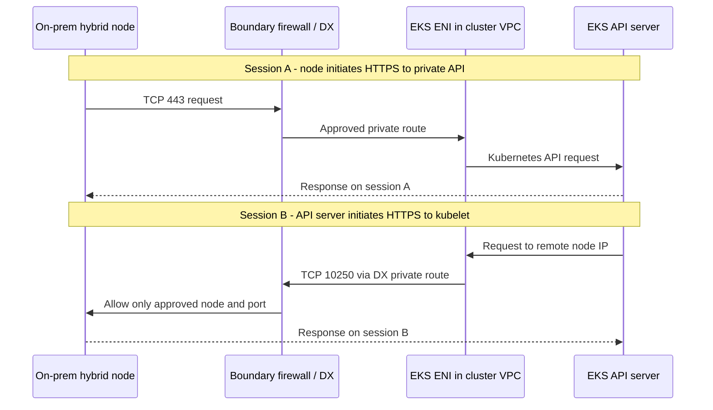

# 与安全团队审核 Hybrid Nodes 网络隔离

> **最后更新**：2026 年 9 月 16 日

AWS 控制平面通过 Direct Connect（DX）连接到本地基础设施，本身并不能证明违反了网络隔离要求。同样，“**我们使用私有端点，因此符合要求”也不是有效结论**。审核需要弄清哪些管理连接跨越信任边界、如何控制这些连接，以及它们可能承载哪些数据。

本文用于技术审核：**采用常规路由方式部署 Hybrid Nodes、Kubernetes API 端点仅限私有访问，并通过 DX 使用私有路由**。本文不构成对任何客户行业、系统分类或内部政策的合规判定或批准。下文的“可能可接受”是指组织政策允许网络之间存在受控的管理通信。撰写本文时没有检查任何客户账户、DX 连接、防火墙或集群。

如果不熟悉 AWS 或 Kubernetes 缩写，请查阅[术语表](#glossary)。

## 提供给安全团队的说明

> EKS Hybrid Nodes 将本地节点连接到 AWS 托管的 Kubernetes 控制平面。本次审核的设计禁用了 Kubernetes API 的公共访问，并使用经批准的私有路由和边界防火墙。由控制平面发起的连接会经过集群 VPC 中的 EKS ENI，并限制到获准节点的 kubelet TCP 10250 端口；如果使用 webhook，也只允许访问获批的目标和端口。API 和 kubelet 的身份验证与授权、受限的运维人员权限以及审计记录共同实施。
>
> 因此，安全论证的依据是**限制并验证哪些身份可以对哪些资源执行哪些操作**，而不是假设 AWS 或某个端点值得信任。此架构包含网络之间的管理连接。若要求完全断开连接，或一概禁止由云端发起的连接，则与本文描述的设计不兼容。

只有在配置和测试证据支持时，才可在提交材料中使用“已限制”和“已实施”等表述。在设计阶段应写成“计划实施，尚待验证”。AWS 的 [Hybrid Nodes 网络要求](https://docs.aws.amazon.com/eks/latest/userguide/hybrid-nodes-networking.html)明确列出了本地防火墙需要允许的入站 TCP 10250 以及所需的 webhook 端口。

## “端点”的三种不同含义

| 组件 | 用途 | 它不能证明什么 |
|---|---|---|
| **Kubernetes API 私有端点** | kubelet、Pod 和获批运维人员通过私有 HTTPS TCP 443 访问集群 API | 它不会消除控制平面发往本地基础设施的连接，也不会阻止通过获授权 API 操作传输数据 |
| **集群 VPC 中的 EKS 控制平面 ENI** | 在 API Server 与 VPC、远程节点和 Pod 网络之间提供网络连接，并受附加安全组和路由约束 | ENI 不是 DLP 设备、经过认证的跨域解决方案，也不是应用命令审批系统 |
| **AWS 服务的接口 VPC 端点 / PrivateLink** | 通过私有地址访问相应 AWS 服务 API，例如 `eks`、`ssm` 或 `rolesanywhere` | `com.amazonaws.<region>.eks` 不会转发 Kubernetes API，也不会转发控制平面到 kubelet 的连接 |

AWS 说明，Kubernetes API 私有端点不同于传统的 AWS API PrivateLink 端点；它不会出现在 VPC 控制台的端点列表中。`eks` 接口端点用于访问 **AWS EKS 管理 API**，包括 `DescribeCluster`。混淆这些端点，可能会错误地声称端点策略能控制 TCP 10250 连接。[集群端点](https://docs.aws.amazon.com/eks/latest/userguide/cluster-endpoint.html)、[EKS PrivateLink](https://docs.aws.amazon.com/eks/latest/userguide/vpc-interface-endpoints.html)

仅设置 `endpointPrivateAccess=true` 并不代表只允许私有访问。本文还假设 `endpointPublicAccess=false`。如果公共和私有访问同时启用，混合节点可能会将集群主机名解析为公共 IP。`publicAccessCidrs` 不会限制私有端点；私有路径由集群安全组、路由和防火墙控制。[端点访问模式](https://docs.aws.amazon.com/eks/latest/userguide/cluster-endpoint.html)

## 哪一端发起各连接？

图中显示了处于**两个独立 TCP 会话**中的请求。反向箭头并不意味着现有出站连接上的响应可以支持所有操作。边界防火墙是客户设计的控制措施；DX 不会自动提供它。

虚线响应沿获准路径反向传输。图中没有引入会改变 TLS 终止位置的代理。实际路由取决于 VPC 路由表、选用的 VGW 或 TGW/DX 网关配置，以及本地路由和防火墙。[AWS 数据包流参考](https://docs.aws.amazon.com/eks/latest/userguide/hybrid-nodes-concepts-traffic-flows.html)

| 发起方 → 目标 | 目标端口 | 用途和审核范围 |
|---|---|---|
| Hybrid kubelet → Kubernetes API 私有端点 | TCP 443 | 集群管理，包括节点状态和 Pod 规格 |
| API Server → Hybrid 节点 kubelet | TCP 10250 | 用于 `logs`、`exec`、`attach`、`cp` 和 `port-forward` 等操作的独立连接 |
| API Server → 本地 webhook / 聚合 API 后端 | 后端实际 TCP 端口 | 这些组件在本地运行时需要单独审批；请区分 Service 端口和实际目标端口 |
| Hybrid 节点 → 所选 SSM 或 IAM Roles Anywhere 端点 | TCP 443 | 节点临时凭证的签发和续期；还应检查任何 SSM 管理功能所需的权限与连接 |
| Pod → Kubernetes API / 所需 AWS 服务 | 通常为 TCP 443 | CNI 的 SNAT 会影响防火墙可见的源地址和返回路径 |
| DNS 客户端 → 获准的解析器 | UDP/TCP 53 | 单独定义 DNS 路径，并考虑 CoreDNS 部署位置和 DNS 转发 |
| 应用、CNI 和监控组件 | 依功能而定 | 维护单独的流量清单，不要将这些流量统称为管理流量后一次性审批 |

此表不是适用于所有 CNI 和应用的完整防火墙策略。详情请参阅[网络配置](02-network-configuration.md)和 [AWS 持续运行要求](https://docs.aws.amazon.com/eks/latest/userguide/hybrid-nodes-networking.html)。Webhook 端口 `8443` 只是示例，并不是要求放行 `8443` 及以上所有端口。

**允许节点发起的 TCP 443 连接返回有状态流量，不会放行新的入站 TCP 10250 连接**。将此架构描述成仅出站的代理隧道，会造成运维和安全错误。安全组是有状态的；网络 ACL 是无状态的，需要单独考虑返回流量。如果流量经过 NAT 或检查设备，请核实各边界可见的地址以及对称返回路径。[Hybrid 流量](https://docs.aws.amazon.com/eks/latest/userguide/hybrid-nodes-concepts-traffic-flows.html)、[安全组和网络 ACL](https://aws.amazon.com/vpc/faqs/)

## 将网络隔离政策转化为设计要求

首先取得客户实际的政策原文。此表评估的是**设计与技术要求是否兼容**，而不是解释法律或监管豁免。

| 客户要求 | 对此设计的评估 |
|---|---|
| 不暴露于互联网；允许网络之间存在获批的私有管理连接 | 可作为候选方案进行审核。需证明已禁用公共 API 访问、所需服务走私有路径，并落实最小权限、防火墙控制和记录 |
| 必须物理断开，禁止与外部控制平面进行实时通信 | 与 Hybrid Nodes 的连接要求冲突。可考虑将控制平面部署在许可的内部边界内 |
| 只允许对内部发起的会话作出响应；禁止所有新建的云端发起连接 | 与常规路由部署 Hybrid Nodes 所需的 kubelet 和 webhook 流量冲突 |
| 工作负载域除了网络隔离外还需要独立的管理权限 | 不要仅凭 VLAN 或命名空间作出结论。应审核共享集群管理员和控制平面；必要时使用独立集群 |
| Kubernetes 对象、Secrets 和运维日志也必须完全留存在本地 | 识别哪些数据与托管在 AWS 的控制平面冲突。仅把节点放在本地无法满足此要求 |
| 连接必须经过指定的跨域设备和审批流程 | 不要假设 DX 或 PrivateLink 能替代该设备或流程。确认要求是否适用，以及设计是否兼容其功能 |

[受限互联网访问设置](03-airgap-setup.md)区分了限制互联网访问与完全断开 AWS。Hybrid Nodes 要求可靠的双向连接。[Hybrid Nodes 概览](https://docs.aws.amazon.com/eks/latest/userguide/hybrid-nodes-overview.html)

## 在正确的边界应用每种控制

### 路由和网络访问

远程节点和 Pod CIDR 可告知 EKS 目标网络的位置。注册这些 CIDR 并不会自动配置本地路由、防火墙或隔离策略。还应检查 EKS 创建的集群 SG 入站规则，包括缩减 CIDR 后的过期规则。AWS 明确说明，移除远程网络不会自动清除对应的安全组规则。[网络和 SG 配置](https://docs.aws.amazon.com/eks/latest/userguide/hybrid-nodes-networking.html)

将规则表述为**已验证的 EKS ENI 源地址范围 → 指定的 Hybrid 节点地址 → TCP 10250**。ENI IP 可能变化，因此不要永久固定今天的 `/32` 列表。在可行时，使用专用控制平面子网可以缩小地址归属范围；还要为 ENI 更换和集群更新维护允许列表更新及重新验证流程。如果允许整个共享子网，该源范围内的其他资源也可能获得访问：请记录这一剩余风险。[EKS ENI 生命周期与网络规划](https://docs.aws.amazon.com/eks/latest/userguide/hybrid-nodes-networking.html)

应一起审核集群 SG 出站规则、VPC/TGW 路由、本地边界防火墙和主机防火墙。SG ID 不会作为身份信息传递给本地防火墙。路由也不代表某个 API 操作已获授权。限制通往无关业务网络前缀的路由传播和访问，并验证对获准范围以外目标的拒绝行为。这些是设计建议，并非对客户环境已实施控制的声明。

### 加密、身份和授权

**DX 默认不会加密传输中的流量**。应保持 Kubernetes API 和 kubelet HTTPS 连接的 TLS 和身份验证检查。如果要求链路加密，请审核 DX 上受支持的 IPsec 或 MACsec 选项及其覆盖范围。MACsec 保护符合条件的 DX 链路；其范围不同于应用端到端 TLS。仅使用 DX 不能证明每个应用流量或 Overlay 流量都已加密。[DX 加密](https://docs.aws.amazon.com/directconnect/latest/UserGuide/encryption-in-transit.html)

私有 IP 地址不能证明调用方具有什么权限。应分别审核运维人员 IAM 身份、EKS 访问条目/访问策略和 Kubernetes RBAC、节点身份，以及 kubelet 身份验证与授权。不要通过禁用 TLS 验证或启用匿名/AlwaysAllow kubelet 访问来解决连接问题。直接访问 kubelet 属于单独的授权路径，不能视为等同于经 API Server 中介的操作。[EKS 访问管理](https://docs.aws.amazon.com/eks/latest/userguide/access-entries.html)、[Kubelet 身份验证与授权](https://kubernetes.io/docs/reference/access-authn-authz/kubelet-authn-authz/)

AWS 服务端点策略会筛选通过该端点发起的对应服务 API 调用。它不会授予 IAM 权限，也不会替代 Kubernetes RBAC。如果使用 SSM，还应审核 Run Command 和 Session Manager 等管理功能的授权。节点通过 HTTPS 发起连接，并不排除外部管理命令的可能性。[端点访问控制](https://docs.aws.amazon.com/vpc/latest/privatelink/vpc-endpoints-access.html)、[SSM 访问控制](https://docs.aws.amazon.com/systems-manager/latest/userguide/security-iam.html)

### 数据和管理边界

Hybrid Nodes 不会自动将本地 Pod 处理的所有业务数据复制到 AWS。但是，AWS 控制平面会管理 Kubernetes API 对象。放入 Pod 规格、ConfigMap 或 Kubernetes Secret 的敏感内容也属于被管理的数据。`logs` 会传输应用输出；`exec`、`cp` 和 `port-forward` 则可能为获授权用户提供数据访问路径。不要声称管理流量绝不会包含业务数据。API 数据静态加密不会改变其存储位置，也不能阻止通过授权读取传输数据。[Hybrid 网络概念](https://docs.aws.amazon.com/eks/latest/userguide/hybrid-nodes-concepts-networking.html)、[EKS API 数据加密](https://docs.aws.amazon.com/eks/latest/userguide/envelope-encryption.html)

应一并审核 `pods/log`、`pods/exec`、`pods/attach`、`pods/portforward`、`nodes/proxy` 以及工作负载创建/修改权限。如果某主体可以创建新 Pod，或创建能以其他方式访问数据的特权/hostPath 工作负载，仅限制 `exec` 并不足够。Pod 安全与准入策略以及主机访问限制可补充 RBAC。仅有命名空间和 NetworkPolicy，无法相对于共享集群管理员建立独立安全边界。[Kubernetes RBAC 最佳实践](https://kubernetes.io/docs/concepts/security/rbac-good-practices/)

尤其不要把 `get nodes/proxy` 归类为只读操作。它可能授权通过 kubelet API 执行容器命令，而且这种访问可能绕过 Kubernetes 审计和准入路径。仅收集 API 审计日志，并不能证明涵盖了所有管理员操作。[Node proxy 权限风险](https://kubernetes.io/docs/concepts/security/rbac-good-practices/#access-to-proxy-subresource-of-nodes)

应分别分类业务数据、API 对象、流式日志、审计日志、镜像/制品和凭证。记录其存储位置、传输目的地、访问权限和保留期限。还应纳入应用出站流量和 SSM 管理路径，以明确“数据仅存储在本地”声明的实际范围。

## 提交安全审核的证据

这些是**证据要求**，不是已完成的检查结果。不要在公开文档中附上客户标识符、令牌、Secret 值或真实业务日志。

| 审核问题 | 证据 | 验收标准 |
|---|---|---|
| 是否确实只允许私有访问？ | 目标集群端点设置、本地 DNS 答案、DX 路由和边界流量记录 | 已禁用公共访问，并验证实际私有地址和路径；仅有 DNS 成功并不足够 |
| AWS 可以访问本地的哪些资源？ | ENI/子网归属、远程 CIDR、VPC/TGW 和本地路由，以及匹配的 SG/防火墙规则 | 只允许已批准的节点、后端和端口；证明已限制对其他业务域的访问 |
| 是否区分了允许和禁止的操作？ | 在隔离测试环境中，使用合成数据成功执行 `logs` 和获批管理操作；并验证未授权身份和目标被拒绝 | 分开测试连接能力和授权；网络故障不能代替授权拒绝测试 |
| 谁在何时执行了哪些 API 操作？ | EKS Kubernetes 审计/身份验证记录、AWS 管理 API 的 CloudTrail 记录，以及关联的时间戳 | 区分两层 API，并追踪测试身份、时间、操作、目标和结果 |
| 哪些内容跨越了边界？ | VPC Flow Logs、本地防火墙记录和单独的数据流清单 | 将 IP/端口/允许或拒绝证据与数据分类并列；不要声称 Flow Logs 能证明 TLS 负载或命令正文内容 |
| 边界在变更和故障时是否仍然有效？ | 对 ENI 更换、路由更改、DX/VPN 故障转移以及凭证续期/过期的重新验证和恢复计划 | 备用路径保留原策略；未经测试的故障转移不能标记为安全 |

启用所需的 EKS 控制平面日志类型；Kubernetes 审计和 CloudTrail 的作用不同。审计日志会根据审计策略和级别记录 API 事件，但不会记录每次 `exec` 的输入/输出或 `port-forward` 负载。收集时还要设计保留期限、访问控制和敏感数据处理方式。[控制平面日志](https://docs.aws.amazon.com/eks/latest/userguide/control-plane-logs.html)、[EKS 审计](https://docs.aws.amazon.com/eks/latest/best-practices/auditing-and-logging.html)、[EKS CloudTrail](https://docs.aws.amazon.com/eks/latest/userguide/logging-using-cloudtrail.html)、[Flow Logs 的限制](https://docs.aws.amazon.com/vpc/latest/userguide/flow-logs.html)

日志记录可能排除配置的捕获范围以外的流量，也可能延迟或缺失。EKS 日志投递是尽力而为；应检查收集设置和 `SKIPDATA` 等数据缺失信号。**仅凭缺少记录，无法证明连接或操作从未发生**。应将防火墙记录与明确的允许/拒绝测试关联起来。[Flow Logs 收集限制](https://docs.aws.amazon.com/vpc/latest/userguide/flow-logs-limitations.html)、[Flow Logs 缺失问题排查](https://docs.aws.amazon.com/vpc/latest/userguide/flow-logs-troubleshooting.html)

请在获准的非生产目标上使用合成数据进行验证。确认网络边界并不需要扫描整个业务网络、大范围开放生产防火墙，或通过 `logs`、`cp` 导出客户数据。

## 安全团队常问的问题

### “开放 10250 会让 AWS 中的所有资源都能访问内部服务器吗？”

限制正确的设计只允许经过验证的集群 ENI 源地址范围和经过身份验证的调用方，而不是整个 AWS 地址空间。仅有 IP 允许列表仍不能证明集群身份；共享子网暴露和管理员权限过宽也仍然是风险。应将网络限制与 TLS、身份验证和授权证据一并提交。

### “把 webhook 移到 AWS 是否能消除入站连接？”

这可以减少直接连到本地 webhook 的连接。但 kubelet TCP 10250 要求仍然存在，托管在云端的 webhook 也可能有其他依赖。请参阅 [AWS 的 webhook 指南](https://docs.aws.amazon.com/eks/latest/userguide/hybrid-nodes-webhooks.html)，了解将 webhook 放在云节点上的选项。

### “Hybrid Nodes Gateway 会让设计变成仅出站吗？”

[Hybrid Nodes Gateway](10-hybrid-nodes-gateway.md) 使用 Cilium VTEP/VXLAN 支持 Hybrid Pod 连通性。它既不是断开连接的集群产品，也不是单向安全网关。应分别审核网关和隧道的外层地址/端口以及 Pod 内层流量；不要未经修改就套用本文的直接路由表。[AWS Gateway 概览](https://aws.amazon.com/blogs/containers/simplify-hybrid-kubernetes-networking-with-amazon-eks-hybrid-nodes-gateway/)

### “我们能否声明这不违反网络隔离要求？”

不能仅凭连接方式得出结论。如果适用政策允许受控管理连接，且证据和组织审批涵盖了连接、权限和数据边界，应在结论中记录**审核范围和条件**。不要仅仅因为使用 DX 或私有端点，就把禁止的连接重新描述成允许的连接。

## 术语表 {#glossary}

| 缩写 | 本文中的全称及含义 |
|---|---|
| VPC / ENI | Virtual Private Cloud / Elastic Network Interface：AWS 逻辑网络边界，以及附加在其中的虚拟网络接口 |
| SG / NACL | Security Group / Network Access Control List：分别指附加到接口的有状态允许规则，以及子网边界上的无状态允许/拒绝规则 |
| DLP | Data Loss Prevention：用于检测或阻止敏感数据不当传输的控制措施；不是 ENI 功能 |
| CNI / SNAT | Container Network Interface / Source Network Address Translation：Pod 网络接口规范及其实现，以及数据包源地址转换 |
| VGW / TGW | Virtual Private Gateway / Transit Gateway：所选 AWS 私有连接设计中使用的网关 |
| VXLAN / VTEP | Virtual Extensible LAN / VXLAN Tunnel Endpoint：网络封装机制及其隧道端点，并非单向控制措施 |
| IAM / RBAC | Identity and Access Management / Role-Based Access Control：AWS 身份与权限管理，以及 Kubernetes 基于角色的授权 |
| TLS / IPsec / MACsec | Transport Layer Security / Internet Protocol Security / Media Access Control Security：协议层和路径覆盖范围不同的安全技术 |
| SSM | AWS Systems Manager 的服务标识符；本文区分节点凭证访问与可选系统管理功能 |

## 延伸阅读

- [网络配置和端点详情](02-network-configuration.md)
- [限制互联网访问与完全断开连接](03-airgap-setup.md)
- [运维和维护](08-operations.md)
- [网络隔离安全审核测验](../quizzes/eks-hybrid-nodes/11-network-separation-security-quiz.md)

< [Hybrid Nodes 目录](README.md) | [上一节：Hybrid Nodes Gateway](10-hybrid-nodes-gateway.md) >
