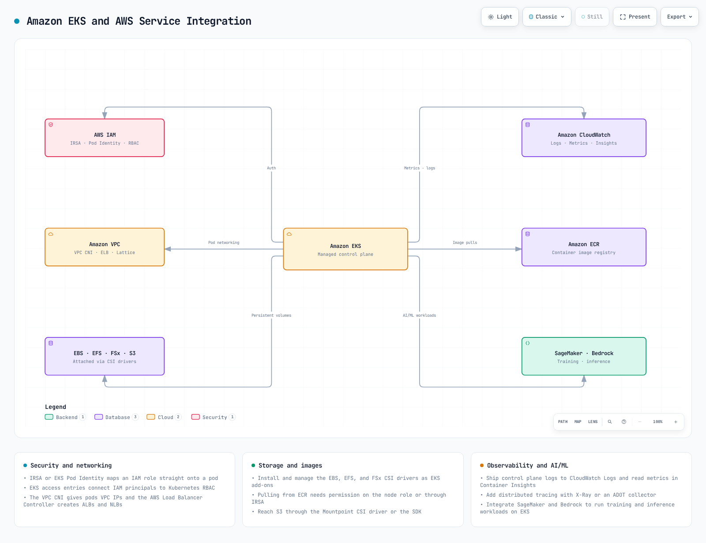

# EKS 简介

> **受支持版本**: Amazon EKS 标准支持 1.34–1.37；扩展支持 1.31–1.33（检查日期：2026 年 10 月 12 日）
> **最后更新**: 2026 年 10 月 12 日

Amazon Elastic Kubernetes Service (EKS) 是一项用于在 AWS 上运行 Kubernetes 的托管服务。本章将介绍 EKS 的基本概念、架构，以及它与标准 Kubernetes 的差异。

## EKS 与 Kubernetes

EKS 是一项提供标准 Kubernetes API 的托管服务。有关 Kubernetes 基本概念和操作的详细信息，请参阅 [Kubernetes 简介](../basics/04-kubernetes-introduction.md) 文档。

### EKS 的主要优势

1. **托管 Control Plane（控制平面）**: AWS 管理 Kubernetes Control Plane 的可用性和可扩展性
2. **增强的安全性**: 通过与 AWS IAM 集成实现身份验证和授权
3. **AWS 服务集成**: 与其他 AWS 服务（ELB、ECR、IAM 等）无缝集成
4. **多种计算选项**: 基于 EC2 的 Node、EKS Auto Mode、Fargate 和 Hybrid Node。Bottlerocket 是一种 Node 操作系统，而非独立的计算服务
5. **自动扩缩容**: 通过 Cluster Autoscaler、Karpenter 等支持自动扩缩容
6. **托管 Node Group**: 自动化的 Node 生命周期管理

## EKS 架构和组件

Amazon EKS 的整体架构如下：

### Control Plane（控制平面）

EKS 提供高可用的 Control Plane。Control Plane 跨多个可用区运行，并由以下组件构成：

* **API Server**: 提供 Kubernetes API 并处理与集群的交互。
* **etcd**: 存储集群状态的分布式键值存储。
* **Controller Manager**: 运行用于管理集群状态的 Controller。
* **Scheduler**: 将 Pod 分配给 Node。

在 EKS 中，这些 Control Plane 组件由 AWS 管理，因此用户无需直接管理它们。

### Data Plane（数据平面）

EKS Data Plane 可通过以下选项配置：

1. **托管 Node Group**: 由 AWS 管理其配置和替换工作流的 EC2 Node Group。运维人员选择并启动 Node 版本/AMI 更新；Control Plane 升级不会自动更新这些 Node。
2. **自管 Node**: 由用户直接管理的 EC2 实例。
3. **AWS Fargate**: 通过 Fargate Profile 选择的按 Pod 计的计算资源。运维人员仍需管理工作负载配置和资源请求。
4. **EKS Auto Mode**: AWS 管理 EC2 Node 的配置、扩缩容和更新，以及受支持的网络、负载均衡和块存储功能。
5. **Hybrid Node**: 客户自管的本地/边缘机器连接到由 AWS 托管的 EKS Control Plane；需要可靠的连接。

### 网络

在传统的基于 EC2 的 EKS Node 上，Amazon VPC CNI 是默认选项，并向普通 Pod 分配 VPC 地址。`hostNetwork` Pod 共享 Node 网络。Auto Mode 管理其自身的网络功能，而 Hybrid Node 使用兼容的本地 CNI，而不是 Amazon VPC CNI。

## 标准 Kubernetes 与 EKS 的差异

### 管理职责

* **自管 Kubernetes**: 运维人员管理 Control Plane 和 Data Plane；其他托管发行版的职责划分可能不同。
* **EKS**: AWS 管理 Control Plane。Data Plane 的职责取决于计算选项。工作负载的安全性、身份、配置、可用性和数据保护仍由客户负责。

### 网络

* **标准 Kubernetes**: 可以从多种 CNI Plugin 中选择。
* **EKS**: 传统的基于 EC2 的集群默认使用 Amazon VPC CNI。替代 CNI 以及 Auto Mode/Hybrid Node 具有不同的功能和支持限制。

### 负载均衡

* **标准 Kubernetes**: 必须安装单独的 Controller 才能使用 `LoadBalancer` 类型的 Service。
* **EKS**: 在传统集群上，为 NLB Service 和 ALB Ingress 安装并授权 AWS Load Balancer Controller；旧版 Controller 可以创建 Classic Load Balancer。Auto Mode 通过其自身的类和受支持的配置提供托管 NLB/ALB 集成。仅凭 Service 类型无法确定 Controller。Fargate 支持 ALB/NLB IP Target。

### 存储

* **标准 Kubernetes**: 必须手动安装和配置各种存储 Driver。
* **EKS**: 在传统集群上，安装 EBS CSI Driver/Add-on 并授予其 IAM 权限。Auto Mode 通过 Provisioner `ebs.csi.eks.amazonaws.com` 提供托管 EBS 支持，这与 `ebs.csi.aws.com` 不同。EFS 和 FSx 集成具有各自的前提条件；Fargate 或 Hybrid Node 无法挂载 EBS Volume。

## EKS 成本结构

运行 EKS 集群时产生的成本如下：

1. **EKS Control Plane 成本**: 每个集群按小时收费，标准/扩展支持的定价不同，并且可选的已预置 Control Plane 层级还会产生额外费用。
2. **计算成本**:
   * EC2 实例（托管或自管 Node）
   * Fargate（根据 Pod 运行时间和资源使用量收费）
3. **存储成本**: EBS、EFS、FSx 等存储服务的成本
4. **网络成本**: 数据传输、NAT Gateway、公共 IPv4 地址和 Load Balancer 使用成本
5. **托管功能成本**: Auto Mode、EKS Capabilities 和 Hybrid Node 除相关集群/基础设施成本外，还各自收取费用。

### 成本优化策略

1. **使用 Spot Instance**: 比较当前 Spot 价格和中断容忍度；宣传的节省金额并非工作负载级别的保证。
2. **评估 Fargate**: 将已预置的 Pod 大小、运行时间、功能限制和运维工作量与 EC2 进行比较。仅应用程序利用率低并不能保证节省成本。
3. **配置自动扩缩容**: 根据需要自动增加或减少 Node。
4. **本地性路由 (Locality Routing)**: 在受支持的情况下，在保持足够容量和故障转移能力的同时，优先使用同一可用区的流量。路由和 Load Balancer 设置决定是否能节省传输费用。
5. **EKS Auto Mode**: 将自动扩缩容和整合带来的节省与 Auto Mode 管理费用一并评估。
6. **Hybrid Node**: 将现有本地容量与按 vCPU 计的 Hybrid Node 费用以及连接/运维成本一并评估。此功能并不等同于混用 EC2 实例类型。

## 与 AWS 服务的集成

EKS 与以下 AWS 服务集成：

[🔍 查看交互式图表](https://www.atomai.click/kubernetes-docs/archmaps/en-eks-01-eks-introduction-0.html)

1. **IAM**: IAM Identity 对集群进行身份验证；EKS Access Entry 通过 Access Policy 和/或 Kubernetes RBAC Group 进行授权。Pod Identity 和 IRSA 分别向工作负载授予 AWS 权限。
2. **VPC**: 提供网络基础设施。
3. **CloudWatch**: 提供监控和日志记录。
4. **ALB/NLB**: 提供负载均衡。
5. **ECR**: 提供容器镜像 Registry。
6. **EBS/EFS/FSx**: 提供持久化存储。
7. **AWS App Mesh**: AWS 已于 2026 年 9 月 30 日终止支持，App Mesh Console 和资源已无法访问。现有集成必须迁移；请勿为新的部署选择它。
8. **AWS Certificate Manager**: 管理 SSL/TLS Certificate。
9. **AWS Secrets Manager**: 安全地存储和管理敏感信息。
10. **AWS SageMaker**: 运行机器学习工作负载。
11. **AWS Bedrock**: 利用生成式 AI Model。

## EKS 最佳实践

1. **集群设计**:
   * 跨多个可用区部署 Node
   * 选择适当的实例类型
   * 制定 Node Group 策略
2. **安全性**:
   * 应用最小权限原则
   * 实施网络策略
   * 使用 Pod Security Admission 和/或 Admission Policy 应用 Pod Security Standard；PodSecurityPolicy API 已在 Kubernetes 1.25 中移除
   * 镜像扫描和漏洞管理
3. **网络**:
   * 合理的子网设计
   * Security Group 配置
   * 利用 Locality Routing
4. **监控和日志记录**:
   * 启用 CloudWatch Container Insights
   * 配置 Control Plane 日志记录
   * 利用 Prometheus 和 Grafana
5. **升级策略**:
   * 规划定期升级
   * 考虑蓝绿部署策略
   * 在升级前进行测试

## 官方参考资料

- [EKS 版本生命周期](https://docs.aws.amazon.com/eks/latest/userguide/kubernetes-versions.html)
- [计算与共同责任](https://docs.aws.amazon.com/eks/latest/userguide/what-is-eks.html)
- [AWS Load Balancer Controller](https://docs.aws.amazon.com/eks/latest/userguide/aws-load-balancer-controller.html)
- [EBS CSI 与 Auto Mode](https://docs.aws.amazon.com/eks/latest/userguide/ebs-csi.html)
- [Hybrid Node](https://docs.aws.amazon.com/eks/latest/userguide/hybrid-nodes-overview.html)
- [Fargate 注意事项](https://docs.aws.amazon.com/eks/latest/userguide/fargate.html)
- [App Mesh 支持公告](https://docs.aws.amazon.com/app-mesh/latest/userguide/what-is-app-mesh.html)
- [EKS 定价](https://aws.amazon.com/eks/pricing/)
- [Pod Security Admission](https://kubernetes.io/docs/concepts/security/pod-security-admission/)

## 测验

如需测试您在本章学到的内容，请尝试 [Amazon EKS 简介测验](../quizzes/eks/01-eks-introduction-quiz.md)。