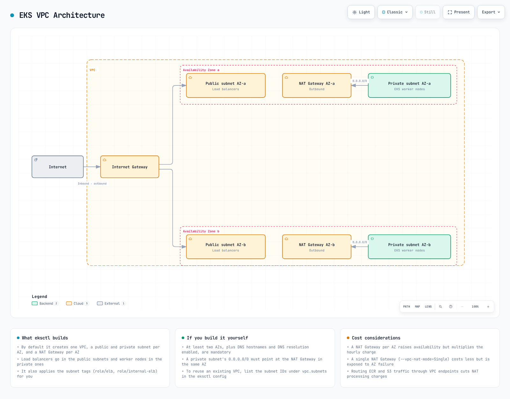

# 第 1 部分：先决条件

> **最后更新**：2026 年 10 月 16 日

创建 Amazon EKS 集群有多种方式。本章将介绍如何使用各种工具和方法创建 EKS 集群。

**当前版本：** EKS 1.37 于 2026 年 10 月 1 日正式发布。

**示例基线：** 集群创建章节采用经过审查的 EKS 1.36 基线。选择其他受支持的版本前，请检查其与相关工具、节点映像和附加组件的兼容性。

## 目录

1. [先决条件](#prerequisites)
2. [eksctl](02-eks-cluster-creation-part2.md)
3. [AWS 管理控制台和 CLI](02-eks-cluster-creation-part3.md)
4. [Terraform](02-eks-cluster-creation-part4.md)
5. [访问、验证、升级和删除](02-eks-cluster-creation-part5.md)
6. [完整指南和 CDK](02-eks-cluster-creation.md)

## 先决条件 {#prerequisites}

创建 EKS 集群前，需要满足以下先决条件：

### 1. AWS 账户

需要有效的 AWS 账户。如果你还没有 AWS 账户，可以在 [AWS 网站](https://aws.amazon.com/)注册。

### 2. IAM 权限

所需权限取决于使用的工具及其管理的资源。遵循最小权限原则并不要求对所有资源授予 `eks:*`、`ec2:*`、`iam:*` 和 `cloudformation:*` 这些宽泛权限。

| 任务 | 需要审查的权限范围 |
| --- | --- |
| EKS 集群/节点组管理 | 所需的 EKS 操作及目标资源 |
| 传递现有 IAM 角色 | 针对获准角色 ARN 和服务条件的 `iam:PassRole` |
| 创建 IAM 角色/策略/OIDC 提供商 | 工具管理的 IAM 资源以及名称/标签范围 |
| 创建网络 | 针对新 VPC、子网和安全组的 EC2 操作 |
| 使用 eksctl/CDK | 相关 CloudFormation 堆栈、执行角色和引导资源 |

执行资源创建的身份、集群服务角色和节点角色彼此独立。SCP、权限边界和会话策略仍然适用。请根据合成后的模板/计划审查组织用于资源创建的权限。Auto Mode 的角色要求与传统节点组有所不同。

参考资料：[EKS IAM 操作和资源](https://docs.aws.amazon.com/service-authorization/latest/reference/list_amazonelastickubernetesservice.html)、[Auto Mode 角色](https://docs.aws.amazon.com/eks/latest/userguide/auto-cluster-iam-role.html)。

### 3. 安装工具

#### AWS CLI

根据你的操作系统/CPU 选择相应的软件包，并按照[官方 AWS CLI v2 安装指南](https://docs.aws.amazon.com/cli/latest/userguide/getting-started-install.html)验证签名。如果已安装 v1/v2，请先查看其更新/迁移流程。

| 环境 | 官方软件包/安装方式 |
| --- | --- |
| macOS | 签名的 `AWSCLIV2.pkg` |
| Linux x86_64 | `awscli-exe-linux-x86_64.zip`，并验证 PGP 签名 |
| Linux ARM64 | `awscli-exe-linux-aarch64.zip`，并验证 PGP 签名 |
| Windows | 适用于受支持 Windows 版本的 MSI 安装程序 |

不要在 ARM 上原样使用 Linux x86_64 软件包。使用 `aws --version` 检查当前启用的 CLI。如果组织使用 IAM Identity Center，请按以下方式配置获准的配置文件。否则，请遵循其联合身份验证流程，不要假定使用长期访问密钥。

```bash
aws configure sso --profile eks-docs
aws sso login --profile eks-docs
aws sts get-caller-identity --profile eks-docs
export AWS_PROFILE=eks-docs
```

请参阅 [IAM Identity Center 身份验证](https://docs.aws.amazon.com/cli/latest/userguide/cli-configure-sso.html)。后续命令请继续使用获准的账户、角色和区域。

#### kubectl 和 eksctl（Linux/macOS）

本章的 EKS 1.36 示例以 kubectl **1.36.5** 和 eksctl **0.231.0** 为基线。建议 kubectl 与服务器使用相同的次版本；受支持的版本偏差为 ±1 个次版本。对于较旧的 EKS 集群，不要盲目安装上游 `stable.txt` 中的最新次版本。

此 Bash 示例会选择 AMD64/ARM64，并在安装前验证官方校验和。需要 `curl`、`tar`、`awk`，以及 `sha256sum` 或 `shasum`；在 `/usr/local/bin` 中安装需要管理员权限。下载或校验和验证失败时会停止安装。

```bash
(
  set -e
  case "$(uname -s)" in
    Linux) EKS_TOOL_OS=linux; EKS_ARCHIVE_OS=Linux ;;
    Darwin) EKS_TOOL_OS=darwin; EKS_ARCHIVE_OS=Darwin ;;
    *) printf 'Use the official installer for this operating system\n' >&2; exit 1 ;;
  esac
  case "$(uname -m)" in
    x86_64) EKS_TOOL_ARCH=amd64 ;;
    aarch64|arm64) EKS_TOOL_ARCH=arm64 ;;
    *) printf 'Select a supported CPU architecture\n' >&2; exit 1 ;;
  esac
  EKS_TOOL_ARCHIVE="eksctl_${EKS_ARCHIVE_OS}_${EKS_TOOL_ARCH}.tar.gz"
  EKS_TOOL_DIR=$(mktemp -d)
  : "${EKS_TOOL_DIR:?}"
  trap 'rm -f -- "$EKS_TOOL_DIR/kubectl" "$EKS_TOOL_DIR/kubectl.sha256" "$EKS_TOOL_DIR/eksctl" "$EKS_TOOL_DIR/eksctl_checksums.txt" "$EKS_TOOL_DIR/$EKS_TOOL_ARCHIVE" "$EKS_TOOL_DIR/selected.sha256"; rmdir -- "$EKS_TOOL_DIR"' EXIT
  cd "$EKS_TOOL_DIR" || exit 1
  verify_sha() {
    if command -v sha256sum >/dev/null 2>&1; then
      sha256sum --check "$1"
    else
      shasum -a 256 --check "$1"
    fi
  }
  EKS_KUBECTL_VERSION=v1.36.5
  curl -fL "https://dl.k8s.io/release/$EKS_KUBECTL_VERSION/bin/$EKS_TOOL_OS/$EKS_TOOL_ARCH/kubectl" -o kubectl || exit 1
  curl -fL "https://dl.k8s.io/release/$EKS_KUBECTL_VERSION/bin/$EKS_TOOL_OS/$EKS_TOOL_ARCH/kubectl.sha256" -o kubectl.sha256 || exit 1
  printf '%s  kubectl\n' "$(tr -d '[:space:]' < kubectl.sha256)" > selected.sha256
  verify_sha selected.sha256 || exit 1

  EKSCTL_VERSION=0.231.0
  curl -fL "https://github.com/eksctl-io/eksctl/releases/download/v$EKSCTL_VERSION/$EKS_TOOL_ARCHIVE" -o "$EKS_TOOL_ARCHIVE" || exit 1
  curl -fL "https://github.com/eksctl-io/eksctl/releases/download/v$EKSCTL_VERSION/eksctl_checksums.txt" -o eksctl_checksums.txt || exit 1
  awk -v name="$EKS_TOOL_ARCHIVE" '$2 == name {print; count++} END {if (count != 1) exit 1}' \
    eksctl_checksums.txt > selected.sha256 || exit 1
  verify_sha selected.sha256 || exit 1
  tar -xzf "$EKS_TOOL_ARCHIVE" eksctl || exit 1
  sudo install -m 0755 kubectl /usr/local/bin/kubectl || exit 1
  sudo install -m 0755 eksctl /usr/local/bin/eksctl || exit 1
  kubectl version --client
  eksctl version
)
```

官方流程：[Linux kubectl](https://kubernetes.io/docs/tasks/tools/install-kubectl-linux/)、[macOS kubectl](https://kubernetes.io/docs/tasks/tools/install-kubectl-macos/)、[eksctl 安装](https://eksctl.io/installation/)。

#### Windows

请在 PowerShell 中遵循[官方 kubectl 安装流程](https://kubernetes.io/docs/tasks/tools/install-kubectl-windows/)。对于本章的 AMD64 示例，请使用 [kubectl 1.36.5](https://dl.k8s.io/release/v1.36.5/bin/windows/amd64/kubectl.exe) 以及同一路径下的 `.sha256` 文件。从 [eksctl 0.231.0 版本发布页](https://github.com/eksctl-io/eksctl/releases/tag/v0.231.0)选择与 CPU 匹配的 Windows ZIP 文件和 `eksctl_checksums.txt`。

将 `Get-FileHash -Algorithm SHA256` 的结果与官方哈希值进行比较；如果不匹配，请停止操作。验证通过后，解压 ZIP 文件，将可执行文件所在目录添加到 PATH，并检查 `kubectl version --client` 和 `eksctl version`。不要在 Bash 中运行 PowerShell 语法。

此外，为 AWS CLI 示例中的 JSON 生成准备好 `jq`。本次审查期间未实际下载/安装客户端或登录。

### 4. VPC 和子网



[🔍 查看交互式图表](https://www.atomai.click/kubernetes-docs/archmaps/en-eks-02-eks-cluster-creation-part1-0.html)

此图展示的是一种基于 NAT 的网络布局，并不意味着每个集群都必须能够访问互联网。

区域性 EKS 集群需要在同一 VPC 的不同 AZ 中至少有两个子网。每个集群子网至少需要有 6 个可用 IP 地址；AWS 建议至少有 16 个。请为节点、Pod、负载均衡器和升级预留额外地址。启用 VPC DNS 主机名和 DNS 解析。

并非每个 EKS 集群都必须能够访问互联网。节点和工作负载需要通过 NAT/互联网路径，或必要的 VPC 端点和镜像副本，访问 Kubernetes API、映像和所需的 AWS 服务。通过适当的 DNS 和路由，可从 VPC 或互联网络访问私有 Kubernetes 端点。

#### EKS 集群的 VPC 标签

`kubernetes.io/cluster/<cluster-name>` VPC 标签是一种旧式机制，并非创建所有 EKS 集群的普遍现行要求。请按照所选控制器的子网发现规则配置负载均衡：

- 公有负载均衡器的子网：`kubernetes.io/role/elb=1`
- 内部负载均衡器的子网：`kubernetes.io/role/internal-elb=1`

标签不会配置路由、安全组或可用 IP 容量。请参阅 [VPC/子网要求](https://docs.aws.amazon.com/eks/latest/userguide/network-reqs.html)和[无互联网访问的集群](https://docs.aws.amazon.com/eks/latest/userguide/private-clusters.html)。

## 测验

要检验你对本章内容的掌握情况，请尝试 [EKS 集群创建 - 第 1 部分测验](../quizzes/eks/02-eks-cluster-creation-part1-quiz.md)。
